# Core Java Fundamentals - Deep Dive

## Table of Contents
1. [OOP Principles](#oop-principles)
2. [equals() and hashCode() Contract](#equals-and-hashcode-contract)
3. [String Internals](#string-internals)
4. [Generics Deep Dive](#generics-deep-dive)
5. [Autoboxing and Unboxing](#autoboxing-and-unboxing)
6. [final, finally, finalize](#final-finally-finalize)
7. [static Keyword](#static-keyword)
8. [Marker Interfaces vs Annotations](#marker-interfaces-vs-annotations)
9. [Cloning](#cloning)
10. [Serialization](#serialization)
11. [Interview Questions](#interview-questions)

---

## OOP Principles

### Abstraction vs Encapsulation

| Dimension | Abstraction | Encapsulation |
|-----------|-------------|---------------|
| **Core Question** | *What* does the object do? | *How* is internal state protected and accessed? |
| **Mechanism** | Interfaces, `abstract` classes, public contracts | `private` fields, helper methods, validated setters |
| **Interview Value** | Enforces separation of concerns & SOLID (DIP/ISP) | Preserves class invariants & prevents invalid state |

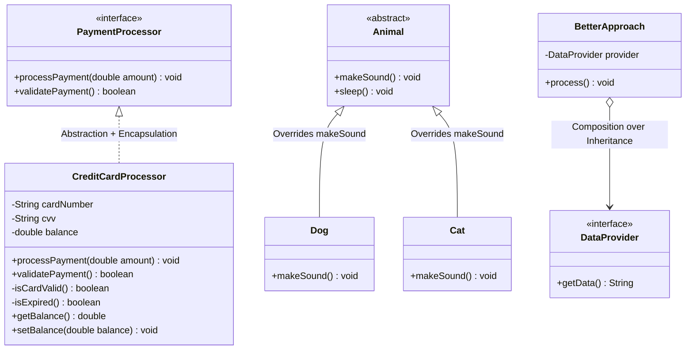

```java
// ABSTRACTION: Defines WHAT the processor does
public interface PaymentProcessor {
    void processPayment(double amount);
    boolean validatePayment();
}

// ENCAPSULATION: Protects HOW card data and balance are validated/mutated
public class CreditCardProcessor implements PaymentProcessor {
    private String cardNumber;
    private String cvv;
    private double balance;

    @Override
    public void processPayment(double amount) {
        if (validatePayment() && amount <= balance) {
            balance -= amount;
        }
    }

    @Override
    public boolean validatePayment() {
        return isCardValid() && !isExpired();
    }

    private boolean isCardValid() { return cardNumber != null && cardNumber.length() == 16; }
    private boolean isExpired() { return false; }

    public double getBalance() { return balance; }
    public void setBalance(double balance) {
        if (balance >= 0) this.balance = balance; // Invariant guard
    }
}

// Client codes against abstraction, decoupled from internal implementation
PaymentProcessor processor = new CreditCardProcessor();
processor.processPayment(100.0);
```

### Polymorphism: Compile-Time vs Runtime

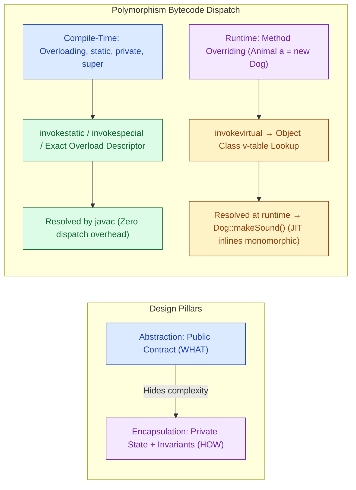

| Aspect | Compile-Time Polymorphism (Overloading) | Runtime Polymorphism (Overriding) |
|--------|-----------------------------------------|-----------------------------------|
| **Resolution** | Compile time by method signature (name + parameter types) | Runtime by actual heap object type via **v-table** (`invokevirtual`) |
| **Return Type** | Cannot overload differing *only* by return type | Supports **covariant return types** (returning a subtype) |
| **Exclusions** | Static/private methods bind statically (`invokestatic`/`invokespecial`) | `final`, `static`, and `private` methods are **not** polymorphic (excluded from v-table override) |
| **Performance** | Zero lookup overhead | v-table lookup overhead (JIT often devirtualizes/inlines monomorphic calls) |

```java
public class Calculator {
    public int add(int a, int b) { return a + b; }
    public double add(double a, double b) { return a + b; }
    public int add(int a, int b, int c) { return a + b + c; }
    public Number addNumbers(Number a, Number b) { return 0; } // Subclass may return Integer (covariant)
}

public abstract class Animal {
    public void makeSound() { System.out.println("Generic animal sound"); } // In v-table
    public final void sleep() { System.out.println("Sleeping"); }           // final: not overridable
}

public class Dog extends Animal {
    @Override public void makeSound() { System.out.println("Woof!"); }
}

public class Cat extends Animal {
    @Override public void makeSound() { System.out.println("Meow!"); }
}

Animal a1 = new Dog();
Animal a2 = new Cat();
a1.makeSound(); // Woof! — JVM checks actual object v-table: Dog::makeSound
a2.makeSound(); // Meow! — JVM checks actual object v-table: Cat::makeSound
```

### Inheritance Pitfalls & Remedies

- **1. Fragile Base Class Problem:** A base method (`process()`) calls an overridable method (`getData()`). Subclass overrides change base behavior unexpectedly. **Fix:** Prefer **composition over inheritance** (`BetterApproach` delegates to injected `DataProvider`).
- **2. Diamond Problem:** Java forbids multiple class inheritance to avoid method/state ambiguity. With interfaces using Java 8+ `default` methods, an implementing class must explicitly resolve conflicts (`C.super.method()`).
- **3. Constructor Chaining Complexity:** Every subclass constructor must invoke `super(...)` as its first statement; `Base` always initializes before `Child`.

```java
// Pitfall 1 Fix: Composition over Inheritance
public interface DataProvider { String getData(); }
public class BetterApproach {
    private final DataProvider provider;
    public BetterApproach(DataProvider provider) { this.provider = provider; }
    public void process() { String data = provider.getData(); }
}

// Pitfall 2 Fix: Explicit disambiguation for default interface methods
public interface A { default void method() { System.out.println("Default A"); } }
public interface B extends A {}
public interface C extends A { @Override default void method() { System.out.println("Default C"); } }
public class D implements B, C {
    @Override public void method() { C.super.method(); } // Must resolve ambiguity explicitly
}

// Pitfall 3: Constructor chaining order (Base executes first, then Child)
public class Base {
    private final String data;
    public Base(String data) { this.data = data; }
}
public class Child extends Base {
    private final int value;
    public Child(String data, int value) {
        super(data); // MUST be first statement
        this.value = value;
    }
}
```

> [!IMPORTANT]
> **30-Second Revision:** **Abstraction** exposes *what* a component does (interfaces); **Encapsulation** protects *how* it maintains invariants (`private` state + checks). Inheritance creates tight coupling and fragile base-class bugs—default to **composition** unless there is a strict, stable IS-A relationship.

---

## equals() and hashCode() Contract

### The Contract Rules

Overriding `equals()` creates two non-negotiable obligations:
1. **5 `equals()` Properties:**
   - **Reflexive:** `x.equals(x)` is `true`
   - **Symmetric:** `x.equals(y)` iff `y.equals(x)`
   - **Transitive:** `x.equals(y)` and `y.equals(z)` implies `x.equals(z)`
   - **Consistent:** Repeated calls return the same boolean while fields are unchanged
   - **Null-safe:** `x.equals(null)` always returns `false`
2. **Hash Consistency Rule:** If `a.equals(b)` is `true`, then `a.hashCode() == b.hashCode()` **must** be `true`. The converse is **false**—unequal objects may share a hash code (a hash collision).

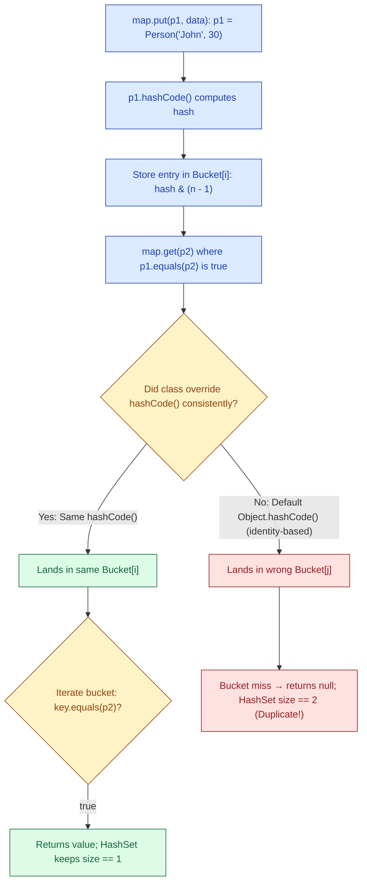

### Broken vs Correct Implementation

```java
// BROKEN: Overrides equals() without hashCode()
public class BrokenPerson {
    private String name;
    private int age;
    public BrokenPerson(String name, int age) { this.name = name; this.age = age; }

    @Override
    public boolean equals(Object obj) {
        if (this == obj) return true;
        if (obj == null || getClass() != obj.getClass()) return false;
        BrokenPerson other = (BrokenPerson) obj;
        return age == other.age && Objects.equals(name, other.name);
    }
    // Missing hashCode() -> uses Object.hashCode() (different per instance!)
}

// FAILURE IN COLLECTIONS:
BrokenPerson p1 = new BrokenPerson("John", 30);
BrokenPerson p2 = new BrokenPerson("John", 30); // p1.equals(p2) == true, hashCodes differ!

Map<BrokenPerson, String> map = new HashMap<>();
map.put(p1, "John's data");
map.get(p2); // null! HashMap computes hash % bucketSize -> looks in wrong bucket!

Set<BrokenPerson> set = new HashSet<>();
set.add(p1);
set.add(p2);
set.size(); // 2! Duplicate logical object inserted because buckets differ!
```

```java
// CORRECT: Same fields in both equals() and hashCode()
public class CorrectPerson {
    private final String name;
    private final int age;
    public CorrectPerson(String name, int age) { this.name = name; this.age = age; }

    @Override
    public boolean equals(Object obj) {
        if (this == obj) return true;
        if (obj == null || getClass() != obj.getClass()) return false;
        CorrectPerson other = (CorrectPerson) obj;
        return age == other.age && Objects.equals(name, other.name);
    }

    @Override
    public int hashCode() {
        return Objects.hash(name, age); // Java 7+, safe & concise
    }

    // Manual prime-31 alternative (odd prime 31 reduces collisions & optimizes to (i << 5) - i):
    public int hashCodeManual() {
        int result = 31 + (name == null ? 0 : name.hashCode());
        return 31 * result + age;
    }
}
// map.get(p2) -> "John's data" | set.size() -> 1
```

> [!WARNING]
> **Interview Gotcha:** Never use mutable fields in `equals()`/`hashCode()` for objects stored as `HashMap` keys or `HashSet` elements. Mutating a field after insertion changes its `hashCode()`, stranding the entry in the old bucket and making it unreachable via `get()` or `remove()`.

---

## String Internals

### String Pool, Heap & Compact Strings (Java 9+)

- **String Literals** (`"hello"`) are resolved in the **String Pool** (`StringTable`, sized via `-XX:StringTableSize`), which moved from **PermGen to the Heap in Java 7/8+**.
- **`new String("hello")`** always allocates a distinct `String` object on the Heap (outside the pool). Calling **`.intern()`** returns the pooled canonical reference (or inserts it into the pool if absent).
- **Compile-time vs Runtime Concatenation:** `"hello" + " " + "world"` folds into one pooled literal during compilation; `prefix + " world"` allocates a new `String` at runtime.
- **Java 9+ Compact Strings:** Replaced `char[]` (2 bytes/char) with `byte[] value` + `byte coder` (`LATIN1 = 0` for 1 byte/char, `UTF16 = 1` for 2 bytes/char), reducing String heap memory up to ~50% for ASCII/Latin-1 workloads.

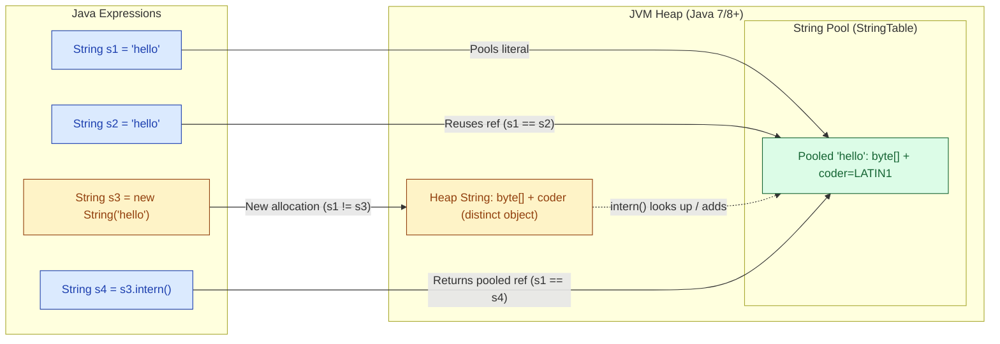

### Why `String` Is Immutable

1. **Thread Safety:** Multiple threads can share `String` instances without synchronization.
2. **Safe `HashMap` Keys:** Hash code never changes after insertion (and is lazily cached).
3. **Security:** Passwords, class names, and URLs passed across APIs cannot be mutated behind the caller's back.
4. **String Pool Deduplication:** Millions of identical literals safely share one canonical instance.

### `String` vs `StringBuilder` vs `StringBuffer`

| Type | Mutable? | Thread-Safe? | Best Use Case | Loop Trap |
|------|----------|--------------|---------------|-----------|
| **`String`** | No (`final`) | Yes | Constants, map keys, shared values | `+=` in loop creates `O(n^2)` copies |
| **`StringBuilder`** | Yes | No | Single-threaded string building (**100x–1000x faster** than `+`) | Creating `new StringBuilder()` *inside* a loop defeats pooling |
| **`StringBuffer`** | Yes | Yes (`synchronized`) | Legacy multi-threaded shared buffer | Unnecessary lock overhead in single threads |

```java
// Pool & intern behavior
String s1 = "hello";
String s2 = "hello";
String s3 = new String("hello");
String s4 = s3.intern();
// s1 == s2 (true) | s1 == s3 (false) | s1.equals(s3) (true) | s1 == s4 (true)

// Compile-time vs Runtime concatenation
String s5 = "hello" + " " + "world"; // Single pooled literal
String prefix = "hello";
String s6 = prefix + " world";        // New runtime String object

// Loop concatenation: declare StringBuilder OUTSIDE the loop
StringBuilder sb = new StringBuilder();
for (int i = 0; i < 10_000; i++) {
    sb.append("x"); // Mutates internal buffer; avoid `new StringBuilder()` inside loop!
}
String result = sb.toString();
```

> [!WARNING]
> **Memory Leak & OOM Risk with `intern()`:** Only `intern()` known, bounded strings (e.g., `"config_key"`). Calling `intern()` on untrusted or high-cardinality user input swells `StringTable` and risks `OutOfMemoryError` if references are retained (even though modern JVMs since Java 8u242+ can GC unreachable interned strings, unbounded `intern()` still causes severe `StringTable` overhead and OOM when tracked).

---

## Generics Deep Dive

### Type Erasure & Bridge Methods

Java generics are enforced at **compile time only** via **Type Erasure**:
- `javac` replaces unbounded `<T>` with `Object` and bounded `<T extends Number>` with `Number`.
- The compiler inserts explicit casts at read sites (e.g., `(String) list.get(0)`).
- **Bridge Methods:** When a subclass implements/overrides a parameterized supertype (e.g., `Comparable<MyNode>`), `javac` generates a synthetic bridge method (`compareTo(Object)`) that casts and delegates to `compareTo(MyNode)` so runtime polymorphism survives erasure.
- **Runtime Consequences:**
  - `new ArrayList<String>().getClass() == new ArrayList<Integer>().getClass()` is `true` (both are `ArrayList`).
  - Cannot overload methods differing only in type arguments (`foo(List<String>)` vs `foo(List<Integer>)` clash after erasure); overloading different raw types (`List<String>` vs `Set<String>`) is legal.
  - Primitives are disallowed (`List<int>` fails; must use `List<Integer>`).

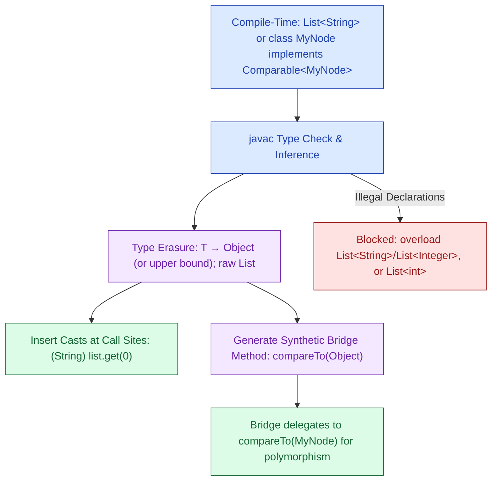

### Bounded Wildcards & PECS (`Producer Extends, Consumer Super`)

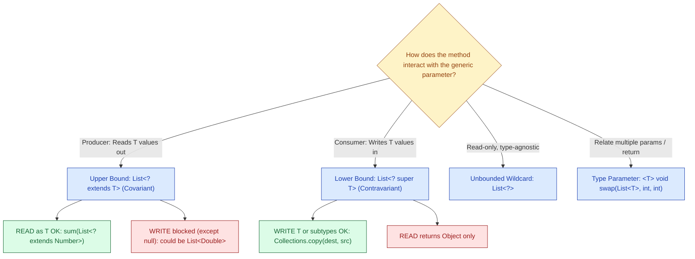

```java
// Producer Extends: reads Number subtypes safely; cannot add elements (except null)
public double sum(List<? extends Number> numbers) {
    double total = 0;
    for (Number n : numbers) total += n.doubleValue();
    return total;
}

// Consumer Super: writes Integer safely into List<Integer>, List<Number>, or List<Object>
public void fill(List<? super Integer> list, Integer value) {
    for (int i = 0; i < 10; i++) list.add(value);
    Object obj = list.get(0); // Only guaranteed readable type is Object
}

// Classic PECS in JDK: Collections.copy(dest, src)
public static <T> void copy(List<? super T> dest, List<? extends T> src) {
    for (T item : src) dest.add(item);
}

// Generic Methods: inference, multiple params, recursive bound, wildcard vs <T>
public <T> T getFirst(List<T> list) { return list.isEmpty() ? null : list.get(0); }
public <K, V> Map<K, V> createMap(K key, V value) { return Map.of(key, value); }

public <T extends Comparable<T>> T max(List<T> list) { // Recursive type bound
    if (list.isEmpty()) return null;
    T max = list.get(0);
    for (T t : list) if (t.compareTo(max) > 0) max = t;
    return max;
}

public <T> void swap(List<T> list, int i, int j) { // Needs <T> to relate two positions
    T tmp = list.get(i); list.set(i, list.get(j)); list.set(j, tmp);
}
public void printList(List<?> list) {               // <?> sufficient when no relation needed
    for (Object item : list) System.out.println(item);
}
```

> [!IMPORTANT]
> **30-Second Revision:** Type erasure wipes generic parameters at runtime (no `List<int>`, no overloading `List<String>` vs `List<Integer>`). Memorize **PECS**: if a parameter *produces* `T` for you to read, use `? extends T`; if it *consumes* `T` that you write, use `? super T` (just like `Collections.copy(dest, src)`).

---

## Autoboxing and Unboxing

- **Autoboxing:** `Integer wrapped = 5;` compiles to `Integer.valueOf(5)`.
- **Unboxing:** `int unwrapped = wrapped;` compiles to `wrapped.intValue()`.
- **Integer Cache:** `Integer.valueOf(int)` caches values from **`-128` to `127`** (upper bound configurable via `-XX:AutoBoxCacheMax=1000`). Values outside the range allocate a fresh `Integer` object; `new Integer(127)` always bypasses the cache.

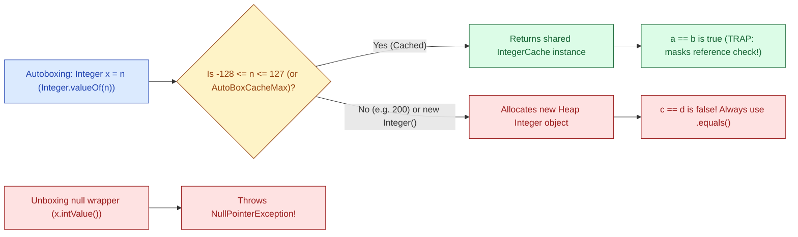

```java
// IntegerCache (-128 to 127) reference equality trap
Integer a = 127, b = 127;               // Cached -> a == b is true
Integer c = 128, d = 128;               // Uncached -> c == d is false
Integer e = new Integer(127);           // Explicit new -> a == e is false
boolean safe = c.equals(d);             // ALWAYS use .equals() for wrapper comparison!

// NullPointerException trap on unboxing null
List<Integer> list = new ArrayList<>();
list.add(null);
int val = list.get(0); // Compiles to list.get(0).intValue() -> NullPointerException!

// Performance cost: ArrayList<Integer> vs int[] (arrays are typically 10-20x faster)
List<Integer> boxed = new ArrayList<>();
for (int i = 0; i < 1_000_000; i++) boxed.add(i); // Allocates ~1M wrapper objects!

int[] primitive = new int[1_000_000];
for (int i = 0; i < 1_000_000; i++) primitive[i] = i; // Zero boxing overhead

// Double-wrapping anti-pattern
Integer x = 5;
Integer y = Integer.valueOf(x); // Unboxes x then re-boxes unnecessarily
```

> [!WARNING]
> **Interview Gotcha:** Always compare wrapper objects (`Integer`, `Long`) with `.equals()`, never `==`, because `==` passes unit tests on small numbers (`-128..127`) and silently fails in production above `127`. Watch for hidden `NullPointerException` whenever unboxing nullable database or collection wrappers.

---

## final, finally, finalize

| Keyword / Method | Category | Purpose & Scope | Execution / Enforcement |
|------------------|----------|-----------------|-------------------------|
| **`final`** | Modifier | Variable: immutable reference (`effective final` in Java 8+ lambdas); Method: cannot override; Class: cannot subclass (e.g., `String`) | Enforced at compile time |
| **`finally`** | Exception Block | Guaranteed cleanup after `try`/`catch` (prefer `try-with-resources` + `AutoCloseable` for streams) | Always executes (even on early `return` or uncaught exception), unless JVM exits/crashes or infinite loop |
| **`finalize()`** | `Object` Method (**Deprecated**) | Pre-GC cleanup hook; suffers unpredictable timing, GC delays, finalizer-thread bottlenecks, no shutdown guarantee, and **object resurrection** | Called unpredictably by GC before reclamation |

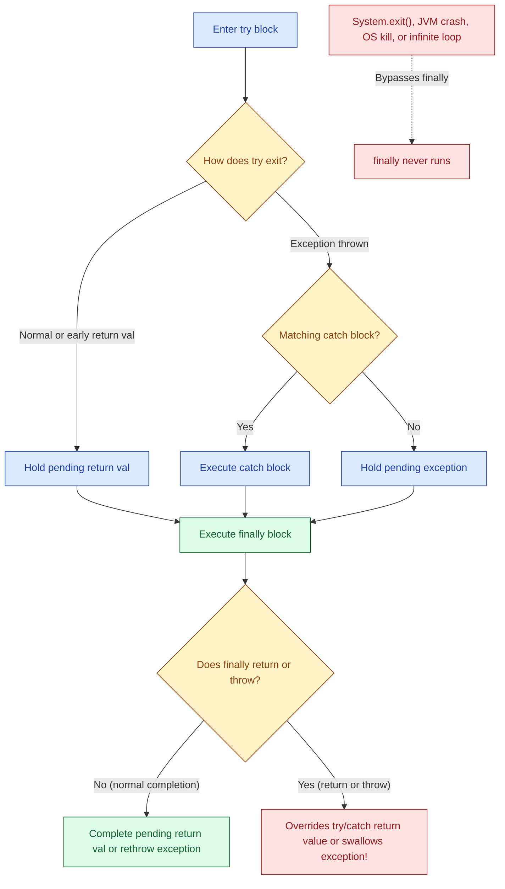

```java
// 1. final: variable, effectively final (Java 8+), method, class
final int value = 10;
int effectivelyFinal = 10; // Never reassigned -> usable inside anonymous class / lambda
new Runnable() { public void run() { System.out.println(effectivelyFinal); } };

// Why String is `public final class String`:
// - Immutability guarantee & String Pool safety
// - Security (cannot subclass to inject mutable behavior)
// - JVM optimization (monomorphic/devirtualized calls)

// 2. finally with early return vs try-with-resources
public String finallyWithReturn() {
    try {
        return "from try"; // Evaluated first, held while finally runs
    } finally {
        System.out.println("Finally runs BEFORE caller receives 'from try'");
    }
}

// Preferred cleanup: try-with-resources (compiler inserts closing + suppressed exceptions)
try (BufferedReader reader = new BufferedReader(new FileReader("file.txt"))) {
    String line = reader.readLine();
}

// 3. Deprecated finalize() & Object Resurrection danger -> replace with AutoCloseable
public class ResurrectionDanger {
    private static ResurrectionDanger instance;
    @Deprecated @Override
    protected void finalize() {
        instance = this; // Resurrects dying object back onto live graph!
    }
}

public class BetterResourceHolder implements AutoCloseable {
    private FileInputStream fis;
    @Override public void close() throws IOException {
        if (fis != null) fis.close();
    }
}
```

> [!CAUTION]
> **Critical Traps:** Never put a `return` or throw an unhandled exception inside a `finally` block—it overrides `try`/`catch` return values and silently swallows original exceptions. Never rely on `finalize()` for resource release; use `AutoCloseable` with `try-with-resources`.

---

## static Keyword

### Core Mechanics & Initialization Order

- **Static Variables:** Belong to the class, shared across all instances. Mutable static state (`public static List<String>`) creates global side effects and concurrency hazards; prefer `public static final` immutable collections (`Collections.unmodifiableList(...)`).
- **Static Methods:** Cannot access `this` or instance state directly. Best for stateless utilities (enforce non-instantiability with a `private` constructor throwing `AssertionError`).
- **Class Initialization Order:** `static` fields and `static` initializer blocks execute **once when the class loads** (in source order, Parent before Child). Instance fields, instance initializer blocks (`{}`), and constructors run **per `new` object** (Parent before Child).

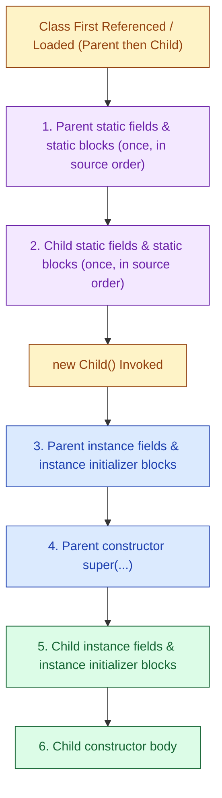

### Static Method Hiding & Inner Classes

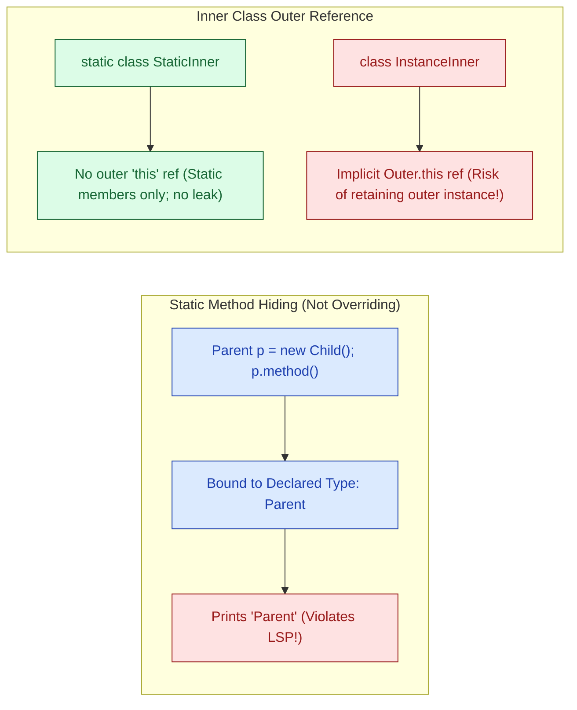

```java
// Immutable static constant & non-instantiable utility class
public final class MathUtil {
    public static final List<String> CONSTANT_LIST =
        Collections.unmodifiableList(Arrays.asList("a", "b"));

    private MathUtil() { throw new AssertionError("Can't instantiate"); }
    public static int add(int a, int b) { return a + b; }
}

// Static blocks vs instance initializer block vs constructor
public class StaticBlocks {
    private static int value;
    public static final String CONSTANT;
    private int instanceValue;

    static { value = 10; }                      // Runs 1st on class load
    static { value += 20; CONSTANT = "const"; } // Runs 2nd on class load (before main)
    { instanceValue = 100; }                    // Runs before constructor on every new()

    public StaticBlocks() { System.out.println("Constructor: " + instanceValue); }
}

// Gotcha 1: Interface fields are implicitly `public static final`
public interface Constants { String KEY = "value"; }

// Gotcha 2: Static method HIDING (resolved by reference type, not runtime type!)
class Parent { public static void method() { System.out.println("Parent"); } }
class Child extends Parent { public static void method() { System.out.println("Child"); } }
Parent p = new Child();
p.method();     // Prints "Parent"! (Use Child.method() instead)

// Gotcha 3: Static blocks only execute if/when the class is actually loaded
```

> [!WARNING]
> **Interview Gotcha:** `static` methods **hide**, never override—`Parent p = new Child(); p.method()` executes `Parent.method()` because dispatch uses the declared reference type (`invokestatic`). Also prefer `static` nested classes unless you explicitly need `Outer.this`, as non-static inner classes can keep large outer objects alive from GC.

---

## Marker Interfaces vs Annotations

| Feature | Marker Interface | Annotation |
|---------|------------------|------------|
| **Syntax** | Empty interface (`implements Serializable`) | `@interface` (`@TestClass(...)`) |
| **Inheritance** | Automatically inherited by all subclasses | Not inherited unless marked `@Inherited` |
| **Metadata** | None (binary present/absent tag only) | Rich parameters (`author()`, `priority()`) |
| **Type Checking** | Compile-time type membership + `instanceof` | Compile-time (APT) or Runtime Reflection |
| **Target Scope** | Classes/interfaces only | Types, methods, fields, parameters (`@Target`) |
| **Tooling** | Limited explicit runtime checks | Rich framework, APT, and doc tooling support |

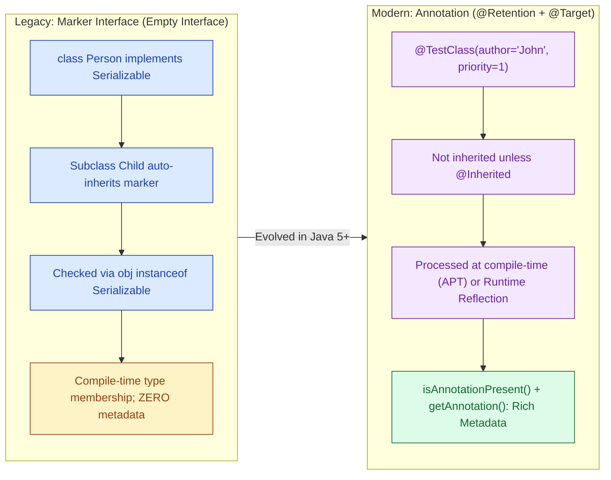

```java
// Marker Interface: subclass automatically inherits it (even when unwanted)
public interface Serializable {}
public class Person implements Serializable {}
public class Child extends Person {} // Automatically Serializable!
if (obj instanceof Serializable) { /* perform serialization */ }

// Annotation: targeted, configurable retention, carries metadata
@Retention(RetentionPolicy.RUNTIME)
@Target(ElementType.TYPE)
public @interface TestClass {
    String author() default "unknown";
    int priority() default 0;
}

@TestClass(author = "John", priority = 1)
public class TestExample {}

// Runtime reflection processing
Class<?> cls = TestExample.class;
if (cls.isAnnotationPresent(TestClass.class)) {
    TestClass meta = cls.getAnnotation(TestClass.class);
    System.out.println(meta.author() + " P" + meta.priority());
}
```

### When to Use Which
- **Use a Marker Interface** (`Drawable`, `Serializable`) when you want a **type hierarchy contract** verified at compile time via method signatures or `instanceof`.
- **Use an Annotation** (`@TestClass`, `@Entity`) when you need **metadata values**, element-level targeting (methods/fields/params), selective inheritance, or framework/APT processing.

> [!TIP]
> **30-Second Revision:** Modern Java strongly favors **annotations** over marker interfaces because annotations decouple metadata from inheritance hierarchies, support arbitrary parameters, and target methods/fields/parameters—not just classes.

---

## Cloning

### Shallow Copy vs Deep Copy

- **Shallow Copy (`super.clone()`):** Performs a bit-for-bit field copy. Primitives and immutable fields (`String`) are independent, but **mutable object references (`Address`) are shared** between original and clone.
- **Deep Copy:** Allocates fresh copies of all mutable nested objects so modifying the clone never mutates the original.

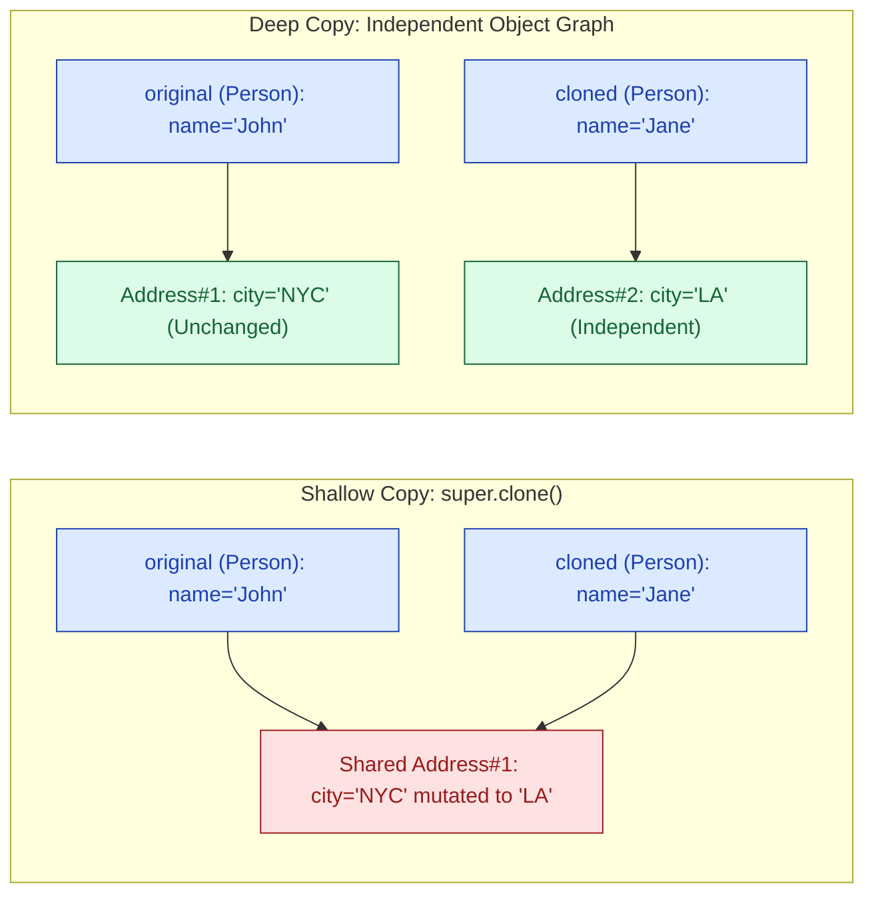

```java
public class Address { public String city, country; }

public class Person implements Cloneable {
    public String name;
    public Address address;

    // Shallow copy: cloned.address == original.address (true -> mutating one mutates both!)
    public Person shallowClone() throws CloneNotSupportedException {
        return (Person) super.clone();
    }

    // Deep copy: manually clone mutable fields
    @Override
    public Person clone() throws CloneNotSupportedException {
        Person cloned = (Person) super.clone();
        if (this.address != null) {
            cloned.address = new Address();
            cloned.address.city = this.address.city;
            cloned.address.country = this.address.country;
        }
        return cloned; // original.address == cloned.address is false
    }
}
```

### `Cloneable` Pitfalls & Better Alternatives

1. **Misleading Empty Interface:** Implementing `Cloneable` does *not* declare or expose a `public clone()` method (`Object.clone()` is `protected`).
2. **Checked Exception Boilerplate:** `super.clone()` throws checked `CloneNotSupportedException`.
3. **Collection Shallow Trap:** `ArrayList.clone()` clones the list array but keeps the *same* mutable element references.
4. **Bypasses Constructors & Invariants:** `super.clone()` creates an object without invoking constructors, skipping validation checks!

```java
// BETTER 1: Copy Constructor (enforces constructor validation!)
public class BetterPerson {
    private final String name;
    private final int age;

    public BetterPerson(String name, int age) {
        if (name == null || name.isEmpty()) throw new IllegalArgumentException("Invalid name");
        this.name = name;
        this.age = age;
    }

    public BetterPerson(BetterPerson other) {
        this(other.name, other.age); // Reuses main constructor validation
    }
}

// BETTER 2: Immutable Objects (no defensive copying needed!)
public final class ImmutablePerson {
    private final String name;
    private final int age;
    public ImmutablePerson(String name, int age) { this.name = name; this.age = age; }
}
```

> [!IMPORTANT]
> **30-Second Revision:** Avoid `Cloneable` in modern Java (`Effective Java` Item 13). `Object.clone()` creates shallow copies by default and **bypasses constructor validation**. Use **copy constructors**, static factory methods (`copyOf`), or **immutable objects** instead.

---

## Serialization

### `ObjectOutputStream` / `ObjectInputStream` Lifecycle

- **`Serializable`:** Marker interface enabling JVM binary serialization.
- **`serialVersionUID`:** Explicit version identifier controlling compatibility across class evolutions.
- **`transient`:** Excludes sensitive (`password`) or non-serializable fields from the byte stream; restored to default (`null`, `0`, `false`) on deserialization.
- **Custom Hooks:** `writeObject` / `readObject` customize stream read/write (`defaultWriteObject()` / `defaultReadObject()`); `writeReplace()` swaps the object before writing; `readResolve()` replaces the deserialized object (critical for preserving **Singletons**!).

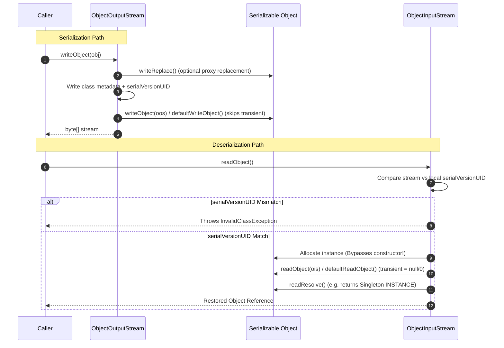

### Versioning & Compatibility Matrix

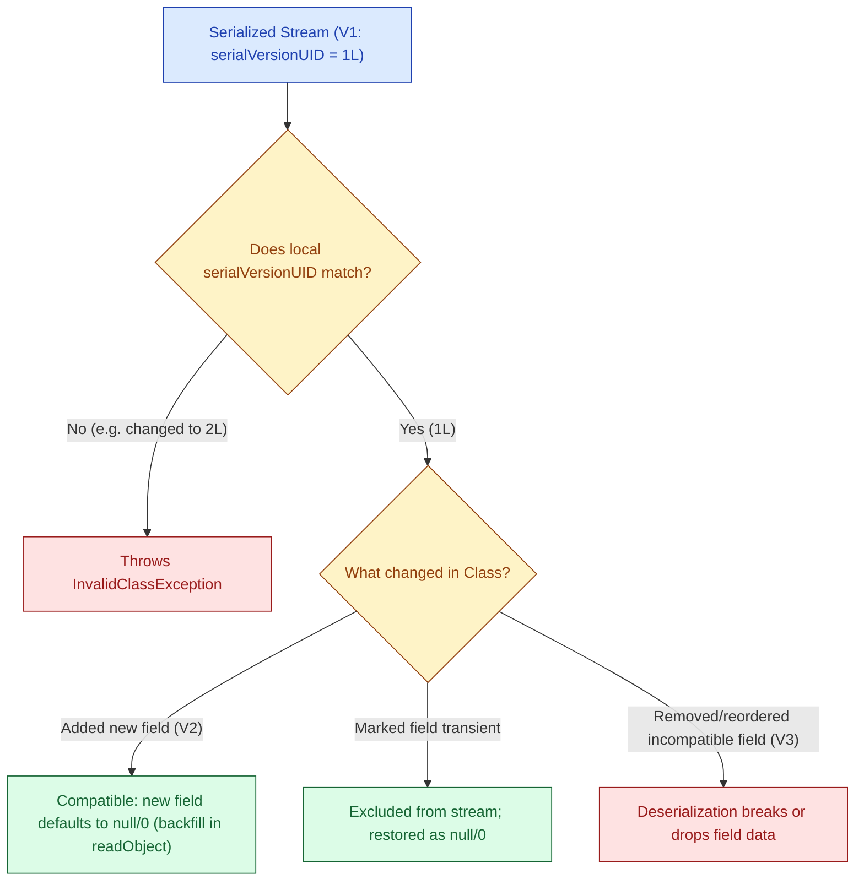

```java
// Custom serialization + transient + versioning fallback
public class Person implements Serializable {
    private static final long serialVersionUID = 1L;
    private String name;
    private int age;
    private transient String password; // Restored as null after deserialization
    private String author;             // Added in V2: null when reading V1 streams
    private List<String> hobbies;

    private void writeObject(ObjectOutputStream oos) throws IOException {
        oos.defaultWriteObject();
        oos.writeInt(hobbies.size());
        for (String h : hobbies) oos.writeUTF(h);
    }

    private void readObject(ObjectInputStream ois) throws IOException, ClassNotFoundException {
        ois.defaultReadObject();
        if (author == null) author = "Unknown"; // Safe default when deserializing V1
        int size = ois.readInt();
        hobbies = new ArrayList<>();
        for (int i = 0; i < size; i++) hobbies.add(ois.readUTF());
    }

    private Object writeReplace() throws ObjectStreamException { return this; }
}

// Singleton Serialization Pitfall & Fix
public class Singleton implements Serializable {
    private static final long serialVersionUID = 1L;
    private static final Singleton INSTANCE = new Singleton();
    private Singleton() {}
    public static Singleton getInstance() { return INSTANCE; }

    // Without readResolve(), ois.readObject() creates a 2nd instance (s1 == s2 is false!)
    private Object readResolve() throws ObjectStreamException {
        return INSTANCE; // Guarantees singleton identity after deserialization
    }
}
```

> [!CAUTION]
> **Security & Singleton Gotcha:** Java deserialization allocates objects **without calling constructors**, breaking Singletons unless `readResolve()` is implemented (or an `enum` singleton is used) and creating severe RCE/gadget risks on untrusted byte streams. Always prefer **JSON or Protobuf** for service communication and define an explicit `serialVersionUID` whenever `Serializable` is unavoidable.

---

## Interview Questions

### Quick-Revision Q&A Matrix

| Question / Scenario | Root Mechanism / Trap | Crisp Interview Answer |
|---------------------|-----------------------|------------------------|
| **`==` vs `.equals()` on `String`** | String Pool vs Heap allocation | `==` compares object references; `.equals()` compares character contents. |
| **Wrapper caching (`-128` to `127`)** | `IntegerCache` via `valueOf()` | Cached values share references (`==` true); `>= 128` allocates new objects (`==` false). Always use `.equals()`. |
| **`equals()` & `hashCode()` contract** | Hash bucket lookup (`hash & (n-1)`) | Equal objects *must* have identical `hashCode()`; unequal objects *may* collide. |
| **Override `equals()` without `hashCode()`** | Different buckets in `HashMap`/`HashSet` | `map.get(equalKey)` returns `null`; `HashSet` stores duplicates. |
| **Why is `String` immutable?** | `final` class + `final byte[]` | Thread-safe sharing, immutable `HashMap` key hashes, String Pool deduplication, security. |
| **PECS in Generics** | Type Erasure + variance safety | Producer (`read` `T`) uses `? extends T`; Consumer (`write` `T`) uses `? super T`. |
| **Static method overriding?** | Compile-time static binding | Static methods are **hidden**, not overridden—bound to declared reference type. |
| **`finally` with early `return`** | `finally` executes before return finishes | Runs after `try` return expression; a `return` inside `finally` overrides `try`'s return. |
| **Singleton + `Serializable`** | Deserialization bypasses constructors | `readObject()` creates a second instance; fix with `readResolve()` returning `INSTANCE`. |

### Diagnostic Decision Tree

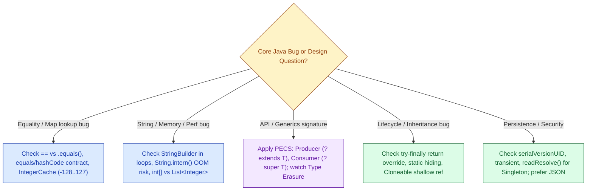

### Structured High-Yield Q&A

#### Q1: What's the difference between `==` and `.equals()` for Strings?
```java
String s1 = "hello";             // Pooled literal
String s2 = "hello";             // Same pooled reference
String s3 = new String("hello"); // Separate Heap object

System.out.println(s1 == s2);      // true  (same reference)
System.out.println(s1 == s3);      // false (different objects)
System.out.println(s1.equals(s3)); // true  (same content)
```
- Use `.equals()` for logical/content equality across Strings and custom objects (with properly overridden `equals()` and `hashCode()`); reserve `==` for primitives or intentional reference-identity checks.

#### Q2: Why are wrapper types cached only between `-128` and `127`?
- Caching small, frequently used values (`-128..127` via `IntegerCache`) avoids repeated object allocations for common loop counters and small constants. Outside this range, autoboxing creates distinct objects on the heap. Always compare wrapper instances with `.equals()`, not `==`.

#### Q3: Explain the relationship between `equals()` and `hashCode()`
- If `a.equals(b)` is `true`, then `a.hashCode() == b.hashCode()` **must** hold. Hash-based collections (`HashMap`, `HashSet`) locate a bucket via `hashCode()` first and only check `equals()` inside that bucket. Reverse equality is not required: two unequal objects may legitimately collide on the same hash code.

#### Q4: What happens if you don't implement `hashCode()` when you override `equals()`?
- Direct `a.equals(b)` calls succeed, but `HashMap` and `HashSet` fail catastrophically: `p1` is placed into one bucket using `Object.hashCode()`, while an equal `p2` hashes to a different bucket during `get(p2)` or `contains(p2)`—causing `null` lookups and duplicate set entries.

#### Q5: Why is `String` immutable?
- **Thread safety** without locking across shared instances.
- **Safe `HashMap` keys** because cached hash codes never change.
- **String Pool efficiency** enabling safe deduplication of identical literals.
- **Security** preventing tampering with sensitive strings (passwords, URLs, class names) after validation.

---

### Key Takeaway Summary

1. **OOP:** Abstraction hides complexity; encapsulation hides state. Prefer composition over inheritance.
2. **`equals()`/`hashCode()`:** Non-negotiable contract—breaking it breaks `HashMap`/`HashSet`.
3. **Strings:** Immutable for thread safety, security, and pooling (Compact Strings `byte[]` + `coder` in Java 9+). Use `StringBuilder` outside loops; avoid `intern()` on untrusted input.
4. **Generics:** Type erasure makes generics compile-time only (plus bridge methods). Apply **PECS** (`? extends T` / `? super T`).
5. **Autoboxing:** Convenient but costly (`10–20x` slower than primitive arrays) and exposes `IntegerCache` (`-128..127`) & `null`-unboxing NPE traps.
6. **`final`/`finally`/`finalize()`:** `final` prevents mutation/override; `finally` guarantees cleanup (`try-with-resources` preferred); `finalize()` is deprecated.
7. **`static`:** Shared class state creates coupling; static methods hide rather than override; non-static inner classes hold `Outer.this`.
8. **Marker Interfaces vs Annotations:** Modern Java favors annotations for metadata, `@Target` granularity, and framework processing over marker interfaces.
9. **Cloning:** `Cloneable` is shallow and bypasses constructors—use copy constructors or immutable objects instead.
10. **Serialization:** Fragile and security-sensitive—prefer JSON/Protobuf; use `serialVersionUID`, `transient`, and `readResolve()` (for Singletons) when required.

> [!TIP]
> **60-Second Pre-Interview Checklist:** Verify every `equals()` override has a matching `hashCode()`; switch wrapper `==` checks to `.equals()`; replace loop `String` concatenation with `StringBuilder`; double-check `Collections.copy(super, extends)` direction for PECS; remember `Parent p = new Child(); p.staticMethod()` calls `Parent`; and mention `try-with-resources` + copy constructors + JSON/Protobuf over `finalize()`, `Cloneable`, and Java serialization.
