# Collections Framework - Deep Dive

## Table of Contents
1. [HashMap Internals](#hashmap-internals)
2. [ArrayList Internals](#arraylist-internals)
3. [LinkedList Internals](#linkedlist-internals)
4. [TreeMap: Red-Black Trees](#treemap-red-black-trees)
5. [ConcurrentHashMap](#concurrenthashmap)
6. [LinkedHashMap](#linkedhashmap)
7. [Collision Handling](#collision-handling)
8. [Comparable vs Comparator](#comparable-vs-comparator)
9. [Iterator and Fail-Fast](#iterator-and-fail-fast)
10. [PriorityQueue](#priorityqueue)
11. [Decision Matrix](#decision-matrix)
12. [Interview Questions](#interview-questions)

---

## HashMap Internals

### `put(K, V)` Execution Pipeline

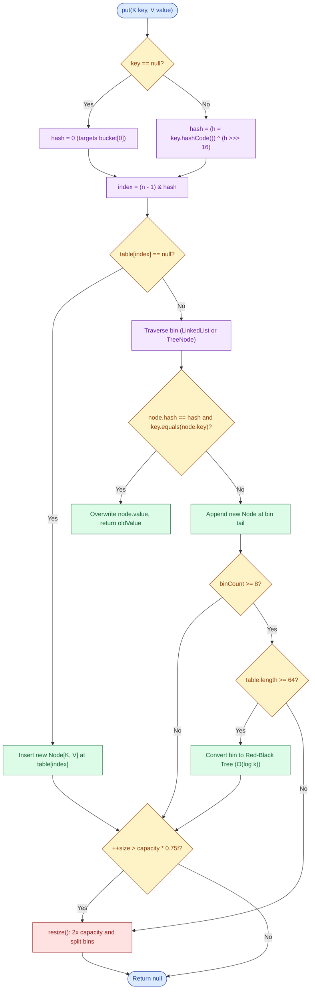

### Hybrid Bucket Layout & `2x` Resize Bit-Split

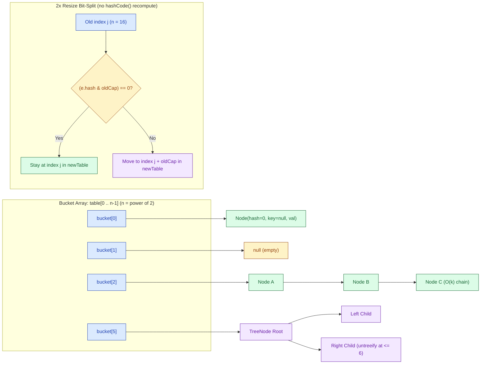

### Core Data Structure & Implementation

- **Defaults & Thresholds:** `DEFAULT_CAPACITY = 16`, `LOAD_FACTOR = 0.75f`, `TREEIFY_THRESHOLD = 8`, `UNTREEIFY_THRESHOLD = 6`, `MIN_TREEIFY_CAPACITY = 64`.
- **Hash Perturbation (`h ^ (h >>> 16)`):** Mixes upper 16 bits into lower 16 bits so small tables (`(n - 1) & hash`) do not ignore high-order hash entropy.
- **Bitwise Indexing (`hash & (table.length - 1)`):** Equivalent to `hash % capacity` whenever capacity is a power of 2, but faster at the CPU level.
- **Null Key Support:** `HashMap` permits one `null` key, mapped directly to `hash = 0` (`bucket[0]`).

```java
public class SimpleHashMap<K, V> {
    private static final int DEFAULT_CAPACITY = 16;
    private static final float LOAD_FACTOR = 0.75f;
    private static final int TREEIFY_THRESHOLD = 8;

    private Node<K, V>[] table;
    private int size;

    static class Node<K, V> {
        final int hash;
        final K key;
        V value;
        Node<K, V> next;

        Node(int hash, K key, V value, Node<K, V> next) {
            this.hash = hash;
            this.key = key;
            this.value = value;
            this.next = next;
        }
    }

    public V put(K key, V value) {
        int hash = hash(key);
        int index = hash & (table.length - 1);

        Node<K, V> node = table[index];
        Node<K, V> prev = null;
        while (node != null) {
            if (node.hash == hash && (key == node.key || (key != null && key.equals(node.key)))) {
                V oldValue = node.value;
                node.value = value; // Update existing key
                return oldValue;
            }
            prev = node;
            node = node.next;
        }

        Node<K, V> newNode = new Node<>(hash, key, value, null);
        if (prev == null) table[index] = newNode;
        else prev.next = newNode; // Java 8+ appends at tail

        if (++size > table.length * LOAD_FACTOR) {
            resize(); // Double capacity and redistribute
        }
        return null;
    }

    public V get(Object key) {
        int hash = hash(key);
        Node<K, V> node = table[hash & (table.length - 1)];
        while (node != null) {
            if (node.hash == hash && (key == node.key || (key != null && key.equals(node.key)))) {
                return node.value;
            }
            node = node.next;
        }
        return null;
    }

    private int hash(Object key) {
        if (key == null) return 0; // HashMap allows null key at bucket 0
        int h = key.hashCode();
        return h ^ (h >>> 16); // Spread upper bits down
    }
}
```

### Hashing Quality, Treeification & Load Factor Tradeoffs

- **4 Properties of a Good `hashCode()`:**
  1. **Deterministic:** Same immutable state always yields the same `int`.
  2. **Uniform distribution:** Minimizes bucket collisions (`O(1)` lookup).
  3. **Fast to compute:** Called on every `get`/`put`.
  4. **Avalanche effect:** Small input change (e.g., `"abc"` vs `"bac"`, `"hello"` vs `"world"`) flips many output bits; returning a constant like `return 1;` collapses all entries into a single bucket (`O(n)` or `O(log n)`).
- **Why Not Trees From the Start?**
  - `TreeNode` objects are roughly **2x larger** than `Node` (extra `parent`, `left`, `right`, `prev`, `red` fields).
  - Under a good hash function, Poisson distribution keeps most buckets at 0–2 nodes where linked lists have better cache locality and lower constant overhead.
  - Treeification requires **both** `binCount >= 8` **and** `table.length >= 64` (otherwise `HashMap` resizes first); when a tree shrinks to `<= 6` (`UNTREEIFY_THRESHOLD`), it converts back to a linked list.
- **Load Factor & Amortized `O(1)` Resizing:**
  - `loadFactor = size / capacity`. Default `0.75f` triggers resize at `12` entries for capacity `16`.
  - **Too low (e.g., `0.25f`):** Fewer collisions, faster lookups, wasted memory.
  - **Too high (e.g., `0.99f`):** Compact memory, frequent collisions, slower lookups.
  - **Amortized `O(1)`:** Resizes at `12, 24, 48, 96, ...` sum to `12 + 24 + 48 + ... <= 2n = O(n)` total work across `n` puts, giving `O(n) / n = O(1)` per operation. During `2x` resize (`16 -> 32`), index `4` either stays at `4` or shifts to `20` (`4 + 16`) depending solely on `(hash & oldCap)`.

> [!IMPORTANT]
> **30-Second Revision:** Java 8+ `HashMap` uses `h ^ (h >>> 16)` + `(n - 1) & hash`, allows one `null` key at bucket `0`, resizes `2x` at `0.75f` load factor (`O(1)` amortized `put`), and only converts a colliding chain to a Red-Black Tree when **both** `binCount >= 8` and `capacity >= 64` (reverting at `<= 6`).

---

## ArrayList Internals

### Contiguous Backing Array & `1.5x` Resize Copy

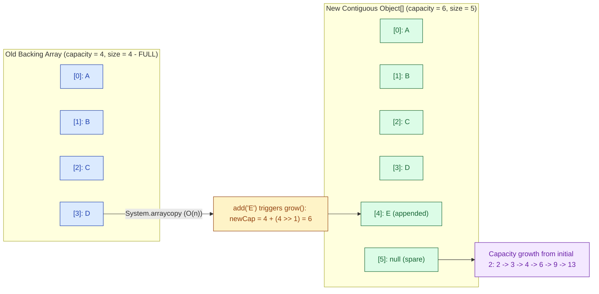

### Dynamic Resizing & Amortized Cost

- **Backing Structure:** Contiguous `Object[]` array (`DEFAULT_CAPACITY = 10` on first `add()` in JDK).
- **Growth Formula (`1.5x`):** `int newCapacity = oldCapacity + (oldCapacity >> 1);`, copied via `System.arraycopy` (`Arrays.copyOf`).
- **Amortized Trace (`new ArrayList<>(2)` adding 10 items):**
  - Resizes occur at capacities `2 -> 3 -> 4 -> 6 -> 9 -> 13`.
  - Total copied elements: `2 + 3 + 4 + 6 + 9 = 24` across `10` adds (`2.4` ops/add) -> **`O(1)` amortized** append.

```java
public class SimpleArrayList<E> {
    private static final int DEFAULT_CAPACITY = 10;
    private Object[] elements = new Object[DEFAULT_CAPACITY];
    private int size;

    public void add(E e) {
        if (size >= elements.length) {
            int newCap = elements.length + (elements.length >> 1); // 1.5x growth
            Object[] newArray = new Object[newCap];
            System.arraycopy(elements, 0, newArray, 0, size);
            elements = newArray;
        }
        elements[size++] = e;
    }

    @SuppressWarnings("unchecked")
    public E get(int index) {
        if (index < 0 || index >= size) throw new IndexOutOfBoundsException();
        return (E) elements[index]; // O(1) direct offset lookup
    }

    public void remove(int index) {
        if (index < 0 || index >= size) throw new IndexOutOfBoundsException();
        System.arraycopy(elements, index + 1, elements, index, size - index - 1);
        elements[--size] = null; // Clear reference for GC
    }
}
```

### Time Complexity Breakdown

| Operation | Complexity | Internal Mechanism |
| :--- | :--- | :--- |
| `get(index)` / `set(index, e)` | `O(1)` | Direct array index offset |
| `add(element)` (append) | `O(1)` amortized | `O(1)` write; occasional `O(n)` `1.5x` resize |
| `add(index, element)` | `O(n)` | Shifts `size - index` elements right via `System.arraycopy` |
| `remove(index)` | `O(n)` | Shifts `size - index - 1` elements left |
| `contains(e)` / `indexOf(e)` | `O(n)` | Linear scan comparing `.equals()` |

- **Worst-Case Trap:** Calling `list.add(0, "element " + i)` inside a loop of `n` iterations shifts all existing items every time (`1 + 2 + 3 + ... + n = O(n^2)`).

> [!TIP]
> **30-Second Revision:** `ArrayList` gives `O(1)` random access and `O(1)` amortized tail append via `1.5x` array resizing (`oldCap + (oldCap >> 1)`). Pre-size with `new ArrayList<>(expectedSize)` when count is known to avoid intermediate copies, and never loop `add(0, x)` (`O(n^2)`).

---

## LinkedList Internals

### Doubly-Linked `Node` Memory Pointer Layout

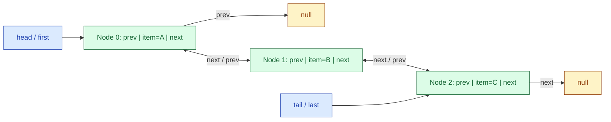

### Memory & CPU Cache Locality: `ArrayList` vs `LinkedList`

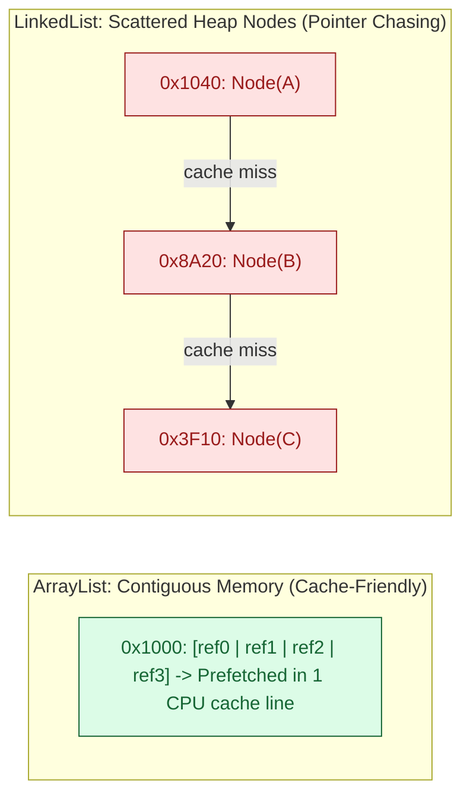

### Core Implementation & Usage Tradeoffs

```java
public class SimpleLinkedList<E> {
    private static class Node<E> {
        E value;
        Node<E> next;
        Node<E> prev;
        Node(E value) { this.value = value; }
    }

    private Node<E> head, tail;
    private int size;

    public void add(E e) {
        Node<E> newNode = new Node<>(e);
        if (tail == null) {
            head = tail = newNode;
        } else {
            tail.next = newNode;
            newNode.prev = tail;
            tail = newNode;
        }
        size++;
    }

    public E get(int index) {
        if (index < 0 || index >= size) throw new IndexOutOfBoundsException();
        Node<E> node = head; // JDK optimizes by starting from tail if index >= size / 2
        for (int i = 0; i < index; i++) node = node.next;
        return node.value;
    }

    public void remove(int index) {
        if (index < 0 || index >= size) throw new IndexOutOfBoundsException();
        Node<E> node = head;
        for (int i = 0; i < index; i++) node = node.next;

        if (node.prev != null) node.prev.next = node.next;
        else head = node.next;

        if (node.next != null) node.next.prev = node.prev;
        else tail = node.prev;

        size--;
    }
}
```

- **Use `LinkedList` when:**
  - Performing frequent `O(1)` insertions/removals at both ends (`addFirst`, `removeFirst`, `addLast`, `removeLast`) or via an active `ListIterator`.
  - You explicitly need both `List` and `Deque` contracts with `null` element support (if `null` isn't needed, `ArrayDeque` is faster and uses far less memory).
- **Avoid `LinkedList` when:**
  - Doing random access (`list.get(i)` is `O(n)`).
  - Iterating by index (`for (int i = 0; i < n; i++) list.get(i)` degrades to **`O(n^2)`**; always use an `Iterator` or enhanced `for-each` loop for `O(n)` total traversal).
  - Memory efficiency or sequential scan speed matters: every `Node` pays object-header + `prev`/`next`/`item` pointer overhead and suffers L1/L2 CPU cache misses.

> [!WARNING]
> **Interview Gotcha:** `LinkedList.get(i)` inside an indexed `for` loop runs in **`O(n^2)`** time! Furthermore, due to scattered heap allocations and cache misses, `ArrayList` and `ArrayDeque` outperform `LinkedList` in almost every modern workload except mid-list `ListIterator.remove()`.

---

## TreeMap: Red-Black Trees

### Red-Black Tree Invariants

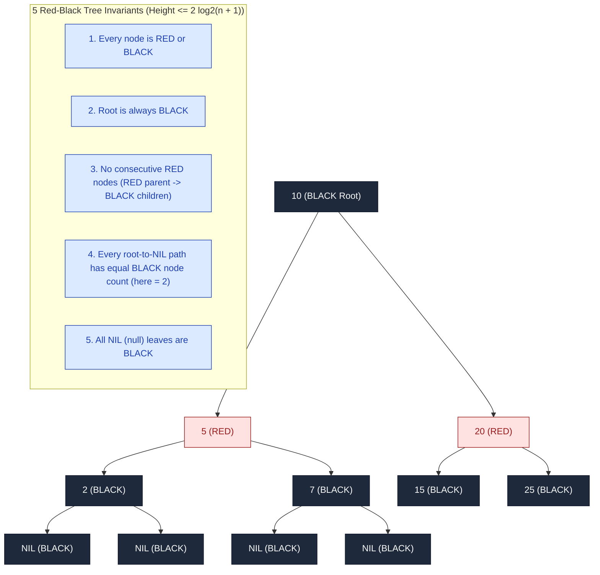

### Rotation Rebalancing (`leftRotate` & `rightRotate`)

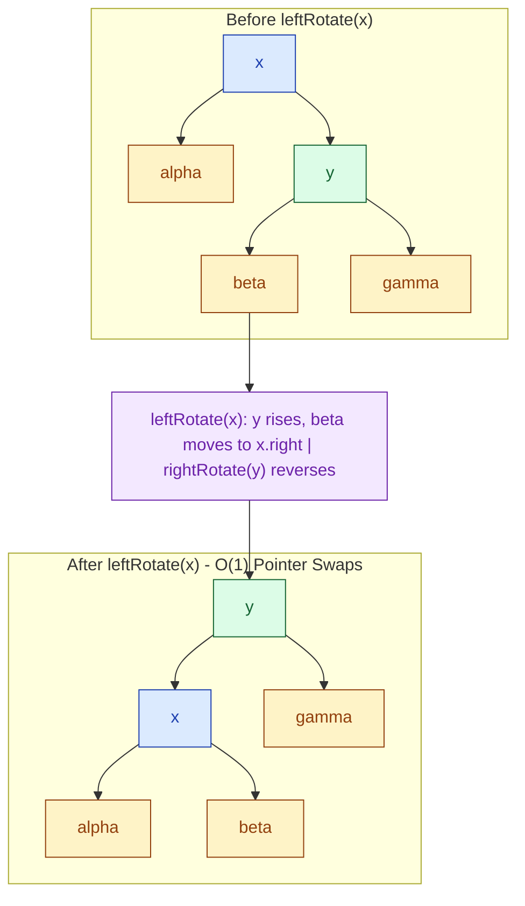

### Sorted Operations & `NavigableMap` API

- **Sorted Storage:** Keeps keys sorted via natural `Comparable` order or an explicit `Comparator` passed to `new TreeMap<>(cmp)`.
- **Guaranteed Worst-Case `O(log n)`:** Balanced height ensures `put`, `get`, `remove`, and `containsKey` never degrade to `O(n)`.
- **Main Advantage Over `HashMap`:** Ordered iteration, min/max access, boundary lookups, and range views (`O(log n + k)` where `k` is returned entries).

```java
TreeMap<Integer, String> map = new TreeMap<>();
map.put(5, "five");
map.put(2, "two");
map.put(8, "eight");
map.put(1, "one");
map.put(3, "three");

// Sorted key iteration: 1, 2, 3, 5, 8
for (Integer key : map.keySet()) System.out.println(key);

// Range views: O(log n + k)
NavigableMap<Integer, String> subMap = map.subMap(2, 8); // [2, 3, 5] (2 inclusive, 8 exclusive)
Map<Integer, String> headMap = map.headMap(5);           // [1, 2, 3] (keys < 5)
Map<Integer, String> tailMap = map.tailMap(5);           // [5, 8]    (keys >= 5)

// Navigable boundary queries on String keys [alice, bob, charlie, david]
TreeMap<String, Integer> names = new TreeMap<>();
names.put("alice", 1); names.put("bob", 2); names.put("charlie", 3); names.put("david", 4);

names.ceilingKey("alex"); // "alice" (smallest key >= "alex")
names.floorKey("carol");  // "bob"   (largest key <= "carol")
names.higherKey("alice"); // "bob"   (smallest key > "alice")
names.lowerKey("bob");    // "alice" (largest key < "bob")
names.firstKey();         // "alice"
names.lastKey();          // "david"
```

- **Avoid `TreeMap` when:** You do not need sorted order or range queries (`HashMap` gives `O(1)`), or you need high-throughput concurrency (`ConcurrentHashMap` or `ConcurrentSkipListMap` for concurrent sorted maps).

> [!IMPORTANT]
> **30-Second Revision:** `TreeMap` backs `NavigableMap` with a Red-Black Tree (`O(log n)` worst-case `get`/`put`/`remove`, `O(log n + k)` range queries). It rejects `null` keys with natural ordering (`compareTo` throws `NullPointerException`) and uses `compareTo() == 0`—not `equals()`—for key equality.

---

## ConcurrentHashMap

### Java 7 Segment Locking vs Java 8+ `CAS` + Bin-Level Synchronization

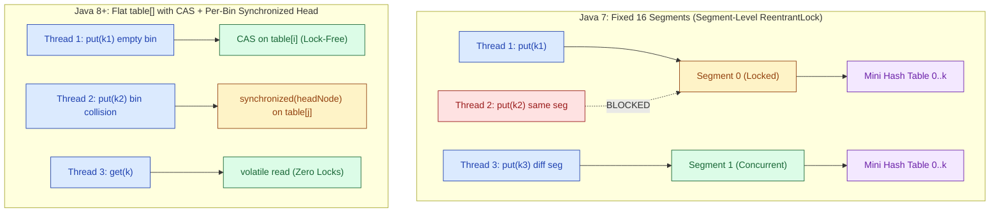

### Java 8+ `putVal()` Concurrency Flow

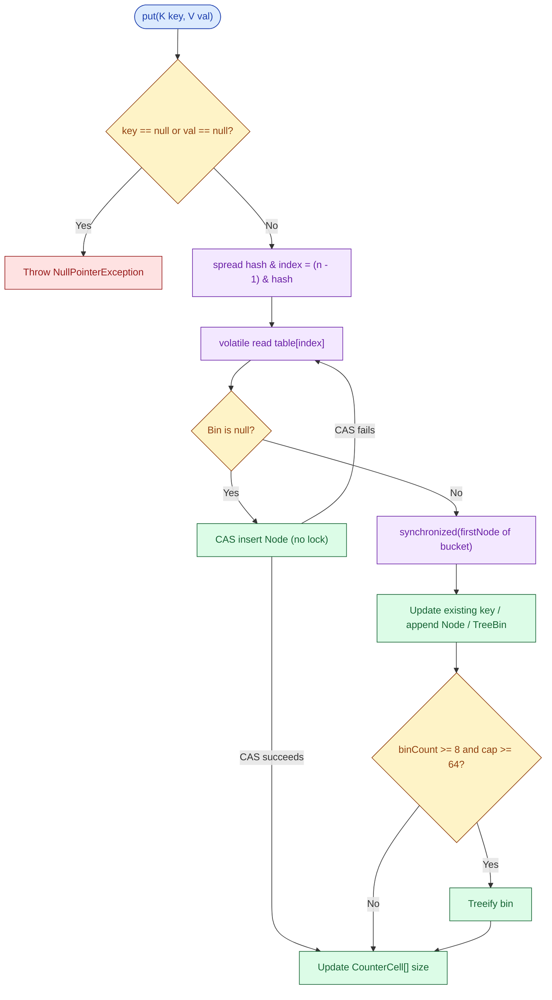

### Evolution & Performance Comparison

| Feature | `Collections.synchronizedMap` | `ConcurrentHashMap` (Java 7) | `ConcurrentHashMap` (Java 8+) |
| :--- | :--- | :--- | :--- |
| **Lock Granularity** | Whole map (1 mutex lock) | 16 fixed `Segment` locks | Empty bin: **CAS**; Collision: **`synchronized` head node** |
| **Read (`get`) Locking** | Blocks on map-wide mutex | Lock-free (`volatile` value) | Lock-free (`volatile` node & value) |
| **Contention Throughput** | Low (serializes all threads) | Up to 16 concurrent writers | Scales dynamically with table buckets (~5–10x faster than `synchronizedMap`) |
| **Null Keys / Values** | Depends on wrapped map | Forbidden (`NullPointerException`) | Forbidden (`NullPointerException`) |
| **Iterator Behavior** | Fail-fast (needs manual `synchronized`) | Weakly consistent (no `CME`) | Weakly consistent (no `CME`) |

### Weakly Consistent Iteration Semantics

- `ConcurrentHashMap` iterators **never throw `ConcurrentModificationException`**; they reflect some updates made after iterator creation without locking the entire map or copying an `O(n)` snapshot.
- Why not strong consistency? Snapshots add `O(n)` memory overhead and global locking defeats fine-grained concurrency.
- If you require an atomic point-in-time snapshot, copy keys explicitly (or coordinate externally):

```java
ConcurrentHashMap<String, Integer> map = new ConcurrentHashMap<>();
map.put("a", 1);
map.put("b", 2);
map.put("c", 3);

Iterator<String> it = map.keySet().iterator();
map.put("d", 4); // Added during iteration: no ConcurrentModificationException
while (it.hasNext()) {
    System.out.println(it.next()); // May or may not print "d"
}

// Point-in-time copy if a consistent list view is needed
List<String> snapshot = new ArrayList<>(map.keySet());
```

> [!WARNING]
> **Interview Gotcha:** `ConcurrentHashMap` forbids both `null` keys and `null` values (to avoid concurrency ambiguity between "key absent" and "mapped to `null`"). Also, separate `get()` + `put()` calls are **NOT** atomic—always use `putIfAbsent()`, `compute()`, or `computeIfAbsent()`.

---

## LinkedHashMap

### Hash Buckets + Doubly-Linked Order List (`LRU Cache`)

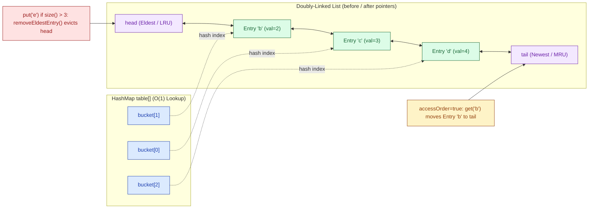

### Insertion Order vs Access Order & LRU Cache

- **Insertion-Order (`accessOrder = false`, default):** Iterates in the exact sequence keys were inserted (`"zebra"`, `"apple"`, `"monkey"` -> `zebra, apple, monkey`). Overwriting an existing key's value does not alter order.
- **Access-Order (`accessOrder = true`):** `new LinkedHashMap<>(16, 0.75f, true)` moves any entry touched by `get()` or `put()` to the `tail` (most recently used position).
- **LRU Cache Pattern:** Override `removeEldestEntry(Map.Entry<K, V> eldest)` to return `size() > capacity`; `LinkedHashMap` automatically removes `head` in `O(1)` after `put()`.

```java
// Access-order LinkedHashMap acting as a bounded O(1) LRU Cache (max 3 entries)
Map<String, Integer> lruCache = new LinkedHashMap<>(16, 0.75f, true) {
    @Override
    protected boolean removeEldestEntry(Map.Entry<String, Integer> eldest) {
        return size() > 3;
    }
};

lruCache.put("a", 1);
lruCache.put("b", 2);
lruCache.put("c", 3);
lruCache.put("d", 4); // Exceeds 3 -> evicts eldest "a" -> [b, c, d]

lruCache.get("b");    // Moves "b" to MRU tail -> [c, d, b]
lruCache.put("e", 5); // Exceeds 3 -> evicts eldest "c" -> [d, b, e]
```

> [!TIP]
> **30-Second Revision:** `LinkedHashMap` preserves `O(1)` `HashMap` lookup while threading every entry into a doubly-linked list (`before`/`after`). Pass `accessOrder = true` and override `removeEldestEntry()` for an instant `O(1)` LRU cache—but note it is **not thread-safe** (`get()` mutates structural links in access-order mode!).

---

## Collision Handling

### Separate Chaining vs Open Addressing

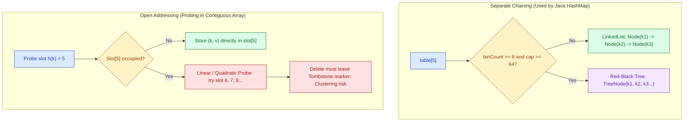

### Hash Function Quality & Contract

- **Bad `hashCode()`:** Hashing only one field (e.g., `return age;`) forces every `Person` of the same age into one bucket regardless of `name`.
- **Good `hashCode()`:** `Objects.hash(name, age)` mixes all fields used in `equals()`, preserving the **avalanche effect** where changing one character (`"hello"` vs `"hallo"`) spreads hash bits widely across buckets.

```java
class Person {
    private final String name;
    private final int age;

    Person(String name, int age) {
        this.name = name;
        this.age = age;
    }

    @Override
    public int hashCode() {
        return Objects.hash(name, age); // Combines all equality fields
    }

    @Override
    public boolean equals(Object obj) {
        if (this == obj) return true;
        if (!(obj instanceof Person other)) return false;
        return age == other.age && Objects.equals(name, other.name);
    }
}
```

### Separate Chaining vs Open Addressing Comparison

| Dimension | Separate Chaining (Java `HashMap`) | Open Addressing (Linear / Quadratic Probing) |
| :--- | :--- | :--- |
| **Collision Storage** | External `Node` linked list (`TreeNode` at `>= 8`) | Next free slot inside the backing array (`h + 1, h + 2...`) |
| **Load Factor Limit** | Can exceed `1.0` (default `0.75f`) | Must stay strictly `< 1.0` |
| **CPU Cache Locality** | Lower (pointer chasing across heap nodes) | High (contiguous array probing) |
| **Memory Overhead** | Extra pointer per node (`next`, or tree links) | Zero node-pointer overhead |
| **Deletion Complexity** | Simple pointer unlink | Complex: requires **tombstone** markers so probe chains stay intact |
| **Worst-Case Lookup** | `O(log n)` with Java 8+ treeification (`O(n)` without) | `O(n)` under primary/secondary clustering |

> [!WARNING]
> **Interview Gotcha:** Never mutate fields used by `hashCode()` or `equals()` after inserting a key into a `HashMap` or `HashSet`. Future `get(key)` calls hash to the *new* bucket while the entry remains stranded in the *old* bucket, causing silent `null` / `false` lookups and memory leaks.

---

## Comparable vs Comparator

### Interface Architecture

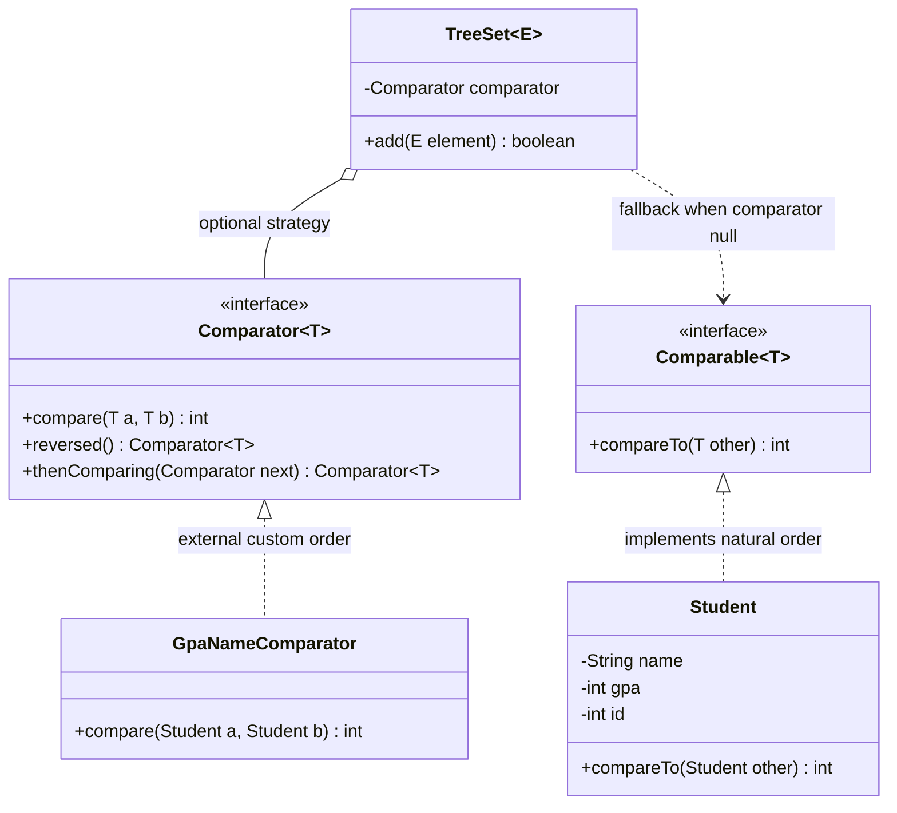

### Ordering Decision & Consistency Flow

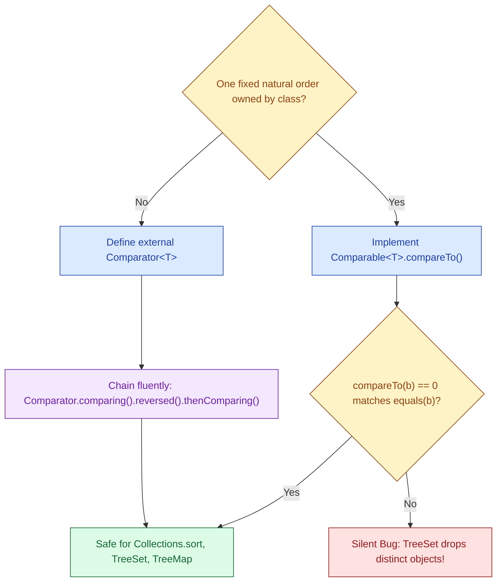

### Natural Order vs Custom Multi-Field Comparators

| Dimension | `Comparable<T>` | `Comparator<T>` |
| :--- | :--- | :--- |
| **Package & Method** | `java.lang.Comparable` -> `compareTo(T o)` | `java.util.Comparator` -> `compare(T o1, T o2)` |
| **Coupling** | Intrusive (domain class implements it) | Non-intrusive (external strategy / lambda) |
| **Sort Orders** | Single natural ordering (e.g., `String`, `Integer`) | Unlimited independent & chained orderings |
| **Usage** | `Collections.sort(list)`, `new TreeSet<>()` | `list.sort(cmp)`, `new TreeSet<>(cmp)` |

```java
// 1. Comparable: single natural ordering (GPA descending, then name ascending)
class Student implements Comparable<Student> {
    final String name;
    final int gpa;

    Student(String name, int gpa) {
        this.name = name;
        this.gpa = gpa;
    }

    @Override
    public int compareTo(Student other) {
        if (this.gpa != other.gpa) {
            return Integer.compare(other.gpa, this.gpa); // Safe descending compare
        }
        return this.name.compareTo(other.name);
    }
}

// 2. Comparator: fluent Java 8+ multi-field chaining without touching Student
students.sort(
    Comparator.comparingInt((Student s) -> s.gpa)
              .reversed()
              .thenComparing(s -> s.name)
);

// 3. TreeSet with custom comparator
Set<Student> ranked = new TreeSet<>(
    Comparator.comparingInt((Student s) -> s.gpa).reversed()
              .thenComparing(s -> s.name)
);
```

### Critical Pitfall: `compareTo()` Inconsistent With `equals()`

```java
class BrokenStudent implements Comparable<BrokenStudent> {
    String name;
    int id;

    @Override public int compareTo(BrokenStudent o) { return Integer.compare(this.id, o.id); }
    @Override public boolean equals(Object o) {
        return o instanceof BrokenStudent other && this.name.equals(other.name); // MISMATCH!
    }
}

BrokenStudent s1 = new BrokenStudent("Alice", 1);
BrokenStudent s2 = new BrokenStudent("Bob", 1);

Set<BrokenStudent> set = new TreeSet<>();
set.add(s1);
set.add(s2); // compareTo returns 0 -> TreeSet treats s2 as duplicate of s1!
System.out.println(set.size());     // 1 (s2 silently ignored)
System.out.println(set.contains(s2)); // true in TreeSet (checks compareTo), false in HashSet!
```

- **Fix:** Align `compareTo()` and `equals()` on the exact same fields (e.g., compare `id` in both, or add `name` as tie-breaker in `compareTo()` if both `id` and `name` define equality).

> [!WARNING]
> **Interview Gotcha:** Never write `return a - b;` inside `compareTo`/`compare`—it silently **overflows** for extreme integers like `Integer.MIN_VALUE - 1`. Always use `Integer.compare(a, b)`, and keep `compareTo(b) == 0` consistent with `equals(b) == true` whenever objects enter `TreeSet` or `TreeMap`.

---

## Iterator and Fail-Fast

### Fail-Fast (`modCount` Check & `ConcurrentModificationException`)

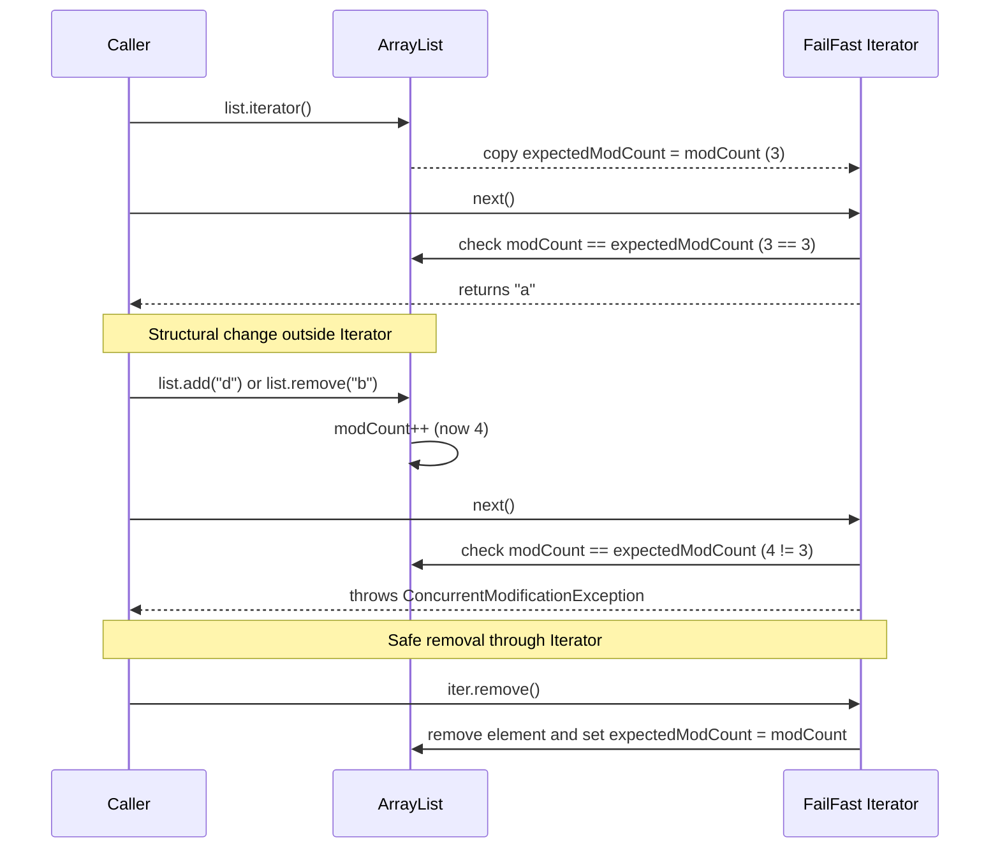

### Fail-Safe (`CopyOnWriteArrayList` Snapshot Isolation)

```mermaid
sequenceDiagram
    participant Caller
    participant COW as CopyOnWriteArrayList
    participant V1 as Snapshot Array v1
    participant V2 as New Array v2

    Caller->>COW: iterator()
    COW-->>Caller: iterator holds ref to Snapshot Array v1
    Caller->>V1: next() yields "a", then "b"

    Note over Caller,V2: Write creates a brand-new array copy under lock
    Caller->>COW: list.add("d")
    COW->>V2: copy [a, b, c] + "d" into Array v2
    COW->>COW: volatile array reference switches to v2

    Caller->>V1: next() continues on immutable Snapshot Array v1
    V1-->>Caller: yields "c" (no exception; "d" not visible)
```

### Fail-Fast vs Fail-Safe Comparison

| Iterator Type | Collections | How It Works | Exception on Mutate | Sees Concurrent Writes? |
| :--- | :--- | :--- | :--- | :--- |
| **Fail-Fast** | `ArrayList`, `LinkedList`, `HashMap`, `HashSet` | Compares `modCount != expectedModCount` | `ConcurrentModificationException` | No (aborts immediately) |
| **Fail-Safe (Snapshot)** | `CopyOnWriteArrayList`, `CopyOnWriteArraySet` | Iterates immutable copy of array at iterator creation | Never | No (reads frozen snapshot) |
| **Weakly Consistent** | `ConcurrentHashMap`, `ConcurrentSkipListMap` | Traverses live concurrent structure without locks | Never | Partially (best-effort) |

```java
// FAIL-FAST BUG: enhanced for-each uses Iterator internally
List<String> list = new ArrayList<>(Arrays.asList("a", "b", "c"));
for (String item : list) {
    if (item.equals("b")) {
        list.remove(item); // Mutates modCount -> throws ConcurrentModificationException!
    }
}

// SAFE REMOVAL 1: use iterator.remove() (or list.removeIf(s -> s.equals("b")))
Iterator<String> iter = list.iterator();
while (iter.hasNext()) {
    if (iter.next().equals("b")) {
        iter.remove(); // Updates expectedModCount = modCount
    }
}

// FAIL-SAFE: CopyOnWriteArrayList iterates over snapshot
List<String> cowList = new CopyOnWriteArrayList<>(Arrays.asList("a", "b", "c"));
for (String item : cowList) {
    if (item.equals("b")) {
        cowList.add("d"); // Copies backing array; iterator still finishes [a, b, c]
    }
}
```

- **When to Use `CopyOnWriteArrayList`:** Read-heavy workloads with frequent concurrent iteration and rare writes (listener lists, routing tables).
- **Avoid When:** Writes are frequent or lists are large (`O(n)` full-array copy + GC pressure on every write).

> [!IMPORTANT]
> **30-Second Revision:** Fail-fast iterators (`modCount != expectedModCount`) are a **best-effort bug detector**, not a thread-safety mechanism. Always remove elements via `iterator.remove()` or `Collection.removeIf()`, and use `CopyOnWriteArrayList` only when reads vastly outnumber writes.

---

## PriorityQueue

### Binary Min-Heap Tree & Contiguous Array Mapping

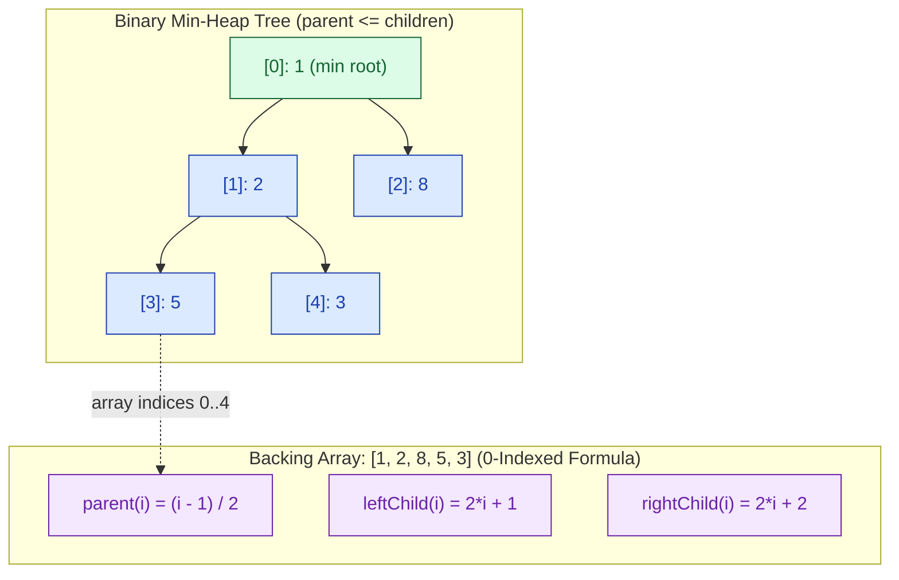

### `offer()` (`siftUp`) vs `poll()` (`siftDown`) Mechanics

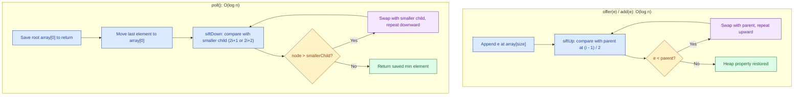

### Min-Heap, Max-Heap & Operations Complexity

```java
// Default: Min-heap (natural ascending order)
PriorityQueue<Integer> minHeap = new PriorityQueue<>();
minHeap.addAll(List.of(5, 2, 8, 1, 3)); // Internal array: [1, 2, 8, 5, 3]
minHeap.peek();                          // 1 (O(1))
while (!minHeap.isEmpty()) {
    System.out.print(minHeap.poll() + " "); // 1 2 3 5 8 (O(log n) each)
}

// Max-heap: reverse comparator
PriorityQueue<Integer> maxHeap = new PriorityQueue<>((a, b) -> Integer.compare(b, a));
maxHeap.addAll(List.of(5, 2, 8));
while (!maxHeap.isEmpty()) {
    System.out.print(maxHeap.poll() + " "); // 8 5 2
}
```

| Operation | Time Complexity | Notes |
| :--- | :--- | :--- |
| `peek()` / `element()` | `O(1)` | Reads `queue[0]` without removing |
| `offer(e)` / `add(e)` | `O(log n)` | Appends at tail and `siftUp` |
| `poll()` / `remove()` | `O(log n)` | Pops root, promotes tail, and `siftDown` |
| `remove(Object)` / `contains(Object)` | `O(n)` | Linear scan over backing array |
| `new PriorityQueue<>(collection)` | `O(n)` | Floyd's bottom-up heapify |

> [!WARNING]
> **Interview Gotcha:** Iterating a `PriorityQueue` (`for (int x : pq)`) traverses the backing heap array in level-order, **NOT sorted order**! Only consecutive `poll()` calls yield sorted order. `PriorityQueue` also forbids `null` elements and is not thread-safe (use `PriorityBlockingQueue` for concurrent producers/consumers).

---

## Decision Matrix

### Visual Collection Selector Flowchart

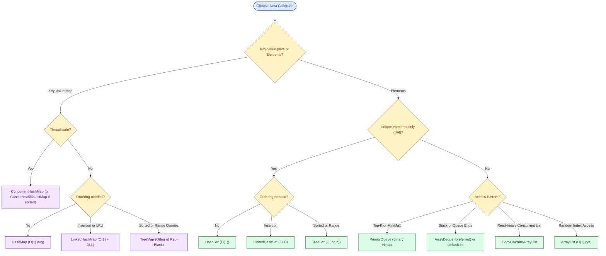

### Big-O Complexity Comparison

| Collection | Lookup / `get` | Insert / `add` | Delete / `remove` | `contains` | Ordering | `null` Support | Thread-Safe |
| :--- | :--- | :--- | :--- | :--- | :--- | :--- | :--- |
| **`ArrayList`** | `O(1)` | `O(1)` amort. tail; `O(n)` index | `O(n)` | `O(n)` | Insertion index | Yes | No |
| **`LinkedList`** | `O(n)` | `O(1)` ends; `O(n)` mid | `O(1)` ends; `O(n)` mid | `O(n)` | Insertion index | Yes | No |
| **`PriorityQueue`** | `O(1)` peek | `O(log n)` | `O(log n)` poll; `O(n)` obj | `O(n)` | Heap priority | **No** | No |
| **`HashSet`** | — | `O(1)` avg | `O(1)` avg | `O(1)` avg | Unordered | 1 `null` | No |
| **`TreeSet`** | — | `O(log n)` | `O(log n)` | `O(log n)` | Sorted (`Comparable`/`Comparator`) | **No** (natural) | No |
| **`HashMap`** | `O(1)` avg | `O(1)` avg | `O(1)` avg | `O(1)` avg | Unordered | 1 `null` key, N values | No |
| **`LinkedHashMap`** | `O(1)` avg | `O(1)` avg | `O(1)` avg | `O(1)` avg | Insertion or Access | 1 `null` key, N values | No |
| **`TreeMap`** | `O(log n)` | `O(log n)` | `O(log n)` | `O(log n)` | Sorted (`NavigableMap`) | **No** `null` key (natural) | No |
| **`ConcurrentHashMap`** | `O(1)` avg | `O(1)` avg | `O(1)` avg | `O(1)` avg | Unordered | **No** `null` key/val | **Yes** |
| **`CopyOnWriteArrayList`** | `O(1)` | `O(n)` copy | `O(n)` copy | `O(n)` | Insertion index | Yes | **Yes** |

### Collection Decision Matrix

| Collection | Key Features | Use When | Avoid When |
| :--- | :--- | :--- | :--- |
| **HashMap** | Fast lookup `O(1)`, unordered, allows 1 `null` key | Need fast key-value access | Need sorted order or thread safety |
| **TreeMap** | Sorted, `O(log n)` ops, range queries (`subMap`/`ceilingKey`) | Need ordering, range queries, floor/ceiling | Need `O(1)` lookup |
| **LinkedHashMap** | Insertion or access order, `O(1)` ops | Need insertion order or `O(1)` LRU cache | Don't need order (extra pointer overhead) |
| **ConcurrentHashMap** | Thread-safe, lock-free reads, high concurrency | Multi-threaded, high contention | Single-threaded (unnecessary overhead) or `null` keys needed |
| **ArrayList** | Fast random access `O(1)`, `1.5x` dynamic array | Frequent index access, appending | Frequent insertions at start (`O(n^2)` in loop) |
| **LinkedList** | Fast insertion/removal at ends `O(1)`, `Deque` + `List` | Deque operations, start insertions with `Iterator` | Random access needed (`get(i)` is `O(n)`) |
| **TreeSet/TreeMap** | Sorted, range queries, `O(log n)` | Need ordering, min/max & range queries | Throughput critical (`HashSet`/`HashMap` faster) |
| **HashSet** | Fast lookup `O(1)`, uniqueness | Need unique elements fast | Need ordering |
| **PriorityQueue** | Min/max element retrieval (`O(1)` peek, `O(log n)` poll) | Need priority ordering, top-k problems | Frequent access to arbitrary elements or full sorted iteration |
| **CopyOnWriteArrayList** | Thread-safe snapshot iteration (no `CME`) | Concurrent read-heavy, rare writes | Frequent writes (`O(n)` copy & memory overhead) |

> [!TIP]
> **30-Second Revision:** Default to `ArrayList`, `HashMap`, `HashSet`, and `ArrayDeque` for general single-threaded code. Reach for `LinkedHashMap` (order/LRU), `TreeMap` (sorted/ranges), `PriorityQueue` (top-k), `ConcurrentHashMap` (high-contention maps), or `CopyOnWriteArrayList` (read-mostly concurrent lists) only when their specific invariant is required.

---

## Interview Questions

### Null-Key Dispatch & LRU Cache Flows

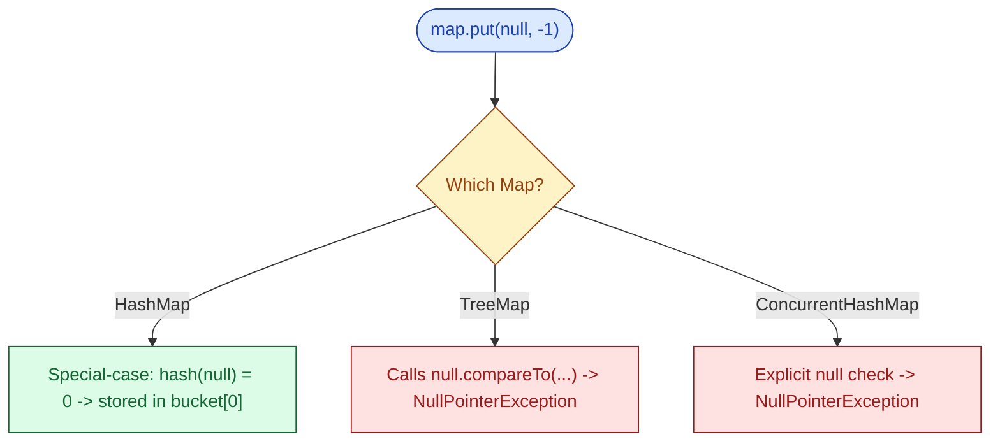

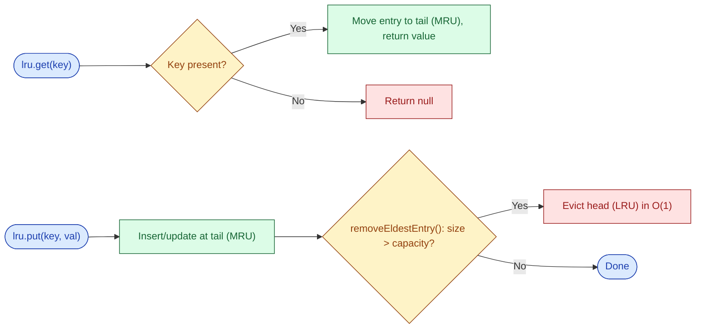

### Q1: Why does `HashMap` allow `null` keys but `TreeMap` doesn't?

- `HashMap` explicitly handles `key == null` by assigning `hash = 0` and placing it in `table[0]`.
- `TreeMap` orders keys via `Comparable.compareTo()` (or `Comparator.compare()`); calling `null.compareTo(...)` throws `NullPointerException` because `null` has no meaningful sort order unless a null-safe custom comparator (e.g., `Comparator.nullsFirst(...)`) is supplied.

```java
HashMap<String, Integer> map = new HashMap<>();
map.put(null, -1); // Allowed: special-cased to bucket 0

TreeMap<String, Integer> treeMap = new TreeMap<>();
treeMap.put(null, -1); // Throws NullPointerException during compareTo()
```

### Q2: What happens if you modify a `HashMap` while iterating?

- A fail-fast **`ConcurrentModificationException`** is thrown because `HashMap` increments `modCount` on every structural `put`/`remove`, and the iterator checks `modCount != expectedModCount` on each `next()`.
- **4 Safe Solutions:**
  1. Use `iterator.remove()` (updates `expectedModCount`).
  2. Use `removeIf()` or collect keys/entries to mutate after the loop finishes.
  3. Use `ConcurrentHashMap` (weakly consistent) or `CopyOnWriteArrayList` (snapshot fail-safe for lists).
  4. Synchronize externally or iterate over a copy (`new ArrayList<>(map.keySet())`).

### Q3: Why is `HashMap` resizing `O(n)` but `put()` is `O(1)` amortized?

- Resizing allocates a `2x` table and redistributes all `n` entries (`O(n)`), but happens at exponentially growing thresholds (`12, 24, 48, 96, ...`).
- Total resizing work across `n` insertions is the geometric sum `12 + 24 + 48 + ... <= 2n = O(n)`.
- Averaged across `n` calls to `put()`: `2n / n = O(1)` amortized time per operation.

### Q4: How would you implement an LRU cache?

- Wrap `LinkedHashMap` in **access-order** mode (`accessOrder = true`) and override `removeEldestEntry()`.
- Note: Initialize backing capacity to `(int) Math.ceil(capacity / 0.75) + 1` in production to prevent unnecessary internal resizes, and wrap with external synchronization (or `ConcurrentHashMap` + doubly-linked list) if accessed by multiple threads.

```java
public class LRUCache<K, V> {
    private final LinkedHashMap<K, V> cache;
    private final int capacity;

    public LRUCache(int capacity) {
        this.capacity = capacity;
        int initialCapacity = (int) Math.ceil(capacity / 0.75) + 1;
        this.cache = new LinkedHashMap<>(initialCapacity, 0.75f, true) {
            @Override
            protected boolean removeEldestEntry(Map.Entry<K, V> eldest) {
                return size() > LRUCache.this.capacity;
            }
        };
    }

    public V get(K key) {
        return cache.get(key); // Moves accessed key to MRU tail
    }

    public void put(K key, V value) {
        cache.put(key, value); // Inserts/moves to MRU tail; evicts LRU head if > capacity
    }
}
```

### Key Takeaway Summary

1. **HashMap:** `O(1)` average, uses hashing (`h ^ (h >>> 16)`) + linked lists/Red-Black trees (`>= 8` & `cap >= 64`), allows one `null` key.
2. **ArrayList:** `O(1)` `get`, `O(1)` amortized append (`1.5x` resize), `O(n)` mid insert/remove.
3. **LinkedList:** `O(1)` insert/remove at ends, `O(n)` random access, doubly-linked with poor cache locality.
4. **TreeMap:** `O(log n)` all ops, sorted `NavigableMap`, backed by a Red-Black tree.
5. **ConcurrentHashMap:** Thread-safe with lock-free `volatile` reads, `CAS` on empty bins, and `synchronized` per bucket head; weakly consistent iteration.
6. **LinkedHashMap:** Maintains insertion or access order (`O(1)` ops); ideal for `removeEldestEntry()` LRU cache.
7. **Collision Handling:** Separate chaining (Java `HashMap`) vs open addressing (contiguous probing, tombstones, clustering).
8. **Fail-Fast vs Fail-Safe:** `ArrayList`/`HashMap` throw `ConcurrentModificationException`; `CopyOnWriteArrayList` iterates an immutable snapshot.
9. **PriorityQueue:** Binary min-heap by default (`O(log n)` `offer`/`poll`, `O(1)` `peek`); iteration is **not** sorted.

> [!IMPORTANT]
> **Final Interview Checklist:** Always verify (1) `hashCode()`/`equals()` and `compareTo()`/`equals()` consistency, (2) `null` key/value rules (`HashMap` allows 1 null key; `TreeMap`, `PriorityQueue`, and `ConcurrentHashMap` reject null keys), (3) `modCount` fail-fast traps in `for-each` loops, and (4) `ArrayList`/`ArrayDeque` cache-locality superiority over `LinkedList`.
