# Concurrency and Multithreading - Deep Dive

## Table of Contents
1. [Thread Lifecycle](#thread-lifecycle)
2. [Runnable vs Callable](#runnable-vs-callable)
3. [Thread vs ExecutorService](#thread-vs-executorservice)
4. [synchronized Keyword](#synchronized-keyword)
5. [volatile Keyword](#volatile-keyword)
6. [java.util.concurrent Tools](#javautilconcurrent-tools)
7. [CompletableFuture](#completablefuture)
8. [Thread Pools](#thread-pools)
9. [ThreadLocal](#threadlocal)
10. [Deadlock, Livelock, Starvation](#deadlock-livelock-starvation)
11. [Atomic Variables and CAS](#atomic-variables-and-cas)
12. [Java Memory Model](#java-memory-model)
13. [Producer-Consumer Pattern](#producer-consumer-pattern)
14. [Interview Questions](#interview-questions)

---

## Thread Lifecycle

Java threads transition through 6 enum states defined in `Thread.State`. The JVM merges OS *Ready* and *Running* into a single `RUNNABLE` state because thread scheduling is controlled by the OS preemptive scheduler.

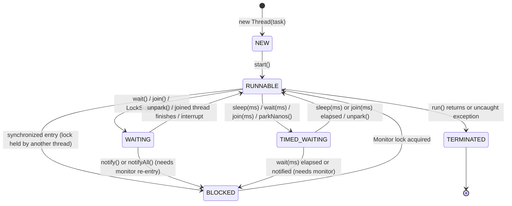

### State Transitions & Mechanics

| State | Meaning | Entry Triggers | Exit Triggers |
|-------|---------|----------------|---------------|
| `NEW` | Object allocated, OS thread not created | `new Thread(runnable)` | `thread.start()` |
| `RUNNABLE` | Executing or eligible for CPU time slice | `start()`, lock/permit acquired | Scheduler yield, blocking, return |
| `BLOCKED` | Waiting to acquire an intrinsic monitor lock | Contended `synchronized` entry | Owner exits monitor |
| `WAITING` | Parked indefinitely until signaled | `Object.wait()`, `Thread.join()`, `park()` | `notify()`, `notifyAll()`, `unpark()`, thread ends |
| `TIMED_WAITING` | Parked with a bounded deadline | `sleep(ms)`, `wait(ms)`, `join(ms)`, `parkNanos()` | Timeout expires or early signal |
| `TERMINATED` | Execution completed or crashed | `run()` finishes / uncaught exception | Cannot restart (`IllegalThreadStateException`) |

```java
// BLOCKED vs WAITING demonstration
Object monitor = new Object();

Thread waiter = new Thread(() -> {
    synchronized (monitor) {
        try {
            monitor.wait(); // Releases monitor -> WAITING
        } catch (InterruptedException e) {
            Thread.currentThread().interrupt();
        }
    }
});

Thread notifier = new Thread(() -> {
    synchronized (monitor) { // Contending thread sits in BLOCKED until waiter calls wait()
        monitor.notifyAll(); // Moves waiter from WAITING -> BLOCKED until notifier exits
    }
});
```

### Common Thread-Starting Mistakes

- **Calling `thread.run()` instead of `thread.start()`**: Executes `run()` synchronously on the caller's thread (e.g., `main`), creating no new OS thread.
- **Restarting a thread**: Calling `thread.start()` a second time (even when `TERMINATED`) throws `IllegalThreadStateException`.
- **Calling `worker.sleep(1000)`**: `Thread.sleep()` is a `static` method that pauses the **currently executing thread**, not `worker`. Use `worker.join()` to wait for `worker` to finish.

> [!WARNING]
> **30-Second Gotcha:** A thread woken by `notify()` does **not** jump straight to `RUNNABLE` and run immediately. It moves from the monitor's *Wait Set* (`WAITING`) to the *Entry Set* (`BLOCKED`) and must re-acquire the monitor lock before resuming after `wait()`.

---

## Runnable vs Callable

`Runnable` models fire-and-forget tasks; `Callable<V>` models tasks that produce a typed result and propagate checked exceptions through `Future<V>`.

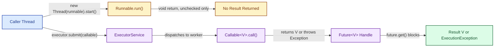

### Feature Comparison

| Feature | `Runnable` | `Callable<V>` |
|---------|------------|---------------------|
| **Package / Java Version** | `java.lang` (Java 1.0) | `java.util.concurrent` (Java 5) |
| **Method Signature** | `void run()` | `V call() throws Exception` |
| **Return Value** | None (`void`) | Generic value `V` via `Future<V>` |
| **Checked Exceptions** | Must catch/handle inside `run()` | Can throw checked exceptions directly |
| **Used With** | `Thread`, `ExecutorService`, `CompletableFuture.runAsync` | `ExecutorService.submit`, `ScheduledExecutorService` |

```java
// Runnable: must catch checked exceptions & restore interrupt flag
Runnable r = () -> {
    try {
        Thread.sleep(100);
    } catch (InterruptedException e) {
        Thread.currentThread().interrupt(); // Preserve interrupt status
    }
};

// Callable: returns value & propagates checked exceptions via Future.get()
Callable<String> c = () -> {
    if (Math.random() > 0.5) throw new IOException("Simulated error");
    return "Success";
};

ExecutorService executor = Executors.newSingleThreadExecutor();
try {
    Future<String> future = executor.submit(c);
    System.out.println(future.get()); // Blocks until complete
} catch (ExecutionException e) {
    Throwable rootCause = e.getCause(); // Unwraps IOException
    System.err.println("Task failed: " + rootCause.getMessage());
} finally {
    executor.shutdown();
}
```

> [!IMPORTANT]
> **30-Second Gotcha:** In `ExecutorService.submit(Callable)`, exceptions thrown inside `call()` are **swallowed until `future.get()` is called**, where they surface wrapped inside `ExecutionException`. In contrast, uncaught runtime exceptions inside `new Thread(runnable)` bypass the caller and invoke `Thread.UncaughtExceptionHandler`.

---

## Thread vs ExecutorService

Creating raw `Thread` instances couples task logic to expensive OS thread allocation (~1 MB stack per thread). `ExecutorService` decouples **task submission** from **thread lifecycle management** using a bounded pool of reusable workers.

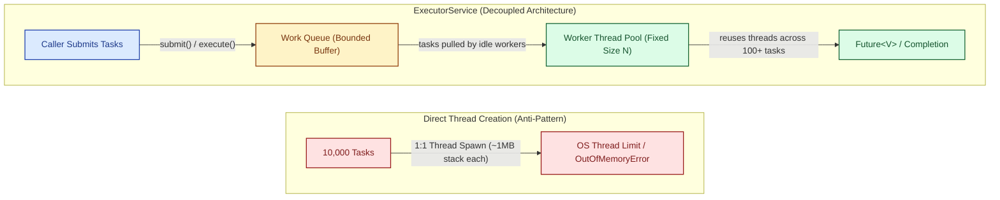

### Direct Threads vs Managed Pool

| Dimension | Direct `new Thread()` | `ExecutorService` |
|-----------|------------------------|-------------------|
| **Memory Overhead** | ~1 MB native stack per thread (`OOM` risk at scale) | Fixed/bounded worker footprint |
| **Thread Reuse** | None (create -> run -> destroy) | Workers pull next task from queue |
| **Backpressure & Control** | No queueing, no concurrency cap | Queue capacity + rejection policies |
| **Result & Lifecycle API** | Manual `join()` + shared mutable fields | `Future<V>`, `invokeAll()`, `shutdown()` |

```java
ExecutorService executor = Executors.newFixedThreadPool(4);
for (int i = 0; i < 100; i++) {
    final int taskId = i;
    executor.submit(() -> System.out.println("Task " + taskId + " on " + Thread.currentThread().getName()));
}

// Two-phase graceful shutdown
executor.shutdown(); // Stop accepting new tasks; run queued tasks
try {
    if (!executor.awaitTermination(1, TimeUnit.MINUTES)) {
        executor.shutdownNow(); // Interrupt active workers if timeout exceeded
    }
} catch (InterruptedException e) {
    executor.shutdownNow();
    Thread.currentThread().interrupt();
}
```

> [!WARNING]
> **30-Second Gotcha:** Non-daemon worker threads inside an `ExecutorService` keep the JVM alive even after `main()` exits. Always pair pool creation with `shutdown()` + `awaitTermination()` (or `try`-with-resources on Java 19+, where `ExecutorService` implements `AutoCloseable`).

---

## synchronized Keyword

Every Java object carries an intrinsic **Monitor Lock** in its object header (`Mark Word`). Entering a `synchronized` method or block executes bytecode `monitorenter`; exiting normally or via an exception executes `monitorexit`.

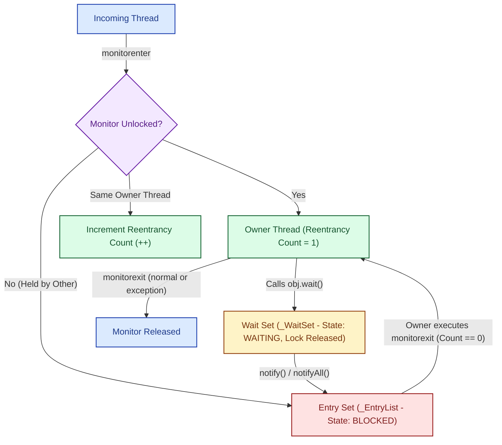

### JVM Lock Escalation (HotSpot Optimization)

To avoid OS kernel mutex syscalls under zero or low contention, the JVM upgrades locks progressively (note: Biased Locking was deprecated in JDK 15 via JEP 374):

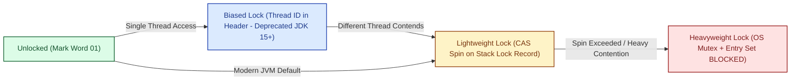

### Lock Scopes, Granularity & Reentrancy

- **Method-level vs Block-level**: `public synchronized void increment()` locks the entire method on `this` (blocking any thread calling another `synchronized` method like `getCount()`). A `synchronized (this)` (or private `lock` object) block narrows contention to just the critical section.
- **Instance vs Static Lock**:
  - Instance `synchronized`: locks `this`. `c1.increment()` and `c2.increment()` on different instances execute concurrently.
  - `static synchronized`: locks the `Class` object (`Counter.class`). Only one thread across the JVM enters any `static synchronized` method on `Counter` at a time.
- **Reentrancy**: The monitor records the owning thread and an acquisition counter. If Thread A holds `lock` in `outer()` and calls `inner()` (or nests `synchronized (lock)`), it does **not** deadlock—the counter increments and decrements back to 0 on exit.

```java
public class Counter {
    private int count = 0;
    private static int globalCount = 0;

    public synchronized void outer() {
        count++;
        inner(); // Reentrant: same thread re-acquires 'this' monitor (count = 2)
    }

    public synchronized void inner() {
        count++;
    }

    public static synchronized void incrementGlobal() {
        globalCount++; // Locks Counter.class (independent of instance 'this' locks)
    }
}
```

> [!WARNING]
> **30-Second Gotcha:** Avoid `synchronized (this)` in public classes—external callers can acquire your instance's monitor and cause unexpected deadlocks. Never synchronize on `String` literals, `Integer`/`Boolean` boxed primitives, or value-based classes because interning/caching shares monitors across unrelated code.

---

## volatile Keyword

Without `volatile`, threads cache variables in CPU registers and L1/L2 caches, and compilers/CPUs may reorder independent writes (`flag = true` before `value = 42`). Declaring a variable `volatile` inserts hardware **memory barriers** that guarantee cross-thread visibility and ordering.

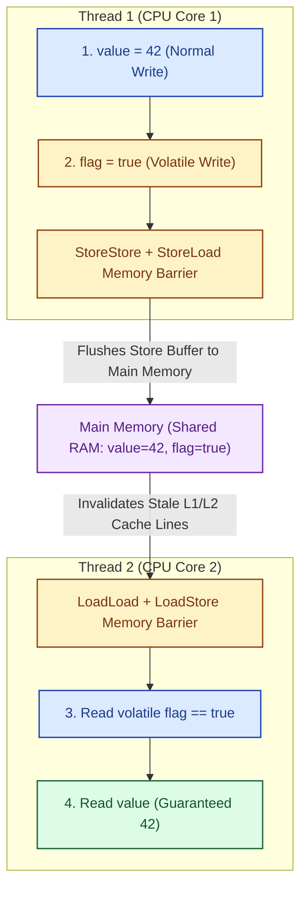

### Visibility, Piggybacking & Why `volatile` Is Not Atomic

- **Happens-Before Piggybacking**: If `value1 = 42;` (non-volatile) precedes `value2 = 100;` (`volatile`), the `volatile` write barrier forces `value1` to flush as well. Any thread reading `value2 == 100` is guaranteed to observe `value1 == 42`.
- **Compound Operations Fail (`count++`)**: Incrementing a `volatile int count` is 3 separate CPU instructions (**Read -> Add 1 -> Write**). Two threads running 1,000 increments each can both read `10`, both compute `11`, and overwrite each other—yielding `< 2000`.
- **Safe `volatile` Use Cases**: Single-writer boolean shutdown flags (`volatile boolean running = true;`), publishing immutable config objects, and double-checked locking singleton references.

| Guarantee | `volatile` | `synchronized` | `AtomicInteger` |
|-----------|------------|----------------|-----------------|
| **Cross-thread Visibility** | Yes | Yes | Yes |
| **Reordering Prevention** | Yes (barrier around access) | Yes (critical section) | Yes (volatile semantics) |
| **Compound Atomicity (`i++`)** | **No** (Race condition) | Yes (Mutual exclusion) | Yes (Hardware CAS) |
| **Blocks Threads** | No | Yes (`BLOCKED`) | No (Lock-free spin) |

> [!CAUTION]
> **30-Second Gotcha:** `volatile` guarantees **visibility and ordering, NOT atomicity**. Never use `volatile` for `count++` or check-then-act patterns (`if (!initialized) initialized = true`). Also note that `volatile` prevents 64-bit word tearing on `long` and `double` on 32-bit JVMs.

---

## java.util.concurrent Tools

The `java.util.concurrent` package provides explicit locks and thread coordinators built primarily on **AbstractQueuedSynchronizer (AQS)**—combining a `volatile int state` modified via CAS with a FIFO CLH wait queue.

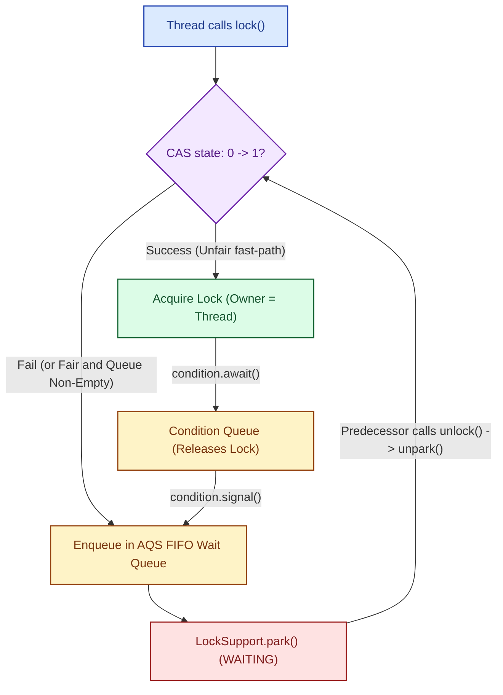

### Thread Coordination Primitives Compared

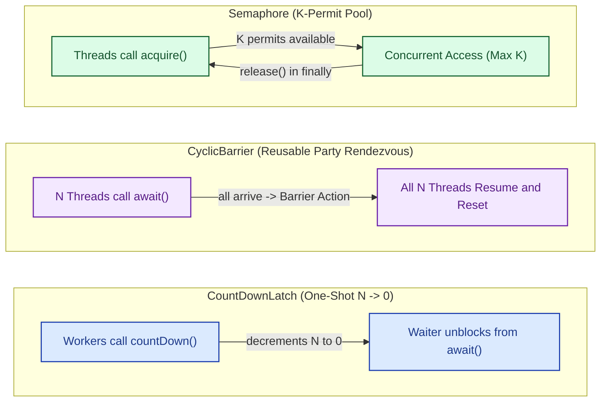

### Tool Summary & Key Distinctions

| Tool | Primary Purpose | Reusable? | Thread Ownership? | Key Advantage / Caveat |
|------|-----------------|-----------|-------------------|------------------------|
| `ReentrantLock` | Explicit mutual exclusion | Yes | Yes (reentrant) | `tryLock(timeout)`, `lockInterruptibly()`, multiple `Condition`s, `fair` FIFO option |
| `ReentrantReadWriteLock` | Concurrent reads, exclusive writes | Yes | Yes | Boosts throughput when reads >> writes; writer blocks all readers |
| `CountDownLatch` | Wait for N events/tasks | **No** (one-shot) | No | Decoupled from specific threads (unlike `Thread.join()`) |
| `CyclicBarrier` | Synchronize N peer threads per phase | **Yes** | No | Optional barrier callback; throws `BrokenBarrierException` if interrupted/timed out |
| `Semaphore` | Bound concurrent access to K slots | Yes | **No** | Any thread can call `release()`; binary `Semaphore(1)` lacks owner check |

```java
// ReentrantLock with timeout + ReadWriteLock + CountDownLatch patterns
Lock lock = new ReentrantLock(true); // Fair FIFO ordering (slower throughput, avoids starvation)
if (lock.tryLock(1, TimeUnit.SECONDS)) {
    try { /* critical section */ } finally { lock.unlock(); }
}

ReadWriteLock rwLock = new ReentrantReadWriteLock();
// Readers share rwLock.readLock(); writers acquire exclusive rwLock.writeLock()

CountDownLatch latch = new CountDownLatch(3);
// Each worker: try { doWork(); } finally { latch.countDown(); }
latch.await(); // Main thread unblocks when count reaches 0

CyclicBarrier barrier = new CyclicBarrier(3, () -> System.out.println("All parties arrived"));
// Each peer calls barrier.await(); resets automatically for next iteration

Semaphore semaphore = new Semaphore(2); // Max 2 concurrent threads
semaphore.acquire();
try { /* bounded resource */ } finally { semaphore.release(); }
```

> [!IMPORTANT]
> **30-Second Gotcha:** Unlike `synchronized`, explicit locks (`ReentrantLock`, `ReadWriteLock`) and `Semaphore` **never release automatically on exception**—always call `unlock()` / `release()` inside a `finally` block. Also remember `CountDownLatch` is one-time only, whereas `CyclicBarrier` resets automatically after each barrier trip.

---

## CompletableFuture

`CompletableFuture<T>` enables non-blocking, composable asynchronous pipelines. By default, `*Async` methods execute on `ForkJoinPool.commonPool()` unless a custom `Executor` is supplied.

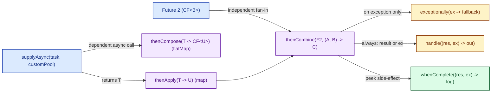

### Composition & Error Recovery API

| Method | Signature Intent | Analogous To | Modifies Pipeline Value? |
|--------|------------------|--------------|--------------------------|
| `completedFuture(v)` | Pre-completed constant future | `Optional.of(v)` | Initial value |
| `runAsync` / `supplyAsync` | Fire-and-forget (`Void`) vs value (`T`) | Async producer | Initial stage |
| `thenApply(fn)` | Synchronous/async transform (`T -> U`) | `Stream.map` | Yes |
| `thenCompose(fn)` | Chain dependent `CompletableFuture` (`T -> CF<U>`) | `Stream.flatMap` | Yes |
| `thenCombine(cf2, fn)` | Combine two independent futures `(A, B) -> C` | Parallel join | Yes |
| `exceptionally(fn)` | Recover from exception with fallback | `catch` returning default | Yes (on error only) |
| `handle(biFn)` | Transform `(result, ex)` on success or failure | `try/catch` transform | Yes (always) |
| `whenComplete(biConsumer)` | Inspect `(result, ex)` without changing output | `finally` / `peek` | **No** |

```java
CompletableFuture<Integer> f1 = CompletableFuture.supplyAsync(() -> 5)
    .thenApply(x -> x * 2)                                          // 10
    .thenCompose(x -> CompletableFuture.supplyAsync(() -> x + 10)); // 20

CompletableFuture<Integer> f2 = CompletableFuture.supplyAsync(() -> 3);

String summary = f1.thenCombine(f2, Integer::sum)                   // 23
    .handle((res, ex) -> ex != null ? "Failed: " + ex.getMessage() : "Result: " + res)
    .whenComplete((res, ex) -> System.out.println("Done: " + res))
    .join();
```

> [!WARNING]
> **30-Second Gotcha:** Never execute blocking network/DB I/O inside `supplyAsync(supplier)` without passing a dedicated `Executor`. `ForkJoinPool.commonPool()` defaults to `CPU cores - 1` threads; blocking them starves every parallel stream and `CompletableFuture` across the entire JVM.

---

## Thread Pools

`ThreadPoolExecutor` controls concurrency with 7 configuration parameters. Understanding the exact **core -> queue -> max -> reject** routing order prevents catastrophic memory leaks and unexpected task rejections.

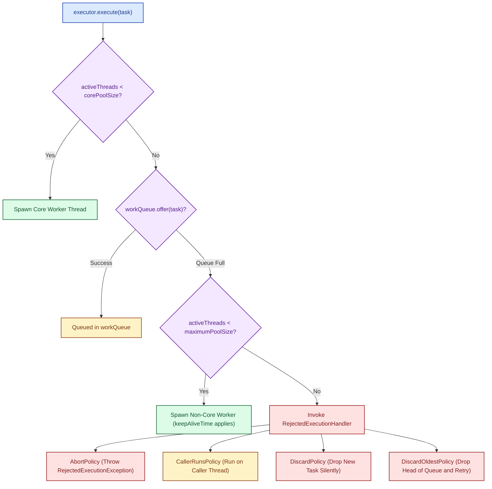

### Standard `Executors` Factories vs Custom `ThreadPoolExecutor`

| Pool Type | Core / Max Threads | Queue Type | Best For | Production Risk |
|-----------|--------------------|------------|----------|-----------------|
| `newFixedThreadPool(n)` | `n` / `n` | Unbounded `LinkedBlockingQueue` | Predictable CPU workloads | **`OOM`** if task submission outpaces execution |
| `newCachedThreadPool()` | `0` / `Integer.MAX_VALUE` (60s idle) | `SynchronousQueue` | Short-lived bursty tasks | **Thread exhaustion** (`OOM`) under spike |
| `newScheduledThreadPool(n)` | `n` / `Integer.MAX_VALUE` | `DelayedWorkQueue` | Delayed & `scheduleAtFixedRate` jobs | Unbounded max threads |
| `ForkJoinPool.commonPool()` | `cores - 1` | Work-stealing `Deque`s | Recursive divide-and-conquer | Starved by blocking I/O |
| **Custom `ThreadPoolExecutor`** | Tuned `core` / `max` | Bounded `ArrayBlockingQueue` / `LinkedBlockingQueue(cap)` | Production services | Safe backpressure via `RejectedExecutionHandler` |

```java
ThreadPoolExecutor executor = new ThreadPoolExecutor(
    4,                                      // corePoolSize: always retained
    8,                                      // maximumPoolSize: burst threads when queue is full
    60, TimeUnit.SECONDS,                   // keepAliveTime: excess threads terminate when idle
    new LinkedBlockingQueue<>(100),         // bounded workQueue
    Executors.defaultThreadFactory(),
    new ThreadPoolExecutor.CallerRunsPolicy() // backpressure: slows caller instead of dropping
);

// Dynamic runtime tuning
executor.setCorePoolSize(6);
executor.setMaximumPoolSize(12);
```

> [!CAUTION]
> **30-Second Gotcha:** `maximumPoolSize` is **completely ignored** if you pass an unbounded queue (`new LinkedBlockingQueue<>()`), because `workQueue.offer()` never returns `false`! Always bound your queue capacity and choose a `RejectedExecutionHandler` (`CallerRunsPolicy` provides natural backpressure).

---

## ThreadLocal

`ThreadLocal` gives every thread its own isolated variable copy without locking—implemented via a `ThreadLocal.ThreadLocalMap` field stored inside each `Thread` object.

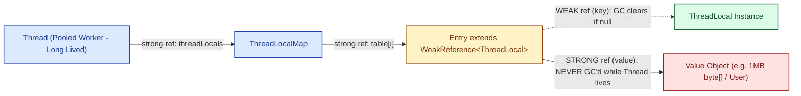

### Request-Context Isolation & Preventing Leaks

- **How It Works**: `threadLocal.set(val)` writes to `Thread.currentThread().threadLocals` keyed by the `ThreadLocal` instance. Downstream methods in the same call stack call `threadLocal.get()` without passing context parameters everywhere.
- **Why Memory Leaks Happen in Thread Pools**:
  1. `Entry` holds a **WeakReference** to the `ThreadLocal` key, so if the `ThreadLocal` variable is dereferenced, GC collects the key, leaving a *stale entry* (`key == null`).
  2. However, `Entry` holds a **Strong Reference** to the `value`. Because `ExecutorService` worker threads live indefinitely, `Thread -> ThreadLocalMap -> Entry -> Value` stays strongly reachable, causing **memory leaks (`OutOfMemoryError`)** and **cross-request context contamination**.

```java
private static final ThreadLocal<User> USER_CONTEXT = new ThreadLocal<>();
private static final ThreadLocal<byte[]> BUFFER = ThreadLocal.withInitial(() -> new byte[1024 * 1024]);

void handleRequest(long userId) {
    USER_CONTEXT.set(loadUser(userId));
    try {
        byte[] buf = BUFFER.get();
        processRequest(buf); // Reads USER_CONTEXT.get() anywhere on this thread
    } finally {
        USER_CONTEXT.remove(); // CRITICAL: clears Entry from ThreadLocalMap before thread returns to pool
        BUFFER.remove();
    }
}
```

> [!CAUTION]
> **30-Second Gotcha:** Weak keys alone do **not** prevent `ThreadLocal` memory leaks—the **value** is strongly referenced by the thread! Always call `.remove()` inside a `finally` block in thread pools to avoid both `OutOfMemoryError` and leaking User A's context into User B's request.

---

## Deadlock, Livelock, Starvation

Concurrency liveness failures occur when threads cannot make forward progress—either permanently frozen (`Deadlock`), spinning uselessly (`Livelock`), or perpetually denied resources (`Starvation`).

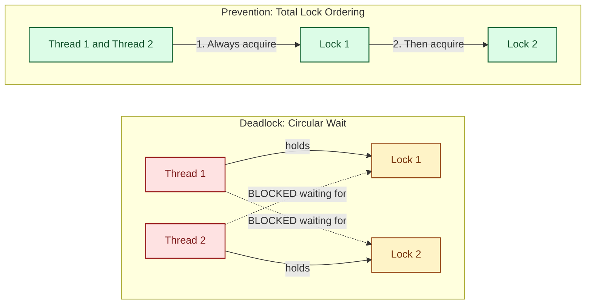

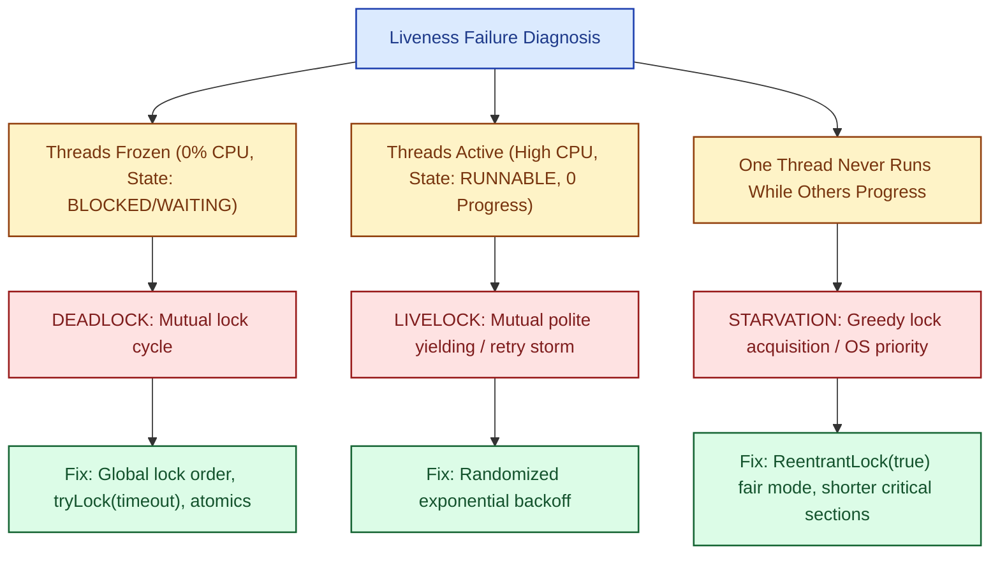

### Coffman's 4 Conditions for Deadlock & Fixes

Deadlock requires **all four** Coffman conditions simultaneously; breaking any one prevents it:
1. **Mutual Exclusion**: Resource held exclusively -> *Break with lock-free structures (`ConcurrentHashMap`, `Atomic*`).*
2. **Hold and Wait**: Holding one lock while waiting for another -> *Break by acquiring all locks upfront or using `tryLock(timeout)` + releasing held locks on failure.*
3. **No Preemption**: Locks cannot be forcibly reclaimed -> *Break with `tryLock` + timeout/interruption.*
4. **Circular Wait**: Cyclic dependency chain (`T1 -> L2 -> T2 -> L1`) -> *Break with **global lock ordering** (always lock `minId` before `maxId`), minimizing critical section scope, and avoiding nested locks.*

### Livelock vs Starvation

- **Livelock**: Threads are **not blocked** (`RUNNABLE`), constantly changing state in response to each other (e.g., two threads calling `Thread.yield()` or releasing locks politely at the exact same cadence) and making zero progress.
- **Starvation**: A thread repeatedly loses lock/CPU contention to unfair threads or higher-priority threads. Fixed using `new ReentrantLock(true)` (fair FIFO queue) and minimizing lock hold times.

> [!IMPORTANT]
> **30-Second Gotcha:** Deadlocks leave threads stuck at 0% CPU (`BLOCKED` in `jstack` or `ThreadMXBean.findDeadlockedThreads()`), whereas livelocks spike CPU usage while accomplishing zero work. Breaking **Circular Wait** via consistent lock ordering is the cleanest prevention strategy.

---

## Atomic Variables and CAS

`java.util.concurrent.atomic` classes (`AtomicInteger`, `AtomicLong`, `AtomicBoolean`, `AtomicReference`) provide lock-free, thread-safe updates using **Compare-And-Swap (CAS)** hardware instructions (`Unsafe.compareAndSwapInt` / `VarHandle`, compiled to CPU `LOCK CMPXCHG`).

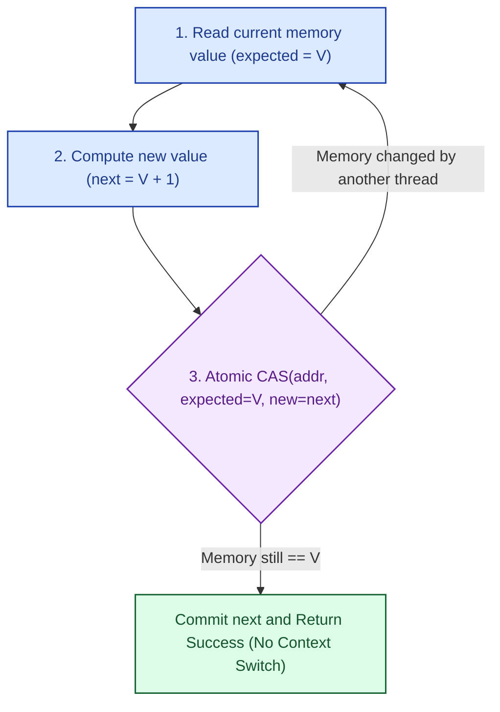

### The ABA Problem & `AtomicStampedReference`

If Thread 1 reads `A`, pauses, and Thread 2 mutates `A -> B -> A`, Thread 1's naive `CAS(A, C)` sees `A` and falsely assumes nothing changed. Pairing the value with a monotonically increasing version stamp (`AtomicStampedReference`) closes this hole:

```mermaid
flowchart LR
    S0["Initial: [Value=A, Stamp=1]"] -->|"Thread 1 reads (A, stamp=1) then pauses"| S1["Thread 2 CAS(A-&gt;B, 1-&gt;2)"]
    S1 --> S2["Thread 2 CAS(B-&gt;A, 2-&gt;3)"]
    S2 --> T1_R["Thread 1 resumes: CAS(A-&gt;C, expectedStamp=1)"]
    T1_R -->|"Current Stamp is 3 != 1"| FAIL["CAS FAILS Safely (ABA Detected)"]

    classDef blue fill:#dbeafe,stroke:#1e40af,color:#1e3a8a,stroke-width:1.5px;
    classDef amber fill:#fef3c7,stroke:#92400e,color:#78350f,stroke-width:1.5px;
    classDef green fill:#dcfce7,stroke:#166534,color:#14532d,stroke-width:1.5px;

    class S0,S1,S2 blue;
    class T1_R amber;
    class FAIL green;
```

### Atomic Operations, Spin-Locks & Contention Tradeoffs

```java
AtomicInteger count = new AtomicInteger(0);
count.incrementAndGet();          // Atomic ++count
count.getAndAdd(5);               // Atomic add, returns old value
boolean updated = count.compareAndSet(6, 20); // true only if current == 6

// Spin-lock via AtomicBoolean (use ONLY for ultra-short critical sections)
AtomicBoolean lock = new AtomicBoolean(false);
while (!lock.compareAndSet(false, true)) {
    // Busy-spins CPU; wastes cycles compared to blocking locks if held long
}
try { /* ultra-short work */ } finally { lock.set(false); }
```

- **Low/Moderate Contention**: CAS outperforms `synchronized` because there is no OS thread suspension or context switch.
- **Extreme Write Contention**: CAS retry loops spin heavily on the same cache line, degrading throughput—prefer `LongAdder` (striped cell counters) for high-contention metrics/counters.

> [!IMPORTANT]
> **30-Second Gotcha:** CAS is **optimistic and non-blocking**—no thread context switches under light contention, which beats `synchronized`. However, heavy contention triggers CAS retry storms (use `LongAdder`), and reference-based lock-free structures (like stacks/queues) must use `AtomicStampedReference` to defeat the `ABA` problem.

---

## Java Memory Model

The **Java Memory Model (JMM)** defines **Happens-Before** guarantees across CPU caches, store buffers, and compiler/hardware reorderings. If Action `A` *happens-before* Action `B`, `B` is guaranteed to observe the memory effects of `A`.

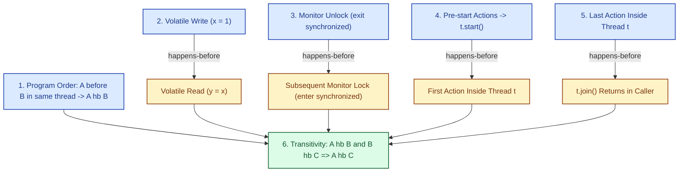

### Core Happens-Before Rules

| Rule | Guarantee | Practical Example |
|------|-----------|-------------------|
| **Program Order** | Statements execute *as-if-serial* within a single thread | `a = 1; b = a;` always sees `a == 1` in same thread |
| **Volatile Variable** | Write to `volatile` `hb` every subsequent read of same variable | Thread 2 sees `flag == true` -> sees pre-write updates |
| **Monitor Lock** | `unlock(lock)` `hb` every subsequent `lock(lock)` | Writes inside `synchronized(lock)` visible to next owner |
| **Thread Start** | All actions before `t.start()` `hb` any action inside `t` | Variables initialized before `t.start()` are safe in `t` |
| **Thread Termination** | All actions inside `t` `hb` caller returning from `t.join()` | Main thread safely reads `t`'s computed fields after `join()` |
| **Transitivity** | `A hb B` and `B hb C` implies `A hb C` | Non-volatile `value1 = 42` before `volatile flag = true` is visible after reading `flag` |

```java
// Monitor Lock + Thread Start + Termination happens-before rules
int preStartValue = 42;
Thread t = new Thread(() -> {
    // Guaranteed to see preStartValue == 42 via Thread Start Rule
    System.out.println(preStartValue);
});
t.start();
t.join(); // Caller guaranteed to see all writes made inside t via Termination Rule
```

> [!IMPORTANT]
> **30-Second Gotcha:** *Happens-before* is a **visibility ordering**, not wall-clock time. If Thread A writes a regular field 5 seconds before Thread B reads it *without* a happens-before edge (`volatile`, monitor, `start`/`join`, or `final` publication), the JVM is legally allowed to return the stale value to Thread B.

---

## Producer-Consumer Pattern

The Producer-Consumer pattern decouples producers from consumers via a bounded buffer, enforcing backpressure when full and blocking when empty.

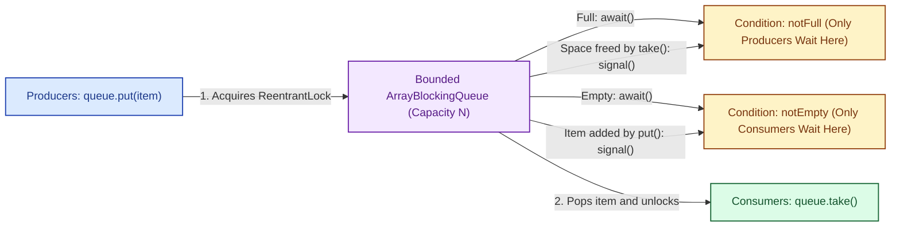

### Manual `wait/notifyAll` vs `BlockingQueue`

```java
// Manual BoundedBuffer: MUST use 'while' (spurious wakeups) and 'notifyAll()'
public class BoundedBuffer<T> {
    private final Queue<T> buffer = new LinkedList<>();
    private final int capacity;

    public BoundedBuffer(int capacity) { this.capacity = capacity; }

    public synchronized void put(T item) throws InterruptedException {
        while (buffer.size() >= capacity) { // NEVER 'if': guard spurious wakeups & multi-producer races
            wait();
        }
        buffer.add(item);
        notifyAll(); // Wake consumers (notify() risks waking another waiting producer!)
    }

    public synchronized T take() throws InterruptedException {
        while (buffer.isEmpty()) {
            wait();
        }
        T item = buffer.poll();
        notifyAll();
        return item;
    }
}

// Production-ready BlockingQueue: internal locks & separate notFull / notEmpty conditions
BlockingQueue<Integer> queue = new LinkedBlockingQueue<>(5); // Or ArrayBlockingQueue<>(5)
// Producer: queue.put(item);   // Blocks cleanly if full
// Consumer: Integer item = queue.take(); // Blocks cleanly if empty
```

### `BlockingQueue` API Behavior Matrix

| Operation | Throws Exception | Returns Special Value | Blocks Indefinitely | Times Out |
|-----------|------------------|-----------------------|---------------------|-----------|
| **Insert** | `add(e)` | `offer(e)` (`false` if full) | `put(e)` | `offer(e, time, unit)` |
| **Remove** | `remove()` | `poll()` (`null` if empty) | `take()` | `poll(time, unit)` |
| **Examine** | `element()` | `peek()` (`null` if empty) | N/A | N/A |

- **`ArrayBlockingQueue`**: Backed by a fixed array with **1 `ReentrantLock`** and 2 `Condition` queues (`notFull`, `notEmpty`).
- **`LinkedBlockingQueue`**: Backed by linked nodes with **2 independent locks** (`putLock`, `takeLock`) for higher concurrent producer/consumer throughput.

> [!WARNING]
> **30-Second Gotcha:** In manual `wait/notify` buffers, always check the condition in a **`while` loop** (not `if`) to guard against spurious wakeups and stolen conditions, and call **`notifyAll()`** (not `notify()`), because `notify()` can wake a thread of the wrong role (e.g., producer waking another producer while consumers sleep -> deadlock).

---

## Interview Questions

### Concurrency Primitive Selection & Troubleshooting Tree

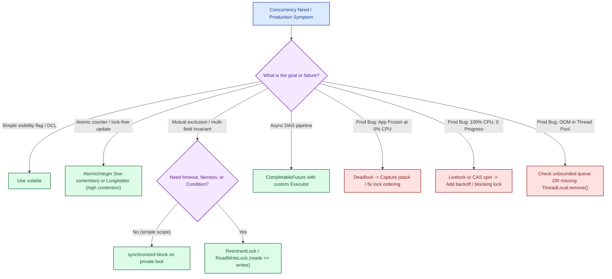

### Rapid-Fire Concurrency Troubleshooting Matrix

| Production Symptom | Most Likely Cause | Diagnostic Signal | Immediate Fix |
|--------------------|-------------------|-------------------|---------------|
| Requests hang, CPU ~0% | **Deadlock** or pool thread starvation | `jstack` shows `BLOCKED` cycle or waiting on `commonPool` | Enforce lock ordering; isolate blocking I/O to custom pool |
| CPU pinned at 100%, no throughput | **Livelock** or hot `AtomicBoolean` spin | Thread dump shows `RUNNABLE` in retry/yield loop | Add randomized backoff or replace spin with `Lock` |
| Heap grows linearly in `ExecutorService` | Unbounded queue or leaked **`ThreadLocal`** | Heap dump shows `LinkedBlockingQueue` or `ThreadLocalMap$Entry` | Bound queue + `CallerRunsPolicy`; call `ThreadLocal.remove()` in `finally` |
| Lost counter updates despite `volatile` | Non-atomic read-modify-write (`count++`) | Final count < expected under load | Replace with `AtomicInteger` / `LongAdder` / `synchronized` |

---

### Q1: Explain the difference between `synchronized` and `volatile`
- **`synchronized`**: Provides **mutual exclusion** (only one thread executes the critical section at a time) **and** memory **visibility/ordering** (monitor unlock happens-before next lock). Supports compound operations like `count++` safely.
- **`volatile`**: Provides **visibility and reordering prevention only** (via memory barriers). Multiple threads can read/write simultaneously, so compound read-modify-write operations (`count++`) still suffer race conditions.

### Q2: What causes deadlock and how do you prevent it?
Deadlock occurs when threads hold exclusive locks while cyclically waiting for locks held by each other (`T1` holds `L1`, waits for `L2`; `T2` holds `L2`, waits for `L1`).

**5 Prevention Strategies:**
1. **Global lock ordering**: Always acquire locks in the exact same deterministic order.
2. **Timeouts**: Use `ReentrantLock.tryLock(timeout, unit)` instead of indefinite blocking.
3. **Higher-level concurrent structures**: Use `ConcurrentHashMap`, `BlockingQueue`, and `Atomic*` instead of manual locking.
4. **Minimize critical sections**: Keep synchronized blocks short; never perform blocking I/O or `sleep()` inside them.
5. **Avoid nested locks**: Release the first lock before acquiring another whenever possible.

### Q3: What is the difference between `wait()` and `sleep()`?

| Dimension | `Object.wait()` | `Thread.sleep(ms)` |
|-----------|-----------------|--------------------|
| **Class Owner** | `java.lang.Object` (instance method) | `java.lang.Thread` (`static` method) |
| **Monitor Lock** | **Releases** monitor lock immediately | **Keeps** all held locks |
| **Calling Context** | Must be called inside `synchronized` block (`IllegalMonitorStateException` otherwise) | Can be called anywhere |
| **Wakeup Trigger** | `notify()` / `notifyAll()` (or timeout/interrupt) | Elapsed timeout (or interrupt) |
| **Purpose** | Inter-thread condition signaling | Timed execution delay |

### Q4: How do you implement a thread-safe Singleton?

Use **Double-Checked Locking (DCL)** with `volatile` (or the Bill Pugh static inner class holder / `enum` singleton):

```java
public class ThreadSafeSingleton {
    // 'volatile' is MANDATORY: prevents instruction reordering of object construction
    private static volatile ThreadSafeSingleton instance;

    private ThreadSafeSingleton() {}

    public static ThreadSafeSingleton getInstance() {
        if (instance == null) {                              // 1st check (fast path, no lock)
            synchronized (ThreadSafeSingleton.class) {
                if (instance == null) {                      // 2nd check (under monitor)
                    instance = new ThreadSafeSingleton();
                }
            }
        }
        return instance;
    }
}
```

> [!IMPORTANT]
> **30-Second Gotcha (Why `volatile` Is Mandatory in DCL):** `instance = new ThreadSafeSingleton()` is 3 steps: (1) allocate memory, (2) run constructor, (3) assign reference to `instance`. Without `volatile`, the JVM/CPU can reorder steps (2) and (3)—allowing another thread at the first `if (instance == null)` check to receive a **partially constructed, half-initialized object**!

---

### Key Takeaway Summary
1. **Threads**: Always use `ExecutorService`, not direct `new Thread()` creation; manage `shutdown()` lifecycle carefully.
2. **Synchronization**: Use `synchronized` for simple critical sections and `ReentrantLock` for timeouts, fairness, or multiple `Condition`s.
3. **Visibility**: `volatile` guarantees visibility and ordering—never atomicity. Use it for flags, DCL references, and happens-before publication.
4. **Atomics**: Prefer `AtomicInteger`/`AtomicLong` (or `LongAdder` under heavy contention) over `volatile` + manual locks for counters.
5. **Concurrent Collections**: Prefer `ConcurrentHashMap` over `Collections.synchronizedMap` for vastly higher concurrent read/write throughput.
6. **Thread Pools**: Avoid unbounded queues/threads in `Executors.*`; configure explicit `ThreadPoolExecutor` bounds and `RejectedExecutionHandler`.
7. **Composition**: Prefer `CompletableFuture` (with custom I/O executors) over raw `Thread`/`Future` plumbing for async DAGs.
8. **Avoid**: `volatile` without understanding happens-before, `ThreadLocal` without `remove()` in `finally`, and `Thread.sleep()` inside `synchronized` blocks.
