# JVM Internals and Memory Management - Deep Dive

## Table of Contents
1. [JVM Architecture](#jvm-architecture)
2. [Memory Areas](#memory-areas)
3. [Garbage Collection Algorithms](#garbage-collection-algorithms)
4. [GC Tuning](#gc-tuning)
5. [Class Loading](#class-loading)
6. [JIT Compilation](#jit-compilation)
7. [Memory Leaks](#memory-leaks)
8. [OutOfMemoryError Types](#outofmemoryerror-types)
9. [Advanced Features](#advanced-features)
10. [Interview Questions](#interview-questions)

---

## JVM Architecture

The Java Virtual Machine (JVM) decouples platform-neutral `.class` bytecode from OS-specific hardware. `javac` compiles `.java` source into bytecode, which the JVM loads, verifies, manages in runtime memory, and translates at runtime into native machine instructions.

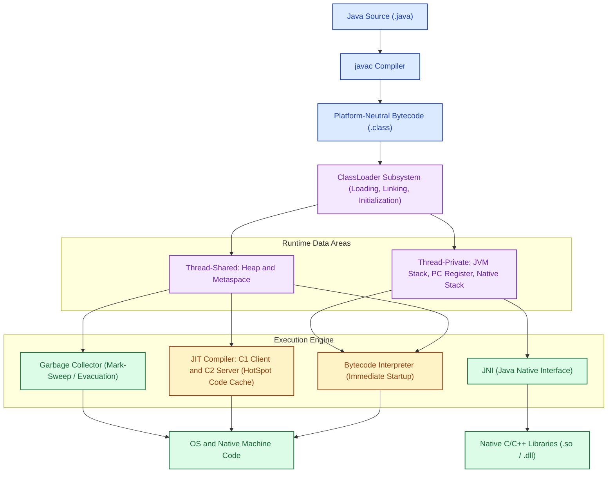

### Core Subsystem Breakdown

| Subsystem | Role & Mechanics | Performance / Runtime Trade-off |
| :--- | :--- | :--- |
| **ClassLoader Subsystem** | Loads `.class` streams via parent delegation (`Bootstrap -> Platform/Ext -> App`), links, and initializes classes. | Lazy loading avoids loading unused classes at boot; classpath order determines first-match wins. |
| **Bytecode Interpreter** | Decodes and executes bytecode instruction by instruction at startup. | Zero compilation delay for fast startup, but slow throughput (orders of magnitude slower than native code); handles cold or overly complex methods. |
| **JIT Compiler** | Detects hot methods (~1,500 calls) and loops (~15,000 iterations), compiling bytecode into native machine code via C1 & C2. | 10–100x faster execution; compilation CPU cost is amortized across subsequent invocations. |
| **Garbage Collector** | Automatically reclaims unreachable heap objects (Serial, Parallel, CMS, G1, ZGC). | Eliminates manual `free()` bugs, but introduces stop-the-world (STW) pause vs. CPU overhead trade-offs. |
| **JNI & Native Libraries** | Bridges managed Java code to OS system calls and C/C++ libraries. | Bypasses JVM memory safety; native leaks sit outside Java Heap limits. |

> [!IMPORTANT]
> **30-Second Revision:** Java achieves "Write Once, Run Anywhere" because `javac` produces identical bytecode on every platform while the **JVM Execution Engine** combines fast-start **interpretation** with adaptive **JIT native compilation** (C1 for quick warmup, C2 for peak optimization).

---

## Memory Areas

JVM runtime memory is strictly partitioned into **Thread-Shared** regions (created at JVM startup, cleaned by GC or class unloading) and **Thread-Private** regions (created per OS/Java thread, reclaimed automatically when the thread exits).

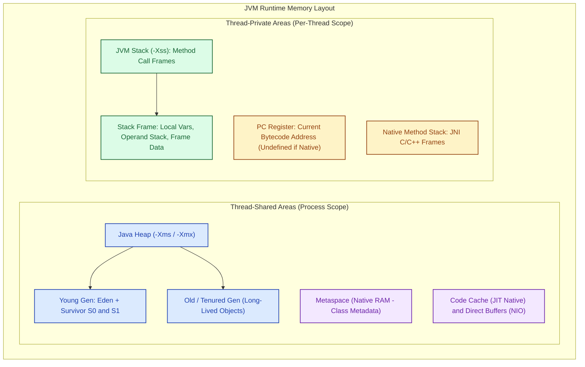

### Region Reference & Generational Hypothesis

| Memory Area | Scope | What It Stores | Sizing Flags | Reclaimed By |
| :--- | :--- | :--- | :--- | :--- |
| **Java Heap** | Thread-Shared | All object instances and arrays (`new`) | `-Xms`, `-Xmx`, `-Xmn` | Garbage Collector |
| **Metaspace** | Thread-Shared (Native) | Class definitions, method signatures, field metadata, runtime constant pool (replaced PermGen in Java 8) | `-XX:MetaspaceSize`, `-XX:MaxMetaspaceSize` | ClassLoader GC & unloading |
| **JVM Stack** | Thread-Private | One stack frame per active method call (local primitives, object references, operand stack) | `-Xss` (per thread) | Popped on method return (no GC) |
| **PC Register** | Thread-Private | Address of currently executing bytecode instruction (`undefined` for JNI native methods); drives exception handling & debugging | Fixed / internal | Thread exit |
| **Native Method Stack** | Thread-Private | Call state and native allocations for JNI (C/C++) calls | OS / `-Xss` | Native stack pop |

### Why Generational Heap Layout Works

- **Weak Generational Hypothesis:** Most objects die young (temporary DTOs, iterators, `StringBuilder`s), and very few Old Gen objects reference Young Gen objects.
- **Fast Young Allocation:** New objects are allocated rapidly in **Eden** (via Thread-Local Allocation Buffers / TLAB pointer bumping).
- **Survivor Ping-Pong (`S0` / `S1`):** One Survivor space is always `From` and the other is `To`. Survivors of Minor GC are copied to `To`, their age increments, and `From`/`To` swap roles—avoiding fragmentation without compacting all of memory.
- **Metaspace vs. PermGen:** Moving metadata to native memory in Java 8+ enabled automatic growth/shrinking and eliminated fixed PermGen tuning, though Metaspace can still OOM on ClassLoader leaks or runaway dynamic class generation.

> [!WARNING]
> **Interview Gotcha:** JVM Stack frames are **never garbage collected**—they are deterministically pushed on call and popped on return. Object **references** live in Stack frames while the actual **objects** live on the Heap (unless eliminated by Escape Analysis). Exceeding stack depth throws `StackOverflowError`, whereas spawning too many threads multiplies `-Xss` native usage and can exhaust OS memory.


---

## Garbage Collection Algorithms

### Object Allocation & Promotion Lifecycle

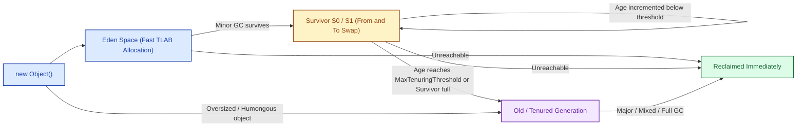


### Collector Architecture & Selection Flow

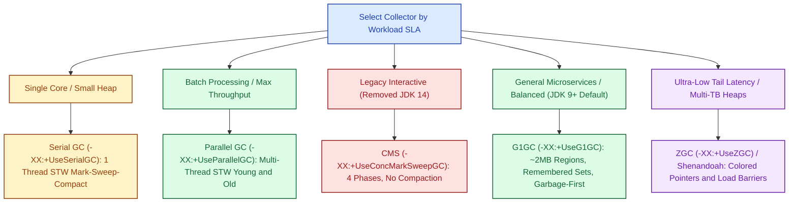

### Garbage Collector Comparison

| Collector | Flag & Status | How It Works | Pause Profile | Trade-offs & Edge Cases |
| :--- | :--- | :--- | :--- | :--- |
| **Serial GC** | `-XX:+UseSerialGC` | Single thread marks from GC roots (stack locals, static fields, JNI), sweeps, and compacts. | Very long STW pauses across the whole heap | Minimal memory footprint; suited only for single-CPU or small containers (`<100MB`). |
| **Parallel GC** | `-XX:+UseParallelGC` (Java 8 default) | Multiple threads (`-XX:ParallelGCThreads=N`) mark and compact Young & Old Gens in parallel. | Shorter than Serial, still scales with heap size | Maximum **throughput**, zero concurrent overhead, but STW pauses block all app threads. |
| **CMS GC** | `-XX:+UseConcMarkSweepGC` (Deprecated JDK 9, Removed JDK 14) | 1. **Initial Mark** (STW roots) -> 2. **Concurrent Mark** -> 3. **Remark** (STW dirty cards) -> 4. **Concurrent Sweep**. | Low pauses (split phases) | **No compaction -> fragmentation**. If heap fills mid-mark, **Concurrent Mode Failure** triggers a slow Serial Full GC. |
| **G1GC** | `-XX:+UseG1GC` (Java 9+ default) | Splits heap into equal regions (~1–32MB; often ~2MB+). Tracks cross-region pointers via **Remembered Sets (RSets)**. Runs Young-only and Mixed collections prioritizing garbage-dense regions. | Predictable soft target (`-XX:MaxGCPauseMillis=200`) | Compacts on evacuation (no fragmentation); higher write-barrier/RSet RAM overhead; spikes if target pause is unrealistic or evacuation fails. |
| **ZGC** | `-XX:+UseZGC` (Generational in JDK 21+) | Concurrent mark, relocate, and remap on multi-TB heaps using **Colored Pointers** (metadata in 64-bit refs) and self-healing **Load Barriers**. | Sub-ms to `<10ms` regardless of heap size | Higher CPU barrier overhead and extra memory headroom; trades peak throughput for flat tail latency. |
| **Shenandoah** | `-XX:+UseShenandoahGC` (OpenJDK) | Concurrent compaction/evacuation while application threads run, coordinated via load-reference & write barriers. | `<10ms` pauses | Similar latency profile to ZGC; does not require colored 64-bit pointer bits. |

> [!IMPORTANT]
> **30-Second Revision:** **Parallel GC** optimizes raw throughput (default in JDK 8); **G1GC** optimizes predictable pauses using region-based evacuation and Remembered Sets (default in JDK 9+); **ZGC/Shenandoah** eliminate long compaction pauses via concurrent evacuation with **Colored Pointers / Load Barriers**.

---

## GC Tuning

### Symptom Diagnosis & Flag Selection Tree

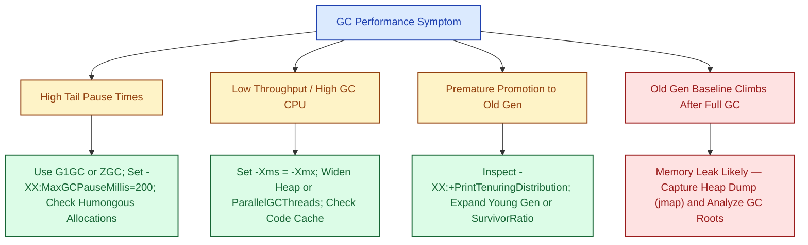

### Essential Tuning & Logging Flags

```bash
# 1. Heap Sizing (Rule: lock -Xms == -Xmx to prevent runtime heap-resizing pauses)
java -Xms4G -Xmx4G -XX:+UseG1GC -XX:MaxGCPauseMillis=200 -jar app.jar
# Young Gen sizing for Parallel/Serial (1/4 to 1/3 of heap; avoid pinning -Xmn under G1GC!)
java -Xms2G -Xmx2G -Xmn640M -XX:+UseParallelGC -jar batch.jar

# 2. Unified GC Logging (Java 9+) vs. Legacy Logging (Java 8)
-Xlog:gc*:file=gc.log:time,level,tags
-XX:+PrintGCDetails -XX:+PrintGCTimeStamps -Xloggc:gc.log   # Java 8 style

# 3. Diagnostic Flags (Always require -XX:+UnlockDiagnosticVMOptions)
-XX:+UnlockDiagnosticVMOptions -XX:+PrintFlagsFinal -XX:+PrintTenuringDistribution -XX:+G1SummarizeRSetStatsPeriod=0
```

### Monitoring Tools & Log Analysis Checklist

```bash
# Real-time GC utilization every 1000ms for 10 samples
# Columns: S0, S1, E (Eden), O (Old), M (Metaspace), CCS, YGC, YGCT, FGC, FGCT
jstat -gcutil <pid> 1000 10
jstat -gccapacity <pid>      # Generation capacities
jstat -gccause <pid>         # Reason for last and current GC

# Heap dump & class histogram
jmap -dump:live,format=b,file=heap.bin <pid>
jmap -histo <pid> | head -n 25

# Thread dump & modern unified diagnostic commands
jstack <pid> > threads.txt
jcmd <pid> GC.heap_info
```

- **GUI & Log Analyzers:** **JVisualVM** (real-time heap, CPU, threads, leak detection; supersedes `jconsole`), **GCeasy**, **GCViewer**, and **JDK Mission Control (JMC)**.
- **4 GC Log Red Flags:**
  1. **Pause duration** exceeding SLA (`MaxGCPauseMillis` misses).
  2. **GC frequency** spiking (allocation rate too high or heap too small).
  3. **Post-GC heap baseline rising** monotonically (classic memory leak indicator).
  4. **Old Gen filling rapidly** (undersized Young Gen causing premature promotion).

> [!WARNING]
> **Tuning Gotcha:** Never hard-code `-Xmn` (fixed Young Gen) when using **G1GC**. G1 dynamically shrinks and expands the Young region count to meet `-XX:MaxGCPauseMillis`; pinning `-Xmn` disables that feedback loop and causes pause-target violations.

---

## Class Loading

### Parent Delegation Hierarchy

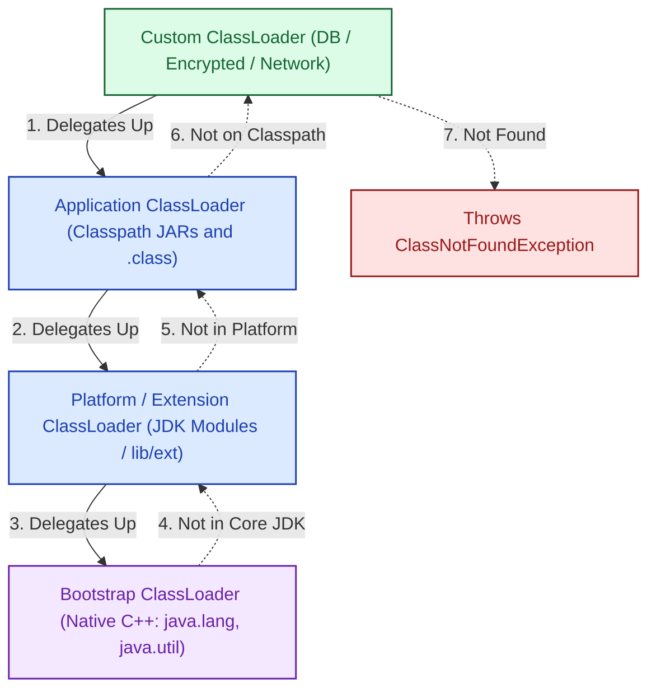

### Class Lifecycle: Loading -> Linking -> Initialization

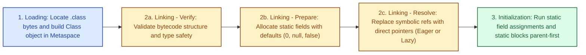

### Delegation Mechanics & Edge Cases

1. **Lookup Order:** Check if already loaded -> delegate up to parent recursively -> if parent returns nothing, child calls `findClass()`.
2. **Core Guarantees:**
   - **Security:** Core classes (`java.lang.String`) always load from Bootstrap—user classpath classes cannot spoof JDK security-critical types.
   - **No Duplicates:** A class is uniquely identified by `(fully-qualified name, defining ClassLoader)`.
   - **Classpath Conflict Rule:** When multiple JARs on the classpath contain the same class, the **first JAR on the classpath wins** (others are ignored).
3. **Java 8 vs. Java 9+:** Java 8 used `Extension ClassLoader` (`jdk/jre/lib/ext`); Java 9+ replaced it with `Platform ClassLoader` (`jdk/conf/modules` / JPMS).

```java
// Inspecting the delegation chain
System.out.println(String.class.getClassLoader());                 // null (Bootstrap C++ loader)
System.out.println(java.util.ArrayList.class.getClassLoader());    // null (Bootstrap C++ loader)
ClassLoader appLoader = MyApp.class.getClassLoader();              // AppClassLoader
ClassLoader platformOrExt = appLoader.getParent();                 // PlatformClassLoader (Ext in Java 8)
System.out.println(platformOrExt.getParent());                     // null (Bootstrap)

// Custom ClassLoader (DB, encrypted jar, runtime bytecode)
class CustomClassLoader extends ClassLoader {
    @Override
    protected Class<?> findClass(String name) throws ClassNotFoundException {
        byte[] bytes = readBytecodeFromCustomSource(name);
        return defineClass(name, bytes, 0, bytes.length);
    }
    private byte[] readBytecodeFromCustomSource(String name) { return new byte[0]; }
}
```

### Initialization Order & Lazy Loading Triggers

```java
public class InitializationOrderTrap {
    static int value = 10;              // Preparation sets 0; Initialization sets 10
    static { value = 20; }              // Executed next in textual order -> value = 20
    static int other = value;           // Evaluates to 20 (Parent class always initializes first)
}
```

| Triggers Class Initialization | Does NOT Trigger Initialization |
| :--- | :--- |
| `new MyClass()` instantiation | Implementing an interface (unless default methods trigger or initialized separately) |
| Calling `static` method or accessing non-constant `static` field | Accessing compile-time constant (`public static final int X = 5`) |
| `Class.forName("com.example.MyClass")` | `MyClass.class` literal or `ClassLoader.loadClass(...)` (loads only) |
| Initializing a subclass (initializes parent first) | Referencing an unused inner class or annotations (depends on `RetentionPolicy`) |

> [!IMPORTANT]
> **Interview Gotcha (Breaking Parent Delegation):** SPI frameworks like **JDBC `DriverManager`** (`ServiceLoader`), Tomcat (per-WAR isolation), and OSGi intentionally bypass upward delegation using the **Thread Context ClassLoader (`TCCL`)** or child-first loading—because `Bootstrap`-loaded core classes cannot directly see application-classpath vendor drivers!

---

## JIT Compilation

HotSpot monitors method invocations (~1,500 threshold in C1, higher for C2) and loop back-edges (~15,000 iterations, triggering **On-Stack Replacement / OSR** mid-loop). Once hot, background compiler threads compile bytecode without stalling application threads, and subsequent calls jump into native code stored in the **Code Cache**.

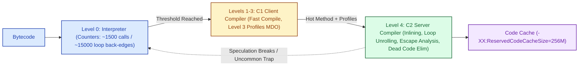

### Tiered Compilation Levels & Key Optimizations

| Tier | Compiler Mode | Purpose & Characteristics |
| :--- | :--- | :--- |
| **Level 0** | Interpreter | Immediate startup; counts method invocations and loop iterations. |
| **Level 1** | Simple C1 | Fast compilation with **no profiling** (for trivial getters/setters that C2 cannot improve). |
| **Level 2** | Limited C1 | Lightweight invocation/back-edge counters; used as fallback when C2 queue is congested. |
| **Level 3** | Full C1 + Profiling | Collects **Method Data Object (MDO)** profiles (branch odds, receiver types) to guide C2. |
| **Level 4** | C2 Server Compiler | Slowest compile, peak native speed via speculative optimizations, aggressive inlining, loop unrolling, dead code elimination, and escape analysis / scalar replacement. |

- **Method Inlining & Speculation:** Small hot calls (e.g., `String result = getResult();` returning `"value"`) are folded directly into the caller, eliminating call-frame overhead and enabling dead-code removal. If C2 speculates a branch never throws and that assumption later breaks, JVM triggers **Deoptimization** back to Level 0 Interpreter.
- **Tuning Flags:** `-XX:CompileThreshold=10000`, `-XX:OnStackReplacePercentage=200`.
- **Code Cache Exhaustion:** Stored outside the Java Heap (`-XX:ReservedCodeCacheSize=256M`, monitor via `jstat -codercache <pid>` or `jcmd <pid> Compiler.codecache`). When full, JVM logs a *"CodeCache is full. Compiler has been disabled"* warning—new/recompiled methods stay stuck at unoptimized tiers, causing sharp throughput degradation. Fix with `-XX:ReservedCodeCacheSize=512M` or `-XX:NonTieredCompileQueueSize=1000`.

> [!WARNING]
> **Interview Gotcha:** Don't confuse **Java Heap** with **Code Cache**. Increasing `-Xmx` will NOT prevent JIT compilation from stalling when the native Code Cache fills up—nor will it reduce warmup latency before Level 4 C2 finishes compiling hot paths.

---

## Memory Leaks

A Java memory leak occurs when objects are no longer needed by business logic yet remain **strongly reachable from GC Roots**, preventing the Garbage Collector from reclaiming them.

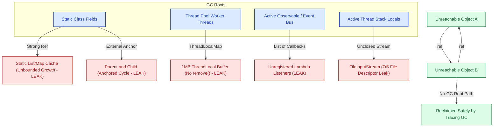

### 5 Classic Leak Patterns & Fixes

| Pattern | Root Cause | Fix / Prevention |
| :--- | :--- | :--- |
| **1. Unbounded Static Collections** | `static List<String> cache = new ArrayList<>();` retains every inserted item for JVM lifetime. | Use bounded caches (Caffeine/LRU with `maximumSize` & TTL) or `WeakHashMap` for metadata caches. |
| **2. `ThreadLocal` in Thread Pools** | Worker threads in `Executors.newFixedThreadPool(4)` never die; `ThreadLocal` values stay pinned in `ThreadLocalMap` across tasks. | Always call `buffer.remove()` in a `finally` block (or use Java 21+ `ScopedValue`). |
| **3. Unregistered Listeners** | Calling `observable.subscribe(() -> {})` adds strong references (and captured outer `this`) that are never removed. | Pair every `subscribe()` with `unsubscribe()`, or store `WeakReference<Listener>`. |
| **4. Unclosed File / Socket Handles** | Creating `FileInputStream` / `BufferedReader` without closing leaks OS file descriptors until `Too many open files`. | Always wrap `Closeable` / `AutoCloseable` resources in `try-with-resources`. |
| **5. Anchored Circular References** | `Parent <-> Child` cycle stays alive if an external root (static field, listener, active thread) still points to either node. | Break the external anchor or use `WeakReference` for back-pointers (`Child -> Parent`). |

```java
// Leak #2 Fix: ThreadLocal cleanup in pooled threads
static final ThreadLocal<byte[]> BUFFER = ThreadLocal.withInitial(() -> new byte[1024 * 1024]);

executor.submit(() -> {
    try {
        byte[] data = BUFFER.get();
        process(data);
    } finally {
        BUFFER.remove(); // Mandatory to prevent ThreadLocal leak in pools!
    }
});

// Leak #4 Fix: Automatic OS handle cleanup
try (BufferedReader reader = new BufferedReader(new InputStreamReader(new FileInputStream(path)))) {
    String line = reader.readLine();
}
```

### Detection Workflow

1. **GC Log Baseline Check:** If Old Gen occupancy **fails to drop** after every Full GC and Full GC frequency increases, you have a leak.
2. **Heap Dump Diffing:** Capture snapshots at `T1` and `T2` with `jmap -dump:live,format=b,file=heap.bin <pid>` and inspect the **Dominator Tree** and **Path to GC Roots** in **Eclipse MAT**, **JProfiler**, or **YourKit**.
3. **Runtime / APM Telemetry:** Track `Runtime.getRuntime().totalMemory() - freeMemory()` trendlines alongside **GCeasy**, **Datadog**, or **New Relic**.

> [!IMPORTANT]
> **Interview Gotcha:** HotSpot uses a **tracing GC**, NOT reference counting—so an isolated cycle (`parent -> child -> parent` after `parent = null`) is **automatically collected**. Circular references only leak in Java when a live GC Root holds an external reference into the cycle, or when non-static inner classes implicitly hold `OuterClass.this`.

---

## OutOfMemoryError Types

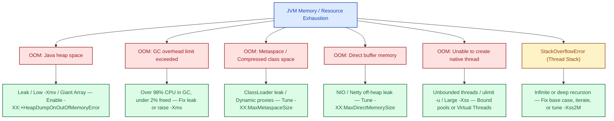

### Diagnostic & Mitigation Matrix

| Error Type | Exhausted Area | Common Causes | Diagnostic Flag / Tool | Fix |
| :--- | :--- | :--- | :--- | :--- |
| **`OutOfMemoryError: Java heap space`** | Heap (Young/Old) | Memory leak, `-Xmx` too low for live set, single array allocation `> heap`. | `-XX:+HeapDumpOnOutOfMemoryError` `-XX:HeapDumpPath=/tmp/heapdump.bin` | Analyze Dominator Tree in MAT; fix leak or increase `-Xmx`. |
| **`OutOfMemoryError: GC overhead limit exceeded`** | Heap + CPU Thrashing | `>98%` of total time spent in GC while recovering `<2%` of heap across 5 consecutive GCs. | GC logs (`-Xlog:gc*`) + `jstat -gcutil` | Fix heap leak or increase `-Xmx` (avoid disabling via `-XX:-UseGCOverheadLimit`). |
| **`OutOfMemoryError: Metaspace`** *(or `Compressed class space`)* | Native Class Metadata | Dynamic bytecode generation (CGLib, ByteBuddy, reflection proxies) or `URLClassLoader` hot-redeploy leaks. | `jcmd <pid> VM.classloader_stats`, MAT | Fix ClassLoader leaks, reuse proxies, tune `-XX:MetaspaceSize=128M -XX:MaxMetaspaceSize=512M`. |
| **`OutOfMemoryError: Direct buffer memory`** | Off-Heap NIO Buffers | `ByteBuffer.allocateDirect()` or Netty `ByteBuf` leaks; uncollected cleaners waiting on GC. | `-XX:NativeMemoryTracking=summary`, Netty leak detector | Pool/release off-heap buffers; tune `-XX:MaxDirectMemorySize`. |
| **`OutOfMemoryError: Unable to create native thread`** | OS Threads / Native RAM | Unbounded thread creation (`newCachedThreadPool`), low OS `ulimit -u`, or huge `-Xss` exhausting native RAM. | `jstack`, `ulimit -u`, `ps -eLf` | Bound thread pools, reduce `-Xss` (e.g., `256k`), raise OS limits, or adopt **Virtual Threads** (JDK 21+). |
| **`StackOverflowError`** *(Error, not OOM)* | Per-Thread JVM Stack | Infinite recursion (missing base case), ultra-deep recursion, or tiny `-Xss`. | Stack trace repeating frames | Fix base case, convert recursion to iteration, or increase `-Xss2M`. |

```java
// Triggering & diagnosing Heap OOM vs. Metaspace OOM vs. StackOverflowError
// 1. Heap OOM: while (true) list.add(new byte[1024 * 1024]);
// 2. Metaspace leak: repeated unclosed ClassLoader load loops:
ClassLoader loader = new URLClassLoader(new URL[] { new File("classes").toURI().toURL() });
// 3. StackOverflowError: void recursion() { recursion(); } // No base case
```

> [!WARNING]
> **Container / Kubernetes Gotcha:** `-Xmx` caps **only the Java Heap**. Total container RSS equals `Heap + Metaspace + Code Cache + Direct Buffers + (Threads * -Xss)`. If `-Xmx` consumes 90%+ of container RAM, the Linux kernel OOM-Killer terminates the JVM (`SIGKILL`, Exit Code `137`) with **no heap dump and no `OutOfMemoryError`**.

---

## Advanced Features

### JIT Escape Analysis & String Deduplication Pipeline

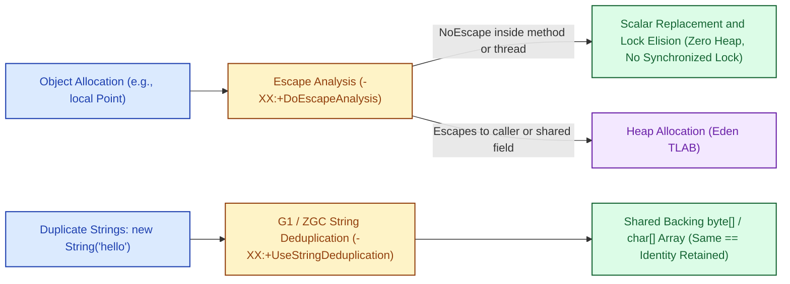

### Production Diagnostic CLI Decision Tree

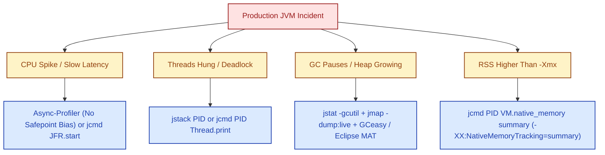

### Deep-Dive Mechanics

- **G1/ZGC String Deduplication (`-XX:+UseStringDeduplication`):** Unlike `String.intern()` (which populates the global string table and risks contention), GC-driven deduplication detects distinct `String` objects with identical character content during collection and points both to the **same backing `char[]` (Java 8) or `byte[]` (Java 9+ Compact Strings)**—preserving distinct `String` object headers and `==` semantics while drastically cutting string-heavy heap usage.
- **Escape Analysis (`-XX:+DoEscapeAnalysis`, enabled by default):**
  - **Scalar Replacement (`-XX:+EliminateAllocations`):** If `Point p = new Point(1, 2);` never escapes `localOnly()` (not returned, not stored in a field, not passed out), C2 skips heap allocation entirely and decomposes `p.x` and `p.y` into CPU registers or stack slots—zero GC overhead.
  - **Lock Elision (`-XX:+EliminateLocks`):** If an object never escapes the executing thread, JIT strips redundant `synchronized` monitor acquisition/release instructions (e.g., local `StringBuffer` or unescaped helper calls).
- **Modern Profiling Tools (`jcmd`, JFR, Async-Profiler):** Prefer `jcmd` as the unified replacement for older tools (`jcmd <pid> JFR.start duration=60s filename=rec.jfr`), and use **Async-Profiler** when hunting CPU/allocation hotspots because sampling-only profilers suffer from **safepoint bias**.

```java
// Escape Analysis: Scalar Replacement + Lock Elision in action
public int localOnly() {
    Point p = new Point(1, 2); // Never escapes -> scalar-replaced in registers/stack (0 heap bytes!)
    return p.distance();
}

public synchronized int getValue() { return 42; }
public void caller() {
    // If receiver doesn't escape thread, JIT eliminates synchronized lock overhead
    getValue();
}
```

> [!IMPORTANT]
> **30-Second Revision:** HotSpot rarely allocates full object structs on the stack—instead, **Escape Analysis** enables **Scalar Replacement** (breaking non-escaping objects into primitive registers/locals) and **Lock Elision** (removing uncontended monitors). Meanwhile, `-XX:+UseStringDeduplication` shares backing byte arrays asynchronously inside GC without `String.intern()` overhead.

---

## Interview Questions

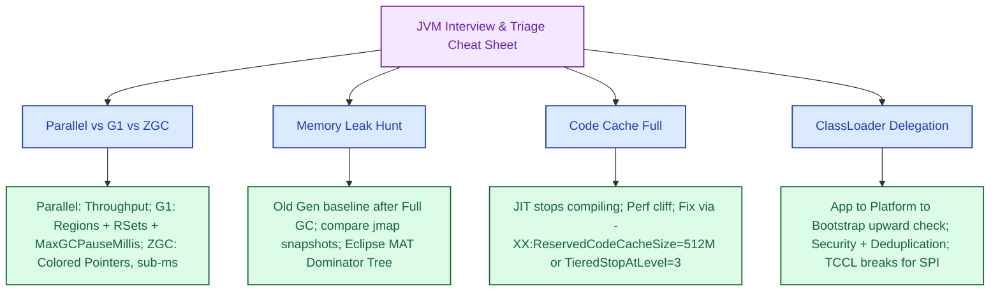

### Q1: What's the difference between Parallel GC and G1GC?

| Dimension | Parallel GC (`-XX:+UseParallelGC`) | G1GC (`-XX:+UseG1GC`) |
| :--- | :--- | :--- |
| **Heap Layout** | Contiguous fixed generations (Young & Old). | Divided into equal-sized dynamic regions (~1–32MB; often ~2MB+). |
| **Collection Strategy** | Collects the entire Young or Old generation at once. | Young-only & Mixed collections targeting garbage-richest regions ("Garbage-First") using Remembered Sets. |
| **Pause Time** | Proportional to total heap / live set size (can spike on large heaps). | Predictable soft target via `-XX:MaxGCPauseMillis=200`. |
| **Throughput** | Highest raw throughput (minimal write-barrier overhead). | Slightly lower throughput due to Remembered Sets and concurrent marking overhead. |
| **Best Workload** | Batch jobs, offline ETL, CPU-bound throughput services. | Interactive microservices, large heaps (`>4GB`), predictable latency SLAs (JDK 9+ default). |

---

### Q2: How do you detect if an application has a memory leak?

1. **Check Old Gen Baseline in GC Logs:** After every Full GC, Old Gen usage should drop back to a steady floor; if the post-Full-GC floor climbs monotonically, a leak exists.
2. **Watch GC Frequency & CPU:** Escalating Full GC frequency (`jstat -gcutil <pid> 1000`) eventually leads to `GC overhead limit exceeded`.
3. **Compare Heap Dumps Over Time:** Capture two live dumps (`jmap -dump:live,format=b,file=heap.bin <pid>`) separated by load and compare retained sizes in **Eclipse MAT**, **JProfiler**, **YourKit**, or **GCeasy**.
4. **Audit Common Culprits:** Unbounded `static` maps/lists, `ThreadLocal` values missing `.remove()` in thread pools, unregistered listeners, and unclosed streams/sockets.

---

### Q3: What happens when the Code Cache is full?

- **Effect:** The Code Cache holds JIT-compiled native machine code outside the Java Heap. Once full, JVM logs a *"compilation disabled"* warning and stops compiling new hot methods—leaving newly exercised paths stuck in slow interpretation or partially optimized tiers, causing a sudden latency/throughput cliff.
- **Prevention & Tuning:**
  - Increase capacity: `-XX:ReservedCodeCacheSize=512M`
  - Cap compilation depth if needed: `-XX:TieredStopAtLevel=3` (avoids heavier C2 native footprint)
  - Monitor proactively: `jstat -codercache <pid>` or `jcmd <pid> Compiler.codecache`.

---

### Q4: Explain the ClassLoader delegation model.

- **Parent-First Flow:** When `AppClassLoader` receives a class load request, it first checks its cache, then delegates upward (`App -> Platform/Extension -> Bootstrap`). Only if the parent cannot locate the class does the child attempt `findClass()`.
- **Why It Exists:**
  1. **Security:** Guarantees core JDK classes (`java.lang.String`) always load from Bootstrap and cannot be replaced by malicious/accidental classpath JARs.
  2. **Deduplication:** Prevents the same class from being loaded multiple times across loaders.
  3. **Isolation:** Enforces clean namespace boundaries.
- **Custom Loaders & Exceptions:** Custom `ClassLoader` subclasses (overriding `findClass()` + `defineClass()`) load classes from databases, encrypted files, or runtime-generated bytecode (Spring, Hibernate, OSGi). Frameworks like **JDBC (`ServiceLoader`)** intentionally invert delegation using the **Thread Context ClassLoader (`TCCL`)** so core JDK classes can load application-classpath drivers.

---

### Q5: Why can `OutOfMemoryError: Unable to create native thread` happen even when the Java Heap has plenty of free space?

- **Answer:** Threads consume **native OS memory** (including `-Xss` per thread stack) and OS process/thread quota (`ulimit -u`), which reside **outside `-Xmx`**. Creating thousands of OS threads (e.g., via an unbounded `Executors.newCachedThreadPool()`) exhausts native memory or kernel thread limits even when Heap usage is near zero. Fix by bounding thread pools, trimming `-Xss` (e.g., `-Xss256k`), raising `ulimit -u`, or migrating blocking I/O to **Virtual Threads** (Java 21+).

> [!IMPORTANT]
> **Interview Framing Formula:** For any JVM diagnostic question, state: **(1) Which region** is affected (`Heap` vs `Metaspace` vs `Code Cache` vs `Direct/Native` vs `Thread Stack`), **(2) Which tool** proves it (`jstat`, `jmap`, `jstack`, `jcmd`, JFR, Async-Profiler), and **(3) Which flag or code fix** resolves it.

---

**Key Takeaway Summary:**

1. **JVM:** Bytecode interpreter (fast startup) + adaptive tiered JIT compiler (~1,500 calls, C1/C2, 10–100x speedup) + automatic GC.
2. **Memory:** Thread-shared Heap (Young Eden/S0/S1 + Old Gen), native Metaspace, and Code Cache vs. thread-private JVM Stack (popped on return), PC Register, and Native Stack.
3. **GC Algorithms:** Serial (single-thread), Parallel (max throughput), CMS (low latency, fragmented, removed JDK 14), G1GC (regions + RSets, predictable pauses, JDK 9+ default), ZGC/Shenandoah (colored pointers/barriers, sub-ms pauses).
4. **Memory Leaks:** Strongly reachable GC Root paths via static collections, pooled `ThreadLocal`s, listeners, unclosed resources, or anchored cycles—diagnosed via `jmap` + Eclipse MAT + GC baseline trends.
5. **Class Loading:** `App -> Platform/Ext -> Bootstrap` parent delegation for security & deduplication, plus `Loading -> Linking (Verify, Prepare, Resolve) -> Initialization`.
6. **Tuning:** Match collector to SLA, set `-Xms = -Xmx`, monitor with `jstat`/`jmap`/`jcmd`/JFR, and avoid pinning `-Xmn` under G1GC.
7. **OutOfMemory & Stack:** Distinguish Heap exhaustion, GC thrashing, Metaspace/ClassLoader leaks, Direct buffer leaks, native thread exhaustion, and `StackOverflowError`.
