# Java 8+ Features - Deep Dive

## Table of Contents
1. [Lambda Expressions](#lambda-expressions)
2. [Functional Interfaces](#functional-interfaces)
3. [Method References](#method-references)
4. [Stream API](#stream-api)
5. [Optional](#optional)
6. [Interface Enhancements](#interface-enhancements)
7. [Java 9+ Features](#java-9-features)
   - [Java 9 Modules (JPMS)](#java-9-modules-jpms)
   - [Java 10 var Keyword](#java-10-var-keyword)
   - [Java 14 and 16 Records](#java-14-and-16-records)
   - [Java 17 Sealed Classes](#java-17-sealed-classes)
   - [Java 21 Pattern Matching for switch](#java-21-pattern-matching-for-switch)
   - [Java 21 Virtual Threads (Project Loom)](#java-21-virtual-threads-project-loom)
8. [Performance and Anti-Patterns](#performance-and-anti-patterns)
9. [Interview Questions](#interview-questions)

---

## Lambda Expressions

Lambda expressions provide a concise way to implement a **Single Abstract Method (SAM)** interface without the bytecode bloat and scoping quirks of anonymous inner classes.

### Runtime Linkage (`invokedynamic`) vs Anonymous Inner Class

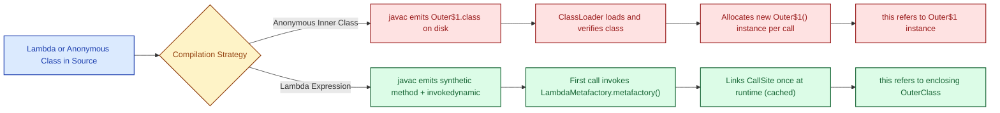

### Core Mechanics & Scoping Rules

| Aspect | Lambda Expression | Anonymous Inner Class |
| :--- | :--- | :--- |
| **Bytecode Mechanism** | `invokedynamic` + `LambdaMetafactory` (no extra `.class` file) | Generates `Outer$N.class` at compile time |
| **`this` Reference** | Refers to the **enclosing class** (`OuterClass`) | Refers to the **anonymous class instance** itself |
| **Lexical Scope** | Shares enclosing block scope (cannot shadow local vars) | Introduces a new scope (can shadow outer vars) |
| **Variable Capture** | Local vars must be `final` or **effectively final** | Local vars must be `final` or **effectively final** |
| **Target Type** | Functional interface only (1 abstract method) | Any interface or abstract/concrete class |

- **Syntax forms**: `() -> expr`, `item -> expr` (single param), `(a, b) -> expr` (type-inferred), `(Integer a, Integer b) -> expr` (explicit types), `() -> { statements; }`.
- **Why effectively final?** Lambdas capture local variables **by value** (copied into the call-site arguments) rather than by stack reference. If the outer local variable mutated after capture, the lambda's snapshot would silently diverge and cause thread-safety bugs.
- **Instance & static fields** are *not* restricted to effectively final because they are accessed through the captured `this` reference or class reference.

```java
public class LambdaDeepDive {
    private int instanceField = 10;

    public void syntaxAndCapture() {
        // Concise syntax forms
        Runnable r1 = () -> System.out.println("Running");
        BinaryOperator<Integer> add = (Integer a, Integer b) -> a + b;
        BinaryOperator<Integer> multiply = (a, b) -> a * b;
        Runnable block = () -> {
            int value = 10;
            System.out.println(value + " Done");
        };

        // Effectively final capture & loop trap
        int outerVar = 10;
        Runnable ok = () -> System.out.println(outerVar); // outerVar never reassigned

        List<Runnable> tasks = new ArrayList<>();
        for (int i = 0; i < 3; i++) {
            // tasks.add(() -> System.out.println(i)); // Compile error: i mutates
            final int copy = i;                        // Effectively final per iteration
            tasks.add(() -> System.out.println(copy)); // Prints 0, 1, 2
        }
    }

    public void thisReferenceDifference() {
        Runnable lambda = () -> System.out.println(this.instanceField); // 'this' = LambdaDeepDive

        Runnable anon = new Runnable() {
            @Override
            public void run() {
                // System.out.println(this.instanceField); // Compile error: 'this' = Runnable
                System.out.println(LambdaDeepDive.this.instanceField);
            }
        };
    }
}
```

> [!IMPORTANT]
> **30-Second Revision:** Lambdas are **not** syntactic sugar for anonymous inner classes. `javac` lowers them via `invokedynamic` and `LambdaMetafactory`, avoiding `.class` file bloat, keeping `this` bound to the enclosing class, and copying local variables by value (requiring them to be **effectively final**).

---

## Functional Interfaces

A functional interface has **exactly one abstract method (SAM)**, optionally enforced at compile time with `@FunctionalInterface`. Any number of `default`, `static`, or `Object` methods (`equals`, `hashCode`, `toString`) do not count toward the abstract method limit.

### `java.util.function` Taxonomy

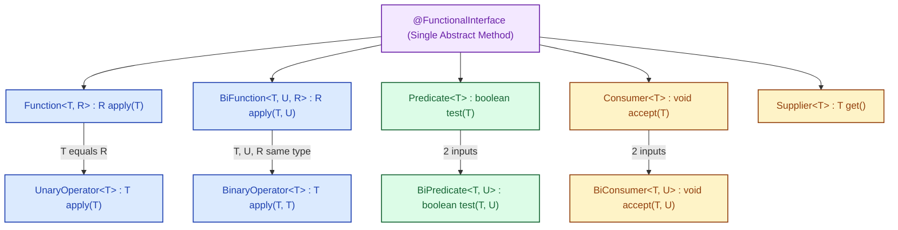

### Core Interface Reference & Primitive Specializations

| Interface | SAM Signature | Composition Methods | Primitive Examples (Zero Boxing) |
| :--- | :--- | :--- | :--- |
| `Function<T, R>` | `R apply(T t)` | `andThen`, `compose`, `identity` | `IntFunction<R>`, `ToIntFunction<T>` |
| `UnaryOperator<T>` | `T apply(T t)` | Inherits `Function` methods | `IntUnaryOperator`, `LongUnaryOperator` |
| `BiFunction<T, U, R>` | `R apply(T t, U u)` | `andThen` | `ToIntBiFunction<T, U>` |
| `BinaryOperator<T>` | `T apply(T a, T b)` | `minBy`, `maxBy`, `andThen` | `IntBinaryOperator`, `DoubleBinaryOperator` |
| `Predicate<T>` | `boolean test(T t)` | `and`, `or`, `negate`, `Predicate.not` (11+) | `IntPredicate`, `BiPredicate<T, U>` |
| `Consumer<T>` | `void accept(T t)` | `andThen` | `IntConsumer`, `BiConsumer<T, U>` |
| `Supplier<T>` | `T get()` | Lazy factory / deferred execution | `BooleanSupplier`, `IntSupplier` |

```java
@FunctionalInterface
public interface Converter<T, R> {
    R convert(T value);

    // Default and static methods do not break the SAM contract
    default void printOriginal(T value) {
        System.out.println("Original: " + value);
    }
}

public void compositionAndLazySupplier() {
    Function<Integer, Integer> add5 = x -> x + 5;
    Function<Integer, Integer> multiplyBy2 = x -> x * 2;

    // Order matters: andThen runs left-to-right; compose runs right-to-left
    int res1 = add5.andThen(multiplyBy2).apply(10); // (10 + 5) * 2 = 30
    int res2 = add5.compose(multiplyBy2).apply(10); // (10 * 2) + 5 = 25

    // Predicate logic
    Predicate<Integer> isEven = x -> x % 2 == 0;
    Predicate<Integer> complex = isEven.and(x -> x > 0).and(x -> x < 10); // 4 -> true, -2/11 -> false

    // Supplier for lazy instantiation: each get() creates a distinct list
    Supplier<List<String>> lazyList = ArrayList::new;
    List<String> list1 = lazyList.get();
    List<String> list2 = lazyList.get(); // Different object reference from list1

    // Custom functional interface
    Converter<Integer, String> intToHex = Integer::toHexString;
    System.out.println(intToHex.convert(255)); // "ff"
}
```

> [!WARNING]
> **Composition Order Trap:** `f.compose(g)` executes **`g` first** (`f(g(x))`), whereas `f.andThen(g)` executes **`f` first** (`g(f(x))`). Also remember `Supplier<T>` returns a fresh evaluation per `.get()` call, making it ideal for deferred initialization.

---

## Method References

Method references (`::`) are compact shorthand for lambdas that merely forward their arguments to an existing method or constructor without extra inline logic.

### The 4 Method Reference Forms

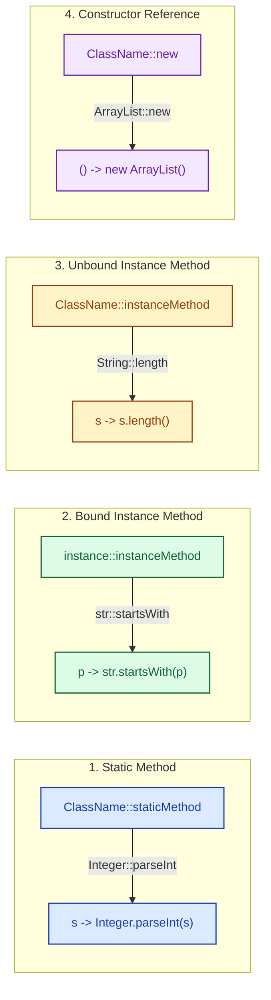

### Method Reference vs Lambda Decision Guide

| Type | Syntax | Equivalent Lambda | Example |
| :--- | :--- | :--- | :--- |
| **Static Method** | `ClassName::staticMethod` | `(args) -> ClassName.staticMethod(args)` | `Integer::parseInt`, `Integer::compare` |
| **Bound Instance** | `instance::method` | `(args) -> instance.method(args)` | `str::startsWith`, `System.out::println` |
| **Unbound Instance** | `ClassName::method` | `(target, args) -> target.method(args)` | `String::length`, `String::isEmpty` |
| **Constructor** | `ClassName::new` | `(args) -> new ClassName(args)` | `ArrayList::new`, `int[]::new` |

- **Use Method References** when an existing method matches the functional signature and its name directly communicates intent (`list.forEach(System.out::println)`, `.filter(String::isEmpty)`).
- **Prefer Lambdas** when inline transformation is needed or no single existing method matches (`list.forEach(s -> System.out.println(s.toUpperCase()))`).

```java
public void allMethodReferenceForms() {
    // 1. Static
    Function<String, Integer> parse = Integer::parseInt;
    List<Integer> nums = Arrays.asList(3, 1, 4, 1, 5);
    Collections.sort(nums, Integer::compare);

    // 2. Bound instance (captures 'str' receiver at reference creation time)
    String str = "hello";
    Function<String, Boolean> startsWith = str::startsWith; // true for "he"
    nums.forEach(System.out::println);

    // 3. Unbound instance (1st lambda parameter becomes the method receiver)
    Function<String, Integer> len = String::length;         // "hello" -> 5
    List<String> words = Arrays.asList("apple", "", "cherry");
    words.stream().filter(String::isEmpty).forEach(System.out::println);

    // 4. Constructor (overload selected by target functional interface signature)
    Supplier<List<String>> noArg = ArrayList::new;          // new ArrayList<>()
    Function<Integer, List<String>> sized = ArrayList::new; // new ArrayList<>(10)
    Function<Collection<String>, List<String>> copy = ArrayList::new;
}
```

> [!IMPORTANT]
> **Bound vs Unbound Subtlety:** In a bound reference (`str::startsWith`), the receiver expression (`str`) is evaluated **immediately** when the reference is created (throwing a `NullPointerException` right away if `str` is `null`), whereas in an unbound reference (`String::length`), the target receiver is passed in as the first parameter at invocation time.

---

## Stream API

A `Stream` is a lazy, single-use data processing pipeline over a source (`Collection`, array, generator). It never mutates the underlying data source and executes **depth-first (vertically)** per element only when a terminal operation triggers evaluation.

### Lazy Pipeline Evaluation & Short-Circuiting


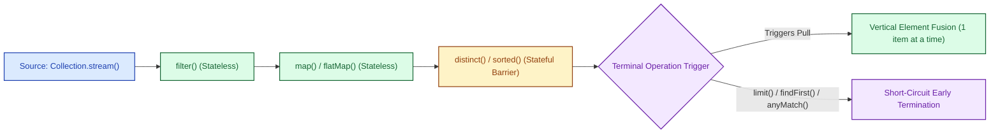

### Parallel Stream Splitting (`Spliterator` + `ForkJoinPool`)

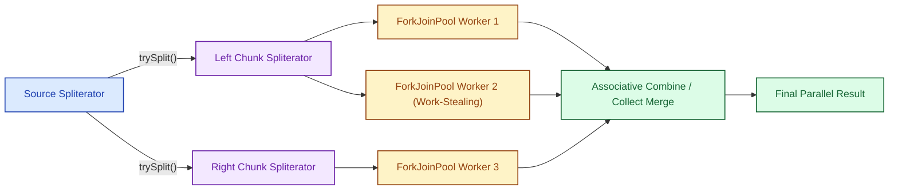

### Operations Classification Matrix

| Category | Type | Key Operations | Behavior |
| :--- | :--- | :--- | :--- |
| **Intermediate (Stateless)** | Lazy | `filter`, `map`, `flatMap` | Processes each item independently; zero cross-element buffering |
| **Intermediate (Stateful)** | Lazy / Barrier | `distinct`, `sorted`, `limit`, `skip` | `sorted`/`distinct` must buffer items; `limit`/`skip` track counts |
| **Terminal (Standard)** | Eager Trigger | `forEach`, `collect` (`toList`, `toMap`), `count`, `reduce` | Consumes stream; `reduce` returns `T` (with identity) or `Optional<T>` (no identity) |
| **Terminal (Short-Circuit)** | Early Exit | `findFirst`, `anyMatch`, `allMatch`, `noneMatch` | Halts upstream pulling the instant result is determined |

### Vertical Fusion, Short-Circuiting & Stateful Barriers

```java
public void lazyAndShortCircuitMechanics() {
    List<Integer> numbers = Arrays.asList(1, 2, 3, 4, 5);

    // 1. Nothing executes during pipeline construction
    Stream<Integer> pipeline = numbers.stream()
        .filter(n -> { System.out.println("Filtering: " + n); return n % 2 == 0; })
        .map(n -> { System.out.println("Mapping: " + n); return n * 2; });

    System.out.println("Stream created");
    pipeline.forEach(System.out::println);
    // Exact depth-first output:
    // Stream created -> Filtering: 1 -> Filtering: 2 -> Mapping: 2 -> 4
    // -> Filtering: 3 -> Filtering: 4 -> Mapping: 4 -> 8 -> Filtering: 5

    // 2. Short-circuit: limit(2) stops checking 6..10 once 2 items > 3 are found
    int twoMatchSum = Arrays.asList(1, 2, 3, 4, 5, 6, 7, 8, 9, 10).stream()
        .filter(n -> n > 3)
        .limit(2)                  // Pulls only 1, 2, 3, 4, 5
        .mapToInt(Integer::intValue)
        .sum();                    // 4 + 5 = 9

    // 3. Stateful barrier: sorted() breaks laziness; must consume all elements before limit(2) runs
    Arrays.asList(3, 1, 4, 1, 5, 9).stream()
        .sorted()
        .limit(2)
        .forEach(System.out::println); // 1, 1
}

public void commonTerminalExamples() {
    List<Integer> numbers = Arrays.asList(1, 2, 3, 4, 5);

    Map<Integer, Integer> squares = numbers.stream()
        .collect(Collectors.toMap(Function.identity(), n -> n * n));

    int sum = numbers.stream().reduce(0, Integer::sum);               // 15
    int max = numbers.stream().reduce(Integer::max).orElse(Integer.MIN_VALUE);
    int firstEven = numbers.stream().filter(n -> n % 2 == 0).findFirst().orElse(-1); // 2

    boolean hasEven = numbers.stream().anyMatch(n -> n % 2 == 0);     // true
    boolean allPositive = numbers.stream().allMatch(n -> n > 0);      // true
    boolean noNegative = numbers.stream().noneMatch(n -> n < 0);      // true

    // flatMap flattens Stream<List<Integer>> -> Stream<Integer>
    List<List<Integer>> nested = Arrays.asList(Arrays.asList(1, 2), Arrays.asList(3, 4));
    List<Integer> flat = nested.stream().flatMap(Collection::stream).collect(Collectors.toList()); // [1, 2, 3, 4]
}
```

> [!IMPORTANT]
> **30-Second Revision:** Stream operations execute **depth-first per element** only after a terminal operation is attached. Stateless operations (`filter`, `map`) stream without buffering, whereas `sorted()` and `distinct()` impose stateful barriers that must inspect elements before emitting downstream.

---

## Optional

`Optional<T>` is a container object representing explicit optionality for **method return values**—eliminating silent `NullPointerException` bugs and nested `null` checks through functional composition.

### Safe Transformation Pipeline & `orElse` vs `orElseGet` Trap

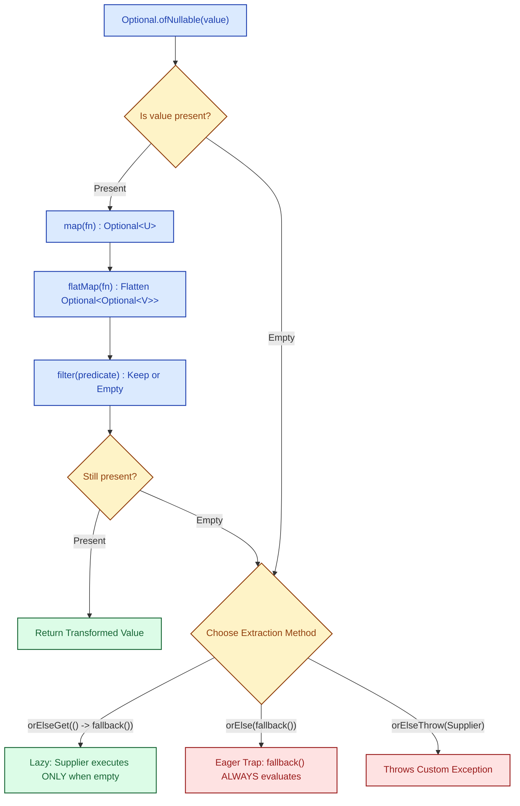

### API Cheat Sheet & Anti-Patterns

| Category | Recommended Methods | Avoid / Anti-Pattern |
| :--- | :--- | :--- |
| **Creation** | `Optional.of(val)` (throws NPE if null), `Optional.ofNullable(val)`, `Optional.empty()` | Wrapping known-present constants unnecessarily |
| **Consumption** | `ifPresent(c)`, `ifPresentOrElse(c, emptyAction)` (Java 9+) | `if (opt.isPresent()) { opt.get(); }` (imperative null-check clone) |
| **Transformation** | `filter(p)`, `map(f)`, `flatMap(f)` | Checking `isPresent()` before unpacking manually |
| **Fallback / Exit** | `orElse(constant)`, `orElseGet(supplier)`, `orElseThrow(exSupplier)` | `opt.orElse(expensiveQuery())`, `opt.orElse(null)`, bare `opt.get()` |
| **Design Scope** | Return type of lookup/query methods (`Optional<User>`) | Class fields (not `Serializable`), method params, `List<Optional<T>>` |

```java
public Optional<User> findUserById(int id) {
    return userExists(id) ? Optional.of(new User(id)) : Optional.empty();
}

public void optionalPatternsAndTraps() {
    // Chained pipeline
    String greeting = Optional.of("john")
        .filter(n -> !n.isEmpty())
        .map(String::toUpperCase)
        .map(n -> "Hello, " + n)
        .orElse("Hello, Unknown"); // "Hello, JOHN"

    // flatMap flattens nested Optionals
    Optional<Optional<String>> nested = Optional.of(Optional.of("hello"));
    String unwrapped = nested.flatMap(Function.identity()).orElse("");

    // Safe API consumption
    String userName = findUserById(1)
        .map(User::getName)
        .map(String::toUpperCase)
        .orElseGet(() -> loadDefaultNameFromDb()); // Lazy: DB only queried if empty!

    // Java 9+ dual-branch action
    Optional.of("hello").ifPresentOrElse(
        System.out::println,
        () -> System.out.println("Not present")
    );
}
```

> [!WARNING]
> **The `orElse()` Eager Evaluation Trap:** `opt.orElse(computeDefault())` **always executes** `computeDefault()`—even when `opt` contains a value—because Java evaluates method arguments before calling `orElse()`. Always use `orElseGet(() -> computeDefault())` for any non-constant fallback. Also never store `Optional` as a class field (`Optional` does not implement `Serializable`).

---

## Interface Enhancements

Java 8 introduced `default` and `static` methods to enable backwards-compatible library evolution (e.g., adding `stream()`, `forEach()`, and `isEmpty()` to `Collection` without breaking legacy implementations). Java 9 added `private` and `private static` methods to share internal helper logic without polluting the public contract.

### Interface Methods & Diamond Inheritance Structure

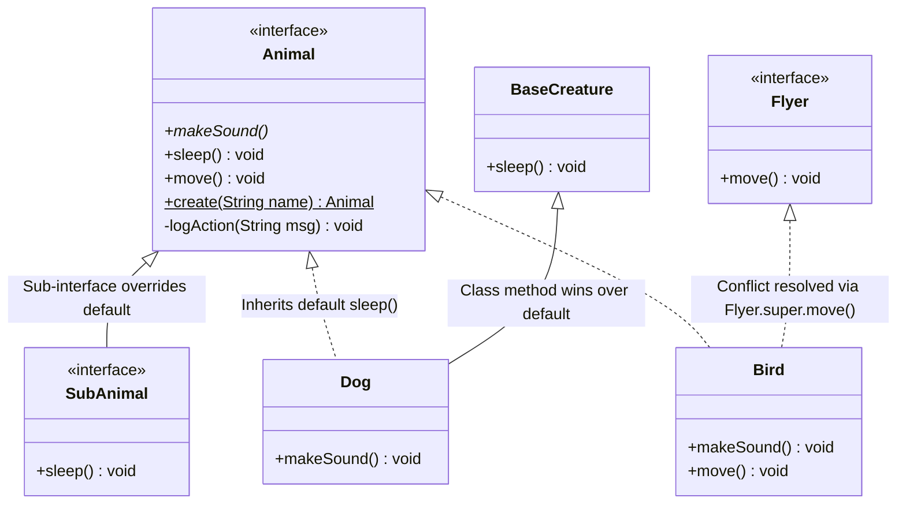

### Diamond Problem Resolution Priority

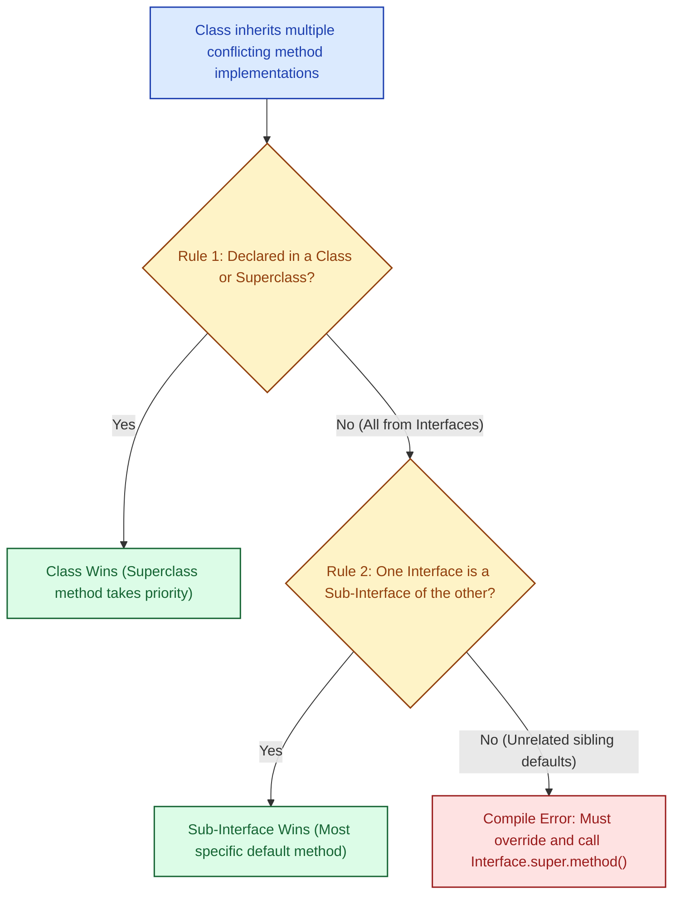

### Interface Method Types Comparison

| Method Type | Since | Inherited / Overridable | Purpose |
| :--- | :--- | :--- | :--- |
| `abstract` | Java 1.0 | Must implement in concrete class | Core behavioral contract |
| `default` | Java 8 | Inherited & overridable | Backwards-compatible API evolution (`Collection.isEmpty()`) |
| `static` | Java 8 | **Not inherited**; call via `Interface.method()` | Factory & utility methods (`Logger.create(...)`) without helper classes |
| `private` / `private static` | Java 9 | Not visible outside interface | Reuse shared helper code across `default` / `static` methods |

```java
interface Logger {
    void log(String message);

    static Logger create(String name) {           // Factory on interface (not inherited)
        logInternal("Creating logger: " + name);
        return new ConsoleLogger(name);
    }

    default void info(String message) {
        System.out.println(format("INFO", message));
    }

    private String format(String level, String msg) { // Java 9 private helper
        return "[" + level + "] " + msg;
    }

    private static void logInternal(String msg) {
        System.out.println(msg);
    }
}

interface Animal {
    default void move() { System.out.println("Moving"); }
}

interface Flyer {
    default void move() { System.out.println("Flying"); }
}

class Bird implements Animal, Flyer {
    @Override
    public void move() {
        Flyer.super.move(); // Explicit disambiguation required (Rule 3)
    }
}
```

> [!IMPORTANT]
> **30-Second Revision:** Remember the 3 Diamond Resolution Rules in strict order: **Class wins > Sub-interface wins > Explicit `Interface.super.method()`**. Also, `static` methods in interfaces are **never inherited** by implementing classes—always invoke them directly on the interface type.

---

## Java 9+ Features

Modern Java releases (9 through 21) transformed Java from verbose OOP boilerplate into an expressive, strongly encapsulated, high-concurrency platform.

### Language & Type-System Evolution (Java 9 → 21)

```mermaid
flowchart LR
    subgraph SG_J9 ["Java 9: JPMS"]
        J9A["module-info.java"] --> J9B["requires / exports / opens"]
    end

    subgraph SG_J10 ["Java 10: Inference"]
        J10A["var x = expr"] --> J10B["Compile-Time Static Type"]
    end

    subgraph SG_J16 ["Java 14-16: Records"]
        J16A["record Point(x, y)"] --> J16B["final + accessors + equals/hashCode"]
    end

    subgraph SG_J17 ["Java 17: Sealed"]
        J17A["sealed Shape permits Circle, Rect"] --> J17B["final / sealed / non-sealed"]
    end

    subgraph SG_J21 ["Java 21: Switch"]
        J21A["switch(shape) + case null"] --> J21B["Exhaustive + when Guards"]
    end

    J9B --> J10A
    J10B --> J16A
    J16B --> J17A
    J17B --> J21A

    classDef blue fill:#dbeafe,stroke:#1e40af,color:#1e40af,stroke-width:1.5px
    classDef green fill:#dcfce7,stroke:#166534,color:#166534,stroke-width:1.5px
    classDef amber fill:#fef3c7,stroke:#92400e,color:#92400e,stroke-width:1.5px
    classDef purple fill:#f3e8ff,stroke:#6b21a8,color:#6b21a8,stroke-width:1.5px

    class J9A,J9B blue
    class J10A,J10B green
    class J16A,J16B amber
    class J17A,J17B,J21A,J21B purple
```

### Java 9 Modules (JPMS)

The **Java Platform Module System** organizes packages into strongly encapsulated modules declared via `src/module-info.java` (compiled to `classes/module-info.class`).

```java
// module-info.java
module com.example.myapp {
    requires java.base;                            // Always implicitly required
    requires java.logging;                         // Explicit compile/runtime dependency
    exports com.example.myapp;                     // Public API visible to all modules
    exports com.example.myapp.api to com.example.client; // Qualified export
    opens com.example.myapp.internal;              // Allows deep reflection only
}
```

- **Benefits:** Strong encapsulation (unexported public classes stay hidden), reliable explicit dependency graphs (eliminates classpath JAR hell), faster startup & minimal custom JREs (`jlink`), and tighter reflection security.
- **Drawbacks:** Migration complexity, slow ecosystem adoption (many enterprise apps still run on the classpath / unnamed module), and steeper tooling setup.

### Java 10 var Keyword

`var` performs **compile-time local variable type inference**—it is **not** dynamic typing (`var x = 42; x = "hi";` fails compilation).

| Rule / Guideline | Valid / Recommended? | Example & Reason |
| :--- | :--- | :--- |
| **Local with obvious RHS** | Do use | `var names = List.of("alice", "bob");` (`List<String>` clear) |
| **Stream pipelines** | Use selectively | `var list = items.stream().filter(...).toList();` |
| **Unclear RHS return** | Avoid | `var x = getValue();` (hides type from reader) |
| **Opaque chained transforms** | Avoid | `var r = process(in).transform(m).filter(p);` |
| **Fields, params, return types, `null`** | Forbidden | Compiler rejects `var` outside initialized local variables |

### Java 14 and 16 Records

Previewed in Java 14 and standardized in Java 16, `record` declares an **immutable, shallowly transparent data carrier**, replacing ~30 lines of boilerplate (`private final` fields, canonical constructor, accessors `name()`/`age()`, `equals()`, `hashCode()`, `toString()`).

```java
public record Point(double x, double y) {
    // Compact constructor: validates before implicit field assignment
    public Point {
        if (x < 0 || y < 0) {
            throw new IllegalArgumentException("Coordinates must be non-negative");
        }
    }

    public double distance() { return Math.sqrt(x * x + y * y); }
    public static Point origin() { return new Point(0, 0); }
}
```

- **Constraints:** Implicitly `final` (implicitly extends `java.lang.Record`, so cannot extend any other class, though it can implement interfaces) and cannot declare non-static instance fields outside the record header.

### Java 17 Sealed Classes

`sealed` classes and interfaces explicitly enumerate their permitted subclasses via `permits`, enabling Algebraic Data Types (ADTs) and compile-time exhaustiveness. Every direct permitted subclass **must** declare itself as `final`, `sealed`, or `non-sealed`.

```java
sealed abstract class Shape permits Circle, Rectangle {
    abstract double area();
}

final class Circle extends Shape {
    private final double radius;
    Circle(double radius) { this.radius = radius; }
    @Override double area() { return Math.PI * radius * radius; }
}

final class Rectangle extends Shape {
    private final double width, height;
    Rectangle(double w, double h) { this.width = w; this.height = h; }
    @Override double area() { return width * height; }
}
// class Triangle extends Shape {} // Compile error: not listed in permits
```

### Java 21 Pattern Matching for switch

Combined with `sealed` hierarchies and `record` patterns, Java 21 `switch` expressions guarantee **compile-time exhaustiveness** without needing a fallback `default` branch, support `case null`, and allow conditional `when` guards.

```java
String describe(Shape shape) {
    return switch (shape) {
        case null -> "No shape";
        case Circle c when c.area() > 100 -> "Large Circle";
        case Circle c -> "Circle";
        case Rectangle r -> "Rectangle";
        // No 'default' needed: compiler proves all permitted subtypes covered
    };
}
```

### Java 21 Virtual Threads (Project Loom)

Traditional platform threads wrap OS threads 1:1 (~1 MB stack each, practical limit ~10,000 per JVM). Virtual threads are **JVM-managed lightweight continuations** stored on the heap, allowing millions of concurrent blocking tasks via **M:N scheduling** onto `ForkJoinPool` carrier threads.


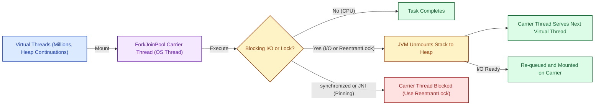

| Dimension | Platform Threads (Classic) | Virtual Threads (Java 21) |
| :--- | :--- | :--- |
| **Scheduling Mapping** | 1:1 with OS Kernel Threads | **M:N** JVM scheduling over `ForkJoinPool` carriers |
| **Memory Footprint** | ~1 MB native stack per thread | Few hundred bytes to KBs on JVM heap |
| **Concurrency Scale** | Thousands (`Executors.newFixedThreadPool(N)`) | Millions (`Thread.ofVirtual().start(...)`) |
| **Blocking I/O Cost** | Wastes entire OS thread while waiting | **Unmounts** continuation; carrier runs other tasks |
| **Pooling Guidance** | Always pool (expensive to create) | **Never pool** (spawn one virtual thread per task) |

```java
// Virtual thread + Structured Concurrency (parent owns child task lifetimes)
public void virtualThreadsAndStructuredConcurrency() throws Exception {
    Thread vt = Thread.ofVirtual().start(() -> {
        try { Thread.sleep(1000); } catch (InterruptedException ignored) {}
    });
    vt.join();

    try (var scope = new StructuredTaskScope.ShutdownOnFailure()) {
        var f1 = scope.fork(() -> fetchFromAPI1());
        var f2 = scope.fork(() -> fetchFromAPI2());

        scope.join();           // Waits for both; cancels sibling immediately if one fails
        scope.throwIfFailed();
        var r1 = f1.get();
        var r2 = f2.get();
    }
}
```

> [!WARNING]
> **Java 21 Carrier Pinning & ThreadLocal Gotchas:** Executing blocking I/O inside a `synchronized` block/method or JNI call in Java 21 **pins** the virtual thread to its OS carrier thread, blocking other virtual threads—replace `synchronized` around I/O with `ReentrantLock`. Also avoid heavy `ThreadLocal` allocations across millions of virtual threads (prefer `ScopedValue`).

---

## Performance and Anti-Patterns

While streams elevate readability for multi-stage transformations, simple primitive iterations on hot paths incur autoboxing and pipeline object overhead (often **1.5–2x slower** than an indexed `for` loop). Parallel streams add `ForkJoinPool` scheduling, splitting, and merge costs that only pay off under strict conditions.

### Stream vs Loop & Sequential vs Parallel Decision Tree

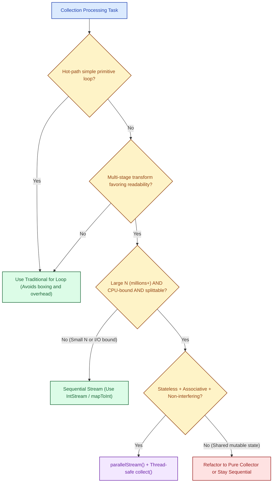

### Common Stream & Parallel Anti-Patterns

| Anti-Pattern | Failure / Overhead Mechanism | Correct Fix |
| :--- | :--- | :--- |
| **Missing terminal operation** | `words.stream().filter(...).map(...)` does zero work silently | Always attach a terminal op (`collect`, `forEach`, `count`) |
| **Collect-then-restream** | Allocates an intermediate `List` only to call `.stream().count()` | Fuse into one pipeline: `numbers.stream().filter(...).count()` |
| **Multiple passes over source** | Repeated traversal (`stream().count()` + `stream().filter().count()`) | Compute in one pass (`Collectors.teeing()` in 12+ or single loop) |
| **Parallel on small dataset** | Thread-pool coordination & splitting cost exceeds compute gain | Use sequential `stream()` unless processing millions of CPU-bound items |
| **Stateful parallel mutation** | `parallelStream().forEach(list::add)` causes race conditions / lost items | Use thread-safe `.collect(Collectors.toList())` |
| **Blocking I/O in `parallelStream()`** | Starves JVM-wide `ForkJoinPool.commonPool()` | Use **Virtual Threads** (`newVirtualThreadPerTaskExecutor`) |
| **Autoboxing in pipelines** | `Stream<Integer>` boxes/unboxes every element | Use `IntStream` / `.mapToInt(Integer::intValue).sum()` |

```java
public void antiPatternsFixed() {
    List<Integer> numbers = IntStream.range(0, 100).boxed().collect(Collectors.toList());

    // WRONG: Race condition & parallel overhead on 100 elements
    List<Integer> unsafe = new ArrayList<>();
    numbers.parallelStream().filter(n -> n % 2 == 0).forEach(unsafe::add);

    // RIGHT: Single-pass, sequential for small data, stateless collector
    List<Integer> safe = numbers.stream()
        .filter(n -> n % 2 == 0)
        .collect(Collectors.toList());

    // RIGHT: Single-pass dual aggregation (Java 12+ Collectors.teeing)
    List<String> words = Arrays.asList("apple", "banana", "cherry");
    var stats = words.stream().collect(Collectors.teeing(
        Collectors.counting(),
        Collectors.filtering(w -> w.length() > 5, Collectors.counting()),
        (total, above5) -> Map.of("total", total, "above5", above5)
    ));
}
```

> [!WARNING]
> **Two Cardinal Stream Sins:** (1) Never mutate external non-thread-safe collections inside `parallelStream().forEach(...)`—it introduces data races, lost elements, and `ArrayIndexOutOfBoundsException`. (2) Never execute blocking I/O inside `parallelStream()`, as it stalls the shared `ForkJoinPool.commonPool()` for the entire JVM.

---

## Interview Questions

### Java 8+ Diagnostic & Construct Decision Tree

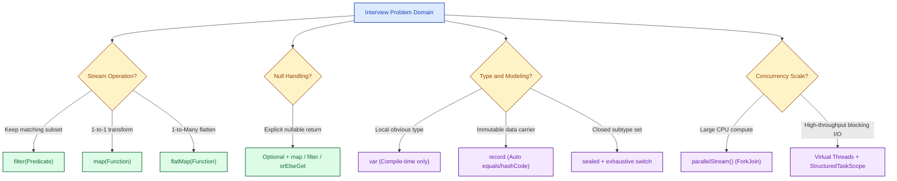

### Detailed Questions & Answers

#### Q1: Explain the difference between `filter`, `map`, and `flatMap` in streams
- **`filter(Predicate<T>)`:** Retains only elements matching the predicate; preserves element type (`Stream<T>` → `Stream<T>`), may shrink count.
- **`map(Function<T, R>)`:** Transforms each element 1-to-1 into a new value/type (`Stream<T>` → `Stream<R>`), preserves count.
- **`flatMap(Function<T, Stream<R>>)`:** Transforms each element 1-to-many into a stream and flattens nested streams (`Stream<List<T>>` → `Stream<T>`).

```java
List<Integer> numbers = Arrays.asList(1, 2, 3, 4, 5);
numbers.stream().filter(n -> n % 2 == 0).forEach(System.out::println); // 2, 4
numbers.stream().map(n -> n * 2).forEach(System.out::println);         // 2, 4, 6, 8, 10

List<List<Integer>> nested = Arrays.asList(Arrays.asList(1, 2), Arrays.asList(3, 4));
nested.stream().flatMap(Collection::stream).forEach(System.out::println); // 1, 2, 3, 4
```

#### Q2: When would you use the `var` keyword?
Use `var` when the inferred type is immediately obvious from the right-hand side (e.g., `var count = list.size();`, `var names = List.of("a", "b");`). Avoid `var` when the RHS hides the type (e.g., `var result = someComplexMethod();`). `var` is strictly a **compile-time** feature valid only for initialized local variables—never for fields, parameters, or return types.

#### Q3: What is the benefit of `Optional`?
**Explicit nullability in API contracts.** Instead of returning a potentially `null` reference (`String method()`), returning `Optional<String>` forces callers to handle absence explicitly and unlocks clean functional chaining (`map`, `filter`, `ifPresent`, `orElseGet`). Avoid using `Optional` as a class field or method parameter.

### High-Yield Q&A Summary Matrix

| Question | High-Signal Answer |
| :--- | :--- |
| **Lambda vs Anonymous Class?** | Lambdas use `invokedynamic` + `LambdaMetafactory` (no extra `.class` files) and bind `this` to the **enclosing class**, not the anonymous instance. |
| **Why must lambda locals be effectively final?** | Stack locals are copied **by value** into the lambda; disallowing mutation prevents state divergence and race conditions. |
| **`compose` vs `andThen`?** | `f.compose(g)` executes `g` then `f` (`f(g(x))`); `f.andThen(g)` executes `f` then `g` (`g(f(x))`). |
| **Why do Streams stay idle without a terminal op?** | Intermediate ops are lazy pipeline descriptors; terminal ops trigger depth-first pulling (short-circuiting on `limit`/`findFirst`, barring `sorted()`). |
| **`orElse` vs `orElseGet`?** | `orElse(val)` evaluates its argument **eagerly** even when present; `orElseGet(supplier)` evaluates **lazily** only when empty. |
| **How are Diamond conflicts resolved?** | Priority: (1) Class/superclass wins → (2) Sub-interface wins → (3) Implementing class overrides and calls `Interface.super.method()`. |
| **`record` vs `class`?** | `record` generates `private final` fields, canonical constructor, accessors, `equals`, `hashCode`, and `toString`; implicitly `final`. |
| **Why combine `sealed` + `switch`?** | `sealed` closes the subtype set at compile time, allowing Java 21 `switch` pattern matching to verify exhaustiveness without `default`. |
| **How do Virtual Threads scale?** | M:N scheduling mounts continuations on `ForkJoinPool` carriers and **unmounts** to heap on blocking I/O (watch out for `synchronized` pinning in Java 21). |
| **When should you avoid `parallelStream()`?** | Small datasets, non-splittable sources (`LinkedList`), shared mutable state (`forEach(list::add)`), or any blocking I/O. |

### Key Takeaway Summary

1. **Lambdas:** Concise syntax for functional interfaces via `invokedynamic`. Captured local variables must be effectively final; `this` refers to the enclosing class.
2. **Streams:** Lazy, depth-first evaluation with composable stateless/stateful operations. Great for declarative readability, though primitive loops win on hot-path speed.
3. **Method References:** Prefer over lambdas when an existing method matches (`Class::static`, `instance::method`, `Class::instance`, `Class::new`).
4. **Optional:** Explicit nullability for return types via `map`/`filter`/`ifPresent`/`orElseGet`. Never use as fields or with eager expensive `orElse()`.
5. **Java 8–21 Evolution:** `default`/`static`/`private` interface methods, JPMS modules, `var`, `record`, `sealed` classes, pattern matching `switch`, and Project Loom Virtual Threads.
6. **Performance:** Primitive streams (`IntStream`) eliminate autoboxing; `parallelStream()` requires millions of CPU-bound, stateless items; use Virtual Threads for blocking I/O.

> [!IMPORTANT]
> **Pre-Interview 30-Second Checklist:** Be ready to trace lazy `filter`/`map` depth-first output, distinguish `orElse` vs `orElseGet`, resolve a `default` method Diamond conflict with `Interface.super.method()`, pair `sealed` + `record` + exhaustive `switch`, and explain Virtual Thread mounting/unmounting vs `synchronized` pinning.
