# Exception Handling and Best Practices - Deep Dive

## Table of Contents
1. [Exception Hierarchy](#exception-hierarchy)
2. [Checked vs Unchecked](#checked-vs-unchecked)
3. [Custom Exceptions](#custom-exceptions)
4. [Try-With-Resources](#try-with-resources)
5. [Best Practices](#best-practices)
6. [Exception Chaining](#exception-chaining)
7. [Performance Impact](#performance-impact)
8. [SOLID Principles](#solid-principles)
9. [Clean Code](#clean-code)
10. [Effective Java Items](#effective-java-items)
11. [Interview Questions](#interview-questions)

---

## Exception Hierarchy

Java roots all throwable objects at `java.lang.Throwable`. Only `Throwable` and its subclasses can be thrown by the JVM or a `throw` statement, or caught in a `catch` clause.

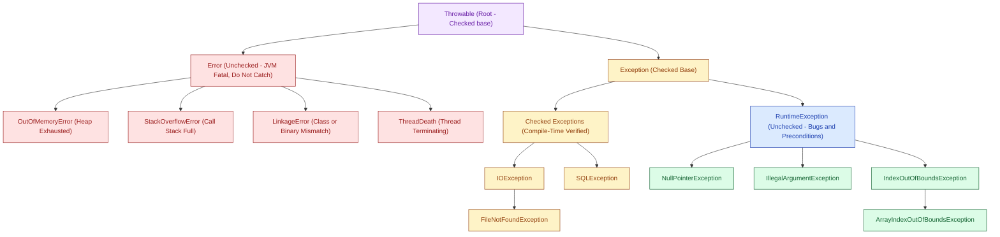

### Category Breakdown

| Category | Base Class | Verification | Typical Examples | Recommended Action |
| :--- | :--- | :--- | :--- | :--- |
| **Error** | `java.lang.Error` | Unchecked (runtime) | `OutOfMemoryError`, `StackOverflowError`, `LinkageError`, `ThreadDeath` | **Do not catch** — JVM or thread cannot reliably recover |
| **Checked Exception** | `Exception` (excluding `RuntimeException`) | **Compile-time enforced** | `IOException`, `FileNotFoundException`, `SQLException` | Catch and recover, or declare via `throws` |
| **Unchecked Exception** | `RuntimeException` | Unchecked (runtime) | `NullPointerException`, `IllegalArgumentException`, `ArrayIndexOutOfBoundsException` | Fix the bug or fail fast on invalid input |

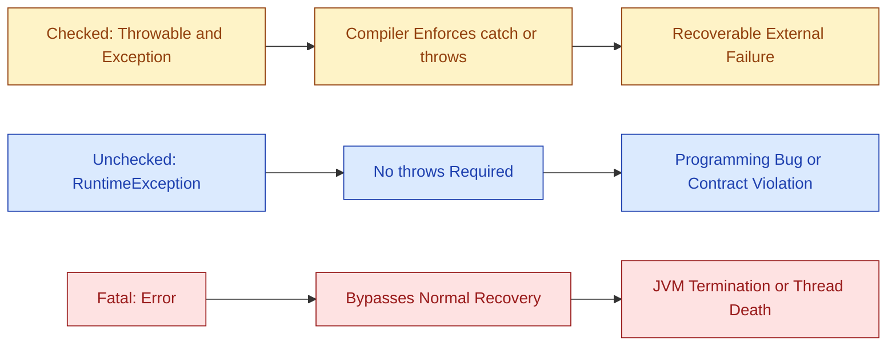

> [!WARNING]
> **Interview Gotcha — Is `Throwable` Checked or Unchecked?**
> By the Java Language Specification (JLS), **`Throwable` itself and `Exception` (non-`RuntimeException` subclasses) are checked**. Only `Error`, `RuntimeException`, and their subclasses are unchecked. Catching `Throwable` accidentally traps `OutOfMemoryError` and `StackOverflowError`, which can leave your JVM in a corrupted state.

---

## Checked vs Unchecked

Choosing between checked and unchecked exceptions is one of the most consequential API design decisions in Java.

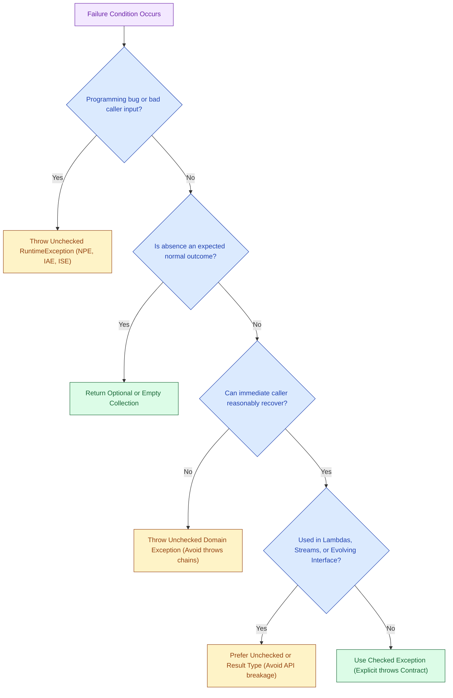

### Checked Exceptions: Contract, Advantages & Controversies

- **Compile-time enforcement**: Calling `new FileReader("file.txt")` throws `FileNotFoundException` (checked). Code will not compile unless wrapped in `try/catch` or declared with `throws`.
- **Advantages**:
  - **Forces recovery thinking**: Developers must explicitly handle foreseeable external failures (e.g., trying an alternate file path when `FileNotFoundException` occurs).
  - **Self-documenting API clarity**: `transfer(Account from, Account to) throws InsufficientFundsException` communicates domain failure modes directly in the signature.
- **Controversies & Friction in Modern Java**:
  - **Forced `throws` chains**: `method1() -> method2() -> method3()` forces intermediate layers to declare `throws IOException` even when they cannot recover.
  - **Catch-and-convert anti-pattern**: Wrapping `IOException | SQLException` inside `new RuntimeException(e)` everywhere defeats the checked contract.
  - **API versioning breakage**: Adding a new checked exception to an interface like `DatabaseAPI.save() throws SQLException` breaks every existing caller and implementation.
  - **Lambda / Stream friction**: Standard functional interfaces (`Function`, `Consumer`, `Supplier`) do not declare checked exceptions.

### Unchecked Exceptions & Defensive Prevention

Unchecked exceptions indicate **programmer responsibility** (null dereference, out-of-bounds index, invalid argument).

```java
// 1. Checked: Must catch or declare
public void readFile(String path) throws IOException {
    try (FileReader reader = new FileReader(path)) {
        // Read primary file; fallback on FileNotFoundException if recoverable
    }
}

// 2. Unchecked prevention: null-safe Optional & fail-fast argument validation
public void printNameLength(String name) {
    Optional.ofNullable(name)
        .map(String::length)
        .ifPresent(System.out::println);
}

public void setAge(int age) {
    if (age < 0 || age > 150) {
        throw new IllegalArgumentException("Invalid age: " + age);
    }
    this.age = age;
}
```

> [!IMPORTANT]
> **30-Second Rule of Thumb**
> Use **Checked** exceptions only when the caller can take meaningful local recovery action (retry, alternate path, prompt user). Use **Unchecked** exceptions for programming errors, invariant violations, unrecoverable infrastructure faults, and modern Spring/functional architectures.

---

## Custom Exceptions

Custom exceptions model domain semantics cleanly and carry structured failure metadata (`orderId`, `required`, `available`, `errorCode`) for callers, logs, and API boundaries.

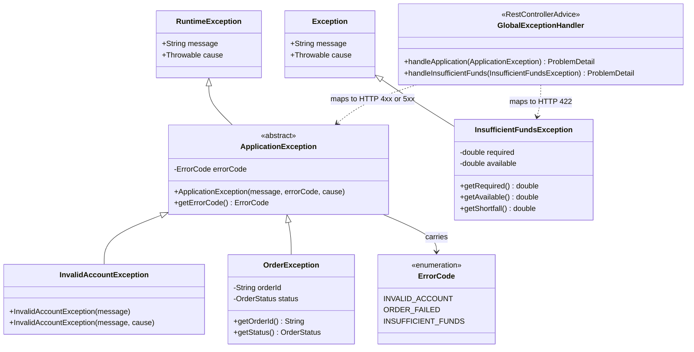

### Domain Exception Implementation & Boundary Translation

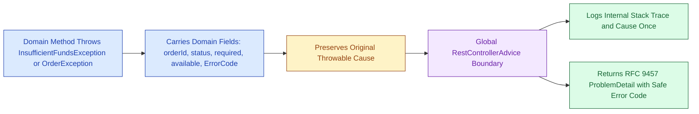

### Key Design Guidelines

- **Extend `Exception` for checked**, `RuntimeException` for unchecked (`InvalidAccountException`, `OrderException`).
- **Provide standard constructors**: Always support `(String message)` and `(String message, Throwable cause)` so callers never drop the underlying root cause.
- **Attach domain diagnostics**: Expose immutable getters (`getRequired()`, `getAvailable()`, `getShortfall()`, `getOrderId()`, `getStatus()`, `getErrorCode()`).

```java
// Checked domain exception with rich diagnostic fields
public class InsufficientFundsException extends Exception {
    private final double required;
    private final double available;

    public InsufficientFundsException(String message, double required, double available) {
        super(message);
        this.required = required;
        this.available = available;
    }

    public double getRequired() { return required; }
    public double getAvailable() { return available; }
    public double getShortfall() { return required - available; }
}

// Unchecked domain exception ALWAYS preserving Throwable cause
public class OrderException extends RuntimeException {
    private final String orderId;
    private final OrderStatus status;

    public OrderException(String message, String orderId, OrderStatus status, Throwable cause) {
        super(message, cause); // Never omit cause when wrapping SQLException!
        this.orderId = orderId;
        this.status = status;
    }

    public String getOrderId() { return orderId; }
    public OrderStatus getStatus() { return status; }
}
```

> [!WARNING]
> **Trap: Message-Only Wrapping Loses the Root Cause**
> Calling `throw new OrderException("Failed: " + e.getMessage(), orderId, status)` without passing `e` to `super(message, cause)` **destroys the original `SQLException` stack trace**. Always pass `e` as the `cause` parameter.

---

## Try-With-Resources

Introduced in Java 7, `try-with-resources` manages any object implementing `java.lang.AutoCloseable` (and its sub-interface `Closeable`), guaranteeing deterministic cleanup without `try-finally` boilerplate or exception masking.

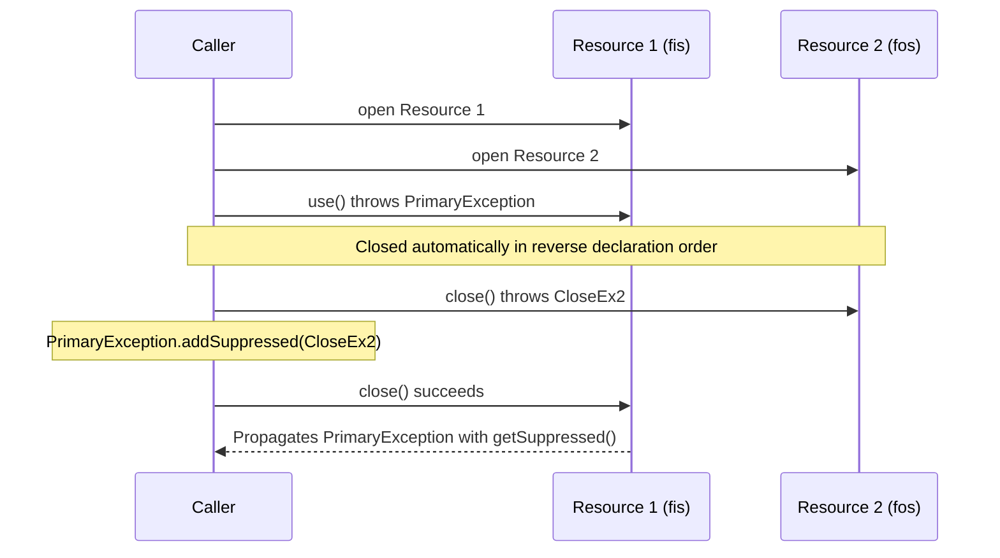

### `try-finally` vs `try-with-resources` Suppression

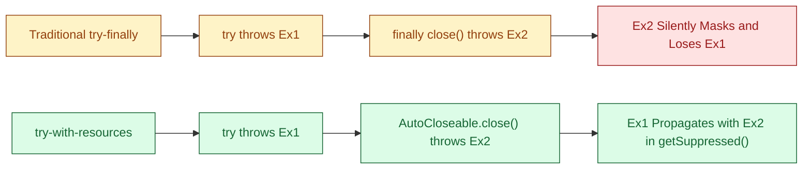

### Multi-Resource Order & Custom `AutoCloseable`

- **Reverse close order**: In `try (FileInputStream fis = ...; FileOutputStream fos = ...; InputStreamReader reader = ...; OutputStreamWriter writer = ...)`, resources close in order: `writer` -> `reader` -> `fos` -> `fis`.
- **Java 9+ enhancement**: Effectively `final` pre-existing resource variables can be referenced directly (`try (reader)`).
- **Suppressed exceptions**: When both the `try` body and `close()` throw, the `try` block's exception wins as the **primary** exception, and `close()` exceptions are attached via `addSuppressed()`.

```java
class DatabaseConnection implements AutoCloseable {
    private boolean open = true;

    public void query(String sql) {
        if (!open) throw new IllegalStateException("Connection closed");
        System.out.println("Executing: " + sql);
    }

    @Override
    public void close() {
        open = false; // Guaranteed to execute even if query() throws
    }
}

public void runWithSuppressionCheck() {
    try (
        Resource1 r1 = new Resource1();
        Resource2 r2 = new Resource2() // Closed BEFORE r1
    ) {
        r1.use(); // Throws primary exception
    } catch (Exception e) {
        System.err.println("Primary: " + e);
        for (Throwable suppressed : e.getSuppressed()) {
            System.err.println("Suppressed: " + suppressed);
        }
    }
}
```

> [!IMPORTANT]
> **30-Second Revision — Reverse Order & `getSuppressed()`**
> `try-with-resources` closes resources in **reverse order of declaration** so outer wrappers (like `BufferedWriter` / `OutputStreamWriter`) flush before inner streams (`FileOutputStream`) close. Unlike `try-finally`—where an exception inside `finally` **overwrites** the original exception—`try-with-resources` preserves the primary exception and attaches cleanup errors via `getSuppressed()`.

---

## Best Practices

Effective exception handling balances precision, observability, and clean abstraction boundaries.

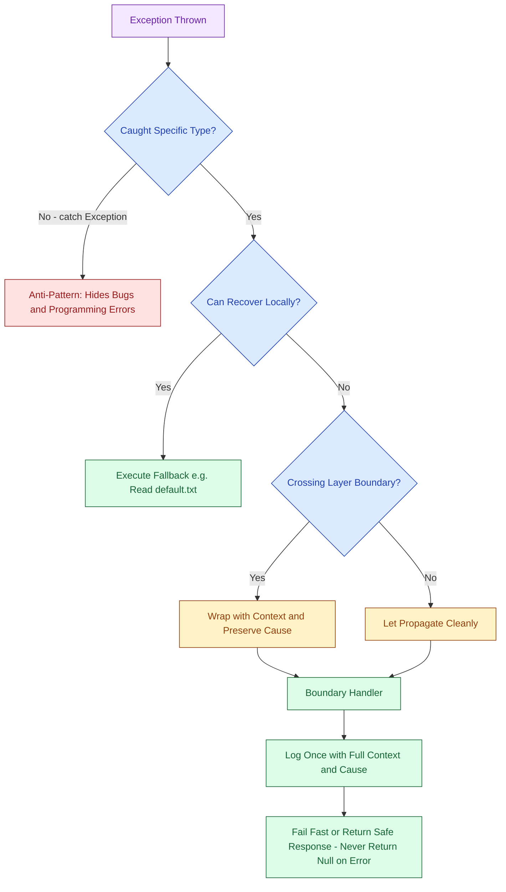

### Do's vs Don'ts Comparison

| Practice | Anti-Pattern (Don't) | Best Practice (Do) |
| :--- | :--- | :--- |
| **Catch Specificity** | `catch (Exception e)` — traps unrelated runtime bugs | Catch narrow types first (`FileNotFoundException` -> fallback `default.txt`, then `IOException`) |
| **Logging** | `e.printStackTrace()` (lost in stdout) or log-and-rethrow (duplicate log noise) | **Log once** at the handling boundary with contextual IDs (`userId`, `accountId`, `required`, `available`) |
| **Failure Mode** | Silent `catch (Exception e) {}` swallowing errors | **Fail fast** on invalid state (`amount <= 0` -> `IllegalArgumentException`) |
| **Error Signaling** | Returning `null` on `SQLException` (ambiguous: missing vs DB down?) | Throw meaningful domain exception (`UserNotFoundException` / `DataAccessException`), or return `Optional<User>` when absence is valid |
| **Abstraction Leaks** | Propagating raw `SQLException` into service/UI layers | Catch and convert to `DataAccessException(message, cause)` preserving root cause |

```java
public User findUser(int id) throws DataAccessException {
    try {
        return loadFromDB(id);
    } catch (SQLException e) {
        // Translate low-level exception; preserve cause; don't return null!
        throw new DataAccessException("Failed to load user id=" + id, e);
    }
}

public void withdraw(double amount) throws InsufficientFundsException {
    if (amount <= 0) {
        throw new IllegalArgumentException("Amount must be positive: " + amount);
    }
    if (amount > balance) {
        throw new InsufficientFundsException("Insufficient balance", amount, balance);
    }
    balance -= amount;
}
```

> [!WARNING]
> **Log-and-Rethrow Anti-Pattern**
> Never log an exception in a lower layer and then rethrow it up the stack—each layer logs the same stack trace again, polluting production logs. Either **handle + log** at the boundary, or **wrap + rethrow** silently with added context.

---

## Exception Chaining

Exception chaining wraps low-level failures inside higher-level domain exceptions without losing the original stack trace, while multi-catch and suppression keep recovery blocks DRY.

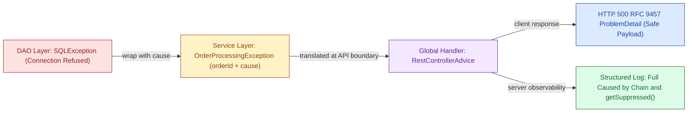

### Multi-Catch & Manual Suppression Pattern

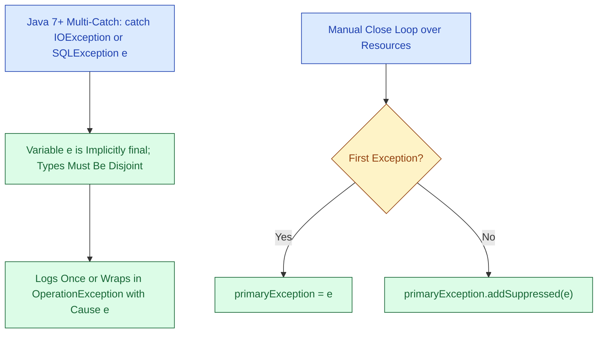

- **Cause chains**: `throw new UserServiceException("Failed to load user", e)` prints `UserServiceException` followed by `Caused by: SQLException: Database connection failed`, accessible via `e.getCause()`.
- **Operational context**: In `transferMoney(fromId, toId, amount)`, enrich the message with IDs and amount while keeping `e` as the cause.
- **Multi-catch (Java 7+)**: `catch (IOException | SQLException e)` removes duplicated catch blocks; the caught parameter `e` is **implicitly `final`**, and union types cannot share an inheritance relationship (e.g., `FileNotFoundException | IOException` is a compile error).
- **Manual suppression aggregation**: When closing variable numbers of resources manually (`closeResources(Resource... resources)`), capture the first exception as `primaryException` and attach later exceptions via `primaryException.addSuppressed(e)`.

```java
public void transferMoney(String fromId, String toId, double amount) {
    try {
        Account from = getAccount(fromId);
        Account to = getAccount(toId);
        from.withdraw(amount);
        to.deposit(amount);
    } catch (IOException | SQLException e) {
        throw new TransferException(
            "Failed to transfer " + amount + " from " + fromId + " to " + toId, e);
    }
}

public void closeResources(AutoCloseable... resources) throws Exception {
    Exception primary = null;
    for (AutoCloseable r : resources) {
        try {
            r.close();
        } catch (Exception e) {
            if (primary == null) primary = e;
            else primary.addSuppressed(e);
        }
    }
    if (primary != null) throw primary;
}
```

> [!IMPORTANT]
> **Multi-Catch Subtlety**
> In `catch (IOException | SQLException e)`, `e` is **implicitly `final`** (cannot be reassigned) and the types in the union must be **disjoint** (neither may be a subclass of the other).

---

## Performance Impact

Entering a `try` block is nearly free in the JVM (handled via bytecode exception tables), **creating and throwing** an exception is ~1000x slower than normal control flow because `Throwable()` calls native `fillInStackTrace()`.

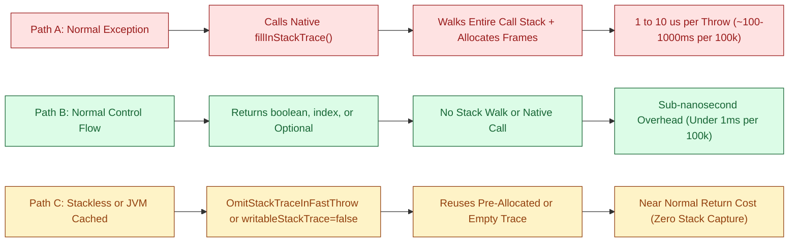

### Performance Rules & JVM Optimizations

- **Stack trace capture cost**: 100,000 throws take ~100–1000 ms (1–10 µs each) vs `< 1 ms` for normal branching/assignment—roughly **1000x slower**.
- **Never use exceptions for control flow**: Don't throw an exception to exit a search loop (`findIndex`)—return the index or `-1`.
- **Don't throw on high-frequency expected validation**: On hot loops where half the calls fail validation (`setAge` in a loop of 2,000 items), return `boolean setAgeIfValid(int age)` or a lightweight validation result instead of throwing `IllegalArgumentException`.
- **JVM Cached / Pre-allocated Exceptions**:
  - `OutOfMemoryError` may be pre-allocated by the JVM with an empty stack trace because heap is exhausted.
  - HotSpot JIT (`-XX:+OmitStackTraceInFastThrow`, enabled by default) optimizes repeated built-in exceptions (`NullPointerException`, `ArithmeticException`, `ArrayIndexOutOfBoundsException`, `ClassCastException`) by reusing a cached **stackless** instance after threshold hits.
  - **Custom stackless exceptions** (for rare internal control-flow/reactive frameworks): override `fillInStackTrace() { return this; }` or pass `writableStackTrace = false` via `super(message, cause, enableSuppression, false)`.

```java
// FAST: normal control flow and hot-path boolean validation
public int findIndexFast(int[] arr, int value) {
    for (int i = 0; i < arr.length; i++) {
        if (arr[i] == value) return i;
    }
    return -1;
}

public boolean setAgeIfValid(int age) {
    if (age < 0) return false;
    this.age = age;
    return true;
}

// Stackless exception (only for ultra-hot internal control/circuit-breaker signals)
public class FastSignalException extends RuntimeException {
    public FastSignalException(String message) {
        super(message, null, false, false); // writableStackTrace = false
    }
}
```

> [!WARNING]
> **Production Debugging Gotcha — `-XX:+OmitStackTraceInFastThrow`**
> If a production service suddenly starts logging `NullPointerException: null` **with zero stack trace lines**, HotSpot's `OmitStackTraceInFastThrow` optimization kicked in after thousands of throws at the same site. Check earlier logs for the original full stack trace, or pass `-XX:-OmitStackTraceInFastThrow` during debugging.

---

## SOLID Principles

SOLID design prevents tangled exception handling, brittle catch-all logic, and leaky infrastructure dependencies.

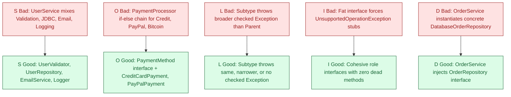

### Principle-by-Principle Breakdown

| Principle | Violation Symptom | Clean Design & Exception Benefit |
| :--- | :--- | :--- |
| **S — Single Responsibility** | `UserService.createUser` does validation, raw `Connection`/`PreparedStatement` JDBC, email sending, and `System.out.println` while throwing `SQLException` | Separate `UserValidator`, `UserRepository`, `EmailService`, and `Logger`; each class owns one failure domain |
| **O — Open-Closed** | `PaymentProcessor` uses `if/else` on `"credit"`, `"paypal"`, `"bitcoin"` — every new method modifies core class | Extract `PaymentMethod` interface; new payment providers implement `process(amount)` without modifying `PaymentProcessor` |
| **L — Liskov Substitution** | Subclass overrides method and throws broader/new checked exception or breaks postconditions | **Java compiler enforces**: overriding method cannot throw broader checked exceptions than base method (may throw narrower, fewer, or unchecked) |
| **I — Interface Segregation** | Bloated interface forces implementers to throw `UnsupportedOperationException` on unused operations | Split into focused client-specific interfaces so implementations never fake unsupported behavior |
| **D — Dependency Inversion** | `OrderService` creates `new DatabaseOrderRepository()` directly | `OrderService` accepts `OrderRepository` via constructor injection (`DatabaseOrderRepository` in prod, `InMemoryOrderRepository` in tests) |

```java
// SRP + OCP + DIP in action
public interface OrderRepository { void save(Order order); }

public class OrderService {
    private final OrderRepository repository; // DIP: depends on abstraction

    public OrderService(OrderRepository repository) {
        this.repository = repository;
    }

    public void placeOrder(Order order) { repository.save(order); }
}

public interface PaymentMethod { void process(double amount); }
public class CreditCardPayment implements PaymentMethod {
    @Override public void process(double amount) { /* Credit card logic */ }
}
public class PayPalPayment implements PaymentMethod {
    @Override public void process(double amount) { /* PayPal logic */ }
}
public class PaymentProcessor {
    public void process(PaymentMethod method, double amount) {
        method.process(amount); // OCP: open for extension, closed for modification
    }
}
```

> [!IMPORTANT]
> **LSP & Java Exception Overriding Rule**
> When overriding a superclass or interface method, you may throw **the same, narrower, or zero** checked exceptions—**never broader or unrelated new checked exceptions**. However, if the superclass method throws no checked exceptions, the subclass override cannot add any checked exceptions (only unchecked `RuntimeException`s).

---

## Clean Code

Clean error handling pairs **flat, readable control flow** with **diagnostics-rich, secret-safe messages** and **explicit `@throws` contracts**.

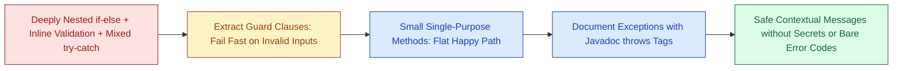

### Message Hygiene & Javadoc Matrix

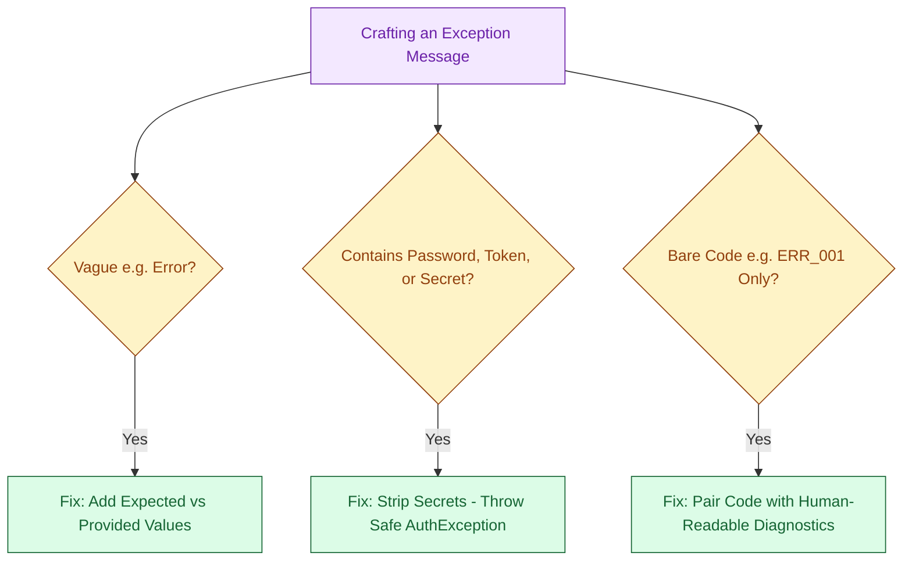

- **Guard clauses over nesting**: Validate preconditions at the top of the method and fail fast with specific exceptions instead of nesting business logic inside multi-level `if` pyramids.
- **Specific, human-readable messages**:
  - Bad: `throw new RuntimeException("Error");` or `throw new BusinessException("ERR_001");`
  - Good: `throw new IllegalArgumentException("Email must be valid (provided: " + email + ")");`
  - Good: `throw new BusinessException("Insufficient funds: required " + required + ", available " + available);`
- **Never leak secrets in exceptions (or logs!)**: Never include raw passwords, API keys, or tokens inside `AuthException` messages (exception messages frequently surface in HTTP responses, crash reports, and APM dashboards). Use a safe message like `throw new AuthException("Authentication failed");` and log only non-sensitive identifiers (`username` / `requestId`).
- **Document all thrown exceptions in Javadoc**: Document both checked exceptions and important unchecked exceptions (`@throws`) plus caller guidance (e.g., `@throws DataAccessException if database error (caller should log and retry)`).

```java
/**
 * Transfers money from source to destination account.
 *
 * @param source source account ID
 * @param destination destination account ID
 * @param amount transfer amount (must be positive)
 * @throws InsufficientFundsException if source account doesn't have enough balance
 * @throws AccountNotFoundException if either account doesn't exist
 * @throws TransferException if database error occurs
 */
public void transfer(String source, String destination, double amount)
        throws InsufficientFundsException, AccountNotFoundException, TransferException {
    // Guard clauses: flat, fail-fast entry checks
    if (amount <= 0) throw new IllegalArgumentException("Amount must be positive: " + amount);
    if (source == null || destination == null) throw new IllegalArgumentException("Account IDs required");

    executeTransfer(source, destination, amount);
}
```

> [!WARNING]
> **Security Alert — Never Put Passwords or PII in Exceptions or Logs**
> Even logging raw passwords on failed login (`logger.error("... password: " + password)`) is a severe security vulnerability. Log only the `userId`/`username` and failure reason, and return a generic `AuthException("Authentication failed")`.

---

## Effective Java Items

Joshua Bloch's *Effective Java* connects clean object construction, defensive design, and exception discipline into one cohesive engineering model.

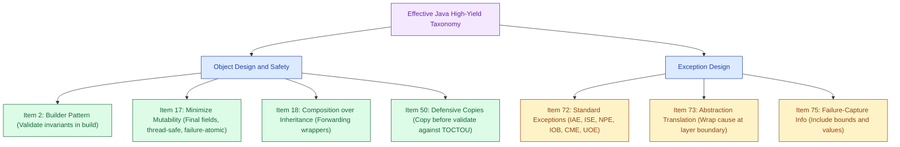

### Core Effective Java Reference Matrix

| Item | Principle | Concrete Rule & Example |
| :--- | :--- | :--- |
| **Item 2** | **Builder Pattern** | Use a Builder when constructors have many/optional parameters; validate parameter invariants inside `build()` and throw `IllegalStateException`/`IllegalArgumentException` |
| **Item 17** | **Minimize Mutability** | Prefer immutable classes (`final` class/fields, no setters, copy mutable components) for thread safety and free **failure atomicity** (Item 76) |
| **Item 18** | **Composition over Inheritance** | Prefer wrapping with forwarding classes over `extends` across packages; inheritance breaks encapsulation when superclass internals change |
| **Item 50** | **Defensive Copies** | Copy mutable constructor inputs (`new Date(start.getTime())`) **before** validating them (prevents TOCTOU race attacks), and return copies from getters |
| **Item 72** | **Standard Exceptions** | Reuse JDK exceptions instead of inventing `DivideByZeroException` (see list below) |
| **Item 73** | **Throw Exceptions Appropriate to Abstraction** | Catch low-level `SQLException` in DAO and translate to `DataAccessException("Failed to load user: " + id, e)` |
| **Item 75** | **Failure-Capture Information** | Include every relevant parameter and boundary in messages: `"Index " + index + " out of bounds for array length " + array.length`, `"Port must be between 1-65535, got: " + port`, `"Insufficient funds: required %.2f, available %.2f"` |

### Standard Exceptions Cheat Sheet (Item 72)

- `IllegalArgumentException`: Non-null parameter value is invalid (e.g., divisor `0`, negative age).
- `IllegalStateException`: Object is in the wrong state for the requested method (e.g., calling `query()` on a closed connection).
- `NullPointerException`: Required parameter is `null` (`Objects.requireNonNull(arg, "arg must not be null")`).
- `IndexOutOfBoundsException`: Index parameter is out of bounds (`index < 0 || index >= size`).
- `ConcurrentModificationException`: Concurrent structural mutation detected during fail-fast iteration.
- `UnsupportedOperationException`: Object does not support the requested operation (e.g., `List.of(...).add(...)`).

```java
// Item 73 + Item 75: Abstraction translation + rich failure-capture message
public User getUser(int id) {
    try {
        return queryDatabase(id);
    } catch (SQLException e) {
        throw new DataAccessException("Failed to load user id=" + id, e);
    }
}

public void setPort(int port) {
    if (port < 1 || port > 65535) {
        throw new InvalidConfigException("Port must be between 1-65535, got: " + port);
    }
}
```

> [!IMPORTANT]
> **TOCTOU Gotcha (Item 50)**
> Always make defensive copies of mutable arguments **before** validating invariants—never after. Otherwise a malicious or concurrent caller thread can mutate the input object in the microsecond window between validation and field assignment.

---

## Interview Questions

Use this quick-revision decision tree before walking through the high-yield interview matrix.

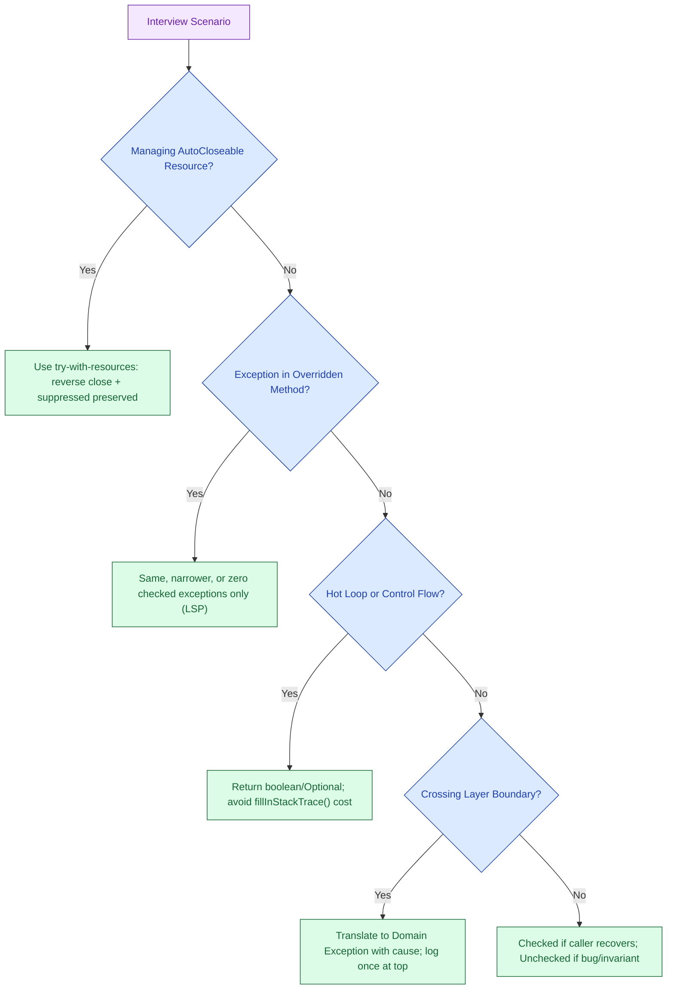

### High-Yield Q&A Summary Matrix

| # | Question | Core Interview Answer |
| :--- | :--- | :--- |
| **Q1** | **Checked vs Unchecked exceptions?** | Checked: compile-time enforced (`IOException`, `SQLException`); use when caller can recover. Unchecked: `RuntimeException` subclasses (`NPE`, `IAE`); indicate bugs or contract violations. |
| **Q2** | **When to use `try-with-resources`?** | Always for `AutoCloseable` resources (streams, connections, readers). Closes in reverse order even on exception and preserves close errors as suppressed exceptions. |
| **Q3** | **How to design domain exception hierarchies?** | Create an abstract `ApplicationException extends RuntimeException` with `(message)` and `(message, cause)` constructors, then extend per domain (`UserServiceException`, `PaymentException`). |
| **Q4** | **Why are exceptions slow & what is `OmitStackTraceInFastThrow`?** | `new Throwable()` invokes native `fillInStackTrace()` to walk stack frames (~1000x slower than normal code). HotSpot caches stackless instances of hot built-in exceptions after threshold hits. |
| **Q5** | **What happens if `try` and `finally` both throw?** | In `try-finally`, the `finally` exception **masks** the `try` exception. In `try-with-resources`, the `try` exception propagates and `close()` exceptions are attached via `getSuppressed()`. |
| **Q6** | **What are Java's exception overriding rules?** | An overriding method cannot throw broader or new checked exceptions than the superclass method (may throw narrower, fewer, or none; any unchecked exception is allowed by compiler). |
| **Q7** | **What is `return` inside a `finally` block trap?** | Returning from `finally` silently suppresses any exception thrown in `try` or `catch` and overrides their return value—never `return` inside `finally`. |
| **Q8** | **How should exceptions cross service/API boundaries?** | Translate low-level `SQLException` into domain exceptions (`OrderProcessingException`) preserving `cause`, log once at `@RestControllerAdvice`, and return sanitized `ProblemDetail`. |

### Detailed Core Answers (Q1–Q3)

#### Q1: What's the difference between checked and unchecked exceptions?
- **Checked (`Exception` subclasses excluding `RuntimeException`)**: Must be caught or declared in `throws`; compiler enforces handling. Examples: `IOException`, `SQLException`. Use only when caller can reasonably recover.
- **Unchecked (`RuntimeException` and `Error` subclasses)**: Not enforced at compile time. `RuntimeException` examples (`NullPointerException`, `IllegalArgumentException`) signal programming errors or failed validation.

#### Q2: When should you use `try-with-resources`?
- **Always** for any `AutoCloseable` resource (streams, JDBC connections, sockets, readers/writers). It guarantees reverse-order `close()`, eliminates verbose `try-finally` null checks, and preserves cleanup exceptions via `getSuppressed()`.

#### Q3: How should you design exception hierarchies?
```java
// Base domain exception allows catch (ApplicationException e) at boundaries
public abstract class ApplicationException extends RuntimeException {
    public ApplicationException(String message) {
        super(message);
    }

    public ApplicationException(String message, Throwable cause) {
        super(message, cause);
    }
}

// Specific domain subclasses preserve granular catch capability
public class UserServiceException extends ApplicationException {
    public UserServiceException(String message, Throwable cause) { super(message, cause); }
}

public class PaymentException extends ApplicationException {
    public PaymentException(String message, Throwable cause) { super(message, cause); }
}
```

> [!IMPORTANT]
> **30-Second Final Interview Checklist**
> Never swallow exceptions silently, never `return` inside `finally`, never log-and-rethrow at every layer, never use exceptions for hot-loop control flow, and always preserve the original `Throwable cause` when translating across architectural boundaries.

---

**Key Takeaway Summary:**

1. **Hierarchy:** `Error` (don't catch), Checked (must catch or declare), Unchecked (indicates bugs or invalid state).
2. **Design:** Throw specific exceptions. Catch specific exceptions. Translate to the caller's abstraction level.
3. **Try-With-Resources:** Always use for `AutoCloseable`—reverse-order closing and `getSuppressed()` preservation.
4. **Best Practices:** Fail fast. Include failure-capture context (without secrets). Preserve cause chains. Never hide errors behind `null`.
5. **Performance:** Exceptions are ~1000x slower due to `fillInStackTrace()`. Never use for normal control flow.
6. **Standards:** Reuse standard JDK exceptions (Item 72); build domain hierarchies only for domain semantics.
