# Top 30 Java-Specific Coding Problems - FAANG Level

A visual, pattern-driven Java coding interview guide covering strings, arrays, hash maps, concurrency primitives, stream pipelines, OOP design patterns, and high-frequency system building blocks.

## Table of Contents
1. [String Manipulation](#string-manipulation)
2. [Array and List Operations](#array-and-list-operations)
3. [HashMap-Based Problems](#hashmap-based-problems)
4. [Concurrency Puzzles](#concurrency-puzzles)
5. [Stream API Challenges](#stream-api-challenges)
6. [OOP Design Problems](#oop-design-problems)
7. [Advanced Problems Summary](#advanced-problems-summary)

---

## String Manipulation

### Visual Pattern Mechanics

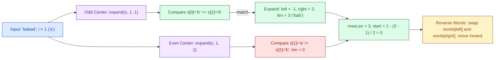

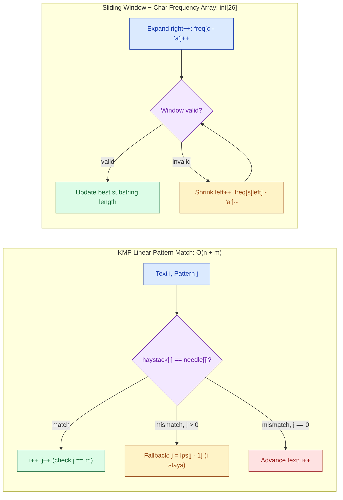

### Algorithm Intuition & Complexity

- **Expand Around Center (Problem 1):** Every palindrome mirrors around either a single character `(i, i)` (odd) or a gap `(i, i + 1)` (even), giving `2n - 1` centers and `O(1)` space without a `DP[n][n]` table.
- **KMP Failure Function (Problem 2):** Precomputing `lps[i]` (longest proper prefix also a suffix) prevents resetting haystack index `i` on mismatch, reducing worst-case `O(n * m)` to `O(n + m)`.
- **Two-Pointer Word Swap & Frequency Windows (Problem 3):** Normalize whitespace with `trim().split("\\s+")`, swap from ends inward, or use `int[26]`/`int[128]` frequency arrays with a sliding `left..right` window for `O(1)`-alphabet anagram/substring checks.

| Problem | Pattern | Time | Space | Key Follow-up |
| :--- | :--- | :--- | :--- | :--- |
| **1. Longest Palindromic Substring** | Expand Around Center | `O(n²)` | `O(1)` | Manacher's algorithm for `O(n)` |
| **2. Implement `strStr()` / `indexOf()`** | Naive Slice / KMP `lps[]` | `O(n*m)` / `O(n+m)` | `O(1)` / `O(m)` | Rabin-Karp rolling hash |
| **3. Reverse Words in String** | Split + Converging Pointers | `O(n)` | `O(n)` | Reverse whole `char[]`, then each word in `O(1)` space |

### Problem 1: Longest Palindromic Substring

```java
public class LongestPalindrome {
    /**
     * Find longest palindromic substring in O(n²) time, O(1) space
     * Example: "babad" -> "bab" or "aba"
     */
    public String longestPalindrome(String s) {
        if (s == null || s.length() < 1) return "";

        int start = 0;
        int maxLen = 0;

        for (int i = 0; i < s.length(); i++) {
            // Odd-length palindromes (single character center)
            int len1 = expandAroundCenter(s, i, i);
            // Even-length palindromes (between two characters)
            int len2 = expandAroundCenter(s, i, i + 1);

            int len = Math.max(len1, len2);

            if (len > maxLen) {
                maxLen = len;
                start = i - (len - 1) / 2; // Calculate start index
            }
        }

        return s.substring(start, start + maxLen);
    }

    private int expandAroundCenter(String s, int left, int right) {
        while (left >= 0 && right < s.length() && s.charAt(left) == s.charAt(right)) {
            left--;
            right++;
        }
        return right - left - 1; // Length of palindrome
    }

    // Time Complexity: O(n²) - expand around each center
    // Space Complexity: O(1) - only constant extra space
    // Follow-up: Use Manacher's algorithm for O(n) solution
}
```

### Problem 2: Implement strStr() / indexOf()

```java
public class StringMatch {
    /**
     * Find first occurrence of needle in haystack
     * Example: "hello", "ll" -> 2
     * Time: O(n*m) naive, O(n+m) with KMP
     */
    public int strStr(String haystack, String needle) {
        if (needle.isEmpty()) return 0;
        if (haystack.length() < needle.length()) return -1;

        // Naive approach: check each position
        for (int i = 0; i <= haystack.length() - needle.length(); i++) {
            if (haystack.substring(i, i + needle.length()).equals(needle)) {
                return i;
            }
        }

        return -1;
    }

    // KMP (Knuth-Morris-Pratt) for O(n+m)
    public int strStrKMP(String haystack, String needle) {
        if (needle.isEmpty()) return 0;

        // Build failure function
        int[] lps = buildLPS(needle);
        int i = 0; // haystack index
        int j = 0; // needle index

        while (i < haystack.length()) {
            if (haystack.charAt(i) == needle.charAt(j)) {
                i++;
                j++;
            }

            if (j == needle.length()) {
                return i - j; // Found at position
            } else if (i < haystack.length() && haystack.charAt(i) != needle.charAt(j)) {
                j = (j > 0) ? lps[j - 1] : 0;
            }
        }

        return -1;
    }

    private int[] buildLPS(String pattern) {
        int[] lps = new int[pattern.length()];
        int j = 0;

        for (int i = 1; i < pattern.length(); i++) {
            while (j > 0 && pattern.charAt(i) != pattern.charAt(j)) {
                j = lps[j - 1];
            }
            if (pattern.charAt(i) == pattern.charAt(j)) {
                j++;
            }
            lps[i] = j;
        }

        return lps;
    }

    // Time: O(n*m) naive, O(n+m) KMP
    // Space: O(m) for KMP failure function
}
```

### Problem 3: Reverse Words in String

```java
public class ReverseWords {
    /**
     * Reverse order of words, trim extra spaces
     * Example: "  hello   world  " -> "world hello"
     */
    public String reverseWords(String s) {
        // Trim and split by whitespace
        String[] words = s.trim().split("\\s+");

        // Reverse array
        int left = 0, right = words.length - 1;
        while (left < right) {
            String temp = words[left];
            words[left] = words[right];
            words[right] = temp;
            left++;
            right--;
        }

        return String.join(" ", words);
    }

    // Time: O(n) - single pass
    // Space: O(n) - for reversed array
    // Follow-up: Do it in-place for character array
}
```

> [!TIP]
> **30-Second Revision (Strings):** Always test empty strings, single-character strings, and repeated characters (`"aaaa"`). Use `start = i - (len - 1) / 2` so both odd and even palindrome lengths map cleanly to the start index, remember `haystack.substring(...)` creates objects whereas `charAt` avoids allocation, and use `int[26]`/`int[128]` frequency arrays before reaching for a `HashMap<Character, Integer>`.

---

## Array and List Operations

### Visual Pointer Movement & Partitioning

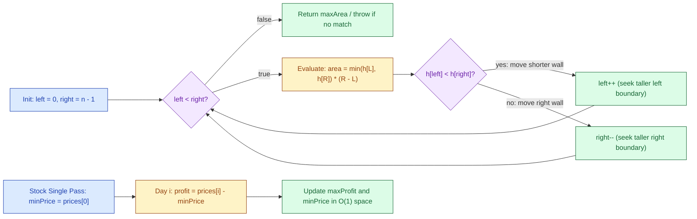

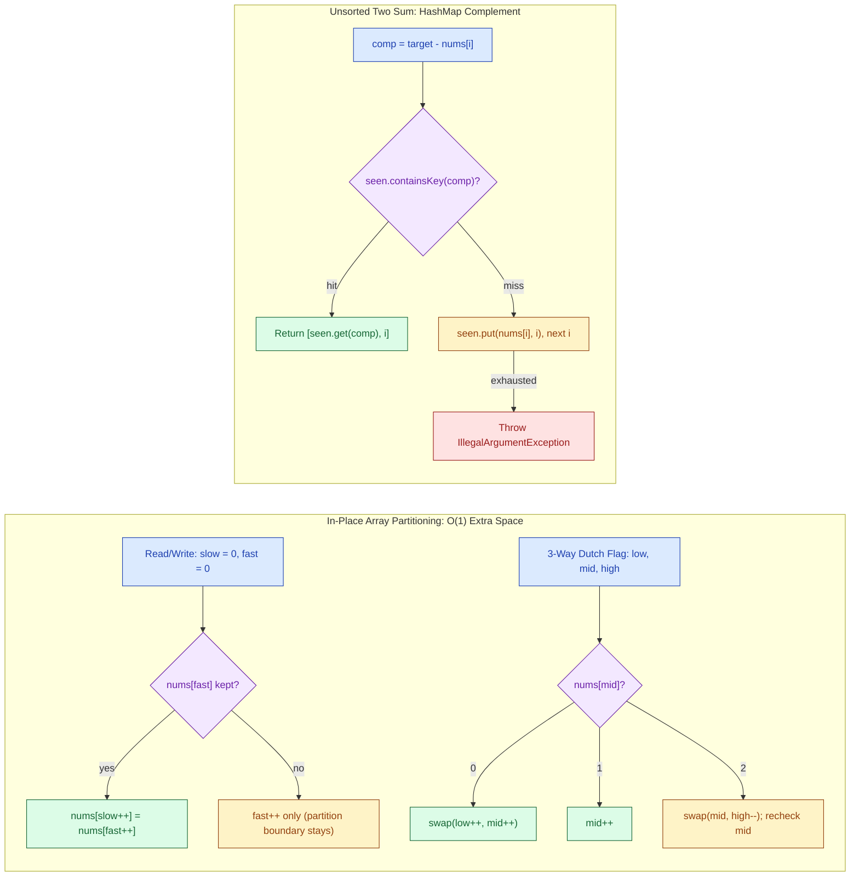

### Algorithm Intuition & Complexity

- **Complement Lookup vs. Sorted Two Pointers (Problem 4):** Unsorted arrays trade `O(n)` space for `O(1)` average complement lookup via `HashMap`; sorted arrays eliminate the map with converging `left`/`right` pointers in `O(1)` space.
- **Prefix Min Tracking & Greedy Slopes (Problem 5):** For one buy/sell, maintain the running `minPrice` before selling at index `i`. For unlimited transactions, summing every positive day-over-day delta `prices[i] - prices[i - 1]` captures every peak-to-valley gain.
- **Greedy Width-Height Trade-off (Problem 6):** Width always shrinks as pointers move inward, so moving the *taller* boundary can never increase area (`min` stays capped by the shorter line while width decreases). Only moving the *shorter* line can discover a taller wall.
- **In-Place Partitioning (`slow`/`fast` & 3-Way):** Maintain `[0..slow)` as valid compacted elements (`slow++` on match) or `[0..low)`, `[low..mid)`, `(high..n-1]` for 3-way partitioning without allocating a second array.

| Problem | Variant / Pattern | Time | Space | Key Invariant |
| :--- | :--- | :--- | :--- | :--- |
| **4. Two Sum** | Unsorted (`HashMap`) / Sorted (2-Ptr) | `O(n)` / `O(n)` | `O(n)` / `O(1)` | Check complement before `put` to avoid self-reuse |
| **5. Best Time to Buy & Sell Stock** | 1 Tx (`minPrice`) / Unlimited (Greedy) | `O(n)` / `O(n)` | `O(1)` / `O(1)` | Update `maxProfit` before or alongside `minPrice` |
| **6. Container With Most Water** | Converging Two Pointers | `O(n)` | `O(1)` | Advance the pointer at `min(height[L], height[R])` |

### Problem 4: Two Sum

```java
public class TwoSum {
    /**
     * Find two numbers in array that sum to target
     * Return indices, not values
     */
    public int[] twoSum(int[] nums, int target) {
        // Use HashMap for O(n) solution
        Map<Integer, Integer> seen = new HashMap<>();

        for (int i = 0; i < nums.length; i++) {
            int complement = target - nums[i];

            if (seen.containsKey(complement)) {
                return new int[]{seen.get(complement), i};
            }

            seen.put(nums[i], i);
        }

        throw new IllegalArgumentException("No two sum solution");
    }

    // Time: O(n)
    // Space: O(n)
    // Follow-up: Sorted array -> use two pointers O(1) space

    public int[] twoSumSorted(int[] nums, int target) {
        int left = 0, right = nums.length - 1;

        while (left < right) {
            int sum = nums[left] + nums[right];
            if (sum == target) {
                return new int[]{left + 1, right + 1}; // 1-indexed
            } else if (sum < target) {
                left++;
            } else {
                right--;
            }
        }

        throw new IllegalArgumentException("No two sum solution");
    }
}
```

### Problem 5: Best Time to Buy and Sell Stock

```java
public class StockTrading {
    /**
     * Max profit from one transaction (buy then sell)
     * Example: [7,1,5,3,6,4] -> 5 (buy at 1, sell at 6)
     */
    public int maxProfit(int[] prices) {
        if (prices == null || prices.length < 2) return 0;

        int minPrice = prices[0];
        int maxProfit = 0;

        for (int i = 1; i < prices.length; i++) {
            // Can sell at current price
            int profit = prices[i] - minPrice;
            maxProfit = Math.max(maxProfit, profit);

            // Update min price seen so far
            minPrice = Math.min(minPrice, prices[i]);
        }

        return maxProfit;
    }

    // Time: O(n)
    // Space: O(1)
    // Key insight: track min price so far, calculate profit at each step

    /**
     * Max profit with unlimited transactions
     */
    public int maxProfitUnlimited(int[] prices) {
        int maxProfit = 0;

        // Capture every upward trend
        for (int i = 1; i < prices.length; i++) {
            if (prices[i] > prices[i - 1]) {
                maxProfit += prices[i] - prices[i - 1];
            }
        }

        return maxProfit;
    }

    // Time: O(n)
    // Key insight: sum all positive differences
}
```

### Problem 6: Container With Most Water

```java
public class ContainerWithMostWater {
    /**
     * Find two lines that can hold most water
     * Height determined by shorter line
     * Example: [1,8,6,2,5,4,8,3,7] -> 49 (indices 1 and 8)
     */
    public int maxArea(int[] height) {
        int left = 0;
        int right = height.length - 1;
        int maxArea = 0;

        while (left < right) {
            // Calculate area
            int width = right - left;
            int h = Math.min(height[left], height[right]);
            int area = width * h;
            maxArea = Math.max(maxArea, area);

            // Move pointer pointing to shorter line
            if (height[left] < height[right]) {
                left++;
            } else {
                right--;
            }
        }

        return maxArea;
    }

    // Time: O(n)
    // Space: O(1)
    // Key insight: two pointers, move inward from wider base
    // Moving shorter line pointer might find taller line (increase area)
    // Moving taller line pointer always decreases area (same height or less, smaller width)
}
```

> [!IMPORTANT]
> **30-Second Revision (Arrays & Pointers):** Ask immediately whether the input is sorted (`O(1)` two pointers) or unsorted (`O(n)` `HashMap` / `O(1)` in-place partitioning). For `TwoSum`, check `seen.containsKey(complement)` *before* `seen.put(nums[i], i)` so an element never pairs with itself; for `ContainerWithMostWater`, always shrink from the shorter wall.

---

## HashMap-Based Problems

### Visual Architecture: LRU Cache & Frequency/Bucket Flows

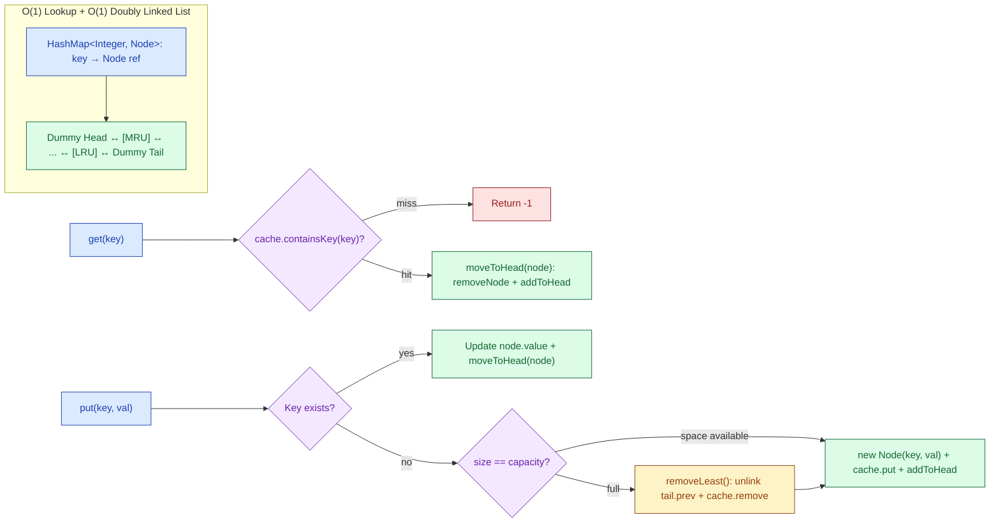

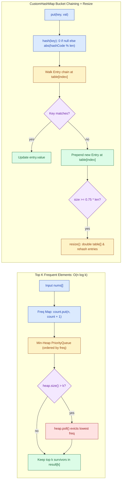

### Algorithm Intuition & Complexity

- **LRU Cache (Problem 7):** Combining a `HashMap<Integer, Node>` (`O(1)` lookup) with a sentinel-bounded Doubly Linked List (`head` = MRU, `tail` = LRU) makes `removeNode`, `addToHead`, and eviction `removeLeast` all `O(1)` without null-pointer boundary branches.
- **Top K Frequent (Problem 8):** Count frequencies in `O(n)`, then maintain a **min-heap** of size `k` (`(a, b) -> count.get(a) - count.get(b)`). Evicting the smallest root whenever `heap.size() > k` keeps the `k` highest-frequency keys in `O(n log k)` (or `O(n)` with bucket sort).
- **Custom HashMap (Problem 9):** Uses power-of-two capacity (`16`), `0.75f` load factor, separate chaining via `Entry<K, V>`, null-key routing to bucket `0`, and `2x` table resize + rehash. Note: JDK `HashMap` also treeifies chains at `TREEIFY_THRESHOLD = 8` when table length `>= 64`.

| Problem | Data Structures | Time | Space | Critical Edge Case |
| :--- | :--- | :--- | :--- | :--- |
| **7. LRU Cache** | `HashMap` + Doubly Linked List | `O(1)` `get`/`put` | `O(capacity)` | Store `key` inside `Node` to delete `tail.prev` from `cache` |
| **8. Top K Frequent Elements** | Frequency `HashMap` + Min-Heap | `O(n log k)` | `O(n)` | Use `Integer.compare` if frequency diffs risk overflow |
| **9. Custom HashMap** | `Entry<K, V>[]` + Chaining | `O(1)` avg, `O(n)` worst | `O(n)` | Handle `null` key at bucket `0` and `Integer.MIN_VALUE` hashCode |

### Problem 7: Implement LRU Cache

```java
public class LRUCache {
    /**
     * LRU Cache with O(1) get and put
     * Evicts least recently used item when full
     */
    private static class Node {
        int key;
        int value;
        Node prev;
        Node next;

        Node(int key, int value) {
            this.key = key;
            this.value = value;
        }
    }

    private int capacity;
    private Map<Integer, Node> cache = new HashMap<>();
    private Node head = new Node(0, 0); // Dummy head (most recent)
    private Node tail = new Node(0, 0); // Dummy tail (least recent)

    public LRUCache(int capacity) {
        this.capacity = capacity;
        head.next = tail;
        tail.prev = head;
    }

    public int get(int key) {
        if (!cache.containsKey(key)) return -1;

        Node node = cache.get(key);
        moveToHead(node); // Mark as recently used
        return node.value;
    }

    public void put(int key, int value) {
        if (cache.containsKey(key)) {
            Node node = cache.get(key);
            node.value = value;
            moveToHead(node);
        } else {
            if (cache.size() == capacity) {
                removeLeast(); // Remove least recently used
            }

            Node newNode = new Node(key, value);
            cache.put(key, newNode);
            addToHead(newNode);
        }
    }

    private void moveToHead(Node node) {
        removeNode(node);
        addToHead(node);
    }

    private void removeNode(Node node) {
        node.prev.next = node.next;
        node.next.prev = node.prev;
    }

    private void addToHead(Node node) {
        node.next = head.next;
        node.prev = head;
        head.next.prev = node;
        head.next = node;
    }

    private void removeLeast() {
        Node least = tail.prev;
        removeNode(least);
        cache.remove(least.key);
    }

    // Time: O(1) for both get and put
    // Space: O(capacity)
    // Uses doubly linked list for O(1) node removal and reordering
}
```

### Problem 8: Top K Frequent Elements

```java
public class TopKFrequent {
    /**
     * Find k most frequent elements
     * Example: [1,1,1,2,2,3] k=2 -> [1,2]
     */
    public int[] topKFrequent(int[] nums, int k) {
        // Count frequencies
        Map<Integer, Integer> count = new HashMap<>();
        for (int num : nums) {
            count.put(num, count.getOrDefault(num, 0) + 1);
        }

        // Use min-heap of size k
        PriorityQueue<Integer> heap = new PriorityQueue<>(
            (a, b) -> count.get(a) - count.get(b)
        );

        for (int num : count.keySet()) {
            heap.offer(num);
            if (heap.size() > k) {
                heap.poll(); // Remove element with smallest frequency
            }
        }

        int[] result = new int[k];
        int i = 0;
        while (!heap.isEmpty()) {
            result[i++] = heap.poll();
        }

        return result;
    }

    // Time: O(n log k) - iterate n elements, maintain k-heap
    // Space: O(n) for frequency map
    // Key insight: maintain min-heap of size k, elements with higher frequency survive
}
```

### Problem 9: Implement HashMap from Scratch

```java
public class CustomHashMap<K, V> {
    /**
     * Basic HashMap implementation
     */
    private static final int DEFAULT_CAPACITY = 16;
    private static final float LOAD_FACTOR = 0.75f;

    private Entry<K, V>[] table;
    private int size;

    @SuppressWarnings("unchecked")
    public CustomHashMap() {
        table = new Entry[DEFAULT_CAPACITY];
        size = 0;
    }

    public void put(K key, V value) {
        if (size >= table.length * LOAD_FACTOR) {
            resize();
        }

        int index = hash(key);
        Entry<K, V> entry = table[index];

        // Check if key exists
        while (entry != null) {
            if ((key == null && entry.key == null) ||
                (key != null && key.equals(entry.key))) {
                entry.value = value; // Update existing
                return;
            }
            entry = entry.next;
        }

        // Add new entry
        Entry<K, V> newEntry = new Entry<>(key, value);
        newEntry.next = table[index];
        table[index] = newEntry;
        size++;
    }

    public V get(Object key) {
        int index = hash(key);
        Entry<K, V> entry = table[index];

        while (entry != null) {
            if ((key == null && entry.key == null) ||
                (key != null && key.equals(entry.key))) {
                return entry.value;
            }
            entry = entry.next;
        }

        return null;
    }

    @SuppressWarnings("unchecked")
    private void resize() {
        Entry<K, V>[] oldTable = table;
        table = new Entry[oldTable.length * 2];
        size = 0;

        for (Entry<K, V> entry : oldTable) {
            while (entry != null) {
                put(entry.key, entry.value);
                entry = entry.next;
            }
        }
    }

    private int hash(Object key) {
        if (key == null) return 0;
        return Math.abs(key.hashCode() % table.length);
    }

    private static class Entry<K, V> {
        K key;
        V value;
        Entry<K, V> next;

        Entry(K key, V value) {
            this.key = key;
            this.value = value;
        }
    }

    // Time: O(1) average for put/get
    // Space: O(n) where n is number of entries
}
```

> [!TIP]
> **30-Second Revision (HashMap Internals & Cache):** In `LRUCache`, dummy `head` and `tail` sentinel nodes eliminate null checks during `removeNode` and `addToHead`. In `CustomHashMap`, watch out for `Math.abs(Integer.MIN_VALUE)` staying negative in Java (JDK `HashMap` uses `(h ^ (h >>> 16)) & (n - 1)` instead). For Top-K *largest*, always use a **min-heap** of size `k` so small elements get evicted.

---

## Concurrency Puzzles

### Visual Thread Coordination & Deadlock Avoidance

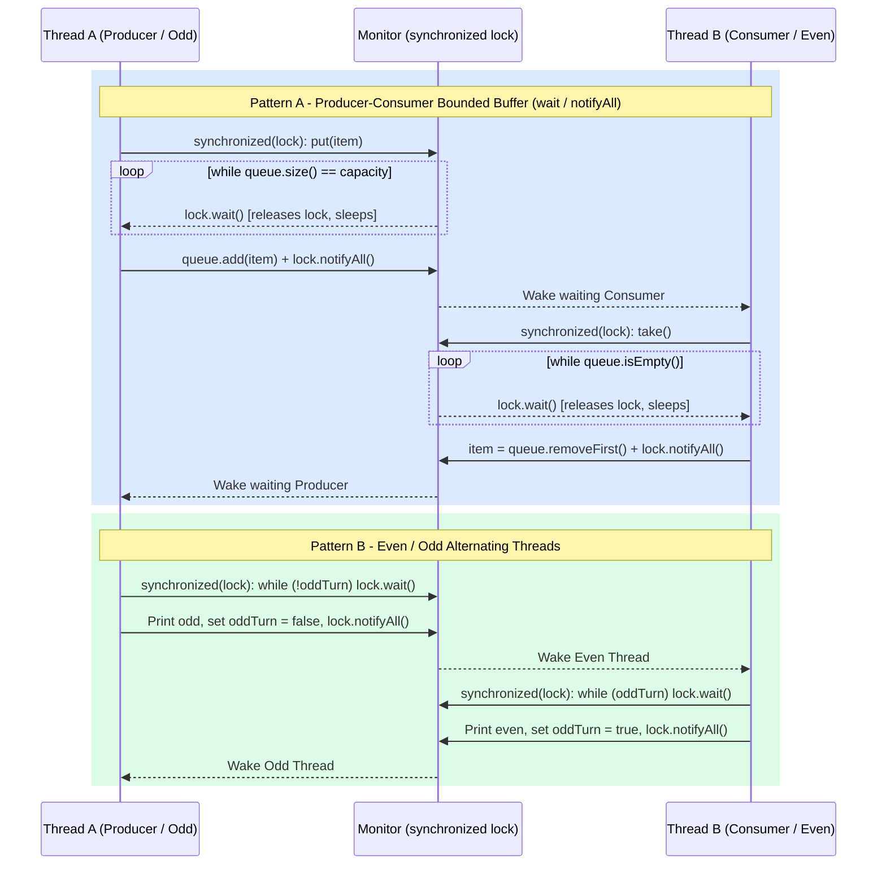

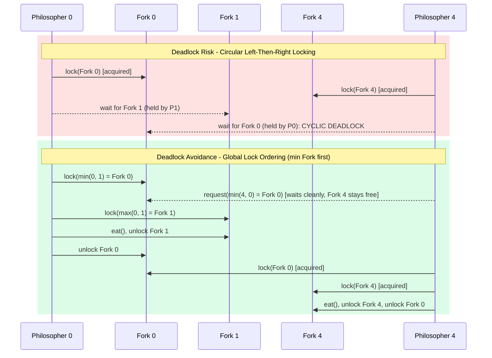

### Algorithm Intuition & Synchronization Rules

- **Guarded `while` Loops (Problem 10):** Always guard `wait()` inside `while (condition)`, never `if`, to protect against **spurious wakeups** and multiple consumers racing after `notifyAll()`. Use `notifyAll()` (or dual `Condition` objects on `ReentrantLock`) so a producer never wakes another blocked producer and stalls.
- **Double-Checked Locking + `volatile` (Problem 11):** Without `volatile`, `instance = new ThreadSafeSingleton()` can publish a partially constructed object reference via instruction reordering. (See [OOP Design Problems](#oop-design-problems) for the Bill Pugh Holder and Enum Singleton comparison.)
- **High-Level `BlockingQueue` & Deadlock Avoidance (Problem 12 + Companion Patterns):** Prefer `LinkedBlockingQueue` / `ArrayBlockingQueue` over manual `wait`/`notifyAll`. For Even/Odd alternation, reuse the same `while (!myTurn) wait(); notifyAll();` monitor predicate; for Dining Philosophers, break circular wait by always locking `min(leftFork, rightFork)` before `max(leftFork, rightFork)`.

| Puzzle | Synchronization Primitive | Time | Space | Deadlock / Liveness Guard |
| :--- | :--- | :--- | :--- | :--- |
| **10. Custom BlockingQueue** | `synchronized` + `wait`/`notifyAll` | `O(1)` | `O(capacity)` | `while` loop predicate + `notifyAll()` |
| **11. Thread-Safe Singleton** | `volatile` + DCL (`synchronized`) | `O(1)` | `O(1)` | `volatile` establishes happens-before visibility |
| **12. Producer-Consumer** | `LinkedBlockingQueue` | `O(1)` | `O(capacity)` | Restore `Thread.currentThread().interrupt()` on `InterruptedException` |
| **Companion: Even/Odd & Philosophers** | Monitor turn flag / Lock ordering | `O(1)` | `O(1)` | Total lock ordering `min(L, R)` prevents circular wait |

### Problem 10: Implement Blocking Queue

```java
public class CustomBlockingQueue<T> {
    /**
     * Thread-safe blocking queue implementation
     */
    private LinkedList<T> queue = new LinkedList<>();
    private int capacity;
    private Object lock = new Object();

    public CustomBlockingQueue(int capacity) {
        this.capacity = capacity;
    }

    public void put(T item) throws InterruptedException {
        synchronized (lock) {
            // Wait while queue is full
            while (queue.size() == capacity) {
                lock.wait();
            }

            queue.add(item);
            lock.notifyAll(); // Wake consumers
        }
    }

    public T take() throws InterruptedException {
        synchronized (lock) {
            // Wait while queue is empty
            while (queue.isEmpty()) {
                lock.wait();
            }

            T item = queue.removeFirst();
            lock.notifyAll(); // Wake producers
            return item;
        }
    }

    public int size() {
        synchronized (lock) {
            return queue.size();
        }
    }

    // Time: O(1) for put/take
    // Space: O(capacity)
    // Key: monitor lock, wait/notifyAll for synchronization
}
```

### Problem 11: Implement Thread-Safe Singleton

```java
public class ThreadSafeSingleton {
    /**
     * Lazy initialization, double-checked locking
     */
    private static volatile ThreadSafeSingleton instance;

    private ThreadSafeSingleton() {
        // Prevent instantiation
    }

    public static ThreadSafeSingleton getInstance() {
        if (instance == null) { // First check (no lock, fast path)
            synchronized (ThreadSafeSingleton.class) {
                if (instance == null) { // Second check (with lock)
                    instance = new ThreadSafeSingleton();
                }
            }
        }
        return instance;
    }

    // Time: O(1) after initialization
    // Space: O(1)
    // Key: volatile keyword ensures visibility, double-check prevents unnecessary locking
    // Better: use initialization-on-demand holder
}
```

### Problem 12: Producer-Consumer with BlockingQueue

```java
public class ProducerConsumerPattern {
    /**
     * Using BlockingQueue for clean synchronization
     */
    public static void main(String[] args) throws InterruptedException {
        BlockingQueue<Integer> queue = new LinkedBlockingQueue<>(5);

        Thread producer = new Thread(() -> {
            try {
                for (int i = 0; i < 20; i++) {
                    queue.put(i);
                    System.out.println("Produced: " + i);
                    Thread.sleep(100);
                }
            } catch (InterruptedException e) {
                Thread.currentThread().interrupt();
            }
        });

        Thread consumer = new Thread(() -> {
            try {
                for (int i = 0; i < 20; i++) {
                    int item = queue.take(); // Blocks if empty
                    System.out.println("Consumed: " + item);
                    Thread.sleep(150);
                }
            } catch (InterruptedException e) {
                Thread.currentThread().interrupt();
            }
        });

        producer.start();
        consumer.start();
        producer.join();
        consumer.join();
    }

    // BlockingQueue handles all synchronization internally
    // put() blocks when full, take() blocks when empty
}
```

### Companion Pattern: Even/Odd Alternation & Ordered Dining Philosophers

```java
public class ConcurrencyPatterns {
    private int current = 1;
    private final int max = 10;
    private final Object turnLock = new Object();

    // Even/Odd alternating threads using monitor predicate
    public void printNumbers(boolean isOddThread) throws InterruptedException {
        synchronized (turnLock) {
            while (current <= max) {
                while ((current % 2 == 1) != isOddThread) {
                    turnLock.wait();
                }
                if (current <= max) {
                    System.out.println(Thread.currentThread().getName() + ": " + current++);
                    turnLock.notifyAll();
                }
            }
        }
    }

    // Dining Philosophers: global lock ordering breaks Coffman's circular wait
    public void dine(Object[] forks, int id) {
        int left = id;
        int right = (id + 1) % forks.length;
        Object first = forks[Math.min(left, right)];
        Object second = forks[Math.max(left, right)];

        synchronized (first) {
            synchronized (second) {
                // Eat safely without cyclic deadlock
            }
        }
    }
}
```

> [!IMPORTANT]
> **30-Second Revision (Concurrency):** Never call `wait()` outside a `synchronized` block or inside an `if` statement (`while` guards spurious wakeups). Never swallow `InterruptedException`—always restore the interrupt flag via `Thread.currentThread().interrupt()`. To eliminate circular-wait deadlocks on multiple locks, impose a strict global acquisition order (`min(id1, id2)` before `max(id1, id2)`).

---

## Stream API Challenges

### Visual Stream & Collector Pipelines

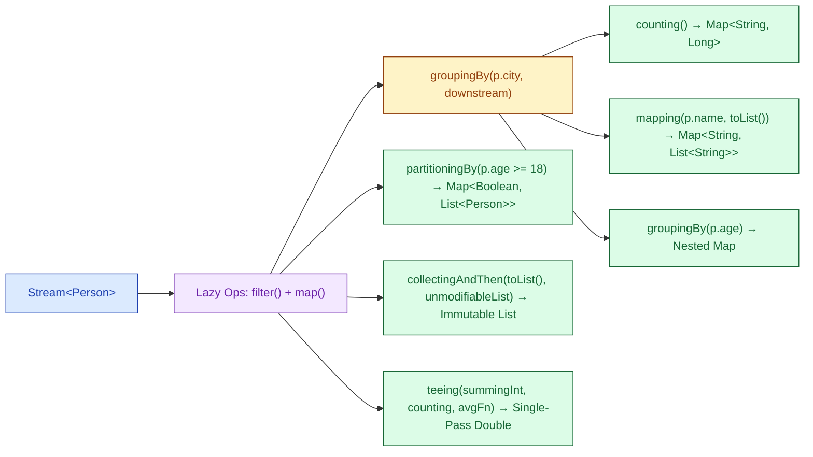

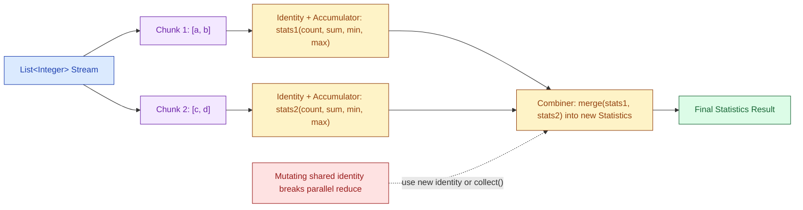

### Algorithm Intuition & Collector Guide

- **Lazy Evaluation & 3-Arg `reduce` (Problem 13):** Streams execute nothing until a terminal operation (`reduce`, `collect`, `count`). The 3-argument `reduce(identity, accumulator, combiner)` maps elements to an aggregation type `U`; note that for **parallel** streams, mutating a shared `identity` instance inside `accumulator` causes data races—prefer `stream.collect(Statistics::new, acc, comb)` for mutable containers.
- **Composing Multi-Stage Collectors (Problem 14 + Advanced Collectors):**
  - `groupingBy(classifier, downstream)` groups keys and transforms buckets in a single pass (`counting()`, `mapping()`, nested `groupingBy()`).
  - `partitioningBy(predicate)` is a fast boolean specialization returning `Map<Boolean, List<T>>` (always populated with both `true` and `false` keys).
  - `collectingAndThen(downstream, finisher)` post-processes the collector result (e.g., freezing into an unmodifiable collection or unwrapping an `Optional`).
  - `Collectors.teeing(c1, c2, merger)` (Java 12+) feeds each element to two independent collectors in one stream pass and merges their results.

| Collector / Op | Output Type | Pass Count | Primary Use Case |
| :--- | :--- | :--- | :--- |
| **`reduce(id, acc, comb)`** | Single value `U` | `O(n)` single pass | Immutable value reduction (sums, counts, custom immutable summaries) |
| **`groupingBy(fn, downstream)`** | `Map<K, D>` | `O(n)` single pass | Multi-level buckets, per-group counts, mapped projections |
| **`partitioningBy(pred)`** | `Map<Boolean, List<T>>` | `O(n)` single pass | Two-way split (e.g., adults vs. minors); keeps empty bucket key |
| **`collectingAndThen(c, fn)`** | `R` (finisher output) | `O(n)` single pass | Make result unmodifiable or extract `Optional::get` safely |
| **`teeing(c1, c2, merger)`** | `R` (merged output) | `O(n)` single pass | Compute two aggregations simultaneously (e.g., min+max, sum+count) |

### Problem 13: Stream Reduction with Complex Logic

```java
public class StreamReduction {
    /**
     * Use reduce for complex aggregations
     */
    public int sumOfSquares(List<Integer> numbers) {
        return numbers.stream()
            .map(n -> n * n)
            .reduce(0, Integer::sum);
    }

    /**
     * Custom reduction with object
     */
    public class Statistics {
        int count = 0;
        int sum = 0;
        int min = Integer.MAX_VALUE;
        int max = Integer.MIN_VALUE;
    }

    public Statistics computeStats(List<Integer> numbers) {
        return numbers.stream()
            .reduce(
                new Statistics(),
                (stats, n) -> {
                    stats.count++;
                    stats.sum += n;
                    stats.min = Math.min(stats.min, n);
                    stats.max = Math.max(stats.max, n);
                    return stats;
                },
                (stats1, stats2) -> {
                    Statistics combined = new Statistics();
                    combined.count = stats1.count + stats2.count;
                    combined.sum = stats1.sum + stats2.sum;
                    combined.min = Math.min(stats1.min, stats2.min);
                    combined.max = Math.max(stats1.max, stats2.max);
                    return combined;
                }
            );
    }

    // Time: O(n)
    // Space: O(1) for single value, O(custom) for complex objects
}
```

### Problem 14: Grouping with Collectors

```java
public class StreamGrouping {
    /**
     * Group and transform data efficiently
     */
    public static class Person {
        String name;
        int age;
        String city;

        public Person(String name, int age, String city) {
            this.name = name;
            this.age = age;
            this.city = city;
        }
    }

    public void groupingExamples(List<Person> people) {
        // Group by city
        Map<String, List<Person>> byCity = people.stream()
            .collect(Collectors.groupingBy(p -> p.city));

        // Group by city, count
        Map<String, Long> cityCount = people.stream()
            .collect(Collectors.groupingBy(p -> p.city, Collectors.counting()));

        // Group by age, get average age per city (nested grouping)
        Map<String, Map<Integer, List<Person>>> nestedGroup = people.stream()
            .collect(Collectors.groupingBy(
                p -> p.city,
                Collectors.groupingBy(p -> p.age)
            ));

        // Group by city, get names
        Map<String, List<String>> cityNames = people.stream()
            .collect(Collectors.groupingBy(
                p -> p.city,
                Collectors.mapping(p -> p.name, Collectors.toList())
            ));
    }

    // Time: O(n) single pass
    // Space: O(n) for grouped result
}
```

### Companion Pattern: `partitioningBy`, `collectingAndThen` & `teeing`

```java
public class AdvancedCollectorsPattern {
    public void pipelineExamples(List<StreamGrouping.Person> people) {
        // 1. partitioningBy: always contains both true and false keys
        Map<Boolean, List<StreamGrouping.Person>> adultsAndMinors = people.stream()
            .collect(Collectors.partitioningBy(p -> p.age >= 18));

        // 2. collectingAndThen: apply post-processing finisher
        List<String> immutableNames = people.stream()
            .map(p -> p.name)
            .collect(Collectors.collectingAndThen(
                Collectors.toList(),
                Collections::unmodifiableList
            ));

        // 3. Collectors.teeing (Java 12+): dual collectors in a single pass
        double averageAge = people.stream()
            .collect(Collectors.teeing(
                Collectors.summingInt(p -> p.age),
                Collectors.counting(),
                (sum, count) -> count == 0 ? 0.0 : (double) sum / count
            ));
    }
}
```

> [!TIP]
> **30-Second Revision (Streams):** Use `reduce` for *immutable* value folding and `collect` (with `Supplier`) for *mutable* containers so parallel streams never share a single mutable identity. Combine `groupingBy` + downstream collectors (`mapping`, `counting`, `filtering`, `collectingAndThen`) or `Collectors.teeing` to avoid scanning a list twice.

---

## OOP Design Problems

### Visual Design Blueprints: Immutability & Thread-Safe Singletons

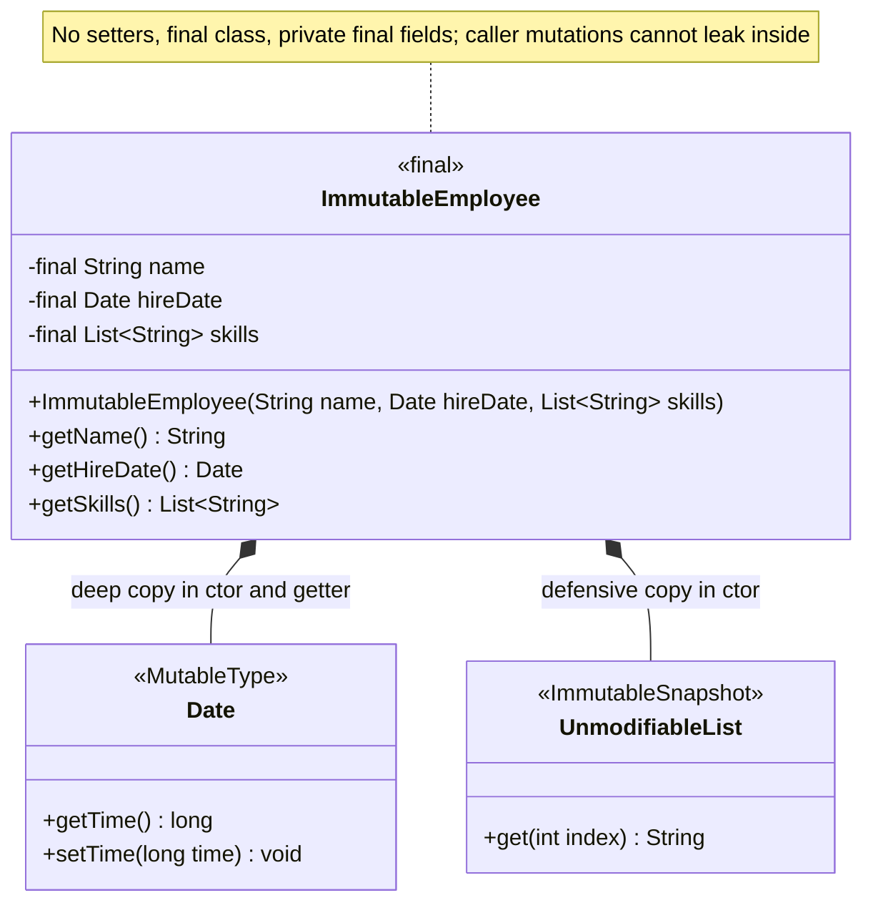

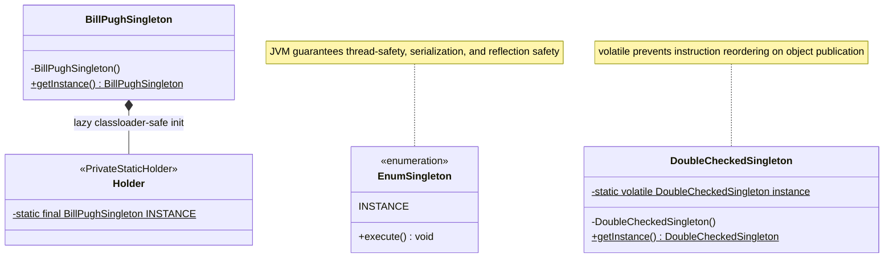

### Design Intuition & Pattern Trade-offs

- **Observer / EventBus (Problem 15):** Decouples publishers from subscribers via `EventListener` and a `Map<String, List<EventListener>>` registry (`computeIfAbsent`). For concurrent buses, swap `HashMap`/`ArrayList` for `ConcurrentHashMap` + `CopyOnWriteArrayList`.
- **Enum Factory (Problem 16):** Each enum constant implements `create()`, giving compile-time type safety, exhaustive dispatch without `if/else` or `switch` chains, and zero reflection overhead.
- **Immutable Class with Mutable Fields (Companion Pattern):** Marking a class `final` and fields `private final` is **not enough** if a field holds a mutable reference (`Date`, `List`, arrays). You must deep-copy mutable arguments in the constructor *and* return defensive copies (or `List.copyOf` unmodifiable snapshots) from getters.
- **Singleton Comparison (Companion + Problem 11):** `EnumSingleton` is the safest default (immune to reflection and serialization); **Bill Pugh Holder** achieves lazy, lock-free thread safety via JVM class initialization guarantees; **Double-Checked Locking** requires `volatile` on `instance`.

| Pattern | Core Mechanism | Key Benefit | Primary Watch-Out |
| :--- | :--- | :--- | :--- |
| **Observer (`EventBus`)** | `Map<String, List<EventListener>>` | Loose publisher-subscriber coupling | Memory leaks if listeners aren't unsubscribed; thread safety |
| **Enum Factory** | Abstract method overridden per constant | Eliminates `switch`/factory boilerplate | Hard-coded set of product types at compile time |
| **Immutable Class** | `final` class + deep copy ctor & getter | Inherently thread-safe, safe `Map` keys | Shallow copy leaks internal mutable objects (`Date`, `List`) |
| **Thread-Safe Singleton** | Enum / Static Holder / `volatile` DCL | Single controlled shared instance | Reflection/serialization attacks (solved automatically by Enum) |

### Problem 15: Observer Pattern / Event System

```java
public class EventBusPattern {
    /**
     * Simple event bus implementation
     */
    public interface EventListener {
        void onEvent(Event event);
    }

    public class Event {
        private String type;
        private Object data;

        public Event(String type, Object data) {
            this.type = type;
            this.data = data;
        }

        public String getType() { return type; }
        public Object getData() { return data; }
    }

    public class EventBus {
        private Map<String, List<EventListener>> listeners = new HashMap<>();

        public void subscribe(String eventType, EventListener listener) {
            listeners.computeIfAbsent(eventType, k -> new ArrayList<>())
                .add(listener);
        }

        public void publish(Event event) {
            List<EventListener> eventListeners = listeners.get(event.getType());
            if (eventListeners != null) {
                eventListeners.forEach(listener -> listener.onEvent(event));
            }
        }
    }

    // Usage:
    public void example() {
        EventBus bus = new EventBus();

        bus.subscribe("user.created", event -> {
            System.out.println("User created: " + event.getData());
        });

        bus.subscribe("user.deleted", event -> {
            System.out.println("User deleted: " + event.getData());
        });

        bus.publish(new Event("user.created", "John"));
    }
}
```

### Problem 16: Factory Pattern with Enum

```java
public class FactoryPattern {
    /**
     * Type-safe factory using enum
     */
    public enum PaymentMethodType {
        CREDIT_CARD {
            @Override
            public PaymentMethod create() {
                return new CreditCardPayment();
            }
        },
        PAYPAL {
            @Override
            public PaymentMethod create() {
                return new PayPalPayment();
            }
        },
        BITCOIN {
            @Override
            public PaymentMethod create() {
                return new BitcoinPayment();
            }
        };

        public abstract PaymentMethod create();
    }

    public interface PaymentMethod {
        void process(double amount);
    }

    public class CreditCardPayment implements PaymentMethod {
        @Override
        public void process(double amount) {
            System.out.println("Processing credit card: $" + amount);
        }
    }

    public class PayPalPayment implements PaymentMethod {
        @Override
        public void process(double amount) {
            System.out.println("Processing PayPal: $" + amount);
        }
    }

    public class BitcoinPayment implements PaymentMethod {
        @Override
        public void process(double amount) {
            System.out.println("Processing Bitcoin: " + amount + " BTC");
        }
    }

    // Usage:
    public void process(PaymentMethodType type, double amount) {
        PaymentMethod method = type.create();
        method.process(amount);
    }
}
```

### Companion Pattern: Immutable Class (Deep Copy) & Singleton Variants

```java
// 1. Strictly Immutable Class with Mutable Fields
public final class ImmutableEmployee {
    private final String name;
    private final Date hireDate;
    private final List<String> skills;

    public ImmutableEmployee(String name, Date hireDate, List<String> skills) {
        this.name = name;
        this.hireDate = new Date(hireDate.getTime()); // Defensive copy on entry
        this.skills = List.copyOf(skills);            // Unmodifiable shallow snapshot of immutable Strings
    }

    public String getName() { return name; }
    public Date getHireDate() { return new Date(hireDate.getTime()); } // Defensive copy on exit
    public List<String> getSkills() { return skills; } // Already unmodifiable
}

// 2. Bill Pugh Initialization-on-Demand Holder Singleton (lazy & lock-free)
public class BillPughSingleton {
    private BillPughSingleton() {}

    private static class Holder {
        private static final BillPughSingleton INSTANCE = new BillPughSingleton();
    }

    public static BillPughSingleton getInstance() {
        return Holder.INSTANCE;
    }
}

// 3. Enum Singleton (Effective Java recommendation: serialization & reflection safe)
public enum EnumSingleton {
    INSTANCE;

    public void execute() { /* singleton behavior */ }
}
```

> [!IMPORTANT]
> **30-Second Revision (OOP Design):** To make a class truly immutable when holding mutable fields (`Date`, `List`, arrays), use `final` class + `private final` fields + defensive deep copy in both constructor *and* getters + no setters. For singletons, prefer **Enum** (simplest, serialization/reflection-proof) or **Bill Pugh Holder** (lazy without synchronization overhead) over manual double-checked locking.

---

## Advanced Problems Summary

### Visual Pattern-Recognition Selector & Building Blocks

```mermaid
flowchart TD
    Root["Identify Core Problem Signal"] --> S["String / Prefix"]
    Root --> A["Array / Pair / Search"]
    Root --> H["O(1) Cache / Frequency"]
    Root --> C["Concurrency / Rate Control"]
    Root --> G["Graph / DP / Systems"]

    S --> S1["Palindrome → Expand Around Center O(n^2) / O(1)"]
    S --> S2["Pattern Search → KMP LPS O(n + m)"]
    S --> S3["Prefix / Autocomplete → Trie O(m) (Prob 17, 23, 30)"]

    A --> A1["Unsorted Complement → HashMap O(n)"]
    A --> A2["Sorted Pair / Max Area → Two Pointers O(1)"]
    A --> A3["Median of 2 Sorted Arrays → Binary Search O(log min) (Prob 24)"]

    H --> H1["Eviction / TTL → HashMap + DLL (Prob 7, 18, 25, 29)"]
    H --> H2["Top K Frequent → Freq Map + Size-K Min-Heap O(n log k)"]

    C --> C1["Bounded Buffer / Pool → wait/notifyAll / BlockingQueue (Prob 10, 12, 19, 26)"]
    C --> C2["Burst Control → Token Bucket Rate Limiter O(1) (Prob 18)"]
    C --> C3["Singleton / Events → Enum, Holder, EventBus (Prob 11, 15, 16)"]

    G --> G1["Shortest Word Transform → BFS (Prob 20)"]
    G --> G2["Prerequisites / Ordering → Topological Sort (Prob 21, 22)"]

    classDef blue fill:#dbeafe,stroke:#1e40af,color:#1e40af
    classDef green fill:#dcfce7,stroke:#166534,color:#166534
    classDef amber fill:#fef3c7,stroke:#92400e,color:#92400e
    classDef red fill:#fee2e2,stroke:#991b1b,color:#991b1b
    classDef purple fill:#f3e8ff,stroke:#6b21a8,color:#6b21a8

    class Root blue
    class S,A,H,C,G purple
    class S1,S2,A1,A2,H1,H2,C1,C2,C3 green
    class S3,A3,G1,G2 amber
```

```mermaid
flowchart TD
    subgraph sg1 ["Trie Prefix Tree: O(m) Lookup"]
        TR["Start at root TrieNode"] --> TC["For each char c in word"]
        TC --> TG{"node.children.get(c) == null?"}
        TG -->|"yes"| TF["Return false (missing prefix)"]
        TG -->|"no"| TN["Advance node = child"]
        TN --> TD{"More chars?"}
        TD -->|"yes"| TC
        TD -->|"no: startsWith()"| TT1["Return true"]
        TD -->|"no: search()"| TT2{"node.isEndOfWord?"}
        TT2 -->|"true"| TT1
        TT2 -->|"false"| TF
    end

    subgraph sg2 ["Token Bucket Rate Limiter: O(1)"]
        RL1["allowRequest() acquires synchronized(lock)"] --> RL2["refillTokens(): elapsed = (now - lastRefill) / 1000.0"]
        RL2 --> RL3["tokens = min(rate, tokens + rate * elapsed)"]
        RL3 --> RL4{"tokens &gt;= 1.0?"}
        RL4 -->|"yes"| RL5["tokens -= 1.0; return true"]
        RL4 -->|"no"| RL6["Reject request; return false"]
    end

    classDef blue fill:#dbeafe,stroke:#1e40af,color:#1e40af
    classDef green fill:#dcfce7,stroke:#166534,color:#166534
    classDef amber fill:#fef3c7,stroke:#92400e,color:#92400e
    classDef red fill:#fee2e2,stroke:#991b1b,color:#991b1b
    classDef purple fill:#f3e8ff,stroke:#6b21a8,color:#6b21a8

    class TR,RL1 blue
    class TC,TN,RL2,RL3 amber
    class TG,TD,TT2,RL4 purple
    class TT1,RL5 green
    class TF,RL6 red
```

### Quick-Lookup Complexity Table (Problems 1–30)

| # | Problem | Core Pattern / Data Structure | Time Complexity | Space Complexity |
| :--- | :--- | :--- | :--- | :--- |
| **1** | Longest Palindromic Substring | Expand Around Center | `O(n²)` | `O(1)` |
| **2** | `strStr()` / `indexOf()` | Naive / KMP (`lps[]`) | `O(n*m)` / `O(n+m)` | `O(1)` / `O(m)` |
| **3** | Reverse Words in String | Split + Two-Pointer Swap | `O(n)` | `O(n)` |
| **4** | Two Sum (Unsorted / Sorted) | `HashMap` / Two Pointers | `O(n)` | `O(n)` / `O(1)` |
| **5** | Best Time to Buy & Sell Stock | Single-Pass `minPrice` / Greedy | `O(n)` | `O(1)` |
| **6** | Container With Most Water | Converging Two Pointers | `O(n)` | `O(1)` |
| **7** | LRU Cache | `HashMap` + Doubly Linked List | `O(1)` | `O(capacity)` |
| **8** | Top K Frequent Elements | Freq `HashMap` + Min-Heap | `O(n log k)` | `O(n)` |
| **9** | Custom HashMap | Bucket Array + Chaining + Resize | `O(1)` avg | `O(n)` |
| **10** | Custom BlockingQueue | `synchronized` + `wait`/`notifyAll` | `O(1)` | `O(capacity)` |
| **11** | Thread-Safe Singleton | `volatile` DCL / Holder / Enum | `O(1)` | `O(1)` |
| **12** | Producer-Consumer | `LinkedBlockingQueue` | `O(1)` | `O(capacity)` |
| **13** | Stream Reduction | `map` + 3-Arg `reduce` | `O(n)` | `O(1)` / `O(custom)` |
| **14** | Stream Grouping | `groupingBy` + Downstream Collectors | `O(n)` | `O(n)` |
| **15** | Event Bus (Observer) | `Map<String, List<EventListener>>` | `O(listeners)` | `O(listeners)` |
| **16** | Payment Factory | Enum Abstract Method Factory | `O(1)` | `O(1)` |
| **17** | Implement Trie (Prefix Tree) | `TrieNode` (`Map<Character, TrieNode>`) | `O(m)` | `O(alphabet * n)` |
| **18** | Rate Limiter (Token Bucket) | Lazy Time-Based Refill + `synchronized` | `O(1)` | `O(1)` |
| **19–22** | Thread Pool, Word Ladder, Course Schedule, Alien Dict | `BlockingQueue` Workers, BFS, Topo Sort (Kahn/DFS) | `O(V + E)` (graphs) | `O(V + E)` |
| **23–24** | Word Break, Median of Two Sorted Arrays | DP + Trie / Partition Binary Search | `O(n²)` / `O(log min(m,n))` | `O(n)` / `O(1)` |
| **25–30** | Cache Eviction, Semaphore, Parking Lot, KV w/ TTL | Policy Pattern, `wait`/`notify`, OOP, `DelayQueue`/Map | `O(1)` avg | `O(n)` |

### Problem 17-30: Additional Challenging Problems

```java
public class AdvancedProblems {
    /*
    17. Implement Custom HashMap (with collision handling)
    18. Implement LRU Cache (with LinkedHashMap)
    19. Implement Thread Pool / ExecutorService
    20. Word Ladder (BFS graph traversal)
    21. Course Schedule (topological sort)
    22. Alien Dictionary (topological sort, DFS)
    23. Word Break (dynamic programming, trie)
    24. Median of Two Sorted Arrays (binary search)
    25. Design Cache Eviction Policy
    26. Implement Semaphore from scratch
    27. Design Parking Lot System (OOP)
    28. Design Rate Limiter (token bucket algorithm)
    29. Design Key-Value Store with TTL
    30. Implement Trie (prefix tree)
    */
}
```

### Problem 17: Implement Trie (Prefix Tree)

```java
public class TrieImplementation {
    /**
     * Prefix tree for efficient string searching
     */
    private class TrieNode {
        Map<Character, TrieNode> children = new HashMap<>();
        boolean isEndOfWord = false;
    }

    private TrieNode root = new TrieNode();

    public void insert(String word) {
        TrieNode node = root;
        for (char c : word.toCharArray()) {
            node = node.children.computeIfAbsent(c, k -> new TrieNode());
        }
        node.isEndOfWord = true;
    }

    public boolean search(String word) {
        TrieNode node = findNode(word);
        return node != null && node.isEndOfWord;
    }

    public boolean startsWith(String prefix) {
        return findNode(prefix) != null;
    }

    private TrieNode findNode(String word) {
        TrieNode node = root;
        for (char c : word.toCharArray()) {
            node = node.children.get(c);
            if (node == null) return null;
        }
        return node;
    }

    // Time: O(m) where m is length of word
    // Space: O(alphabet_size * n) where n is number of words
}
```

### Problem 18: Rate Limiter (Token Bucket)

```java
public class RateLimiter {
    /**
     * Token bucket algorithm for rate limiting
     */
    private final double rate; // tokens per second
    private double tokens;
    private long lastRefillTime;
    private final Object lock = new Object();

    public RateLimiter(double rate) {
        this.rate = rate;
        this.tokens = rate; // Start with full bucket
        this.lastRefillTime = System.currentTimeMillis();
    }

    public boolean allowRequest() {
        synchronized (lock) {
            refillTokens();

            if (tokens >= 1.0) {
                tokens -= 1.0;
                return true;
            }
            return false;
        }
    }

    private void refillTokens() {
        long now = System.currentTimeMillis();
        double elapsedSeconds = (now - lastRefillTime) / 1000.0;
        tokens = Math.min(rate, tokens + rate * elapsedSeconds);
        lastRefillTime = now;
    }

    // Time: O(1) per request
    // Space: O(1)
    // Key: refill tokens based on elapsed time, allow if >= 1 token
}
```

### Key Takeaways for Each Category

- **String Problems:**
  - Use two pointers for palindromes (expand around center)
  - KMP for efficient string matching (`O(n + m)`)
  - `HashMap` or fixed `int[26]`/`int[128]` arrays for character frequency counts
- **Array/List Problems:**
  - Two pointers for linear problems and in-place partitioning
  - `HashMap` for complement/frequency problems
  - Min/max tracking for single-pass solutions
- **HashMap Problems:**
  - LRU: use doubly linked list + `HashMap` (or `LinkedHashMap` with `accessOrder = true`)
  - TopK: use min-heap of size `k`
  - Understand collision handling (chaining/treeification) and resizing (`0.75f` load factor)
- **Concurrency:**
  - `wait`/`notifyAll` inside `while` loops for custom synchronization
  - `BlockingQueue` for producer-consumer
  - `volatile` and double-checked locking (or Bill Pugh Holder / Enum) for singletons, plus lock ordering to prevent deadlocks
- **Streams:**
  - Intermediate (lazy) vs terminal (eager) operations
  - `reduce` for custom immutable aggregations; `collect` for mutable containers
  - `Collectors.groupingBy`, `partitioningBy`, `collectingAndThen`, and `teeing` for multi-stage grouping
- **OOP Design:**
  - Patterns: Factory, Observer, Singleton, Immutable Class
  - Use enums for type-safe factories and serialization-safe singletons
  - Interface segregation and defensive copying for loose coupling and thread safety

> [!TIP]
> **30-Second Revision (Advanced Systems & Tries):** For `RateLimiter`, compute lazy refills on request arrival (`elapsedSeconds * rate`, capped at bucket capacity) instead of spawning a background refill thread (`System.nanoTime()` avoids wall-clock NTP jumps in production). For `Trie`, use `TrieNode[26]` when the alphabet is lowercase ASCII for faster cache locality, or `Map<Character, TrieNode>` for full Unicode.
