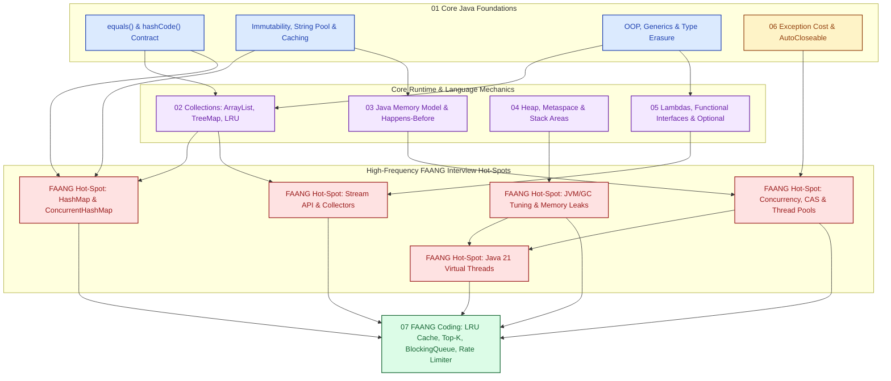
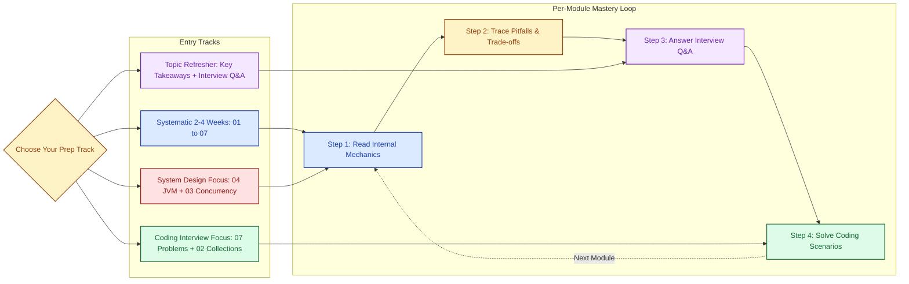
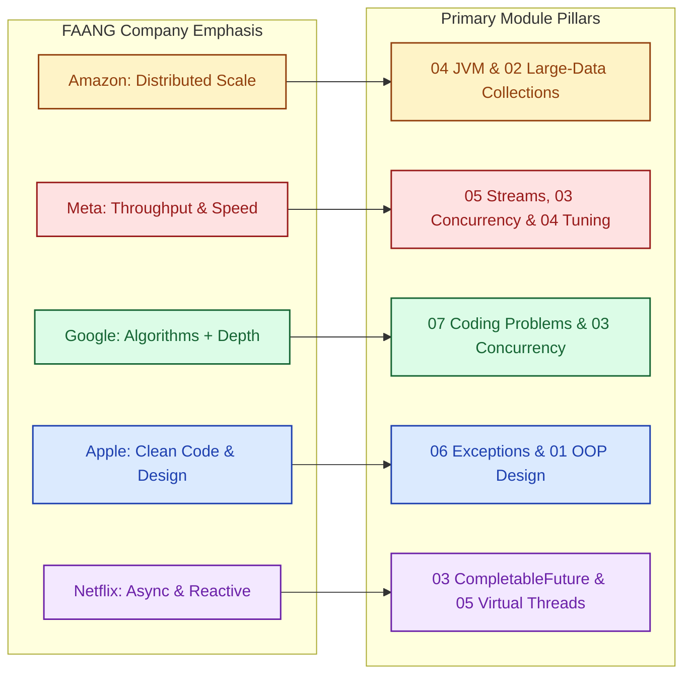
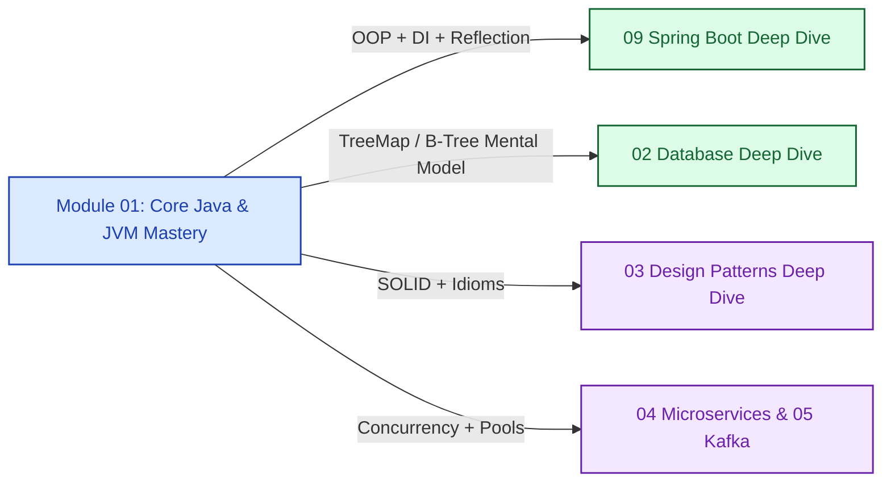
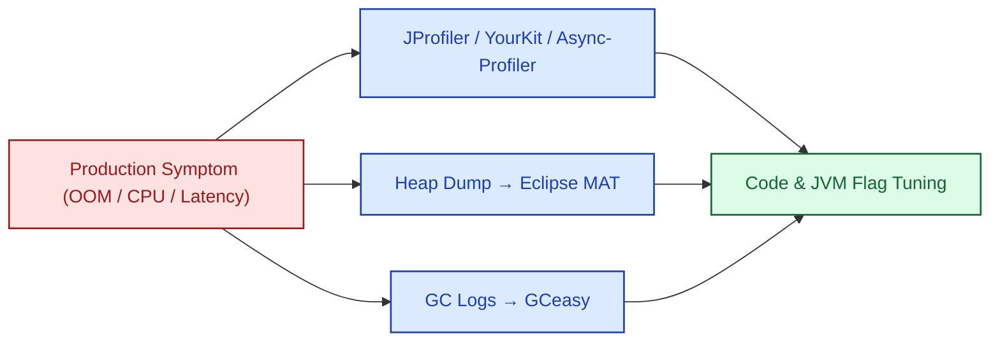
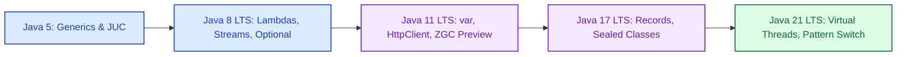

# Java Interview Preparation - Complete Deep Dive

**Target Audience:** Mid-level Java engineers (5+ years experience) preparing for senior FAANG roles  
**Total Content:** 7,524 lines across 7 deep-dive modules (~384 KB total) | **Java 5–21** (Focus: **Java 8–17**, Latest: **Java 21**)

---

## Overview

This guide targets **deep, production-level Java mastery** rather than surface-level syntax recall. Every module pairs internal JVM/library mechanics with production debugging and interview trade-offs:

| What Every Module Delivers | Focus in Practice |
|---|---|
| **Internal Mechanics** | How data structures, monitors, bytecode, and GC actually execute under the hood |
| **Production Code Patterns** | Idiomatic, thread-safe, memory-conscious implementations |
| **Pitfalls & Anti-Patterns** | Subtle failure modes (`HashMap` key mutation, `ThreadLocal` leaks, stream misuse) |
| **Interview Q&A + Trade-offs** | Detailed answers comparing latency, throughput, memory, and complexity |
| **Why It Matters** | Connecting language internals to large-scale distributed system reliability |

### Module Learning Roadmap

```mermaid
flowchart LR
    subgraph W1["Week 1 - Foundation"]
        M01["01 Core Java: OOP, equals/hashCode, String, Generics"]
        M02["02 Collections: HashMap, TreeMap, ConcurrentHashMap"]
        M01 --> M02
    end

    subgraph W2["Week 2 - Concurrency & Runtime"]
        M03["03 Concurrency: JMM, Locks, Pools, CompletableFuture"]
        M04["04 JVM & Memory: Heap, G1/ZGC, JIT, Leaks"]
        M03 --> M04
    end

    subgraph W3["Week 3 - Modern APIs & Craft"]
        M05["05 Java 8+ Features: Streams, Records, Virtual Threads"]
        M06["06 Exceptions & Practices: AutoCloseable, SOLID"]
        M05 --> M06
    end

    subgraph W4["Week 4 - Synthesis"]
        M07["07 Coding Problems: 30+ FAANG Scenarios"]
    end

    M02 --> M03
    M04 --> M05
    M06 --> M07

    classDef blue fill:#dbeafe,stroke:#1e40af,color:#1e40af,stroke-width:1.5px
    classDef green fill:#dcfce7,stroke:#166534,color:#166534,stroke-width:1.5px
    classDef amber fill:#fef3c7,stroke:#92400e,color:#92400e,stroke-width:1.5px
    classDef red fill:#fee2e2,stroke:#991b1b,color:#991b1b,stroke-width:1.5px
    classDef purple fill:#f3e8ff,stroke:#6b21a8,color:#6b21a8,stroke-width:1.5px

    class M01,M02 blue
    class M03,M04 red
    class M05 purple
    class M06 amber
    class M07 green
```

---

## Module Breakdown

### Java Topic Dependency & FAANG Priority Tree

> [!NOTE]
> **Color Legend:** Blue = Core Foundations | Amber = Exceptions & Safety Craft | Purple = Runtime Mechanics | **Red = High-Frequency FAANG Hot-Spots** (`HashMap`, `Concurrency`, `JVM/GC`, `Streams`, `Virtual Threads`) | Green = Coding Synthesis.

| # | Module File | Lines | Primary Focus | FAANG Priority |
|---:|---|---:|---|---|
| 01 | [01-Core-Java-Fundamentals.md](./01-Core-Java-Fundamentals.md) | 1,072 | OOP, `equals`/`hashCode`, Strings, Generics, Serialization | High |
| 02 | [02-Collections-Framework.md](./02-Collections-Framework.md) | 1,258 | `HashMap` treeification, `ConcurrentHashMap`, `TreeMap`, Iterators | Very High |
| 03 | [03-Concurrency-and-Multithreading.md](./03-Concurrency-and-Multithreading.md) | 977 | JMM, `volatile`, CAS, `ThreadPoolExecutor`, `CompletableFuture` | Critical |
| 04 | [04-JVM-Internals-and-Memory.md](./04-JVM-Internals-and-Memory.md) | 698 | Heap/Metaspace, G1/ZGC, JIT C1/C2, Memory Leaks, OOM | Critical |
| 05 | [05-Java-8-Plus-Features.md](./05-Java-8-Plus-Features.md) | 930 | Lambdas, Streams, `Optional`, Records, Sealed Classes, Virtual Threads | Very High |
| 06 | [06-Exception-Handling-and-Best-Practices.md](./06-Exception-Handling-and-Best-Practices.md) | 894 | Checked/Unchecked, Try-With-Resources, SOLID, Effective Java | High |
| 07 | [07-Java-Coding-Problems.md](./07-Java-Coding-Problems.md) | 1,695 | 30+ hands-on String, Array, `HashMap`, Concurrency, Stream & OOP problems | Critical |

---

### 1. Core Java Fundamentals (1,072 lines)
**File:** [01-Core-Java-Fundamentals.md](./01-Core-Java-Fundamentals.md) — Core concepts that distinguish junior from senior engineers.

| Topic | Internal Mechanics & Interview Focus |
|---|---|
| **OOP Principles** | Abstraction vs Encapsulation (real differences), Polymorphism (compile-time vs runtime), Inheritance pitfalls |
| **equals() & hashCode()** | Contract details, real consequences of breaking it, `HashMap` data-loss failures |
| **String Internals** | String pool, immutability rationale, `StringBuilder` vs `StringBuffer` optimization |
| **Generics** | Type erasure (core concept), bounded wildcards, PECS principle (`Producer Extends, Consumer Super`) |
| **Autoboxing / Unboxing** | `Integer` caching (`-128` to `127`), hidden allocation and performance implications |
| **final / finally / finalize** | Differences, use cases, cleanup gotchas (and deprecation of `finalize`) |
| **static Keyword** | Class variables vs instance variables, static blocks, static inner classes |
| **Marker Interfaces vs Annotations** | Trade-offs and when to use each |
| **Cloning** | Shallow vs deep copy, `Cloneable` pitfalls, better alternatives (copy constructors/factories) |
| **Serialization** | `serialVersionUID`, `transient`, custom serialization, versioning |

> [!IMPORTANT]
> **Key Insight:** Understanding `equals`/`hashCode` is critical—breaking the contract causes silent data loss in `HashMap`s. This separates deep understanding from memorizing API names.

---

### 2. Collections Framework (1,258 lines)
**File:** [02-Collections-Framework.md](./02-Collections-Framework.md) — Deep dive into implementations, not just API usage.

| Topic | Internal Mechanics & Interview Focus |
|---|---|
| **HashMap** | Internal array of nodes, hashing, collision handling, treeification at threshold 8 (Java 8+) |
| **ArrayList** | Dynamic resizing with 1.5x growth, amortized O(1) analysis |
| **LinkedList** | Doubly linked structure, when NOT to use (O(n) random `get`) |
| **TreeMap** | Red-Black tree internals, range queries, O(log n) guarantees |
| **ConcurrentHashMap** | Segment locking (pre-Java 8) vs node-level CAS + `synchronized` locking (Java 8+), performance comparison |
| **LinkedHashMap** | Insertion vs access order, O(1) LRU cache implementation |
| **Comparable vs Comparator** | Contract consistency with `equals`, `TreeSet`/`TreeMap` pitfalls |
| **Iterator** | Fail-fast vs fail-safe, `ConcurrentModificationException`, `CopyOnWriteArrayList` |
| **PriorityQueue** | Min-heap implementation, `peek`/`poll`/`add` complexity |
| **Decision Matrix** | Which collection to choose for each workload and concurrency scenario |

> [!TIP]
> **Key Insight:** `HashMap` collision handling matters. Java 8+ converts long bucket linked lists into Red-Black trees at size 8, improving worst-case lookup from O(n) to O(log n).

---

### 3. Concurrency and Multithreading (977 lines)
**File:** [03-Concurrency-and-Multithreading.md](./03-Concurrency-and-Multithreading.md) — Production-level thread safety understanding.

| Topic | Internal Mechanics & Interview Focus |
|---|---|
| **Thread Lifecycle** | 6 states (`NEW` to `TERMINATED`), common mistakes (calling `run()` instead of `start()`) |
| **Runnable vs Callable** | Return values (`Future`), checked exception handling differences |
| **Thread vs ExecutorService** | Why direct thread creation fails at scale, thread pooling benefits |
| **synchronized Keyword** | Method-level vs block-level, monitor locks, reentrant locking |
| **volatile Keyword** | Visibility guarantees, when NOT sufficient, happens-before semantics |
| **java.util.concurrent** | `ReentrantLock`, `ReadWriteLock`, `CountDownLatch`, `CyclicBarrier`, `Semaphore` |
| **CompletableFuture** | Non-blocking composition, exception handling, async pipelines |
| **Thread Pools** | `FixedThreadPool`, `CachedThreadPool`, custom `ThreadPoolExecutor` sizing & rejection policies |
| **ThreadLocal** | Request-scoped context use cases, memory leak risks (critical in pooled threads) |
| **Liveness Hazards** | Deadlock, Livelock, Starvation causes and prevention strategies |
| **AtomicInteger & CAS** | Lock-free programming, hardware Compare-And-Swap operations |
| **Java Memory Model (JMM)** | Happens-before rules, memory barriers, visibility guarantees |
| **Producer-Consumer** | `wait`/`notify` patterns vs `BlockingQueue` |

> [!WARNING]
> **Key Insight:** `volatile` guarantees visibility, NOT atomicity. Using `volatile` on counters (`count++`) still produces race conditions—reserve `volatile` for simple flags or safe publication.

---

### 4. JVM Internals and Memory (698 lines)
**File:** [04-JVM-Internals-and-Memory.md](./04-JVM-Internals-and-Memory.md) — Understanding JVM behavior is crucial for debugging production issues.

| Topic | Internal Mechanics & Interview Focus |
|---|---|
| **JVM Architecture** | ClassLoader subsystem, Runtime Data Areas, Execution Engine |
| **Memory Areas** | Heap (Young/Old Gen), Metaspace, Stack (per-thread), PC Register |
| **Garbage Collection** | `Serial`, `Parallel`, `CMS`, `G1`, `ZGC` algorithms and latency/throughput trade-offs |
| **GC Tuning** | Key JVM flags (`-Xms`, `-Xmx`, `-Xmn`), live monitoring with `jstat` and `jmap` |
| **Class Loading** | Parent delegation model, Bootstrap / Extension / Application class loaders |
| **JIT Compilation** | Activation threshold (~1,500 invocations), C1 vs C2 compilers, tiered compilation |
| **Memory Leaks** | Common patterns (static collections, `ThreadLocal`, unclosed listeners), detection methods |
| **OutOfMemoryError Types** | Java heap space, Metaspace, Stack overflow (`StackOverflowError`), Code cache |
| **Advanced Optimizations** | String deduplication, escape analysis (scalar replacement), lock elision |

> [!NOTE]
> **Key Insight:** `G1GC` is the modern default for heaps > 4GB, targeting predictable pauses by collecting garbage-dense regions first. `ZGC` achieves < 10ms pauses even on multi-TB heaps for ultra-low-latency systems.

---

### 5. Java 8+ Features (930 lines)
**File:** [05-Java-8-Plus-Features.md](./05-Java-8-Plus-Features.md) — Modern Java APIs essential in production codebases.

| Topic | Internal Mechanics & Interview Focus |
|---|---|
| **Lambda Expressions** | Syntax, effectively final capture rules, `this` reference semantics |
| **Functional Interfaces** | `Function`, `Predicate`, `Consumer`, `Supplier`, `BiFunction` variants |
| **Method References** | Static, bound/unbound instance, and constructor references—when to use |
| **Stream API** | Intermediate vs terminal ops, lazy evaluation, short-circuit optimization |
| **Stream Pitfalls** | Reusing streams, collecting then re-streaming, parallel stream fork-join misuse |
| **Optional** | Proper usage (`map`/`filter`/`ifPresent`), anti-patterns (never use as a class field/param) |
| **Default Methods** | Interface evolution without breaking binary/source compatibility |
| **Java 9 Modules (JPMS)** | Explicit module dependencies and strong encapsulation |
| **Java 10 `var` Keyword** | Local variable type inference, readability and polymorphism trade-offs |
| **Java 14 Records** | Immutable data carriers reducing boilerplate (`equals`/`hashCode`/`toString`) |
| **Java 17 Sealed Classes** | Restricted class hierarchies enabling exhaustive `switch` pattern matching |
| **Java 21 Virtual Threads** | Project Loom lightweight threads (millions concurrent), structured concurrency |
| **Performance** | Streams vs imperative loops overhead and microbenchmark trade-offs |

> [!TIP]
> **Key Insight:** Streams add ~1.5–2x overhead vs simple imperative loops, though readability usually wins. Parallel streams add higher coordination overhead and only pay off on large datasets with CPU-bound work.

---

### 6. Exception Handling and Best Practices (894 lines)
**File:** [06-Exception-Handling-and-Best-Practices.md](./06-Exception-Handling-and-Best-Practices.md) — Exception handling separates production craft from amateur code.

| Topic | Internal Mechanics & Interview Focus |
|---|---|
| **Exception Hierarchy** | `Throwable` -> `Error` vs `Exception`, Checked vs Unchecked (`RuntimeException`) |
| **Checked Exceptions** | When recoverable contracts make sense, `throws` chain friction |
| **Unchecked Exceptions** | Programming bugs, invariant & argument validation |
| **Custom Exceptions** | Designing domain-specific exceptions cleanly |
| **Try-With-Resources** | `AutoCloseable`, deterministic cleanup, suppressed exception tracking |
| **Best Practices** | Catch specific exceptions, fail fast, include actionable context in messages |
| **Exception Chaining** | Preserving root cause, adding layer context, Java 7+ multi-catch |
| **Performance Impact** | Exceptions are ~1,000x slower than normal control flow (stack trace capture) |
| **SOLID Principles** | Alignment with Single Responsibility and Dependency Inversion |
| **Effective Java Items** | Reusing standard exceptions, exception translation, failure-atomicity capture |
| **Anti-Patterns** | Returning `null` for errors, catch-and-ignore swallowing, broad `catch (Exception)` |

> [!CAUTION]
> **Key Insight:** Throwing an exception costs 100+ microseconds due to stack trace capture—never use exceptions for normal control flow. Reserve them for truly exceptional paths; use return values or `Optional` for expected misses.

---

### 7. Java Coding Problems (1,695 lines)
**File:** [07-Java-Coding-Problems.md](./07-Java-Coding-Problems.md) — 30+ hands-on FAANG interview scenarios.

| Category | Count | Included Problems & Key Approaches |
|---|---:|---|
| **String Manipulation** | 3 | Longest Palindromic Substring (`O(n^2)` expand-around-center), String Matching (naive vs KMP), Reverse Words (`O(n)` trim/split) |
| **Array / List Operations** | 4 | Two Sum (`HashMap` `O(n)`), Best Time to Buy/Sell Stock (min tracking `O(n)`), Container With Most Water (two pointers) |
| **HashMap-Based** | 3 | Implement LRU Cache (doubly linked list + `HashMap`), Top K Frequent Elements (min-heap of size `k`), Implement `HashMap` from scratch (collisions, resizing) |
| **Concurrency Puzzles** | 3 | Implement Blocking Queue (`wait`/`notify`), Thread-Safe Singleton (double-checked locking with `volatile`), Producer-Consumer (`BlockingQueue` abstraction) |
| **Stream API Challenges** | 2 | Stream reduction with complex logic, multi-level grouping with `Collectors` |
| **OOP Design** | 3+ | Observer Pattern / Event Bus, Factory Pattern with Enum, Trie Implementation, Rate Limiter (Token Bucket Algorithm) |

**Every Problem Includes:** Problem statement & examples | Multiple solution approaches | Time & space complexity analysis | Key insights & trade-offs.

---

## How to Use This Guide

| Prep Mode | Recommended Path | Best For |
|---|---|---|
| **Systematic Study (2–4 Weeks)** | **Week 1:** `01` + `02` → **Week 2:** `03` + `04` → **Week 3:** `05` + `06` → **Week 4:** `07` + real scenarios | Complete senior-level readiness |
| **Targeted: System Design** | Focus on [04-JVM-Internals-and-Memory.md](./04-JVM-Internals-and-Memory.md) + [03-Concurrency-and-Multithreading.md](./03-Concurrency-and-Multithreading.md) | Latency, throughput, capacity & scaling rounds |
| **Targeted: Coding Round** | Study [07-Java-Coding-Problems.md](./07-Java-Coding-Problems.md) + relevant collection/concurrency sections | Algorithmic + concurrent data structure rounds |
| **Targeted: Depth Round** | Cover all modules, emphasizing *"Why it matters"* sections | Architecture & deep-dive Java rounds |
| **Quick Topic Refresher** | Jump directly to any self-contained file; review the end-of-file **Key Takeaway Summary** & **Interview Questions** | Last-mile pre-interview review |

---

## Key Insights Summary

### What Separates Senior Engineers

| Pillar | Senior-Level Expectation |
|---|---|
| **1. Understanding WHY** | Know not just *that* `String` is immutable, but *why* (thread safety, string pooling, hash caching, security) |
| **2. Trade-offs** | Quantify every design choice: GC latency vs throughput, lock contention vs memory overhead |
| **3. Production Mindset** | Think continuously about monitoring (`jstat`, GC logs), debugging (`MAT`), and operational blast radius |
| **4. Performance Implications** | Look beyond Big-O to CPU cache locality, object allocations, and GC pressure |
| **5. Patterns & Anti-Patterns** | Spot both idiomatic fixes and subtle bugs (`ThreadLocal` leaks, broken `equals/hashCode`) in code reviews |

### FAANG Interview Focus Areas

| Company | Primary Java Focus Areas | Priority Modules |
|---|---|---|
| **Amazon** | Distributed systems, scalability, large-data JVM & collection sizing | `04`, `02`, `03` |
| **Meta (Facebook)** | Performance optimization, low-overhead Streams, concurrency, JVM tuning | `05`, `03`, `04` |
| **Google** | Algorithms paired with deep Java semantics & concurrent correctness | `07`, `03`, `01` |
| **Apple** | Clean code, API ergonomics, design patterns, exception boundaries | `06`, `01`, `07` |
| **Netflix** | Non-blocking concurrency, reactive pipelines, `CompletableFuture`, Virtual Threads | `03`, `05`, `04` |

---

## Topics NOT Covered (But Important)

| Adjacent Area | Scope & How This Guide Bridges to It |
|---|---|
| **Spring Framework** | Dependency injection, AOP — foundational concepts covered in OOP principles (`01`) and dedicated Spring Boot module |
| **Databases** | SQL, indexing internals — index structures relate closely to `TreeMap`/B-Tree concepts in `02` |
| **Design Patterns** | Gang of Four patterns — practical examples integrated throughout modules (`01`, `06`, `07`) |
| **Build Tools** | Maven, Gradle — outside scope of this core Java module |
| **Testing** | JUnit, Mockito — testing seams and dependency inversion mentioned in OOP (`01`) and SOLID (`06`) |

---

## Time Estimates

```mermaid
flowchart LR
    P1["Foundations: 01 + 02 (7.5–9.5 hrs)"] --> P2["Runtime & Concurrency: 03 + 04 (8–10 hrs)"]
    P2 --> P3["Modern Java & Craft: 05 + 06 (6–7 hrs)"]
    P3 --> P4["Coding Synthesis: 07 (7–9 hrs)"]
    P4 --> TOT["Total Budget: 27–35 hrs"]

    classDef blue fill:#dbeafe,stroke:#1e40af,color:#1e40af,stroke-width:1.5px
    classDef red fill:#fee2e2,stroke:#991b1b,color:#991b1b,stroke-width:1.5px
    classDef purple fill:#f3e8ff,stroke:#6b21a8,color:#6b21a8,stroke-width:1.5px
    classDef green fill:#dcfce7,stroke:#166534,color:#166534,stroke-width:1.5px
    classDef amber fill:#fef3c7,stroke:#92400e,color:#92400e,stroke-width:1.5px

    class P1 blue
    class P2 red
    class P3 purple
    class P4 green
    class TOT amber
```

| Module | Study Time | Practice | Total |
|---|---:|---:|---:|
| [01 Core Java](./01-Core-Java-Fundamentals.md) | 3–4 hours | 1 hour | **4–5 hours** |
| [02 Collections](./02-Collections-Framework.md) | 2–3 hours | 1.5 hours | **3.5–4.5 hours** |
| [03 Concurrency](./03-Concurrency-and-Multithreading.md) | 3–4 hours | 2 hours | **5–6 hours** |
| [04 JVM Internals](./04-JVM-Internals-and-Memory.md) | 2–3 hours | 1 hour | **3–4 hours** |
| [05 Java 8+](./05-Java-8-Plus-Features.md) | 2–3 hours | 1 hour | **3–4 hours** |
| [06 Exceptions](./06-Exception-Handling-and-Best-Practices.md) | 2 hours | 1 hour | **3 hours** |
| [07 Coding Problems](./07-Java-Coding-Problems.md) | 4–5 hours | 3–4 hours | **7–9 hours** |
| **Total** | **18–24 hours** | **9–11 hours** | **27–35 hours** |

---

## Quick Reference Cheatsheets

### Interactive Decision Selector

```mermaid
flowchart TD
    ROOT{"Quick Selector: What Do You Need?"}

    ROOT --> COL["Collections"]
    ROOT --> CON["Thread Safety"]
    ROOT --> GC["GC Algorithm"]

    COL --> COL_KV{"Access Pattern?"}
    COL_KV -->|"O(1) Hash"| R_HM["HashMap: O(1) get/put/remove"]
    COL_KV -->|"O(log n) Sorted"| R_TM["TreeMap: O(log n) range queries"]
    COL_KV -->|"Indexed List"| R_AL["ArrayList: O(1) get, O(n) insert"]
    COL_KV -->|"Ends Insert"| R_LL["LinkedList: O(1) ends, O(n) get"]
    COL_KV -->|"Thread-Safe Map"| R_CHM["ConcurrentHashMap: fine-grained locks"]

    CON --> CON_OP{"Guarantee Needed?"}
    CON_OP -->|"Visibility Only"| R_VOL["volatile: flags only, not atomic"]
    CON_OP -->|"CAS Atomicity"| R_ATM["AtomicInteger: lock-free counters"]
    CON_OP -->|"Mutual Exclusion"| R_SYN["synchronized: visibility + lock"]
    CON_OP -->|"Multi-Reader"| R_RWL["ReadWriteLock: N readers, 1 writer"]

    GC --> GC_GOAL{"Latency vs Throughput?"}
    GC_GOAL -->|"Min Overhead"| R_SER["Serial: single-thread, high pause"]
    GC_GOAL -->|"Max Throughput"| R_PAR["Parallel: multi-thread, high pause"]
    GC_GOAL -->|"Legacy Low Pause"| R_CMS["CMS: concurrent mark, fragmentation"]
    GC_GOAL -->|"Modern Default"| R_G1["G1GC: regions, predictable pause"]
    GC_GOAL -->|"Sub-10ms Pause"| R_ZGC["ZGC: &lt; 10ms pause, higher CPU"]

    classDef blue fill:#dbeafe,stroke:#1e40af,color:#1e40af,stroke-width:1.5px
    classDef green fill:#dcfce7,stroke:#166534,color:#166534,stroke-width:1.5px
    classDef amber fill:#fef3c7,stroke:#92400e,color:#92400e,stroke-width:1.5px
    classDef red fill:#fee2e2,stroke:#991b1b,color:#991b1b,stroke-width:1.5px
    classDef purple fill:#f3e8ff,stroke:#6b21a8,color:#6b21a8,stroke-width:1.5px

    class ROOT,COL_KV,CON_OP,GC_GOAL amber
    class COL,R_HM,R_TM,R_AL,R_LL,R_CHM blue
    class CON,R_VOL,R_ATM,R_SYN,R_RWL red
    class GC,R_SER,R_PAR,R_CMS,R_G1,R_ZGC purple
```

### Collections Time Complexity

| Collection | `get` / Lookup | `add` / `put` | `remove` / `insert` | Key Notes |
|---|---|---|---|---|
| **HashMap** | `O(1)` avg | `O(1)` avg | `O(1)` avg | Treeifies buckets at threshold 8 (`O(log n)` worst case in Java 8+) |
| **ArrayList** | `O(1)` | `O(1)` amortized | `O(n)` | 1.5x growth factor; shifts elements on mid-list insert/remove |
| **LinkedList** | `O(n)` | `O(1)` at ends | `O(1)` at known position | High node memory overhead; avoid for random-access workloads |
| **TreeMap** | `O(log n)` | `O(log n)` | `O(log n)` | Red-Black tree; supports sorted navigation & range queries |
| **ConcurrentHashMap** | `O(1)` avg | `O(1)` avg | `O(1)` avg | Same complexity as `HashMap` with fine-grained node-level locking |

### Thread Safety Primitives

| Mechanism | Visibility | Atomicity / Exclusion | Best Use Case |
|---|---|---|---|
| **`synchronized`** | Yes | Mutual exclusion (monitor lock) | Critical sections with compound invariants |
| **`volatile`** | Yes | No (single read/write only) | Status/shutdown flags, double-checked locking reference |
| **`AtomicInteger`** | Yes | Yes (CAS lock-free) | Counters, sequence numbers, non-blocking state updates |
| **`ConcurrentHashMap`** | Yes | Fine-grained per-bucket locking | High-concurrency shared caches & frequency maps |
| **`ReadWriteLock`** | Yes | Multiple readers OR single writer | Read-heavy shared state with infrequent writes |

### GC Algorithms

| Collector | Threading | Pause Profile | Trade-Off / Role |
|---|---|---|---|
| **Serial** | Single-threaded | High pause | Lowest overhead; suited for small heaps / single-core containers |
| **Parallel** | Multi-threaded | High pause | Highest batch throughput |
| **CMS** | Concurrent marking | Low pause | Memory fragmentation issues (deprecated/removed in newer JDKs) |
| **G1** | Region-based concurrent | Predictable pause | Modern default collector for heaps > 4GB |
| **ZGC** | Concurrent colored pointers | Ultra-low pause (< 10ms) | Multi-TB scalability with higher CPU overhead |

---

## Common Interview Tricks and Gotchas

```mermaid
flowchart TD
    T_ROOT["Top 10 Java Interview Traps"]

    T_ROOT --> T_EQ["Equality & Caching"]
    T_ROOT --> T_COL["Collections & Iteration"]
    T_ROOT --> T_CON["Concurrency & Locking"]
    T_ROOT --> T_MOD["Streams & Modern Syntax"]

    T_EQ --> T1["Trap 1: String == vs .equals()"]
    T_EQ --> T2["Trap 2: Integer Cache -128 to 127"]
    T_EQ --> T4["Trap 4: Broken hashCode() Contract"]

    T_COL --> T3["Trap 3: ConcurrentModificationException"]
    T_COL --> T6["Trap 6: HashMap null Key vs TreeMap"]

    T_CON --> T5["Trap 5: volatile Counter Race"]
    T_CON --> T7["Trap 7: sleep() Holds Monitor Lock"]
    T_CON --> T8["Trap 8: wait() Without while Loop"]

    T_MOD --> T9["Trap 9: Stream Missing Terminal Op"]
    T_MOD --> T10["Trap 10: var Local Scope Limits"]

    classDef blue fill:#dbeafe,stroke:#1e40af,color:#1e40af,stroke-width:1.5px
    classDef green fill:#dcfce7,stroke:#166534,color:#166534,stroke-width:1.5px
    classDef amber fill:#fef3c7,stroke:#92400e,color:#92400e,stroke-width:1.5px
    classDef red fill:#fee2e2,stroke:#991b1b,color:#991b1b,stroke-width:1.5px
    classDef purple fill:#f3e8ff,stroke:#6b21a8,color:#6b21a8,stroke-width:1.5px

    class T_ROOT red
    class T_EQ,T1,T2,T4 amber
    class T_COL,T3,T6 blue
    class T_CON,T5,T7,T8 purple
    class T_MOD,T9,T10 green
```

| # | Interview Gotcha | Why It Trips Candidates | Module |
|---:|---|---|---|
| 1 | **`String ==` vs `.equals()`** | `==` compares object references (pool vs `new String()`), whereas `.equals()` checks character values | [01](./01-Core-Java-Fundamentals.md) |
| 2 | **`Integer` caching** | Values `-128` to `127` are cached (`==` returns `true`), while `128 == 128` on boxed `Integer`s is `false` | [01](./01-Core-Java-Fundamentals.md) |
| 3 | **`ConcurrentModificationException`** | Fail-fast iterators throw if a collection is structurally modified during iteration without `Iterator.remove()` | [02](./02-Collections-Framework.md) |
| 4 | **`hashCode()` contract** | If `a.equals(b)`, then `a.hashCode() == b.hashCode()` must hold—breaking this causes unreachable `HashMap` entries | [01](./01-Core-Java-Fundamentals.md) |
| 5 | **`volatile` and atomicity** | `volatile` guarantees cross-thread visibility, NOT atomicity for compound operations like `i++` | [03](./03-Concurrency-and-Multithreading.md) |
| 6 | **`HashMap` `null` key vs `TreeMap`** | `HashMap` allows one `null` key (hashed to bucket `0`); `TreeMap` throws `NullPointerException` under natural ordering | [02](./02-Collections-Framework.md) |
| 7 | **`Thread.sleep()` in `synchronized`** | `sleep()` pauses execution WITHOUT releasing the monitor lock, risking thread starvation or deadlock | [03](./03-Concurrency-and-Multithreading.md) |
| 8 | **`wait()` without a `while` loop** | Spurious wakeups or stolen conditions mean a waking thread must always re-check its predicate inside `while` | [03](./03-Concurrency-and-Multithreading.md) |
| 9 | **Stream terminal operators** | Intermediate ops (`map`, `filter`) are lazy—forgetting a terminal op means the pipeline never executes | [05](./05-Java-8-Plus-Features.md) |
| 10 | **`var` keyword limitations** | Restricted to local variables with an immediately inferrable initializer (not fields, params, or `null` alone) | [05](./05-Java-8-Plus-Features.md) |

---

## Additional Resources

| Category | Recommended Resources & Tooling |
|---|---|
| **Official Documentation** | Java API Documentation, Java Language & JVM Specifications |
| **Profiling & Heap Analysis** | `JProfiler`, `YourKit`, `Eclipse MAT` (Memory Analyzer Tool) |
| **Production Monitoring** | `GCeasy` (online GC log analyzer), `New Relic`, `Datadog` |
| **Essential Books** | *Effective Java* (Joshua Bloch), *Java Concurrency in Practice* (Brian Goetz) |

---

## Versions Covered

| Tier | Versions | Highlights |
|---|---|---|
| **Core Java Span** | Java **5–21** | Generics, JMM (`volatile`/JUC), modern runtime evolution |
| **Primary Industry Focus** | Java **8–17** | Lambdas, Streams, `Optional`, Modules, `var`, Records, Sealed Classes, G1GC |
| **Latest LTS Features** | Java **21** | Virtual Threads (Project Loom), Structured Concurrency, Pattern Matching |

---

## Feedback and Improvements

This guide is comprehensive, never static—interview scenarios vary by company, team, and system constraints. Focus on **understanding internal mechanisms and trade-offs** rather than memorizing disconnected trivia.

> [!TIP]
> **Good Luck!** FAANG companies test **depth of understanding**, not breadth of buzzwords. One crisp, end-to-end explanation of why `HashMap` hashes, resizes, and treeifies beats surface-level familiarity with twenty topics.

---

**Created:** February 2026 | **Module Lines:** 7,524 (8,208 with README) | **Total Size:** ~384 KB | **Audience:** Mid-level engineers preparing for senior roles at top tech companies
