# SQL Fundamentals and Advanced Concepts

## Table of Contents

- [SQL Execution Order (Critical for Interview Prep)](#sql-execution-order-critical-for-interview-prep)
- [JOINs Deep Dive](#joins-deep-dive)
- [Subqueries vs JOINs](#subqueries-vs-joins)
- [Window Functions](#window-functions)
- [Common Table Expressions (CTEs)](#common-table-expressions-ctes)
- [Set Operations](#set-operations)
- [CASE Expressions](#case-expressions)
- [COALESCE and NULLIF](#coalesce-and-nullif)
- [Aggregate Functions and GROUP BY](#aggregate-functions-and-group-by)
- [EXISTS vs IN Performance](#exists-vs-in-performance)
- [String Functions](#string-functions)
- [Date/Time Functions](#datetime-functions)
- [Top 20 SQL Interview Questions with Solutions](#top-20-sql-interview-questions-with-solutions)
- [Interview Tips](#interview-tips)

---

## SQL Execution Order (Critical for Interview Prep)

Understanding the order SQL executes is fundamental. The written syntax differs from logical execution order:

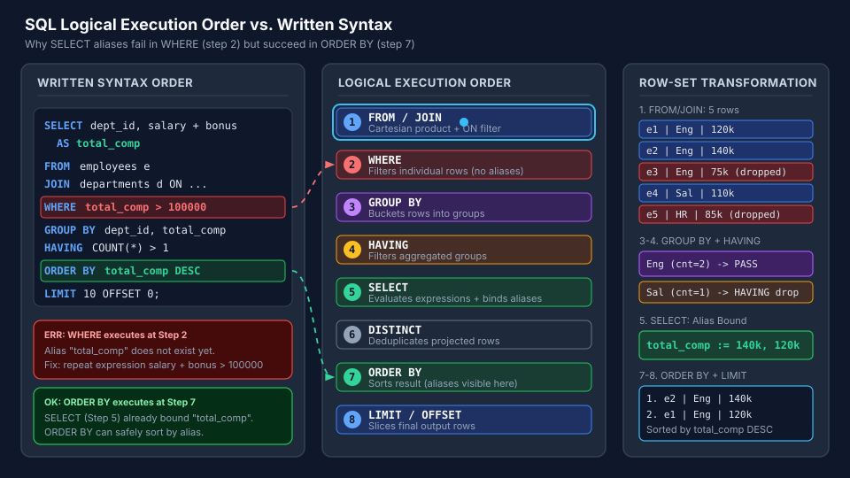

```mermaid
flowchart LR
    classDef blue fill:#dbeafe,stroke:#3b82f6,color:#1e3a8a
    classDef green fill:#dcfce7,stroke:#22c55e,color:#14532d
    classDef amber fill:#fef3c7,stroke:#f59e0b,color:#78350f
    classDef red fill:#fee2e2,stroke:#ef4444,color:#7f1d1d
    classDef purple fill:#f3e8ff,stroke:#a855f7,color:#581c87

    S1["1. FROM / JOIN (Load + Join)"]:::blue --> S2["2. WHERE (Filter Rows - No Aliases)"]:::red
    S2 --> S3["3. GROUP BY (Form Buckets)"]:::purple
    S3 --> S4["4. HAVING (Filter Groups)"]:::amber
    S4 --> S5["5. SELECT (Project + Bind Aliases)"]:::green
    S5 --> S6["6. DISTINCT (Deduplicate)"]:::blue
    S6 --> S7["7. ORDER BY (Sort - Aliases Valid)"]:::green
    S7 --> S8["8. LIMIT / OFFSET (Slice Rows)"]:::blue
```

### Execution Order vs Syntax Order

| Stage | Written Order | Logical Execution Order | Scope &amp; Alias Visibility |
|-------|--------------|------------------------|---------------------------|
| **1** | `SELECT` | `FROM` / `JOIN` | Identifies source table(s) and join predicates |
| **2** | `FROM` | `WHERE` | Filters individual rows before grouping; `SELECT` aliases **not** visible |
| **3** | `WHERE` | `GROUP BY` | Aggregates rows into groups |
| **4** | `GROUP BY` | `HAVING` | Filters groups (not individual rows) |
| **5** | `HAVING` | `SELECT` | Evaluates expressions, window functions, and binds column aliases |
| **6** | `ORDER BY` | `DISTINCT` | Removes duplicate projected rows |
| **7** | `LIMIT / OFFSET` | `ORDER BY` | Sorts result set; `SELECT` aliases **are** visible |
| **8** | — | `LIMIT / OFFSET` | Returns final subset of rows |

**Written Order:**
```sql
SELECT column1, column2
FROM table1
WHERE condition
GROUP BY column1
HAVING group_condition
ORDER BY column1
LIMIT 10
```

**Actual Execution Order:**
1. **FROM** — Identifies source table(s)
2. **WHERE** — Filters rows before grouping
3. **GROUP BY** — Aggregates rows into groups
4. **HAVING** — Filters groups (not rows)
5. **SELECT** — Chooses which columns to return
6. **ORDER BY** — Sorts result set
7. **LIMIT/OFFSET** — Returns subset of rows

### Why This Matters

- You **cannot use aliases** in `WHERE` clause (`WHERE` executes before `SELECT`)
- You **can use aliases** in `ORDER BY` (`ORDER BY` executes after `SELECT`)
- Aggregate functions are **only valid in `SELECT` or `HAVING`** (need grouping context)

> [!IMPORTANT]
> When an interviewer asks why `WHERE total_comp > 100000` throws an "unknown column" error, explain that `WHERE` runs at **Step 2** before `SELECT` binds `total_comp` at **Step 5**. `ORDER BY` runs at **Step 7**, so aliases are valid there.

```sql
-- WRONG: Error - alias not yet defined
SELECT salary + bonus AS total_comp
FROM employees
WHERE total_comp > 100000;

-- CORRECT: Use expression in WHERE
SELECT salary + bonus AS total_comp
FROM employees
WHERE salary + bonus > 100000;

-- CORRECT: Use alias in ORDER BY
SELECT salary + bonus AS total_comp
FROM employees
WHERE salary + bonus > 100000
ORDER BY total_comp DESC;
```

---

## JOINs Deep Dive

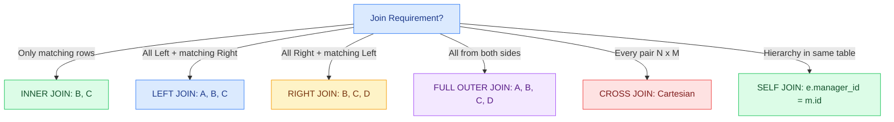

### 1. INNER JOIN

Returns only rows where join condition is true in **both** tables.

```sql
-- Basic syntax
SELECT e.employee_id, e.name, d.department_name
FROM employees e
INNER JOIN departments d ON e.department_id = d.id;
```

**Text-based Venn Diagram:**
```
Employees Table          Departments Table
    [A, B, C]               [B, C, D]

        INNER JOIN Result: [B, C]
```

**Performance:** Index on join columns is critical. PostgreSQL will use nested loop, hash join, or merge join depending on data distribution.

### 2. LEFT JOIN (LEFT OUTER JOIN)

Returns **all rows from left table** + matching rows from right table. Non-matching get `NULL`.

```sql
SELECT e.employee_id, e.name, d.department_name
FROM employees e
LEFT JOIN departments d ON e.department_id = d.id;

-- Result includes employees with NULL department_name
-- (employees not assigned to any department)
```

**Text-based Venn Diagram:**
```
Employees Table          Departments Table
    [A, B, C]               [B, C, D]

    LEFT JOIN Result: [A, B, C]
    (All from left, matched right data where available)
```

> [!TIP]
> **Interview Tip:** "What if an employee has no department?" → `LEFT JOIN` includes them with `NULL`s. Watch out for filtering the right table in `WHERE` (e.g., `WHERE d.active = true`), which silently turns a `LEFT JOIN` into an `INNER JOIN`! Put right-table filters in the `ON` clause instead.

### 3. RIGHT JOIN (RIGHT OUTER JOIN)

Returns **all rows from right table** + matching from left. Rarely used; usually rewrite as `LEFT JOIN`.

```sql
SELECT e.employee_id, e.name, d.department_name
FROM employees e
RIGHT JOIN departments d ON e.department_id = d.id;

-- Equivalent to:
SELECT e.employee_id, e.name, d.department_name
FROM departments d
LEFT JOIN employees e ON e.department_id = d.id;
```

### 4. FULL OUTER JOIN

Returns **all rows from both tables**. Non-matching get `NULL`s.

```sql
SELECT e.employee_id, e.name, d.department_name
FROM employees e
FULL OUTER JOIN departments d ON e.department_id = d.id;

-- Result includes:
-- - Employees with departments
-- - Employees without departments (NULL department_name)
-- - Departments with no employees (NULL employee fields)
```

**Text-based Venn Diagram:**
```
Employees Table          Departments Table
    [A, B, C]               [B, C, D]

    FULL OUTER JOIN: [A, B, C, D]
```

**Performance Note:** `FULL OUTER JOIN` often requires hash or merge join; can be expensive on large tables.

### 5. CROSS JOIN

Cartesian product: returns **every row from left table paired with every row from right table**.

```sql
-- 3 employees × 5 departments = 15 rows
SELECT e.employee_id, e.name, d.department_name
FROM employees e
CROSS JOIN departments d;

-- Same as:
SELECT e.employee_id, e.name, d.department_name
FROM employees e, departments d;
```

**Use Case:** Generate all possible combinations (e.g., all dates for a date range for each product).

```sql
-- Example: Generate daily sales for all products
SELECT p.product_id, d.date
FROM products p
CROSS JOIN (
    SELECT DISTINCT date
    FROM orders
) d;
```

### 6. SELF JOIN

Joining a table to itself (usually with different aliases).

```sql
-- Find employees and their managers
SELECT e.employee_id, e.name, m.employee_id AS manager_id, m.name AS manager_name
FROM employees e
LEFT JOIN employees m ON e.manager_id = m.employee_id;
```

**Interview Scenario:** "Given employee hierarchy, find all direct reports and their managers."

### Join Performance Implications

| Join Type | Selectivity | Use When | Performance |
|-----------|-----------|----------|-------------|
| `INNER` | Both tables needed | Standard case | Fastest; both tables filtered |
| `LEFT` | Keep all left rows | Want all left records | Medium; right must be complete |
| `RIGHT` | Keep all right rows | Rare; prefer `LEFT` | Medium; left must be complete |
| `FULL` | All rows from both | Need unmatched from both | Slowest; no table pre-filtered |
| `CROSS` | All combinations | Specific use cases | Very slow; N × M results |

**Join Algorithm Selection (PostgreSQL):**

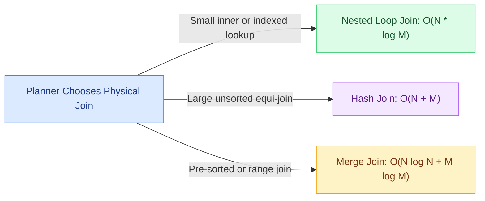

- **Nested Loop Join:** Sequential scan of inner table for each outer row. Good for small inner table or indexed join condition.
- **Hash Join:** Builds hash table of inner table, probes with outer rows. Best for large tables, good hash distribution.
- **Merge Join:** Both tables sorted on join columns. Good when data already sorted, useful for range joins.

---

## Subqueries vs JOINs

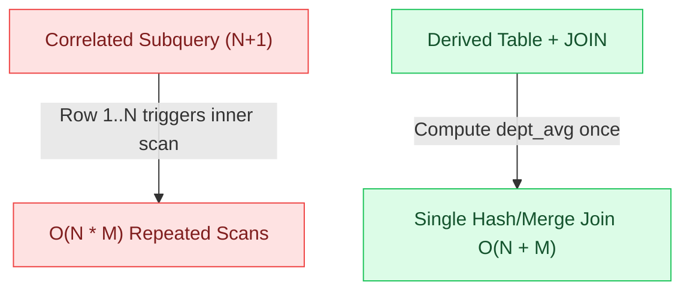

### When to Use Subqueries

**Subqueries best for:**
1. Logical readability (complex logic in subquery)
2. Aggregating first, then joining
3. Top-N per group
4. `EXISTS` / `NOT EXISTS` checks

```sql
-- Find employees earning more than average salary
SELECT employee_id, name, salary
FROM employees
WHERE salary > (SELECT AVG(salary) FROM employees);
```

### When to Use JOINs

**JOINs best for:**
1. Performance (especially with indexes)
2. Multiple table access
3. Complex filtering across tables

```sql
-- Same query with JOIN (better performance)
SELECT e.employee_id, e.name, e.salary
FROM employees e
JOIN (SELECT AVG(salary) AS avg_salary FROM employees) avg_sal
  ON e.salary > avg_sal.avg_salary;
```

### Correlated Subqueries

A subquery that references columns from outer query. Executed **once per outer row** (N+1 problem).

```sql
-- Find employees earning above their department average
SELECT e.employee_id, e.name, e.salary
FROM employees e
WHERE salary > (
    SELECT AVG(salary)
    FROM employees e2
    WHERE e2.department_id = e.department_id
);

-- Same query with JOIN (much faster)
SELECT e.employee_id, e.name, e.salary
FROM employees e
JOIN (
    SELECT department_id, AVG(salary) AS dept_avg
    FROM employees
    GROUP BY department_id
) dept_avg ON e.department_id = dept_avg.department_id
WHERE e.salary > dept_avg.dept_avg;
```

> [!WARNING]
> **Interview Tip:** Correlated subqueries often indicate an N+1 problem. Rewrite with a `JOIN` or a Window Function (`AVG(salary) OVER (PARTITION BY department_id)`) when possible so the table is scanned once.

### EXISTS vs IN with Subqueries

```sql
-- EXISTS: Checks if subquery returns ANY rows (efficient with NULL)
SELECT e.employee_id, e.name
FROM employees e
WHERE EXISTS (
    SELECT 1
    FROM assignments
    WHERE employee_id = e.employee_id
);

-- IN: Checks if value in set (NULL in set can cause issues)
SELECT e.employee_id, e.name
FROM employees e
WHERE employee_id IN (
    SELECT employee_id
    FROM assignments
);

-- If assignments contains NULL, IN may not work as expected
-- EXISTS is generally safer and performs better with large sets
```

---

## Window Functions

Window functions operate on a set of rows (window) and return a value for each row. They don't collapse rows like `GROUP BY`.

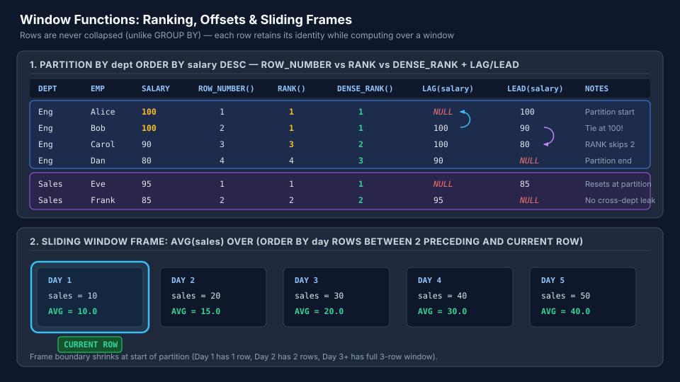

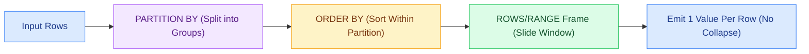

### Core Window Functions

#### 1. `ROW_NUMBER()`

Assigns unique sequential number within partition.

```sql
SELECT
    employee_id, name, salary, department_id,
    ROW_NUMBER() OVER (PARTITION BY department_id ORDER BY salary DESC) AS rank_in_dept
FROM employees;

-- Result:
-- dept 1: employee A (rank 1), employee B (rank 2), employee C (rank 3)
-- dept 2: employee D (rank 1), employee E (rank 2)
```

### 2. `RANK()` and `DENSE_RANK()`

- **`RANK()`:** Assigns rank with gaps for ties (`1, 1, 3, 4`)
- **`DENSE_RANK()`:** Assigns rank without gaps (`1, 1, 2, 3`)

| Salary | `ROW_NUMBER()` | `RANK()` | `DENSE_RANK()` |
|--------|---------------|----------|---------------|
| 100 | 1 | 1 | 1 |
| 100 | 2 | 1 | 1 |
| 90 | 3 | 3 | 2 |
| 80 | 4 | 4 | 3 |

```sql
SELECT
    employee_id, name, salary,
    RANK() OVER (ORDER BY salary DESC) AS rank,
    DENSE_RANK() OVER (ORDER BY salary DESC) AS dense_rank,
    ROW_NUMBER() OVER (ORDER BY salary DESC) AS row_num
FROM employees;

-- Example with salaries: 100, 100, 90, 80
-- RANK:       1,   1,  3,  4
-- DENSE_RANK: 1,   1,  2,  3
-- ROW_NUMBER: 1,   2,  3,  4
```

### 3. `LEAD()` and `LAG()`

Access rows before/after current row within partition.

```sql
SELECT
    employee_id, name, salary,
    LAG(salary) OVER (ORDER BY salary) AS prev_salary,
    LEAD(salary) OVER (ORDER BY salary) AS next_salary
FROM employees;

-- Use case: Calculate salary differences
SELECT
    employee_id, name, salary,
    salary - LAG(salary) OVER (ORDER BY hire_date) AS salary_increase
FROM employees
ORDER BY hire_date;
```

### 4. `NTILE()`

Divides rows into N buckets.

```sql
SELECT
    employee_id, name, salary,
    NTILE(4) OVER (ORDER BY salary) AS quartile
FROM employees;

-- Quartiles: 25% in bucket 1, 25% in bucket 2, etc.
```

### 5. `FIRST_VALUE()` and `LAST_VALUE()`

Access first/last value in window.

> [!IMPORTANT]
> By default, when `ORDER BY` is present in `OVER (...)`, SQL uses `RANGE BETWEEN UNBOUNDED PRECEDING AND CURRENT ROW`. That makes `LAST_VALUE()` return the **current row** unless you explicitly specify `ROWS BETWEEN UNBOUNDED PRECEDING AND UNBOUNDED FOLLOWING`!

```sql
SELECT
    employee_id, name, salary, hire_date,
    FIRST_VALUE(salary) OVER (
        ORDER BY hire_date
        ROWS BETWEEN UNBOUNDED PRECEDING AND UNBOUNDED FOLLOWING
    ) AS first_salary_ever,
    LAST_VALUE(salary) OVER (
        ORDER BY hire_date
        ROWS BETWEEN UNBOUNDED PRECEDING AND UNBOUNDED FOLLOWING
    ) AS last_salary_ever
FROM employees;
```

### 6. Aggregate Functions as Window Functions

```sql
-- Running total (cumulative sum)
SELECT
    employee_id, name, salary,
    SUM(salary) OVER (
        ORDER BY hire_date
        ROWS BETWEEN UNBOUNDED PRECEDING AND CURRENT ROW
    ) AS cumulative_salary
FROM employees;

-- Moving average (last 3 months)
SELECT
    date, sales,
    AVG(sales) OVER (
        ORDER BY date
        ROWS BETWEEN 2 PRECEDING AND CURRENT ROW
    ) AS moving_avg_3
FROM daily_sales;
```

### Window Frame Specification

```sql
ROWS BETWEEN <start> AND <end>

-- Start/End options:
-- UNBOUNDED PRECEDING  - from first row
-- N PRECEDING          - N rows before current
-- CURRENT ROW          - current row
-- N FOLLOWING          - N rows after current
-- UNBOUNDED FOLLOWING  - to last row

-- Examples:
ROWS BETWEEN UNBOUNDED PRECEDING AND CURRENT ROW         -- Running total
ROWS BETWEEN 2 PRECEDING AND 2 FOLLOWING                 -- Window around current
ROWS BETWEEN UNBOUNDED PRECEDING AND UNBOUNDED FOLLOWING -- All rows
```

---

## Common Table Expressions (CTEs)

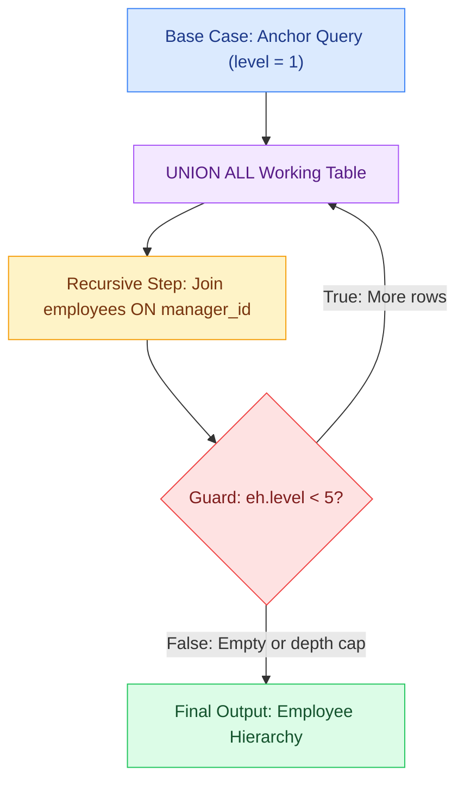

### Basic CTE

```sql
WITH department_avg AS (
    SELECT
        department_id,
        AVG(salary) AS avg_salary
    FROM employees
    GROUP BY department_id
)
SELECT e.employee_id, e.name, e.salary, da.avg_salary
FROM employees e
JOIN department_avg da ON e.department_id = da.department_id
WHERE e.salary > da.avg_salary;
```

**Benefits:**
- Improves readability
- Can reference multiple times
- Can chain multiple CTEs
- Performance: CTE can be materialized (executed once) or inlined by modern planners (PostgreSQL 12+)

### Multiple CTEs

```sql
WITH dept_avg AS (
    SELECT department_id, AVG(salary) AS avg_salary
    FROM employees
    GROUP BY department_id
),
high_earners AS (
    SELECT e.employee_id, e.name, e.salary
    FROM employees e
    JOIN dept_avg ON e.department_id = dept_avg.department_id
    WHERE e.salary > dept_avg.avg_salary
)
SELECT * FROM high_earners
WHERE salary > 100000;
```

### Recursive CTEs

Used for hierarchical or tree data (organizational charts, bills of materials).

```sql
-- Find all employees under a manager (recursively)
WITH RECURSIVE employee_hierarchy AS (
    -- Base case: start with a specific manager
    SELECT employee_id, name, manager_id, 1 AS level
    FROM employees
    WHERE employee_id = 5  -- Start employee

    UNION ALL

    -- Recursive case: find direct reports
    SELECT e.employee_id, e.name, e.manager_id, eh.level + 1
    FROM employees e
    JOIN employee_hierarchy eh ON e.manager_id = eh.employee_id
    WHERE eh.level < 5  -- Prevent infinite loops
)
SELECT * FROM employee_hierarchy
ORDER BY level, employee_id;
```

> [!TIP]
> **Critical for Interviews:** Recursive CTEs often appear in system design and SQL rounds for org charts, category trees, and graph traversal. Always include a depth guard (e.g., `WHERE eh.level < 5`) or cycle detection to prevent infinite loops on cyclic data.

---

## Set Operations

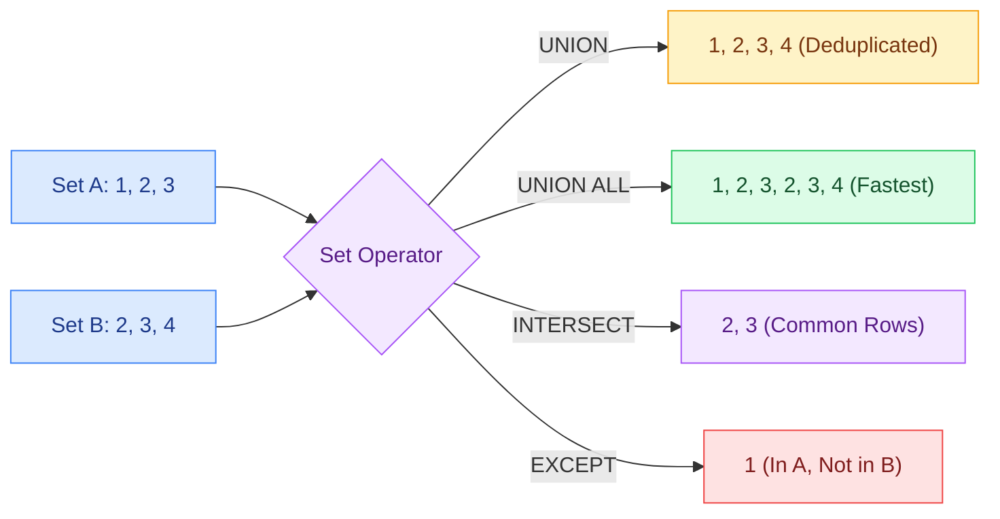

| Operator | Duplicates | Sort/Hash Cost | Use Case |
|----------|-----------|----------------|----------|
| `UNION` | Removed (`DISTINCT`) | High | Combine sets needing deduplication |
| `UNION ALL` | Kept | Very Low | Disjoint sets or when duplicates are valid |
| `INTERSECT` | Removed | Medium-High | Rows present in both queries |
| `EXCEPT` | Removed | Medium-High | Rows in first query but absent from second |

### `UNION` (Removes Duplicates)

```sql
SELECT employee_id, name, 'Current' AS status
FROM employees
WHERE active = true

UNION

SELECT employee_id, name, 'Inactive' AS status
FROM employees
WHERE active = false;
```

> [!WARNING]
> **Performance:** `UNION` performs `DISTINCT`, which requires sorting or hashing all rows. Always prefer `UNION ALL` if duplicates are impossible (e.g., mutually exclusive `WHERE` predicates) or acceptable.

### `UNION ALL` (Keeps Duplicates)

```sql
-- Combine results from multiple tables without distinct operation
SELECT employee_id, name, salary, 'employee' AS source
FROM employees

UNION ALL

SELECT contractor_id, name, rate * hours_worked, 'contractor'
FROM contractors;
```

### `INTERSECT` (Common Rows)

```sql
-- Find IDs that appear in both employees and contractors
SELECT id FROM employees

INTERSECT

SELECT id FROM contractors;
```

### `EXCEPT` (Difference)

```sql
-- Find employees who are not contractors
SELECT employee_id FROM employees

EXCEPT

SELECT employee_id FROM contractors;
```

---

## CASE Expressions

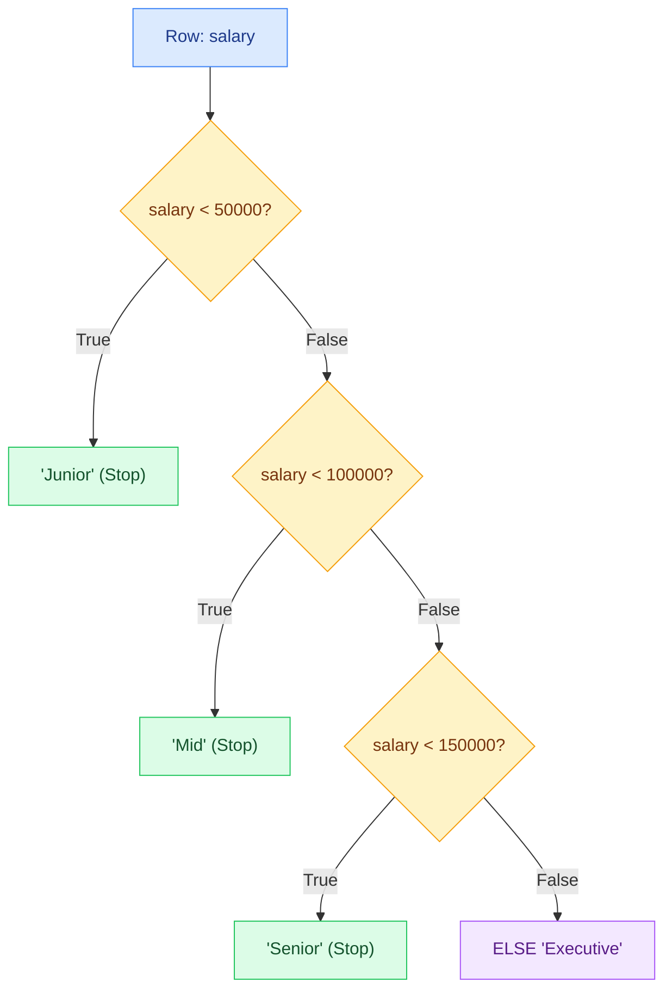

### Simple CASE

```sql
SELECT
    employee_id, name, salary,
    CASE department_id
        WHEN 1 THEN 'Engineering'
        WHEN 2 THEN 'Sales'
        WHEN 3 THEN 'Marketing'
        ELSE 'Other'
    END AS department_name
FROM employees;
```

### Searched CASE

```sql
SELECT
    employee_id, name, salary,
    CASE
        WHEN salary < 50000 THEN 'Junior'
        WHEN salary < 100000 THEN 'Mid'
        WHEN salary < 150000 THEN 'Senior'
        ELSE 'Executive'
    END AS level
FROM employees;
```

### CASE with Aggregates

```sql
-- Conditional aggregation
SELECT
    department_id,
    COUNT(*) AS total_employees,
    COUNT(CASE WHEN salary > 100000 THEN 1 END) AS high_earners,
    SUM(CASE WHEN active = true THEN 1 ELSE 0 END) AS active_count
FROM employees
GROUP BY department_id;
```

> [!TIP]
> **Conditional Aggregation:** `COUNT(CASE WHEN ... THEN 1 END)` works because `COUNT(col)` ignores `NULL`s, and a `CASE` without an `ELSE` implicitly returns `NULL` when the condition is false. Never use `ELSE 0` inside `COUNT(CASE ...)` or it will count `0`! Use `ELSE 0` only with `SUM(CASE ...)`.

---

## COALESCE and NULLIF

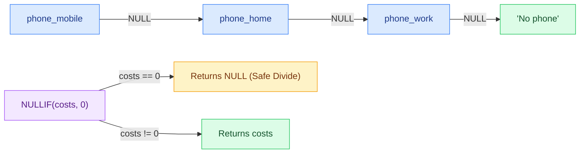

### `COALESCE`

Returns first non-`NULL` value.

```sql
SELECT
    employee_id, name,
    COALESCE(phone_mobile, phone_home, phone_work, 'No phone') AS contact_phone
FROM employees;

-- Useful for providing defaults when columns are NULL
```

### `NULLIF`

Returns `NULL` if two expressions are equal, otherwise returns first expression.

```sql
-- Avoid division by zero
SELECT
    product_id,
    revenue,
    costs,
    revenue - costs AS profit,
    NULLIF(costs, 0) AS costs_non_zero,
    revenue / NULLIF(costs, 0) AS profit_margin
FROM products;
```

> [!NOTE]
> Combining `COALESCE(revenue / NULLIF(costs, 0), 0)` is a classic production SQL idiom: `NULLIF` prevents a division-by-zero crash by turning `0` into `NULL`, and `COALESCE` converts the resulting `NULL` ratio into `0`.

---

## Aggregate Functions and GROUP BY

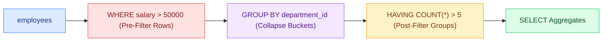

### Core Aggregates

```sql
SELECT
    department_id,
    COUNT(*) AS total_employees,
    COUNT(DISTINCT manager_id) AS unique_managers,
    SUM(salary) AS total_salary,
    AVG(salary) AS avg_salary,
    MIN(salary) AS min_salary,
    MAX(salary) AS max_salary,
    STRING_AGG(name, ', ') AS employee_names
FROM employees
GROUP BY department_id;
```

### `HAVING` vs `WHERE`

```sql
-- WHERE: Filters BEFORE grouping
-- HAVING: Filters AFTER grouping

SELECT
    department_id,
    COUNT(*) AS emp_count
FROM employees
WHERE salary > 50000  -- Filter rows first
GROUP BY department_id
HAVING COUNT(*) > 5;  -- Filter groups second
```

> [!IMPORTANT]
> `COUNT(*)` counts all rows including `NULL`s, whereas `COUNT(column)` counts only non-`NULL` values. Similarly, `AVG(salary)` ignores `NULL` salaries—use `AVG(COALESCE(salary, 0))` if `NULL` should be treated as `0`.

---

## EXISTS vs IN Performance

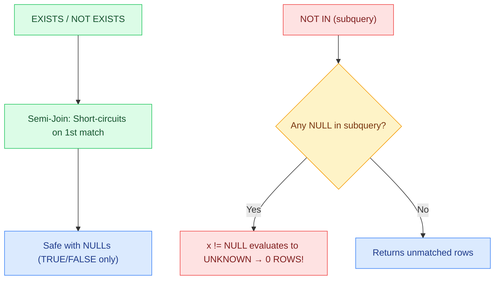

### `EXISTS` (Better for Subqueries with Large Result Sets)

```sql
-- EXISTS stops checking once it finds ANY match
SELECT e.employee_id, e.name
FROM employees e
WHERE EXISTS (
    SELECT 1
    FROM assignments a
    WHERE a.employee_id = e.employee_id
    AND a.status = 'active'
);
```

**Advantages:**
- Stops early (doesn't need to build full result set)
- Handles `NULL` better
- Can be optimized by query planner

### `IN` (Simpler Syntax, But May Build Full Set)

```sql
SELECT e.employee_id, e.name
FROM employees e
WHERE employee_id IN (
    SELECT DISTINCT employee_id
    FROM assignments
    WHERE status = 'active'
);

-- If subquery has NULL values and employee not found, result can be NULL!
-- Better to use NOT EXISTS instead of NOT IN
```

### `NOT EXISTS` vs `NOT IN`

```sql
-- Correct: Use NOT EXISTS
SELECT e.employee_id, e.name
FROM employees e
WHERE NOT EXISTS (
    SELECT 1
    FROM blacklist b
    WHERE b.employee_id = e.employee_id
);

-- Problematic: NOT IN can fail if subquery has NULLs
-- This returns nothing if any blacklist.employee_id is NULL!
SELECT e.employee_id, e.name
FROM employees e
WHERE employee_id NOT IN (
    SELECT employee_id
    FROM blacklist
);
```

> [!WARNING]
> **Classic SQL Trap:** `x NOT IN (1, 2, NULL)` expands to `x != 1 AND x != 2 AND x != NULL`. Because `x != NULL` is `UNKNOWN`, the entire `AND` expression never evaluates to `TRUE`, returning **zero rows**. Always use `NOT EXISTS` (or filter `WHERE col IS NOT NULL` inside `NOT IN`).

---

## String Functions

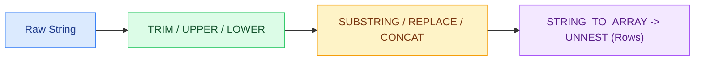

```sql
-- Concatenation
SELECT CONCAT(first_name, ' ', last_name) AS full_name FROM employees;
SELECT first_name || ' ' || last_name AS full_name FROM employees;

-- Substring
SELECT SUBSTRING(name, 1, 3) FROM employees;  -- First 3 characters

-- Case conversion
SELECT UPPER(name), LOWER(name) FROM employees;

-- Trimming
SELECT TRIM(name), LTRIM(name), RTRIM(name) FROM employees;

-- Replace
SELECT REPLACE(email, '@old.com', '@new.com') FROM employees;

-- Length
SELECT LENGTH(name) FROM employees;

-- Position
SELECT POSITION('a' IN name) FROM employees;  -- Position of first 'a'

-- Split (PostgreSQL specific)
SELECT UNNEST(STRING_TO_ARRAY(email, '.')) FROM employees;
```

> [!TIP]
> **Indexing Note:** Applying `LOWER(email) = 'a@b.com'` in a `WHERE` clause prevents a standard B-tree index on `email` from being used unless you create a functional/expression index (`CREATE INDEX idx_email_lower ON users (LOWER(email))`).

---

## Date/Time Functions

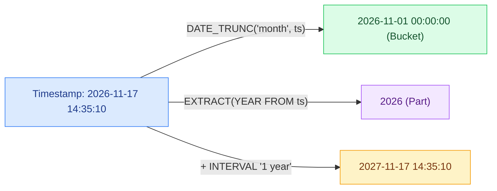

```sql
-- Current date/time
SELECT NOW(), CURRENT_DATE, CURRENT_TIME;

-- Date arithmetic
SELECT hire_date, hire_date + INTERVAL '1 year' FROM employees;
SELECT hire_date, hire_date - INTERVAL '6 months' FROM employees;

-- Date part extraction
SELECT
    hire_date,
    EXTRACT(YEAR FROM hire_date) AS hire_year,
    EXTRACT(MONTH FROM hire_date) AS hire_month,
    EXTRACT(DAY FROM hire_date) AS hire_day,
    DATE_TRUNC('month', hire_date) AS month_start
FROM employees;

-- Age calculation
SELECT name, EXTRACT(YEAR FROM AGE(NOW(), hire_date)) AS years_employed
FROM employees;

-- Date comparison
SELECT * FROM employees
WHERE hire_date >= DATE_TRUNC('month', NOW()) - INTERVAL '1 year';
```

> [!IMPORTANT]
> **Sargable Predicates:** Keep indexed date columns bare on one side of the comparison (`WHERE hire_date >= DATE_TRUNC('month', NOW()) - INTERVAL '1 year'`). Wrapping the column itself (`WHERE EXTRACT(YEAR FROM hire_date) = 2025`) forces a full table scan.

---

## Top 20 SQL Interview Questions with Solutions

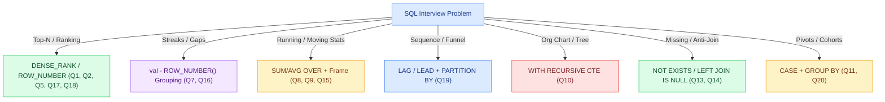

### 1. Find the Second Highest Salary

```sql
SELECT DISTINCT salary
FROM employees
ORDER BY salary DESC
LIMIT 1 OFFSET 1;

-- Or with window functions
SELECT salary
FROM (
    SELECT salary, DENSE_RANK() OVER (ORDER BY salary DESC) AS rank
    FROM employees
) ranked
WHERE rank = 2;
```

### 2. Find Nth Highest Salary (Parametric)

```sql
-- Find 3rd highest salary
SELECT salary
FROM (
    SELECT DISTINCT salary, DENSE_RANK() OVER (ORDER BY salary DESC) AS rank
    FROM employees
) ranked
WHERE rank = 3;
```

### 3. Employees Earning More Than Their Manager

```sql
SELECT e.employee_id, e.name, e.salary, m.name AS manager_name, m.salary AS manager_salary
FROM employees e
JOIN employees m ON e.manager_id = m.employee_id
WHERE e.salary > m.salary;
```

### 4. Department with Highest Average Salary

```sql
SELECT department_id, AVG(salary) AS avg_salary
FROM employees
GROUP BY department_id
ORDER BY avg_salary DESC
LIMIT 1;

-- With department name
SELECT d.name, AVG(e.salary) AS avg_salary
FROM employees e
JOIN departments d ON e.department_id = d.id
GROUP BY d.id, d.name
ORDER BY avg_salary DESC
LIMIT 1;
```

### 5. Top 3 Employees by Salary in Each Department

```sql
WITH ranked_employees AS (
    SELECT
        employee_id, name, salary, department_id,
        ROW_NUMBER() OVER (PARTITION BY department_id ORDER BY salary DESC) AS rank
    FROM employees
)
SELECT employee_id, name, salary, department_id
FROM ranked_employees
WHERE rank <= 3
ORDER BY department_id, salary DESC;
```

### 6. Find Duplicate Emails

```sql
SELECT email, COUNT(*) AS count
FROM users
GROUP BY email
HAVING COUNT(*) > 1;
```

### 7. Consecutive Dates Problem

```sql
-- Find groups of consecutive dates
WITH date_groups AS (
    SELECT
        date,
        ROW_NUMBER() OVER (ORDER BY date) AS row_num,
        date - INTERVAL (ROW_NUMBER() OVER (ORDER BY date)) DAY AS date_group
    FROM (SELECT DISTINCT date FROM orders)
)
SELECT
    date_group,
    MIN(date) AS start_date,
    MAX(date) AS end_date,
    COUNT(*) AS consecutive_days
FROM date_groups
GROUP BY date_group
HAVING COUNT(*) >= 3  -- At least 3 consecutive days
ORDER BY start_date;
```

### 8. Cumulative Sum

```sql
SELECT
    date, revenue,
    SUM(revenue) OVER (ORDER BY date) AS cumulative_revenue
FROM daily_sales
ORDER BY date;
```

### 9. Moving Average

```sql
SELECT
    date, sales,
    AVG(sales) OVER (
        ORDER BY date
        ROWS BETWEEN 6 PRECEDING AND CURRENT ROW
    ) AS moving_avg_7_day
FROM daily_sales
ORDER BY date;
```

### 10. Employee Hierarchy (Manager-Employee Chain)

```sql
WITH RECURSIVE org_chart AS (
    SELECT employee_id, name, manager_id, 1 AS level
    FROM employees
    WHERE manager_id IS NULL  -- Start with top-level managers

    UNION ALL

    SELECT e.employee_id, e.name, e.manager_id, oc.level + 1
    FROM employees e
    JOIN org_chart oc ON e.manager_id = oc.employee_id
)
SELECT * FROM org_chart
ORDER BY level, employee_id;
```

### 11. Pivot Table (Wide Format)

```sql
SELECT
    department_id,
    SUM(CASE WHEN salary < 50000 THEN 1 ELSE 0 END) AS "< 50K",
    SUM(CASE WHEN salary >= 50000 AND salary < 100000 THEN 1 ELSE 0 END) AS "50K - 100K",
    SUM(CASE WHEN salary >= 100000 THEN 1 ELSE 0 END) AS "> 100K"
FROM employees
GROUP BY department_id;
```

### 12. Last Login for Each User

```sql
SELECT
    user_id,
    MAX(login_timestamp) AS last_login
FROM login_logs
GROUP BY user_id;

-- With more detail
SELECT DISTINCT ON (user_id)
    user_id, login_timestamp, ip_address
FROM login_logs
ORDER BY user_id, login_timestamp DESC;
```

### 13. Employees with No Orders

```sql
SELECT e.employee_id, e.name
FROM employees e
WHERE NOT EXISTS (
    SELECT 1 FROM orders o
    WHERE o.employee_id = e.employee_id
);
```

### 14. Products Never Ordered

```sql
SELECT p.product_id, p.name
FROM products p
LEFT JOIN order_items oi ON p.product_id = oi.product_id
WHERE oi.product_id IS NULL;
```

### 15. Median Salary by Department

```sql
SELECT
    department_id,
    PERCENTILE_CONT(0.5) WITHIN GROUP (ORDER BY salary) AS median_salary
FROM employees
GROUP BY department_id;
```

### 16. Gap and Islands Problem (Find Ranges)

```sql
-- Find gaps in order IDs
WITH ordered_ids AS (
    SELECT
        id,
        LAG(id) OVER (ORDER BY id) AS prev_id,
        id - ROW_NUMBER() OVER (ORDER BY id) AS grp
    FROM orders
)
SELECT
    MIN(id) AS gap_start,
    MAX(id) AS gap_end,
    MAX(id) - MIN(id) + 1 - COUNT(*) AS missing_count
FROM ordered_ids
GROUP BY grp
HAVING MAX(id) - MIN(id) + 1 > COUNT(*);
```

### 17. Rank Users by Purchase Amount

```sql
SELECT
    user_id,
    SUM(amount) AS total_spent,
    RANK() OVER (ORDER BY SUM(amount) DESC) AS user_rank
FROM orders
GROUP BY user_id;
```

### 18. Top N Customers by Revenue (With Pagination)

```sql
SELECT
    user_id,
    total_spent,
    rank,
    NTILE(10) OVER (ORDER BY total_spent DESC) AS decile
FROM (
    SELECT
        user_id,
        SUM(amount) AS total_spent,
        RANK() OVER (ORDER BY SUM(amount) DESC) AS rank
    FROM orders
    GROUP BY user_id
)
WHERE rank <= 100;
```

### 19. Event Sequence Detection

```sql
-- Find users who completed a purchase after viewing a product
WITH user_events AS (
    SELECT
        user_id, event_type, timestamp,
        LAG(event_type) OVER (PARTITION BY user_id ORDER BY timestamp) AS prev_event
    FROM user_events
)
SELECT DISTINCT user_id
FROM user_events
WHERE event_type = 'purchase' AND prev_event = 'view';
```

### 20. Attrition Rate by Cohort

```sql
WITH user_cohorts AS (
    SELECT
        user_id,
        DATE_TRUNC('month', created_at) AS cohort_month,
        DATE_TRUNC('month', last_activity) AS last_month_active
    FROM users
)
SELECT
    cohort_month,
    COUNT(DISTINCT user_id) AS cohort_size,
    COUNT(DISTINCT CASE WHEN last_month_active < NOW() - INTERVAL '90 days' THEN user_id END) AS churned,
    ROUND(100.0 * COUNT(DISTINCT CASE WHEN last_month_active < NOW() - INTERVAL '90 days' THEN user_id END) /
        COUNT(DISTINCT user_id), 2) AS churn_percentage
FROM user_cohorts
GROUP BY cohort_month
ORDER BY cohort_month;
```

> [!TIP]
> **Pattern Recognition:** In Q7 (Consecutive Dates) and Q16 (Gap and Islands), subtracting `ROW_NUMBER()` from a monotonically increasing sequence produces a constant group key for contiguous runs—this single trick solves most streak and island interview problems.

---

## Interview Tips

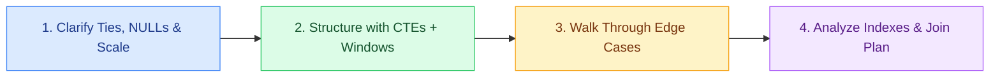

1. **Always clarify requirements first** — Ask about `NULL` handling, edge cases, performance requirements
2. **Start with readable SQL, optimize later** — Premature optimization is the root of all evil
3. **Use window functions for ranking/ordering** — Much cleaner than subqueries
4. **Avoid correlated subqueries** — Always check if `JOIN` is better
5. **Use CTEs for complex queries** — Makes logic clearer and often performs better
6. **Test with edge cases** — Empty sets, `NULL`s, duplicates
7. **Explain query plan** — "This uses a hash join on indexed columns for O(n) performance"
8. **Mention performance** — "This will full table scan if not indexed" or "This is O(log n) with B-tree index"

> [!IMPORTANT]
> Before finishing any SQL interview answer, verbally trace a 3-row edge-case table containing a **tie**, a **`NULL`**, and an **empty partition**—catching those proactively separates senior candidates from everyone else.
