# PostgreSQL Internals

## Table of Contents

- [PostgreSQL Architecture Overview](#postgresql-architecture-overview)
- [MVCC (Multi-Version Concurrency Control)](#mvcc-multi-version-concurrency-control)
- [WAL (Write-Ahead Logging)](#wal-write-ahead-logging)
- [VACUUM and AUTOVACUUM](#vacuum-and-autovacuum)
- [TOAST (The Oversized-Attribute Storage Technique)](#toast-the-oversized-attribute-storage-technique)
- [Buffer Management and Shared Buffers](#buffer-management-and-shared-buffers)
- [PostgreSQL Data Types](#postgresql-data-types)
- [Tablespaces](#tablespaces)
- [PostgreSQL-Specific Features](#postgresql-specific-features)
- [Configuration Tuning](#configuration-tuning)
- [Connection Pooling with PgBouncer](#connection-pooling-with-pgbouncer)
- [Common Interview Questions and Answers](#common-interview-questions-and-answers)

---

## PostgreSQL Architecture Overview

### Process Architecture

PostgreSQL uses a **multi-process architecture** (not multi-threaded). A single master `Postmaster` process listens for incoming connections and forks a dedicated `Backend` OS process per client connection, alongside specialized auxiliary background processes.

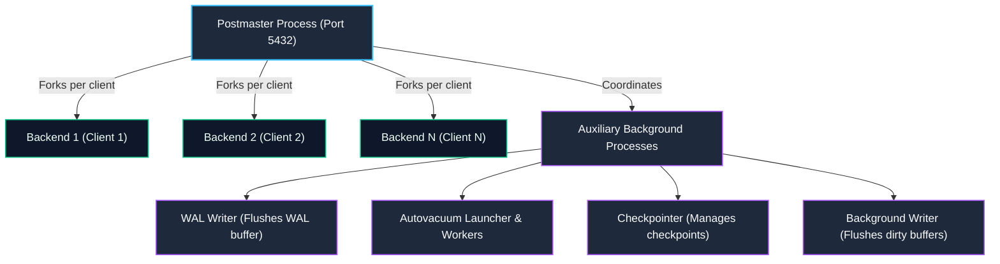

### Key Processes

- **Postmaster:** Main server process
  - Listens for client connections on port `5432`
  - Forks backend processes for each client
  - Manages crash recovery
  - Coordinates background workers (autovacuum, WAL archiver, etc.)
- **Backend Process:** One per client connection
  - Executes queries from client
  - Communicates via TCP/IP or Unix socket
  - Isolated memory space (process-level isolation)
  - Process crash doesn't affect other backends
- **Auxiliary Processes:**
  - **WAL Writer:** Flushes WAL buffer to disk
  - **Autovacuum Launcher/Worker:** Initiates and performs vacuuming
  - **Checkpointer:** Manages checkpoint operations
  - **Background Writer:** Flushes dirty buffers to disk

### Shared Memory Structure

All backend and auxiliary processes attach to a shared memory segment allocated at startup in RAM.

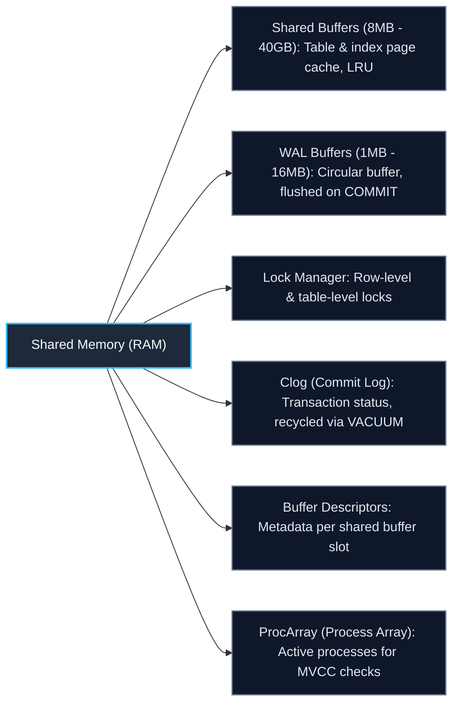

> [!IMPORTANT]
> Because each client connection spawns a separate OS process with its own private memory (~6 MB+ overhead plus `work_mem`), unbounded direct client connections can exhaust RAM rapidly—making connection poolers like PgBouncer essential at scale.

---

## MVCC (Multi-Version Concurrency Control)

PostgreSQL uses MVCC to provide high concurrency and isolation without heavy locking: **readers never block writers, and writers never block readers**.


### Core Concepts

Every row (tuple) has **invisible system metadata**:
- `xmin` (Insert transaction ID): Which transaction inserted this row
- `xmax` (Delete transaction ID): Which transaction deleted/updated this row (`0` / NULL if not deleted)
- `cmin` (Command ID): Which command in the transaction inserted the row
- `cmax` (Command ID): Which command in the transaction deleted the row
- `ctid`: Physical tuple location `(page, slot)` — updated rows form a version chain

### How MVCC Works

```sql
-- Transaction 1 (xid = 100)
BEGIN;
INSERT INTO employees (name, salary) VALUES ('Alice', 50000);
COMMIT;

-- Transaction 2 (xid = 101)
BEGIN;
UPDATE employees SET salary = 55000 WHERE name = 'Alice';
COMMIT;

-- At this point, we have TWO row versions:
-- Version 1: xmin=100, xmax=101, salary=50000
-- Version 2: xmin=101, xmax=NULL, salary=55000

-- Transaction 3 (xid = 102)
SELECT * FROM employees;
-- Sees Version 2 (xmin=101 is committed before 102)

-- Transaction 4 (xid = 100, in a REPEATABLE READ snapshot taken at xid=100)
SELECT * FROM employees;
-- Sees Version 1 (Version 2's xmin=101 is after snapshot)
```

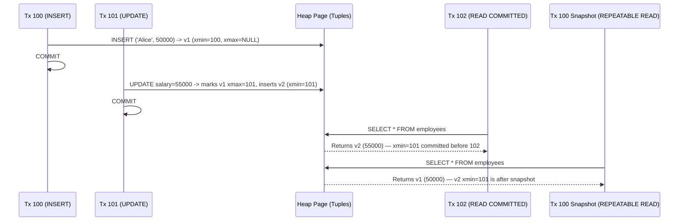

### Visibility Determination (Key Interview Topic)

PostgreSQL determines if a row is visible to a transaction based on:
1. **`xmin` status:** Is the inserting transaction committed before my snapshot?
2. **`xmax` status:** Is the deleting transaction visible to me?
3. **Isolation level:** `REPEATABLE READ`, `READ COMMITTED`, `SERIALIZABLE`.

```c
// Pseudocode for visibility check
bool HeapTupleSatisfiesMVCC(HeapTuple tuple, Snapshot snapshot) {
    TransactionId xmin = tuple->xmin;
    TransactionId xmax = tuple->xmax;

    // Was this row inserted by a committed transaction?
    if (!TransactionIdIsFinished(xmin)) {
        return false;  // Inserting transaction still running
    }

    // Was this row deleted? If so, is deletion visible to me?
    if (TransactionIdIsValid(xmax)) {
        if (TransactionIdIsFinished(xmax)) {
            return false;  // Delete is committed, row is invisible
        }
    }

    return true;  // Row is visible
}
```

### Transaction ID Wraparound Problem

Transaction IDs are 32-bit unsigned integers (`0` to ~4.29 billion).

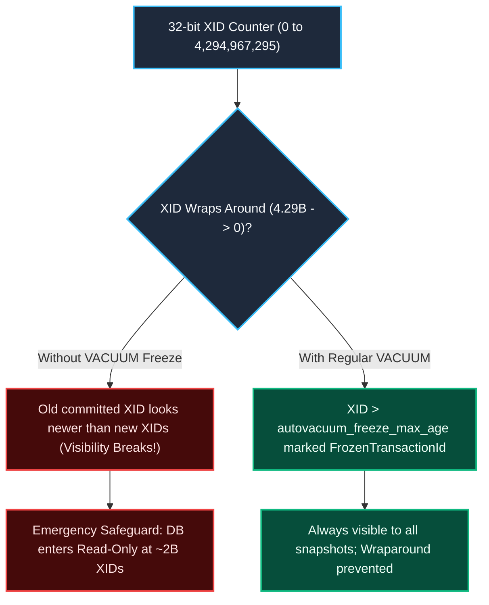

> [!WARNING]
> **Interview Answer:** "VACUUM marks rows as frozen when `xid > autovacuum_freeze_max_age`. This prevents XID wraparound anomalies. If you don't vacuum and reach ~2 billion un-frozen XIDs, PostgreSQL forces the database into **read-only mode** to prevent data corruption!"

---

## WAL (Write-Ahead Logging)

PostgreSQL never writes dirty data pages directly to disk on commit. Instead:
1. Log entry is written to WAL (sequential disk write, fast).
2. Entry is written to memory buffer (`Shared Buffers`).
3. Later, dirty buffers are flushed to disk asynchronously in the background or on checkpoint.


### WAL Flush Rules (Critical!)

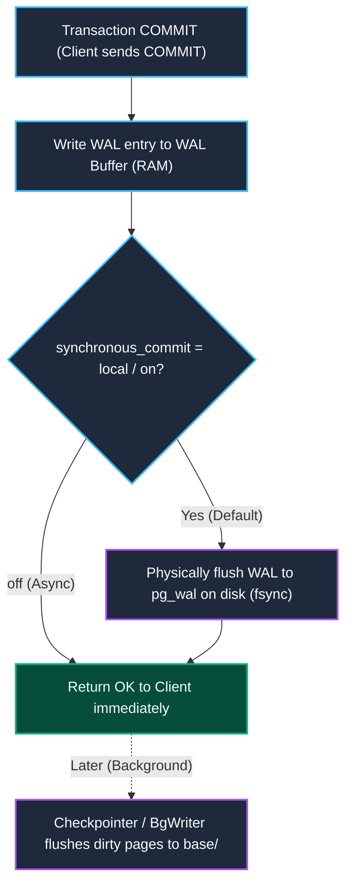

### WAL Configuration Parameters

```sql
-- Check current WAL settings
SHOW wal_level;
SHOW wal_buffers;
SHOW checkpoint_timeout;
SHOW max_wal_size;

-- View in postgresql.conf
wal_level = replica  -- minimal, replica, or logical
wal_buffers = 16MB   -- Default is 1/32 of shared_buffers
checkpoint_timeout = 15min
max_wal_size = 4GB   -- Max WAL before forced checkpoint
```

### WAL Levels

| Level | Use Case | What's Logged |
|-------|----------|---------------|
| `minimal` | Single-server, no HA | Only critical data for crash recovery |
| `replica` (default) | Streaming replication, PITR | Full WAL for physical replication & archiving |
| `logical` | Logical replication, CDC | Decoded WAL for logical subscribers |

### WAL Segments

WAL is divided into **16MB segments** (default, `wal_segment_size`):

```text
pg_wal/000000010000000000000001
pg_wal/000000010000000000000002
pg_wal/000000010000000000000003
...
pg_wal/0000000100000000FFFFFFFF  (4GB worth, then timeline increments)
```

### Crash Recovery


> [!TIP]
> Sequential appends to `pg_wal` + `fsync()` are orders of magnitude faster than flushing scattered 8KB random heap pages on every `COMMIT`, giving PostgreSQL both high throughput and full ACID durability.

---

## VACUUM and AUTOVACUUM

### Why VACUUM is Needed

MVCC leaves dead tuples (marked with `xmax`). These waste disk/buffer space and make sequential and index scans slower.

**Dead Tuple Problem:**
```sql
-- Table: employees
-- Initial: 1 million rows, 1GB size

UPDATE employees SET salary = salary * 1.1;  -- Affects all rows
-- Now: 2 million versions (old + new), 2GB size!
-- Old versions have xmax set (dead tuples)

-- Without VACUUM:
SELECT * FROM employees;  -- Scans 1M new + 1M old tuples
-- Performance degrades over time
```

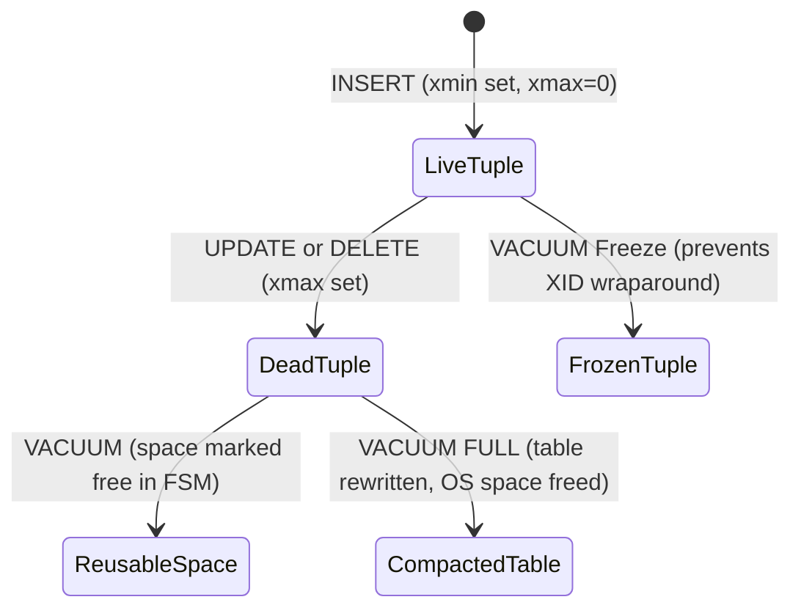

### VACUUM Process

```sql
-- Manual VACUUM
VACUUM;  -- Scans whole table, marks dead tuples as reusable

-- VACUUM with ANALYZE (updates statistics too)
VACUUM ANALYZE;

-- VACUUM FULL (rewrites table, slow, exclusive lock)
VACUUM FULL;  -- Compresses table, returns space to OS
```

**What `VACUUM` does:**
1. Scans all pages looking for dead tuples
2. Marks space as reusable in the Free Space Map (doesn't return space to OS)
3. Updates `pg_stat_user_tables` and Visibility Map (enables Index-Only Scans)
4. Removes old `clog` entries beyond `vacuum_freeze_min_age`

| Command | Table Lock | Returns Space to OS? | Rebuilds Indexes? | Use Case |
|---------|-----------|----------------------|-------------------|----------|
| `VACUUM` | Non-blocking (ShareUpdateExclusive) | No (reusable internally) | No | Routine bloat prevention |
| `VACUUM ANALYZE` | Non-blocking | No | No | Vacuum + refresh planner stats |
| `VACUUM FULL` | `ACCESS EXCLUSIVE` (blocks all reads/writes) | Yes | Yes | Severe bloat recovery |

### AUTOVACUUM

PostgreSQL runs the autovacuum daemon automatically. It triggers when:
`dead_tuples > autovacuum_vacuum_threshold + autovacuum_vacuum_scale_factor * reltuples`

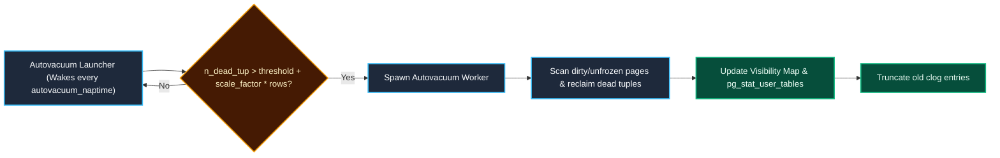

```sql
-- Check autovacuum settings
SHOW autovacuum;  -- on/off
SHOW autovacuum_vacuum_threshold;  -- Base threshold (50 dead tuples)
SHOW autovacuum_vacuum_scale_factor;  -- 10% of table size
SHOW autovacuum_analyze_threshold;
SHOW autovacuum_naptime;  -- Check every 10 seconds

-- Check vacuum stats
SELECT * FROM pg_stat_user_tables
WHERE n_live_tup > 0
ORDER BY last_vacuum DESC;
```

### Monitoring Dead Tuples & Tuning

```sql
-- Count dead tuples in a table
SELECT
    schemaname, tablename,
    n_live_tup, n_dead_tup,
    ROUND(100 * n_dead_tup / NULLIF(n_live_tup + n_dead_tup, 0), 2) AS dead_ratio,
    last_vacuum, last_autovacuum
FROM pg_stat_user_tables
WHERE n_dead_tup > 1000
ORDER BY n_dead_tup DESC;

-- Table-specific settings (for high-churn tables)
ALTER TABLE employees SET (
    autovacuum_vacuum_scale_factor = 0.05,    -- 5% instead of 10%
    autovacuum_vacuum_threshold = 100,        -- More aggressive
    autovacuum_naptime = '30s'                -- Check more often
);

-- For very large tables, increase parallelism
ALTER SYSTEM SET autovacuum_max_workers = 8;
SELECT pg_reload_conf();
```

> [!TIP]
> On a 100M-row table, the default `autovacuum_vacuum_scale_factor = 0.1` waits for **10 million** dead tuples before triggering! Lower `scale_factor` (e.g., `0.01` or `0.02`) per-table on huge, high-churn tables.

---

## TOAST (The Oversized-Attribute Storage Technique)

PostgreSQL heap pages are fixed at **8KB**, and tuples cannot span multiple pages. Large variable-length columns are compressed and/or stored out-of-line in a companion TOAST table.

### How TOAST Works

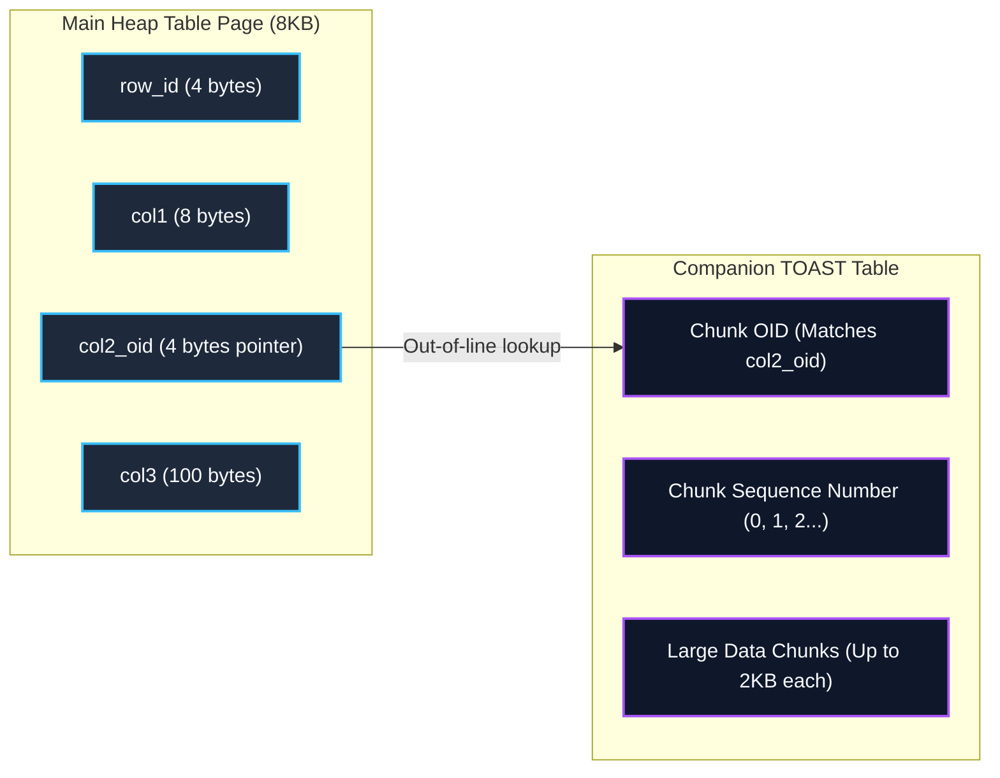

### TOAST Storage Strategies

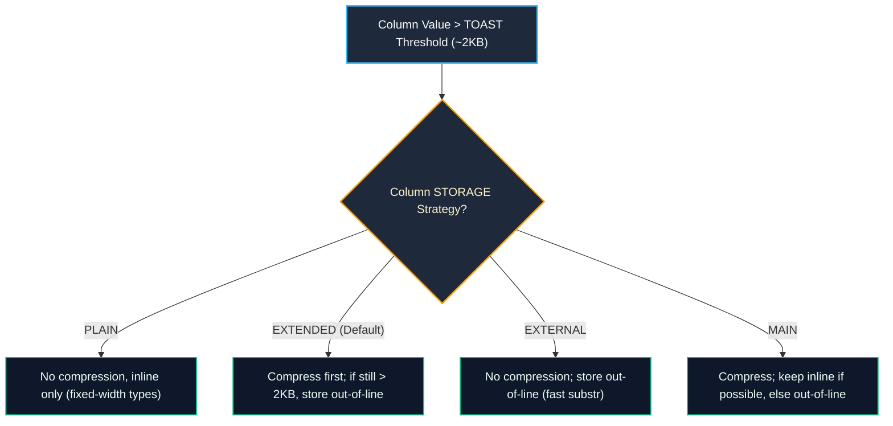

| Strategy | Compression | Out-of-Line Storage | Best For |
|----------|-------------|---------------------|----------|
| `PLAIN` | No | Never (inline only) | Fixed-size types (`int`, `uuid`) |
| `EXTENDED` (default) | Yes | Yes, if still > 2KB | General `text`, `jsonb`, `bytea` |
| `EXTERNAL` | No | Yes, always if > 2KB | Pre-compressed media, fast `SUBSTRING()` |
| `MAIN` | Yes | Only as last resort | Columns you want kept inline when possible |

```sql
-- Set TOAST strategy for column
ALTER TABLE documents
  ALTER COLUMN content SET STORAGE EXTENDED;
```

> [!TIP]
> **Interview Tip:** "Large `text` or `bytea` columns are TOASTed and stored separately from the main table. If a `SELECT` query doesn't reference the TOASTed column, PostgreSQL never reads the TOAST table—keeping row scans fast!"

---

## Buffer Management and Shared Buffers

### Shared Buffer Pool

```sql
-- Check current setting
SHOW shared_buffers;  -- Default: 128MB, should be 25% of RAM for dedicated server

-- Formula for sizing:
-- Dedicated server: 25% of RAM
-- Shared server: 10% of RAM
-- Max practical: 40GB
```

### Buffer Eviction Policy (Clock-Sweep / LRU Variant)

PostgreSQL uses a **clock-sweep variant of LRU (Least Recently Used)** tracked via `usage_count` (0–5) in `BufferDescriptor`:
1. Each buffer slot has a `usage_count` (incremented on access, capped at 5).
2. The clock hand sweeps slots when a free buffer is needed.
3. If `usage_count > 0`, it decrements `usage_count` and moves on.
4. When `usage_count == 0`, the slot is evicted (if `dirty`, flushed to disk first).

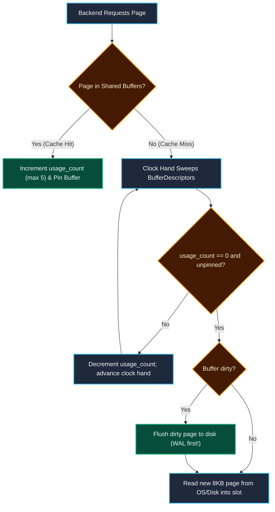

### Buffer Descriptors and Locking

```c
struct BufferDescriptor {
    int    buf_id;           // Which buffer slot
    int    lock;             // Buffer lock (content_lock)
    uint16 usage_count;      // LRU counter (0-5)
    bool   dirty;            // Page modified since read from disk
    // ... other fields
};
```

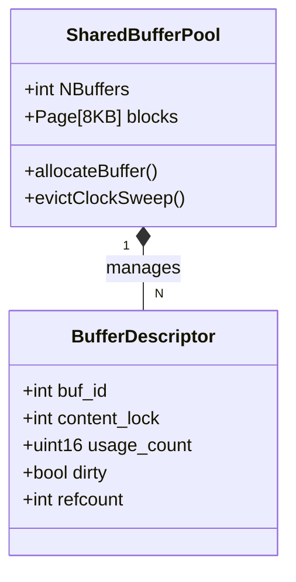

### Impact on Query Performance

```sql
-- If shared_buffers is too small:
-- - More disk I/O
-- - More CPU spent on eviction
-- - EXPLAIN ANALYZE shows many buffer misses

-- Check buffer hit ratio (target: > 99%)
SELECT
    sum(heap_blks_read) as heap_read,
    sum(heap_blks_hit) as heap_hit,
    sum(heap_blks_hit) / (sum(heap_blks_hit) + sum(heap_blks_read)) as hit_ratio
FROM pg_statio_user_tables;
```

> [!IMPORTANT]
> Setting `shared_buffers` above 25–40% of RAM rarely helps and can hurt by starving the OS page cache (PostgreSQL relies on double-buffering with the OS kernel page cache).

---

## PostgreSQL Data Types

### Choosing the Right Type

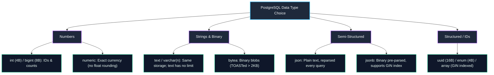

| Type | Size | Use Case | Interview Note |
|------|------|----------|----------------|
| `int` (`int4`) | 4 bytes | Small numbers, IDs | 2.1B range, default for `SERIAL` |
| `bigint` (`int8`) | 8 bytes | Large counts, IDs | 9.2×10^18 range, use for `BIGSERIAL` |
| `numeric` / `decimal` | variable | Currency, exact decimals | No rounding errors, slower than float |
| `float8` | 8 bytes | Approximate values | Fast, IEEE 754 precision |
| `text` | variable | Strings, unlimited | No length limit unlike `varchar(n)` |
| `varchar(n)` | variable | Limited strings | Enforces max length |
| `char(n)` | fixed | Fixed-width | Pads with spaces, wasteful |
| `bytea` | variable | Binary data | TOASTed if > 2KB |
| `json` | variable | Tree structure, logging | Slower, reparsed on each query |
| `jsonb` | variable | Binary JSON, indexing | Faster, pre-parsed, GIN indexing |
| `uuid` | 16 bytes | Globally unique IDs | No sequence/autoinc dependency |
| `array` | variable | Multiple values | GIN indexing support |
| `enum` | 4 bytes | Fixed options | Type-safe, efficient storage |
| `point`, `polygon` | variable | Geospatial | Requires PostGIS extension |

### JSON vs JSONB (Key Difference)

```sql
-- json: Plain text storage, stored as-is
-- Slower: Reparsed on every query
-- Cheaper storage if never queried
SELECT json_column->>'key' FROM table;  -- Must parse each time

-- jsonb: Binary format, pre-parsed
-- Faster: Parsed once, binary format cached
-- More storage (larger binary representation)
-- Supports GIN indexing
CREATE INDEX idx_jsonb ON table USING GIN (jsonb_column);

SELECT jsonb_column->>'key' FROM table;  -- Binary access, fast
```

### Arrays & Enums

```sql
CREATE TABLE events (
    id serial PRIMARY KEY,
    name text,
    tags text[] DEFAULT ARRAY[]::text[]
);

-- Insert & Query & Index
INSERT INTO events (name, tags) VALUES ('Event', ARRAY['tag1', 'tag2']);
SELECT * FROM events WHERE 'tag1' = ANY(tags);
CREATE INDEX idx_tags ON events USING GIN (tags);

-- Enums (4 bytes + type safety)
CREATE TYPE employment_status AS ENUM (
    'active',
    'inactive',
    'on_leave',
    'terminated'
);

CREATE TABLE employees (
    id serial PRIMARY KEY,
    name text,
    status employment_status DEFAULT 'active'
);
```

> [!TIP]
> **Interview Note:** Use `jsonb` for dynamic attributes that are frequently queried or indexed with `GIN`, and `text` instead of `varchar(n)` when you don't need a hard character limit (their internal storage and performance are identical in PostgreSQL).

---

## Tablespaces

Tablespaces allow you to distribute tables and indexes across multiple physical disks or mount points for I/O isolation and capacity management.

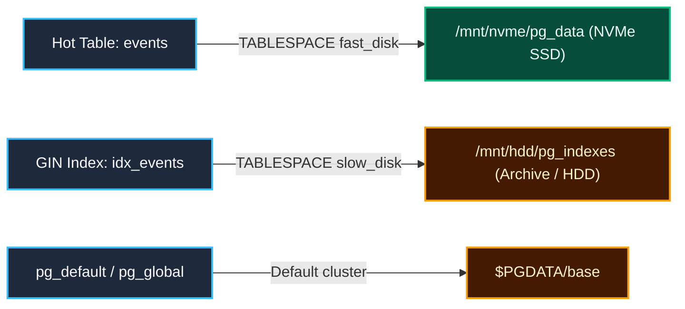

```sql
-- Create tablespace on different disk
CREATE TABLESPACE fast_disk LOCATION '/mnt/nvme/pg_data';

-- Create table on specific tablespace
CREATE TABLE events (id serial PRIMARY KEY, data jsonb)
TABLESPACE fast_disk;

-- Create index on different tablespace (indexes on slower disk)
CREATE INDEX idx_events ON events USING GIN (data)
TABLESPACE slow_disk;

-- Move table
ALTER TABLE events SET TABLESPACE fast_disk;

-- List tablespaces
SELECT * FROM pg_tablespaces;
```

> [!TIP]
> **Interview Use Case:** Place high-frequency lookup tables or WAL on NVMe SSDs and cold archive partitions on cheaper HDDs.

---

## PostgreSQL-Specific Features

### LISTEN/NOTIFY (Pub-Sub)

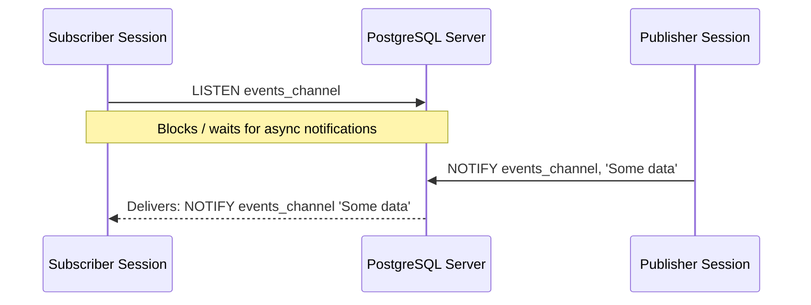

```sql
-- In one session (Subscriber)
LISTEN events_channel;
-- Now listening... (blocks until notification)

-- In another session (Publisher)
NOTIFY events_channel, 'Some data';

-- Listener receives: NOTIFY events_channel 'Some data'
```

**Use Case:** Application event notification without polling (chat messages, cache invalidation, real-time updates).

### Bulk Load, Upsert, Lateral Joins & Materialized Views

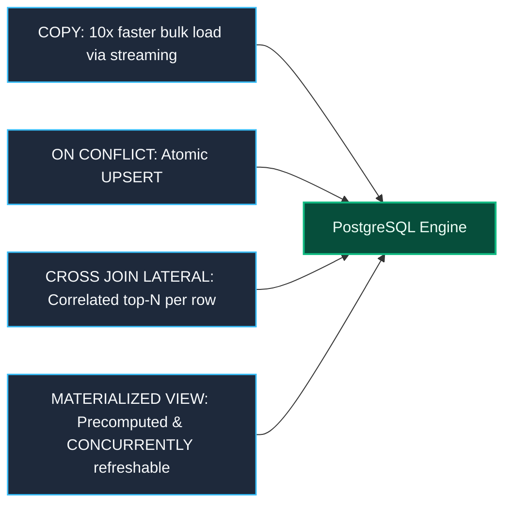

```sql
-- COPY (Bulk Load - 10x faster than INSERT for large datasets)
COPY employees (name, salary) FROM STDIN;
Alice    50000
Bob      60000
\.

COPY employees TO STDOUT;
\COPY employees FROM '/path/to/file.csv' WITH (FORMAT csv, DELIMITER ',', HEADER);

-- UPSERT (ON CONFLICT)
INSERT INTO users (email, name, updated_at)
VALUES ('user@example.com', 'Alice', NOW())
ON CONFLICT (email) DO UPDATE SET
    name = EXCLUDED.name,
    updated_at = EXCLUDED.updated_at;

INSERT INTO product_inventory (product_id, quantity)
VALUES (123, 100)
ON CONFLICT (product_id) DO UPDATE SET
    quantity = product_inventory.quantity + EXCLUDED.quantity;

-- Lateral Joins (like SQL Server CROSS APPLY)
SELECT c.customer_id, c.name, o.*
FROM customers c
CROSS JOIN LATERAL (
    SELECT order_id, amount
    FROM orders
    WHERE customer_id = c.customer_id
    ORDER BY amount DESC
    LIMIT 3
) o;

-- Materialized Views
CREATE MATERIALIZED VIEW customer_stats AS
SELECT
    customer_id,
    COUNT(*) AS total_orders,
    SUM(amount) AS total_spent
FROM orders
GROUP BY customer_id;

REFRESH MATERIALIZED VIEW customer_stats;

-- Concurrent refresh (doesn't lock reads, requires unique index)
CREATE UNIQUE INDEX idx_customer_stats ON customer_stats (customer_id);
REFRESH MATERIALIZED VIEW CONCURRENTLY customer_stats;
```

> [!IMPORTANT]
> `REFRESH MATERIALIZED VIEW CONCURRENTLY` avoids blocking `SELECT` queries during refresh, but **requires** a `UNIQUE` index on the materialized view.

---

## Configuration Tuning

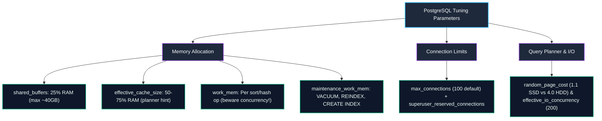

### Memory Parameters

```sql
SHOW shared_buffers;        -- Shared cache, 25% RAM
SHOW effective_cache_size;  -- Total memory available, 50-75% RAM
SHOW work_mem;              -- Per-operation memory (sorts, hash), 4MB-256MB
SHOW maintenance_work_mem;  -- VACUUM, REINDEX, 64MB default
```

| Server RAM | `shared_buffers` | `effective_cache_size` | `work_mem` | `maintenance_work_mem` |
|------------|------------------|------------------------|------------|------------------------|
| **16 GB** | `4GB` (25%) | `12GB` (75%) | `256MB` | `1GB` |
| **64 GB** | `16GB` (25%) | `48GB` (75%) | `512MB` | `2GB` |

### Connection Pool & Query Planning

```sql
SHOW max_connections;                 -- Default: 100, increase for many clients
SHOW superuser_reserved_connections;  -- Keep slots for admin

-- For application with 1000+ clients, use PgBouncer:
-- PgBouncer: 1000 client connections -> 20 database connections

SET enable_seqscan = off;             -- Force index use (for testing only)
SET random_page_cost = 1.1;           -- SSD: lower, HDD: higher (default 4)
SET effective_io_concurrency = 200;   -- Number of concurrent I/O operations
```

> [!WARNING]
> `work_mem` is allocated **per sort or hash operation**, not per connection. A single complex query with 4 hash joins across 100 concurrent connections can allocate `4 × 100 × work_mem`!

---

## Connection Pooling with PgBouncer

### Problem: PostgreSQL Process Per Connection

Each connection = one OS process = ~6MB RAM. For 1,000 clients, that's **6GB just for idle processes** plus heavy context-switching overhead.

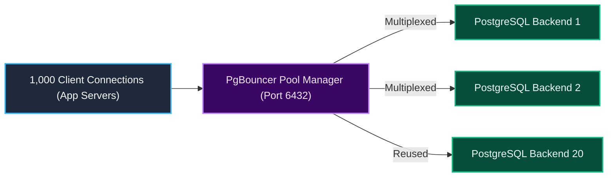

### PgBouncer Configuration

```ini
[databases]
mydb = host=localhost port=5432 dbname=mydb

[pgbouncer]
listen_port = 6432
max_client_conn = 1000
default_pool_size = 20      # Connections per database
min_pool_size = 5           # Keep alive
reserve_pool_size = 5       # Extra connections for spikes
reserve_pool_timeout = 10   # Timeout for reserve
```

### Connection Pooling Modes

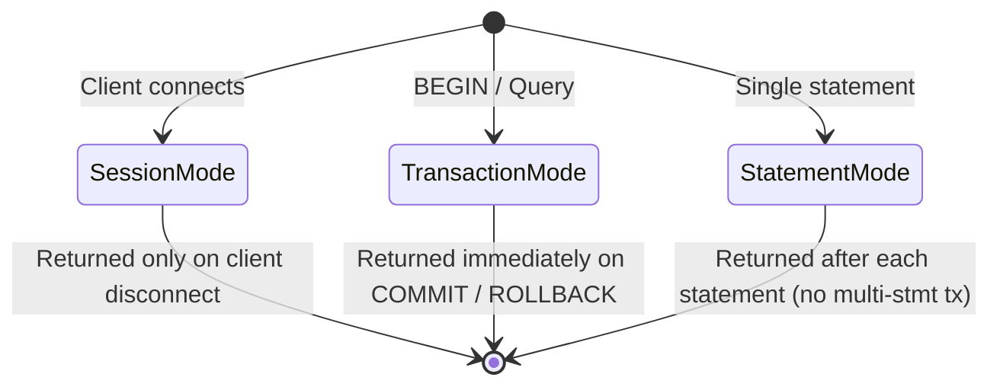

| Mode | Behavior | Good For | Caveats |
|------|----------|----------|---------|
| `session` | Connection returned after client disconnects | Long-lived connections, `PREPARE`, `LISTEN` | Lowest multiplexing |
| `transaction` | Connection returned after each transaction | Short queries, high concurrency (recommended) | No session-level `SET` / temp tables across tx |
| `statement` | Connection returned after each statement | Single auto-commit queries (rare) | Multi-statement transactions disallowed |

> [!TIP]
> **Interview Answer:** "With 5,000 client connections, using PgBouncer in `transaction` pooling mode lets us keep only 100 PostgreSQL backend connections. Each transaction borrows a backend and returns it on `COMMIT`—reducing connection memory from ~30GB to ~600MB."

---

## Common Interview Questions and Answers


### Q1: What happens when you run a SELECT query?

**Answer:**
1. **Parser** checks syntax and builds a parse tree.
2. **Planner** determines the best execution plan (considers indexes, `pg_statistic` histograms, cost estimates).
3. **Executor** runs the plan (fetches 8KB pages via `Shared Buffers`, checks MVCC visibility, filters rows, aggregates, sorts).
4. **Results** are returned to the client.
5. If `VACUUM` hasn't run recently, the executor may scan many dead tuples, slowing down the query.

### Q2: How does PostgreSQL ensure durability?

**Answer:**
"WAL guarantees durability. Before returning OK to the client on `COMMIT`:
1. The WAL entry is written to the `WAL Buffer`.
2. The WAL buffer is `fsync`'d to `pg_wal` on disk.
3. The client is told the commit succeeded.
4. Later (in the background), dirty pages in `Shared Buffers` are flushed to data files by the `Checkpointer` or `Background Writer`.
Even if PostgreSQL crashes before step 4, it replays WAL from the last checkpoint and recovers the transaction."

### Q3: What's the difference between VACUUM and VACUUM FULL?

**Answer:**
"`VACUUM` marks dead tuples as reusable inside the table without shrinking the file size on disk, and runs concurrently without blocking reads/writes.
`VACUUM FULL` rewrites the entire table into a new file, reclaiming space and returning it to the OS—but it takes much longer on large tables and requires an `ACCESS EXCLUSIVE` lock."

### Q4: What causes bloat?

**Answer:**
"Dead tuples from `UPDATE`/`DELETE` not yet vacuumed, or B-tree indexes not maintained after heavy churn. Bloat causes:
- Slower sequential scans (more pages to read)
- Slower index scans (deeper/sparser index pages)
- Wasted disk space and lower `Shared Buffers` hit ratio
**Solution:** Tune `autovacuum` per-table, run manual `VACUUM`, or `REINDEX CONCURRENTLY`."

### Q5: Why use JSONB over regular columns?

**Answer:**
"Use `JSONB` for flexible schemas (e.g., dynamic user attributes) where GIN indexing is helpful. Use regular typed columns for:
- Fixed schemas (better performance, constraints, and type integrity)
- Complex relational queries and joins
- Specific column indexing (B-tree is smaller and faster than GIN)"

> [!TIP]
> In system design interviews, combine **MVCC** (non-blocking reads), **WAL** (`fsync` sequential durability), **Autovacuum** (bloat & XID wraparound prevention), and **PgBouncer** (transaction pooling) to explain why PostgreSQL scales cleanly under heavy OLTP workloads.
