# Indexing and Query Optimization

## Table of Contents

- [B-Tree Index Internals](#b-tree-index-internals)
- [Index Types in PostgreSQL](#index-types-in-postgresql)
- [Composite Indexes](#composite-indexes)
- [Covering Indexes (INCLUDE Clause)](#covering-indexes-include-clause)
- [Partial Indexes and Expression Indexes](#partial-indexes-and-expression-indexes)
- [Unique Indexes](#unique-indexes)
- [EXPLAIN and EXPLAIN ANALYZE](#explain-and-explain-analyze)
- [Physical Join Algorithms](#physical-join-algorithms)
- [Query Optimization Strategies](#query-optimization-strategies)
- [N+1 Query Problem](#n1-query-problem)
- [Index Bloat and Maintenance](#index-bloat-and-maintenance)
- [Slow Query Identification and Optimization Workflow](#slow-query-identification-and-optimization-workflow)
- [Partitioning](#partitioning)
- [Common Performance Anti-Patterns](#common-performance-anti-patterns)
- [Interview Scenario: "Your Query is Slow"](#interview-scenario-your-query-is-slow)

---

## B-Tree Index Internals

**B-Tree (Balanced Tree)** is PostgreSQL's default index type. Understanding how 8KB index pages, `ctid` pointers, and page splits work is critical for database engineering interviews.

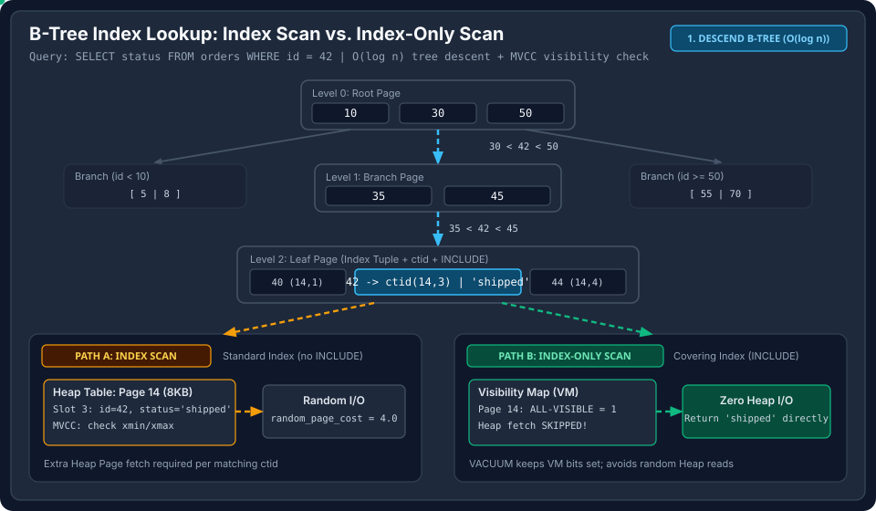

### B-Tree Structure & Traversal (`WHERE id = 42`)

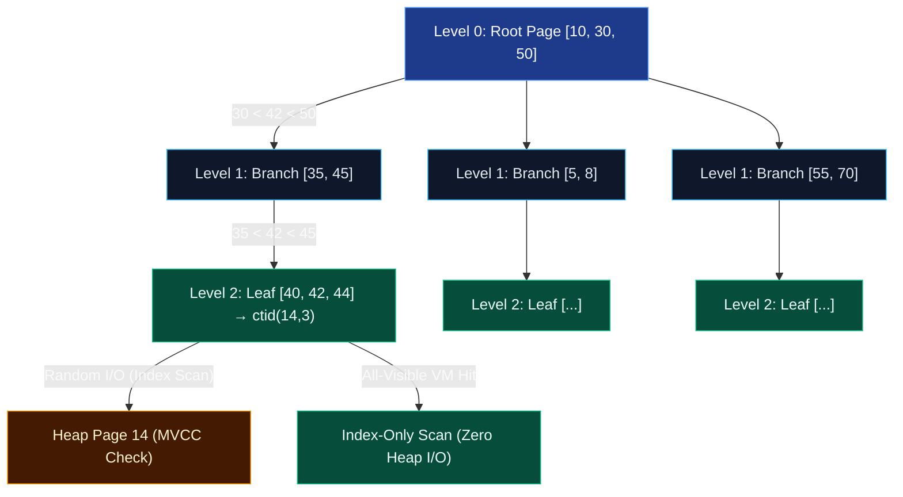

### B-Tree Properties & Complexity

- **All leaves at the same depth** — Binary search within each page guarantees $O(\log n)$ lookup.
- **Ordered** — Keys are stored in sorted order, enabling range scans and `ORDER BY` without a separate sort.
- **Balanced** — Maintained on `INSERT` / `UPDATE` via **page splits** when an 8KB leaf page overflows.
- **Doubly-linked leaves** — Sibling pointers between leaf pages allow fast forward/backward range scans (`O(log n + k)`).

### Page Splits During Insert

When inserting `5.5` into a full 8KB leaf page `[1..10]`, PostgreSQL splits the page and promotes the median key to the parent branch:

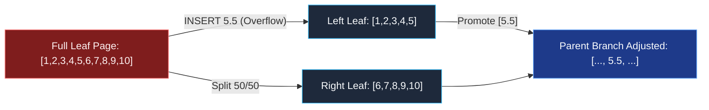

### B-Tree Search Algorithm Walkthrough

```sql
SELECT * FROM employees WHERE id = 42;
-- 1. Start at root: keys [10, 30, 50] -> 42 > 30 and 42 < 50 -> follow middle pointer
-- 2. Branch node: keys [35, 45] -> 42 > 35 and 42 < 45 -> follow child pointer
-- 3. Leaf node: [35, 36, 37, ... 45] -> binary search leaf for 42 -> get ctid
-- 4. Total I/Os: log_B(table_size) ≈ O(log n) -> For 1M rows, ~3-4 page reads (~20 binary comparisons)
```

> [!TIP]
> **Interview Tip:** B-Tree indexes are ordered, so a single index supports **equality** (`WHERE id = 5` in $O(\log n)$), **range** (`WHERE id > 10 AND id < 50` in $O(\log n + k)$), and **sorting** (`ORDER BY id` with zero extra sort).

---

## Index Types in PostgreSQL

PostgreSQL provides six specialized index access methods. Choosing the wrong one leads to bloated indexes or ignored plans.

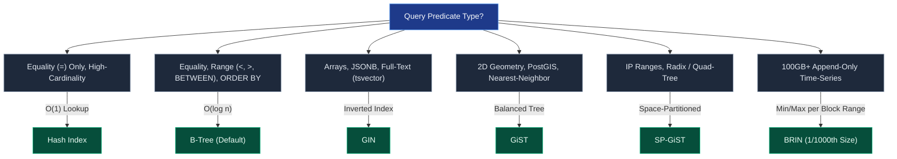

### Index Type Comparison

| Index Type | Best For | Supported Operators | Relative Size | Trade-Offs |
| :--- | :--- | :--- | :--- | :--- |
| **B-Tree** (Default) | Equality, ranges, sorting, `LIKE 'abc%'` | `=`, `<`, `<=`, `>`, `>=`, `BETWEEN`, `IN`, `IS NULL` | Medium | Slower for multi-value columns (arrays/JSONB) |
| **Hash** | Equality-only lookups | `=` only | Medium | No range/sort; historically not WAL-logged (fixed in PG 10+) |
| **GiST** | Geometry (PostGIS), ranges, nearest-neighbor | `&&`, `@>`, `<@`, `<->` | Medium–Large | Lossy; requires Heap recheck |
| **SP-GiST** | IP/inet ranges, quad-trees, radix trees | `=`, `<`, `>`, `@>`, `<@` | Medium | Best for non-balanced / skewed spaces |
| **GIN** | Arrays, `JSONB`, Full-Text Search (`tsvector`) | `@>`, `<@`, `?`, `?&`, `?|`, `@@` | Large | Expensive writes (use `fastupdate` pending list) |
| **BRIN** | 100GB+ naturally ordered / append-only tables | `=`, `<`, `>`, `BETWEEN` | Tiny (1/1000th) | Lossy; useless if physical row order is random |

### SQL Examples by Index Type

```sql
-- 1. B-Tree (Default): Index Scan, Index-Only Scan, or Bitmap Index Scan
CREATE INDEX idx_name ON table_name(column_name);

-- 2. Hash Index: Equality (=) ONLY, no sorting
CREATE INDEX idx_hash ON users USING HASH (email);

-- 3. GiST (Generalized Search Tree): Geometric & PostGIS nearest-neighbor
CREATE INDEX idx_geometry ON locations USING GiST (coordinates);

-- 4. SP-GiST (Space-Partitioned GiST): IP ranges, quad-trees, radix trees
CREATE INDEX idx_range ON data USING SPGIST (int_range_col);

-- 5. GIN (Generalized Inverted Index): Stores 'postgresql' -> [event_id_1, event_id_2, ...]
CREATE INDEX idx_array ON events USING GIN (tags);
CREATE INDEX idx_jsonb ON documents USING GIN (data);
-- Fast array membership: O(log n + k) vs O(n) Seq Scan with B-Tree
SELECT * FROM events WHERE 'postgresql' = ANY(tags);

-- 6. BRIN (Block Range Index): 100GB+ immutable logs sorted by created_at
CREATE INDEX idx_date ON logs USING BRIN (created_at);
```

> [!WARNING]
> Never use **BRIN** on columns with random physical distribution (e.g., `user_id` UUIDs) or heavy `UPDATE` churn — every 128-page block range will span `[min, max]` covering the whole domain, forcing PostgreSQL to scan the entire table.

---

## Composite Indexes

Column order in a multi-column B-Tree determines which queries can use the index. PostgreSQL sorts by the **first** column, then breaks ties by the **second**, then the **third**.

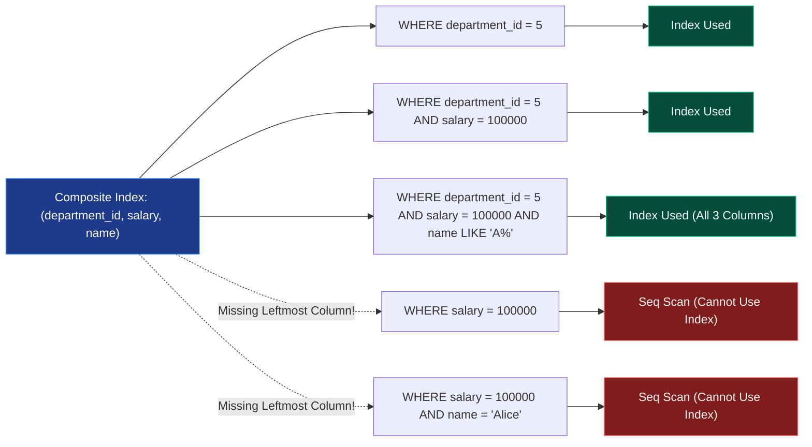

### Leftmost Prefix Rule & Column Order Strategy

1. **Equality columns before range columns** — A range predicate (`>`, `<`, `BETWEEN`) stops further exact B-Tree narrowing on subsequent columns.
2. **Most selective equality column first** — Prunes the search space fastest.
3. **Consider `JOIN` and `ORDER BY` alignment** — Matching `ORDER BY` direction avoids an explicit `Sort` node.

```sql
-- Leftmost Prefix Rule: (department_id, salary, name)
CREATE INDEX idx_composite ON employees(department_id, salary, name);

SELECT * FROM employees WHERE department_id = 5;                              -- ✓ Uses index
SELECT * FROM employees WHERE department_id = 5 AND salary = 100000;          -- ✓ Uses index
SELECT * FROM employees WHERE department_id = 5 AND salary = 100000 AND name LIKE 'A%'; -- ✓ Uses all 3
SELECT * FROM employees WHERE salary = 100000;                                -- ✗ Seq Scan
SELECT * FROM employees WHERE salary = 100000 AND name = 'Alice';             -- ✗ Seq Scan

-- Column Order Strategy: Equality -> Range -> Filter
CREATE INDEX idx ON orders(customer_id, created_at DESC, status);
SELECT * FROM orders
WHERE customer_id = 123
  AND created_at > '2024-01-01' AND created_at < '2024-12-31'
  AND status = 'shipped';
```

### Composite Index Performance Impact

```sql
-- Before index: Seq Scan (100,000 rows scanned, 20,000 matches)
EXPLAIN SELECT * FROM employees WHERE department_id = 5 AND salary > 100000;

-- After composite index: Index Scan (50 index entries -> 20,000 rows)
CREATE INDEX idx ON employees(department_id, salary);

-- Even better (partial index, fewer entries):
CREATE INDEX idx_partial ON employees(department_id) WHERE salary > 100000;
```

> [!IMPORTANT]
> Put **equality (`=`)** columns before **range (`>`, `<`, `BETWEEN`)** columns in a composite index. Once PostgreSQL hits a range condition on column 2, column 3 can only be filtered, not binary-searched.

---

## Covering Indexes (INCLUDE Clause)

A **Covering Index** stores non-key payload columns directly in the B-Tree leaf pages using `INCLUDE`, enabling an **Index-Only Scan** with zero Heap table fetches (when Visibility Map bits are set).

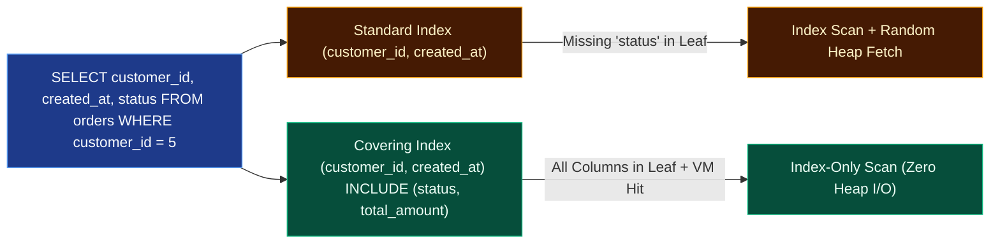

```sql
-- Standard index: must fetch 'status' from Heap table (extra random I/O)
CREATE INDEX idx_orders ON orders(customer_id, created_at);

-- Covering index with INCLUDE: 'status' and 'total_amount' live in leaf pages only
CREATE INDEX idx_orders_covering ON orders(customer_id, created_at)
INCLUDE (status, total_amount);

-- Query satisfied completely from index (Index Only Scan)
SELECT customer_id, created_at, status
FROM orders
WHERE customer_id = 5;
```

| Aspect | Key Columns `(a, b)` | `INCLUDE (c, d)` Columns |
| :--- | :--- | :--- |
| **Stored in** | Root, Branch, and Leaf pages | **Leaf pages only** |
| **Searchable / Sortable** | Yes | No (payload only) |
| **Enforces Uniqueness** | Yes (if `UNIQUE`) | No |
| **Best Use Case** | `WHERE`, `JOIN`, `ORDER BY` predicates | `SELECT` list columns for Index-Only Scans |

> [!TIP]
> **Interview Tip:** Covering indexes trade index storage size and write overhead for read latency. Use `INCLUDE` for hot queries where avoiding random Heap fetches is worth the extra disk/RAM footprint.

---

## Partial Indexes and Expression Indexes

**Partial Indexes** index only a subset of rows matching a `WHERE` predicate, while **Expression Indexes** precompute and index the result of a function or expression.

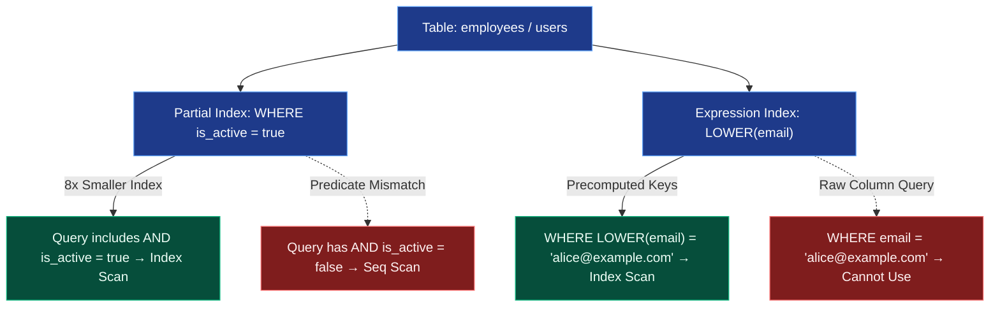

### Partial Indexes (Most Common Optimization)

```sql
-- Index only active employees (e.g., 8x fewer entries)
CREATE INDEX idx_active_employees ON employees(id)
WHERE is_active = true;

SELECT * FROM employees WHERE id = 5 AND is_active = true;   -- ✓ Uses partial index
SELECT * FROM employees WHERE id = 5 AND is_active = false;  -- ✗ Cannot use index

-- Recent 90-day orders (note: predicate must be immutable or explicit cutoff)
CREATE INDEX idx_recent_orders ON orders(customer_id, created_at)
WHERE created_at > '2024-01-01';

-- NULL filtering for sparse orphan rows
CREATE INDEX idx_orphan_rows ON table_name(id)
WHERE parent_id IS NULL;
```

### Expression Indexes

```sql
-- Case-insensitive email lookup
CREATE INDEX idx_lower_email ON users(LOWER(email));
SELECT * FROM users WHERE LOWER(email) = 'alice@example.com';

-- Date truncation & JSONB field extraction
CREATE INDEX idx_month ON orders(DATE_TRUNC('month', created_at));
CREATE INDEX idx_user_age ON users(((data->>'age')::int));
```

> [!WARNING]
> Expression indexes are recomputed on **every `INSERT` and `UPDATE`** of the underlying columns, and the query's `WHERE` clause must match the indexed expression **identically** for the planner to use it.

---

## Unique Indexes

Unique indexes enforce data integrity at the storage layer while simultaneously serving as fast lookup structures.

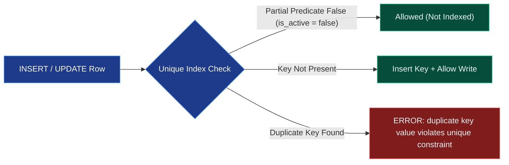

```sql
-- Enforce single-column uniqueness + fast lookup
CREATE UNIQUE INDEX idx_email ON users(email);

-- Multi-column uniqueness (one account per currency per customer)
CREATE UNIQUE INDEX idx_unique_combination ON accounts(customer_id, currency);

-- Partial unique index: max 1 active user per email, multiple soft-deleted/inactive OK
CREATE UNIQUE INDEX idx_unique_active ON users(email)
WHERE is_active = true;
```

> [!TIP]
> A **partial unique index** (`WHERE deleted_at IS NULL` or `WHERE is_active = true`) is the cleanest PostgreSQL pattern for soft-delete uniqueness without application-level race conditions.

---

## EXPLAIN and EXPLAIN ANALYZE

`EXPLAIN` shows the planner's **estimated** execution tree, whereas `EXPLAIN (ANALYZE, BUFFERS, VERBOSE)` actually **executes** the query and reports real timings, row counts, and buffer hits.

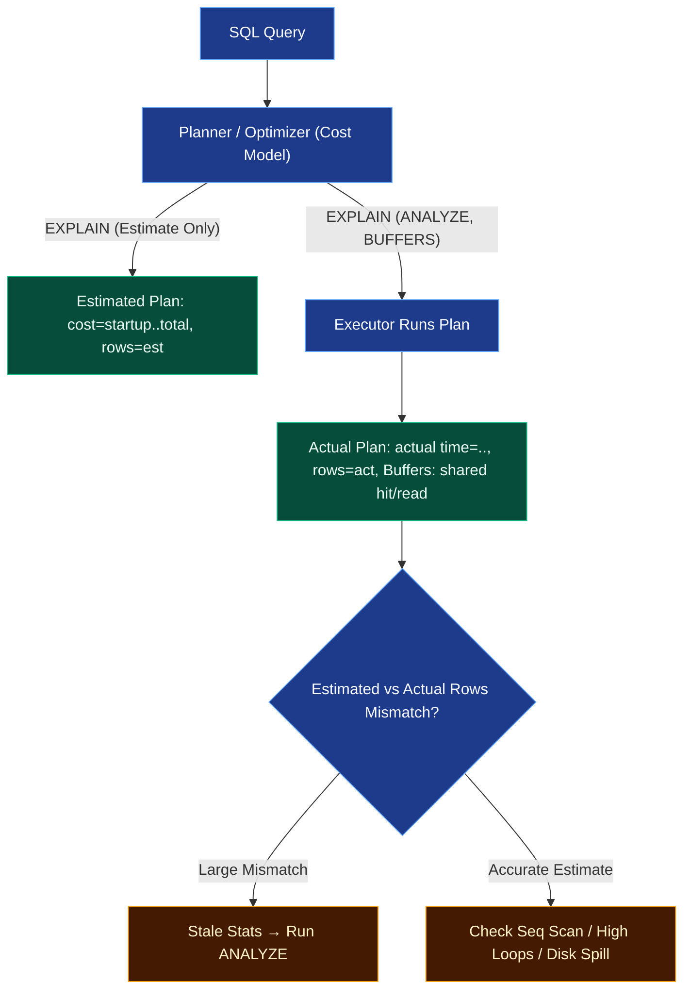

### Key Plan Node Types

| Node | Meaning | When Used |
| :--- | :--- | :--- |
| **Seq Scan** | Sequential scan of all Heap pages | No suitable index, small table, or low selectivity (>10–15% rows) |
| **Index Scan** | Traverse B-Tree, then fetch Heap rows | Indexed column with good selectivity |
| **Index Only Scan** | All needed columns in index + VM hit | Covering index (`INCLUDE`) or `COUNT(*)` |
| **Bitmap Index Scan** | Build page bitmap from index(es), then sequential Heap read | Moderate/many matches, or combining multiple indexes (`AND`/`OR`) |
| **Nested Loop Join** | For each outer row, probe inner table/index | Small outer input, indexed inner join |
| **Hash Join** | Build hash table on smaller input, probe with larger | Medium–large unsorted tables, inner fits in `work_mem` |
| **Merge Join** | Lockstep merge of two pre-sorted inputs | Both inputs pre-sorted (e.g., B-Tree) or very large tables |

### Reading `EXPLAIN (ANALYZE, BUFFERS, VERBOSE)`

```sql
EXPLAIN (ANALYZE, BUFFERS, VERBOSE)
SELECT * FROM employees WHERE salary > 100000;

-- Seq Scan on employees  (cost=0.00..1234.00 rows=234 width=64) (actual time=0.10..2.30 rows=234 loops=1)
--   Filter: (salary > 100000)
--   Buffers: shared hit=100 read=2
-- Planning Time: 0.1 ms
-- Execution Time: 2.4 ms
```

### PostgreSQL Cost Model Constants

- **Cost unit** = `1.0` sequential 8KB page read (`seq_page_cost = 1.0`).
- **Random page read**: `random_page_cost = 4.0` (often tuned to `1.1`–`1.5` on NVMe SSDs).
- **CPU costs**: `cpu_tuple_cost = 0.01` per row, `cpu_operator_cost = 0.005` per `WHERE` clause evaluation.
- **Example**: Scanning 1M rows across 1,000 blocks sequentially costs `1000 * 1.0 + 1,000,000 * 0.01 = 11,000` units, whereas an Index Scan for 100 rows costs `~20 * 4.0 + 100 * 0.01 = 81` units.

> [!IMPORTANT]
> Always check **estimated vs. actual rows** and **Buffers: `shared hit` vs. `read`**. A 10x+ row estimate mismatch indicates stale statistics (`ANALYZE`), and a buffer cache hit ratio should typically exceed **99%** in OLTP workloads.

---

## Physical Join Algorithms

PostgreSQL implements joins using three physical strategies: **Nested Loop**, **Hash Join**, and **Merge Join**.

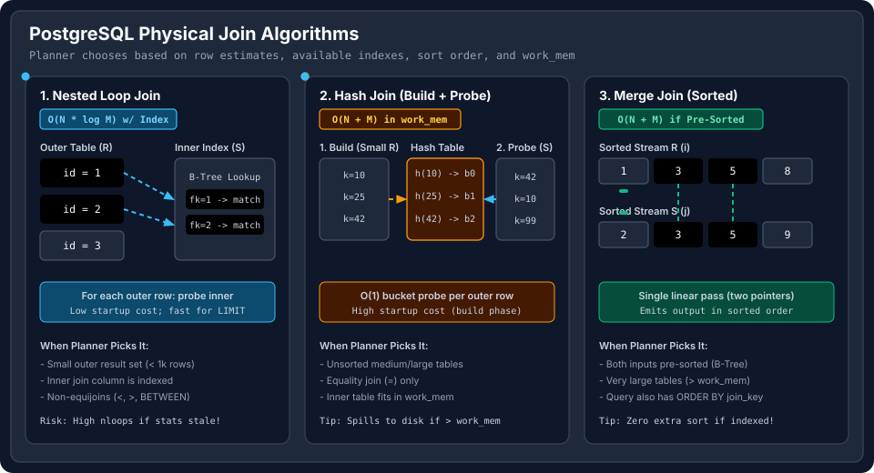

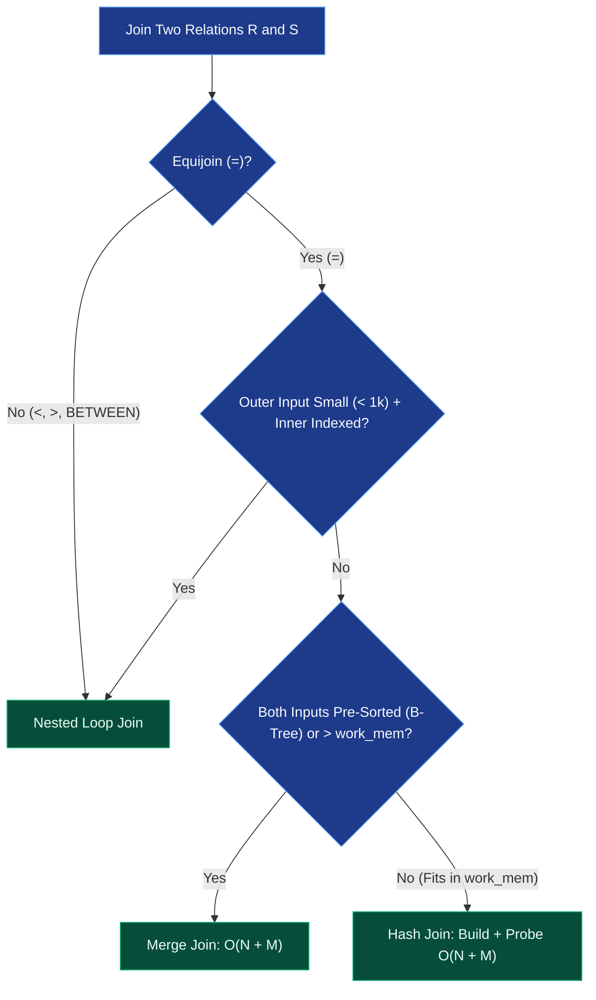

### Physical Join Comparison

| Algorithm | Complexity | Memory Usage | Startup Cost | Best Scenario |
| :--- | :--- | :--- | :--- | :--- |
| **Nested Loop** | $O(N \cdot \log M)$ w/ index | Minimal | Very Low | Small outer table + indexed inner; fast with `LIMIT` |
| **Hash Join** | $O(N + M)$ | `work_mem` (spills if exceeded) | High (Build phase) | Unsorted medium/large tables with `=` join |
| **Merge Join** | $O(N + M)$ if pre-sorted | Low (unless sorting) | Low if indexed | Pre-sorted B-Tree inputs, huge tables, or `ORDER BY` on join key |

> [!WARNING]
> A **Nested Loop** with `loops=50000` in `EXPLAIN ANALYZE` is a classic symptom of stale statistics underestimating the outer table's row count (e.g., estimating `rows=1` when actual `rows=50000`). Run `ANALYZE` so the planner switches to a **Hash Join** or **Merge Join**.

---

## Query Optimization Strategies

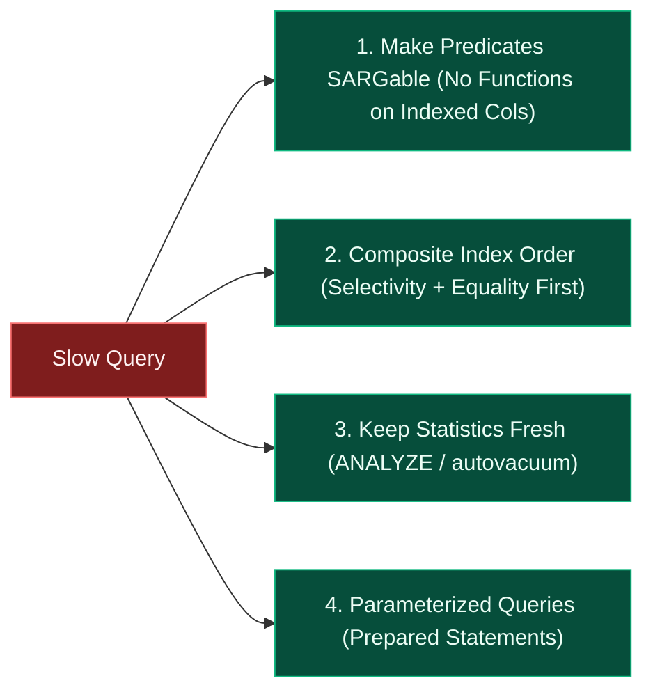

### 1. Avoiding Full Table Scans (SARGable Predicates)

```sql
-- Problem: Function call on indexed column prevents B-Tree use
SELECT * FROM users WHERE DATE(created_at) = '2024-01-15';
-- Solution: Rewrite as sargable range query
SELECT * FROM users
WHERE created_at >= '2024-01-15'::date
  AND created_at < '2024-01-15'::date + '1 day'::interval;

-- Problem: UPPER(name) = 'WIDGET' -> Solution: Expression index
CREATE INDEX idx_product_name ON products(UPPER(name));

-- Problem: Leading wildcard LIKE '%@gmail.com' -> Solution: Dedicated column or GIN FTS
ALTER TABLE customers ADD COLUMN email_domain text;
CREATE INDEX idx_domain ON customers(email_domain);
```

### 2. Proper Indexing Strategy & Usage Monitoring

```sql
-- Avoid indexing every column independently (hurts writes & memory)
-- Instead, create targeted composite indexes for common WHERE clauses:
CREATE INDEX idx_main ON big_table(col1, col2, col3);

-- Audit unused or high-scan indexes
SELECT indexname, idx_scan FROM pg_stat_user_indexes ORDER BY idx_scan DESC;
```

### 3. Statistics and `ANALYZE`

```sql
ANALYZE;              -- Update stats for all tables
ANALYZE table_name;   -- Update stats for a specific table

-- Tune autovacuum analyze frequency for huge tables
ALTER TABLE big_table SET (autovacuum_analyze_scale_factor = 0.001);

-- Inspect planner histograms & most-common values
SELECT * FROM pg_stats WHERE tablename = 'employees';
```

### 4. Parameterized Queries and Plan Caching

```sql
-- Prepared statements reuse cached plans and prevent SQL injection
PREPARE fetch_orders (int) AS
SELECT * FROM orders WHERE customer_id = $1;
EXECUTE fetch_orders(1);
```

```java
PreparedStatement ps = conn.prepareStatement(
    "SELECT * FROM orders WHERE customer_id = ?"
);
ps.setInt(1, customerId); // Plan cached after initial executions
```

> [!TIP]
> Keep predicates **SARGable** (Search ARGument-able): never wrap an indexed column in a function (`DATE(col)`, `LOWER(col)`, `col + 1 = 5`) unless you have a matching **expression index**.

---

## N+1 Query Problem

The **N+1 problem** occurs when an application executes `1` query to fetch `N` parent records, followed by `N` separate queries in a loop to fetch each parent's children.

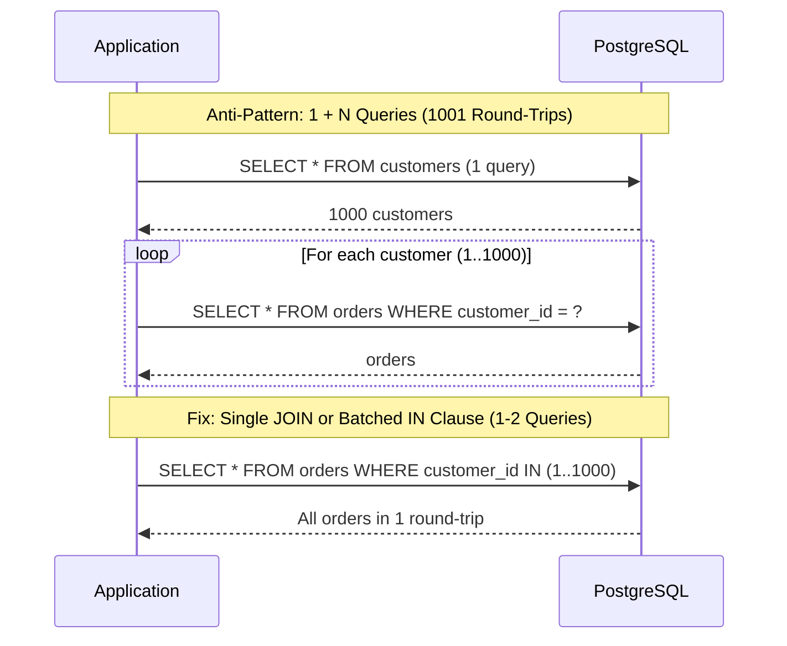

### Anti-Pattern vs. Fixes (Java / SQL)

```java
// BAD: 1 + N queries (1,001 round-trips for 1,000 customers)
List<Customer> customers = fetchAllCustomers();
for (Customer customer : customers) {
    List<Order> orders = fetchOrdersByCustomer(customer.id);
}
```

- **Solution 1: Single `LEFT JOIN` Query**
  ```sql
  SELECT c.*, o.*
  FROM customers c
  LEFT JOIN orders o ON c.id = o.customer_id
  WHERE c.active = true;
  ```
- **Solution 2: Batched `IN (...)` Query (2 Queries Total)**
  ```java
  List<Long> customerIds = customers.stream().map(Customer::getId).collect(Collectors.toList());
  Map<Long, List<Order>> ordersByCustomer = fetchOrdersByCustomerIds(customerIds);
  // Executes: SELECT * FROM orders WHERE customer_id IN (...)
  ```
- **Solution 3: ORM Eager Loading (`FetchType.EAGER` / `JOIN FETCH`)**
  ```java
  @Entity
  class Customer {
      @OneToMany(fetch = FetchType.EAGER)
      List<Order> orders;
  }
  ```

> [!IMPORTANT]
> Detect N+1 queries by enabling query logging or APM tracing and looking for identical parameterized queries firing inside a loop. Fix with `JOIN FETCH`, a batched `IN (...)` / `ANY($1)` query, or DataLoader batching.

---

## Index Bloat and Maintenance

Heavy `UPDATE` and `DELETE` workloads leave dead tuples and half-empty B-Tree pages, degrading cache efficiency and inflating I/O.

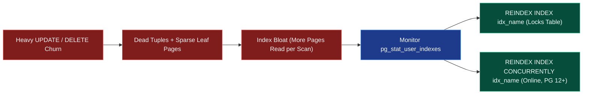

```sql
-- Check index usage & size
SELECT indexname, idx_scan, idx_tup_read, idx_tup_fetch,
       pg_size_pretty(pg_relation_size(indexrelid)) AS index_size
FROM pg_stat_user_indexes
WHERE idx_scan > 0
ORDER BY idx_scan DESC;

-- Rebuild options
REINDEX INDEX idx_name;               -- Brief exclusive lock
REINDEX TABLE table_name;             -- Rebuilds all indexes on table
REINDEX DATABASE mydb;                -- Rebuilds all DB indexes (caution on prod)
REINDEX INDEX CONCURRENTLY idx_name;  -- Online rebuild (PostgreSQL 12+, no write lock)
```

> [!WARNING]
> Standard `REINDEX INDEX` blocks writes on the table. In production, always use `REINDEX INDEX CONCURRENTLY` (PostgreSQL 12+) or `CREATE INDEX CONCURRENTLY` + swap + `DROP INDEX CONCURRENTLY`.

---

## Slow Query Identification and Optimization Workflow

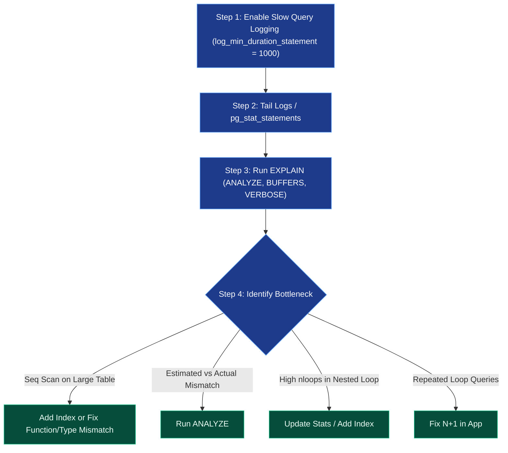

### 4-Step Workflow

1. **Enable Query Logging (`postgresql.conf`):**
   ```sql
   log_min_duration_statement = 1000  -- Log queries > 1s
   log_duration = on
   SELECT pg_reload_conf();
   ```
2. **Identify Slow Queries:**
   ```bash
   tail -f /var/log/postgresql/postgresql.log | grep "duration:"
   ```
3. **Run `EXPLAIN (ANALYZE, BUFFERS, VERBOSE)`:** Inspect for large `Seq Scan`, high `nloops` on `Nested Loop`, or estimated vs. actual row mismatches.
4. **Fix Common Root Causes:**
   ```sql
   -- 1. Missing index -> CREATE INDEX idx ON orders(customer_id);
   -- 2. Bad statistics -> ANALYZE orders;
   -- 3. N+1 query -> Use JOIN or IN clause
   -- 4. Function on column -> CREATE INDEX idx ON users(UPPER(email));
   -- 5. Implicit type conversion: id = '5' (text) vs id = 5 (int) -> Match column type!
   ```

> [!TIP]
> Implicit type conversions (e.g., passing `'5'` as text for an `int` or `bigint` column) can silently disable index usage. Always match parameter types to schema types.

---

## Partitioning

**Partitioning** splits a large logical table (100GB+) into smaller physical child tables, enabling **partition pruning** (scanning only relevant partitions), smaller per-partition indexes, and instant `DROP TABLE` archival instead of expensive `DELETE`.

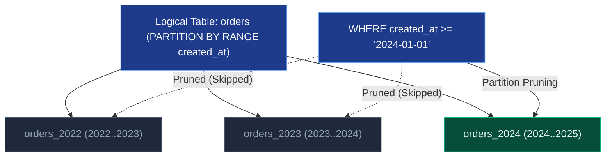

### Partitioning Strategies

| Strategy | Partition Key Example | Best For |
| :--- | :--- | :--- |
| **Range** (Most Common) | `created_at` (by month/year) | Time-series data, easy `DROP` retention |
| **List** | `region` (`'USA'`, `'UK'`, ...) | Discrete categories, tenant/geo isolation |
| **Hash** | `HASH (user_id)` (`modulus 8`) | Uniform load distribution across N shards/partitions |

```sql
-- Range Partitioning
CREATE TABLE orders (
    id bigserial, customer_id int, amount numeric, created_at timestamp
) PARTITION BY RANGE (EXTRACT(YEAR FROM created_at));

CREATE TABLE orders_2024 PARTITION OF orders FOR VALUES FROM (2024) TO (2025);
CREATE INDEX idx_orders_2024_customer ON orders_2024(customer_id);

-- List Partitioning
CREATE TABLE sales_by_region (id serial, region text, revenue numeric) PARTITION BY LIST (region);
CREATE TABLE sales_americas PARTITION OF sales_by_region FOR VALUES IN ('USA', 'CANADA', 'MEXICO');

-- Hash Partitioning
CREATE TABLE events (id bigserial, user_id int, data jsonb) PARTITION BY HASH (user_id);
CREATE TABLE events_0 PARTITION OF events FOR VALUES WITH (modulus 8, remainder 0);
```

> [!IMPORTANT]
> **Interview Tip:** Partitioning adds DDL and maintenance complexity and is **not** a silver bullet for small tables. Reserve it for **100GB+ tables** where partition pruning, smaller indexes, and fast retention (`DROP PARTITION`) deliver clear wins.

---

## Common Performance Anti-Patterns

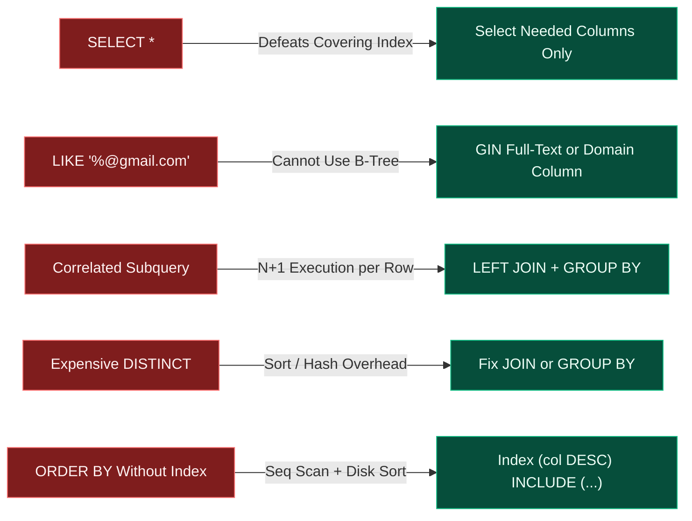

```sql
-- 1. Avoid SELECT * (breaks Index-Only Scans and wastes network/memory)
SELECT id, name, price FROM products;

-- 2. Wildcard Search: Use GIN Full-Text Search instead of LIKE '%...'
CREATE INDEX idx_email_fts ON users USING GIN(to_tsvector('english', email));
SELECT * FROM users WHERE to_tsvector('english', email) @@ 'gmail';

-- 3. Correlated Subquery -> Rewrite as LEFT JOIN + GROUP BY
SELECT e.*, COALESCE(a.count, 0) AS assignment_count
FROM employees e
LEFT JOIN (
    SELECT employee_id, COUNT(*) AS count FROM assignments GROUP BY employee_id
) a ON e.id = a.employee_id;

-- 4. DISTINCT on large sets -> Fix underlying JOIN duplication or use indexed GROUP BY

-- 5. Sorting without index -> Add matching ordered covering index
CREATE INDEX idx_created_desc ON orders(created_at DESC) INCLUDE (customer_id, amount);
```

> [!WARNING]
> `SELECT *` is the #1 silent killer of **Index-Only Scans** — even if you build a covering index for your hot columns, `SELECT *` forces PostgreSQL back to the Heap table for every single row.

---

## Interview Scenario: "Your Query is Slow"

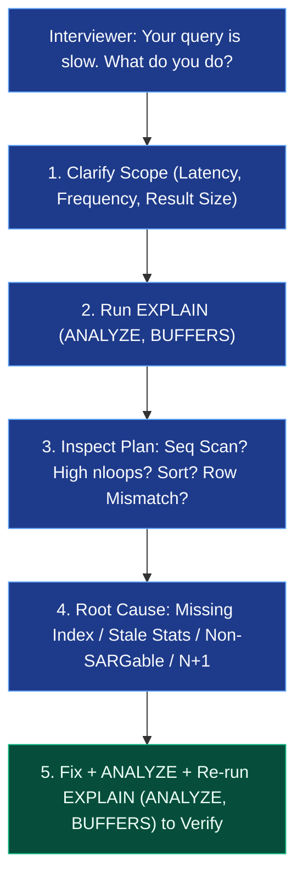

### Structured 5-Step Response

1. **Gather context:** Current vs. target latency, execution frequency, and expected result size.
2. **Capture the actual plan:** `EXPLAIN (ANALYZE, BUFFERS) SELECT ...;`
3. **Spot bottlenecks:** `Seq Scan` on large tables, high `nloops` on `Nested Loop`, large `Sort` spilling to disk, or large `estimated` vs. `actual` row mismatches.
4. **Diagnose root cause:** Missing/unused index, stale statistics, non-SARGable predicate (function or implicit cast), wrong join type, or application N+1 loop.
5. **Apply fix & verify:** Create index (use `CONCURRENTLY` in prod), run `ANALYZE`, and re-run `EXPLAIN (ANALYZE, BUFFERS)` to confirm plan and buffer/time improvements.

> [!TIP]
> **Example Interview Answer:** *"I'd start with `EXPLAIN (ANALYZE, BUFFERS)`. If I see a `Seq Scan` where I expect an `Index Scan`, I'd check whether the index exists, run `ANALYZE` for fresh stats, and inspect the `WHERE` clause for non-SARGable functions or implicit type casts. After applying the fix, I'd re-run `EXPLAIN ANALYZE` to verify the plan and execution time."*
