# Transactions and Concurrency Control

## Table of Contents

- [ACID Properties (Fundamental Interview Topic)](#acid-properties-fundamental-interview-topic)
- [Transaction Isolation Levels](#transaction-isolation-levels)
- [Isolation Anomalies & Read Phenomena](#isolation-anomalies--read-phenomena)
- [PostgreSQL Locking](#postgresql-locking)
- [Deadlock Detection and Prevention](#deadlock-detection-and-prevention)
- [Optimistic vs Pessimistic Locking](#optimistic-vs-pessimistic-locking)
- [Two-Phase Commit (2PC) & Distributed Saga Patterns](#two-phase-commit-2pc--distributed-saga-patterns)
- [Savepoints and Nested Transactions](#savepoints-and-nested-transactions)
- [Long-Running Transaction Problems and Solutions](#long-running-transaction-problems-and-solutions)
- [Connection Pooling and Transaction Management](#connection-pooling-and-transaction-management)
- [Common Interview Scenarios](#common-interview-scenarios)

---

## ACID Properties (Fundamental Interview Topic)

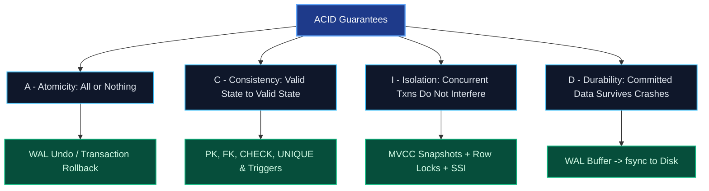

### A — Atomicity

A transaction is **"all or nothing"**. Either all operations succeed, or none do.

```sql
-- Bank transfer example
BEGIN;
  UPDATE accounts SET balance = balance - 100 WHERE id = 1;
  UPDATE accounts SET balance = balance + 100 WHERE id = 2;
COMMIT;

-- If power fails after first UPDATE:
-- - Transaction not committed
-- - Both updates rolled back
-- - No partial transfer occurred

-- If COMMIT fails:
-- - No acknowledgment to client
-- - Next query starts new transaction
-- - Previous work automatically rolled back on connection close
```

- **Implementation:** PostgreSQL uses **WAL (Write-Ahead Logging)**. All changes are logged to disk before `COMMIT` returns. On crash, uncommitted transactions are rolled back (their tuples remain invisible via `clog` / `xmin` status).

### C — Consistency

Database moves from one valid state to another. All constraints, triggers, and rules are enforced.

```sql
-- Example: Foreign key constraint
CREATE TABLE departments (id serial PRIMARY KEY);
CREATE TABLE employees (
    id serial PRIMARY KEY,
    dept_id int REFERENCES departments(id)
);

-- INSERT with invalid dept_id is rejected
INSERT INTO employees (id, dept_id) VALUES (1, 999);
-- ERROR: insert or update on table "employees" violates foreign key constraint

-- Transaction is rolled back, database stays consistent
```

- **Implementation:** PostgreSQL enforces constraints immediately (or at `COMMIT` if `DEFERRABLE`). If any constraint is violated, the entire transaction is rolled back.

### I — Isolation

Transactions cannot interfere with each other. Each transaction sees a consistent snapshot.

```sql
-- Transaction 1 (xid=100)
BEGIN;
SELECT * FROM accounts WHERE id = 1;  -- balance = 1000
-- Do some business logic

-- Transaction 2 (xid=101)
BEGIN;
UPDATE accounts SET balance = 900 WHERE id = 1;
COMMIT;

-- Back to Transaction 1
SELECT * FROM accounts WHERE id = 1;  -- balance = ?
-- Depends on isolation level (see below)
```

- **Isolation Levels:** PostgreSQL implements `READ UNCOMMITTED` (treated as `READ COMMITTED`), `READ COMMITTED` (default), `REPEATABLE READ`, and `SERIALIZABLE`.

### D — Durability

Once committed, data survives hardware failures.

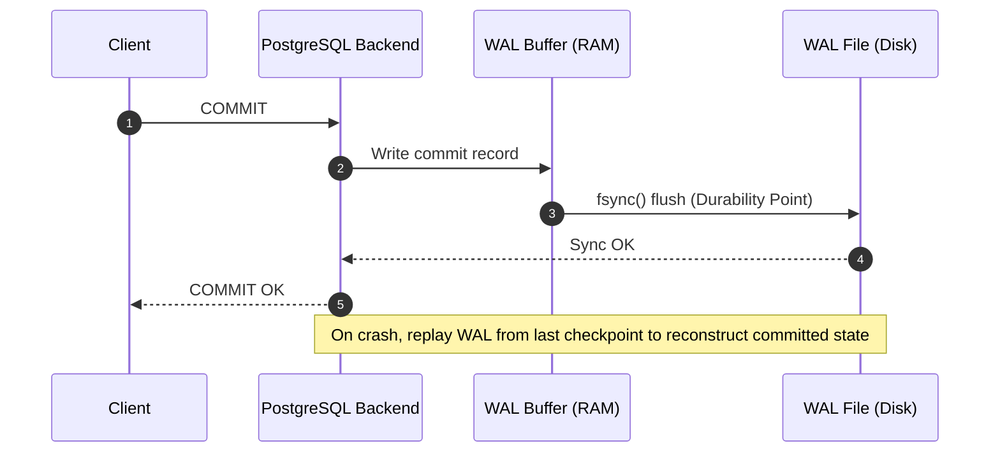

```sql
-- Client sends COMMIT
COMMIT;

-- Internally:
-- 1. WAL entry written to buffer
-- 2. WAL buffer fsync'd to disk (DURABILITY POINT)
-- 3. Return OK to client

-- Even if PostgreSQL crashes immediately:
-- On restart, replay WAL from checkpoint
-- Reconstruct committed transactions
-- Data is safe
```

| `synchronous_commit` Setting | Behavior | Durability vs Latency Tradeoff |
|---|---|---|
| `on` (default) | Wait for local WAL `fsync` before returning `OK` | Full local durability; standard latency |
| `remote_apply` | Wait for standby replica to apply WAL | Zero data loss on primary failure (HA); higher latency |
| `off` | Return `OK` before `fsync` (async flush) | Faster throughput; risk of losing last few ms of commits on crash |

> [!IMPORTANT]
> In interviews, distinguish **Database Consistency** (the `C` in ACID: invariants, foreign keys, `CHECK` constraints) from **Distributed Consistency** (the `C` in CAP: linearizability / replicas agreeing on the latest write).

---

## Transaction Isolation Levels


### ANSI SQL vs PostgreSQL Isolation Levels

| Isolation Level | Dirty Read | Non-Repeatable Read | Phantom Read | Write Skew | PostgreSQL Implementation |
|---|---|---|---|---|---|
| `READ UNCOMMITTED` | Prevented in PG (ANSI: Allowed) | Allowed | Allowed | Allowed | Mapped directly to `READ COMMITTED` |
| `READ COMMITTED` (Default) | Prevented | Allowed | Allowed | Allowed | Fresh MVCC snapshot per SQL statement |
| `REPEATABLE READ` | Prevented | Prevented | Prevented for `SELECT` (ANSI: Allowed) | Allowed | Single MVCC snapshot taken at `BEGIN` |
| `SERIALIZABLE` | Prevented | Prevented | Prevented | Prevented (`40001`) | Serializable Snapshot Isolation (SSI) |

### 1. READ UNCOMMITTED (PostgreSQL treats as READ COMMITTED)

```sql
-- Theoretically: Read uncommitted changes from other transactions
-- PostgreSQL: Actually READ COMMITTED (safer default)

-- Set isolation level
SET TRANSACTION ISOLATION LEVEL READ UNCOMMITTED;

-- No dirty reads in PostgreSQL (reads only committed data)
```

### 2. READ COMMITTED (Default)

Each statement sees only committed data at **statement start**.

```sql
-- Session 1
BEGIN;
SELECT balance FROM accounts WHERE id = 1;  -- 1000
-- ... other work ...
SELECT balance FROM accounts WHERE id = 1;  -- 900 (sees update from Session 2)

-- Session 2
UPDATE accounts SET balance = 900 WHERE id = 1;
COMMIT;

-- In READ COMMITTED:
-- Each SELECT statement gets fresh snapshot of committed data
-- So Session 1's second SELECT sees Session 2's update (non-repeatable read)
```

- **Use Case:** Most applications. Balances safety and performance.
- **Problems:** Non-repeatable reads (same query returns different results) and phantom reads (new rows appear between queries).

### 3. REPEATABLE READ

Each transaction has a consistent snapshot from **transaction start** (`BEGIN`).

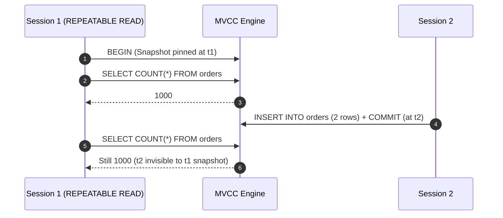

```sql
-- Session 1
BEGIN;  -- Snapshot taken here
SELECT COUNT(*) FROM orders;  -- 1000

-- Session 2
INSERT INTO orders VALUES (...);
INSERT INTO orders VALUES (...);
COMMIT;

-- Back to Session 1
SELECT COUNT(*) FROM orders;  -- Still 1000 (doesn't see Session 2's inserts)

-- In REPEATABLE READ:
-- Transaction sees consistent snapshot
-- Session 2's commits are invisible until Session 1 commits
```

- **Use Case:** Reports, financial reconciliation, multi-query calculations needing a consistent point-in-time view.
- **Prevents:** Dirty reads, non-repeatable reads, and phantom reads on `SELECT`.

### 4. SERIALIZABLE

Full isolation as if transactions ran one at a time.

```sql
-- Session 1
BEGIN ISOLATION LEVEL SERIALIZABLE;
SELECT SUM(amount) FROM orders WHERE product_id = 5;  -- 5000

-- Session 2
BEGIN ISOLATION LEVEL SERIALIZABLE;
INSERT INTO orders (product_id, amount) VALUES (5, 100);
COMMIT;  -- Gets serialization error!

-- Back to Session 1
-- Session 1's transaction must be restarted because
-- Session 2 violated the apparent serial ordering

-- Error: SQLSTATE 40001 (serialization_failure)
```

- **Implementation:** PostgreSQL uses **Serializable Snapshot Isolation (SSI)** with `SIREAD` predicate locks and `rw-conflict` tracking. Detects dangerous conflict cycles at commit time without blocking readers.
- **Use Case:** High-value transactions (financial ledgers, inventory reservations, invariant checks across multiple rows).
- **Cost:** May raise `SQLSTATE 40001` (`serialization_failure`); applications **must** implement retry loops.

> [!TIP]
> PostgreSQL `REPEATABLE READ` is actually **Snapshot Isolation (SI)**, which is stronger than the ANSI SQL `REPEATABLE READ` definition because it also prevents phantom reads on `SELECT`—but it still permits **Write Skew**.

---

## Isolation Anomalies & Read Phenomena

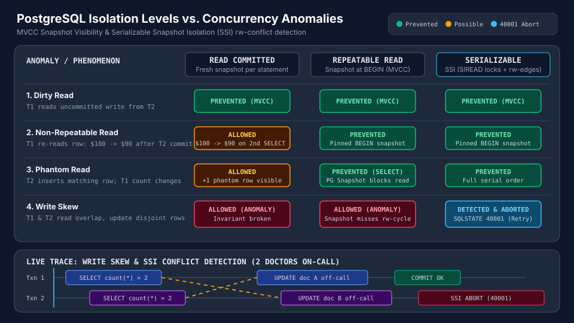

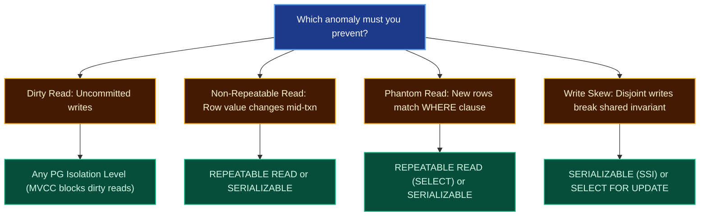

### Dirty Read

Transaction reads uncommitted changes from another transaction.

```sql
-- Session 1
BEGIN;
UPDATE accounts SET balance = -1000 WHERE id = 1;
-- (Invalid state, would violate constraint)

-- Session 2 (READ UNCOMMITTED)
SELECT balance FROM accounts WHERE id = 1;  -- -1000 (uncommitted!)

-- Session 1
ROLLBACK;  -- Oops, invalid!

-- Session 2 saw data that never really existed (dirty read)
```

- **PostgreSQL:** Prevents dirty reads (even in `READ UNCOMMITTED`).

### Non-Repeatable Read

Same row returns different values within the same transaction.

```sql
-- Session 1 (READ COMMITTED)
BEGIN;
SELECT salary FROM employees WHERE id = 1;  -- 50000

-- Session 2
UPDATE employees SET salary = 55000 WHERE id = 1;
COMMIT;

-- Session 1
SELECT salary FROM employees WHERE id = 1;  -- 55000 (changed!)
-- Same query, different result (non-repeatable read)
```

- **PostgreSQL:** Allowed in `READ COMMITTED`, prevented in `REPEATABLE READ`.

### Phantom Read

New rows appear that match the transaction's `WHERE` clause.

```sql
-- Session 1 (REPEATABLE READ)
BEGIN;
SELECT COUNT(*) FROM orders WHERE status = 'pending';  -- 100

-- Session 2
INSERT INTO orders (status) VALUES ('pending');
INSERT INTO orders (status) VALUES ('pending');
COMMIT;

-- Session 1 (REPEATABLE READ)
SELECT COUNT(*) FROM orders WHERE status = 'pending';  -- Still 100 (old snapshot)

-- But if Session 1 tries to update:
UPDATE orders SET priority = 1 WHERE status = 'pending';
-- Updated 102 rows! (including Session 2's inserts)
-- This is phantom read (rows appeared)
```

- **PostgreSQL:** Prevents on `SELECT` with consistent snapshot (note: `UPDATE`/`DELETE` in `REPEATABLE READ` will fail with a serialization error if modifying a row updated by a concurrent committed txn, or see newly inserted rows depending on predicate).

### Write Skew & Serialization Anomaly

Two concurrent transactions read an overlapping dataset, make decisions based on what they read, and update **disjoint** rows—violating an application invariant even under `REPEATABLE READ` (Snapshot Isolation).

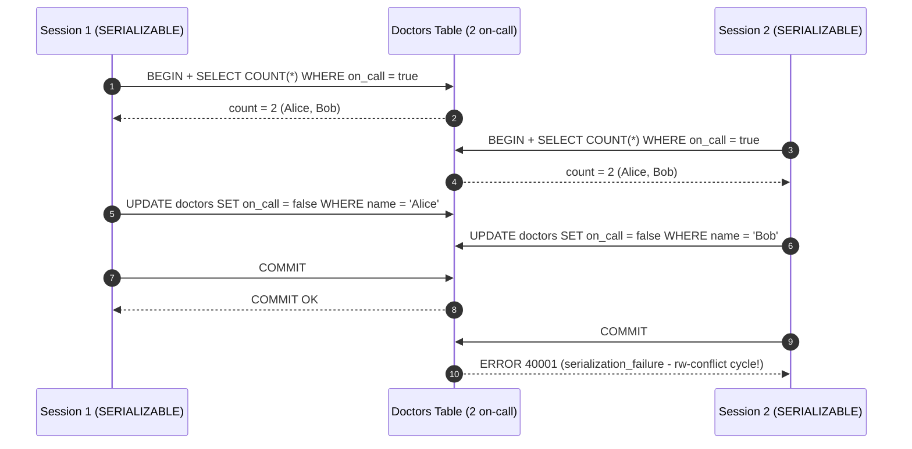

```sql
-- Write Skew Example 1: On-Call Doctors (Invariant: >= 1 doctor must remain on call)
-- Under REPEATABLE READ: BOTH commit -> 0 doctors on call!
-- Under SERIALIZABLE: Session 2 fails with SQLSTATE 40001.

-- Session 1 (SERIALIZABLE)
BEGIN ISOLATION LEVEL SERIALIZABLE;
SELECT COUNT(*) FROM doctors WHERE on_call = true;  -- 2 (safe to leave)
UPDATE doctors SET on_call = false WHERE name = 'Alice';

-- Session 2 (SERIALIZABLE)
BEGIN ISOLATION LEVEL SERIALIZABLE;
SELECT COUNT(*) FROM doctors WHERE on_call = true;  -- 2 (safe to leave)
UPDATE doctors SET on_call = false WHERE name = 'Bob';

-- Session 1 commits first
COMMIT;  -- OK

-- Session 2 attempts commit
COMMIT;  -- ERROR: could not serialize access due to read/write dependencies (40001)
```

```sql
-- Write Skew / Serialization Anomaly Example 2: Checking + Savings Total
-- Session 1 (SERIALIZABLE)
BEGIN;
SELECT SUM(balance) FROM accounts;  -- 10000

-- Session 2 (SERIALIZABLE)
BEGIN;
UPDATE accounts SET balance = balance * 1.1 WHERE account_type = 'checking';
COMMIT;

-- Session 1
UPDATE accounts SET balance = balance / 0.99 WHERE account_type = 'savings';
COMMIT;  -- ERROR: serialization_failure

-- If both committed: financial calculations would be inconsistent
-- PostgreSQL detects and rejects Session 1
```

> [!WARNING]
> `REPEATABLE READ` does **not** prevent Write Skew because Snapshot Isolation only checks for write-write conflicts on the *same* row. Use `SERIALIZABLE` (with retry on `40001`) or explicit row locking (`SELECT ... FOR UPDATE`) when invariants span multiple rows.

---

## PostgreSQL Locking

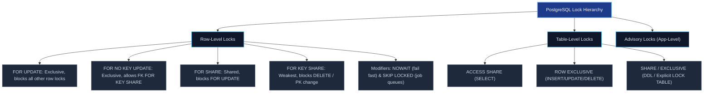

### Row-Level Locks

```sql
-- FOR UPDATE: Exclusive lock (no other transaction can read with FOR UPDATE)
SELECT * FROM employees WHERE id = 1 FOR UPDATE;
-- Blocks other transactions trying: FOR UPDATE, FOR NO KEY UPDATE

-- FOR NO KEY UPDATE: Exclusive, but allows foreign key lookups
SELECT * FROM employees WHERE id = 1 FOR NO KEY UPDATE;

-- FOR SHARE: Shared lock (multiple transactions can hold)
SELECT * FROM employees WHERE id = 1 FOR SHARE;
-- Blocks FOR UPDATE, but multiple FOR SHARE OK

-- FOR KEY SHARE: Shared, but FOR UPDATE still blocked
SELECT * FROM employees WHERE id = 1 FOR KEY SHARE;
```

### Locking in Transactions (Read-Modify-Write)

```sql
-- Pattern: Read-modify-write safely
BEGIN;
SELECT * FROM accounts WHERE id = 1 FOR UPDATE;
-- Row is locked, cannot be modified by others

-- Do calculations
-- Process in application

-- Write
UPDATE accounts SET balance = 1500 WHERE id = 1;
COMMIT;
-- Lock released
```

### `NOWAIT` and `SKIP LOCKED`

```mermaid
sequenceDiagram
    autonumber
    participant W1 as Worker 1
    participant DB as jobs Table (Rows 1..20)
    participant W2 as Worker 2

    W1->>DB: SELECT * FROM jobs WHERE status='pending' FOR UPDATE SKIP LOCKED LIMIT 10
    DB-->>W1: Locks &amp; returns Jobs 1..10
    W2->>DB: SELECT * FROM jobs WHERE status='pending' FOR UPDATE SKIP LOCKED LIMIT 10
    DB-->>W2: Skips locked 1..10, locks &amp; returns Jobs 11..20
    Note over W1,W2: Zero blocking, zero duplicate processing!
```

```sql
-- NOWAIT: Fail immediately if row locked
SELECT * FROM jobs WHERE id = 1 FOR UPDATE NOWAIT;
-- ERROR: could not obtain lock immediately

-- SKIP LOCKED: Skip locked rows (useful for queue processing)
SELECT * FROM jobs WHERE status = 'pending' FOR UPDATE SKIP LOCKED LIMIT 10;
-- Returns up to 10 unlocked pending jobs
-- (Perfect for job queue: multiple workers grab different jobs)
```

### Table-Level Locks

PostgreSQL acquires table locks automatically, or you can request them explicitly:

```sql
-- ACCESS SHARE: Concurrent reads
SELECT ... FROM table_name;

-- ROW SHARE: Intent to read rows (FOR SHARE)
SELECT ... FOR SHARE;

-- ROW EXCLUSIVE: Intent to modify rows (FOR UPDATE)
SELECT ... FOR UPDATE;

-- SHARE: Concurrent SHAREs, blocks exclusives
LOCK TABLE table_name IN SHARE MODE;

-- EXCLUSIVE: Blocks all access
LOCK TABLE table_name IN EXCLUSIVE MODE;
-- EXCLUSIVE blocks even reads (except ACCESS SHARE in some modes; ACCESS EXCLUSIVE blocks everything)
```

### Advisory Locks (Application-Level Locking)

```sql
-- Explicit application-level locks (not tied to rows)
SELECT pg_advisory_lock(123);
-- Acquire lock on resource ID 123 (any int/bigint)
-- Other sessions blocked on pg_advisory_lock(123)

-- Do critical work
UPDATE accounts SET balance = balance - 100 WHERE id = 123;
UPDATE accounts SET balance = balance + 100 WHERE id = 456;

-- Release lock
SELECT pg_advisory_unlock(123);

-- Useful for:
-- - Distributed locks across multiple services sharing Postgres
-- - Complex business logic requiring app-level locking
-- - Coordination between batch jobs (e.g., pg_try_advisory_lock)
```

> [!TIP]
> Prefer `pg_advisory_xact_lock(key)` inside transactions—it automatically releases on `COMMIT` or `ROLLBACK`, preventing leaked locks if a connection crashes or forgets to unlock.

---

## Deadlock Detection and Prevention

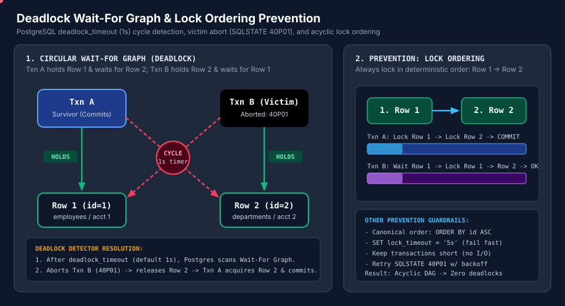

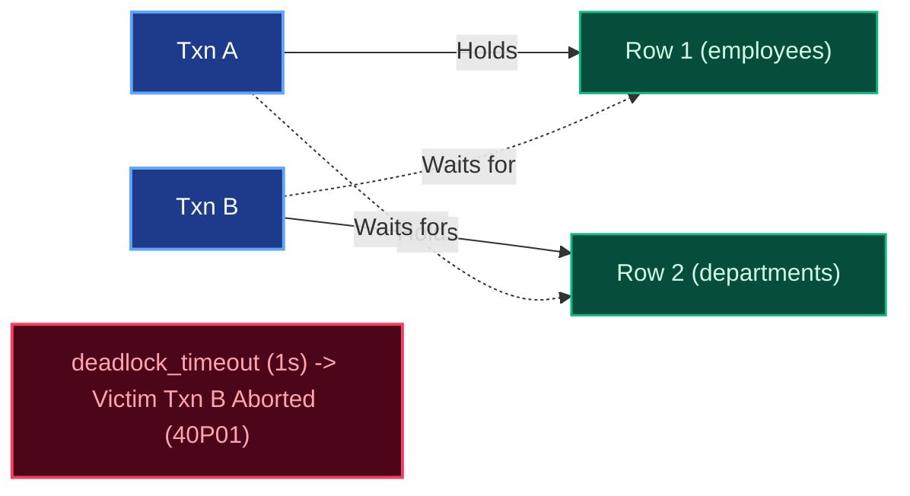

### What is a Deadlock?

```sql
-- Session 1
BEGIN;
SELECT * FROM employees WHERE id = 1 FOR UPDATE;
-- Holds lock on employees row 1

-- Session 2
BEGIN;
SELECT * FROM departments WHERE id = 1 FOR UPDATE;
-- Holds lock on departments row 1

-- Back to Session 1
SELECT * FROM departments WHERE id = 1 FOR UPDATE;
-- Blocked! Waiting for Session 2 to release departments row 1

-- Session 2
SELECT * FROM employees WHERE id = 1 FOR UPDATE;
-- DEADLOCK! Waiting for Session 1 to release employees row 1

-- PostgreSQL detects cycle after deadlock_timeout (1s) and kills one transaction:
-- ERROR: deadlock detected (SQLSTATE 40P01)
```

### Deadlock Prevention Strategies

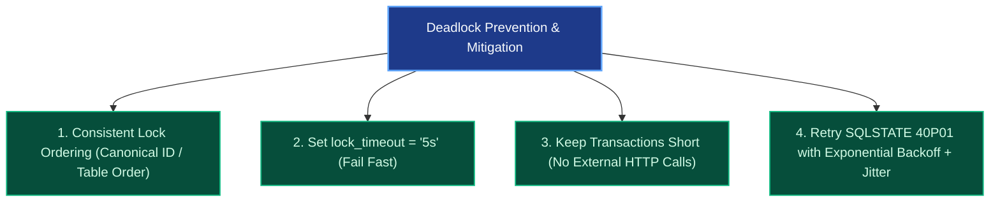

```sql
-- 1. Always lock tables/rows in SAME ORDER
-- Session 1
BEGIN;
SELECT * FROM employees WHERE id = 1 FOR UPDATE;
SELECT * FROM departments WHERE id = 1 FOR UPDATE;
COMMIT;

-- Session 2
BEGIN;
SELECT * FROM employees WHERE id = 2 FOR UPDATE;
SELECT * FROM departments WHERE id = 1 FOR UPDATE;
COMMIT;
-- No deadlock: both go employees first, then departments

-- 2. Use timeouts
SET lock_timeout = '5 seconds';
BEGIN;
SELECT * FROM accounts WHERE id = 1 FOR UPDATE;
-- If waited > 5s, ERROR: canceling statement due to lock timeout

-- 3. Short transactions
-- Long transactions hold locks longer, increase deadlock probability
-- Break into smaller transactions if possible
```

```java
// 4. Catch deadlock, retry with exponential backoff + jitter
int maxRetries = 3;
for (int i = 0; i < maxRetries; i++) {
    try {
        executeTransaction();
        return;
    } catch (PSQLException e) {
        if ("40P01".equals(e.getSQLState()) && i < maxRetries - 1) {  // Deadlock
            Thread.sleep((long) (Math.pow(2, i) * 100 + Math.random() * 100));
        } else {
            throw e;
        }
    }
}
```

> [!IMPORTANT]
> When locking multiple rows in the same table (e.g., transferring between `account_a` and `account_b`), always sort IDs (`Math.min(fromId, toId)` first, then `Math.max(fromId, toId)`) or use `WHERE id IN (...) ORDER BY id FOR UPDATE` to guarantee an acyclic lock graph.

---

## Optimistic vs Pessimistic Locking

```mermaid
sequenceDiagram
    autonumber
    participant T1 as Txn 1
    participant DB as Database (version=5)
    participant T2 as Txn 2

    Note over T1,T2: Optimistic Locking (Check at COMMIT)
    T1->>DB: SELECT balance, version FROM accounts WHERE id=1
    DB-->>T1: balance=100, version=5
    T2->>DB: SELECT balance, version FROM accounts WHERE id=1
    DB-->>T2: balance=100, version=5
    T1->>DB: UPDATE accounts SET balance=90, version=6 WHERE id=1 AND version=5
    DB-->>T1: 1 row updated (COMMIT OK)
    T2->>DB: UPDATE accounts SET balance=80, version=6 WHERE id=1 AND version=5
    DB-->>T2: 0 rows updated -&gt; OptimisticLockException (Retry)
```

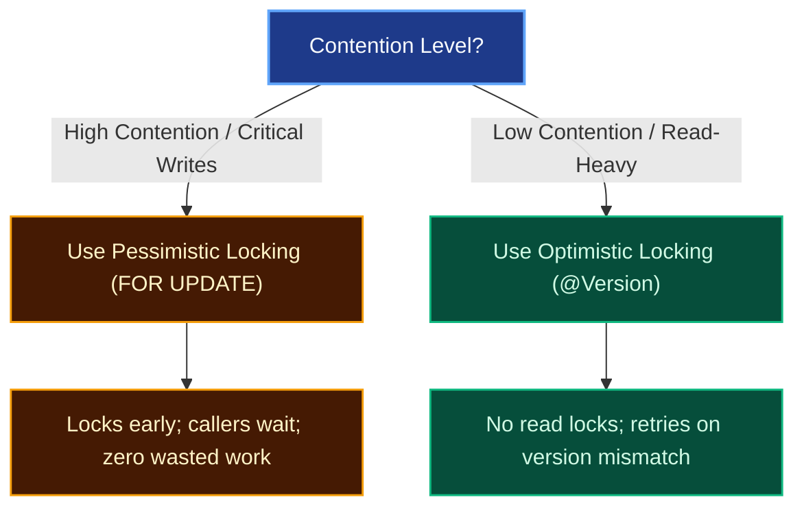

### Pessimistic Locking (Lock Early)

```java
// Assume conflicts likely, lock immediately
public class BankTransfer {
    public void transfer(int fromId, int toId, BigDecimal amount) {
        em.getTransaction().begin();

        // Lock early (always order IDs in production to prevent deadlocks)
        Account from = em.find(Account.class, fromId, LockModeType.PESSIMISTIC_WRITE);
        Account to = em.find(Account.class, toId, LockModeType.PESSIMISTIC_WRITE);

        // Guaranteed no other transaction can modify
        from.setBalance(from.getBalance().subtract(amount));
        to.setBalance(to.getBalance().add(amount));

        em.getTransaction().commit();
        // Locks released
    }
}
```

```sql
-- Equivalent SQL:
SELECT * FROM accounts WHERE id = 1 FOR UPDATE;
```

- **Use When:** High contention (many concurrent transactions), data consistency is critical, and waiting is preferable to retrying.

### Optimistic Locking (Check on Update)

```java
// Assume conflicts rare, use version/timestamp
@Entity
class Account {
    @Id
    private int id;
    private BigDecimal balance;

    @Version  // Optimistic lock column
    private int version;  // Incremented on each update
}

public class BankTransfer {
    public void transfer(int fromId, int toId, BigDecimal amount) {
        // Read (no lock)
        Account from = em.find(Account.class, fromId);
        Account to = em.find(Account.class, toId);

        // Version: from.version=5, to.version=3

        // Modify
        from.setBalance(from.getBalance().subtract(amount));
        to.setBalance(to.getBalance().add(amount));

        // Update (checks version)
        em.getTransaction().begin();
        try {
            em.merge(from);  // UPDATE ... WHERE id=1 AND version=5
            em.merge(to);    // UPDATE ... WHERE id=2 AND version=3
            em.getTransaction().commit();
        } catch (OptimisticLockException e) {
            // Version mismatch! Another transaction modified
            em.getTransaction().rollback();
            // Retry transaction
            transfer(fromId, toId, amount);
        }
    }
}
```

```sql
-- Equivalent SQL:
UPDATE accounts SET balance = 200, version = 6 WHERE id = 1 AND version = 5;
-- If row updated by another transaction: 0 rows affected -> OptimisticLockException
```

- **Use When:** Low contention, many read operations, and occasional retries are acceptable.

### Interview Comparison

| Aspect | Pessimistic | Optimistic |
|---|---|---|
| **Lock Duration** | Long (held during transaction) | Short (checked on update) |
| **Throughput** | Lower under low contention (waits) | Higher under low contention (no read waits) |
| **High Contention** | Handles well (serializes access) | Can thrash (repeated retries) |
| **Implementation** | Manage lock ordering & timeouts | Simple (`@Version` column + retry) |
| **Good For** | Financial transfers, hot inventory SKUs | Social media, user profiles, analytics |

---

## Two-Phase Commit (2PC) & Distributed Saga Patterns

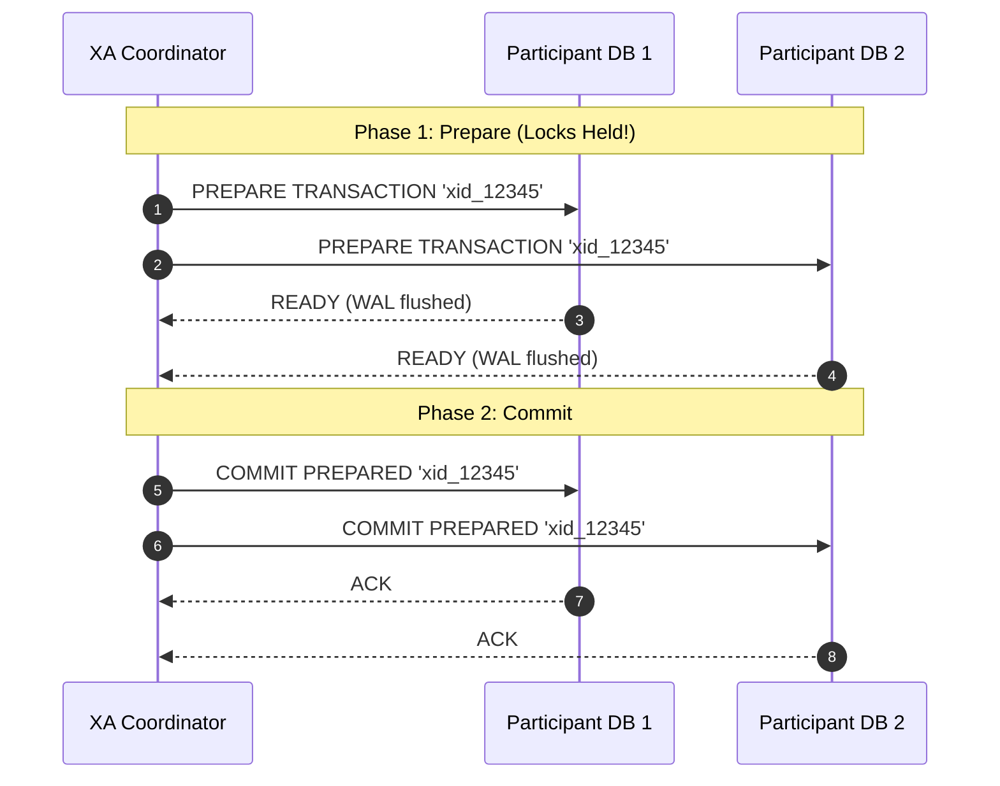

### Two-Phase Commit (2PC)

Coordinate atomic commits across multiple databases.

```sql
-- Coordinator (XA Transaction Manager)

-- Phase 1: Prepare
PREPARE TRANSACTION 'xid_12345';
-- All participants flush to log, respond "ready"

-- Phase 2: Commit
COMMIT PREPARED 'xid_12345';
-- All participants commit

-- Or rollback:
ROLLBACK PREPARED 'xid_12345';
-- All participants rollback
```

```java
// Using Atomikos or Narayana XA Transaction Manager
@Transactional(Transactional.TxType.REQUIRED)
public void transferAcrossDBs(int accountAId, int accountBId, BigDecimal amount) {
    // DataSource1 and DataSource2 are XA-enabled

    // Transaction automatically coordinated:
    // 1. Prepare phase: Both databases prepared
    // 2. Commit phase: Both databases committed or both rolled back

    // SQL on Database 1
    accountA.setBalance(accountA.getBalance().subtract(amount));

    // SQL on Database 2
    accountB.setBalance(accountB.getBalance().add(amount));

    // Automatic commit coordinates both
}
```

- **Problems with 2PC:**
  - **Slow:** Two rounds of synchronous network communication.
  - **Blocking:** Participants hold row locks while waiting in the prepared state.
  - **Coordinator SPOF:** If the coordinator crashes after `PREPARE`, participants remain stuck in-doubt until recovery.
  - **Rarely used in microservices:** Prefer eventual consistency with Sagas.

### Distributed Saga Pattern (Modern Alternative)

A **Saga** breaks a distributed transaction into a sequence of local ACID transactions. If step $k$ fails, **compensating transactions** undo steps $k-1 \dots 1$ in reverse order.

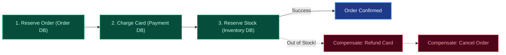

| Aspect | Two-Phase Commit (2PC) | Saga Pattern |
|---|---|---|
| **Consistency** | Strong (Atomic across DBs) | Eventual (ACD per local step; no global I) |
| **Locking** | Locks held across network round-trips | No cross-service locks; local commits immediately |
| **Failure Recovery** | Coordinator rollback | Compensating transactions (`Refund`, `Cancel`) |
| **Styles** | Coordinator + XA Participants | **Choreography** (events) or **Orchestration** (central state machine) |
| **Best For** | Monolith / tightly coupled XA DBs | Microservices, payment + order + shipping flows |

> [!WARNING]
> Because Sagas lack **Isolation (I)** between steps, intermediate states (e.g., `ORDER_PENDING`) are visible to other users. Always design compensating actions to be **idempotent** and use semantic locks (e.g., `status = 'RESERVING'`) to guard against concurrent anomalies.

---

## Savepoints and Nested Transactions

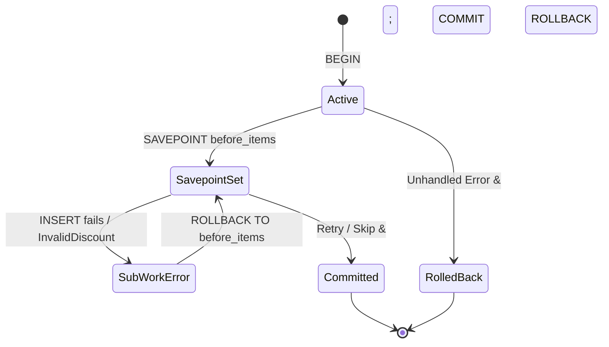

### Savepoints (Partial Rollback)

```sql
BEGIN;
  INSERT INTO orders (customer_id, amount) VALUES (1, 100);
  SAVEPOINT before_items;

  INSERT INTO order_items (order_id, item_id, qty) VALUES (1, 5, 2);
  -- Oops, item doesn't exist!
  -- ROLLBACK to savepoint, not entire transaction

  ROLLBACK TO before_items;
  -- order_items rolled back, order still exists

  INSERT INTO order_items (order_id, item_id, qty) VALUES (1, 6, 3);
COMMIT;
-- Transaction contains 1 order + 1 item
```

### Nested Transactions with Exception Handling

```java
public void complexTransaction() {
    em.getTransaction().begin();

    try {
        // Main work
        Order order = createOrder(customerId);

        try {
            // Risky sub-work (e.g. Spring @Transactional(propagation = Propagation.NESTED) uses SAVEPOINT)
            applyDiscount(order, discountCode);
        } catch (InvalidDiscountException e) {
            // Rollback discount only, continue with order
            // Internally uses SAVEPOINT / ROLLBACK TO
            em.getTransaction().rollback();
            em.getTransaction().begin();
            // Order still exists, discount not applied
        }

        em.getTransaction().commit();
    } catch (Exception e) {
        em.getTransaction().rollback();
    }
}
```

> [!TIP]
> Avoid creating thousands of `SAVEPOINT`s in a tight loop in PostgreSQL—each savepoint allocates a subtransaction ID (`subxid`). Exceeding 64 active subtransactions per backend spills to disk (`pg_subtrans`) and can severely degrade throughput.

---

## Long-Running Transaction Problems and Solutions

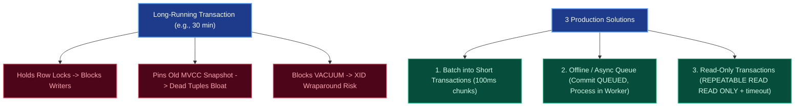

### Problems

```sql
-- Long transaction holds locks
BEGIN;
SELECT * FROM accounts WHERE id = 1 FOR UPDATE;
-- ... 30 minutes of business logic ...
COMMIT;

-- Problems:
-- 1. Row locked for 30 minutes
-- 2. Other transactions waiting
-- 3. MVCC keeps old versions (bloats storage)
-- 4. Vacuum can't remove old versions (transaction still open)
-- 5. Clog/xid wraparound risk
```

### Solution 1: Batch Into Smaller Transactions

```java
public void processManyOrders() {
    for (Order order : orders) {
        em.getTransaction().begin();
        try {
            processOrder(order);  // Quick transaction
            em.getTransaction().commit();
        } catch (Exception e) {
            em.getTransaction().rollback();
        }
    }
}

// SQL:
// BEGIN; ... UPDATE order SET status='processed'; COMMIT;  (100ms)
// BEGIN; ... UPDATE order SET status='processed'; COMMIT;  (100ms)
// vs
// BEGIN; ... all updates ... COMMIT;  (10+ seconds holding locks)
```

### Solution 2: Offline Processing + Async

```java
// Instead of blocking, queue work
public void handleOrderRequest(Order order) {
    // Quick: save order, queue for processing
    order.setStatus("QUEUED");
    em.persist(order);
    em.getTransaction().commit();  // Quick!

    // Async worker processes
    messageQueue.send(new ProcessOrderMessage(order.id));
}

// Separate consumer
@MessageDriven
public void processOrder(ProcessOrderMessage msg) {
    Order order = em.find(Order.class, msg.orderId);
    // Long-running work in background
    em.getTransaction().begin();
    // ... heavy processing ...
    em.getTransaction().commit();
}
```

### Solution 3: Read-Only Transactions

```java
@Transactional(readOnly = true, timeout = 30)
public OrderReport generateReport() {
    // Read-only: no locks, can run long without blocking others
    // timeout: 30 seconds max
    return buildComplexReport();
}
```

```sql
-- SQL:
SET TRANSACTION ISOLATION LEVEL REPEATABLE READ READ ONLY;
-- No row locks acquired, consistent snapshot
```

> [!WARNING]
> Always set `idle_in_transaction_session_timeout` (e.g., `60s`) in PostgreSQL so crashed or buggy clients cannot leave transactions open indefinitely and stall `AUTOVACUUM`.

---

## Connection Pooling and Transaction Management


### Transaction Per Request Pattern (Web Apps)

```java
@WebFilter("/*")
public class TransactionFilter extends HttpFilter {
    @Inject
    EntityManager em;

    @Override
    protected void doFilter(HttpRequest req, HttpResponse res, FilterChain chain) {
        em.getTransaction().begin();
        try {
            chain.doFilter(req, res);
            em.getTransaction().commit();
        } catch (Exception e) {
            em.getTransaction().rollback();
            throw e;
        }
    }
}

// Per HTTP request: 1 transaction, 1 database connection
// From pool: acquire connection, associate with transaction
// Response sent: commit (or rollback), return connection to pool
```

### Connection Pooling Configuration (HikariCP)

```java
HikariConfig config = new HikariConfig();
config.setJdbcUrl("jdbc:postgresql://localhost/mydb");
config.setUsername("user");
config.setPassword("pass");
config.setMaximumPoolSize(20);              // Max concurrent connections
config.setMinimumIdle(5);                   // Keep-alive connections
config.setConnectionTimeout(30000);         // Wait 30s for available connection
config.setIdleTimeout(600000);              // Close connection after 10min idle
config.setMaxLifetime(1800000);             // Max 30 min per connection
config.setAutoCommit(false);                // Manual transaction control

HikariDataSource ds = new HikariDataSource(config);

// Usage:
Connection conn = ds.getConnection();  // Borrow from pool
try {
    // Execute SQL
} finally {
    conn.close();  // Return to pool
}
```

> [!TIP]
> **Interview Tip:** With 100 concurrent users, 20 database connections are often sufficient. Each user's request borrows one connection (avg ~100ms), executes SQL, and returns it. Keeping `minimumIdle = 5` prevents TCP/TLS connection churn. Formula of thumb: `connections = (core_count * 2) + effective_spindle_count`.

---

## Common Interview Scenarios

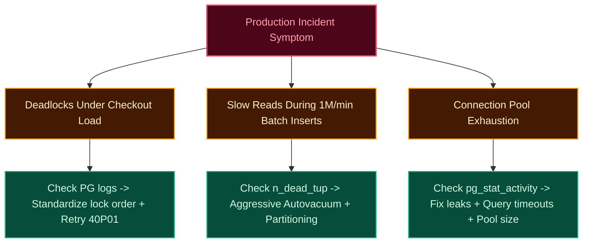

### Scenario 1: "Database Deadlock Under Load"

**Question:** *"Your e-commerce system deadlocks during checkout. How do you debug?"*

1. **Check PostgreSQL logs** for deadlock messages:
   - Find the victim transaction and lock holder.
   - Identify which queries and tables are involved.
2. **Reproduce** with a concurrent stress test to confirm the lock acquisition pattern.
3. **Common causes:**
   - Locking tables/rows in different order across endpoints.
   - Holding too many locks in a single long transaction.
   - Background batch jobs locking rows while user checkouts also lock them.
4. **Solutions:**
   - Standardize lock order across the application.
   - Use `NOWAIT` / `SKIP LOCKED` for worker queues.
   - Break work into smaller transactions.
   - Implement exponential backoff retry on `40P01`.

```java
int maxRetries = 3;
for (int i = 0; i < maxRetries; i++) {
    try {
        checkout(orderId);
        return;
    } catch (DeadlockException e) {
        if (i == maxRetries - 1) throw e;
        Thread.sleep((long) Math.pow(2, i) * 100);  // Exponential backoff
    }
}
```

### Scenario 2: "Slow Writes Under Concurrent Reads"

**Question:** *"Batch inserts (1M/min) are causing read queries to slow down. Why?"*

1. **Root Cause (MVCC Overhead):**
   - Each insert/update creates a new row version (`xmin`/`xmax`).
   - Concurrent reads must check tuple visibility across many versions.
   - **Vacuum lag:** Dead tuples accumulate, bloating heap pages and indexes.
2. **Check statistics:**

```sql
SELECT relname, n_live_tup, n_dead_tup, last_autovacuum
FROM pg_stat_user_tables
WHERE n_dead_tup > 1000;
```

3. **Solutions:**
   - **Aggressive autovacuum** on high-churn tables:

```sql
ALTER TABLE high_churn_table SET (
    autovacuum_vacuum_scale_factor = 0.01,
    autovacuum_vacuum_threshold = 100
);
```

   - **Partition inserts and reads:** `INSERT` into staging/current partition -> `UNION` or roll over for analytical reads.
   - **Multiple writers (sharding/hash partitioning):** `hash(id) % 10` across 10 partitions reduces index/page contention.
4. **Verify with `EXPLAIN (ANALYZE, BUFFERS)`:** Check `heap_blks_read` / `Heap Fetches`—high ratios indicate visibility checks across bloated pages.

### Scenario 3: "Connection Pool Exhaustion"

**Question:** *"Intermittent failures: 'Cannot get a connection. Waited X seconds.'"*

1. **Diagnosis:**
   - Check HikariCP pool utilization metrics (`active`, `idle`, `pending`).
   - Query PostgreSQL active sessions: `SELECT count(*) FROM pg_stat_activity;`
   - Look for long-running queries holding connections:

```sql
SELECT pid, state, now() - query_start AS duration, query
FROM pg_stat_activity
WHERE state = 'active'
ORDER BY query_start;
```

2. **Root causes:**
   - Slow queries not releasing connections quickly.
   - Code not closing connections (missing `try-with-resources` or `try-finally conn.close()`).
   - Pool max size too small for peak concurrency, or DB `max_connections` saturated.
3. **Solutions:**
   - Set statement/query timeouts (`statement_timeout`).
   - Fix slow queries and add missing indexes.
   - Enable HikariCP connection leak detection:

```java
HikariConfig config = new HikariConfig();
config.setMaximumPoolSize(30);              // Increase within DB limits
config.setLeakDetectionThreshold(15000);    // 15s leak alert in logs
```

> [!IMPORTANT]
> Increasing `maximumPoolSize` blindly without checking PostgreSQL's `max_connections` and CPU cores can **worsen** latency due to context-switching and lock contention—always pair pool tuning with `pg_stat_activity` analysis and PgBouncer if scaling to thousands of app instances.
