# Database Design and Normalization

A visual, interview-ready guide to relational modeling, normalization (1NF–BCNF), strategic denormalization, schema migrations, horizontal sharding, consistent hashing, replication, CAP theorem trade-offs, and production database design.

---

## Table of Contents

- [Normal Forms (1NF Through BCNF)](#normal-forms-1nf-through-bcnf)
- [When to Denormalize (Real-World Trade-Offs)](#when-to-denormalize-real-world-trade-offs)
- [Entity-Relationship (ER) Modeling](#entity-relationship-er-modeling)
- [Primary Keys: Natural vs Surrogate](#primary-keys-natural-vs-surrogate)
- [Foreign Keys and Cascading Actions](#foreign-keys-and-cascading-actions)
- [Database Design Patterns](#database-design-patterns)
- [Schema Migration Strategies](#schema-migration-strategies)
- [Sharding (Horizontal Partitioning)](#sharding-horizontal-partitioning)
- [Replication](#replication)
- [CAP Theorem and Implications](#cap-theorem-and-implications)
- [Database Design Interview Exercises](#database-design-interview-exercises)

---

## Normal Forms (1NF Through BCNF)

Normalization is the process of organizing data to minimize redundancy and improve data integrity by eliminating insertion, update, and deletion anomalies.


### 1NF (First Normal Form)

**Definition:** Remove repeating groups. Each cell contains only atomic (indivisible) values.

**Before 1NF (Violates):**
```
employees table:
┌────────────────────────────────────────┐
│ emp_id │ name  │ phone_numbers        │
├────────────────────────────────────────┤
│ 1      │ Alice │ 555-1234, 555-5678   │ ← Repeating group
│ 2      │ Bob   │ 555-9999             │
└────────────────────────────────────────┘

Problem: phone_numbers is repeating group (could be 0 to N values)
```

**After 1NF:**
```
employees table:
┌────────────────────────────────────┐
│ emp_id │ name  │ phone_number       │
├────────────────────────────────────┤
│ 1      │ Alice │ 555-1234           │
│ 1      │ Alice │ 555-5678           │ ← One row per phone
│ 2      │ Bob   │ 555-9999           │
└────────────────────────────────────┘

OR use array type (PostgreSQL):
┌────────────────────────────────────┐
│ emp_id │ name  │ phone_numbers[]    │
├────────────────────────────────────┤
│ 1      │ Alice │ {555-1234, 555-5678}
│ 2      │ Bob   │ {555-9999}         │
└────────────────────────────────────┘
```

**SQL:**
```sql
-- Alternative 1NF: Separate table for repeating data
CREATE TABLE employees (
    emp_id serial PRIMARY KEY,
    name text NOT NULL
);

CREATE TABLE phone_numbers (
    phone_id serial PRIMARY KEY,
    emp_id int REFERENCES employees(emp_id),
    phone_number text
);

INSERT INTO employees VALUES (1, 'Alice');
INSERT INTO phone_numbers VALUES (1, 1, '555-1234');
INSERT INTO phone_numbers VALUES (2, 1, '555-5678');
```

### 2NF (Second Normal Form)

**Definition:** In 1NF AND all non-key attributes fully depend on entire primary key (no partial dependencies).

**Before 2NF (Violates):**
```
student_courses table (Primary Key: student_id, course_id):
┌────────────────────────────────────────────────┐
│ student_id │ course_id │ student_name │ grade  │
├────────────────────────────────────────────────┤
│ 1          │ 101       │ Alice        │ A      │
│ 1          │ 102       │ Alice        │ B      │
│ 2          │ 101       │ Bob          │ C      │
└────────────────────────────────────────────────┘

Problem: student_name depends on student_id alone (not entire key)
- Partial dependency: student_name is determined by part of PK (student_id)
- Anomaly: Changing Alice's name requires changing 2+ rows
```

**After 2NF:**
```
students table:
┌──────────────────┐
│ student_id │ name│
├──────────────────┤
│ 1          │ Alice
│ 2          │ Bob
└──────────────────┘

student_courses table:
┌─────────────────────────────────┐
│ student_id │ course_id │ grade  │
├─────────────────────────────────┤
│ 1          │ 101       │ A      │
│ 1          │ 102       │ B      │
│ 2          │ 101       │ C      │
└─────────────────────────────────┘

All non-key attributes (name, grade) fully depend on their respective PKs
```

### 3NF (Third Normal Form)

**Definition:** In 2NF AND no transitive dependencies (non-key attributes don't depend on other non-key attributes).

**Before 3NF (Violates):**
```
employees table:
┌────────────────────────────────────┐
│ emp_id │ name  │ dept_id │ dept_name│
├────────────────────────────────────┤
│ 1      │ Alice │ 10      │ Sales    │
│ 2      │ Bob   │ 10      │ Sales    │
│ 3      │ Carol │ 20      │ Engineering│
└────────────────────────────────────┘

Problem: Transitive dependency
- emp_id → dept_id (functional dependency)
- dept_id → dept_name (functional dependency)
- Therefore: emp_id → dept_name (transitive)
- Anomaly: Update dept_name in one place, inconsistent in another
```

**After 3NF:**
```
employees table:
┌──────────────────┐
│ emp_id │ name   │ dept_id
├──────────────────┤
│ 1      │ Alice  │ 10
│ 2      │ Bob    │ 10
│ 3      │ Carol  │ 20
└──────────────────┘

departments table:
┌────────────────────┐
│ dept_id │ dept_name  │
├────────────────────┤
│ 10      │ Sales      │
│ 20      │ Engineering│
└────────────────────┘

No transitive dependencies
```

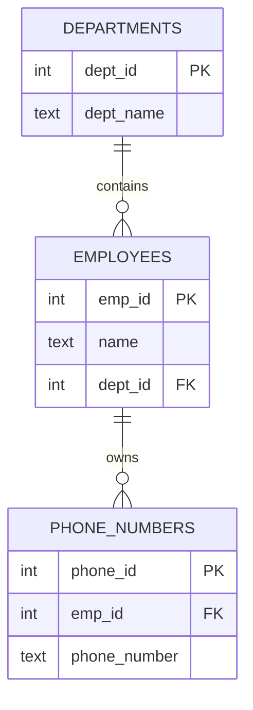

### BCNF (Boyce-Codd Normal Form)

**Definition:** Every determinant is a candidate key.

**Before BCNF (Violates):**
```
professor_courses table:
┌─────────────────────────────────┐
│ professor │ course  │ time_slot  │
├─────────────────────────────────┤
│ Dr. Smith │ CS101   │ 9:00 AM    │ ← Dr. Smith teaches CS101
│ Dr. Smith │ CS102   │ 9:00 AM    │ ← Only one prof per time!
│ Dr. Jones │ MATH101 │ 10:00 AM   │
└─────────────────────────────────┘

Primary Key: (professor, course)

Problem: time_slot is determined by professor alone (not entire key)
- Professor Dr. Smith cannot teach 2 courses at 9:00 AM
- Non-key attribute (time_slot) determines part of key
- Violates BCNF: time_slot is determinant but not a candidate key
```

**After BCNF:**
```
professor_time_slots table:
┌────────────────────────┐
│ professor │ time_slot  │
├────────────────────────┤
│ Dr. Smith │ 9:00 AM    │
│ Dr. Jones │ 10:00 AM   │
└────────────────────────┘

courses table:
┌────────────────────┐
│ course  │ time_slot  │
├────────────────────┤
│ CS101   │ 9:00 AM    │
│ CS102   │ 10:00 AM   │
│ MATH101 │ 10:00 AM   │
└────────────────────┘

Now: Every determinant is a candidate key
```

### Normalization Summary

| Form | Requirement | Prevents | Trade-off |
|------|-------------|----------|-----------|
| **1NF** | Atomic values only | Repeating groups | Multiple rows per entity |
| **2NF** | 1NF + no partial dependencies | Data redundancy | More joins |
| **3NF** | 2NF + no transitive dependencies | Update anomalies | More joins |
| **BCNF** | Every determinant is candidate key | Complex overlapping-key anomalies | Rare; most designs stop at 3NF |

> [!IMPORTANT]
> **The 3NF Sweet Spot:** Almost all production OLTP schemas target **3NF** (remembered as: *"every non-key column depends on the key, the whole key, and nothing but the key"*). Going beyond 3NF/BCNF often splits tightly coupled attributes across too many tables without practical benefit.

---

## When to Denormalize (Real-World Trade-Offs)

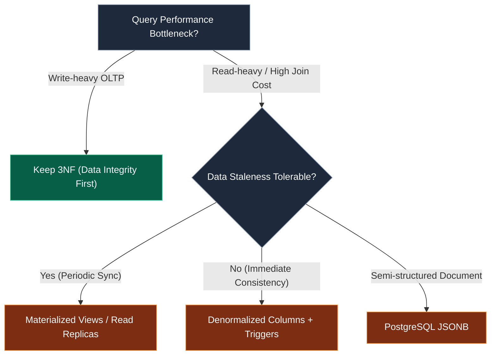

### Why Denormalize?

```sql
-- Normalized (3NF)
SELECT e.name, e.salary, d.dept_name, d.location
FROM employees e
JOIN departments d ON e.dept_id = d.id;

-- Requires join, slower on large tables

-- Denormalized (add dept_name, location to employees)
ALTER TABLE employees ADD COLUMN dept_name text;
ALTER TABLE employees ADD COLUMN location text;

SELECT name, salary, dept_name, location FROM employees;
-- Single table scan, faster, but data redundancy risk
```

### Denormalization Trade-Offs

| Dimension | Normalized (3NF) | Denormalized |
|-----------|------------------|--------------|
| **Read Speed** | Slower (requires multi-table joins) | Faster (single-table scan / index lookup) |
| **Write Speed** | Fast, single-row updates | Slower (must update redundant copies) |
| **Storage** | Minimal | Higher (duplicated values) |
| **Data Integrity** | Guaranteed by FK & constraints | Risk of update anomalies / drift |

### When Denormalization Makes Sense

**1. Read-Heavy Systems (Analytics, Cache)**

```sql
-- Create materialized view (denormalized snapshot)
CREATE MATERIALIZED VIEW employee_summary AS
SELECT
    e.emp_id, e.name, e.salary,
    d.dept_name, d.location,
    COUNT(a.id) AS assignment_count,
    SUM(a.budget) AS total_budget
FROM employees e
JOIN departments d ON e.dept_id = d.id
LEFT JOIN assignments a ON e.emp_id = a.emp_id
GROUP BY e.emp_id, e.name, e.salary, d.dept_name, d.location;

-- Refresh periodically
REFRESH MATERIALIZED VIEW employee_summary;

-- Query cached result
SELECT * FROM employee_summary WHERE dept_name = 'Sales';
-- No joins needed, instant response
```

**2. Frequent Aggregations**

```sql
-- Denormalize running totals
CREATE TABLE account_balances (
    account_id serial PRIMARY KEY,
    balance numeric,
    last_transaction_date timestamp,
    total_credits numeric,      -- Denormalized
    total_debits numeric        -- Denormalized
);

-- Query: Find high-value accounts
SELECT account_id, balance FROM account_balances
WHERE total_credits > 1000000;
-- No aggregation needed, instant response

-- Update on transaction insert (trigger maintains consistency)
CREATE TRIGGER update_balance AFTER INSERT ON transactions
FOR EACH ROW EXECUTE FUNCTION update_account_totals();
```

**3. JSON/Document Storage (Semi-Structured)**

```sql
-- Denormalize related data into JSONB
CREATE TABLE orders (
    id serial PRIMARY KEY,
    customer_data jsonb,  -- Denormalized customer info
    line_items jsonb[]    -- Denormalized order items
);

INSERT INTO orders VALUES (1,
    '{"name": "Alice", "email": "alice@example.com", "city": "SF"}',
    ARRAY[
        '{"product": "Widget", "qty": 2, "price": 10.00}',
        '{"product": "Gadget", "qty": 1, "price": 50.00}'
    ]
);

-- Query: Get customer's city and items in one SELECT
SELECT customer_data->>'city' AS city, line_items FROM orders
WHERE id = 1;
```

> [!WARNING]
> **Normalize First, Denormalize with Proof:** Never denormalize prematurely. Always start in 3NF and introduce materialized views, summary columns, or JSONB only after profiling proves join or aggregation bottlenecks.

---

## Entity-Relationship (ER) Modeling

ER modeling defines entities, their attributes, and the cardinality of relationships between them before writing DDL.

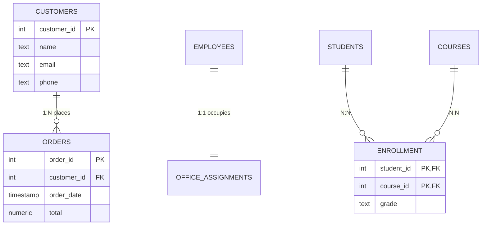

### Cardinality Types

| Cardinality | Meaning | Schema Implementation | Example |
|-------------|---------|----------------------|---------|
| **1:1** (One-to-One) | One row maps to at most one row | Foreign key + `UNIQUE` constraint on either table | `Employee` ↔ `OfficeAssignment` |
| **1:N** (One-to-Many) | Parent has many children | Foreign key placed on the "Many" (`N`) child table | `Customers` → `Orders` |
| **N:N** (Many-to-Many) | Both sides link to many of the other | Dedicated **junction table** with composite PK `(fk1, fk2)` | `Students` ↔ `Enrollment` ↔ `Courses` |

> [!TIP]
> **Junction Tables Carry Relationship State:** In an `N:N` relationship like `Students ↔ Courses`, attributes that describe the *relationship itself* (such as `grade` or `enrolled_at`) belong on the `Enrollment` junction table—not on `Students` or `Courses`.

---

## Primary Keys: Natural vs Surrogate

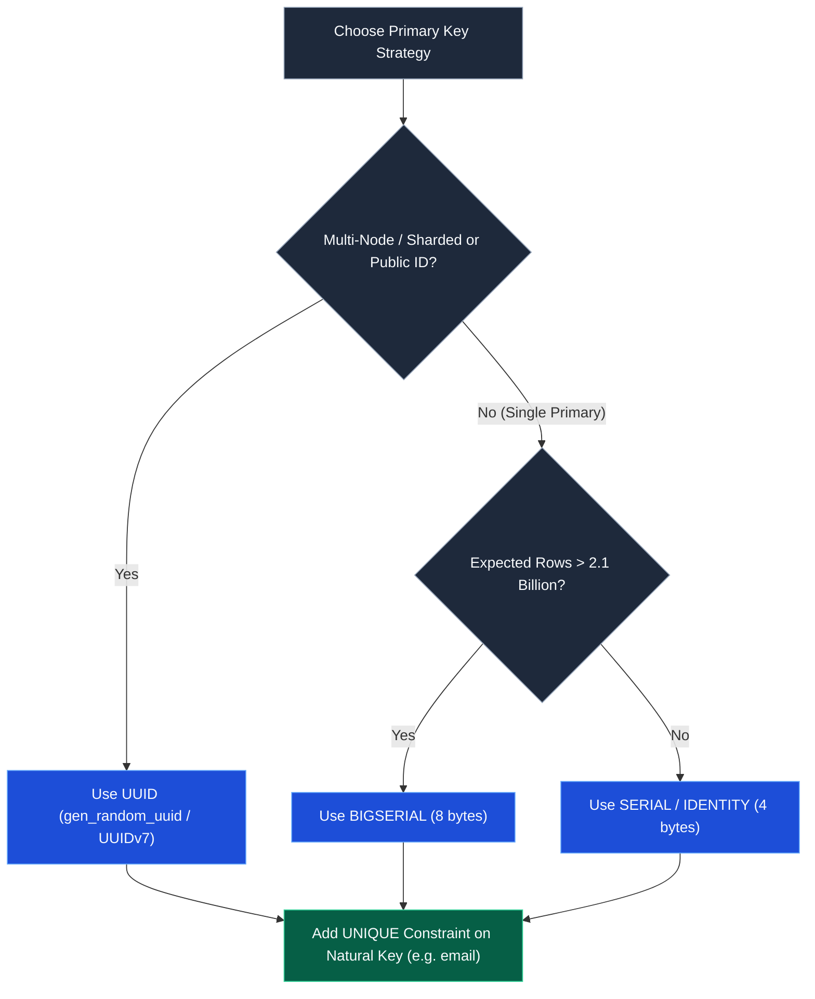

### Natural Keys (Domain-Meaningful)

```sql
-- Natural key: email is business-meaningful unique identifier
CREATE TABLE users (
    email text PRIMARY KEY,
    name text,
    created_at timestamp
);

-- Pros:
-- + Meaningful (email is unique by nature)
-- + No extra storage
-- Cons:
-- - Can change (email reassigned?)
-- - Longer foreign keys
-- - Joins slower (string vs int)
```

### Surrogate Keys (Auto-Generated ID)

```sql
-- Surrogate key: auto-incrementing integer
CREATE TABLE users (
    user_id serial PRIMARY KEY,
    email text UNIQUE NOT NULL,
    name text,
    created_at timestamp
);

-- Pros:
-- + Stable (never changes)
-- + Small (int = 4 bytes)
-- + Fast joins
-- Cons:
-- - Meaningless (user_id=12345 tells nothing)
-- - Extra storage per row
```

**Interview Answer:** *"Use surrogate keys (`serial`/`bigserial`/`uuid`) for primary keys, and natural keys (`email`) for `UNIQUE` constraints. Surrogate keys are faster for joins and never change when business attributes change."*

### UUID vs SERIAL / BIGSERIAL

| Key Type | Size | Scope | Pros | Cons |
|----------|------|-------|------|------|
| **SERIAL** | 4 bytes | 1 to 2.1B | Compact, fast B-Tree joins | Single-server sequence; 32-bit overflow risk |
| **BIGSERIAL** | 8 bytes | Up to 9.2 quintillion | Virtually inexhaustible, sequential inserts | Leaks row count if exposed publicly |
| **UUID** | 16 bytes | Globally unique | Distributed ID generation, sharding-friendly, opaque | Larger index footprint; random UUIDv4 causes B-Tree page splits |

```sql
-- SERIAL (auto-incrementing, 1 to 2.1 billion)
CREATE TABLE events (
    id serial PRIMARY KEY  -- 4 bytes
);

-- BIGSERIAL (auto-incrementing, huge range)
CREATE TABLE logs (
    id bigserial PRIMARY KEY  -- 8 bytes
);

-- UUID (globally unique, no sequence)
CREATE TABLE distributed_data (
    id uuid PRIMARY KEY DEFAULT gen_random_uuid()  -- 16 bytes
);
```

**When to use UUID:**
- Distributed systems (multiple servers generate IDs without coordination)
- Public IDs (expose in URLs without revealing total row counts)
- Sharded databases (avoid sequence collisions across shards)

> [!TIP]
> **UUIDv7 Over UUIDv4 for B-Trees:** Standard random `UUIDv4` (`gen_random_uuid()`) fragments B-Tree indexes because inserts land at random pages. Time-ordered **UUIDv7** preserves sequential insert locality while staying globally unique.

---

## Foreign Keys and Cascading Actions

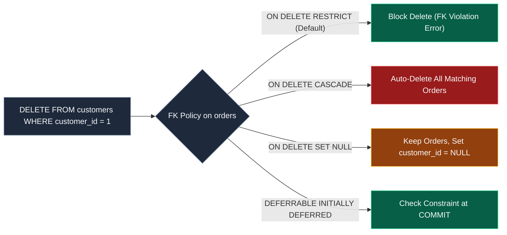

```sql
-- Without cascading actions (default RESTRICT behavior)
CREATE TABLE orders (
    order_id serial PRIMARY KEY,
    customer_id int REFERENCES customers(customer_id)
);

-- Try to delete customer with orders: ERROR
DELETE FROM customers WHERE customer_id = 1;
-- ERROR: update or delete on table "customers" violates foreign key constraint

-- WITH CASCADING ACTIONS

-- ON DELETE CASCADE: Delete orders when customer deleted
CREATE TABLE orders (
    order_id serial PRIMARY KEY,
    customer_id int REFERENCES customers(customer_id) ON DELETE CASCADE
);

DELETE FROM customers WHERE customer_id = 1;
-- Orders for customer 1 automatically deleted!

-- ON DELETE SET NULL: Set FK to NULL
CREATE TABLE orders (
    order_id serial PRIMARY KEY,
    customer_id int REFERENCES customers(customer_id) ON DELETE SET NULL
);

-- ON UPDATE CASCADE: Update FK when PK changes (rare)
CREATE TABLE orders (
    order_id serial PRIMARY KEY,
    customer_id int REFERENCES customers(customer_id) ON UPDATE CASCADE
);

-- ON DELETE RESTRICT: Prevent deletion (default, safest)
CREATE TABLE orders (
    order_id serial PRIMARY KEY,
    customer_id int REFERENCES customers(customer_id) ON DELETE RESTRICT
);
```

### Deferred Constraints

```sql
-- Check constraints at transaction end, not immediately
CREATE TABLE accounts (
    id serial PRIMARY KEY,
    account_type text,
    parent_id int REFERENCES accounts(id) DEFERRABLE INITIALLY DEFERRED
);

-- This would fail immediately with RESTRICT:
INSERT INTO accounts (account_type, parent_id) VALUES ('sub', 999);
-- ERROR: FK violation (parent 999 doesn't exist)

-- But with DEFERRABLE INITIALLY DEFERRED:
BEGIN;
INSERT INTO accounts (account_type, parent_id) VALUES ('sub', 999);
-- No error yet

INSERT INTO accounts (id, account_type) VALUES (999, 'parent');
-- Now parent exists

COMMIT;  -- All constraints checked and satisfied
```

> [!WARNING]
> **Beware `ON DELETE CASCADE` on Core Business Tables:** Deleting a single `customer` row with `ON DELETE CASCADE` can silently wipe millions of `orders`, `payments`, and audit records—holding long locks. Prefer `ON DELETE RESTRICT` combined with soft deletes (`deleted_at`) for financial or auditable entities.

---

## Database Design Patterns

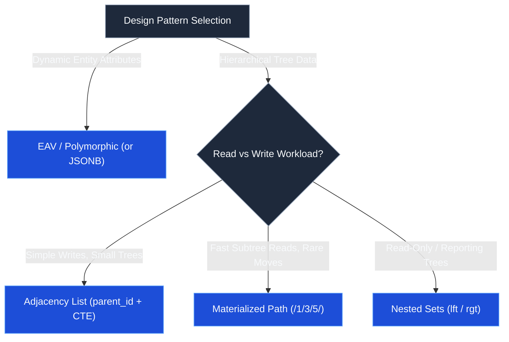

### 1. Polymorphic Associations (EAV Pattern)

Handling different object types without complex schema.

```sql
-- EAV (Entity-Attribute-Value) pattern:
CREATE TABLE entities (
    entity_id serial PRIMARY KEY,
    entity_type varchar(50),  -- 'employee', 'contractor', 'vendor'
    name text
);

CREATE TABLE attributes (
    attr_id serial PRIMARY KEY,
    entity_id int REFERENCES entities(entity_id),
    attr_name text,
    attr_value text
);

-- Insert employee
INSERT INTO entities VALUES (1, 'employee', 'Alice');
INSERT INTO attributes VALUES
    (1, 1, 'salary', '50000'),
    (2, 1, 'department', 'Sales');

-- Insert contractor
INSERT INTO entities VALUES (2, 'contractor', 'Bob');
INSERT INTO attributes VALUES
    (3, 2, 'hourly_rate', '100'),
    (4, 2, 'contract_duration', '6 months');

-- Query: Get all attributes for entity 1
SELECT attr_name, attr_value FROM attributes
WHERE entity_id = 1;

-- Downside: Complex queries, no schema validation
-- SELECT salary FROM employees WHERE employee_id = 1;  ← Impossible!
-- Must query attributes table and aggregate values
```

### 2. Adjacency List (Tree Hierarchy)

Each node points to parent (simple writes, requires recursive CTE for deep traversal).

```sql
CREATE TABLE categories (
    category_id serial PRIMARY KEY,
    name text,
    parent_id int REFERENCES categories(category_id)
);

-- Tree:
--     Root
--    / | \
--   A  B  C
--      |
--      D

INSERT INTO categories VALUES
    (1, 'Root', NULL),
    (2, 'A', 1),
    (3, 'B', 1),
    (4, 'C', 1),
    (5, 'D', 3);

-- Query: Get children of B (category_id=3)
SELECT * FROM categories WHERE parent_id = 3;
-- Result: D

-- Query: Get all descendants (recursive)
WITH RECURSIVE descendants AS (
    SELECT category_id, name, parent_id, 1 AS level
    FROM categories
    WHERE category_id = 3  -- Start at B

    UNION ALL

    SELECT c.category_id, c.name, c.parent_id, d.level + 1
    FROM categories c
    JOIN descendants d ON c.parent_id = d.category_id
)
SELECT * FROM descendants;
```

### 3. Materialized Path (Better for Trees)

Store full path in each node for fast `LIKE` prefix queries.

```sql
CREATE TABLE categories (
    category_id serial PRIMARY KEY,
    name text,
    path text  -- '/1/3/5/'
);

INSERT INTO categories VALUES
    (1, 'Root', '/1/'),
    (2, 'A', '/1/2/'),
    (3, 'B', '/1/3/'),
    (4, 'C', '/1/4/'),
    (5, 'D', '/1/3/5/');

-- Query: Get all descendants of B (path starts with '/1/3/')
SELECT * FROM categories WHERE path LIKE '/1/3/%';
-- Result: D (path='/1/3/5/')

-- Query: Get all ancestors of D
SELECT * FROM categories
WHERE '/1/3/5/' LIKE path || '%';
-- Result: Root, B

-- Pros: Fast queries
-- Cons: Path update on move requires updating all children
```

### 4. Nested Sets (Complex But Fast)

Preorder traversal numbering (`lft` and `rgt`).

```sql
CREATE TABLE categories (
    category_id serial PRIMARY KEY,
    name text,
    lft int,
    rgt int
);

-- Tree visualization with numbering:
--    (1)Root(10)
--    /   |    \
--  (2)A(3) (4)B(9) (7)C(8)
--       |
--      (5)D(6)

INSERT INTO categories VALUES
    (1, 'Root', 1, 10),
    (2, 'A', 2, 3),
    (3, 'B', 4, 9),
    (4, 'D', 5, 6),
    (5, 'C', 7, 8);

-- Query: Get children of B (lft > 4, rgt < 9)
SELECT * FROM categories WHERE lft > 4 AND rgt < 9;
-- Result: D

-- Pros: Any subtree query without recursive join
-- Cons: Complex to understand and maintain on inserts/moves
```

### Tree Pattern Comparison

| Pattern | Subtree Query | Move Node | Referential Integrity | Best For |
|---------|--------------|-----------|-----------------------|----------|
| **Adjacency List** | Slow (Recursive CTE) | O(1) | Enforced via FK | Frequent writes/moves |
| **Materialized Path** | Fast (`LIKE` + index) | Updates subtree | Application-managed | Comments, category trees |
| **Nested Sets** | Fastest (range scan) | Very expensive | Application-managed | Static/read-only hierarchies |

> [!IMPORTANT]
> **Prefer `JSONB` Over EAV in Modern PostgreSQL:** Traditional EAV tables lose type safety, foreign keys, and require multi-row pivots. Use `JSONB` with a `GIN` index for sparse/dynamic attributes instead.

---

## Schema Migration Strategies

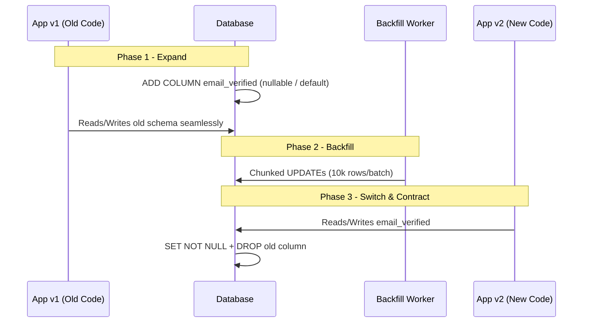

### Zero-Downtime Migrations

```sql
-- Step 1: Create new column (ADD COLUMN)
ALTER TABLE users ADD COLUMN email_verified boolean DEFAULT false;
-- Non-blocking in PostgreSQL 11+: New rows get default, reads/writes continue

-- Step 2: Backfill existing data (background process)
-- Split into chunks to avoid long lock
UPDATE users SET email_verified = true
WHERE id <= 100000 AND email_verified IS NULL;

-- Repeat for each chunk
UPDATE users SET email_verified = true
WHERE id > 100000 AND id <= 200000 AND email_verified IS NULL;

-- Step 3: Deploy code using new column
-- Application reads/writes email_verified column

-- Step 4: Make column NOT NULL (requires no NULLs)
ALTER TABLE users ALTER COLUMN email_verified SET NOT NULL;

-- Step 5: Drop old column (if renaming)
ALTER TABLE users DROP COLUMN old_email_verified;
```

### Expand-Contract Pattern

Safer for large tables where old and new application versions run concurrently during rolling deploys:

```sql
-- Phase 1: Expand (add new column, old code continues)
ALTER TABLE users ADD COLUMN email_verified boolean DEFAULT false;
-- Application still uses old column, dual-writes to new column

-- Phase 2: Contract (switch to new column, old code retired)
-- Make sure backfill complete
ALTER TABLE users DROP COLUMN email_unverified;  -- Old column gone
-- Code updated to use email_verified

-- Advantages:
-- + Can rollback easily (new column exists, old code still works)
-- + No downtime
-- + Easy to test new column alongside old
```

> [!TIP]
> **Avoid `ACCESS EXCLUSIVE` Table Rewrites:** In PostgreSQL, `ALTER TABLE ... ADD COLUMN ... DEFAULT ...` is instant (metadata-only) since v11, and adding a `CHECK (...) NOT VALID` constraint followed by `VALIDATE CONSTRAINT` avoids blocking concurrent writes.

---

## Sharding (Horizontal Partitioning)

**Partitioning** splits a large table into smaller pieces within a **single** database instance (e.g., by date range), whereas **Sharding** distributes those horizontal slices across **multiple independent database servers** to scale writes and storage.

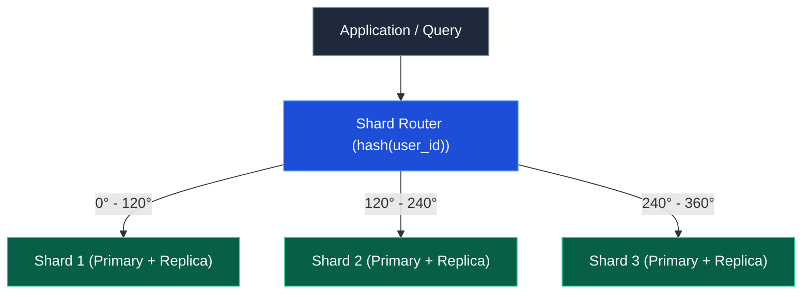

### Consistent Hashing Ring (Animated)

Naive modulo sharding (`hash(key) % N`) breaks when `N` changes—adding 1 shard remaps ~75%+ of keys. **Consistent Hashing** maps both shards and keys onto a `0°–360°` ring so adding a new shard only migrates `~1/N` of keys:


### Sharding Key Selection

| Strategy | Example Key | Distribution | Trade-offs |
|----------|-------------|--------------|------------|
| **Bad (Skewed)** | `country`, `status` | Uneven (most users in US; few active vs many inactive) | Creates hot shards |
| **Hash Sharding** | `user_id`, `customer_id` | Uniform across shards | Range queries require scatter-gather |
| **Range Sharding** | `created_at` (date) | Predictable growth | Latest shard takes 100% of new writes |

### Sharding Implementation

```java
public class ShardResolver {
    private static final int NUM_SHARDS = 8;

    public int getShardId(long userId) {
        return Math.abs((int)(userId % NUM_SHARDS));
        // Simple modulo routing (userId 100 always -> shard 4)
        // Note: Use consistent hashing with virtual nodes when NUM_SHARDS changes dynamically
    }

    public DataSource getShardDataSource(long userId) {
        int shardId = getShardId(userId);
        return shardDataSources[shardId];
    }
}

// Usage
public void insertUser(User user) {
    DataSource shard = shardResolver.getShardDataSource(user.id);
    Connection conn = shard.getConnection();
    // Insert into shard-specific database
    insertIntoDatabase(conn, user);
}
```

### Sharding Challenges

1. **Cross-shard queries:** `SELECT * FROM users WHERE country = 'USA'` must fan out to all shards (scatter-gather), making latency equal to the slowest shard.
2. **Resharding (adding new shards):** Hash modulo changes (`id % 8` → `id % 16`) force massive data migration; consistent hashing with virtual nodes reduces this to `~1/N`.
3. **Hotspots (Celebrity Problem):** One user with 1M transactions overloads a single shard while others sit idle. Mitigate with compound keys or dedicated sub-sharding.
4. **Data integrity:** ACID transactions and foreign keys across shards are expensive (2PC) or unavailable, requiring eventual consistency (Sagas/Outbox).

> [!WARNING]
> **Sharding Is a Last Resort:** Sharding permanently sacrifices cross-shard joins, global unique constraints, and simple ACID transactions. Exhaust vertical scaling, indexing, read replicas, and single-node table partitioning before sharding.

---

## Replication

Replication copies data from a primary (leader) database to one or more standby (follower) databases for read scaling and high availability.

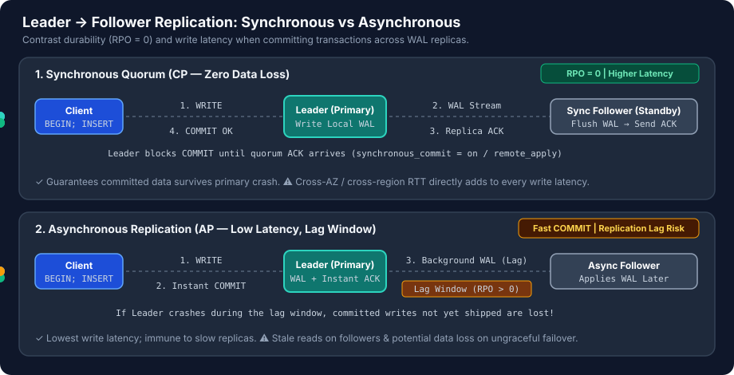

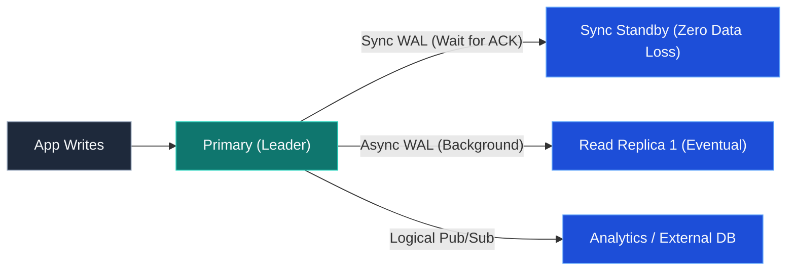

### Streaming Replication (Physical)

Primary streams byte-for-byte WAL (Write-Ahead Log) records to replicas.

```sql
-- PostgreSQL configuration for primary
wal_level = replica
max_wal_senders = 10
wal_keep_size = '1GB'

-- Replica automatically applies all changes
-- Up-to-date read replicas for SELECT queries
```

### Logical Replication

Replicate a subset of tables at the SQL/row level (supports cross-version upgrades and selective filtering).

```sql
-- Primary: Create publication (what to replicate)
CREATE PUBLICATION pub_users FOR TABLE users, orders;

-- Replica: Create subscription (subscribe to changes)
CREATE SUBSCRIPTION sub_from_master CONNECTION 'postgresql://master'
PUBLICATION pub_users;

-- Now: Users and orders replicated, other tables not
-- Useful for:
-- - Selective replication
-- - Replicating to different database version or system
```

### Synchronous vs Asynchronous Replication

| Mode | Commit Behavior | Durability (RPO) | Write Latency | Best For |
|------|-----------------|------------------|---------------|----------|
| **Asynchronous (Default)** | Primary writes local WAL & returns `COMMIT OK` | Potential data loss during lag window | Lowest (no network wait) | Read scaling, non-critical logs |
| **Synchronous** | Primary waits for standby ACK before `COMMIT OK` | Zero data loss (`RPO = 0`) | Higher (+1 network RTT) | Financial ledgers, HA failover |

```sql
-- Slowest, safest: Wait for replica to apply changes to disk/visibility
synchronous_commit = remote_apply
```

> [!IMPORTANT]
> **Watch `synchronous_commit` Levels:** PostgreSQL supports `off`, `local`, `remote_write`, `on` (flushed to standby WAL), and `remote_apply` (visible to standby reads). Only `remote_apply` prevents stale reads immediately after a primary `COMMIT`.

---

## CAP Theorem and Implications

Any distributed data store can guarantee at most **2 of 3** properties during a **network partition** (`P`):
- **Consistency (`C`):** Every read receives the most recent write or an error.
- **Availability (`A`):** Every request receives a non-error response (without guaranteeing it has the latest write).
- **Partition Tolerance (`P`):** The system continues operating despite arbitrary message loss or network splits.

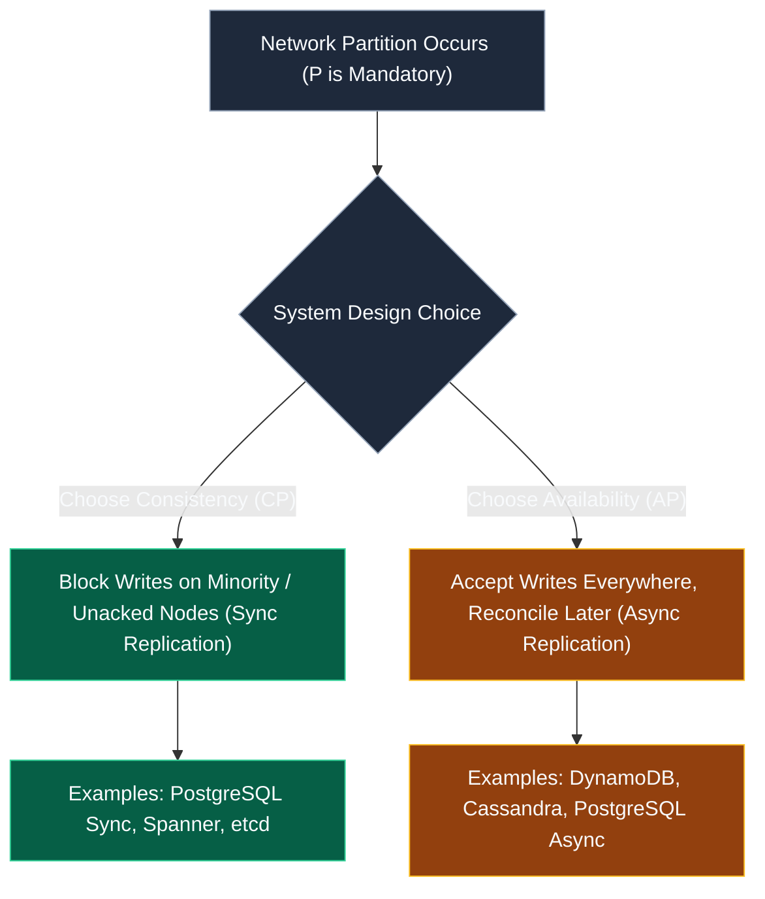

### PostgreSQL Behavior Under Partitions

| Setup | Mode | Behavior During Partition | Trade-off |
|-------|------|---------------------------|-----------|
| **Single Server** | CA (No `P`) | Full ACID guarantees | Single point of failure |
| **Primary + Sync Standby** | **CP** | Blocks writes if standby unreachable | Availability suffers; zero data loss |
| **Primary + Async Replica** | **AP** | Primary accepts writes; replica lags | Stale reads / potential data loss on failover |

### PostgreSQL HA (High Availability)

```
Setup: Primary + Hot Standby Replica

Scenario 1: Primary fails
- Promote standby replica to primary
- Use pg_rewind to resync failed primary as a new standby
- Brief downtime (seconds)

Scenario 2: Network partition (primary and replica disconnected)
- Async mode (AP): Primary keeps accepting writes; replica falls behind (stale reads)
- Sync mode (CP): Primary blocks writes until replica confirms (no data loss)
```

> [!IMPORTANT]
> **CAP Is About Partitions, PACELC Is About Normal Operation:** Even when there is *no* network partition (`E` = Else), distributed databases still trade off **Latency (`L`)** vs **Consistency (`C`)**—which is why synchronous replication costs latency on every single write.

---

## Database Design Interview Exercises

### Exercise 1: Design Social Media Database

**Requirements:**
- Users with profiles
- Posts with comments
- Followers/Following relationships
- Notifications
- Messaging

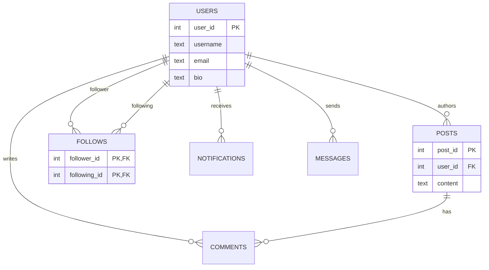

**Schema:**

```sql
CREATE TABLE users (
    user_id serial PRIMARY KEY,
    username text UNIQUE NOT NULL,
    email text UNIQUE NOT NULL,
    bio text,
    created_at timestamp DEFAULT NOW()
);

CREATE TABLE posts (
    post_id serial PRIMARY KEY,
    user_id int REFERENCES users(user_id) ON DELETE CASCADE,
    content text NOT NULL,
    created_at timestamp DEFAULT NOW(),
    updated_at timestamp DEFAULT NOW()
);

CREATE TABLE comments (
    comment_id serial PRIMARY KEY,
    post_id int REFERENCES posts(post_id) ON DELETE CASCADE,
    user_id int REFERENCES users(user_id) ON DELETE CASCADE,
    content text NOT NULL,
    created_at timestamp DEFAULT NOW()
);

CREATE TABLE follows (
    follower_id int REFERENCES users(user_id) ON DELETE CASCADE,
    following_id int REFERENCES users(user_id) ON DELETE CASCADE,
    created_at timestamp DEFAULT NOW(),
    PRIMARY KEY (follower_id, following_id),
    CHECK (follower_id != following_id)
);

CREATE TABLE notifications (
    notification_id serial PRIMARY KEY,
    user_id int REFERENCES users(user_id) ON DELETE CASCADE,
    action_user_id int REFERENCES users(user_id) ON DELETE CASCADE,
    type text,  -- 'like', 'comment', 'follow'
    post_id int REFERENCES posts(post_id) ON DELETE SET NULL,
    is_read boolean DEFAULT false,
    created_at timestamp DEFAULT NOW()
);

CREATE TABLE messages (
    message_id serial PRIMARY KEY,
    sender_id int REFERENCES users(user_id) ON DELETE CASCADE,
    receiver_id int REFERENCES users(user_id) ON DELETE CASCADE,
    content text,
    is_read boolean DEFAULT false,
    created_at timestamp DEFAULT NOW()
);

-- Indexes for common queries
CREATE INDEX idx_posts_user ON posts(user_id);
CREATE INDEX idx_posts_created ON posts(created_at);
CREATE INDEX idx_follows_follower ON follows(follower_id);
CREATE INDEX idx_notifications_user ON notifications(user_id, is_read);
CREATE INDEX idx_messages_receiver ON messages(receiver_id, is_read);
```

**Key Design Decisions:**
- Surrogate `user_id` instead of `username` for faster integer joins
- `ON DELETE CASCADE` for user-owned content cleanup
- `follows` table is self-referential with composite PK `(follower_id, following_id)` and `CHECK (follower_id != following_id)`
- `notifications` stores `action_user_id` directly for fast feed rendering

---

### Exercise 2: Design E-Commerce Database

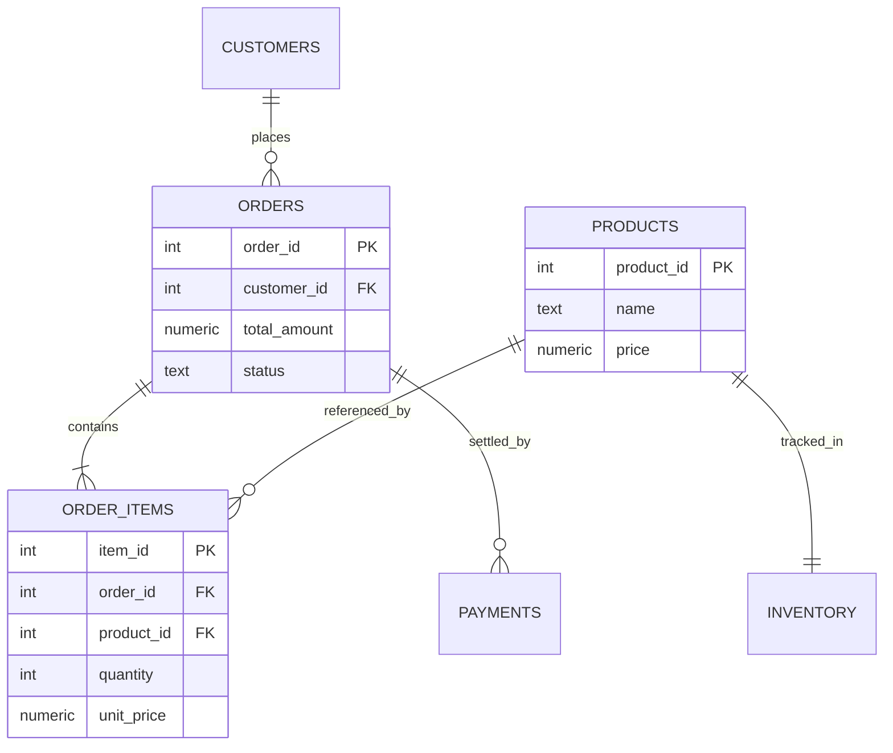

**Schema:**

```sql
CREATE TABLE products (
    product_id serial PRIMARY KEY,
    name text NOT NULL,
    description text,
    price numeric(10,2) NOT NULL,
    stock_qty int DEFAULT 0,
    category_id int REFERENCES categories(category_id),
    created_at timestamp DEFAULT NOW()
);

CREATE TABLE orders (
    order_id serial PRIMARY KEY,
    customer_id int REFERENCES customers(customer_id),
    order_date timestamp DEFAULT NOW(),
    total_amount numeric(10,2),
    status text DEFAULT 'pending'  -- pending, shipped, delivered, cancelled
);

CREATE TABLE order_items (
    item_id serial PRIMARY KEY,
    order_id int REFERENCES orders(order_id) ON DELETE CASCADE,
    product_id int REFERENCES products(product_id),
    quantity int NOT NULL,
    unit_price numeric(10,2),
    CHECK (quantity > 0)
);

CREATE TABLE inventory (
    inventory_id serial PRIMARY KEY,
    product_id int UNIQUE REFERENCES products(product_id),
    warehouse_id int,
    quantity int DEFAULT 0,
    last_restock timestamp
);

-- For order processing and payment
CREATE TABLE payments (
    payment_id serial PRIMARY KEY,
    order_id int REFERENCES orders(order_id),
    amount numeric(10,2),
    status text,  -- pending, completed, failed
    payment_method text,
    created_at timestamp DEFAULT NOW()
);

-- Indexes
CREATE INDEX idx_orders_customer ON orders(customer_id);
CREATE INDEX idx_orders_status ON orders(status);
CREATE INDEX idx_order_items_product ON order_items(product_id);
CREATE INDEX idx_inventory_warehouse ON inventory(warehouse_id);
```

**Design Notes:**
- `inventory` table is separated for multi-warehouse tracking
- `order_items.unit_price` intentionally **denormalizes** the snapshot price at purchase time so future catalog price changes never alter historical invoices
- `status` columns avoid unnecessary lookup joins for simple state machines

> [!TIP]
> **4-Step Interview Framework:** (1) Clarify read/write ratio & scale → (2) Sketch core ER entities & cardinalities → (3) Define PKs, FKs, and access-pattern indexes → (4) Discuss intentional denormalization, partitioning/sharding keys, and replication/CAP trade-offs.
