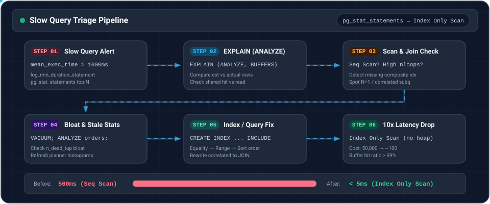
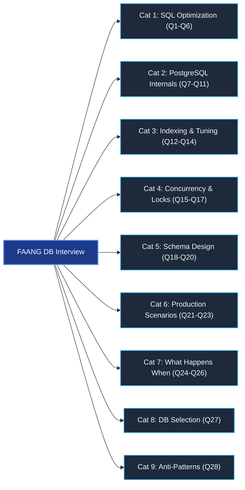
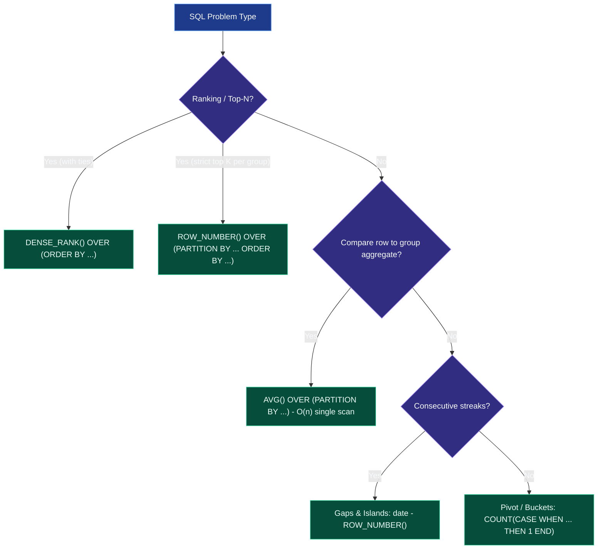
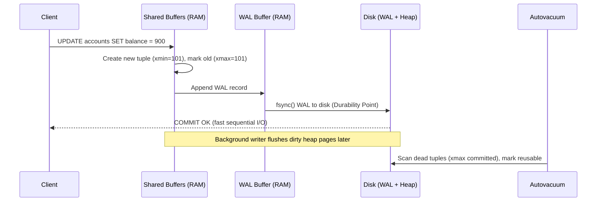
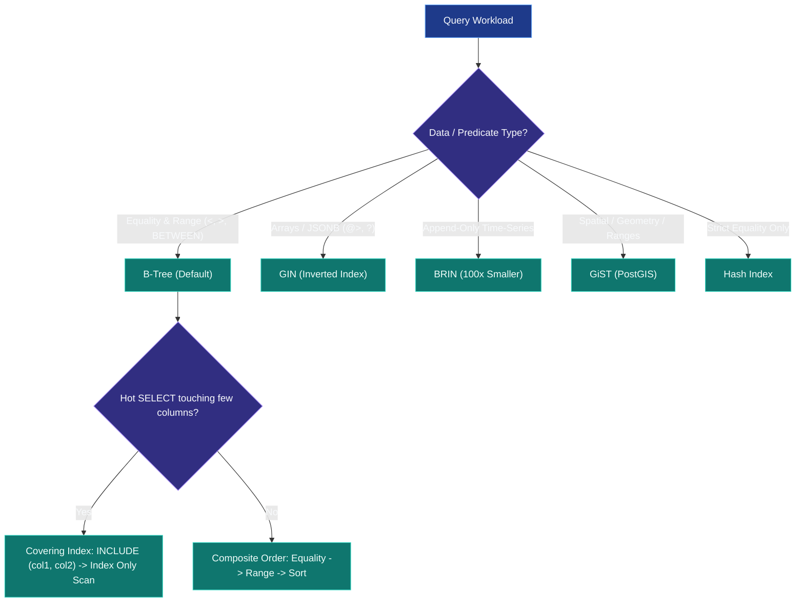
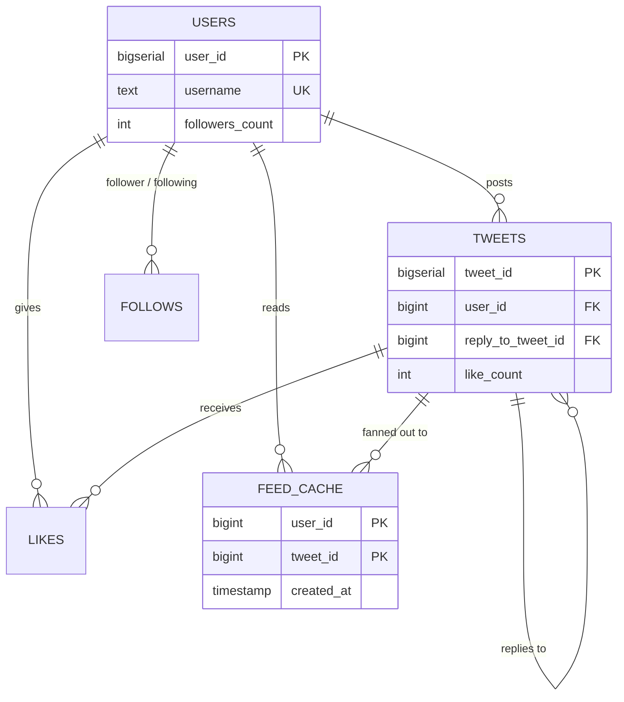
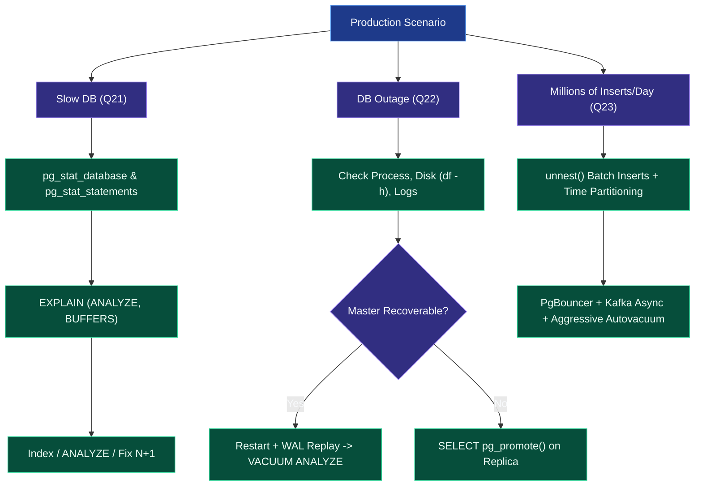
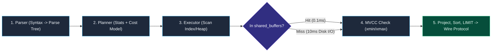
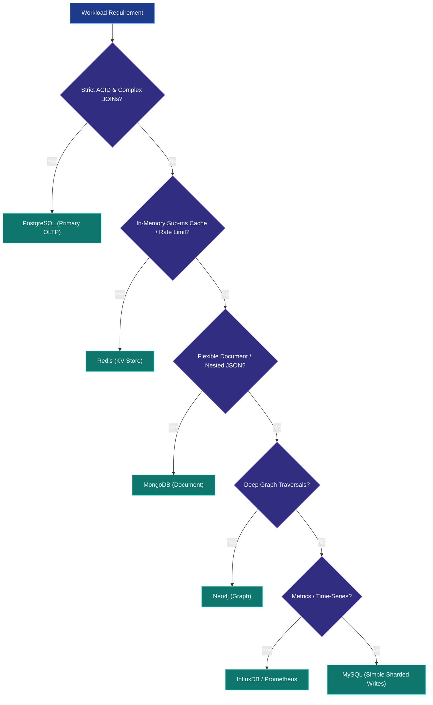
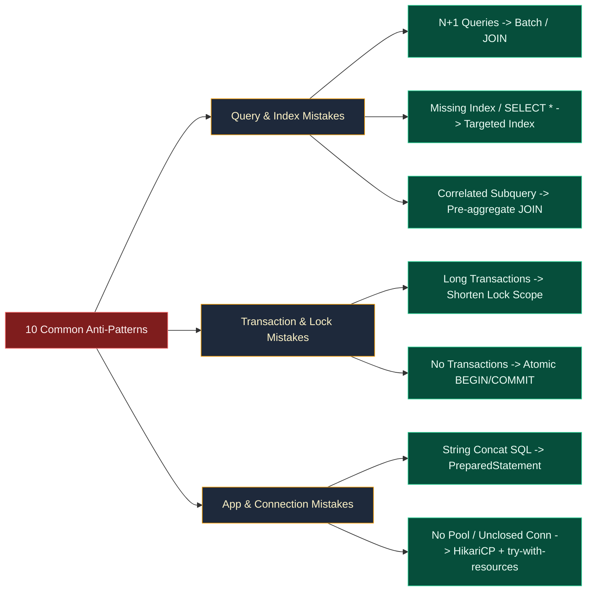

# Database Interview Questions for FAANG Companies



## Study Guide Overview & Question Map



| Category | Questions | Core Focus |
| :--- | :--- | :--- |
| **1. SQL Query Optimization** | Q1 – Q6 | Window functions, CTEs, gaps-and-islands, pivot queries |
| **2. PostgreSQL Internals** | Q7 – Q11 | MVCC (`xmin`/`xmax`), WAL, `VACUUM`, `shared_buffers`, `EXPLAIN` |
| **3. Indexing & Performance** | Q12 – Q14 | B-Tree, Hash, GIN, BRIN, GiST, covering indexes, leftmost prefix |
| **4. Transactions & Concurrency** | Q15 – Q17 | Isolation levels, deadlock prevention, optimistic vs pessimistic locking |
| **5. Database Design** | Q18 – Q20 | Twitter/X schema, E-commerce schema, 3NF vs denormalization |
| **6. Scenario-Based** | Q21 – Q23 | Slow DB triage, outage recovery, millions of inserts/day |
| **7. "What Happens When..."** | Q24 – Q26 | `SELECT` lifecycle, XID wraparound, undersized `shared_buffers` |
| **8. Comparison Questions** | Q27 | PostgreSQL vs MySQL vs Redis vs MongoDB vs Neo4j vs Time-Series |
| **9. Red Flags & Mistakes** | Q28 | 10 production anti-patterns (N+1, leaks, SQLi, missing indexes) |

> [!TIP]
> **How to use this guide:** Start every interview answer by clarifying **scale (rows/QPS)** and **read/write ratio**, then anchor your explanation in internals (`Index Scan` vs `Seq Scan`, MVCC visibility, WAL durability) before writing SQL or schema DDL.

---

## Category 1: SQL Query Optimization



### Q1: Write a query to find the 2nd highest salary

**Answer:**
```sql
-- Method 1: Using DENSE_RANK (handles ties correctly)
SELECT salary FROM (
    SELECT DISTINCT salary, DENSE_RANK() OVER (ORDER BY salary DESC) AS rank
    FROM employees
) WHERE rank = 2;

-- Method 2: Using OFFSET LIMIT
SELECT DISTINCT salary FROM employees
ORDER BY salary DESC LIMIT 1 OFFSET 1;

-- Method 3: Using MAX (avoid if ties matter)
SELECT MAX(salary) FROM employees
WHERE salary < (SELECT MAX(salary) FROM employees);
```

**Interview Points:**
- DISTINCT important (multiple employees at same salary)
- DENSE_RANK vs RANK (gaps for ties)
- Explain trade-offs of each approach

---

### Q2: Write a query to find employees earning more than their department average

**Answer:**
```sql
-- Using window function (BEST)
SELECT e.employee_id, e.name, e.salary, e.department_id
FROM (
    SELECT *,
        AVG(salary) OVER (PARTITION BY department_id) AS dept_avg
    FROM employees
) e
WHERE e.salary > e.dept_avg;

-- Using subquery (Alternative)
SELECT e.employee_id, e.name, e.salary
FROM employees e
WHERE salary > (
    SELECT AVG(salary)
    FROM employees e2
    WHERE e2.department_id = e.department_id
);

-- Using JOIN (Also good)
SELECT e.employee_id, e.name, e.salary
FROM employees e
JOIN (
    SELECT department_id, AVG(salary) AS avg_salary
    FROM employees
    GROUP BY department_id
) dept_avg ON e.department_id = dept_avg.department_id
WHERE e.salary > dept_avg.avg_salary;
```

**Performance Tips:**
- Window function: Single scan, O(n)
- Correlated subquery: N+1 problem, O(n²)
- JOIN with pre-aggregated: Single scan, O(n)

---

### Q3: Find customers who placed orders in every month of the year

**Answer:**
```sql
SELECT customer_id
FROM orders
WHERE EXTRACT(YEAR FROM order_date) = 2024
GROUP BY customer_id
HAVING COUNT(DISTINCT EXTRACT(MONTH FROM order_date)) = 12;

-- Explanation:
-- Extract month from each order
-- Group by customer
-- Having: Check if count of DISTINCT months = 12
```

---

### Q4: Find the top 3 products by revenue for each category

**Answer:**
```sql
WITH product_revenue AS (
    SELECT
        p.product_id,
        p.name,
        c.category_id,
        c.category_name,
        SUM(oi.quantity * oi.unit_price) AS revenue,
        ROW_NUMBER() OVER (PARTITION BY c.category_id ORDER BY SUM(oi.quantity * oi.unit_price) DESC) AS rank
    FROM products p
    JOIN categories c ON p.category_id = c.category_id
    LEFT JOIN order_items oi ON p.product_id = oi.product_id
    GROUP BY p.product_id, p.name, c.category_id, c.category_name
)
SELECT * FROM product_revenue WHERE rank <= 3;
```

---

### Q5: Detect consecutive login days for each user

**Answer:**
```sql
WITH login_with_gap AS (
    SELECT
        user_id,
        login_date,
        login_date - ROW_NUMBER() OVER (PARTITION BY user_id ORDER BY login_date) AS date_group
    FROM logins
),
consecutive_groups AS (
    SELECT
        user_id,
        date_group,
        COUNT(*) AS consecutive_days,
        MIN(login_date) AS start_date,
        MAX(login_date) AS end_date
    FROM login_with_gap
    GROUP BY user_id, date_group
)
SELECT user_id, start_date, end_date, consecutive_days
FROM consecutive_groups
WHERE consecutive_days >= 5  -- At least 5 consecutive days
ORDER BY user_id, consecutive_days DESC;

-- Explanation:
-- ROW_NUMBER() gives sequence: 1, 2, 3, 4, 5 for consecutive dates
-- date - ROW_NUMBER() = same value for consecutive dates
// Group by that value to find consecutive sequences
```

---

### Q6: Pivot query - Show salary ranges for each department

**Answer:**
```sql
SELECT
    d.department_id,
    d.department_name,
    COUNT(CASE WHEN e.salary < 50000 THEN 1 END) AS "< 50K",
    COUNT(CASE WHEN e.salary >= 50000 AND e.salary < 100000 THEN 1 END) AS "50K-100K",
    COUNT(CASE WHEN e.salary >= 100000 AND e.salary < 150000 THEN 1 END) AS "100K-150K",
    COUNT(CASE WHEN e.salary >= 150000 THEN 1 END) AS "> 150K"
FROM departments d
LEFT JOIN employees e ON d.department_id = e.department_id
GROUP BY d.department_id, d.department_name;
```

> [!IMPORTANT]
> **Window Functions vs Correlated Subqueries:** Always prefer `AVG() OVER (PARTITION BY ...)` or a pre-aggregated `JOIN` (`O(n)` single scan) over a correlated subquery (`O(n^2)`).

---

## Category 2: PostgreSQL-Specific Questions



| Parameter | Default | Recommended (Dedicated DB) | Role |
| :--- | :--- | :--- | :--- |
| `shared_buffers` | 128 MB | 25% of RAM | PostgreSQL-managed page cache (8 KB pages) |
| `effective_cache_size` | 4 GB | 50–75% of RAM | Planner hint (OS cache + `shared_buffers`), not allocated |
| `work_mem` | 4 MB | `RAM / (max_connections * 2)` | Per-sort/hash operation memory |
| `synchronous_commit` | `on` | `on` (safe) / `off` (fast) | Controls whether `COMMIT` waits for WAL `fsync()` |
| `log_min_duration_statement` | `-1` (off) | `1000` (ms) | Logs slow queries exceeding threshold |

### Q7: What is MVCC? How does it work internally?

**Answer:**
```
MVCC (Multi-Version Concurrency Control) allows readers and writers
to coexist without heavy locking.

Every row has:
- xmin: Insert transaction ID
- xmax: Delete transaction ID (NULL if not deleted)

Example:
Transaction 100 (COMMITTED):
  INSERT INTO users VALUES (id=1, name='Alice')
  Row: xmin=100, xmax=NULL

Transaction 101 (COMMITTED):
  UPDATE users SET name='Alice2' WHERE id=1
  Creates new version: xmin=101, xmax=NULL
  Old version: xmin=100, xmax=101

Transaction 102 (RUNNING):
  SELECT * FROM users
  Sees: xmin=101 (committed before 102's snapshot) → 'Alice2'

Transaction 103 (RUNNING, started before 101 committed):
  SELECT * FROM users
  Sees: xmin=100 (committed before 103's snapshot) → 'Alice'
  Cannot see xmin=101 (committed after snapshot)

Key benefit: Readers never block writers (different versions)
```

---

### Q8: Explain WAL and its role in durability

**Answer:**
```
Write-Ahead Logging (WAL) ensures durability without waiting for disk flushes.

Sequence:
1. Client sends: UPDATE accounts SET balance = 900 WHERE id = 1

2. PostgreSQL:
   a. Write entry to WAL buffer (memory)
   b. fsync() WAL buffer to disk (DURABILITY POINT)
   c. Write to shared buffers (memory, not yet on disk)
   d. Return OK to client (COMMIT acknowledged)

3. Later (background writer):
   - Dirty buffer page flushed to disk

4. On crash:
   - Restart reads checkpoint location
   - Replays WAL entries from checkpoint
   - Recovers all committed transactions

Key advantage:
- Sequential disk write (WAL) much faster than random writes
- WAL buffers multiple transactions, flushes once per ms
- COMMIT doesn't wait for full data page flush

Configuration:
- synchronous_commit = on (default, safe)
- synchronous_commit = off (fast, less safe)
```

---

### Q9: How does VACUUM work? Why is it important?

**Answer:**
```
VACUUM removes dead tuples (rows with xmax set).

Why needed:
Table: 1M rows, all updated → 2M versions (1M new, 1M old)
Storage: 2GB (should be 1GB)
Scan: Must check visibility of 2M versions (slower)

VACUUM process:
1. Scans all pages
2. Identifies dead tuples (xmax committed, transaction older than oldest active)
3. Marks space as reusable
4. Updates visibility map
5. Recycles clog entries (transaction status)

Types:
- Regular VACUUM: Marks space as reusable (fast)
- VACUUM FULL: Rewrites table, returns space to OS (slow, exclusive lock)

AUTOVACUUM:
PostgreSQL runs background vacuum automatically
- Triggered when: (dead_tuples > 50) + (live_tuples * 0.1)
- Can be tuned per table

Without VACUUM:
- Table bloats (2GB for 1GB data)
- Performance degrades (more pages to scan)
- Transaction ID wraparound risk (xid > 2 billion)
- After wraparound: Very old committed xid treated as recent (data corruption!)
```

---

### Q10: Explain the difference between shared_buffers and effective_cache_size

**Answer:**
```
shared_buffers: PostgreSQL's page cache
- Managed by PostgreSQL process
- Default: 128MB (set to 25% RAM on dedicated server)
- Shared among all connections
- Used for: Buffer pool (LRU eviction)

effective_cache_size: Hint to query planner
- NOT actually allocated memory
- Tells planner how much memory total available (OS + shared_buffers)
- Used for: Cost calculations in EXPLAIN
- Default: 4GB (should be 50-75% of total RAM)

Example impact:
-- If effective_cache_size = 1GB (low)
EXPLAIN SELECT * FROM billion_row_table WHERE id = 5;
-- Planner: "Scan is expensive, sequential scan cheaper"
-- Result: Seq Scan chosen (slow)

-- If effective_cache_size = 64GB (realistic)
EXPLAIN SELECT * FROM billion_row_table WHERE id = 5;
-- Planner: "Index already in cache, index scan cheap"
-- Result: Index Scan chosen (fast)

Tuning:
shared_buffers = 25% of RAM
effective_cache_size = 50-75% of RAM
work_mem = RAM / (max_connections * 2)
```

---

### Q11: How do you identify and fix a slow query?

**Answer:**
```
Step 1: Enable query logging
-- postgresql.conf
log_min_duration_statement = 1000  -- Queries > 1 second
log_statement = 'all'

Step 2: Identify slow queries
SELECT query, mean_exec_time, calls
FROM pg_stat_statements
WHERE mean_exec_time > 1000  -- > 1 second
ORDER BY mean_exec_time DESC;

Step 3: EXPLAIN ANALYZE the slow query
EXPLAIN (ANALYZE, BUFFERS)
SELECT * FROM orders
WHERE customer_id = 5 AND status = 'shipped'
ORDER BY created_at DESC;

Step 4: Analyze output
Seq Scan on orders  (cost=0..50000)  (actual time=100..500ms)
  Filter: (customer_id = 5) AND (status = 'shipped')
  Rows: 1000 (estimated 1000)
  Buffers: shared hit=2000 read=50

Issues:
- Seq Scan: No index on (customer_id, status)
- Estimated vs actual rows match (stats OK)
- Buffer hits 98% (good)

Fix:
CREATE INDEX idx_orders ON orders(customer_id, status, created_at DESC);

Verify:
-- Re-run EXPLAIN ANALYZE
-- Cost should drop from 50000 to ~100
-- Check execution time improvement
```

> [!WARNING]
> **Avoid `VACUUM FULL` in production peak hours:** Unlike regular `VACUUM`, `VACUUM FULL` acquires an `ACCESS EXCLUSIVE` lock and blocks all reads and writes while rewriting the entire table.

---

## Category 3: Indexing and Performance



| Index Type | Best For | Supported Operators | Trade-Off |
| :--- | :--- | :--- | :--- |
| **B-Tree** | General purpose, sorting, ranges | `=`, `<`, `>`, `<=`, `>=`, `BETWEEN` | Larger than BRIN; write amplification |
| **Hash** | Exact equality lookups | `=` | No range/sort support |
| **GIN** | Multi-valued (`ARRAY`, `JSONB`) | `@>`, `<@`, `?` | Slower writes, larger index |
| **BRIN** | Physically sorted huge tables (logs) | Range queries on monotonic columns | 100x smaller, but coarse block-level |
| **GiST** | Geospatial (`PostGIS`), range types | Geometric/overlap operators | Specialized use cases |
| **Covering (`INCLUDE`)** | Hot-path `SELECT`s | Enables `Index Only Scan` | Extra storage & slower writes |

### Q12: Explain different index types in PostgreSQL

**Answer:**
```
B-Tree (default):
- Ordered index
- Supports: =, <, >, <=, >=, BETWEEN
- Best for: General purpose, range queries
  CREATE INDEX idx_id ON users(id);

Hash:
- For equality only
- Rarely used (limited use cases)
  CREATE INDEX idx_hash ON users USING HASH (email);

GIN (Generalized Inverted Index):
- For multi-valued data
- Supports: array membership, JSONB keys
- Good for: @>, <@, ? operators
  CREATE INDEX idx_tags ON posts USING GIN (tags);
  SELECT * FROM posts WHERE tags @> ARRAY['postgresql'];

BRIN (Block Range Index):
- For sorted/mostly-sorted large tables
- Tiny index size (100x smaller than B-Tree)
- Example: Time-series logs (always newer)
  CREATE INDEX idx_created ON logs USING BRIN (created_at);

GiST (Generalized Search Tree):
- For geometric data, range types
- Example: PostGIS spatial queries
  CREATE INDEX idx_location ON places USING GiST (coordinates);
```

---

### Q13: What is a covering index? When use it?

**Answer:**
```sql
-- Standard index: Must fetch row from table
CREATE INDEX idx_orders ON orders(customer_id, created_at);

SELECT customer_id, created_at, status FROM orders WHERE customer_id = 5;
-- Plan: Index Scan → Heap Fetch (extra I/O for status)

-- Covering index: All columns in index
CREATE INDEX idx_orders_cover ON orders(customer_id, created_at)
INCLUDE (status, total_amount);

SELECT customer_id, created_at, status FROM orders WHERE customer_id = 5;
-- Plan: Index Only Scan (no table access needed!)

Trade-off:
+ Faster queries (avoid table access)
+ No extra I/O
- Larger index (extra columns stored)
- Slower writes (more data to index)

Use when:
- Frequently executed queries
- Query touches few columns
- Can afford extra storage
- Example: SELECT operations in hot path
```

---

### Q14: Explain composite index column order

**Answer:**
```
Rule: Leftmost prefix must match WHERE clause

Index: (customer_id, status, created_at)

✓ Usable:
WHERE customer_id = 5
WHERE customer_id = 5 AND status = 'shipped'
WHERE customer_id = 5 AND status = 'shipped' AND created_at > '2024-01-01'

✗ Cannot use:
WHERE status = 'shipped'  (missing leftmost customer_id)
WHERE created_at > '2024-01-01'  (missing customer_id, status)
WHERE customer_id = 5 AND created_at > '2024-01-01'  (missing status)

Optimal column order:
1. Equality columns first (high selectivity)
2. Range columns second
3. Sort columns third

Example: Common query
SELECT * FROM orders
WHERE customer_id = 5 AND created_at > '2024-01-01'
ORDER BY created_at;

Index: (customer_id, created_at)
- Filters by customer_id (leftmost)
- Filters by created_at range
- Already sorted by created_at (no separate sort!)
```

> [!TIP]
> **Composite Index Golden Rule:** Order columns as **Equality → Range → Sort** (`E-R-S`). Once a range condition (`>`, `<`, `BETWEEN`) is encountered, subsequent index columns cannot be used for further filtering.

---

## Category 4: Transactions and Concurrency

```mermaid
sequenceDiagram
    participant S1 as Session 1
    participant DB as PostgreSQL Lock Manager
    participant S2 as Session 2

    Note over S1,S2: Deadlock Scenario (Inconsistent Lock Order)
    S1->>DB: Lock employees(id=1) FOR UPDATE
    S2->>DB: Lock departments(id=1) FOR UPDATE
    S1->>DB: Wait for departments(id=1)
    S2->>DB: Wait for employees(id=1)
    DB-->>S2: DEADLOCK DETECTED (abort one tx)

    Note over S1,S2: Fix: Consistent Lock Order (employees -&gt; departments)
    S1->>DB: Lock employees(id=1), then departments(id=1)
    S2->>DB: Lock employees(id=2), then departments(id=1)
    DB-->>S1: Commit OK (no cycle!)
```

| Isolation Level | Dirty Read | Non-Repeatable Read | Phantom Read | Serialization Anomaly |
| :--- | :--- | :--- | :--- | :--- |
| **READ UNCOMMITTED** *(PG = Read Committed)* | Prevented in PG | Allowed | Allowed | Allowed |
| **READ COMMITTED** *(PG Default)* | Prevented | Allowed | Allowed | Allowed |
| **REPEATABLE READ** | Prevented | Prevented | Mitigated by snapshot (allowed in SQL std) | Allowed |
| **SERIALIZABLE** | Prevented | Prevented | Prevented | Prevented (`SQLSTATE 40001` on conflict) |

### Q15: What are isolation levels? How do they differ?

**Answer:**
```
READ UNCOMMITTED (Treated as READ COMMITTED in PostgreSQL)
- Theory: Can read uncommitted data
- PostgreSQL: Actually READ COMMITTED
- Anomalies prevented: None

READ COMMITTED (Default)
- Each statement sees committed data at statement start
- Consistent snapshot per statement, not transaction
- Anomalies prevented: Dirty reads
- Allows: Non-repeatable reads, phantom reads

REPEATABLE READ
- All statements see same snapshot from transaction start
- Consistent view throughout transaction
- Anomalies prevented: Dirty reads, non-repeatable reads
- Allows: Phantom reads (but mitigated by snapshot)

SERIALIZABLE
- Highest isolation
- Detects conflicts at commit time
- If conflict detected: Serialization error (SQLSTATE 40001)
- Anomalies prevented: All (dirty, non-repeatable, phantom, serialization)

Example scenario:
Session 1:
BEGIN ISOLATION LEVEL REPEATABLE READ;
SELECT COUNT(*) FROM orders;  -- 100 (snapshot taken)

Session 2:
INSERT INTO orders VALUES (...);
COMMIT;

Session 1:
SELECT COUNT(*) FROM orders;  -- Still 100 (same snapshot)
UPDATE orders SET status = 'processed';  -- Updates 102 rows (includes Session 2 inserts)
-- Phantom read: New rows appeared in transaction

Session 1 with SERIALIZABLE:
BEGIN ISOLATION LEVEL SERIALIZABLE;
SELECT COUNT(*) FROM orders;  -- 100
-- Session 2 inserts
Session 1:
SELECT COUNT(*) FROM orders;  -- ERROR: serialization_failure
-- Must retry transaction
```

---

### Q16: How to prevent deadlocks?

**Answer:**
```
Deadlock example:
Session 1:
  SELECT * FROM employees WHERE id = 1 FOR UPDATE;
  SELECT * FROM departments WHERE id = 1 FOR UPDATE;  -- Waiting for Session 2

Session 2:
  SELECT * FROM departments WHERE id = 1 FOR UPDATE;
  SELECT * FROM employees WHERE id = 1 FOR UPDATE;  -- Waiting for Session 1
  -- DEADLOCK DETECTED!

Prevention strategies:

1. Lock in consistent order
   // Always lock employees before departments
   Session 1:
     SELECT * FROM employees WHERE id = 1 FOR UPDATE;
     SELECT * FROM departments WHERE id = 1 FOR UPDATE;

   Session 2:
     SELECT * FROM employees WHERE id = 2 FOR UPDATE;
     SELECT * FROM departments WHERE id = 1 FOR UPDATE;
   // No deadlock possible

2. Use timeouts
   SET lock_timeout = '5 seconds';
   BEGIN;
     SELECT * FROM accounts WHERE id = 1 FOR UPDATE;
   // If waited > 5s: ERROR: canceling statement due to lock timeout

3. Implement retry with exponential backoff
   for (int i = 0; i < MAX_RETRIES; i++) {
       try {
           executeTransaction();
           return;
       } catch (DeadlockException e) {
           Thread.sleep((long)Math.pow(2, i) * 100);  // 100ms, 200ms, 400ms...
       }
   }

4. Keep transactions short
   // Long transactions hold locks longer
   // Break into smaller transactions

5. Monitor deadlock occurrences
   SELECT * FROM pg_stat_database
   WHERE deadlocks > 0;
```

---

### Q17: Optimistic vs Pessimistic locking in Java

**Answer:**
```java
// PESSIMISTIC: Lock immediately
@Transactional
public void transferFunds(int fromId, int toId, BigDecimal amount) {
    Account from = em.find(Account.class, fromId, LockModeType.PESSIMISTIC_WRITE);
    Account to = em.find(Account.class, toId, LockModeType.PESSIMISTIC_WRITE);

    // Locked, no other transaction can modify
    from.setBalance(from.getBalance().subtract(amount));
    to.setBalance(to.getBalance().add(amount));

    em.flush();
}
// SQL: SELECT * FROM accounts WHERE id = ? FOR UPDATE;

// OPTIMISTIC: Check on update
@Entity
class Account {
    @Version
    private int version;  // Optimistic lock column
}

@Transactional
public void transferFunds(int fromId, int toId, BigDecimal amount) {
    Account from = em.find(Account.class, fromId);
    Account to = em.find(Account.class, toId);

    from.setBalance(from.getBalance().subtract(amount));
    to.setBalance(to.getBalance().add(amount));

    try {
        em.flush();  // version check: WHERE id=? AND version=5
    } catch (OptimisticLockException e) {
        // Version mismatch, retry
        retryTransaction(fromId, toId, amount);
    }
}

Comparison:
Pessimistic:
+ Guarantees success first try
+ Handles high contention well
- Slower (locks held longer)
- Risk of deadlock

Optimistic:
+ Higher throughput (fewer locks)
+ No deadlocks
- Must retry on conflict
- Good for low contention
```

> [!IMPORTANT]
> **Application Retry Loop:** Both `SERIALIZABLE` (`SQLSTATE 40001`) and Optimistic Locking (`@Version` mismatch) require idempotent retry logic with exponential backoff in your application layer.

---

## Category 5: Database Design



| Approach | Write Cost | Read Cost | Data Integrity | Best Use Case |
| :--- | :--- | :--- | :--- | :--- |
| **Normalized (3NF)** | Low (single row update) | Higher (requires `JOIN`s) | Highest (FKs, no anomalies) | OLTP core entities |
| **Denormalized** | Higher (sync multiple copies) | Lowest (single table scan) | Risk of drift | Read-heavy hot paths, counters |
| **Materialized View** | Periodic `REFRESH` cost | Lowest (precomputed snapshot) | Eventual consistency | Analytics & reporting dashboards |

### Q18: How would you design a database for Twitter/X?

**Answer:**
```sql
CREATE TABLE users (
    user_id bigserial PRIMARY KEY,
    username text UNIQUE NOT NULL,
    email text UNIQUE NOT NULL,
    profile_image_url text,
    bio text,
    followers_count int DEFAULT 0,
    following_count int DEFAULT 0,
    created_at timestamp DEFAULT NOW()
);

CREATE TABLE tweets (
    tweet_id bigserial PRIMARY KEY,
    user_id bigint REFERENCES users(user_id) ON DELETE CASCADE,
    content text NOT NULL,
    reply_to_tweet_id bigint REFERENCES tweets(tweet_id) ON DELETE CASCADE,
    retweet_count int DEFAULT 0,
    like_count int DEFAULT 0,
    created_at timestamp DEFAULT NOW()
);

CREATE TABLE likes (
    like_id serial PRIMARY KEY,
    user_id bigint REFERENCES users(user_id) ON DELETE CASCADE,
    tweet_id bigint REFERENCES tweets(tweet_id) ON DELETE CASCADE,
    created_at timestamp DEFAULT NOW(),
    UNIQUE(user_id, tweet_id)
);

CREATE TABLE follows (
    follower_id bigint REFERENCES users(user_id) ON DELETE CASCADE,
    following_id bigint REFERENCES users(user_id) ON DELETE CASCADE,
    created_at timestamp DEFAULT NOW(),
    PRIMARY KEY (follower_id, following_id),
    CHECK (follower_id != following_id)
);

CREATE TABLE feed_cache (
    user_id bigint REFERENCES users(user_id) ON DELETE CASCADE,
    tweet_id bigint REFERENCES tweets(tweet_id) ON DELETE CASCADE,
    created_at timestamp,
    PRIMARY KEY (user_id, tweet_id)
);

-- Indexes for common queries
CREATE INDEX idx_tweets_user ON tweets(user_id);
CREATE INDEX idx_tweets_created ON tweets(created_at DESC);
CREATE INDEX idx_replies_parent ON tweets(reply_to_tweet_id);
CREATE INDEX idx_follows_follower ON follows(follower_id);
CREATE INDEX idx_likes_user ON likes(user_id);
CREATE INDEX idx_feed_cache_user ON feed_cache(user_id, created_at DESC);

Key design decisions:
1. Denormalized counters (followers_count) for fast access
   - Update asynchronously with eventual consistency

2. feed_cache table
   - Pre-computed feed (tweets from followed users)
   - Updated asynchronously when new tweet posted
   - Avoids expensive fan-out queries

3. Likes are separate table (many-to-many)
   - UNIQUE constraint prevents duplicate likes
   - Can query likes efficiently

4. Follows self-referential
   - CHECK constraint prevents self-follows

Scaling considerations:
- Partition tweets by date (range partitioning)
- Shard users by user_id (hash partitioning)
- Use Redis cache for feed_cache (memory)
- Message queue for async updates
```

---

### Q19: How would you design database for e-commerce system?

**Answer:**
```sql
CREATE TABLE customers (
    customer_id serial PRIMARY KEY,
    email text UNIQUE NOT NULL,
    name text,
    created_at timestamp DEFAULT NOW()
);

CREATE TABLE products (
    product_id serial PRIMARY KEY,
    name text NOT NULL,
    description text,
    price numeric(10,2) NOT NULL,
    category_id int REFERENCES categories(category_id),
    created_at timestamp DEFAULT NOW()
);

CREATE TABLE inventory (
    inventory_id serial PRIMARY KEY,
    product_id int UNIQUE REFERENCES products(product_id),
    quantity int DEFAULT 0,
    warehouse_id int,
    last_restock timestamp
);

CREATE TABLE orders (
    order_id serial PRIMARY KEY,
    customer_id int REFERENCES customers(customer_id),
    order_date timestamp DEFAULT NOW(),
    total_amount numeric(10,2),
    status text DEFAULT 'pending',  -- pending, shipped, delivered, cancelled
    shipping_address text,
    created_at timestamp DEFAULT NOW()
);

CREATE TABLE order_items (
    order_item_id serial PRIMARY KEY,
    order_id int REFERENCES orders(order_id) ON DELETE CASCADE,
    product_id int REFERENCES products(product_id),
    quantity int NOT NULL,
    unit_price numeric(10,2),  -- Snapshot of price at time of order
    CHECK (quantity > 0)
);

CREATE TABLE payments (
    payment_id serial PRIMARY KEY,
    order_id int UNIQUE REFERENCES orders(order_id),
    amount numeric(10,2),
    status text,  -- pending, completed, failed
    created_at timestamp DEFAULT NOW()
);

CREATE TABLE reviews (
    review_id serial PRIMARY KEY,
    product_id int REFERENCES products(product_id),
    customer_id int REFERENCES customers(customer_id),
    rating int CHECK (rating >= 1 AND rating <= 5),
    comment text,
    created_at timestamp DEFAULT NOW(),
    UNIQUE(product_id, customer_id)
);

-- Indexes
CREATE INDEX idx_orders_customer ON orders(customer_id);
CREATE INDEX idx_orders_status ON orders(status);
CREATE INDEX idx_order_items_product ON order_items(product_id);
CREATE INDEX idx_payments_order ON payments(order_id);
CREATE INDEX idx_reviews_product ON reviews(product_id);

Key design decisions:
1. order_items stores price snapshot (decouples from current product price)
2. inventory separate from products (multi-warehouse support)
3. Unique(product_id, customer_id) for reviews (one review per product per customer)
4. Status field (simpler than separate tables for order states)
5. Payments separate table (payment processing, auditing)

Scaling:
- Partition orders by order_date (time-series data)
- Shard customers by customer_id
- Cache popular products
- Async order processing (message queue)
- Denormalize product ratings in products table
```

---

### Q20: Explain normalization vs denormalization trade-offs

**Answer:**
```
NORMALIZATION (3NF):
Example: Store departments separately from employees

Table: employees
┌──────────────────┐
│ emp_id │ name   │ dept_id
├──────────────────┤
│ 1      │ Alice  │ 10
│ 2      │ Bob    │ 10
│ 3      │ Carol  │ 20

Table: departments
┌────────────────────┐
│ dept_id │ dept_name  │
├────────────────────┤
│ 10      │ Sales      │
│ 20      │ Engineering│

Pros:
+ No update anomalies (change dept name once)
+ Less storage (no redundancy)
+ Data integrity (foreign keys)

Cons:
- More joins (slower queries)
- More complex schema

DENORMALIZATION:
Store dept_name in employees table

Table: employees
┌─────────────────────────────┐
│ emp_id │ name  │ dept_id │ dept_name  │
├─────────────────────────────┤
│ 1      │ Alice │ 10      │ Sales      │
│ 2      │ Bob   │ 10      │ Sales      │
│ 3      │ Carol │ 20      │ Engineering│

Pros:
+ Fewer joins (faster SELECT)
+ Single table scan

Cons:
- Update anomalies (change Sales → Sales Dept in 2+ rows)
- Extra storage
- Consistency burden (trigger-maintained)

When to denormalize:
1. Read-heavy systems (analytics)
2. Specific hot queries
3. Materialized views (snapshot, refreshed periodically)
4. OLAP systems (data warehouse)

Example: Materialized view (safe denormalization)
CREATE MATERIALIZED VIEW sales_summary AS
SELECT
    emp_id, name, salary,
    dept_name,
    COUNT(*) AS orders_count,
    SUM(amount) AS total_sales
FROM employees e
JOIN departments d ON e.dept_id = d.dept_id
LEFT JOIN orders o ON e.emp_id = o.employee_id
GROUP BY e.emp_id, e.name, e.salary, d.dept_name;

REFRESH MATERIALIZED VIEW sales_summary;

Query materialized view (fast, denormalized)
SELECT * FROM sales_summary WHERE dept_name = 'Sales';

Recommendation:
- Start with normalization (3NF)
- Identify specific slow queries
- Denormalize only for those queries (materialized views)
- Measure impact before committing
```

> [!TIP]
> **Schema Design Rule of Thumb:** Start normalized in **3NF** for data integrity, then introduce **Materialized Views** or async `feed_cache` tables only for proven read-heavy hot paths.

---

## Category 6: Scenario-Based Questions



### Q21: Your database is running slow. Walk me through your debugging process

**Answer:**
```
1. Gather information
   - "How slow? 100ms → 10s? Interactive or batch?"
   - "When? Peak hours? Specific application?"
   - "What changed? New feature, data growth?"

2. High-level metrics
   SELECT * FROM pg_stat_database WHERE datname = 'mydb';
   - Check: tup_returned, tup_fetched (mismatches indicate scans)
   - Check: xact_rollback (transaction failures)

3. Query-level analysis
   SELECT query, mean_exec_time, calls
   FROM pg_stat_statements
   ORDER BY mean_exec_time DESC
   LIMIT 10;

4. Identify problematic query
   EXPLAIN (ANALYZE, BUFFERS)
   SELECT * FROM orders WHERE customer_id = 5 AND status = 'shipped';

   Look for:
   a) Seq Scan on large table? → Missing index
   b) High nloops on Nested Loop? → Inefficient join
   c) Estimated vs actual rows mismatch? → Bad statistics
   d) Sort without index? → Add index on ORDER BY columns

5. Address root cause

   Case A: Missing index
   CREATE INDEX idx ON orders(customer_id, status);
   ANALYZE orders;
   Re-run EXPLAIN ANALYZE → Verify index used and timing improved

   Case B: Bad statistics
   ANALYZE orders;
   Re-run EXPLAIN ANALYZE → Verify plan improved

   Case C: N+1 queries (application)
   // Check application logs for repeated similar queries
   // Refactor to use JOIN instead of loop

   Case D: Hardware bottleneck
   // Check: top, iostat, vmstat
   // If CPU 100%: Optimize query
   // If disk I/O 100%: Add indexes, increase cache
   // If memory exhausted: Increase shared_buffers, reduce work_mem

6. Monitor improvement
   - Re-run slow query
   - Check execution time with EXPLAIN ANALYZE
   - Monitor resource usage (CPU, disk, memory)

7. Prevent recurrence
   - Add to slow query monitoring
   - Document learned lesson
   - Consider workload baseline
```

---

### Q22: How would you handle a database outage?

**Answer:**
```
During Outage:

1. Immediate response
   - Alert on-call DBA
   - Start incident war room
   - Notify affected teams
   - Do NOT attempt blind restarts

2. Assess damage
   - Is PostgreSQL process running? (ps aux | grep postgres)
   - Check logs for errors
   - Verify disk space (df -h)
   - Check memory (free -m)
   - Network connectivity to database?

3. Restart if safe
   -- If clean shutdown expected
   sudo systemctl restart postgresql

   -- If process hung
   sudo systemctl kill -s KILL postgresql
   sudo systemctl start postgresql

4. Database recovery
   -- On startup, PostgreSQL:
   -- 1. Reads checkpoint location from pg_control
   -- 2. Replays WAL from checkpoint
   -- 3. Recovers committed transactions
   -- 4. Rolls back incomplete transactions
   -- This can take hours for large databases!

5. Failover if needed
   -- If master unrecoverable:
   -- 1. Promote replica to master
   SELECT pg_promote();  -- Convert hot standby to master

   -- 2. Update connection strings to new master
   -- 3. Resume operations

6. Post-incident
   - Run VACUUM ANALYZE (recovery may leave bloat)
   - Run FSCK / disk check if filesystem issue
   - Review cause and implement preventive measures
   - Update runbook

Prevention:
- Regular backup testing
- Replica + automated failover (Patroni, etcd)
- Monitoring and alerting (disk full, OOM killer)
- Connection pooling (reduce impact)
- Read replicas for failover
```

---

### Q23: Design a solution for handling millions of inserts per day

**Answer:**
```
Challenges:
- High write load (M inserts/day = ~1000 inserts/sec)
- Bloat from updates (MVCC versions)
- Vacuum overhead
- AUTOVACUUM interference with inserts

Solution architecture:

1. Batch inserts
   INSERT INTO events (user_id, event_type, created_at)
   SELECT user_id, event_type, NOW()
   FROM unnest(batch_array) AS b(user_id, event_type);
   // 1000 rows in single INSERT much faster than 1000 separate INSERTs

2. Partitioning (by time)
   CREATE TABLE events (
       event_id bigserial,
       user_id int,
       event_type text,
       created_at timestamp
   ) PARTITION BY RANGE (EXTRACT(YEAR FROM created_at), EXTRACT(MONTH FROM created_at));

   CREATE TABLE events_2024_01 PARTITION OF events
       FOR VALUES FROM (2024, 1) TO (2024, 2);

   CREATE TABLE events_2024_02 PARTITION OF events
       FOR VALUES FROM (2024, 2) TO (2024, 3);

   Benefits:
   - Smaller indexes (per partition)
   - Can archive old partitions
   - Parallel inserts to different partitions

3. Aggressive autovacuum tuning
   ALTER TABLE events SET (
       autovacuum_vacuum_scale_factor = 0.01,  -- Vacuum more frequently
       autovacuum_vacuum_threshold = 100,      -- Lower threshold
       autovacuum_naptime = '10s'
   );

4. Connection pooling (reduce connections)
   // Use PgBouncer in transaction pooling mode
   // 10,000 application connections → 100 DB connections

5. Asynchronous inserts
   // Instead of blocking application:
   1. Application sends event to Kafka/RabbitMQ
   2. Consumer process batches and inserts into DB
   3. Decouples application from database latency

   Application: Write to queue (1ms)
   Consumer: Batch insert (100 events per 100ms)

6. Monitoring
   SELECT * FROM pg_stat_user_tables
   WHERE relname = 'events'
   ORDER BY n_live_tup DESC;

   // Watch: n_dead_tup growth
   // If > 10% of n_live_tup, increase autovacuum frequency

7. Archive old data
   -- Move old partitions to separate table (or delete)
   ALTER TABLE events DETACH PARTITION events_2023_12;
   -- Keep recent data hot, archive cold data
```

> [!WARNING]
> **Never blindly restart a crashed database:** Always inspect `df -h` (disk full), OOM killer logs, and PostgreSQL logs first—a forced restart on a full disk or mid-checkpoint can prolong WAL replay recovery for hours.

---

## Category 7: "What Happens When..." Questions



### Q24: What happens when you run a SELECT query in PostgreSQL?

**Answer:**
```
1. Parser
   - Check SQL syntax
   - Convert to parse tree

2. Planner
   - Analyze query (WHERE conditions, JOINs)
   - Consider indexes, table statistics
   - Generate multiple execution plans
   - Choose lowest cost plan
   - Example: Index Scan vs Seq Scan

3. Executor
   a) Open relation (table)
   b) For each row matching WHERE:
      - Get tuple from disk (if not in shared_buffers)
      - Check visibility (xmin/xmax for MVCC)
      - If visible to transaction snapshot, include
   c) Apply SELECT columns
   d) Apply ORDER BY (sort if not indexed)
   e) Apply LIMIT
   f) Return results

4. Network
   - Serialize results to PostgreSQL wire protocol
   - Send to client

Example with EXPLAIN:
EXPLAIN SELECT name, salary FROM employees WHERE dept_id = 5;
Result:
Index Scan using idx_dept on employees
  Index Cond: (dept_id = 5)

Execution:
1. Use idx_dept to find rows with dept_id = 5 (binary search, ~10 I/Os)
2. Fetch 100 rows from heap
3. Check visibility (MVCC)
4. Return (name, salary) to client

Performance factors:
- Indexes available?
- Statistics current?
- Shared buffers hits?
- Table bloat (dead tuples)?
```

---

### Q25: What happens when transaction ID (xid) wraps around?

**Answer:**
```
PostgreSQL uses 32-bit transaction IDs (0 to 4,294,967,295).
After 4B transactions, wraps to 0.

Problem:
Xid 4,294,967,295 (committed long ago)
Xid 0, 1, 2 (new transactions)

Visibility check breaks:
// For visibility, we check: is xmin < oldest active xid?
// With wraparound:
//   Old xmin = 4,294,967,290
//   Oldest active = 5
//   4,294,967,290 > 5 → Old row treated as NEW!

Result:
- Data corruption (old rows hidden, new rows visible incorrectly)
- Inconsistent results
- Potential data loss

Prevention:
VACUUM freezes old rows
// VACUUM marks rows as "frozen" (special xid state)
// Frozen rows always visible (bypass xid check)

When vacuum happens:
// autovacuum_freeze_max_age (default: 50 million)
// After 50M transactions, VACUUM FREEZE runs automatically

If you don't VACUUM:
- After 2 billion transactions: Database goes READ-ONLY
  ERROR: database is not accepting commands to avoid wraparound data loss

Monitoring:
SELECT datname, age(datfrozenxid) FROM pg_database;
// age > 50M → VACUUM FREEZE should have run
// If not running: Check autovacuum settings

Fix if approaching limit:
VACUUM FREEZE;  // Freeze all unfrozen rows
// Can take hours on large database!
```

---

### Q26: What happens when shared_buffers is too small?

**Answer:**
```
Scenario: shared_buffers = 128MB (default), table = 10GB

Query: SELECT * FROM big_table WHERE id = 5;

With adequate shared_buffers:
1. Page loaded into cache (8KB)
2. Second query for same page: Cache hit (0.1ms)
3. Hot data stays in cache

With small shared_buffers:
1. Page loaded into cache
2. Other queries load more pages
3. Cache full, LRU evicts first page
4. Second query for same page: Cache miss, disk read (10ms)

Performance degradation:
- More disk I/Os
- CPU spent on buffer eviction
- Query times 100x slower

Symptoms:
- High disk I/O (iostat: disk util near 100%)
- CPU high (context switching between queries)
- slow queries

Fix:
shared_buffers = 0.25 * total_RAM

Example:
- 16GB RAM: shared_buffers = 4GB
- 64GB RAM: shared_buffers = 16GB

Verify improvement:
SELECT
    sum(heap_blks_read) as heap_read,
    sum(heap_blks_hit) as heap_hit,
    sum(heap_blks_hit) / (sum(heap_blks_hit) + sum(heap_blks_read)) as ratio
FROM pg_statio_user_tables;

// Ratio should be > 99%
// If < 90%: Buffer hits not good, increase shared_buffers
```

> [!IMPORTANT]
> **Two Health Ratios to Memorize:** Keep buffer cache hit ratio (`heap_blks_hit / (heap_blks_hit + heap_blks_read)`) **&gt; 99%**, and monitor `age(datfrozenxid)` so `VACUUM FREEZE` runs well before the 2-billion-transaction read-only cliff.

---

## Category 8: Comparison Questions



### Q27: PostgreSQL vs MySQL vs NoSQL - When to use each?

**Answer:**
```
PostgreSQL (Relational):
Best for:
- Complex queries (JOINs, aggregations, window functions)
- ACID transactions (financial, inventory)
- Schema that evolves (migrations, constraints)
- Rich data types (JSON, arrays, enums)

Examples: Banking, e-commerce, social media, SaaS

MySQL (Relational):
Best for:
- High-throughput writes (log aggregation)
- Simple schemas (web applications)
- Sharding (horizontal scaling)

Examples: Social feeds, analytics, logging

Redis (In-Memory KV):
Best for:
- Session store (fast, volatile)
- Cache (frequently accessed data)
- Real-time counters
- Pub/sub messaging

Examples: Session management, cache layer, rate limiting

MongoDB (Document):
Best for:
- Flexible schema (product catalogs, user profiles)
- Nested data (comments in documents)
- Fast inserts (logging)

Examples: Content management, user profiles, product catalogs

Graph Database (Neo4j):
Best for:
- Relationships (social graphs, recommendations)
- Complex pattern matching

Examples: Social networks, recommendation engines

Time-Series Database (InfluxDB, Prometheus):
Best for:
- Time-series metrics
- High write throughput
- Time-based aggregations

Examples: Monitoring, metrics, sensor data

Decision matrix:
────────────────────────────────────────────────
Feature          │ SQL │ NoSQL │ Redis │ Graph
Transactions     │ ✓✓✓ │ ✗     │ ✓     │ ✗
Complex queries  │ ✓✓✓ │ ✗     │ ✗     │ ✓
Scaling (writes) │ ✗   │ ✓✓✓   │ ✓✓✓   │ ✗
Flexible schema  │ ✗   │ ✓✓✓   │ N/A   │ ✗
────────────────────────────────────────────────

Best practice: Polyglot persistence
- PostgreSQL: Primary data store (ACID)
- Redis: Session cache, rate limiting
- Elasticsearch: Full-text search
- Neo4j: Social graph queries
```

> [!TIP]
> **Polyglot Persistence Soundbite:** In system design rounds, recommend **PostgreSQL** as the system of record for ACID transactions, paired with **Redis** for caching/rate-limiting and **Elasticsearch** or **Neo4j** for specialized search/graph workloads.

---

## Category 9: Red Flags and Common Mistakes



| # | Anti-Pattern | Root Symptom | Production Fix |
| :--- | :--- | :--- | :--- |
| 1 | N+1 Query Problem | Loop issuing N `SELECT`s | Batch `IN` fetch or `JOIN` |
| 2 | Missing Indexes | `Seq Scan` on large tables | Composite `CREATE INDEX` |
| 3 | `SELECT *` Everywhere | Wasted I/O &amp; prevents covering scan | Project only needed columns |
| 4 | Correlated Subqueries | `O(n²)` repeated execution | Window function or `JOIN` |
| 5 | Long-Running Transactions | Lock contention &amp; MVCC bloat | Move business logic outside `BEGIN..COMMIT` |
| 6 | Updating Without Index | `Seq Scan` before row lock | Index the `WHERE` predicate |
| 7 | String Concatenated SQL | SQL Injection + no plan cache | `PreparedStatement` with `?` |
| 8 | Unclosed DB Resources | Connection leak under load | Java `try-with-resources` |
| 9 | No Connection Pooling | TCP/auth handshake per query | `HikariDataSource` / PgBouncer |
| 10 | Missing Transactions | Orphaned child/parent rows | Wrap multi-step writes in `BEGIN..COMMIT` |

### Q28: What are common database anti-patterns to avoid?

**Answer:**
```
1. N+1 Query Problem
   ANTI-PATTERN:
   for (Order order : orders) {
       Customer customer = fetchCustomer(order.customerId);  // N queries!
       System.out.println(customer.name);
   }

   FIX:
   Map<Long, Customer> customers = fetchCustomersByIds(orderCustomerIds);
   for (Order order : orders) {
       System.out.println(customers.get(order.customerId).name);
   }

2. Missing Indexes
   ANTI-PATTERN:
   SELECT * FROM orders WHERE customer_id = 5 AND status = 'shipped';
   // Seq Scan without index (1000ms)

   FIX:
   CREATE INDEX idx_orders ON orders(customer_id, status);
   // Now Index Scan (10ms)

3. SELECT * Without Needing All Columns
   ANTI-PATTERN:
   SELECT * FROM users;  // 50 columns, 100MB

   FIX:
   SELECT id, name, email FROM users;  // 3 columns, 6MB

4. Correlated Subqueries
   ANTI-PATTERN:
   SELECT e.* FROM employees e
   WHERE salary > (
       SELECT AVG(salary) FROM employees e2
       WHERE e2.dept_id = e.dept_id  // N+1 problem!
   );

   FIX:
   SELECT e.* FROM employees e
   JOIN (
       SELECT dept_id, AVG(salary) AS avg
       FROM employees
       GROUP BY dept_id
   ) d ON e.dept_id = d.dept_id
   WHERE e.salary > d.avg;

5. Long-Running Transactions
   ANTI-PATTERN:
   BEGIN;
   SELECT * FROM accounts WHERE id = 1 FOR UPDATE;
   // ... 30 minutes of business logic ...
   COMMIT;

   FIX:
   BEGIN;
   SELECT * FROM accounts WHERE id = 1 FOR UPDATE;
   COMMIT;  // Quick transaction
   // Do business logic outside transaction

6. Updating Without Index
   ANTI-PATTERN:
   UPDATE logs SET processed = true WHERE status = 'pending';
   // Seq Scan of all logs!

   FIX:
   CREATE INDEX idx_status ON logs(status);
   // Now targets only pending logs

7. Not Using Parameterized Queries
   ANTI-PATTERN:
   String query = "SELECT * FROM users WHERE id = " + userId;  // SQL injection!

   FIX:
   PreparedStatement ps = conn.prepareStatement("SELECT * FROM users WHERE id = ?");
   ps.setInt(1, userId);  // Safe + cached plan

8. Not Closing Database Resources
   ANTI-PATTERN:
   Connection conn = dataSource.getConnection();
   Statement stmt = conn.createStatement();
   ResultSet rs = stmt.executeQuery(sql);
   // Missing: rs.close(), stmt.close(), conn.close()
   // Connection leak!

   FIX:
   try (Connection conn = dataSource.getConnection();
        Statement stmt = conn.createStatement();
        ResultSet rs = stmt.executeQuery(sql)) {
       // Auto-closed on exit
   }

9. No Connection Pooling
   ANTI-PATTERN:
   for (int i = 0; i < 1000; i++) {
       Connection conn = DriverManager.getConnection(url, user, pass);
       // New connection each time (slow, resource leak)
   }

   FIX:
   HikariDataSource ds = new HikariDataSource(config);
   for (int i = 0; i < 1000; i++) {
       Connection conn = ds.getConnection();  // From pool (fast)
       ...
       conn.close();  // Return to pool
   }

10. Not Using Transactions
    ANTI-PATTERN:
    INSERT INTO orders VALUES (...);
    INSERT INTO order_items VALUES (...);  // If fails, order orphaned

    FIX:
    BEGIN;
    INSERT INTO orders VALUES (...);
    INSERT INTO order_items VALUES (...);
    COMMIT;  // All or nothing
```

> [!WARNING]
> **Instant Red Flags in Coding Rounds:** String-concatenated SQL (SQL injection), unclosed `Connection`/`ResultSet` objects outside `try-with-resources`, and calling `SELECT` inside a `for` loop (N+1 queries) are immediate senior-level red flags.

---

## Interview Tips


1. **Always ask clarifying questions first**
   - "How large is the dataset?"
   - "What's the expected QPS?"
   - "Read-heavy or write-heavy?"

2. **Explain trade-offs**
   - Normalization vs denormalization
   - Consistency vs availability
   - Performance vs maintenance

3. **Show knowledge of internals**
   - "This uses an Index Scan, which is O(log n)"
   - "MVCC allows this without full table locking"
   - "WAL guarantees durability"

4. **Demonstrate problem-solving**
   - Start with EXPLAIN ANALYZE
   - Check statistics with pg_stat_user_tables
   - Consider schema, indexes, query logic

5. **Code examples matter**
   - Show SQL for complex scenarios
   - Java with ORM patterns (eager loading, etc.)
   - Connection pooling configuration

6. **Discuss monitoring**
   - Query logging and pg_stat_statements
   - Buffer hit ratio
   - Autovacuum behavior
   - Deadlock detection

7. **Consider edge cases**
   - NULLs in queries
   - Empty result sets
   - Concurrency issues
   - Failover scenarios

8. **Be prepared to implement**
   - Be ready to write SQL on the board
   - Explain indexes and explain plans
   - Design schema for unknown domain
