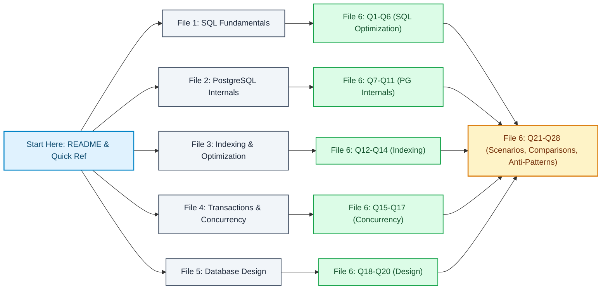
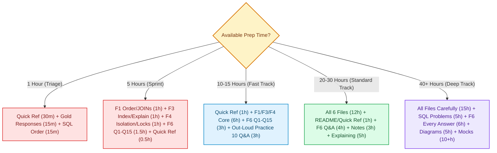
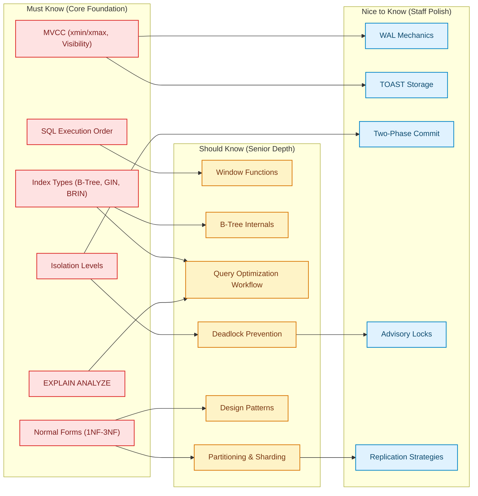
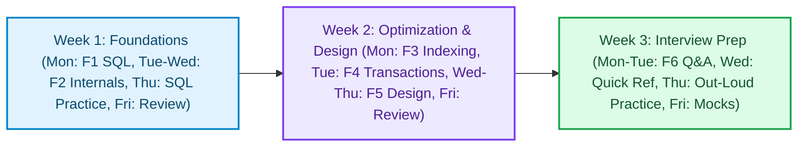

# Module 02: Database Deep Dive — Navigation & Study Tracker

> [!NOTE]
> **Module Scope:** 6,400+ lines (~200KB) across 6 deep-dive guides, a quick-reference sheet, and 50+ worked interview Q&As tailored for Senior/Staff Engineer interviews. Estimated total study time: **20–40 hours**.

---

## Quick Navigation

| Category | File | Size / Scope | Primary Focus |
| :--- | :--- | :--- | :--- |
| **Start Here** | [README.md](README.md) | Overview | Module roadmap & navigation help |
| **Cheat Sheet** | [QUICK-REFERENCE.md](QUICK-REFERENCE.md) | Printable | Rapid 30-min pre-interview review |
| **File 1** | [01-SQL-Fundamentals-and-Advanced.md](01-SQL-Fundamentals-and-Advanced.md) | 1,076 lines | Execution order, JOINs, window functions, CTEs, 20 SQL problems |
| **File 2** | [02-PostgreSQL-Internals.md](02-PostgreSQL-Internals.md) | 773 lines | Architecture, MVCC, WAL, VACUUM, buffer management & tuning |
| **File 3** | [03-Indexing-and-Query-Optimization.md](03-Indexing-and-Query-Optimization.md) | 874 lines | B-Tree, GIN/BRIN, composite indexes, `EXPLAIN ANALYZE`, partitioning |
| **File 4** | [04-Transactions-and-Concurrency-Control.md](04-Transactions-and-Concurrency-Control.md) | 903 lines | ACID, isolation levels, locking, deadlocks, optimistic vs pessimistic |
| **File 5** | [05-Database-Design-and-Normalization.md](05-Database-Design-and-Normalization.md) | 1,050 lines | 1NF–BCNF, denormalization, ER modeling, migrations & sharding |
| **File 6** | [06-Database-Interview-Questions.md](06-Database-Interview-Questions.md) | 1,466 lines | 50+ Q&As across 8 categories, scenarios & anti-patterns |

---

## Content Map & Module Architecture

| Topic Domain | Core Deep-Dive File | Interview Q&A Mapping |
| :--- | :--- | :--- |
| **SQL & Query Writing** | [File 1](01-SQL-Fundamentals-and-Advanced.md): SQL execution order, JOINs, window functions, CTEs | [File 6](06-Database-Interview-Questions.md): SQL query optimization problems (`Q1–Q6`) |
| **PostgreSQL Internals** | [File 2](02-PostgreSQL-Internals.md): MVCC, WAL, VACUUM, buffer management, tuning | [File 6](06-Database-Interview-Questions.md): PostgreSQL-specific questions (`Q7–Q11`) |
| **Indexing & Performance** | [File 3](03-Indexing-and-Query-Optimization.md): Index types, `EXPLAIN ANALYZE`, query optimization | [File 6](06-Database-Interview-Questions.md): Index-related questions (`Q12–Q14`) |
| **Transactions & Concurrency** | [File 4](04-Transactions-and-Concurrency-Control.md): ACID, isolation levels, locking, deadlocks | [File 6](06-Database-Interview-Questions.md): Concurrency questions (`Q15–Q17`) |
| **Database Design** | [File 5](05-Database-Design-and-Normalization.md): Normalization, design patterns, schema migration | [File 6](06-Database-Interview-Questions.md): Design questions (`Q18–Q20`) |
| **Scenarios & Debugging** | Cross-module synthesis | [File 6](06-Database-Interview-Questions.md): Real-world scenarios (`Q21–Q26`), comparisons (`Q27`), anti-patterns (`Q28`) |

---

## Study Track Selector & Time-Boxed Plans

### Primary Study Tracks

| Track | Duration | Step-by-Step Plan |
| :--- | :--- | :--- |
| **Fast Track** | 10–15 hours | 1. Read [QUICK-REFERENCE.md](QUICK-REFERENCE.md) (1h) 2. Read [File 1](01-SQL-Fundamentals-and-Advanced.md): Execution order, JOINs, window functions (2h) 3. Read [File 3](03-Indexing-and-Query-Optimization.md): Index types, `EXPLAIN ANALYZE` (2h) 4. Read [File 4](04-Transactions-and-Concurrency-Control.md): Isolation levels, deadlocks (2h) 5. Read [File 6](06-Database-Interview-Questions.md): First 15 Q&A (3h) 6. Practice: Answer 10 Q&A out loud (3h) |
| **Standard Track** | 20–30 hours | 1. Read all 6 main files (12h) 2. Review [README.md](README.md) and [QUICK-REFERENCE.md](QUICK-REFERENCE.md) (1h) 3. Study [File 6](06-Database-Interview-Questions.md) Q&A (4h) 4. Create personal notes on key concepts (3h) 5. Practice explaining concepts (5h) |
| **Deep Track** | 40+ hours | 1. Read all files carefully (15h) 2. Work through SQL problems (5h) 3. Study [File 6](06-Database-Interview-Questions.md) every answer (6h) 4. Create visual diagrams of concepts (5h) 5. Practice mock interviews (10+h) |

### Most Important Sections (By Time Budget)

| Budget | Priority Checklist |
| :--- | :--- |
| **If Only 1 Hour** | 1. Read [QUICK-REFERENCE.md](QUICK-REFERENCE.md) (30 min) 2. Memorize "Interview Gold Responses" section (15 min) 3. Review SQL execution order (15 min) |
| **If Only 5 Hours** | 1. [File 1](01-SQL-Fundamentals-and-Advanced.md): SQL execution order + JOINs (1 hour) 2. [File 3](03-Indexing-and-Query-Optimization.md): Index types + `EXPLAIN ANALYZE` (1 hour) 3. [File 4](04-Transactions-and-Concurrency-Control.md): Isolation levels + locking (1 hour) 4. [File 6](06-Database-Interview-Questions.md): `Q1–Q15` (1.5 hours) 5. [QUICK-REFERENCE.md](QUICK-REFERENCE.md) review (0.5 hour) |
| **If 20+ Hours** | 1. Read all 6 files thoroughly (15 hours) 2. Study and practice [File 6](06-Database-Interview-Questions.md) Q&A (5 hours) 3. Create personal notes (3 hours) 4. Review [QUICK-REFERENCE.md](QUICK-REFERENCE.md) (1 hour) |

---

## Topic Quick Links (Line-Range Index)

| File | Section & Line Ranges |
| :--- | :--- |
| **[01-SQL-Fundamentals-and-Advanced.md](01-SQL-Fundamentals-and-Advanced.md)** | [L1–50](01-SQL-Fundamentals-and-Advanced.md#L1-L50) SQL execution order · [L50–200](01-SQL-Fundamentals-and-Advanced.md#L50-L200) JOINs with diagrams · [L200–400](01-SQL-Fundamentals-and-Advanced.md#L200-L400) Subqueries vs JOINs · [L400–600](01-SQL-Fundamentals-and-Advanced.md#L400-L600) Window functions · [L600–750](01-SQL-Fundamentals-and-Advanced.md#L600-L750) CTEs · [L750–850](01-SQL-Fundamentals-and-Advanced.md#L750-L850) Set operations · [L850–1076](01-SQL-Fundamentals-and-Advanced.md#L850-L1076) 20 SQL problems |
| **[02-PostgreSQL-Internals.md](02-PostgreSQL-Internals.md)** | [L1–100](02-PostgreSQL-Internals.md#L1-L100) Architecture · [L100–250](02-PostgreSQL-Internals.md#L100-L250) MVCC & visibility · [L250–400](02-PostgreSQL-Internals.md#L250-L400) WAL · [L400–550](02-PostgreSQL-Internals.md#L400-L550) VACUUM · [L550–650](02-PostgreSQL-Internals.md#L550-L650) Configuration · [L650–773](02-PostgreSQL-Internals.md#L650-L773) Interview Q&A |
| **[03-Indexing-and-Query-Optimization.md](03-Indexing-and-Query-Optimization.md)** | [L1–150](03-Indexing-and-Query-Optimization.md#L1-L150) B-Tree structure · [L150–350](03-Indexing-and-Query-Optimization.md#L150-L350) Index types · [L350–500](03-Indexing-and-Query-Optimization.md#L350-L500) Composite indexes · [L500–700](03-Indexing-and-Query-Optimization.md#L500-L700) `EXPLAIN ANALYZE` · [L700–850](03-Indexing-and-Query-Optimization.md#L700-L850) Query optimization · [L850–874](03-Indexing-and-Query-Optimization.md#L850-L874) Partitioning |
| **[04-Transactions-and-Concurrency-Control.md](04-Transactions-and-Concurrency-Control.md)** | [L1–150](04-Transactions-and-Concurrency-Control.md#L1-L150) ACID properties · [L150–400](04-Transactions-and-Concurrency-Control.md#L150-L400) Isolation levels · [L400–600](04-Transactions-and-Concurrency-Control.md#L400-L600) Locking · [L600–750](04-Transactions-and-Concurrency-Control.md#L600-L750) Deadlocks · [L750–900](04-Transactions-and-Concurrency-Control.md#L750-L900) Optimistic vs pessimistic |
| **[05-Database-Design-and-Normalization.md](05-Database-Design-and-Normalization.md)** | [L1–200](05-Database-Design-and-Normalization.md#L1-L200) Normal forms (1NF–BCNF) · [L200–350](05-Database-Design-and-Normalization.md#L200-L350) Normalization vs denormalization · [L350–500](05-Database-Design-and-Normalization.md#L350-L500) ER modeling & keys · [L500–700](05-Database-Design-and-Normalization.md#L500-L700) Design patterns · [L700–900](05-Database-Design-and-Normalization.md#L700-L900) Migrations & sharding · [L900–1050](05-Database-Design-and-Normalization.md#L900-L1050) Design exercises |
| **[06-Database-Interview-Questions.md](06-Database-Interview-Questions.md)** | `Q1–Q6`: SQL optimization · `Q7–Q11`: PostgreSQL internals · `Q12–Q14`: Indexing · `Q15–Q17`: Transactions & concurrency · `Q18–Q20`: Database design · `Q21–Q26`: Scenario-based · `Q27`: Comparisons · `Q28`: Anti-patterns |

---

## Key Concepts Dependency Graph & Checklist

### Must Know
- [ ] SQL execution order (`FROM → WHERE → GROUP BY → HAVING → SELECT → ORDER BY → LIMIT`)
- [ ] MVCC (`xmin`/`xmax`, visibility, prevents blocking)
- [ ] Index types (B-Tree, GIN, BRIN, etc.)
- [ ] Isolation levels (`READ COMMITTED`, `REPEATABLE READ`, `SERIALIZABLE`)
- [ ] Normal forms (1NF, 2NF, 3NF)
- [ ] `EXPLAIN ANALYZE` interpretation

### Should Know
- [ ] B-Tree internals
- [ ] Window functions
- [ ] Deadlock prevention
- [ ] Query optimization workflow
- [ ] Design patterns
- [ ] Partitioning and sharding

### Nice to Know
- [ ] WAL mechanics
- [ ] TOAST storage
- [ ] Two-Phase Commit
- [ ] Advisory locks
- [ ] Replication strategies

---

## Practice Problems

### SQL Problems ([File 1](01-SQL-Fundamentals-and-Advanced.md#L850-L1076), end section)

| # | Problem | # | Problem |
| :---: | :--- | :---: | :--- |
| 1 | Find 2nd highest salary | 11 | Gap and islands problem |
| 2 | Find Nth highest salary | 12 | Ranking by amount |
| 3 | Employees earning &gt; department average | 13 | Top N customers |
| 4 | Top 3 employees by salary per department | 14 | Event sequence detection |
| 5 | Consecutive dates/login problem | 15 | Attrition by cohort |
| 6 | Pivot table | 16–20 | More challenging problems |
| 7 | Last login per user | | |
| 8 | Employees with no orders | | |
| 9 | Products never ordered | | |
| 10 | Median salary | | |

### Design Exercises & Interview Questions

| Category | Source | Scope |
| :--- | :--- | :--- |
| **Design Exercises** | [File 5](05-Database-Design-and-Normalization.md#L900-L1050) (end section) | 1. Social media database (users, posts, comments, followers) 2. E-commerce database (products, orders, inventory, payments) 3. Additional exercises to create from scratch |
| **Interview Questions** | [File 6](06-Database-Interview-Questions.md) | 50+ questions across 8 categories with full answers |

---

## Time Estimates & Week-by-Week Mastery Timeline

### Time Estimates

| Activity | Time |
| :--- | :--- |
| Read [File 1](01-SQL-Fundamentals-and-Advanced.md) (SQL) | 3–4 hours |
| Read [File 2](02-PostgreSQL-Internals.md) (Internals) | 2–3 hours |
| Read [File 3](03-Indexing-and-Query-Optimization.md) (Indexing) | 3–4 hours |
| Read [File 4](04-Transactions-and-Concurrency-Control.md) (Transactions) | 2–3 hours |
| Read [File 5](05-Database-Design-and-Normalization.md) (Design) | 3–4 hours |
| Read [File 6](06-Database-Interview-Questions.md) (Q&A) | 4–5 hours |
| Review [QUICK-REFERENCE.md](QUICK-REFERENCE.md) | 30 mins |
| Practice SQL problems | 3–5 hours |
| Practice explaining (out loud) | 5–10 hours |
| Mock interviews | 3–5 hours |
| **TOTAL** | **30–40 hours** |

### Interview Prep Week-by-Week

| Week | Monday | Tuesday | Wednesday | Thursday | Friday |
| :--- | :--- | :--- | :--- | :--- | :--- |
| **Week 1: Foundations** | Read [File 1](01-SQL-Fundamentals-and-Advanced.md) (SQL) | Read [File 2](02-PostgreSQL-Internals.md) (Internals) | Read [File 2](02-PostgreSQL-Internals.md) (Internals) | Practice SQL problems | Review and consolidate |
| **Week 2: Optimization & Design** | Read [File 3](03-Indexing-and-Query-Optimization.md) (Indexing) | Read [File 4](04-Transactions-and-Concurrency-Control.md) (Transactions) | Read [File 5](05-Database-Design-and-Normalization.md) (Design) | Read [File 5](05-Database-Design-and-Normalization.md) (Design) | Review and consolidate |
| **Week 3: Interview Prep** | Read [File 6](06-Database-Interview-Questions.md) (Q&A) | Read [File 6](06-Database-Interview-Questions.md) (Q&A) | Review [QUICK-REFERENCE.md](QUICK-REFERENCE.md) | Practice explaining answers | Mock interviews |

---

## Success Indicators

### Before Interview — Can You:
- [ ] Explain SQL execution order from memory
- [ ] Draw a Venn diagram for different JOINs
- [ ] Explain MVCC without looking it up
- [ ] Read `EXPLAIN ANALYZE` output and identify issues
- [ ] Explain at least 3 index types and when to use each
- [ ] Describe isolation levels and their trade-offs
- [ ] Normalize a schema to 3NF
- [ ] Answer 10 of the [File 6](06-Database-Interview-Questions.md) questions confidently

### During Interview — Remember to:
- [ ] Ask clarifying questions first
- [ ] Explain trade-offs (consistency vs performance)
- [ ] Show knowledge of internals
- [ ] Use `EXPLAIN ANALYZE` examples
- [ ] Provide both SQL and Java code examples
- [ ] Discuss monitoring and debugging
- [ ] Consider edge cases
- [ ] Be honest about unknowns

> [!TIP]
> **Final Reminders:**
> 1. **Read actively** — Make notes, draw diagrams, ask yourself questions
> 2. **Practice out loud** — Pretend you're explaining to an interviewer
> 3. **Use real examples** — Reference databases you've actually worked with
> 4. **Review [QUICK-REFERENCE.md](QUICK-REFERENCE.md)** — 30 minutes before your interview
> 5. **Get good sleep** — Night before interview is more important than cramming
> 6. **Be confident** — You've prepared thoroughly, trust your knowledge

---

## External Resources & Help

| Category | Resources |
| :--- | :--- |
| **Official Documentation** | PostgreSQL: https://www.postgresql.org/docs/current/ · MySQL: https://dev.mysql.com/doc/ · SQLite: https://www.sqlite.org/docs.html |
| **Practice Platforms** | LeetCode Database (medium-hard difficulty) · HackerRank SQL challenges · Mode Analytics SQL Tutorial · Stanford DB course materials |
| **Monitoring Tools** | `pg_stat_statements` (query statistics) · `EXPLAIN` (query planning) · `top`, `iostat`, `vmstat` (system metrics) · `pgAdmin` (GUI management) |

> [!IMPORTANT]
> **Questions?** All content is self-contained in these files. If something is unclear:
> 1. Check the specific file for that topic
> 2. Review [QUICK-REFERENCE.md](QUICK-REFERENCE.md) for key concepts
> 3. Look at [File 6](06-Database-Interview-Questions.md) for worked examples
> 4. Check [README.md](README.md) for navigation help
>
> Good luck with your FAANG interview!

---

**Last Updated:** February 2025 · **Total Content:** 6,400+ lines, ~200KB · **Estimated Study Time:** 20–40 hours · **Target:** Senior/Staff Engineer level interviews
