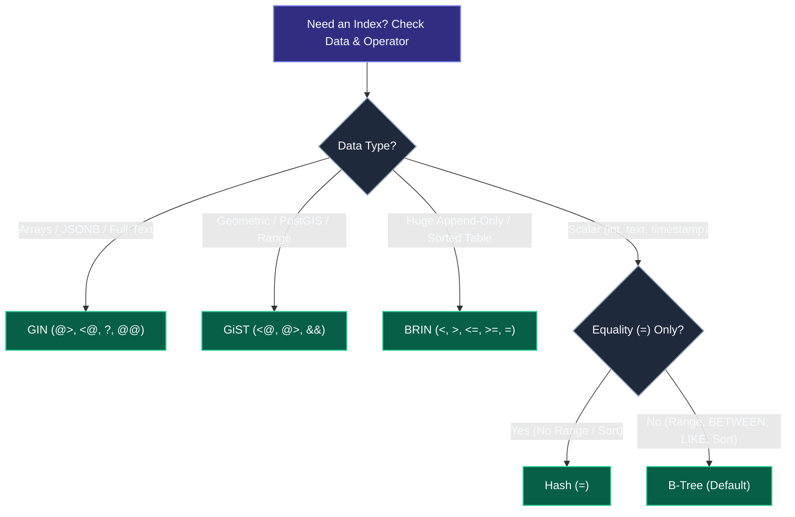
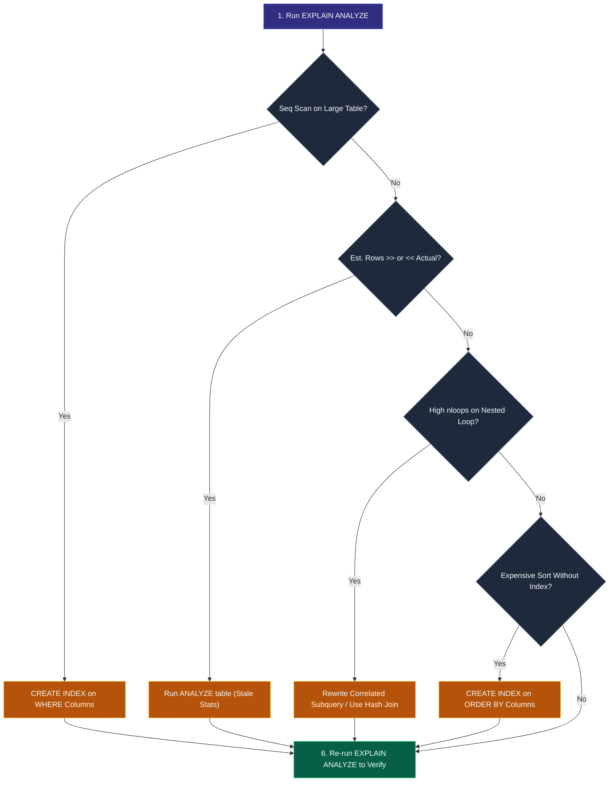
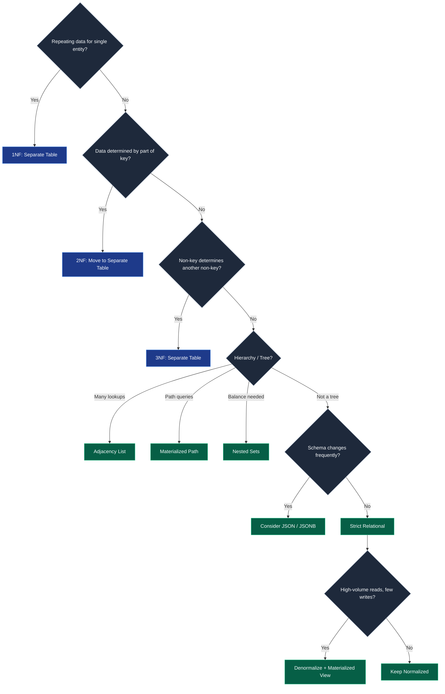

# Quick Reference Guide - Database Interview Cheat Sheet

> [!IMPORTANT]
> **Last-Minute Interview Mantra:** Always clarify **scale ("How large?")** and **access pattern ("Read/write ratio, filters, joins?")**, then reason through trade-offs using `EXPLAIN ANALYZE` and PostgreSQL internals.

---

## 1. SQL Execution Order (MEMORIZE THIS)


| Rule | Why It Matters |
| :--- | :--- |
| **Cannot use `SELECT` aliases in `WHERE`** | `WHERE` runs at step 2; `SELECT` aliases do not exist until step 5 |
| **Can use `SELECT` aliases in `ORDER BY`** | `ORDER BY` runs at step 6, after `SELECT` |
| **Aggregates only in `SELECT` / `HAVING`** | Grouping happens at step 3; row-level `WHERE` cannot evaluate group aggregates |
| **`WHERE` vs `HAVING`** | `WHERE` filters individual rows before grouping; `HAVING` filters groups after `GROUP BY` |

---

## 2. Index Types & Selector Tree



| Type | Best Use Case | Supported Operators |
| :--- | :--- | :--- |
| **B-Tree** | Default index, equality & ranges, sorting | `=`, `<`, `>`, `<=`, `>=`, `BETWEEN`, `LIKE` |
| **Hash** | Equality lookups only | `=` |
| **GIN** | Arrays, JSON/JSONB, full-text search | `@>`, `<@`, `?`, `@@` |
| **BRIN** | Very large, physically sorted tables (e.g., timestamps) | `<`, `>`, `<=`, `>=`, `=` |
| **GiST** | Geometric data, PostGIS, overlapping ranges | `<@`, `@>`, `&&` |

---

## 3. Isolation Levels & Anomaly Matrix


| Isolation Level | Dirty Reads | Non-Repeatable Reads | Phantom Reads | Notes & Cost |
| :--- | :---: | :---: | :---: | :--- |
| **READ COMMITTED** *(default)* | Prevented | Allowed | Allowed | Lowest contention; each statement sees latest committed data |
| **REPEATABLE READ** | Prevented | Prevented | Allowed *(per spec)* | Snapshot taken at transaction start |
| **SERIALIZABLE** *(safest)* | Prevented | Prevented | Prevented | May throw serialization errors (`40001`); retry with backoff |

---

## 4. `EXPLAIN ANALYZE` Triage & 60-Second Query Optimization



| `EXPLAIN ANALYZE` Red Flag | Root Issue | Fix |
| :--- | :--- | :--- |
| **Seq Scan (large table)** | Missing index | `CREATE INDEX` on `WHERE` columns |
| **High `nloops` on Nested Loop** | Inefficient join / correlated subquery | Use Hash Join with `JOIN` condition |
| **Est. rows >> Actual rows** | Bad planner statistics | `ANALYZE table` |
| **Est. rows << Actual rows** | Bad planner statistics | `ANALYZE table` |
| **Sort without index** | No `ORDER BY` index | `CREATE INDEX` on `ORDER BY` columns |

**60-Second Query Optimization Steps:**
1. **Get `EXPLAIN ANALYZE` output** (shows actual vs. estimated rows & timings)
2. **Look for `Seq Scan`** -> `CREATE INDEX`
3. **Look for high row discrepancy** -> `ANALYZE table`
4. **Look for correlated subquery** -> Rewrite as `JOIN`
5. **Look for `Sort`** -> `CREATE INDEX` on `ORDER BY`
6. **Verify improvement** -> Re-run `EXPLAIN ANALYZE`

---

## 5. MVCC Core Concept

```mermaid
sequenceDiagram
    participant R as Reader (Snapshot T10)
    participant DB as Row Version (xmin / xmax)
    participant W as Writer (Tx T12)

    Note over DB: Row active: xmin=5, xmax=NULL
    R->>DB: SELECT (checks snapshot T10)
    DB-->>R: Visible (xmin=5 committed &lt; T10, xmax is NULL)
    W->>DB: UPDATE / DELETE (sets old xmax=12, inserts new xmin=12)
    R->>DB: SELECT again in same snapshot
    DB-->>R: Still sees old version (xmax=12 not committed at T10)
    Note over DB: Old version becomes dead tuple after T12 commits -> VACUUM reclaims
```

Every row stores two transaction IDs:
- **`xmin`**: Insert transaction ID (when the row was inserted)
- **`xmax`**: Delete transaction ID (when the row was deleted; `NULL` if active)

**Visibility Check:**
- Is `xmin` committed before my snapshot? If yes -> row is visible
- Is `xmax` set and committed? If yes -> row is deleted

> [!TIP]
> **Interview Gold — "Explain MVCC":**
> "PostgreSQL keeps multiple versions of rows (`xmin`/`xmax`). Readers see a snapshot at transaction start. Writers create new versions. There is no blocking between readers and writers. Problem: Dead tuples accumulate, so `VACUUM` is needed."

---

## 6. Window Functions & JOINs

### Window Function Pattern
```sql
SELECT
    col1, col2,
    FUNCTION() OVER (PARTITION BY partition_col ORDER BY order_col) AS result
FROM table;
```

| Function | Behavior |
| :--- | :--- |
| `ROW_NUMBER()` | Sequential numbering (1, 2, 3, 4) |
| `RANK()` | Rank with gaps for ties (1, 1, 3, 4) |
| `DENSE_RANK()` | Rank without gaps for ties (1, 1, 2, 3) |
| `LEAD()` / `LAG()` | Access next / previous row values without self-join |
| Running totals | `SUM() OVER (... ROWS BETWEEN UNBOUNDED PRECEDING AND CURRENT ROW)` |

### JOIN Types & Performance

| JOIN Type | Result Set |
| :--- | :--- |
| **`INNER JOIN`** | Both tables, matching rows only |
| **`LEFT JOIN`** | All left rows, matching right rows (`NULL` if no match) |
| **`RIGHT JOIN`** | All right rows, matching left rows *(avoid; use `LEFT JOIN` for readability)* |
| **`FULL OUTER JOIN`** | All rows from both tables |
| **`CROSS JOIN`** | Cartesian product *(rarely needed)* |
| **`SELF JOIN`** | Table joined to itself |

```sql
-- Always: Create indexes on join columns
CREATE INDEX ON table(join_column);

-- Composite JOIN indexes
CREATE INDEX ON orders(customer_id, created_at);

-- Covering indexes for common joins (Index-Only Scan)
CREATE INDEX ON orders(customer_id) INCLUDE (total, status);
```

---

## 7. N+1 Query Anti-Pattern & Common SQL Mistakes

```mermaid
sequenceDiagram
    participant App as Java Service
    participant DB as Database

    Note over App,DB: BAD: N+1 Queries (1 + N round trips)
    App->>DB: SELECT * FROM customers (1 query)
    loop For each of N customers
        App->>DB: SELECT * FROM orders WHERE customer_id = ? (N queries)
    end

    Note over App,DB: GOOD: Batch / JOIN FETCH (2 or 1 round trips)
    App->>DB: SELECT * FROM customers
    App->>DB: SELECT * FROM orders WHERE customer_id IN (...) (1 query)
    App-->>App: Map&lt;Long, List&lt;Order&gt;&gt; in-memory lookup
```

### N+1 in Application Code (Java)
```java
// PROBLEM: 1 + N queries
for (Customer c : customers) {               // 1 query
    List<Order> orders = fetchOrders(c.id);  // N queries
}

// SOLUTION: Batch fetch + Map lookup (or JOIN FETCH in JPA)
Map<Long, List<Order>> orders =
    fetchOrdersByCustomerIds(customerIds);   // 1 query
for (Customer c : customers) {
    List<Order> o = orders.get(c.id);        // Memory lookup
}
```

### Common SQL Mistake: Correlated Subquery (N+1 in SQL)
```sql
-- WRONG: Correlated subquery (executes per outer row)
SELECT e.* FROM employees e
WHERE salary > (
    SELECT AVG(salary) FROM employees e2
    WHERE e2.dept_id = e.dept_id
);

-- RIGHT: Aggregate once and JOIN
SELECT e.* FROM employees e
JOIN (
    SELECT dept_id, AVG(salary) AS avg_sal
    FROM employees GROUP BY dept_id
) d ON e.dept_id = d.dept_id
WHERE e.salary > d.avg_sal;
```

### CTE Pattern (Always Consider)
```sql
WITH intermediate AS (
    SELECT filtered_cols FROM source_table
    WHERE condition
)
SELECT * FROM intermediate
WHERE additional_filters;
```
- **Readability**: Breaks complex queries into named logical steps
- **Reusable**: Reference the CTE multiple times in the main query
- **Performance**: Cleanly isolates intermediate sets *(often materialized)*

---

## 8. Locking, Deadlocks & Transactions

### Locking Modes in SQL
```sql
SELECT ... FOR UPDATE;             -- Exclusive row lock
SELECT ... FOR SHARE;              -- Shared row lock (blocks writers, allows readers)
SELECT ... FOR UPDATE NOWAIT;      -- Fail immediately if already locked
SELECT ... FOR UPDATE SKIP LOCKED; -- Skip locked rows (ideal for job queues)
```

### Deadlock Prevention & Java Transaction Pattern
| Strategy | Implementation |
| :--- | :--- |
| **1. Lock Order** | Always acquire locks on tables/rows in the exact same order |
| **2. Timeouts** | `SET lock_timeout = '5 seconds'` |
| **3. Retry Logic** | Exponential backoff on deadlock / serialization failure (`40001`) |
| **4. Short Transactions** | Keep transactions `< 1 second` to release locks faster |

```java
// Manual JPA / EntityManager pattern (or @Transactional with short scope)
try {
    em.getTransaction().begin();
    // Business logic (keep duration < 1 second!)
    em.getTransaction().commit();
} catch (Exception e) {
    em.getTransaction().rollback();
    throw e;
}
```

> [!WARNING]
> Never hold a database transaction open across external HTTP/RPC calls or slow I/O—long transactions hold row locks, block writers, and prevent `VACUUM` from reclaiming dead tuples.

---

## 9. Normalization & Design Pattern Decision Tree



| Normal Form | Rule | Problem Prevented |
| :--- | :--- | :--- |
| **1NF** | No repeating groups; atomic values | Inconsistent data |
| **2NF** | 1NF + no partial dependencies on composite key | Redundancy |
| **3NF** | 2NF + no transitive dependencies (non-key -> non-key) | Update anomalies |
| **BCNF** | Every determinant is a candidate key | Complex anomalies |

---

## 10. PostgreSQL Parameters & Tuning Checklist

### Key PostgreSQL Parameters
| Parameter | Recommended Value | Purpose |
| :--- | :--- | :--- |
| `shared_buffers` | `25%` of RAM *(default 128MB)* | PostgreSQL page cache |
| `effective_cache_size` | `50-75%` of RAM | Planner hint for OS + PG cache |
| `work_mem` | `256MB` *(or `RAM / (max_connections * 2)`)* | Per-operation sort/hash memory |
| `maintenance_work_mem` | `1GB` | `VACUUM`, `CREATE INDEX`, `REINDEX` |
| `random_page_cost` | `1.1` for SSD (`4.0` for HDD) | Planner cost of random disk I/O |
| `max_connections` | `100+` *(pair with connection pooler)* | Connection limit |
| `wal_level` | `replica` | Write-Ahead Log replication support |
| `autovacuum` | `on` | Background dead-tuple cleanup & stats |

### Database Tuning Checklist
- [ ] `shared_buffers = 25% of RAM`
- [ ] `effective_cache_size = 50-75% of RAM`
- [ ] `work_mem = RAM / (max_connections * 2)`
- [ ] `random_page_cost = 1.1` for SSD (`4.0` for HDD)
- [ ] `autovacuum` enabled and tuned
- [ ] Indexes on frequently filtered (`WHERE` / `JOIN` / `ORDER BY`) columns
- [ ] Statistics up-to-date (`ANALYZE`)
- [ ] No N+1 queries
- [ ] Connection pooling configured (e.g., HikariCP / PgBouncer)
- [ ] Replication / failover tested

---

## 11. Interview Gold Responses & Key Numbers

### Interview Gold Responses

| Question | 30-Second Winning Answer |
| :--- | :--- |
| **"Query is Slow"** | "I'd run `EXPLAIN ANALYZE` to inspect the plan. Check for `Seq Scan` (missing index), bad cardinality (run `ANALYZE`), or correlated subqueries (N+1). Fix accordingly and re-verify with `EXPLAIN ANALYZE`." |
| **"Design Database for X"** | "First, identify entities and relationships. Normalize to 3NF. Add indexes on frequent `WHERE`/`JOIN`/`ORDER BY` columns. Consider partitioning for large tables. Set up replication for HA. Monitor with `pg_stat_*`." |
| **"Deadlock Under Load"** | "Ensure all transactions lock tables in the same order. Use `NOWAIT`/`SKIP LOCKED` for queues. Keep transactions short. Implement exponential backoff retry logic. Monitor `pg_stat_database.deadlocks`." |

### Stats You Should Know
- **PostgreSQL throughput**: ~`6,144` transactions/sec per core (typical)
- **Index lookup**: `O(log n)`, ~`20` I/Os for `1B` rows
- **Sequential scan**: `O(n)`, ~`1M` rows/sec
- **Page size**: `8KB` (fixed in PostgreSQL)
- **Default `shared_buffers`**: `128MB` (increase to `25%` of RAM)

### Final Interview Tips
1. Always ask **"How large?"** and **"What's the access pattern?"**
2. Explain **trade-offs** (consistency vs. speed, simplicity vs. performance)
3. Use **`EXPLAIN ANALYZE`** as your best friend
4. Mention specific **PostgreSQL features** (MVCC, partitioning, `SKIP LOCKED`, `INCLUDE` indexes)
5. Show **Java/ORM knowledge** (eager loading, batching, prepared statements, `@Transactional` scope)
6. Discuss **monitoring** (how would you detect this in production, e.g., `pg_stat_*`)
7. Think about **failure scenarios** (what if this fails?)
8. **Be honest about unknowns** (better than guessing)

---

**Print this page. Review before interview. Good luck!**
