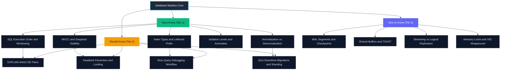
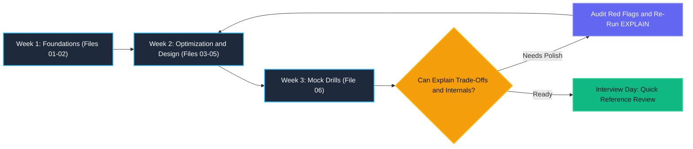

# Database & PostgreSQL Deep-Dive Interview Preparation

> [!NOTE]
> **Target Audience & Scope:** Built for mid-to-senior Java engineers (5+ years) preparing for FAANG technical interviews (Google, Amazon, Meta, Apple, Netflix, Microsoft). Covers **6,100+ lines** across **6 core guides** (~170 KB), **300+ code examples**, **150+ SQL queries**, and **50+ interview Q&As**.

---

## Module Learning Roadmap

Follow the 6-stage progression below from SQL execution fundamentals through PostgreSQL internals, query optimization, concurrency control, schema design, and FAANG scenario drills.

```mermaid
flowchart LR
    S1["01 SQL Fundamentals (1,076 lines)"] --> S2["02 PostgreSQL Internals (773 lines)"]
    S2 --> S3["03 Indexing and Optimization (874 lines)"]
    S3 --> S4["04 Transactions and Concurrency (903 lines)"]
    S4 --> S5["05 Database Design and Scale (1,050 lines)"]
    S5 --> S6["06 FAANG 50+ Q&amp;As (1,466 lines)"]

    S1 -.-> QR["Quick Reference Cheat Sheet"]
    S6 -.-> IDX["Full Module Index"]

    classDef foundation fill:#0ea5e9,stroke:#38bdf8,color:#0f172a,stroke-width:2px
    classDef engine fill:#6366f1,stroke:#818cf8,color:#f8fafc,stroke-width:2px
    classDef perf fill:#14b8a6,stroke:#2dd4bf,color:#0f172a,stroke-width:2px
    classDef concurrency fill:#f59e0b,stroke:#fbbf24,color:#0f172a,stroke-width:2px
    classDef design fill:#8b5cf6,stroke:#a78bfa,color:#f8fafc,stroke-width:2px
    classDef mastery fill:#10b981,stroke:#34d399,color:#0f172a,stroke-width:2px
    classDef ref fill:#1e293b,stroke:#64748b,color:#e2e8f0,stroke-width:1.5px

    class S1 foundation
    class S2 engine
    class S3 perf
    class S4 concurrency
    class S5 design
    class S6 mastery
    class QR,IDX ref
```

| Metric | Value | Coverage |
| :--- | :--- | :--- |
| **Total Content** | 6,100+ lines (~170 KB) | 6 deep-dive guides + [INDEX.md](./INDEX.md) + [QUICK-REFERENCE.md](./QUICK-REFERENCE.md) |
| **Code & SQL** | 300+ examples, 150+ queries | PostgreSQL SQL, `EXPLAIN ANALYZE`, Java/JPA locking patterns |
| **Practice & Q&A** | 20 SQL challenges + 50+ Q&As | Window functions, MVCC, deadlocks, system design, war stories |
| **Difficulty** | Senior / Staff Engineer | Trade-off analysis, internals, production debugging |

---

## Core Modules & File Breakdown

| # | Module Guide | Lines | Core Focus | Key Hands-On Deliverables |
| :--- | :--- | :---: | :--- | :--- |
| **01** | [01-SQL-Fundamentals-and-Advanced.md](./01-SQL-Fundamentals-and-Advanced.md) | 1,076 | Execution order, JOINs, Window Functions, CTEs, `EXISTS` vs `IN` | 20 solved SQL interview problems (Nth salary, consecutive dates, pivoting) |
| **02** | [02-PostgreSQL-Internals.md](./02-PostgreSQL-Internals.md) | 773 | Postmaster/backends, MVCC (`xmin`/`xmax`), WAL, `VACUUM`, TOAST, PgBouncer | Tuning `shared_buffers`, `work_mem`, `effective_cache_size`, `jsonb` |
| **03** | [03-Indexing-and-Query-Optimization.md](./03-Indexing-and-Query-Optimization.md) | 874 | B-Tree, Hash, GiST, SP-GiST, GIN, BRIN, covering/partial indexes | Reading `EXPLAIN (ANALYZE, BUFFERS)`, fixing N+1, partitioning |
| **04** | [04-Transactions-and-Concurrency-Control.md](./04-Transactions-and-Concurrency-Control.md) | 903 | ACID, isolation levels, anomalies, row/table/advisory locks, 2PC | Deadlock prevention, `SKIP LOCKED`, Java/JPA optimistic vs pessimistic |
| **05** | [05-Database-Design-and-Normalization.md](./05-Database-Design-and-Normalization.md) | 1,050 | 1NF–BCNF, denormalization, EAV, trees, zero-downtime migrations | Sharding, streaming vs logical replication, Twitter/X & e-commerce schemas |
| **06** | [06-Database-Interview-Questions.md](./06-Database-Interview-Questions.md) | 1,466 | 50+ FAANG Q&As across SQL, internals, indexing, concurrency, design | "Your query is slow" war stories, XID wraparound, 10 red-flag anti-patterns |

> [!TIP]
> **Fast Navigation:** Use [INDEX.md](./INDEX.md) for a topic-by-topic map and [QUICK-REFERENCE.md](./QUICK-REFERENCE.md) for last-minute interview day syntax and tuning formulas.

---

## Topic Dependency & FAANG Priority Tree

Understanding how PostgreSQL storage and SQL execution underpin indexing, locking, and distributed scaling makes trade-off questions effortless.

---

## 3-Week Prep Track Loop

Structure your preparation into focused weekly sprints with active SQL execution and out-loud mock explanations.

| Phase | Files to Study | Action Plan |
| :--- | :--- | :--- |
| **Week 1: Fundamentals** | `01` SQL + `02` PostgreSQL | Master SQL execution order, solve all 20 SQL challenges, diagram MVCC & WAL |
| **Week 2: Optimization & Design** | `03` Indexing + `04` Transactions + `05` Design | Practice `EXPLAIN ANALYZE`, compare isolation anomalies, sketch sharded schemas |
| **Week 3: Interview Prep** | `06` 50+ Q&As | Explain answers out loud, drill scenario questions, eliminate the 10 red flags |
| **Interview Day** | [QUICK-REFERENCE.md](./QUICK-REFERENCE.md) | Review trade-offs, tuning parameters, and concrete production examples |

---

## Interview Question Quick Index

All 28+ grouped question sets live in [06-Database-Interview-Questions.md](./06-Database-Interview-Questions.md):

| Topic | Question Range | Difficulty | Primary Reference |
| :--- | :--- | :--- | :--- |
| **SQL Query Optimization** | Q1–Q6 | Easy–Medium | [01-SQL-Fundamentals-and-Advanced.md](./01-SQL-Fundamentals-and-Advanced.md) |
| **MVCC Internals** | Q7 | Medium | [02-PostgreSQL-Internals.md](./02-PostgreSQL-Internals.md) |
| **WAL & Durability** | Q8 | Medium | [02-PostgreSQL-Internals.md](./02-PostgreSQL-Internals.md) |
| **VACUUM & Bloat** | Q9 | Medium | [02-PostgreSQL-Internals.md](./02-PostgreSQL-Internals.md) |
| **Buffer & Slow Query Tuning** | Q10–Q11 | Medium | [02-PostgreSQL-Internals.md](./02-PostgreSQL-Internals.md) |
| **Index Types & Composite Order** | Q12–Q14 | Medium | [03-Indexing-and-Query-Optimization.md](./03-Indexing-and-Query-Optimization.md) |
| **Isolation Levels & Anomalies** | Q15 | Hard | [04-Transactions-and-Concurrency-Control.md](./04-Transactions-and-Concurrency-Control.md) |
| **Deadlocks & Locking (Java/JPA)** | Q16–Q17 | Hard | [04-Transactions-and-Concurrency-Control.md](./04-Transactions-and-Concurrency-Control.md) |
| **System & Schema Design** | Q18–Q20 | Hard | [05-Database-Design-and-Normalization.md](./05-Database-Design-and-Normalization.md) |
| **Production Scenarios & Outages** | Q21–Q26 | Hard | [06-Database-Interview-Questions.md](./06-Database-Interview-Questions.md) |
| **PostgreSQL vs MySQL vs NoSQL** | Q27 | Medium | [06-Database-Interview-Questions.md](./06-Database-Interview-Questions.md) |
| **10 Red Flags & Anti-Patterns** | Q28 | Easy | [06-Database-Interview-Questions.md](./06-Database-Interview-Questions.md) |

> [!IMPORTANT]
> **Interview Day Checklist:** Always clarify scale and read/write ratios first, state trade-offs (consistency vs availability, write amplification vs read latency), cite internals (`MVCC`, `B-Tree`, `EXPLAIN (ANALYZE, BUFFERS)`), and address edge cases (`NULL`s, empty sets, concurrent updates).

---

## Success Metrics & Practice Toolkit

| Readiness Dimension | Target Outcome | Verification Method |
| :--- | :--- | :--- |
| **SQL Fluency** | Write JOINs, window functions, and recursive CTEs cleanly | Solve all 20 problems in Module 01 without hints |
| **Query Diagnostics** | Read `EXPLAIN (ANALYZE, BUFFERS)` and spot Seq Scans / N+1 | Profile real queries using `pg_stat_statements` |
| **Concurrency Mastery** | Explain MVCC snapshots, isolation anomalies, and `SKIP LOCKED` | Walk through Java/JPA optimistic vs pessimistic locking |
| **Architecture & Scale** | Design 3NF schemas, zero-downtime migrations, and shard keys | Practice Twitter/X and e-commerce schema exercises |

### Diagnostics & External Practice

- **PostgreSQL Docs:** Official [PostgreSQL Documentation](https://www.postgresql.org/docs/current/) for syntax, configuration parameters, and system catalogs.
- **Query Profiling:** Enable `pg_stat_statements` and `log_min_duration_statement`, inspect bloat via `pg_stat_user_tables`, and run `EXPLAIN (ANALYZE, BUFFERS)`.
- **Hands-On Drills:** LeetCode Database (Medium–Hard), HackerRank SQL, and a local PostgreSQL instance loaded with real schemas.

> [!WARNING]
> **Common Pitfalls to Avoid:** Never skip `NULL` semantics in `NOT IN` vs `NOT EXISTS`, never add indexes blindly without checking write amplification, and never run long-running idle transactions that block `VACUUM` and risk XID wraparound.

---

**Last Updated:** February 2025 · **Target Companies:** Google, Amazon, Meta, Apple, Netflix, Microsoft · **Difficulty:** Senior / Staff Engineer
