# Creational Design Patterns: In-Depth Guide for FAANG Interviews

## Overview
Creational patterns abstract the object instantiation process so systems remain independent of how objects are created, composed, and represented. In FAANG interviews and production Java systems (such as Spring, JDBC, and `java.util.concurrent`), they govern **instance lifecycle**, **polymorphic creation**, and **complex object assembly**.

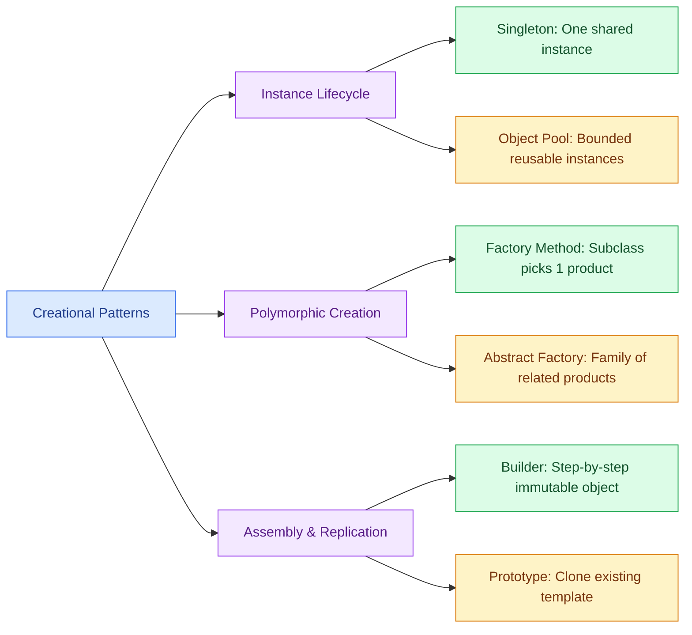

---

## Table of Contents
1. [1. Singleton Pattern](#1-singleton-pattern)
2. [2. Factory Method Pattern](#2-factory-method-pattern)
3. [3. Abstract Factory Pattern](#3-abstract-factory-pattern)
4. [4. Builder Pattern](#4-builder-pattern)
5. [5. Prototype Pattern](#5-prototype-pattern)
6. [6. Object Pool Pattern](#6-object-pool-pattern)
7. [Summary Table: When to Use Each Creational Pattern](#summary-table-when-to-use-each-creational-pattern)

---

## 1. Singleton Pattern

### Intent
Ensure a class has **only one instance** and provide a **global point of access** to it.

### Problem It Solves
- Prevents resource waste from duplicate heavy objects (e.g., database connection pools, thread pools).
- Maintains consistent global state (e.g., configuration managers, logging systems, caches).
- Coordinates synchronized access to shared resources.

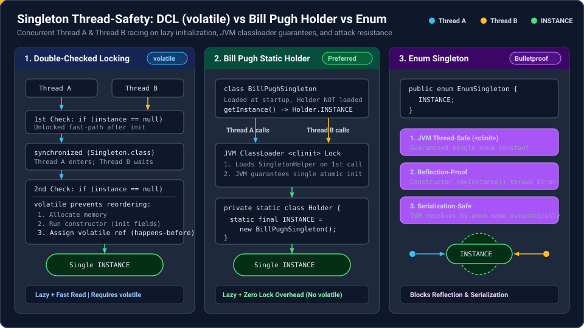

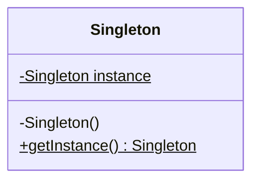

### 1.1 Implementation Variants Compared

| Variant | Lazy? | Thread-Safe? | Reflection / Serialization Safe? | Performance | Verdict |
|---|---|---|---|---|---|
| **Eager Initialization** | No | Yes (classloader) | No | Fast | Good only if always used |
| **Synchronized Method** | Yes | Yes | No | Slow (lock on every call) | Avoid in high concurrency |
| **Double-Checked Locking (`volatile`)** | Yes | Yes | No | Fast after init | Good if args needed at runtime |
| **Bill Pugh Static Holder** | Yes | Yes (JVM `<clinit>`) | No (needs guards) | Fastest lazy | **Recommended** for classes |
| **Enum Singleton** | On 1st access | Yes (JVM) | **Yes (built-in)** | Fastest | **Most bulletproof** |

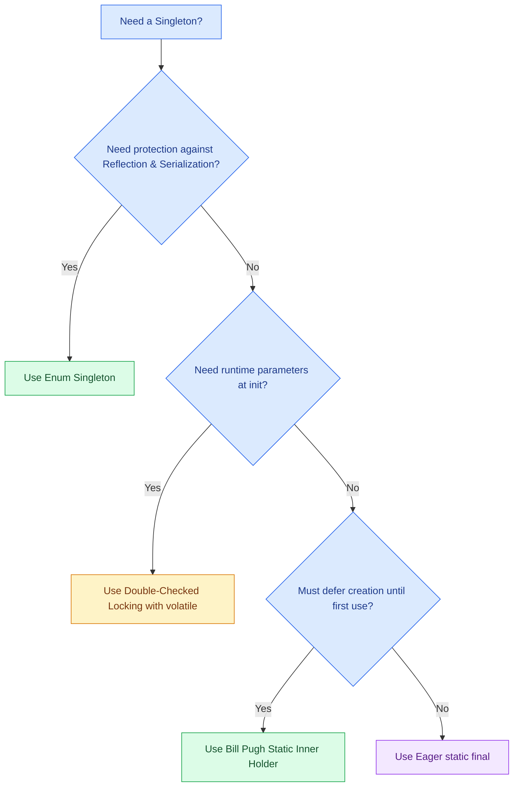

### 1.2 Eager Initialization (Thread-Safe but Wasteful)

```java
public class EagerSingleton {
    // Instance created at class loading time
    private static final EagerSingleton instance = new EagerSingleton();

    private EagerSingleton() {
        if (instance != null) {
            throw new IllegalStateException("Singleton already initialized");
        }
    }

    public static EagerSingleton getInstance() {
        return instance;
    }
}
```
- **Pros:** Simple, thread-safe by JVM classloader guarantees.
- **Cons:** Wastes memory if never used; cannot pass runtime initialization parameters.

### 1.3 Lazy Initialization with Synchronization (Simple but Slow)

```java
public class LazySingleton {
    private static LazySingleton instance;

    private LazySingleton() {}

    // Synchronized method - thread-safe but every call acquires a monitor lock
    public synchronized static LazySingleton getInstance() {
        if (instance == null) {
            instance = new LazySingleton();
        }
        return instance;
    }
}
```
- **Pros:** Thread-safe and lazy.
- **Cons:** Severe contention bottleneck under high concurrency because every `getInstance()` call synchronizes.

### 1.4 Double-Checked Locking (Good Performance + Thread Safety)

```java
public class DoubleCheckedLockingSingleton {
    private static volatile DoubleCheckedLockingSingleton instance;

    private DoubleCheckedLockingSingleton() {}

    public static DoubleCheckedLockingSingleton getInstance() {
        if (instance == null) { // 1st check (unlocked)
            synchronized (DoubleCheckedLockingSingleton.class) {
                if (instance == null) { // 2nd check (locked)
                    instance = new DoubleCheckedLockingSingleton();
                }
            }
        }
        return instance;
    }
}
```

> [!IMPORTANT]
> **Why `volatile` is mandatory in DCL:** `new Singleton()` is not atomic—it involves (1) memory allocation, (2) constructor execution, and (3) reference assignment. Without `volatile`, the JVM/CPU may reorder steps 2 and 3, allowing another thread to observe a non-null but **partially constructed** object. `volatile` establishes a happens-before memory barrier.

### 1.5 Bill Pugh Singleton (Class Loader Pattern — Recommended)

```java
public class BillPughSingleton {
    private BillPughSingleton() {}

    // Loaded only when getInstance() references SingletonHelper.INSTANCE
    private static class SingletonHelper {
        private static final BillPughSingleton INSTANCE = new BillPughSingleton();
    }

    public static BillPughSingleton getInstance() {
        return SingletonHelper.INSTANCE;
    }
}
```
- **Why it is superior:** Zero explicit `synchronized` overhead. The JVM synchronizes class initialization (`<clinit>`) on first reference to `SingletonHelper`, making it both **lazy** and **thread-safe**.

### 1.6 Enum-Based Singleton (Most Bulletproof)

```java
public enum EnumSingleton {
    INSTANCE;

    private String data = "Enum Singleton";

    public String getData() { return data; }
    public void setData(String data) { this.data = data; }
}
```
- **Why Enums win on safety:**
  1. **Serialization-safe:** JVM resolves enum constants by name; `readResolve()` is unnecessary.
  2. **Reflection-proof:** `Constructor.newInstance()` explicitly rejects `Enum` types.
  3. **Thread-safe:** Guaranteed by JVM enum initialization.

### 1.7 Breaking Singleton — Attacks and Prevention

| Attack Vector | How It Breaks Singleton | Prevention |
|---|---|---|
| **Reflection** | `constructor.setAccessible(true); constructor.newInstance();` | Throw `IllegalStateException` in private constructor if already created (or use `enum`) |
| **Serialization** | `ObjectInputStream.readObject()` allocates a new instance | Implement `protected Object readResolve() { return getInstance(); }` (or use `enum`) |
| **Cloning** | `singleton.clone()` via `Cloneable` creates a copy | Override `clone()` and throw `CloneNotSupportedException` |

```java
// Combined Reflection + Serialization + Cloning Guards
public class HardenedSingleton implements Serializable, Cloneable {
    private static final long serialVersionUID = 1L;
    private static boolean instanceCreated = false;

    private HardenedSingleton() {
        if (instanceCreated) {
            throw new IllegalStateException("Singleton already created");
        }
        instanceCreated = true;
    }

    private static class Holder {
        private static final HardenedSingleton INSTANCE = new HardenedSingleton();
    }

    public static HardenedSingleton getInstance() {
        return Holder.INSTANCE;
    }

    protected Object readResolve() {
        return getInstance();
    }

    @Override
    public Object clone() throws CloneNotSupportedException {
        throw new CloneNotSupportedException("Singleton cloning not allowed");
    }
}
```

### Real-World Examples
- **Logger (Spring / SLF4J):** `LoggerFactory.getLogger(ApplicationLogger.class)` caches logger instances per class name.
- **Database Connection Pool:** A single `DatabaseConnectionPool` (using Bill Pugh `PoolHelper`) manages a fixed pool of `Connection` objects with `synchronized getConnection()` (`wait()`) and `releaseConnection()` (`notifyAll()`).

### Trade-Offs & Interview Questions
- **When to Use:** Connection pools, loggers, cache managers, config managers, thread pools, event buses.
- **When NOT to Use:** When unit testing requires easy mocking, when tight coupling hurts modularity, or when distributed/multi-instance scaling is required.
- **Q1: Why is `volatile` necessary in DCL?** Prevents instruction reordering and ensures memory visibility across threads so no thread sees a half-initialized object.
- **Q2: Enum vs Bill Pugh?** Enum is automatically reflection-proof and serialization-safe; Bill Pugh requires explicit guards (`readResolve()`, constructor flag) but supports class inheritance/lazy loading without enum constraints.
- **Q3: How does Spring handle Singleton scope?** Spring uses a **Singleton registry** (`DefaultSingletonBeanRegistry`) per `ApplicationContext` container rather than a strict JVM-wide GoF Singleton.

---

## 2. Factory Method Pattern

### Intent
Define an interface for creating an object, but **let subclasses decide which class to instantiate**.

### Problem It Solves
- Decouples client code from concrete product classes.
- Centralizes object creation and pre/post-initialization workflow (often paired with a Template Method).
- Follows the **Open/Closed Principle**: add new product types without modifying existing client logic.

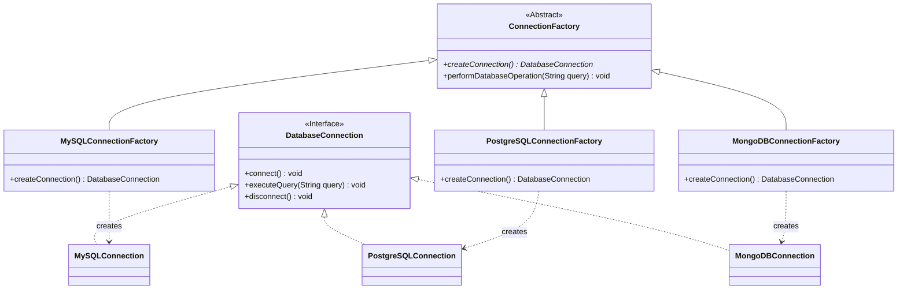

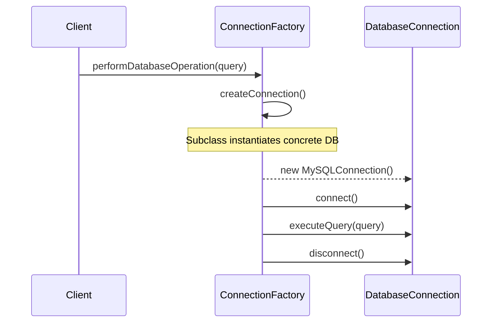

### Implementation: Database Connection Factory

```java
public interface DatabaseConnection {
    void connect();
    void executeQuery(String query);
    void disconnect();
}

public class MySQLConnection implements DatabaseConnection {
    @Override public void connect() { System.out.println("Connecting to MySQL..."); }
    @Override public void executeQuery(String q) { System.out.println("MySQL: " + q); }
    @Override public void disconnect() { System.out.println("Disconnecting MySQL"); }
}

public class PostgreSQLConnection implements DatabaseConnection {
    @Override public void connect() { System.out.println("Connecting to PostgreSQL..."); }
    @Override public void executeQuery(String q) { System.out.println("PostgreSQL: " + q); }
    @Override public void disconnect() { System.out.println("Disconnecting PostgreSQL"); }
}

public class MongoDBConnection implements DatabaseConnection {
    @Override public void connect() { System.out.println("Connecting to MongoDB..."); }
    @Override public void executeQuery(String q) { System.out.println("MongoDB: " + q); }
    @Override public void disconnect() { System.out.println("Disconnecting MongoDB"); }
}

// Creator
public abstract class ConnectionFactory {
    public abstract DatabaseConnection createConnection();

    // Template method using the factory method
    public void performDatabaseOperation(String query) {
        DatabaseConnection connection = createConnection();
        connection.connect();
        connection.executeQuery(query);
        connection.disconnect();
    }
}

public class MySQLConnectionFactory extends ConnectionFactory {
    @Override public DatabaseConnection createConnection() { return new MySQLConnection(); }
}

public class PostgreSQLConnectionFactory extends ConnectionFactory {
    @Override public DatabaseConnection createConnection() { return new PostgreSQLConnection(); }
}

public class MongoDBConnectionFactory extends ConnectionFactory {
    @Override public DatabaseConnection createConnection() { return new MongoDBConnection(); }
}
```

### Real-World Examples
- **Spring `BeanFactory` / `@Bean`:** `ApplicationContext.getBean("mysqlConnection", DatabaseConnection.class)` acts as a factory returning configured beans without exposing concrete instantiation.
- **Payment Processing:** `PaymentProcessorFactory` defines `createProcessor(String... args)` and a `final processPaymentSafely(double amount, String... args)` template that validates (`CreditCardProcessor` / `PayPalProcessor`) before charging.

```java
public abstract class PaymentProcessorFactory {
    public abstract PaymentProcessor createProcessor(String... args);

    public final boolean processPaymentSafely(double amount, String... args) {
        PaymentProcessor processor = createProcessor(args);
        if (processor.validatePayment()) {
            processor.processPayment(amount);
            return true;
        }
        return false;
    }
}
```

> [!TIP]
> **Interview Distinction:** **Factory Method** creates a *single* product via inheritance/overriding, whereas **Abstract Factory** creates *families of related products* via composition.

### Trade-Offs
- **When to Use:** Runtime type selection, decoupling client from concrete classes, extensible plugin architectures.
- **When NOT to Use:** Simple objects with one implementation, or when a DI container (Spring/Guice) already wires dependencies.

---

## 3. Abstract Factory Pattern

### Intent
Provide an interface for creating **families of related or dependent objects** without specifying their concrete classes.

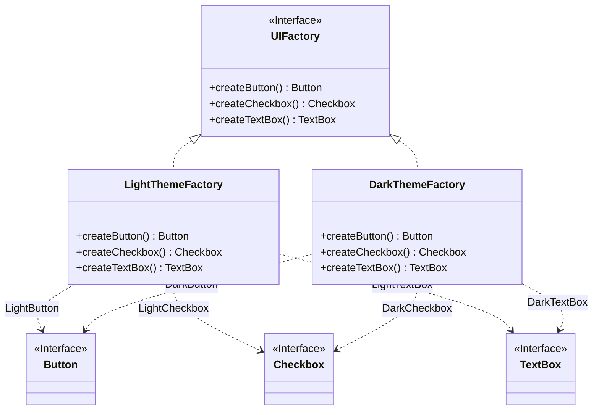

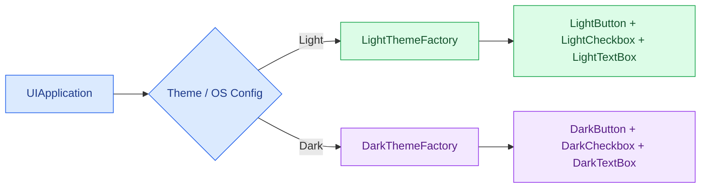

### Complete Example: UI Theme System

```java
// Abstract Products
public interface Button { void render(); }
public interface Checkbox { void render(); }
public interface TextBox { void render(); }

// Concrete Products - Light Theme
public class LightButton implements Button {
    @Override public void render() { System.out.println("Rendering Light Button"); }
}
public class LightCheckbox implements Checkbox {
    @Override public void render() { System.out.println("Rendering Light Checkbox"); }
}
public class LightTextBox implements TextBox {
    @Override public void render() { System.out.println("Rendering Light TextBox"); }
}

// Concrete Products - Dark Theme
public class DarkButton implements Button {
    @Override public void render() { System.out.println("Rendering Dark Button"); }
}
public class DarkCheckbox implements Checkbox {
    @Override public void render() { System.out.println("Rendering Dark Checkbox"); }
}
public class DarkTextBox implements TextBox {
    @Override public void render() { System.out.println("Rendering Dark TextBox"); }
}

// Abstract Factory
public interface UIFactory {
    Button createButton();
    Checkbox createCheckbox();
    TextBox createTextBox();
}

public class LightThemeFactory implements UIFactory {
    @Override public Button createButton() { return new LightButton(); }
    @Override public Checkbox createCheckbox() { return new LightCheckbox(); }
    @Override public TextBox createTextBox() { return new LightTextBox(); }
}

public class DarkThemeFactory implements UIFactory {
    @Override public Button createButton() { return new DarkButton(); }
    @Override public Checkbox createCheckbox() { return new DarkCheckbox(); }
    @Override public TextBox createTextBox() { return new DarkTextBox(); }
}

// Client Code - guaranteed consistent family
public class UIApplication {
    private final Button button;
    private final Checkbox checkbox;
    private final TextBox textBox;

    public UIApplication(UIFactory factory) {
        this.button = factory.createButton();
        this.checkbox = factory.createCheckbox();
        this.textBox = factory.createTextBox();
    }

    public void render() {
        button.render();
        checkbox.render();
        textBox.render();
    }
}
```

### Real-World Example: Cross-Platform OS Factory
`OSFactory` exposes `createDialog()` and `createFileChooser()`. At startup, `System.getProperty("os.name")` selects `WindowsFactory` or `MacFactory`, guaranteeing `WindowsDialog` is never paired with `MacFileChooser`.

### Trade-Offs
- **When to Use:** Multi-family product suites (UI themes, cross-platform widgets, database dialect layers) where mixing families is a bug.
- **When NOT to Use:** When new product types are added frequently (requires updating the `AbstractFactory` interface and every concrete factory).

---

## 4. Builder Pattern

### Intent
Separate the construction of a complex object from its representation so the same construction process can create different representations—typically yielding an **immutable** object via a **fluent API**.

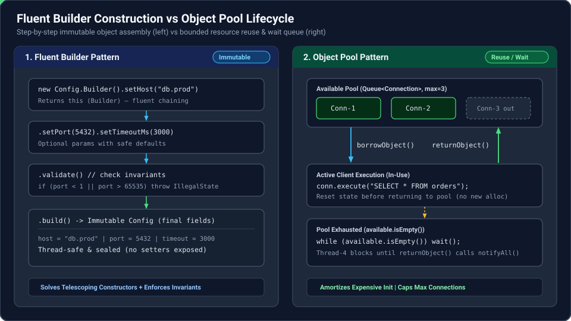

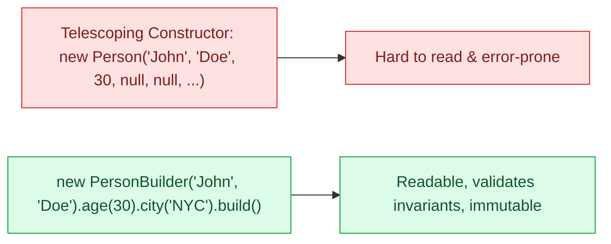

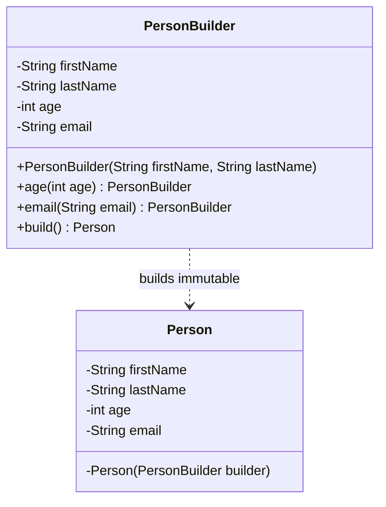

### Problem: Telescoping Constructor Anti-Pattern
Having 5+ optional parameters forces chains of overloaded constructors (`Person(fn, ln)`, `Person(fn, ln, age)`, ..., `Person(fn, ln, age, email, phone, address, city, state, zip)`), making call sites unreadable and prone to swapped arguments.

### Builder Pattern Solution

```java
public class Person {
    private final String firstName;
    private final String lastName;
    private final int age;
    private final String email;
    private final String phone;
    private final String address;
    private final String city;
    private final String state;
    private final String zipCode;

    // Immutable object - private constructor
    private Person(PersonBuilder builder) {
        this.firstName = builder.firstName;
        this.lastName = builder.lastName;
        this.age = builder.age;
        this.email = builder.email;
        this.phone = builder.phone;
        this.address = builder.address;
        this.city = builder.city;
        this.state = builder.state;
        this.zipCode = builder.zipCode;
    }

    public static class PersonBuilder {
        private final String firstName; // Required
        private final String lastName;  // Required
        private int age;
        private String email, phone, address, city, state, zipCode;

        public PersonBuilder(String firstName, String lastName) {
            this.firstName = firstName;
            this.lastName = lastName;
        }

        public PersonBuilder age(int age) { this.age = age; return this; }
        public PersonBuilder email(String email) { this.email = email; return this; }
        public PersonBuilder phone(String phone) { this.phone = phone; return this; }
        public PersonBuilder address(String address) { this.address = address; return this; }
        public PersonBuilder city(String city) { this.city = city; return this; }
        public PersonBuilder state(String state) { this.state = state; return this; }
        public PersonBuilder zipCode(String zipCode) { this.zipCode = zipCode; return this; }

        public Person build() {
            return new Person(this);
        }
    }
}

// Usage
Person person = new Person.PersonBuilder("John", "Doe")
        .age(30)
        .email("john@example.com")
        .city("NYC")
        .build();
```

### Lombok `@Builder` & Real-World SQL Query Builder

```java
// 1. Lombok generates the static builder automatically
@Data
@Builder
public class PersonLombok {
    private String firstName, lastName, email, phone, address, city, state, zipCode;
    private int age;
}

// 2. Real-World Example: Fluent SQL Query Builder
public class SQLQueryBuilder {
    private String selectClause = "", fromClause = "", whereClause = "", orderByClause = "";
    private int limitValue = -1;

    public SQLQueryBuilder select(String... cols) { this.selectClause = "SELECT " + String.join(", ", cols); return this; }
    public SQLQueryBuilder from(String table) { this.fromClause = " FROM " + table; return this; }
    public SQLQueryBuilder where(String cond) { this.whereClause = " WHERE " + cond; return this; }
    public SQLQueryBuilder orderBy(String col, String dir) { this.orderByClause = " ORDER BY " + col + " " + dir; return this; }
    public SQLQueryBuilder limit(int limit) { this.limitValue = limit; return this; }

    public String build() {
        StringBuilder q = new StringBuilder().append(selectClause).append(fromClause).append(whereClause).append(orderByClause);
        if (limitValue > 0) q.append(" LIMIT ").append(limitValue);
        return q.toString();
    }
}
```

### Builder vs Constructor

| Aspect | Builder | Constructor |
|---|---|---|
| **Parameters** | 5+ optional parameters | Few, mostly required |
| **Readability** | High (named fluent methods) | Positional, hard to read |
| **Immutability** | Easy (`final` fields, no setters) | Verbose with many overloads |
| **Default Values** | Natural support in Builder | Requires telescoping overloads |
| **Performance** | Slight extra Builder allocation | Minimal |

### Trade-Offs
- **When to Use:** Many optional parameters, immutable objects, invariant validation in `build()`, fluent DSLs (`StringBuilder`, `HttpRequest.Builder`, SQL builders).
- **When NOT to Use:** Simple POJOs with 1–3 required fields, or ultra-hot allocation paths.

---

## 5. Prototype Pattern

### Intent
Create new objects by **copying an existing prototype** rather than instantiating from scratch.

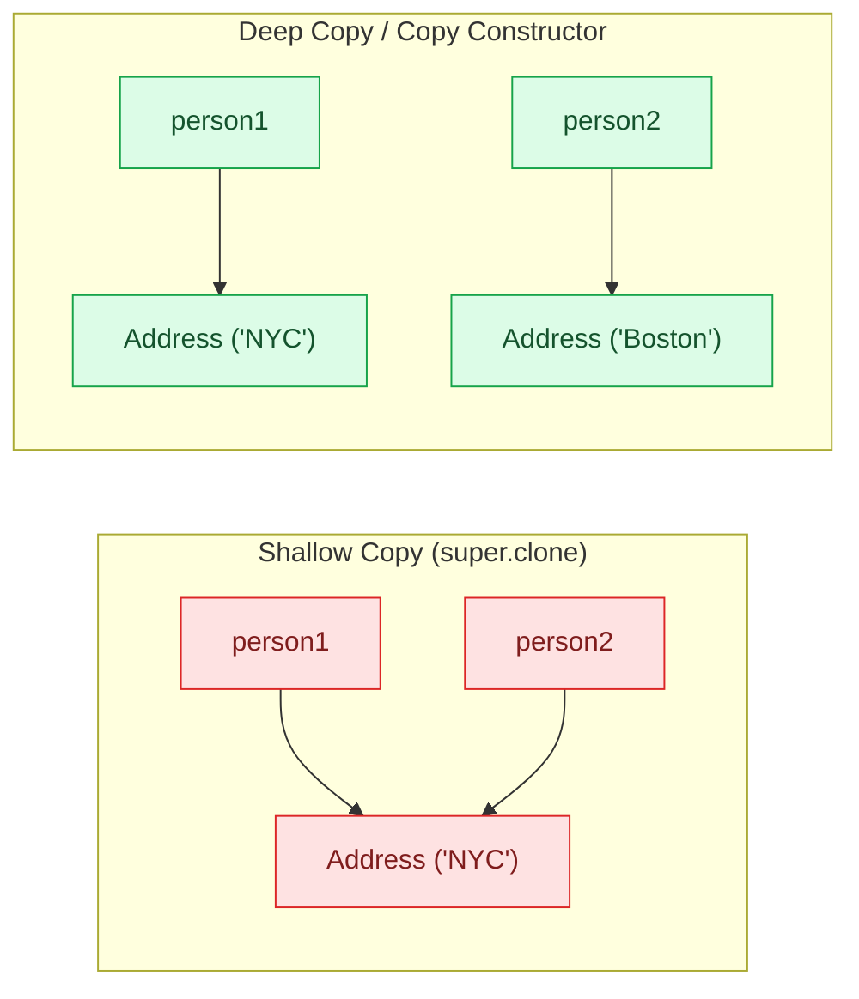

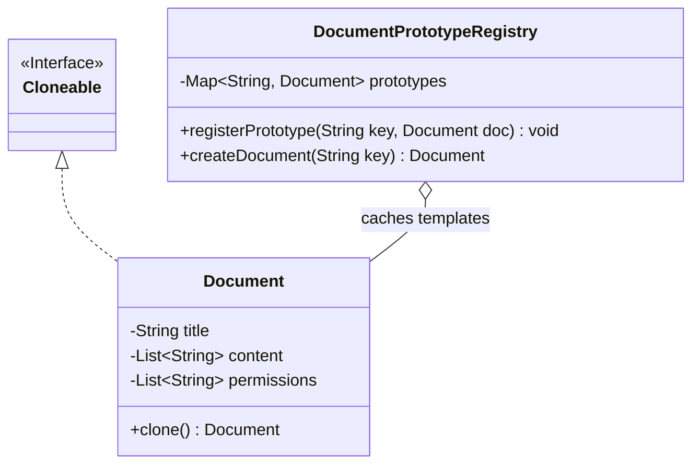

### Shallow Copy vs Deep Copy

```java
public static class Address {
    public String street, city;
    public Address(String street, String city) { this.street = street; this.city = city; }
}

// Shallow copy: person2.address == person1.address (mutating one mutates both!)
public static class PersonShallow implements Cloneable {
    public String name;
    public Address address;

    @Override
    public PersonShallow clone() throws CloneNotSupportedException {
        return (PersonShallow) super.clone();
    }
}

// Deep copy: clones mutable nested objects
public static class PersonDeep implements Cloneable {
    public String name;
    public Address address;

    @Override
    public PersonDeep clone() throws CloneNotSupportedException {
        PersonDeep cloned = (PersonDeep) super.clone();
        cloned.address = new Address(this.address.street, this.address.city);
        return cloned;
    }
}
```

> [!WARNING]
> **Java `Cloneable` Pitfalls:** `Cloneable` is a marker interface without a `clone()` method, `Object.clone()` is `protected` and performs only a shallow copy, and it bypasses constructors. Prefer a **Copy Constructor** (`public Person(Person other)`) in modern Java.

### Copy Constructor Alternative (Preferred) & Prototype Registry

```java
// Preferred: Explicit Copy Constructor
public class PersonCopyConstructor {
    private String name;
    private Address address;

    public PersonCopyConstructor(String name, Address address) {
        this.name = name;
        this.address = address;
    }

    public PersonCopyConstructor(PersonCopyConstructor other) {
        this.name = other.name;
        this.address = new Address(other.address.street, other.address.city);
    }
}

// Real-World Example: Document Prototype Registry
public class Document implements Cloneable {
    private String title;
    private List<String> content = new ArrayList<>();
    private List<String> permissions = new ArrayList<>();

    public Document(String title) { this.title = title; }

    @Override
    public Document clone() throws CloneNotSupportedException {
        Document cloned = (Document) super.clone();
        cloned.content = new ArrayList<>(this.content);
        cloned.permissions = new ArrayList<>(this.permissions);
        return cloned;
    }
}

public class DocumentPrototypeRegistry {
    private final Map<String, Document> prototypes = new HashMap<>();

    public void registerPrototype(String key, Document doc) { prototypes.put(key, doc); }

    public Document createDocument(String key) throws CloneNotSupportedException {
        Document prototype = prototypes.get(key);
        if (prototype == null) throw new IllegalArgumentException("Prototype not found: " + key);
        return prototype.clone();
    }
}
```

### Trade-Offs
- **When to Use:** Expensive initialization (DB/file/network templates), creating variations of complex configured objects, prototype registries.
- **When NOT to Use:** Simple objects, or object graphs with circular references where deep copying is error-prone.

---

## 6. Object Pool Pattern

### Intent
**Reuse** expensive-to-create objects from a bounded pool instead of creating and destroying them repeatedly.

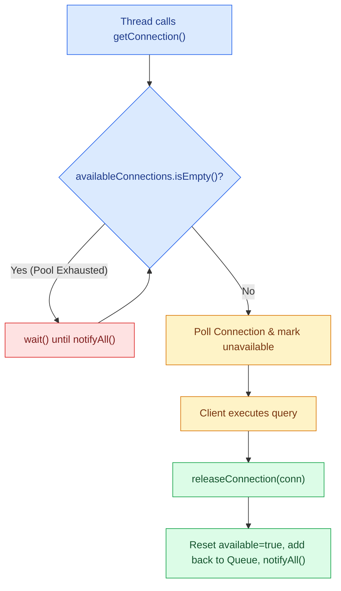

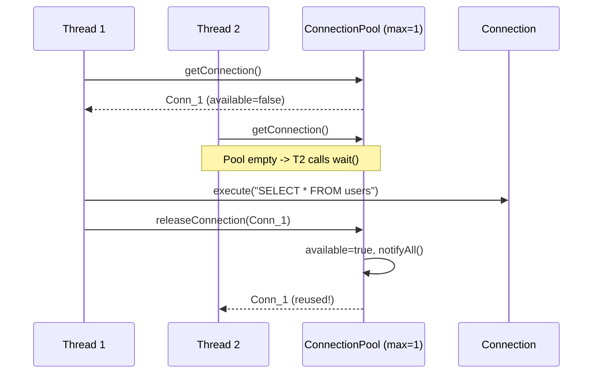

### Real-World Example: Thread-Safe Connection Pool

```java
public class Connection implements Serializable {
    private final String id;
    private boolean available = true;
    private long lastUsedAt = System.currentTimeMillis();

    public Connection(String id) { this.id = id; }
    public String getId() { return id; }
    public void setAvailable(boolean available) {
        this.available = available;
        this.lastUsedAt = System.currentTimeMillis();
    }
    public void execute(String query) {
        System.out.println("Executing on " + id + ": " + query);
        this.lastUsedAt = System.currentTimeMillis();
    }
    public boolean isExpired(long timeoutMs) {
        return System.currentTimeMillis() - lastUsedAt > timeoutMs;
    }
}

public class ConnectionPool {
    private final Queue<Connection> availableConnections = new LinkedList<>();
    private final Set<Connection> allConnections = Collections.synchronizedSet(new HashSet<>());
    private final long connectionTimeout;

    public ConnectionPool(int maxPoolSize, long connectionTimeout) {
        this.connectionTimeout = connectionTimeout;
        for (int i = 1; i <= maxPoolSize; i++) {
            Connection conn = new Connection("Conn_" + i);
            availableConnections.add(conn);
            allConnections.add(conn);
        }
    }

    public synchronized Connection getConnection() throws InterruptedException {
        while (availableConnections.isEmpty()) {
            wait();
        }
        Connection conn = availableConnections.poll();
        conn.setAvailable(false);
        return conn;
    }

    public synchronized void releaseConnection(Connection conn) {
        if (conn != null && allConnections.contains(conn)) {
            conn.setAvailable(true);
            availableConnections.add(conn);
            notifyAll();
        }
    }

    public synchronized void removeExpiredConnections() {
        allConnections.removeIf(conn -> conn.isExpired(connectionTimeout));
    }
}
```

### Thread Pool as Object Pool
Java's `ExecutorService executor = Executors.newFixedThreadPool(4);` is a built-in Object Pool: worker threads are pre-created/reused across tasks rather than spawning a new OS thread per task.

### Trade-Offs
- **When to Use:** Database connections (HikariCP), thread pools (`ExecutorService`), byte buffers, sockets—any resource with high creation cost or strict concurrency caps.
- **When NOT to Use:** Lightweight short-lived objects (JVM generational GC handles them faster than synchronization), or stateful objects that leak state if not reset cleanly.

---

## Summary Table: When to Use Each Creational Pattern

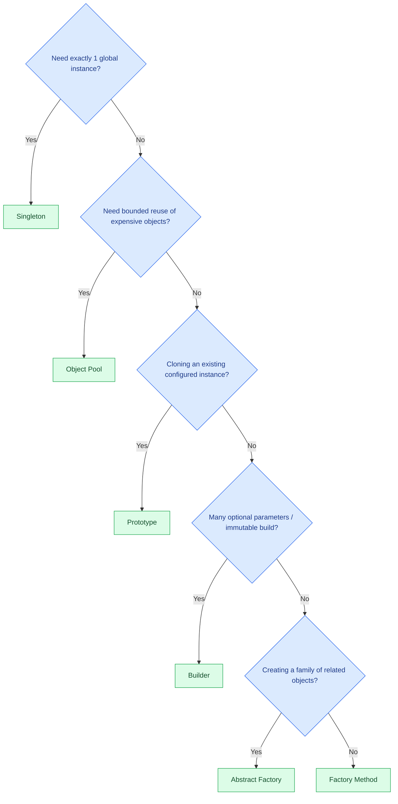

| Pattern | Use Case | Key Benefit | Primary Java / Spring Example |
|---|---|---|---|
| **Singleton** | Logging, configuration, caching | Single instance guarantee | `EnumSingleton`, Spring Singleton Registry |
| **Factory Method** | Creating objects whose type varies at runtime | Decouples client from concrete classes | `ConnectionFactory`, Spring `@Bean` |
| **Abstract Factory** | Families of related products | Ensures consistency across families | `UIFactory` (Light/Dark), `OSFactory` |
| **Builder** | Complex objects with 5+ optional params | Readable fluent API, immutability | `StringBuilder`, Lombok `@Builder`, `SQLQueryBuilder` |
| **Prototype** | Expensive object copying / templates | Efficient replication without re-init | Copy Constructor, `DocumentPrototypeRegistry` |
| **Object Pool** | Frequently borrowed expensive resources | Amortizes allocation &amp; caps concurrency | `ConnectionPool`, `Executors.newFixedThreadPool` |
