# Structural Design Patterns: In-Depth Guide for FAANG Interviews

## Table of Contents
- [Overview](#overview)
- [1. Adapter Pattern](#1-adapter-pattern)
- [2. Bridge Pattern](#2-bridge-pattern)
- [3. Composite Pattern](#3-composite-pattern)
- [4. Decorator Pattern](#4-decorator-pattern)
- [5. Facade Pattern](#5-facade-pattern)
- [6. Flyweight Pattern](#6-flyweight-pattern)
- [7. Proxy Pattern](#7-proxy-pattern)
- [Summary Table: Structural Patterns](#summary-table-structural-patterns)

---

## Overview

Structural patterns deal with **object composition** and **relationships between entities**. They simplify complex systems by defining how classes and objects combine to form larger, flexible structures—a core requirement in system design and enterprise Java/Spring architectures.

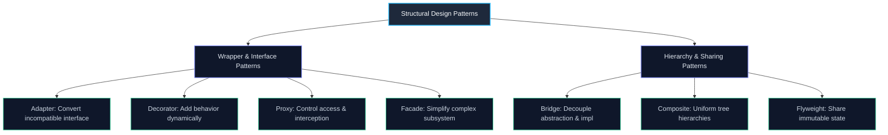

> [!TIP]
> In FAANG interviews, interviewers rarely ask "define Adapter." Instead, they test whether you can distinguish **look-alike wrappers** (`Adapter` vs. `Bridge` vs. `Decorator` vs. `Proxy` vs. `Facade`) by their **intent**.

---

## 1. Adapter Pattern

### Intent
Convert the interface of a class into another interface that clients expect. Let classes work together that couldn't otherwise due to incompatible interfaces.

### Problem
Integrating incompatible components, legacy codebases, or third-party libraries with existing client code without modifying either side.

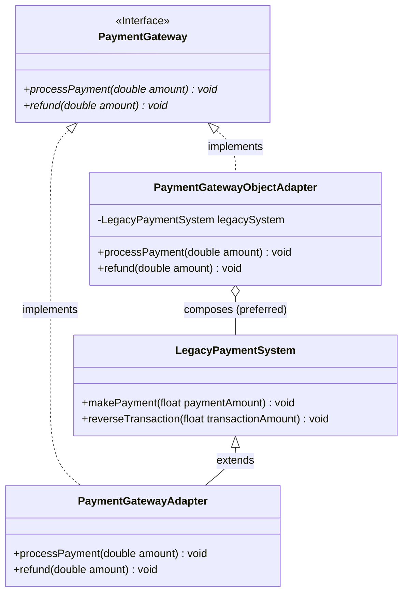

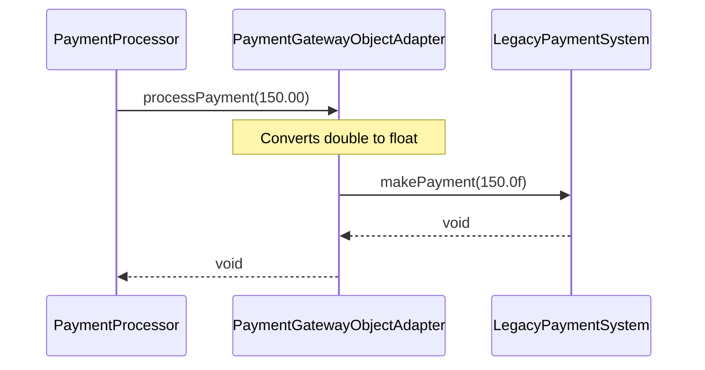

### 1.1 Class Adapter (Inheritance-based)

```java
// Target interface that clients expect
public interface PaymentGateway {
    void processPayment(double amount);
    void refund(double amount);
}

// Adaptee: Incompatible third-party library
public class LegacyPaymentSystem {
    public void makePayment(float paymentAmount) {
        System.out.println("Legacy system processing: $" + paymentAmount);
    }

    public void reverseTransaction(float transactionAmount) {
        System.out.println("Legacy system refunding: $" + transactionAmount);
    }
}

// Class Adapter (using inheritance)
public class PaymentGatewayAdapter extends LegacyPaymentSystem implements PaymentGateway {
    @Override
    public void processPayment(double amount) {
        // Convert double to float and delegate to legacy system
        makePayment((float) amount);
    }

    @Override
    public void refund(double amount) {
        reverseTransaction((float) amount);
    }
}

// Client code - doesn't know about legacy system
public class PaymentProcessor {
    private PaymentGateway gateway;

    public PaymentProcessor(PaymentGateway gateway) {
        this.gateway = gateway;
    }

    public void processTransaction(double amount) {
        gateway.processPayment(amount);
    }

    public void handleRefund(double amount) {
        gateway.refund(amount);
    }
}

public class ClassAdapterDemo {
    public static void main(String[] args) {
        // Client uses modern PaymentGateway interface
        PaymentGateway gateway = new PaymentGatewayAdapter();
        PaymentProcessor processor = new PaymentProcessor(gateway);

        processor.processTransaction(100.50);
        processor.handleRefund(50.25);
    }
}
```

### 1.2 Object Adapter (Composition-based) - PREFERRED

```java
// Object Adapter using composition
public class PaymentGatewayObjectAdapter implements PaymentGateway {
    private final LegacyPaymentSystem legacySystem;

    public PaymentGatewayObjectAdapter(LegacyPaymentSystem legacySystem) {
        this.legacySystem = legacySystem;
    }

    @Override
    public void processPayment(double amount) {
        legacySystem.makePayment((float) amount);
    }

    @Override
    public void refund(double amount) {
        legacySystem.reverseTransaction((float) amount);
    }
}

public class ObjectAdapterDemo {
    public static void main(String[] args) {
        LegacyPaymentSystem legacySystem = new LegacyPaymentSystem();
        PaymentGateway gateway = new PaymentGatewayObjectAdapter(legacySystem);
        PaymentProcessor processor = new PaymentProcessor(gateway);

        processor.processTransaction(150.00);
        processor.handleRefund(75.00);
    }
}
```

> [!IMPORTANT]
> Always prefer **Object Adapter (composition)** over **Class Adapter (inheritance)** in Java. Java does not support multiple class inheritance, and composition lets a single adapter wrap an entire hierarchy of `Adaptee` subclasses.

### Real-World Examples in Java

#### Example 1: `Arrays.asList` Adapter

```java
public class ArraysAsListAdapterDemo {
    public static void main(String[] args) {
        // Array is not a List, but Arrays.asList adapts it
        Integer[] array = {1, 2, 3, 4, 5};

        // Arrays.asList is an adapter that makes Array work as List
        List<Integer> list = Arrays.asList(array);

        list.forEach(System.out::println);

        // Important: The adapted list is backed by the original array
        // Modifications to list affect the array
        list.set(0, 100);
        System.out.println("Array after modification: " + Arrays.toString(array));
    }
}
```

#### Example 2: `InputStreamReader` Adapter

```java
public class InputStreamReaderDemo {
    public static void main(String[] args) throws IOException {
        // InputStream (byte-oriented) and Reader (character-oriented) are incompatible
        // InputStreamReader adapts InputStream to Reader interface

        ByteArrayInputStream inputStream = new ByteArrayInputStream("Hello World".getBytes(StandardCharsets.UTF_8));

        // InputStreamReader is the adapter
        InputStreamReader reader = new InputStreamReader(inputStream, StandardCharsets.UTF_8);

        char[] charArray = new char[5];
        reader.read(charArray);
        System.out.println("Read characters: " + new String(charArray));

        reader.close();
    }
}
```

#### Example 3: Custom Adapter for Collection Types

```java
// Target: Java's Map interface
public interface KeyValueStore {
    void put(String key, String value);
    String get(String key);
    void remove(String key);
}

// Adaptee: Legacy dictionary system
public class LegacyDictionary {
    private Map<String, String> data = new HashMap<>();

    public void addEntry(String key, String value) {
        data.put(key, value);
    }

    public String lookupValue(String key) {
        return data.get(key);
    }

    public void deleteEntry(String key) {
        data.remove(key);
    }
}

// Adapter
public class DictionaryAdapter implements KeyValueStore {
    private final LegacyDictionary dictionary;

    public DictionaryAdapter(LegacyDictionary dictionary) {
        this.dictionary = dictionary;
    }

    @Override
    public void put(String key, String value) {
        dictionary.addEntry(key, value);
    }

    @Override
    public String get(String key) {
        return dictionary.lookupValue(key);
    }

    @Override
    public void remove(String key) {
        dictionary.deleteEntry(key);
    }
}

public class DictionaryAdapterDemo {
    public static void main(String[] args) {
        LegacyDictionary legacyDict = new LegacyDictionary();
        KeyValueStore store = new DictionaryAdapter(legacyDict);

        store.put("name", "John");
        store.put("age", "30");

        System.out.println("Name: " + store.get("name"));
        System.out.println("Age: " + store.get("age"));

        store.remove("age");
        System.out.println("Age after removal: " + store.get("age")); // null
    }
}
```

### Class Adapter vs Object Adapter

| Aspect | Class Adapter | Object Adapter |
|--------|---------------|----------------|
| **Mechanism** | Inheritance (`extends`) | Composition (`has-a`) |
| **Flexibility** | Limited (single parent class) | High (can adapt any subtype at runtime) |
| **Code reuse** | Limited to single adaptee | Can wrap multiple adaptees |
| **Type compatibility** | Adaptee must be a non-final class | Any type (class or interface) |
| **Recommendation** | Rarely used | **PREFERRED** |

### When to Use / When NOT to Use
- **Use when:**
  - Integrating third-party libraries or external APIs.
  - Making incompatible interfaces work together without altering source code.
  - Wrapping legacy systems behind modern interfaces.
- **Avoid when:**
  - No interface incompatibility exists.
  - Simple type conversions suffice (use static utility/mapper methods instead).
  - Extreme hot-path performance forbids even minor wrapper indirection.

---

## 2. Bridge Pattern

### Intent
Decouple an abstraction from its implementation so that the two can vary independently.

### Problem
When both the abstraction (e.g., database access mode) and implementation (e.g., database vendor) vary independently, inheritance creates an $M \times N$ **class explosion**.

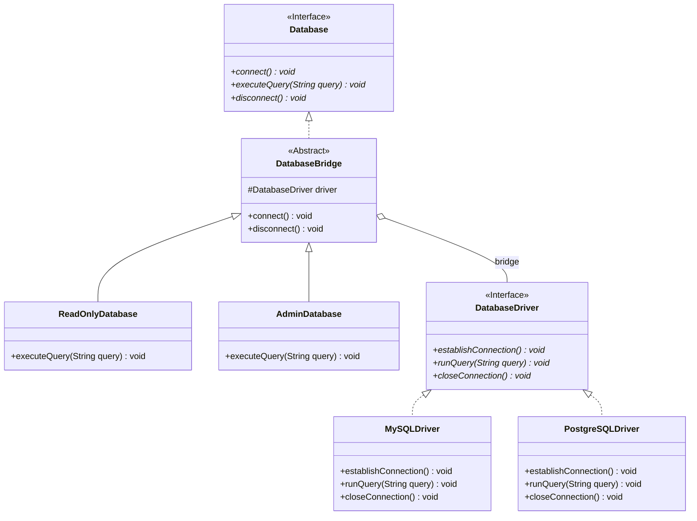

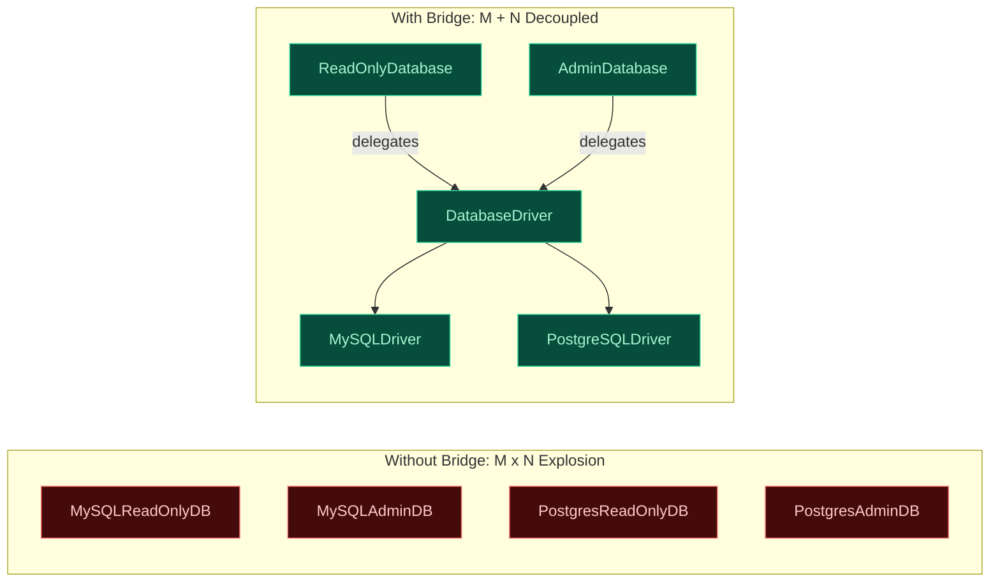

### Real-World Example: JDBC Driver Architecture

```java
// Abstraction: Database interface that clients use
public interface Database {
    void connect();
    void executeQuery(String query);
    void disconnect();
}

// Implementation: Specific database drivers
public interface DatabaseDriver {
    void establishConnection();
    void runQuery(String query);
    void closeConnection();
}

// Concrete Implementations
public class MySQLDriver implements DatabaseDriver {
    @Override
    public void establishConnection() {
        System.out.println("Connecting to MySQL database...");
    }

    @Override
    public void runQuery(String query) {
        System.out.println("MySQL executing: " + query);
    }

    @Override
    public void closeConnection() {
        System.out.println("Closing MySQL connection");
    }
}

public class PostgreSQLDriver implements DatabaseDriver {
    @Override
    public void establishConnection() {
        System.out.println("Connecting to PostgreSQL database...");
    }

    @Override
    public void runQuery(String query) {
        System.out.println("PostgreSQL executing: " + query);
    }

    @Override
    public void closeConnection() {
        System.out.println("Closing PostgreSQL connection");
    }
}

// Abstract Bridge - connects abstraction to implementation
public abstract class DatabaseBridge implements Database {
    protected DatabaseDriver driver;

    public DatabaseBridge(DatabaseDriver driver) {
        this.driver = driver;
    }

    @Override
    public void connect() {
        driver.establishConnection();
    }

    @Override
    public void disconnect() {
        driver.closeConnection();
    }
}

// Refined Abstraction
public class ReadOnlyDatabase extends DatabaseBridge {
    public ReadOnlyDatabase(DatabaseDriver driver) {
        super(driver);
    }

    @Override
    public void executeQuery(String query) {
        if (query.toLowerCase().startsWith("select")) {
            driver.runQuery(query);
        } else {
            System.out.println("ReadOnlyDatabase: Write operations not allowed");
        }
    }
}

public class AdminDatabase extends DatabaseBridge {
    public AdminDatabase(DatabaseDriver driver) {
        super(driver);
    }

    @Override
    public void executeQuery(String query) {
        System.out.println("AdminDatabase: Executing with full privileges");
        driver.runQuery(query);
    }
}

// Usage
public class BridgePatternDemo {
    public static void main(String[] args) {
        // Abstraction and implementation can vary independently
        DatabaseDriver mysqlDriver = new MySQLDriver();
        Database readOnlyDB = new ReadOnlyDatabase(mysqlDriver);

        readOnlyDB.connect();
        readOnlyDB.executeQuery("SELECT * FROM users");
        readOnlyDB.executeQuery("DELETE FROM users"); // Blocked
        readOnlyDB.disconnect();

        System.out.println("\n---\n");

        DatabaseDriver postgresDriver = new PostgreSQLDriver();
        Database adminDB = new AdminDatabase(postgresDriver);

        adminDB.connect();
        adminDB.executeQuery("SELECT * FROM users");
        adminDB.executeQuery("DELETE FROM users"); // Allowed
        adminDB.disconnect();
    }
}
```

### Key Difference from Adapter

```java
// Adapter: Makes incompatible things work together (retrofitted after design)
// Bridge: Separates abstraction from implementation for independent variation (upfront design)

// Example: Without Bridge (tight coupling)
public class BadDatabaseDesign {
    public class MySQLReadOnlyDB {
        // Coupled to both MySQL and ReadOnly behavior
    }

    public class MySQLAdminDB {
        // Coupled to both MySQL and Admin behavior
    }

    public class PostgresReadOnlyDB {
        // Coupled to both PostgreSQL and ReadOnly behavior
    }

    public class PostgresAdminDB {
        // Coupled to both PostgreSQL and Admin behavior
    }
    // 4 classes for 2 abstractions × 2 implementations = explosion!
}

// With Bridge: Only 4 leaf classes (2 abstractions + 2 implementations)
// Adding a 3rd DB driver (Oracle) adds 1 class instead of 2!
```

> [!TIP]
> **Interview Distinction:** **Adapter** is usually applied *after* classes are built to make incompatible interfaces work together. **Bridge** is designed *upfront* so two dimensions (e.g., UI Platform × Shape, or Access Mode × DB Driver) can evolve independently.

### When to Use / When NOT to Use
- **Use when:**
  - Both abstraction and implementation should vary independently.
  - Avoiding permanent compile-time binding between abstraction and implementation.
  - Sharing an implementation among multiple objects or preventing $M \times N$ class explosion.
- **Avoid when:**
  - Simple systems with a single dimension of variation.
  - Implementation is permanently tied to one abstraction.
  - Extra indirection is unacceptable in ultra-low-latency paths.

---

## 3. Composite Pattern

### Intent
Compose objects into tree structures to represent part-whole hierarchies. Let clients treat individual objects (`Leaf`) and compositions (`Composite`) uniformly.

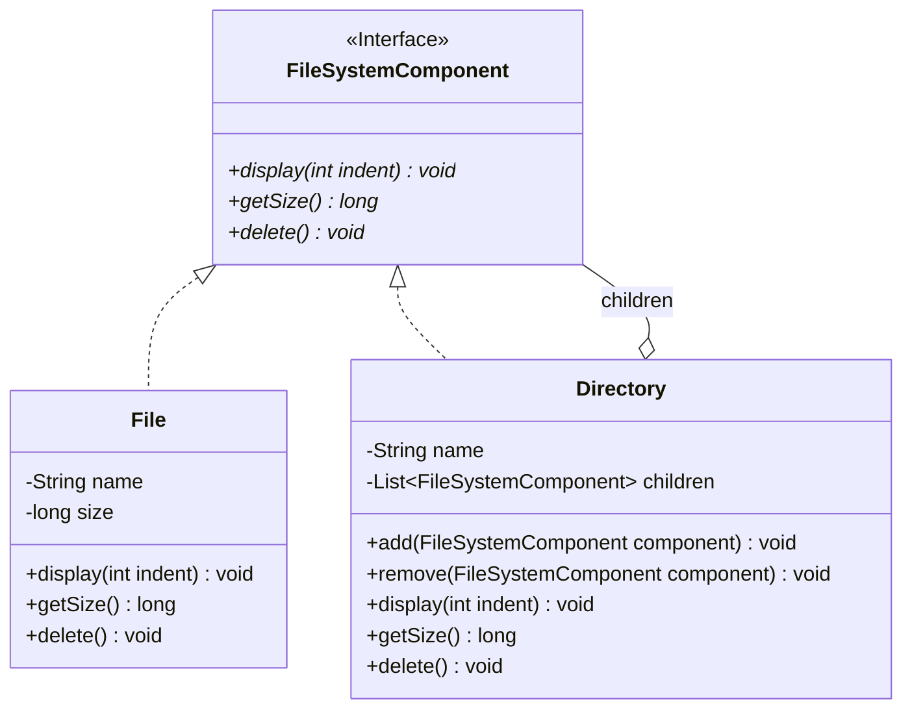

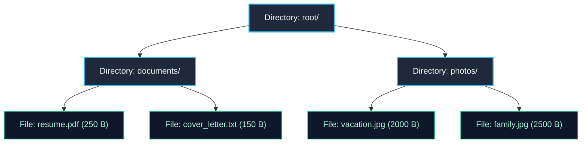

### Real-World Example: File System

```java
// Component interface
public interface FileSystemComponent {
    void display(int indent);
    long getSize();
    void delete();
}

// Leaf: File (cannot have children)
public class File implements FileSystemComponent {
    private String name;
    private long size;

    public File(String name, long size) {
        this.name = name;
        this.size = size;
    }

    @Override
    public void display(int indent) {
        System.out.println(" ".repeat(indent) + "📄 " + name + " (" + size + " bytes)");
    }

    @Override
    public long getSize() {
        return size;
    }

    @Override
    public void delete() {
        System.out.println("Deleting file: " + name);
    }
}

// Composite: Directory (can have children)
public class Directory implements FileSystemComponent {
    private String name;
    private List<FileSystemComponent> children = new ArrayList<>();

    public Directory(String name) {
        this.name = name;
    }

    public void add(FileSystemComponent component) {
        children.add(component);
    }

    public void remove(FileSystemComponent component) {
        children.remove(component);
    }

    @Override
    public void display(int indent) {
        System.out.println(" ".repeat(indent) + "📁 " + name + "/");
        for (FileSystemComponent child : children) {
            child.display(indent + 2);
        }
    }

    @Override
    public long getSize() {
        // Recursive calculation
        return children.stream().mapToLong(FileSystemComponent::getSize).sum();
    }

    @Override
    public void delete() {
        System.out.println("Deleting directory: " + name);
        for (FileSystemComponent child : children) {
            child.delete();
        }
        children.clear();
    }
}

public class CompositePatternDemo {
    public static void main(String[] args) {
        // Create file system structure
        Directory root = new Directory("root");
        Directory documents = new Directory("documents");
        Directory photos = new Directory("photos");

        File resume = new File("resume.pdf", 250);
        File cover = new File("cover_letter.txt", 150);
        File photo1 = new File("vacation.jpg", 2000);
        File photo2 = new File("family.jpg", 2500);

        // Build tree
        root.add(documents);
        root.add(photos);
        documents.add(resume);
        documents.add(cover);
        photos.add(photo1);
        photos.add(photo2);

        // Display tree structure
        root.display(0);

        System.out.println("\nTotal size: " + root.getSize() + " bytes");

        // Delete operation works recursively
        System.out.println("\nDeleting documents directory:");
        documents.delete();
    }
}
```

### Real-World Example: Organization Hierarchy

```java
public interface Employee {
    void display(int indent);
    double getSalary();
    void performDuty();
}

public class Developer implements Employee {
    private String name;
    private double salary;

    public Developer(String name, double salary) {
        this.name = name;
        this.salary = salary;
    }

    @Override
    public void display(int indent) {
        System.out.println(" ".repeat(indent) + "👨‍💻 " + name + " (Dev) - $" + salary);
    }

    @Override
    public double getSalary() {
        return salary;
    }

    @Override
    public void performDuty() {
        System.out.println(name + " is writing code...");
    }
}

public class Manager implements Employee {
    private String name;
    private double salary;
    private List<Employee> subordinates = new ArrayList<>();

    public Manager(String name, double salary) {
        this.name = name;
        this.salary = salary;
    }

    public void addSubordinate(Employee employee) {
        subordinates.add(employee);
    }

    @Override
    public void display(int indent) {
        System.out.println(" ".repeat(indent) + "👔 " + name + " (Manager) - $" + salary);
        for (Employee sub : subordinates) {
            sub.display(indent + 2);
        }
    }

    @Override
    public double getSalary() {
        return salary;
    }

    @Override
    public void performDuty() {
        System.out.println(name + " is managing team...");
        for (Employee sub : subordinates) {
            sub.performDuty();
        }
    }
}

public class OrganizationDemo {
    public static void main(String[] args) {
        Developer dev1 = new Developer("Alice", 80000);
        Developer dev2 = new Developer("Bob", 75000);
        Developer dev3 = new Developer("Charlie", 85000);

        Manager teamLead = new Manager("David", 100000);
        teamLead.addSubordinate(dev1);
        teamLead.addSubordinate(dev2);

        Manager director = new Manager("Eve", 150000);
        director.addSubordinate(teamLead);
        director.addSubordinate(dev3);

        System.out.println("Organization Structure:");
        director.display(0);

        System.out.println("\nPerforming duties:");
        director.performDuty();
    }
}
```

> [!WARNING]
> Keep `add()`/`remove()` methods on the **Composite** (`Directory`, `Manager`) rather than the `Component` interface if you want compile-time safety against adding children to a `Leaf`. Placing them on `Component` favors uniformity at the cost of runtime `UnsupportedOperationException` checks.

### When to Use / When NOT to Use
- **Use when:**
  - Modeling tree structures (file systems, org charts, UI component trees, ASTs).
  - Representing part-whole hierarchies where clients treat leaves and containers uniformly.
- **Avoid when:**
  - Data is flat or linear (use standard `List`/`Set`).
  - Type constraints between parent and child nodes are overly rigid.
  - Deep recursive traversal causes unacceptable overhead.

---

## 4. Decorator Pattern

### Intent
Attach additional responsibilities to an object dynamically. Decorators provide a flexible, composable alternative to subclassing for extending functionality.

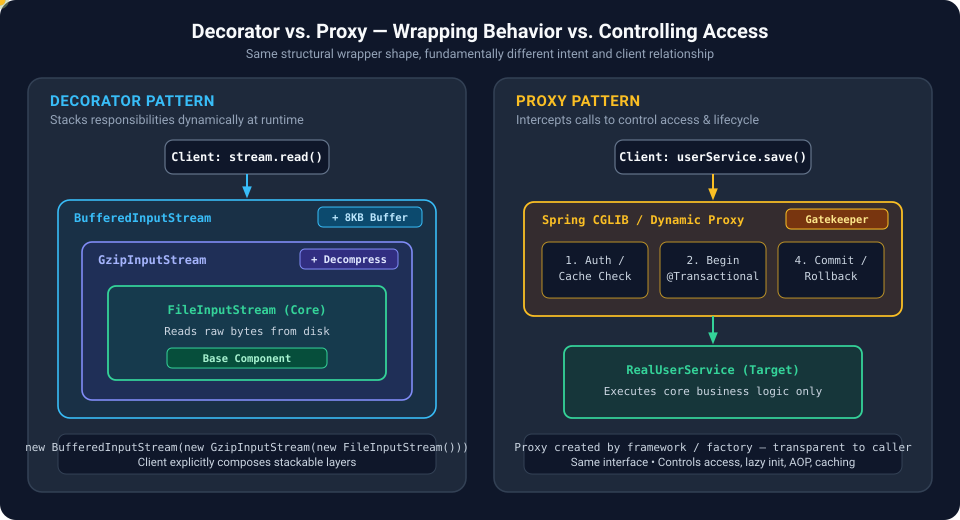

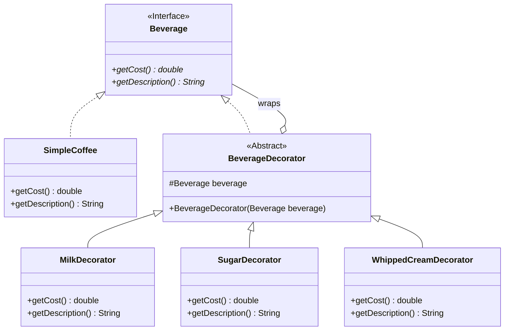

### Problem: Inheritance Explosion

```java
// Without Decorator: Explosion of subclasses
public class BadDesign {
    public class Coffee { }
    public class CoffeeWithMilk extends Coffee { } // 1 subclass
    public class CoffeeWithSugar extends Coffee { } // 1 subclass
    public class CoffeeWithMilkAndSugar extends Coffee { } // 1 subclass
    public class CoffeeWithWhippedCream extends Coffee { } // 1 subclass
    public class CoffeeWithMilkAndWhippedCream extends Coffee { } // 1 subclass
    // With n ingredients, we get 2^n subclasses!
}
```

### Decorator Solution

```java
// Component interface
public interface Beverage {
    double getCost();
    String getDescription();
}

// Concrete Component
public class SimpleCoffee implements Beverage {
    @Override
    public double getCost() {
        return 2.0;
    }

    @Override
    public String getDescription() {
        return "Simple Coffee";
    }
}

// Decorator abstract class
public abstract class BeverageDecorator implements Beverage {
    protected Beverage beverage;

    public BeverageDecorator(Beverage beverage) {
        this.beverage = beverage;
    }
}

// Concrete Decorators
public class MilkDecorator extends BeverageDecorator {
    public MilkDecorator(Beverage beverage) {
        super(beverage);
    }

    @Override
    public double getCost() {
        return beverage.getCost() + 0.50;
    }

    @Override
    public String getDescription() {
        return beverage.getDescription() + ", Milk";
    }
}

public class SugarDecorator extends BeverageDecorator {
    public SugarDecorator(Beverage beverage) {
        super(beverage);
    }

    @Override
    public double getCost() {
        return beverage.getCost() + 0.25;
    }

    @Override
    public String getDescription() {
        return beverage.getDescription() + ", Sugar";
    }
}

public class WhippedCreamDecorator extends BeverageDecorator {
    public WhippedCreamDecorator(Beverage beverage) {
        super(beverage);
    }

    @Override
    public double getCost() {
        return beverage.getCost() + 0.75;
    }

    @Override
    public String getDescription() {
        return beverage.getDescription() + ", Whipped Cream";
    }
}

public class DecoratorPatternDemo {
    public static void main(String[] args) {
        // Create coffee with decorators
        Beverage coffee = new SimpleCoffee();
        System.out.println(coffee.getDescription() + ": $" + coffee.getCost());

        // Add milk
        coffee = new MilkDecorator(coffee);
        System.out.println(coffee.getDescription() + ": $" + coffee.getCost());

        // Add sugar
        coffee = new SugarDecorator(coffee);
        System.out.println(coffee.getDescription() + ": $" + coffee.getCost());

        // Add whipped cream
        coffee = new WhippedCreamDecorator(coffee);
        System.out.println(coffee.getDescription() + ": $" + coffee.getCost());

        // Different combination
        Beverage anotherCoffee = new WhippedCreamDecorator(
                new MilkDecorator(new SimpleCoffee()));
        System.out.println("\n" + anotherCoffee.getDescription() + ": $" + anotherCoffee.getCost());
    }
}
```

### Real-World Example: Java I/O Streams


```java
public class JavaIODecoratorDemo {
    public static void main(String[] args) throws IOException {
        // FileInputStream is the base component
        FileInputStream fileIn = new FileInputStream("data.txt");

        // BufferedInputStream decorates FileInputStream
        BufferedInputStream bufferedIn = new BufferedInputStream(fileIn);

        // DataInputStream further decorates
        DataInputStream dataIn = new DataInputStream(bufferedIn);

        // Reading from the decorated stream
        try {
            String line = dataIn.readLine();
            System.out.println("Read: " + line);
        } catch (IOException e) {
            e.printStackTrace();
        } finally {
            dataIn.close(); // Closes all decorators
        }
    }
}
```

### Decorator vs Inheritance

```java
// Inheritance approach (less flexible)
public class CoffeeWithMilkAndSugar extends SimpleCoffee {
    @Override
    public double getCost() {
        return super.getCost() + 0.50 + 0.25;
    }
    // Static, compile-time composition
}

// Decorator approach (more flexible)
Beverage coffee = new SugarDecorator(new MilkDecorator(new SimpleCoffee()));
// Dynamic, runtime composition
```

> [!TIP]
> **Single Responsibility & Open/Closed Principles:** Each decorator encapsulates exactly one enhancement (`Milk`, `Buffering`, `Compression`) and can be combined in any order at runtime without touching existing classes.

### When to Use / When NOT to Use
- **Use when:**
  - Adding responsibilities dynamically and transparently at runtime.
  - Avoiding $2^n$ subclass explosion.
  - Enforcing Single Responsibility across layered features (e.g., Java I/O streams, `Collections.unmodifiableList`).
- **Avoid when:**
  - Objects have no dynamic feature combinations.
  - Order of decorators is fragile or hard to reason about.
  - Deeply nested decorator stacks hurt debuggability or hot-path performance.

---

## 5. Facade Pattern

### Intent
Provide a unified, simplified interface to a set of interfaces in a complex subsystem.

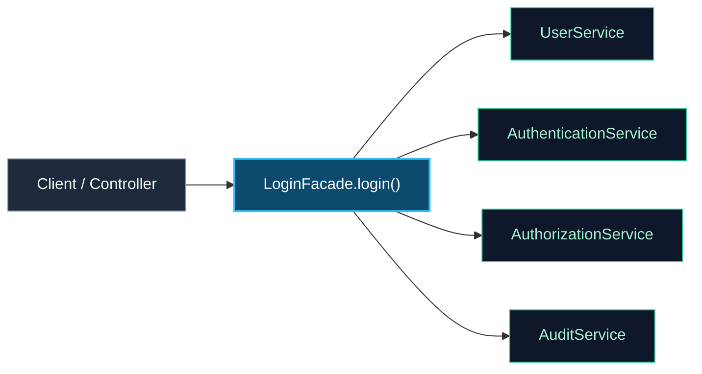

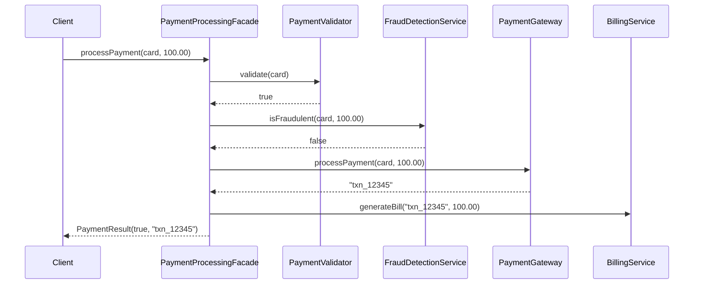

### Real-World Example: Simplifying Complex Subsystem

```java
// Complex subsystem components
public class UserService {
    public boolean validateUser(String username, String password) {
        System.out.println("Validating user: " + username);
        return username.length() >= 3 && password.length() >= 6;
    }
}

public class AuthenticationService {
    public String generateToken(String username) {
        System.out.println("Generating token for: " + username);
        return "token_" + System.currentTimeMillis();
    }
}

public class AuthorizationService {
    public boolean hasPermission(String token, String resource) {
        System.out.println("Checking permission for resource: " + resource);
        return token.startsWith("token_");
    }
}

public class AuditService {
    public void logLogin(String username, String timestamp) {
        System.out.println("Audit Log - User " + username + " logged in at " + timestamp);
    }
}

// Facade: Simplifies complex subsystem
public class LoginFacade {
    private UserService userService = new UserService();
    private AuthenticationService authService = new AuthenticationService();
    private AuthorizationService authzService = new AuthorizationService();
    private AuditService auditService = new AuditService();

    public boolean login(String username, String password) {
        // Coordinates complex sequence of operations
        if (!userService.validateUser(username, password)) {
            return false;
        }

        String token = authService.generateToken(username);

        if (!authzService.hasPermission(token, "login")) {
            return false;
        }

        auditService.logLogin(username, String.valueOf(System.currentTimeMillis()));

        return true;
    }
}

public class FacadePatternDemo {
    public static void main(String[] args) {
        LoginFacade loginFacade = new LoginFacade();

        // Client uses simple facade instead of coordinating complex subsystem
        if (loginFacade.login("john", "password123")) {
            System.out.println("Login successful!");
        } else {
            System.out.println("Login failed!");
        }
    }
}
```

### Spring's `JdbcTemplate` as Facade

```java
@Service
public class UserRepositoryWithFacade {

    @Autowired
    private JdbcTemplate jdbcTemplate; // Facade for complex JDBC operations

    public void saveUser(String name, String email) {
        // JdbcTemplate facades:
        // - Connection management
        // - Statement creation
        // - Result set handling
        // - Exception handling
        // - Resource cleanup

        String sql = "INSERT INTO users (name, email) VALUES (?, ?)";
        jdbcTemplate.update(sql, name, email);
    }

    public List<Map<String, Object>> getUsers() {
        String sql = "SELECT * FROM users";
        return jdbcTemplate.queryForList(sql);
    }
}

// Without JdbcTemplate (complex):
public class UserRepositoryWithoutFacade {
    public void saveUserManual(String name, String email) throws SQLException {
        Connection conn = null;
        PreparedStatement stmt = null;
        try {
            conn = DriverManager.getConnection("jdbc:mysql://localhost/db", "user", "pass");
            stmt = conn.prepareStatement("INSERT INTO users (name, email) VALUES (?, ?)");
            stmt.setString(1, name);
            stmt.setString(2, email);
            stmt.executeUpdate();
        } finally {
            if (stmt != null) stmt.close();
            if (conn != null) conn.close();
        }
    }
}
```

### Real-World Example: Payment Processing Facade

```java
// Complex subsystem
public class PaymentValidator {
    public boolean validate(CreditCard card) {
        System.out.println("Validating card...");
        return card.getExpiry().isAfter(LocalDate.now());
    }
}

public class FraudDetectionService {
    public boolean isFraudulent(CreditCard card, double amount) {
        System.out.println("Checking fraud detection...");
        return amount > 10000; // Simple check
    }
}

public class PaymentGateway {
    public String processPayment(CreditCard card, double amount) {
        System.out.println("Processing payment of $" + amount);
        return "txn_" + System.currentTimeMillis();
    }
}

public class BillingService {
    public void generateBill(String transactionId, double amount) {
        System.out.println("Generating bill for transaction: " + transactionId);
    }
}

// Facade
public class PaymentProcessingFacade {
    private PaymentValidator validator = new PaymentValidator();
    private FraudDetectionService fraudDetection = new FraudDetectionService();
    private PaymentGateway paymentGateway = new PaymentGateway();
    private BillingService billingService = new BillingService();

    public PaymentResult processPayment(CreditCard card, double amount) {
        try {
            if (!validator.validate(card)) {
                return new PaymentResult(false, "Card expired");
            }

            if (fraudDetection.isFraudulent(card, amount)) {
                return new PaymentResult(false, "Fraudulent transaction detected");
            }

            String transactionId = paymentGateway.processPayment(card, amount);
            billingService.generateBill(transactionId, amount);

            return new PaymentResult(true, transactionId);
        } catch (Exception e) {
            return new PaymentResult(false, "Payment processing error");
        }
    }

    public static class PaymentResult {
        public boolean success;
        public String message;

        public PaymentResult(boolean success, String message) {
            this.success = success;
            this.message = message;
        }
    }
}

// Simple usage
public class PaymentFacadeDemo {
    public static void main(String[] args) {
        CreditCard card = new CreditCard("1234567890123456", LocalDate.now().plusYears(2));
        PaymentProcessingFacade facade = new PaymentProcessingFacade();

        PaymentProcessingFacade.PaymentResult result = facade.processPayment(card, 100.00);
        System.out.println("Success: " + result.success + ", Message: " + result.message);
    }
}
```

> [!IMPORTANT]
> A Facade **does not forbid** advanced clients from accessing the underlying subsystem classes directly when fine-grained control is needed—it simply provides a clean default entry point.

### When to Use / When NOT to Use
- **Use when:**
  - Simplifying complex, multi-step subsystems (e.g., `JdbcTemplate`, `SLF4J`, checkout orchestrators).
  - Decoupling client layers from volatile third-party SDKs.
  - Defining clean boundaries in layered/microservice architectures.
- **Avoid when:**
  - The subsystem is already simple.
  - The Facade itself turns into a bloated "God Object" (split into smaller facades or orchestrators).
  - Clients routinely need low-level customization that the facade hides.

---

## 6. Flyweight Pattern

### Intent
Use sharing to support large numbers of fine-grained objects efficiently by separating **intrinsic** (shared, immutable) state from **extrinsic** (unique, context-dependent) state.

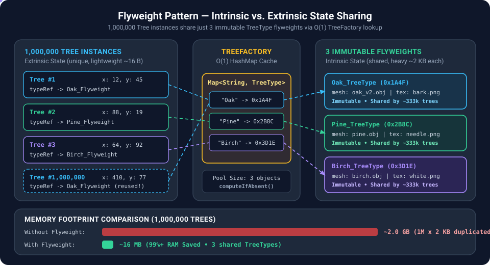

```mermaid
classDiagram
    class CharacterTypeFactory {
        <<Factory>>
        -Map~String, CharacterType~ cache$
        +getCharacterType(String name, String sprite, int health, int attackPower)$ CharacterType
        +getPoolSize()$ int
    }
    class CharacterType {
        -String name
        -String sprite
        -int health
        -int attackPower
        +displayStats() void
    }
    class Character {
        -CharacterType type
        -int posX
        -int posY
        -int currentHealth
        +moveAndAttack(int targetX, int targetY) void
    }

    CharacterTypeFactory --> CharacterType : caches &amp; shares
    Character o-- CharacterType : references
```


### Real-World Example 1: String Pool

```java
public class StringPoolDemo {
    public static void main(String[] args) {
        // Java uses flyweight pattern for String interning
        String str1 = "Hello";
        String str2 = "Hello";
        String str3 = new String("Hello").intern();

        System.out.println("str1 == str2: " + (str1 == str2)); // true - same reference
        System.out.println("str1 == str3: " + (str1 == str3)); // true - same interned string

        // Without intern()
        String str4 = new String("Hello");
        System.out.println("str1 == str4: " + (str1 == str4)); // false - different objects
    }
}
```

### Real-World Example 2: `Integer` Cache

```java
public class IntegerCacheDemo {
    public static void main(String[] args) {
        // Integer.valueOf uses caching (flyweight) for -128 to 127
        Integer a = Integer.valueOf(100);
        Integer b = Integer.valueOf(100);
        System.out.println("a == b: " + (a == b)); // true - same cached object

        Integer c = Integer.valueOf(1000);
        Integer d = Integer.valueOf(1000);
        System.out.println("c == d: " + (c == d)); // false - different objects (cache miss)

        // Always use valueOf for flyweight benefits
        Integer e = 100; // Autoboxing uses valueOf
        Integer f = 100;
        System.out.println("e == f: " + (e == f)); // true - cached
    }
}
```

### Practical Example: Game Flyweight Pattern

```java
// Intrinsic state: shared, immutable
public class CharacterType {
    private String name;
    private String sprite;
    private int health;
    private int attackPower;

    public CharacterType(String name, String sprite, int health, int attackPower) {
        this.name = name;
        this.sprite = sprite;
        this.health = health;
        this.attackPower = attackPower;
        System.out.println("Creating CharacterType: " + name);
    }

    public void displayStats() {
        System.out.println("Name: " + name + ", Health: " + health + ", Power: " + attackPower);
    }
}

// Extrinsic state: unique, mutable
public class Character {
    private CharacterType type; // Shared flyweight
    private int posX;
    private int posY;
    private int currentHealth;

    public Character(CharacterType type, int x, int y) {
        this.type = type;
        this.posX = x;
        this.posY = y;
        this.currentHealth = type.health;
    }

    public void moveAndAttack(int targetX, int targetY) {
        System.out.println("Character at (" + posX + "," + posY + ") moving to (" + targetX + "," + targetY + ")");
        type.displayStats();
    }
}

// Flyweight Factory
public class CharacterTypeFactory {
    private static final Map<String, CharacterType> cache = new HashMap<>();

    public static CharacterType getCharacterType(String name, String sprite, int health, int attackPower) {
        if (!cache.containsKey(name)) {
            cache.put(name, new CharacterType(name, sprite, health, attackPower));
        }
        return cache.get(name);
    }

    public static int getPoolSize() {
        return cache.size();
    }
}

public class FlyweightGameDemo {
    public static void main(String[] args) {
        // Creating many game characters, but character types are shared
        CharacterType warrior = CharacterTypeFactory.getCharacterType("Warrior", "warrior.png", 100, 20);
        CharacterType mage = CharacterTypeFactory.getCharacterType("Mage", "mage.png", 60, 30);

        System.out.println("Pool size after creating 2 types: " + CharacterTypeFactory.getPoolSize());

        // Create 10000 warrior instances - they all share the same CharacterType!
        Character[] warriors = new Character[10000];
        for (int i = 0; i < 10000; i++) {
            warriors[i] = new Character(warrior, i % 100, i / 100);
        }

        // Create 5000 mage instances
        Character[] mages = new Character[5000];
        for (int i = 0; i < 5000; i++) {
            mages[i] = new Character(mage, i % 100, i / 100);
        }

        System.out.println("Pool size after creating characters: " + CharacterTypeFactory.getPoolSize());
        System.out.println("Created 15000 character objects with only 2 CharacterType instances!");

        warriors[0].moveAndAttack(50, 50);
        mages[0].moveAndAttack(60, 60);
    }
}
```

### Real-World Example: Text Rendering

```java
// Intrinsic: Character glyph data (shared)
public class CharacterGlyph {
    private char character;
    private byte[] bitmapData;
    private int width;
    private int height;

    public CharacterGlyph(char character) {
        this.character = character;
        // Load glyph bitmap from font file (expensive operation)
        this.bitmapData = loadGlyphBitmap(character);
        this.width = 10;
        this.height = 15;
        System.out.println("Loaded glyph for character: " + character);
    }

    private byte[] loadGlyphBitmap(char character) {
        // Simulate loading from font file
        return new byte[width * height];
    }

    public void render(Graphics g, int x, int y) {
        g.drawImage(bitmapData, x, y, width, height);
    }
}

// Extrinsic: Position and color in document
public class CharacterPosition {
    private CharacterGlyph glyph; // Shared flyweight
    private int x;
    private int y;
    private Color color;
    private int fontSize;

    public CharacterPosition(CharacterGlyph glyph, int x, int y, Color color, int fontSize) {
        this.glyph = glyph;
        this.x = x;
        this.y = y;
        this.color = color;
        this.fontSize = fontSize;
    }

    public void render(Graphics g) {
        // Use shared glyph with unique position and color
        g.setColor(color);
        g.setFont(new Font("Arial", Font.PLAIN, fontSize));
        glyph.render(g, x, y);
    }
}

// Font factory - ensures only one glyph object per character
public class FontFactory {
    private static final Map<Character, CharacterGlyph> glyphCache = new HashMap<>();

    public static CharacterGlyph getGlyph(char character) {
        if (!glyphCache.containsKey(character)) {
            glyphCache.put(character, new CharacterGlyph(character));
        }
        return glyphCache.get(character);
    }
}
```

> [!WARNING]
> Flyweight objects **must be immutable**. If any caller mutates a shared flyweight's intrinsic state, every instance referencing it is silently corrupted. In multi-threaded apps, back the factory cache with `ConcurrentHashMap.computeIfAbsent()`.

### When to Use / When NOT to Use
- **Use when:**
  - Tens of thousands or millions of similar objects exhaust heap memory.
  - Heavy intrinsic state can be cleanly separated and made immutable.
  - Built-in JDK examples apply: `String.intern()`, `Integer.valueOf(-128..127)`, `Boolean.valueOf()`.
- **Avoid when:**
  - Objects have mostly unique, non-shareable state.
  - Memory is not a bottleneck and factory lookup complexity isn't justified.

---

## 7. Proxy Pattern

### Intent
Provide a surrogate or placeholder for another object to control access to it (lazy initialization, access control, remote calls, caching, or AOP).

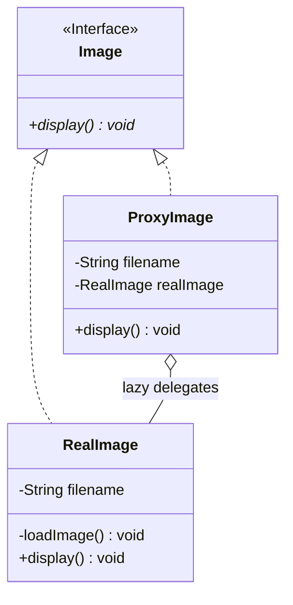

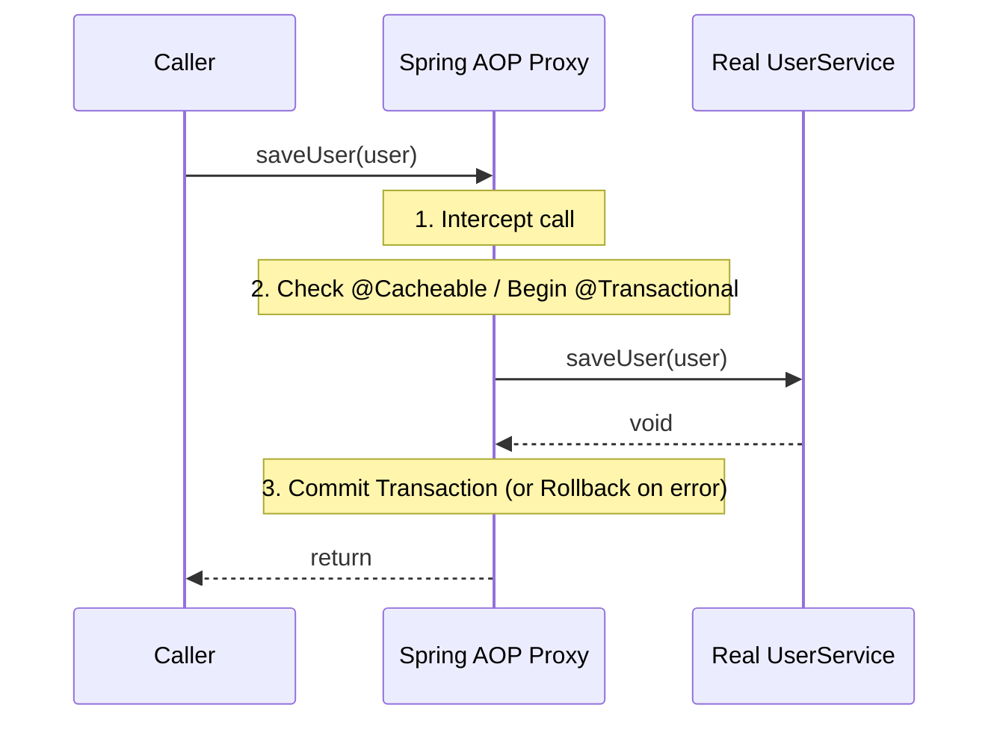

### Types of Proxy

#### 1. Virtual Proxy (Lazy Initialization)

```java
public interface Image {
    void display();
}

public class RealImage implements Image {
    private String filename;

    public RealImage(String filename) {
        this.filename = filename;
        loadImage();
    }

    private void loadImage() {
        System.out.println("Loading image from disk: " + filename);
        try {
            Thread.sleep(2000); // Simulate expensive loading
        } catch (InterruptedException e) {
            e.printStackTrace();
        }
    }

    @Override
    public void display() {
        System.out.println("Displaying image: " + filename);
    }
}

// Virtual Proxy: Delays loading until needed
public class ProxyImage implements Image {
    private String filename;
    private RealImage realImage;

    public ProxyImage(String filename) {
        this.filename = filename;
        // Image not loaded yet
    }

    @Override
    public void display() {
        if (realImage == null) {
            realImage = new RealImage(filename); // Load only when needed
        }
        realImage.display();
    }
}

public class VirtualProxyDemo {
    public static void main(String[] args) {
        // Proxy created but image not loaded
        Image image = new ProxyImage("large_image.jpg");
        System.out.println("Proxy created");

        // Image loaded when display() is called
        System.out.println("Displaying image:");
        image.display();

        // Subsequent calls use cached RealImage
        System.out.println("\nSecond display:");
        image.display();
    }
}
```

#### 2. Protection Proxy (Access Control)

```java
public interface BankAccount {
    void deposit(double amount);
    void withdraw(double amount);
    double getBalance();
}

public class RealBankAccount implements BankAccount {
    private double balance = 1000;

    @Override
    public void deposit(double amount) {
        balance += amount;
        System.out.println("Deposited $" + amount + ". New balance: $" + balance);
    }

    @Override
    public void withdraw(double amount) {
        if (amount <= balance) {
            balance -= amount;
            System.out.println("Withdrew $" + amount + ". New balance: $" + balance);
        } else {
            System.out.println("Insufficient funds");
        }
    }

    @Override
    public double getBalance() {
        return balance;
    }
}

// Protection Proxy: Controls access based on user role
public class BankAccountProxy implements BankAccount {
    private RealBankAccount account;
    private String userRole;

    public BankAccountProxy(RealBankAccount account, String userRole) {
        this.account = account;
        this.userRole = userRole;
    }

    @Override
    public void deposit(double amount) {
        if ("CUSTOMER".equals(userRole) || "ADMIN".equals(userRole)) {
            account.deposit(amount);
        } else {
            System.out.println("Access denied: You don't have permission to deposit");
        }
    }

    @Override
    public void withdraw(double amount) {
        if ("CUSTOMER".equals(userRole) || "ADMIN".equals(userRole)) {
            account.withdraw(amount);
        } else {
            System.out.println("Access denied: You don't have permission to withdraw");
        }
    }

    @Override
    public double getBalance() {
        if ("ADMIN".equals(userRole)) {
            return account.getBalance();
        } else {
            System.out.println("Access denied: Only admins can view balance");
            return -1;
        }
    }
}

public class ProtectionProxyDemo {
    public static void main(String[] args) {
        RealBankAccount realAccount = new RealBankAccount();

        // Customer access
        System.out.println("=== Customer Access ===");
        BankAccount customerAccount = new BankAccountProxy(realAccount, "CUSTOMER");
        customerAccount.deposit(500);
        customerAccount.withdraw(100);
        customerAccount.getBalance();

        System.out.println("\n=== Guest Access ===");
        BankAccount guestAccount = new BankAccountProxy(realAccount, "GUEST");
        guestAccount.deposit(100); // Denied
        guestAccount.getBalance(); // Denied

        System.out.println("\n=== Admin Access ===");
        BankAccount adminAccount = new BankAccountProxy(realAccount, "ADMIN");
        adminAccount.getBalance(); // Allowed
    }
}
```

#### 3. Remote Proxy (Network Communication)

```java
// Remote service interface
public interface DatabaseService {
    List<String> query(String sql);
    void update(String sql);
}

// Real remote service (on different server)
public class RemoteDatabaseService implements DatabaseService {
    @Override
    public List<String> query(String sql) {
        System.out.println("Remote: Executing query on server: " + sql);
        // Network call simulation
        return Arrays.asList("Row1", "Row2", "Row3");
    }

    @Override
    public void update(String sql) {
        System.out.println("Remote: Executing update on server: " + sql);
    }
}

// Remote Proxy: Handles network communication
public class DatabaseServiceProxy implements DatabaseService {
    private RemoteDatabaseService remoteService;
    private List<String> queryCache;
    private String lastQuery;

    public DatabaseServiceProxy() {
        this.remoteService = new RemoteDatabaseService(); // Initialize connection
    }

    @Override
    public List<String> query(String sql) {
        // Caching example
        if (sql.equals(lastQuery) && queryCache != null) {
            System.out.println("Proxy: Returning cached result");
            return queryCache;
        }

        System.out.println("Proxy: Sending query over network");
        queryCache = remoteService.query(sql);
        lastQuery = sql;
        return queryCache;
    }

    @Override
    public void update(String sql) {
        System.out.println("Proxy: Sending update over network");
        remoteService.update(sql);
        queryCache = null; // Invalidate cache
    }
}

public class RemoteProxyDemo {
    public static void main(String[] args) {
        DatabaseService dbService = new DatabaseServiceProxy();

        // First query - makes network call
        List<String> result1 = dbService.query("SELECT * FROM users");
        System.out.println("Result: " + result1);

        // Same query - returns cached result
        System.out.println("\nSecond query (same SQL):");
        List<String> result2 = dbService.query("SELECT * FROM users");
        System.out.println("Result: " + result2);

        // Different query - makes network call
        System.out.println("\nDifferent query:");
        List<String> result3 = dbService.query("SELECT * FROM products");
        System.out.println("Result: " + result3);

        // Update invalidates cache
        dbService.update("UPDATE users SET name='John' WHERE id=1");
    }
}
```

#### 4. Java Dynamic Proxy (`InvocationHandler`)

```java
public interface PaymentService {
    void processPayment(double amount);
    void refund(double amount);
}

public class RealPaymentService implements PaymentService {
    @Override
    public void processPayment(double amount) {
        System.out.println("Processing payment of $" + amount);
    }

    @Override
    public void refund(double amount) {
        System.out.println("Processing refund of $" + amount);
    }
}

// Dynamic Proxy Handler - adds cross-cutting concerns
public class PaymentServiceHandler implements InvocationHandler {
    private final Object target;

    public PaymentServiceHandler(Object target) {
        this.target = target;
    }

    @Override
    public Object invoke(Object proxy, Method method, Object[] args) throws Throwable {
        // Before
        System.out.println("Before: Logging payment service call - Method: " + method.getName());
        long startTime = System.currentTimeMillis();

        // Invoke actual method
        Object result = method.invoke(target, args);

        // After
        long duration = System.currentTimeMillis() - startTime;
        System.out.println("After: Method completed in " + duration + "ms");

        return result;
    }
}

public class DynamicProxyDemo {
    public static void main(String[] args) {
        PaymentService realService = new RealPaymentService();

        // Create dynamic proxy
        PaymentService proxyService = (PaymentService) Proxy.newProxyInstance(
                PaymentService.class.getClassLoader(),
                new Class[]{PaymentService.class},
                new PaymentServiceHandler(realService)
        );

        // Use proxy - adds logging automatically
        proxyService.processPayment(100.00);
        System.out.println();
        proxyService.refund(50.00);
    }
}
```

### Spring AOP Proxy Example

```java
@Service
public class UserService {
    @Transactional // Proxy adds transaction management
    public void saveUser(User user) {
        System.out.println("Saving user: " + user.getName());
    }

    @Cacheable(value = "users", key = "#id") // Proxy adds caching
    public User getUserById(String id) {
        System.out.println("Fetching user from database: " + id);
        return new User(id, "John Doe");
    }
}

// Spring creates a proxy that:
// 1. Intercepts method calls
// 2. Applies @Transactional
// 3. Applies @Cacheable
// 4. Then invokes the real method
```

> [!WARNING]
> **Spring AOP Self-Invocation Pitfall:** Because Spring uses a **Proxy** around `@Service` beans, calling a `@Transactional` or `@Cacheable` method from *another method inside the same class* (`this.saveUser(...)`) bypasses the proxy and silently skips transactions/caching!

### Proxy vs Decorator

| Aspect | Proxy | Decorator |
|--------|-------|-----------|
| **Purpose** | Control access / cross-cutting concerns | Add new responsibilities dynamically |
| **Client awareness** | Transparent (client thinks it has the real object) | Explicit (client composes decorators) |
| **Change interface** | No | No |
| **Lifecycle** | Proxy often instantiates/manages the real subject | Client passes the wrapped component in |
| **Examples** | Virtual, Protection, Remote, Spring AOP | Java I/O streams, Beverage coffee example |

### When to Use / When NOT to Use
- **Use when:**
  - Lazy initialization of heavy resources (Virtual Proxy).
  - Role-based access checks (Protection Proxy).
  - Transparent RPC/network stubs (Remote Proxy).
  - Cross-cutting concerns: logging, metrics, `@Transactional`, `@Cacheable` (Dynamic/CGLIB Proxy).
- **Avoid when:**
  - Direct access is needed with zero reflection/indirection overhead.
  - No access control, lazy loading, or cross-cutting interception is required.

---

## Summary Table: Structural Patterns

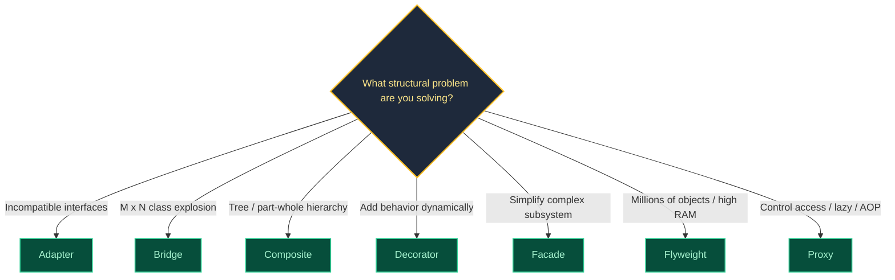

| Pattern | Purpose | Key Benefit | Classic JDK / Spring Example |
|---------|---------|-------------|------------------------------|
| **Adapter** | Make incompatible interfaces compatible | Integrates legacy systems & 3P SDKs | `Arrays.asList()`, `InputStreamReader` |
| **Bridge** | Separate abstraction from implementation | Independent variation ($M + N$) | JDBC `Driver` & `Connection` |
| **Composite** | Treat parts and wholes uniformly | Recursive tree structures | Swing `JComponent`, File systems |
| **Decorator** | Add responsibilities dynamically | Flexible alternative to subclassing | `BufferedInputStream(FileInputStream)` |
| **Facade** | Simplify complex subsystem | Clean, unified entry point | Spring `JdbcTemplate`, `SLF4J` |
| **Flyweight** | Share objects for efficiency | Massive memory optimization | `String.intern()`, `Integer.valueOf()` |
| **Proxy** | Control access to objects | Lazy loading, auth, caching, AOP | `java.lang.reflect.Proxy`, Spring `@Transactional` |
