# Behavioral Design Patterns: In-Depth Guide for FAANG Interviews

## Table of Contents

- [Overview](#overview)
- [1. Strategy Pattern](#1-strategy-pattern)
- [2. Observer Pattern](#2-observer-pattern)
- [3. Template Method Pattern](#3-template-method-pattern)
- [4. Command Pattern](#4-command-pattern)
- [5. Chain of Responsibility Pattern](#5-chain-of-responsibility-pattern)
- [6. State Pattern](#6-state-pattern)
- [7. Iterator Pattern](#7-iterator-pattern)
- [Summary of Behavioral Patterns](#summary-of-behavioral-patterns)

---

## Overview

Behavioral patterns focus on **object collaboration** and the **distribution of responsibility**. They define how objects interact and distribute work, making communication more flexible and helping design algorithms that are decoupled from the objects that use them.

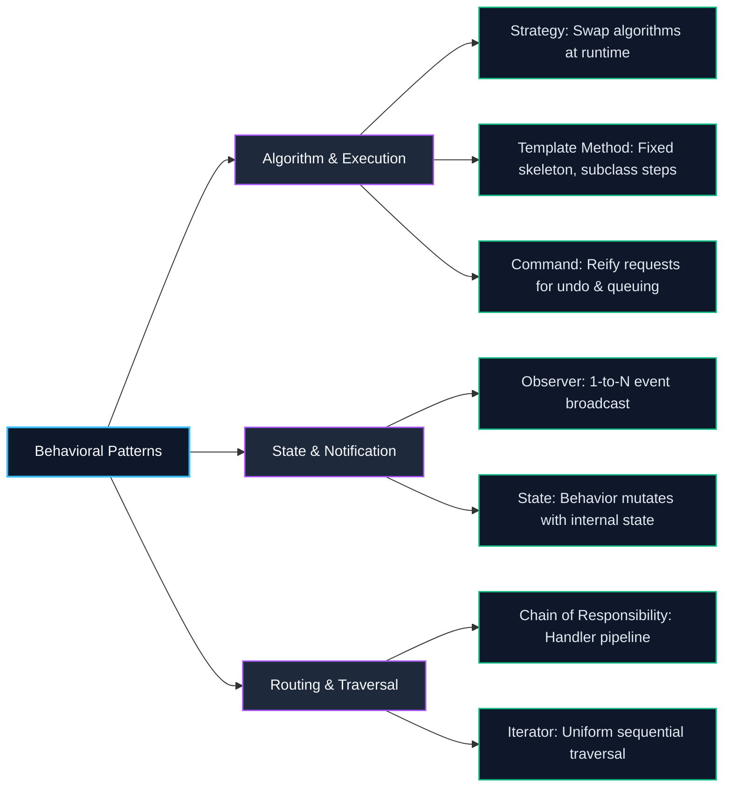

| Focus Area | Patterns | Core Mechanism |
|---|---|---|
| **Encapsulating Behavior** | Strategy, Template Method, Command | Composition (`Strategy`, `Command`) or inheritance (`Template Method`) |
| **Managing State & Events** | Observer, State | Pub-sub fan-out (`Observer`) vs. state-driven delegation (`State`) |
| **Decoupling Flow & Access** | Chain of Responsibility, Iterator | Linked handler pipeline (`CoR`) vs. cursor abstraction (`Iterator`) |

> [!TIP]
> In FAANG system design and LLD interviews, behavioral patterns are your primary tool for eliminating **Open/Closed Principle violations** (giant `if/else` or `switch` blocks) and **tight coupling** between producers and consumers.

---

## 1. Strategy Pattern

### Intent
Define a family of algorithms, encapsulate each one, and make them interchangeable at runtime.

### Architecture & Flow

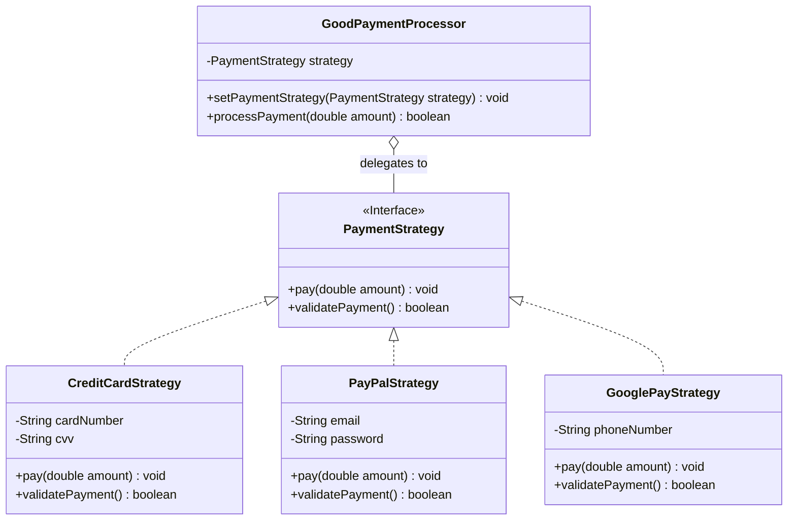

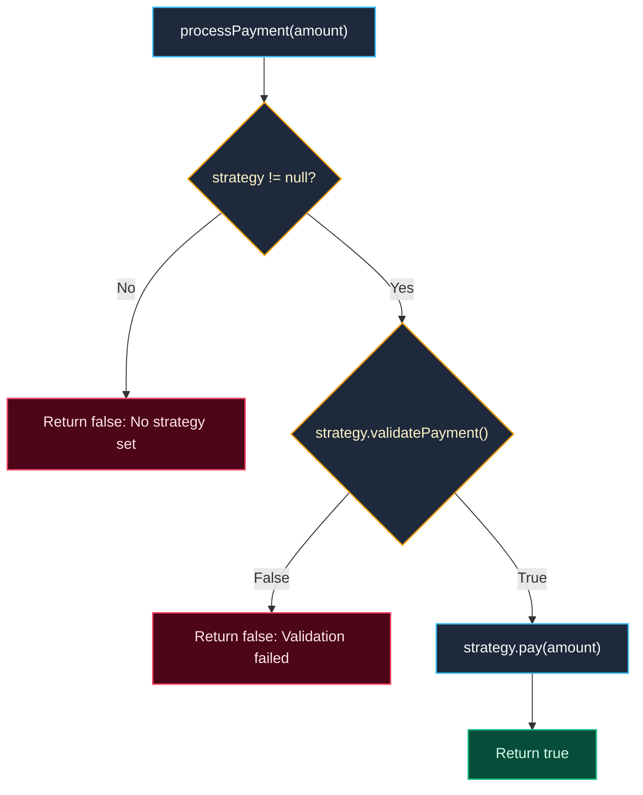

### Problem: Conditional Logic Explosion

```java
// Anti-pattern: Tight coupling with conditional logic
public class BadPaymentProcessor {
    public void processPayment(double amount, String paymentType) {
        if ("CREDIT_CARD".equals(paymentType)) {
            System.out.println("Processing credit card payment: $" + amount);
            // credit card specific logic
        } else if ("PAYPAL".equals(paymentType)) {
            System.out.println("Processing PayPal payment: $" + amount);
            // PayPal specific logic
        } else if ("GOOGLE_PAY".equals(paymentType)) {
            System.out.println("Processing Google Pay payment: $" + amount);
            // Google Pay specific logic
        }
        // Adding new payment method requires modifying this class (Open/Closed violation)
    }
}
```

### Strategy Solution

```java
// Strategy interface
public interface PaymentStrategy {
    void pay(double amount);
    boolean validatePayment();
}

// Concrete strategies
public class CreditCardStrategy implements PaymentStrategy {
    private String cardNumber;
    private String cvv;

    public CreditCardStrategy(String cardNumber, String cvv) {
        this.cardNumber = cardNumber;
        this.cvv = cvv;
    }

    @Override
    public void pay(double amount) {
        System.out.println("Processing credit card payment: $" + amount);
        System.out.println("Card: " + cardNumber.substring(cardNumber.length() - 4));
    }

    @Override
    public boolean validatePayment() {
        return cardNumber.length() == 16 && cvv.length() == 3;
    }
}

public class PayPalStrategy implements PaymentStrategy {
    private String email;
    private String password;

    public PayPalStrategy(String email, String password) {
        this.email = email;
        this.password = password;
    }

    @Override
    public void pay(double amount) {
        System.out.println("Processing PayPal payment: $" + amount);
        System.out.println("Account: " + email);
    }

    @Override
    public boolean validatePayment() {
        return email.contains("@") && password.length() >= 6;
    }
}

public class GooglePayStrategy implements PaymentStrategy {
    private String phoneNumber;

    public GooglePayStrategy(String phoneNumber) {
        this.phoneNumber = phoneNumber;
    }

    @Override
    public void pay(double amount) {
        System.out.println("Processing Google Pay payment: $" + amount);
        System.out.println("Phone: " + phoneNumber);
    }

    @Override
    public boolean validatePayment() {
        return phoneNumber.matches("\\d{10}");
    }
}

// Context: Uses strategy without knowing implementation details
public class GoodPaymentProcessor {
    private PaymentStrategy strategy;

    public void setPaymentStrategy(PaymentStrategy strategy) {
        this.strategy = strategy;
    }

    public boolean processPayment(double amount) {
        if (strategy == null) {
            System.out.println("No payment strategy set");
            return false;
        }

        if (!strategy.validatePayment()) {
            System.out.println("Payment validation failed");
            return false;
        }

        strategy.pay(amount);
        return true;
    }
}

public class StrategyPatternDemo {
    public static void main(String[] args) {
        GoodPaymentProcessor processor = new GoodPaymentProcessor();

        // Use credit card strategy
        processor.setPaymentStrategy(new CreditCardStrategy("1234567890123456", "123"));
        processor.processPayment(100.00);

        System.out.println();

        // Switch to PayPal strategy
        processor.setPaymentStrategy(new PayPalStrategy("user@example.com", "password123"));
        processor.processPayment(50.00);

        System.out.println();

        // Switch to Google Pay strategy
        processor.setPaymentStrategy(new GooglePayStrategy("9876543210"));
        processor.processPayment(75.00);

        // Adding new strategy doesn't require modifying existing code!
    }
}
```

### Real-World Example: Sorting Strategies

```java
// Strategy for sorting
public interface SortingStrategy {
    <T extends Comparable<T>> void sort(T[] array);
}

public class BubbleSortStrategy implements SortingStrategy {
    @Override
    public <T extends Comparable<T>> void sort(T[] array) {
        System.out.println("Sorting using Bubble Sort");
        for (int i = 0; i < array.length - 1; i++) {
            for (int j = 0; j < array.length - i - 1; j++) {
                if (array[j].compareTo(array[j + 1]) > 0) {
                    T temp = array[j];
                    array[j] = array[j + 1];
                    array[j + 1] = temp;
                }
            }
        }
    }
}

public class QuickSortStrategy implements SortingStrategy {
    @Override
    public <T extends Comparable<T>> void sort(T[] array) {
        System.out.println("Sorting using Quick Sort");
        quickSort(array, 0, array.length - 1);
    }

    private <T extends Comparable<T>> void quickSort(T[] array, int low, int high) {
        if (low < high) {
            int pi = partition(array, low, high);
            quickSort(array, low, pi - 1);
            quickSort(array, pi + 1, high);
        }
    }

    private <T extends Comparable<T>> int partition(T[] array, int low, int high) {
        T pivot = array[high];
        int i = low - 1;
        for (int j = low; j < high; j++) {
            if (array[j].compareTo(pivot) < 0) {
                i++;
                T temp = array[i];
                array[i] = array[j];
                array[j] = temp;
            }
        }
        T temp = array[i + 1];
        array[i + 1] = array[high];
        array[high] = temp;
        return i + 1;
    }
}

// Java's Comparator is also a strategy pattern
public class ComparatorStrategyDemo {
    public static void main(String[] args) {
        Integer[] numbers = {5, 2, 8, 1, 9};

        // Strategy 1: Default sorting
        Arrays.sort(numbers);
        System.out.println("Default sort: " + Arrays.toString(numbers));

        numbers = new Integer[]{5, 2, 8, 1, 9};

        // Strategy 2: Reverse sorting (different strategy)
        Arrays.sort(numbers, (a, b) -> b.compareTo(a));
        System.out.println("Reverse sort: " + Arrays.toString(numbers));
    }
}
```

### Real-World Example: Compression Strategies

```java
public interface CompressionStrategy {
    void compress(String filename);
}

public class ZipCompressionStrategy implements CompressionStrategy {
    @Override
    public void compress(String filename) {
        System.out.println("Compressing " + filename + " using ZIP");
    }
}

public class GzipCompressionStrategy implements CompressionStrategy {
    @Override
    public void compress(String filename) {
        System.out.println("Compressing " + filename + " using GZIP");
    }
}

public class RarCompressionStrategy implements CompressionStrategy {
    @Override
    public void compress(String filename) {
        System.out.println("Compressing " + filename + " using RAR");
    }
}

public class CompressionContext {
    private CompressionStrategy strategy;

    public void setCompressionStrategy(CompressionStrategy strategy) {
        this.strategy = strategy;
    }

    public void compress(String filename) {
        strategy.compress(filename);
    }
}

public class CompressionStrategyDemo {
    public static void main(String[] args) {
        CompressionContext context = new CompressionContext();

        context.setCompressionStrategy(new ZipCompressionStrategy());
        context.compress("document.txt");

        context.setCompressionStrategy(new GzipCompressionStrategy());
        context.compress("document.txt");

        context.setCompressionStrategy(new RarCompressionStrategy());
        context.compress("document.txt");
    }
}
```

### Trade-Offs

| When to Use | When NOT to Use |
|---|---|
| Multiple algorithms for a single task | Single algorithm only |
| Runtime selection or swapping of algorithm | Algorithms rarely or never change |
| Avoiding `if/else` or `switch` conditional explosion | Performance-critical inner loops sensitive to virtual dispatch |
| Family of related algorithms (sorting, compression, payment) | Over-engineering simple 2-branch logic |

> [!IMPORTANT]
> In modern Java (8+), functional interfaces like `Comparator<T>` and lambdas often replace boilerplate concrete strategy classes when the strategy has only a single method.

---

## 2. Observer Pattern

### Intent
Define a one-to-many dependency where when one object changes state, all its dependents are notified automatically.

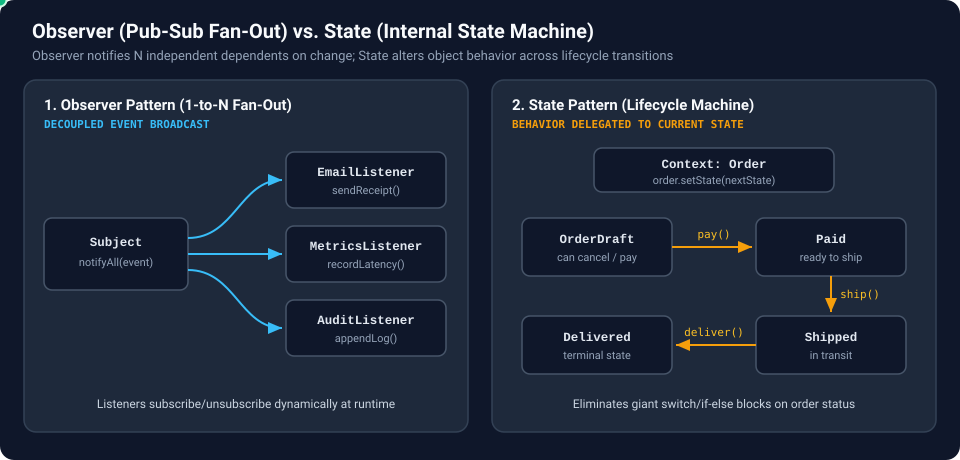

### Architecture & Notification Sequence

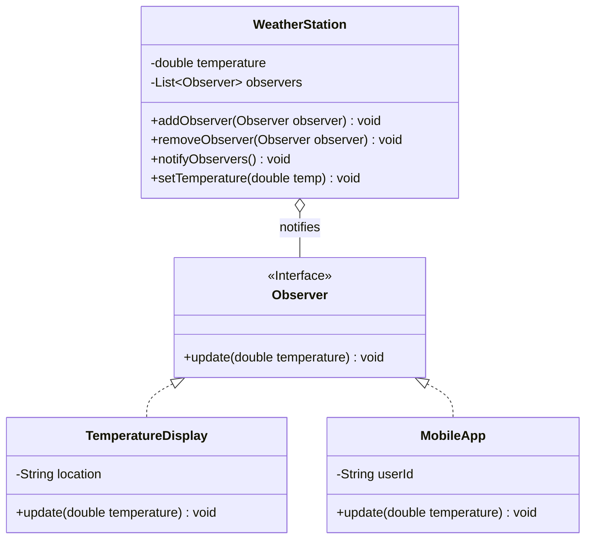

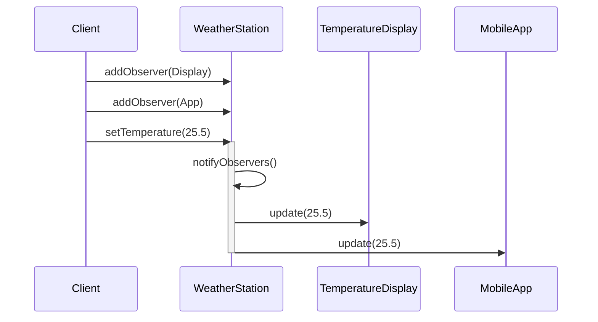

### Problem: Tight Coupling Between Components

```java
// Anti-pattern: Direct coupling
public class BadWeatherStation {
    private double temperature;
    private TemperatureDisplay display1;
    private TemperatureDisplay display2;
    private TemperatureDisplay display3;

    public void setTemperature(double temp) {
        this.temperature = temp;
        // Tight coupling - must know all observers
        display1.update(temp);
        display2.update(temp);
        display3.update(temp);
        // Adding new display requires changing this class
    }
}
```

### Observer Solution

```java
// Observer interface
public interface Observer {
    void update(double temperature);
}

// Concrete Observers
public class TemperatureDisplay implements Observer {
    private String location;

    public TemperatureDisplay(String location) {
        this.location = location;
    }

    @Override
    public void update(double temperature) {
        System.out.println(location + " display: Temperature is " + temperature + "°C");
    }
}

public class MobileApp implements Observer {
    private String userId;

    public MobileApp(String userId) {
        this.userId = userId;
    }

    @Override
    public void update(double temperature) {
        System.out.println("User " + userId + " received notification: Temperature " + temperature + "°C");
    }
}

// Subject (Observable)
public class WeatherStation {
    private double temperature;
    private List<Observer> observers = new ArrayList<>();

    public void addObserver(Observer observer) {
        if (!observers.contains(observer)) {
            observers.add(observer);
        }
    }

    public void removeObserver(Observer observer) {
        observers.remove(observer);
    }

    public void notifyObservers() {
        for (Observer observer : observers) {
            observer.update(temperature);
        }
    }

    public void setTemperature(double temp) {
        System.out.println("Temperature changed to: " + temp);
        this.temperature = temp;
        notifyObservers();
    }

    public double getTemperature() {
        return temperature;
    }
}

public class ObserverPatternDemo {
    public static void main(String[] args) {
        WeatherStation station = new WeatherStation();

        // Create observers
        Observer display1 = new TemperatureDisplay("Airport");
        Observer display2 = new TemperatureDisplay("City Center");
        Observer app = new MobileApp("user123");

        // Subscribe
        station.addObserver(display1);
        station.addObserver(display2);
        station.addObserver(app);

        // Notify all observers when temperature changes
        station.setTemperature(25.5);

        System.out.println();

        // Remove observer
        station.removeObserver(display1);
        station.setTemperature(28.0);

        System.out.println();

        // Add new observer dynamically
        Observer newDisplay = new TemperatureDisplay("Highway");
        station.addObserver(newDisplay);
        station.setTemperature(22.0);
    }
}
```

### Java's Built-in Observer (Deprecated)

```java
// Java's Observable (deprecated since Java 9)
public class OldWeatherStationDemo {
    public static void main(String[] args) {
        // Observable obs = new Observable();
        // obs.addObserver((o, arg) -> System.out.println("Update: " + arg));
        // No longer recommended - use custom implementation or reactive streams
    }
}
```

### Reactive Streams (Modern Alternative)

```java
public class ReactiveObserverDemo {
    public static void main(String[] args) {
        // Modern approach using reactive streams
        PublishSubject<Double> temperatureSubject = PublishSubject.create();

        // Subscribe to temperature changes
        temperatureSubject.subscribe(
                temp -> System.out.println("Display 1: " + temp + "°C"),
                error -> System.err.println("Error: " + error),
                () -> System.out.println("Temperature stream completed")
        );

        temperatureSubject.subscribe(
                temp -> System.out.println("Display 2: " + temp + "°C")
        );

        // Emit events
        temperatureSubject.onNext(25.5);
        temperatureSubject.onNext(28.0);
        temperatureSubject.onNext(22.0);
    }
}
```

### Spring's ApplicationEvent Observer

```java
// Custom event
public class TemperatureChangedEvent extends ApplicationEvent {
    private double temperature;

    public TemperatureChangedEvent(Object source, double temperature) {
        super(source);
        this.temperature = temperature;
    }

    public double getTemperature() {
        return temperature;
    }
}

// Observer as event listener
@Component
public class TemperatureEventListener {
    @EventListener
    public void onTemperatureChanged(TemperatureChangedEvent event) {
        System.out.println("Temperature changed to: " + event.getTemperature());
    }
}

// Publisher
@Component
public class SpringWeatherStation {
    @Autowired
    private ApplicationEventPublisher eventPublisher;

    public void setTemperature(double temp) {
        eventPublisher.publishEvent(new TemperatureChangedEvent(this, temp));
    }
}
```

### Trade-Offs

| When to Use | When NOT to Use |
|---|---|
| Event-driven systems & UI listeners | Simple, direct communication is enough |
| MVC architectures (Model notifies Views) | Strict notification ordering is required |
| Real-time updates (weather, stock prices) | Simple one-way relationships |
| Publish-Subscribe messaging | Memory-leak-prone lifecycles without weak refs / unsubscribe |

> [!WARNING]
> Always provide a mechanism to **unsubscribe** (`removeObserver`) or use weak references—forgetting to detach observers is a classic source of **memory leaks** ("lapsed listener problem").

---

## 3. Template Method Pattern

### Intent
Define the skeleton of an algorithm in a base class, letting subclasses override specific steps without changing the algorithm's structure.

### Architecture & Execution Skeleton

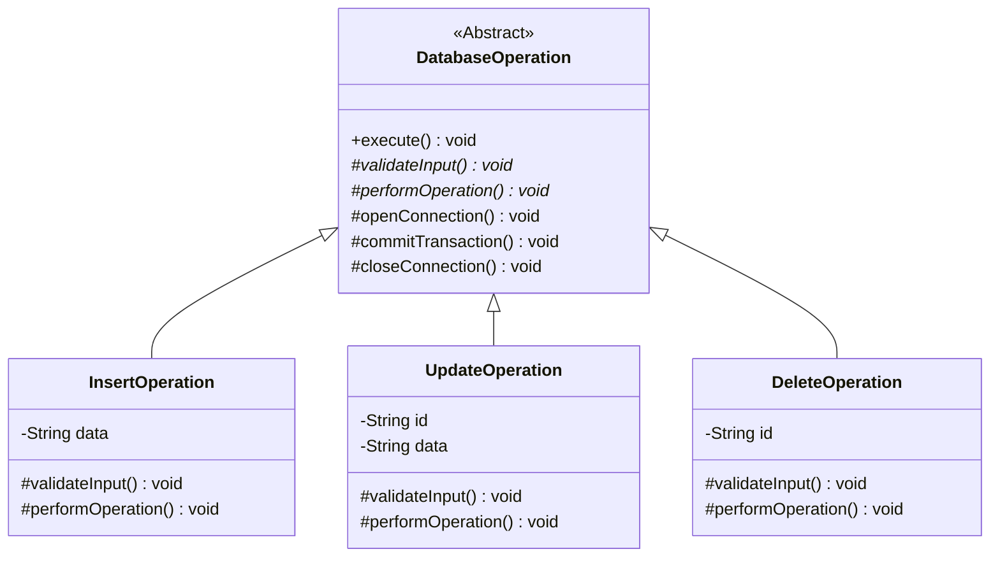

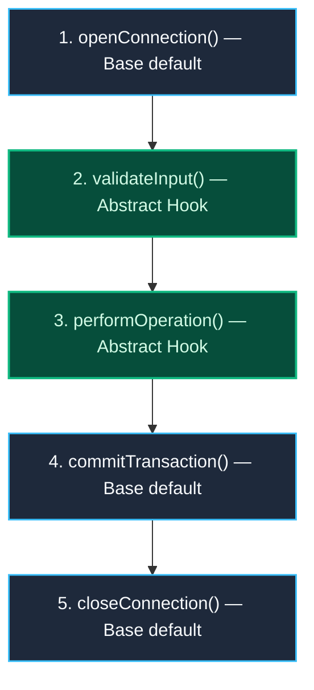

### Real-World Example: Database Operations

```java
// Abstract template
public abstract class DatabaseOperation {
    // Template method - defines algorithm skeleton
    public final void execute() {
        System.out.println("1. Opening database connection");
        openConnection();

        System.out.println("2. Validating input");
        validateInput();

        System.out.println("3. Performing operation");
        performOperation();

        System.out.println("4. Committing transaction");
        commitTransaction();

        System.out.println("5. Closing connection");
        closeConnection();
    }

    protected abstract void validateInput();
    protected abstract void performOperation();

    // Common steps (can have default implementation)
    protected void openConnection() {
        System.out.println("   - Connection opened");
    }

    protected void closeConnection() {
        System.out.println("   - Connection closed");
    }

    protected void commitTransaction() {
        System.out.println("   - Transaction committed");
    }
}

// Concrete implementations
public class InsertOperation extends DatabaseOperation {
    private String data;

    public InsertOperation(String data) {
        this.data = data;
    }

    @Override
    protected void validateInput() {
        System.out.println("   - Validating data: " + data);
    }

    @Override
    protected void performOperation() {
        System.out.println("   - Inserting data: " + data);
    }
}

public class UpdateOperation extends DatabaseOperation {
    private String id;
    private String data;

    public UpdateOperation(String id, String data) {
        this.id = id;
        this.data = data;
    }

    @Override
    protected void validateInput() {
        System.out.println("   - Validating ID: " + id + " and data: " + data);
    }

    @Override
    protected void performOperation() {
        System.out.println("   - Updating record " + id + " with data: " + data);
    }
}

public class DeleteOperation extends DatabaseOperation {
    private String id;

    public DeleteOperation(String id) {
        this.id = id;
    }

    @Override
    protected void validateInput() {
        System.out.println("   - Validating ID: " + id);
    }

    @Override
    protected void performOperation() {
        System.out.println("   - Deleting record: " + id);
    }
}

public class TemplateMethodDemo {
    public static void main(String[] args) {
        System.out.println("=== INSERT ===");
        DatabaseOperation insert = new InsertOperation("John Doe, 30");
        insert.execute();

        System.out.println("\n=== UPDATE ===");
        DatabaseOperation update = new UpdateOperation("123", "Jane Doe, 28");
        update.execute();

        System.out.println("\n=== DELETE ===");
        DatabaseOperation delete = new DeleteOperation("123");
        delete.execute();
    }
}
```

### Spring's JdbcTemplate Example

```java
@Repository
public class UserRepositoryWithTemplate {
    @Autowired
    private JdbcTemplate jdbcTemplate;

    public void saveUser(User user) {
        // JdbcTemplate applies template method pattern
        String sql = "INSERT INTO users (name, email) VALUES (?, ?)";
        jdbcTemplate.update(sql, user.getName(), user.getEmail());
        // Template method handles:
        // - Connection management
        // - Statement preparation
        // - Parameter binding
        // - Exception handling
        // - Resource cleanup
    }

    public List<User> getUsers() {
        String sql = "SELECT * FROM users";
        return jdbcTemplate.query(sql, (rs, rowNum) ->
            new User(rs.getInt("id"), rs.getString("name"), rs.getString("email"))
        );
    }
}
```

### Trade-Offs

| When to Use | When NOT to Use |
|---|---|
| Algorithm has steps that vary between implementations | Simple algorithms without step variation |
| Common boilerplate (e.g., connection/cleanup) shouldn't be duplicated | Only one implementation exists |
| Subclasses should only override specific hooks | Inheritance hierarchy is not justified (prefer Strategy) |
| Enforcing invariant algorithm ordering via `final` method | Runtime swapping of individual steps is needed |

> [!TIP]
> Always mark the template method `final` (like `public final void execute()`) so subclasses cannot accidentally break the invariant step ordering.

---

## 4. Command Pattern

### Intent
Encapsulate a request as an object, allowing you to parameterize clients with different requests, queue requests, log requests, and support undoable operations.

### Architecture & Undo/Redo Flow

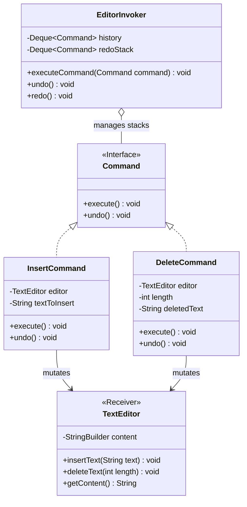

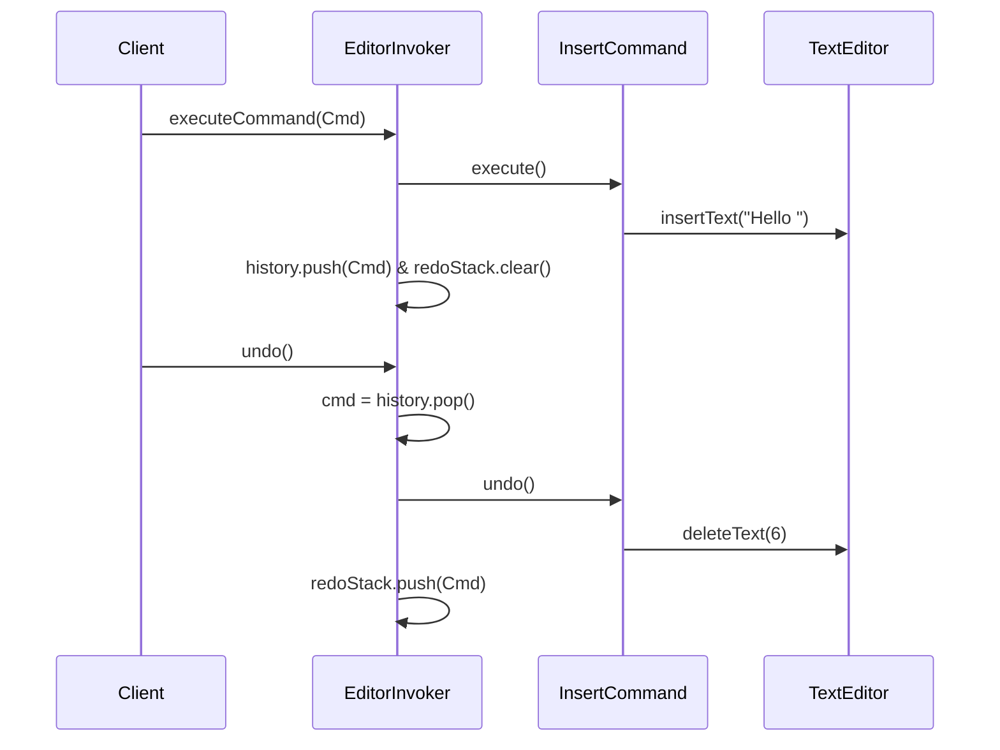

### Real-World Example: Undo/Redo System

```java
// Command interface
public interface Command {
    void execute();
    void undo();
}

// Receiver: Object that performs actual work
public class TextEditor {
    private StringBuilder content = new StringBuilder();

    public void insertText(String text) {
        content.append(text);
    }

    public void deleteText(int length) {
        if (content.length() >= length) {
            content.delete(content.length() - length, content.length());
        }
    }

    public String getContent() {
        return content.toString();
    }
}

// Concrete Commands
public class InsertCommand implements Command {
    private TextEditor editor;
    private String textToInsert;

    public InsertCommand(TextEditor editor, String text) {
        this.editor = editor;
        this.textToInsert = text;
    }

    @Override
    public void execute() {
        editor.insertText(textToInsert);
        System.out.println("Inserted: " + textToInsert);
    }

    @Override
    public void undo() {
        editor.deleteText(textToInsert.length());
        System.out.println("Undo insert: " + textToInsert);
    }
}

public class DeleteCommand implements Command {
    private TextEditor editor;
    private int length;
    private String deletedText;

    public DeleteCommand(TextEditor editor, int length) {
        this.editor = editor;
        this.length = length;
    }

    @Override
    public void execute() {
        deletedText = editor.getContent();
        editor.deleteText(length);
        System.out.println("Deleted " + length + " characters");
    }

    @Override
    public void undo() {
        // Simplified - in real world, store actual deleted content
        editor.insertText(deletedText);
        System.out.println("Undo delete");
    }
}

// Invoker: Executes commands
public class EditorInvoker {
    private Deque<Command> history = new LinkedList<>();
    private Deque<Command> redoStack = new LinkedList<>();

    public void executeCommand(Command command) {
        command.execute();
        history.push(command);
        redoStack.clear(); // Clear redo stack on new command
    }

    public void undo() {
        if (history.isEmpty()) {
            System.out.println("Nothing to undo");
            return;
        }
        Command command = history.pop();
        command.undo();
        redoStack.push(command);
    }

    public void redo() {
        if (redoStack.isEmpty()) {
            System.out.println("Nothing to redo");
            return;
        }
        Command command = redoStack.pop();
        command.execute();
        history.push(command);
    }
}

public class CommandPatternDemo {
    public static void main(String[] args) {
        TextEditor editor = new TextEditor();
        EditorInvoker invoker = new EditorInvoker();

        // Execute commands
        invoker.executeCommand(new InsertCommand(editor, "Hello "));
        invoker.executeCommand(new InsertCommand(editor, "World"));
        System.out.println("Content: " + editor.getContent());

        System.out.println("\n--- Undo ---");
        invoker.undo();
        System.out.println("Content: " + editor.getContent());

        System.out.println("\n--- Redo ---");
        invoker.redo();
        System.out.println("Content: " + editor.getContent());
    }
}
```

### Real-World Example: Task Scheduling

```java
public interface Task extends Command {
    String getDescription();
}

public class DownloadTask implements Task {
    private String filename;
    private int progress;

    public DownloadTask(String filename) {
        this.filename = filename;
    }

    @Override
    public void execute() {
        System.out.println("Starting download of: " + filename);
        // Simulate download
        progress = 100;
    }

    @Override
    public void undo() {
        System.out.println("Cancelling download of: " + filename);
        progress = 0;
    }

    @Override
    public String getDescription() {
        return "Download " + filename;
    }
}

public class TaskScheduler {
    private Queue<Command> taskQueue = new LinkedList<>();

    public void scheduleTask(Command task) {
        taskQueue.offer(task);
        System.out.println("Task scheduled");
    }

    public void executePendingTasks() {
        while (!taskQueue.isEmpty()) {
            Command task = taskQueue.poll();
            task.execute();
        }
    }
}

public class TaskSchedulerDemo {
    public static void main(String[] args) {
        TaskScheduler scheduler = new TaskScheduler();

        scheduler.scheduleTask(new DownloadTask("file1.zip"));
        scheduler.scheduleTask(new DownloadTask("file2.pdf"));
        scheduler.scheduleTask(new DownloadTask("file3.exe"));

        System.out.println("\nExecuting scheduled tasks:");
        scheduler.executePendingTasks();
    }
}
```

### Trade-Offs

| When to Use | When NOT to Use |
|---|---|
| Undo / Redo functionality (`history` + `redoStack`) | Simple, direct method calls are sufficient |
| Command queuing, delayed execution, or thread pools | No need for undo/redo or auditing |
| Logging requests / transaction replay | No command history needed |
| Macro commands (composing multiple actions) | Tight memory constraints with large state snapshots |

> [!IMPORTANT]
> Executing a new command **must clear the `redoStack`** (`redoStack.clear()`), otherwise redoing an invalidated future action will corrupt document state.

---

## 5. Chain of Responsibility Pattern

### Intent
Pass a request along a chain of handlers where each handler decides either to process it or pass it to the next handler.

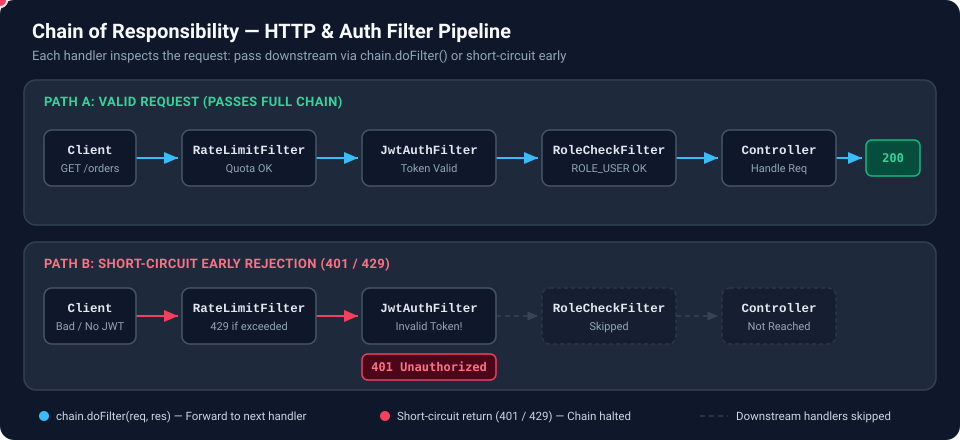

### Architecture & Approval Routing

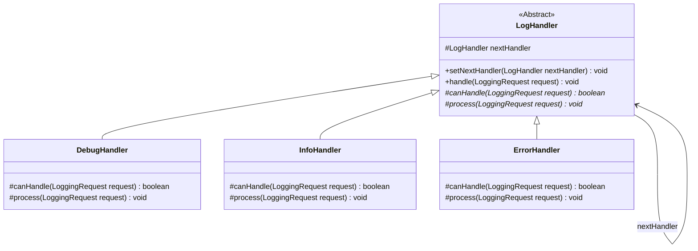

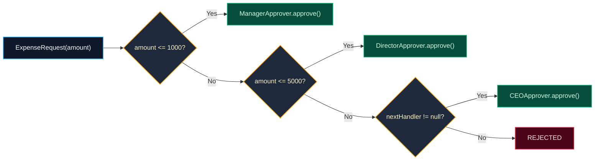

### Real-World Example: Request Filtering

```java
// Request object
public class LoggingRequest {
    private String message;
    private String severity; // DEBUG, INFO, WARNING, ERROR, CRITICAL

    public LoggingRequest(String message, String severity) {
        this.message = message;
        this.severity = severity;
    }

    public String getMessage() {
        return message;
    }

    public String getSeverity() {
        return severity;
    }
}

// Handler interface
public abstract class LogHandler {
    protected LogHandler nextHandler;

    public void setNextHandler(LogHandler nextHandler) {
        this.nextHandler = nextHandler;
    }

    public final void handle(LoggingRequest request) {
        if (canHandle(request)) {
            process(request);
        } else if (nextHandler != null) {
            nextHandler.handle(request);
        } else {
            System.out.println("Request not handled");
        }
    }

    protected abstract boolean canHandle(LoggingRequest request);
    protected abstract void process(LoggingRequest request);
}

// Concrete handlers
public class DebugHandler extends LogHandler {
    @Override
    protected boolean canHandle(LoggingRequest request) {
        return "DEBUG".equals(request.getSeverity());
    }

    @Override
    protected void process(LoggingRequest request) {
        System.out.println("[DEBUG] " + request.getMessage());
    }
}

public class InfoHandler extends LogHandler {
    @Override
    protected boolean canHandle(LoggingRequest request) {
        return "INFO".equals(request.getSeverity());
    }

    @Override
    protected void process(LoggingRequest request) {
        System.out.println("[INFO] " + request.getMessage());
    }
}

public class ErrorHandler extends LogHandler {
    @Override
    protected boolean canHandle(LoggingRequest request) {
        return "ERROR".equals(request.getSeverity()) || "CRITICAL".equals(request.getSeverity());
    }

    @Override
    protected void process(LoggingRequest request) {
        System.out.println("[ERROR] " + request.getMessage());
        // Could also log to file or send alert
    }
}

public class ChainOfResponsibilityDemo {
    public static void main(String[] args) {
        LogHandler debugHandler = new DebugHandler();
        LogHandler infoHandler = new InfoHandler();
        LogHandler errorHandler = new ErrorHandler();

        // Build chain: Debug -> Info -> Error
        debugHandler.setNextHandler(infoHandler);
        infoHandler.setNextHandler(errorHandler);

        // Process requests
        debugHandler.handle(new LoggingRequest("Starting application", "DEBUG"));
        debugHandler.handle(new LoggingRequest("User logged in", "INFO"));
        debugHandler.handle(new LoggingRequest("Database connection failed", "CRITICAL"));
    }
}
```

### Spring's Servlet Filter Chain

```java
// Spring filters form a chain of responsibility
@Component
public class LoggingFilter implements Filter {
    @Override
    public void doFilter(ServletRequest request, ServletResponse response, FilterChain chain)
            throws IOException, ServletException {
        System.out.println("LoggingFilter: Before request");
        chain.doFilter(request, response); // Pass to next in chain
        System.out.println("LoggingFilter: After request");
    }
}

@Component
public class SecurityFilter implements Filter {
    @Override
    public void doFilter(ServletRequest request, ServletResponse response, FilterChain chain)
            throws IOException, ServletException {
        System.out.println("SecurityFilter: Checking security");
        // Check authentication/authorization
        chain.doFilter(request, response); // Pass to next in chain
    }
}

// Spring automatically creates the chain:
// SecurityFilter -> LoggingFilter -> DispatcherServlet
```

### Real-World Example: Approval Chain

```java
public abstract class ApprovalHandler {
    protected double limit;
    protected ApprovalHandler nextHandler;

    public void setNextHandler(ApprovalHandler nextHandler) {
        this.nextHandler = nextHandler;
    }

    public void approveRequest(ExpenseRequest request) {
        if (request.getAmount() <= limit) {
            approve(request);
        } else if (nextHandler != null) {
            nextHandler.approveRequest(request);
        } else {
            System.out.println("Request amount $" + request.getAmount() + " exceeds all limits - REJECTED");
        }
    }

    protected abstract void approve(ExpenseRequest request);
}

public class ManagerApprover extends ApprovalHandler {
    public ManagerApprover() {
        this.limit = 1000;
    }

    @Override
    protected void approve(ExpenseRequest request) {
        System.out.println("Manager approved request for $" + request.getAmount());
    }
}

public class DirectorApprover extends ApprovalHandler {
    public DirectorApprover() {
        this.limit = 5000;
    }

    @Override
    protected void approve(ExpenseRequest request) {
        System.out.println("Director approved request for $" + request.getAmount());
    }
}

public class CEOApprover extends ApprovalHandler {
    public CEOApprover() {
        this.limit = Double.MAX_VALUE;
    }

    @Override
    protected void approve(ExpenseRequest request) {
        System.out.println("CEO approved request for $" + request.getAmount());
    }
}

public class ExpenseRequest {
    private double amount;
    private String description;

    public ExpenseRequest(double amount, String description) {
        this.amount = amount;
        this.description = description;
    }

    public double getAmount() {
        return amount;
    }
}

public class ApprovalChainDemo {
    public static void main(String[] args) {
        ApprovalHandler manager = new ManagerApprover();
        ApprovalHandler director = new DirectorApprover();
        ApprovalHandler ceo = new CEOApprover();

        manager.setNextHandler(director);
        director.setNextHandler(ceo);

        manager.approveRequest(new ExpenseRequest(500, "Office supplies"));
        manager.approveRequest(new ExpenseRequest(3000, "Equipment"));
        manager.approveRequest(new ExpenseRequest(10000, "Building expansion"));
    }
}
```

### Trade-Offs

| When to Use | When NOT to Use |
|---|---|
| Request should be handled by multiple handlers | Single handler is always sufficient |
| Handler chain is composed or reordered at runtime | Handler order is overly complex or fragile |
| Event bubbling in UI frameworks | Latency-critical hot paths (deep chain traversal) |
| Middleware / HTTP filter pipelines (Spring Security) | Guaranteed delivery is required without a fallback sink |

> [!TIP]
> Distinguish the **two CoR variants** in interviews: **Pure CoR** (only one handler processes the request, e.g., `ApprovalHandler`) vs. **Pipeline/Filter CoR** (every handler intercepts and forwards via `chain.doFilter()`, e.g., Spring `FilterChain`).

---

## 6. State Pattern

### Intent
Allow an object to alter its behavior when its internal state changes, making it appear as if the object changed its class.

### State Machines

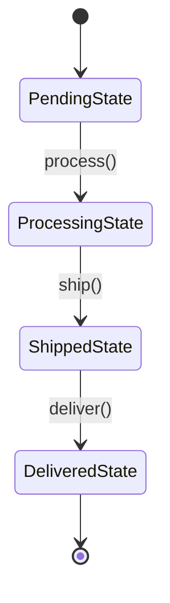

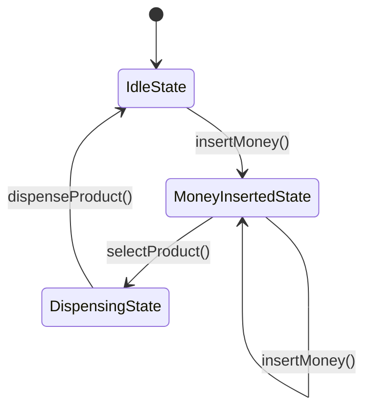

### Real-World Example: Order Status Management

```java
// State interface
public interface OrderState {
    void processOrder();
    void cancelOrder();
    void deliverOrder();
}

// Concrete states
public class PendingState implements OrderState {
    @Override
    public void processOrder() {
        System.out.println("Order processing started...");
    }

    @Override
    public void cancelOrder() {
        System.out.println("Order cancelled (was pending)");
    }

    @Override
    public void deliverOrder() {
        System.out.println("Cannot deliver pending order");
    }
}

public class ProcessingState implements OrderState {
    @Override
    public void processOrder() {
        System.out.println("Order already being processed");
    }

    @Override
    public void cancelOrder() {
        System.out.println("Cannot cancel order in processing");
    }

    @Override
    public void deliverOrder() {
        System.out.println("Order shipped!");
    }
}

public class ShippedState implements OrderState {
    @Override
    public void processOrder() {
        System.out.println("Order already shipped");
    }

    @Override
    public void cancelOrder() {
        System.out.println("Cannot cancel shipped order");
    }

    @Override
    public void deliverOrder() {
        System.out.println("Order delivered!");
    }
}

public class DeliveredState implements OrderState {
    @Override
    public void processOrder() {
        System.out.println("Order already delivered");
    }

    @Override
    public void cancelOrder() {
        System.out.println("Cannot cancel delivered order");
    }

    @Override
    public void deliverOrder() {
        System.out.println("Order already delivered");
    }
}

// Context: Order object
public class Order {
    private OrderState state;
    private String orderId;

    public Order(String orderId) {
        this.orderId = orderId;
        this.state = new PendingState();
    }

    public void setState(OrderState newState) {
        System.out.println("Order transitioned to: " + newState.getClass().getSimpleName());
        this.state = newState;
    }

    public void process() {
        state.processOrder();
    }

    public void cancel() {
        state.cancelOrder();
    }

    public void deliver() {
        state.deliverOrder();
    }

    public void ship() {
        setState(new ShippedState());
    }
}

public class StatePatternDemo {
    public static void main(String[] args) {
        Order order = new Order("ORD-001");

        order.process(); // Valid
        order.ship();
        order.deliver(); // Valid

        Order order2 = new Order("ORD-002");
        order2.cancel(); // Valid
        order2.deliver(); // Invalid
    }
}
```

### Real-World Example: Vending Machine

```java
public interface VendingMachineState {
    void selectProduct(String product);
    void insertMoney(double amount);
    void dispenseProduct();
}

public class IdleState implements VendingMachineState {
    private VendingMachine machine;

    public IdleState(VendingMachine machine) {
        this.machine = machine;
    }

    @Override
    public void selectProduct(String product) {
        System.out.println("No money inserted. Insert money first.");
    }

    @Override
    public void insertMoney(double amount) {
        System.out.println("Money inserted: $" + amount);
        machine.setBalance(amount);
        machine.setState(new MoneyInsertedState(machine));
    }

    @Override
    public void dispenseProduct() {
        System.out.println("Cannot dispense without selecting product");
    }
}

public class MoneyInsertedState implements VendingMachineState {
    private VendingMachine machine;

    public MoneyInsertedState(VendingMachine machine) {
        this.machine = machine;
    }

    @Override
    public void selectProduct(String product) {
        System.out.println("Product selected: " + product);
        machine.setSelectedProduct(product);
        machine.setState(new DispensingState(machine));
    }

    @Override
    public void insertMoney(double amount) {
        System.out.println("Additional money inserted: $" + amount);
        machine.setBalance(machine.getBalance() + amount);
    }

    @Override
    public void dispenseProduct() {
        System.out.println("Select product first");
    }
}

public class DispensingState implements VendingMachineState {
    private VendingMachine machine;

    public DispensingState(VendingMachine machine) {
        this.machine = machine;
    }

    @Override
    public void selectProduct(String product) {
        System.out.println("Wait for dispensing to complete");
    }

    @Override
    public void insertMoney(double amount) {
        System.out.println("Wait for current product to dispense");
    }

    @Override
    public void dispenseProduct() {
        System.out.println("Dispensing " + machine.getSelectedProduct());
        System.out.println("Product dispensed!");
        machine.setBalance(0);
        machine.setState(new IdleState(machine));
    }
}

public class VendingMachine {
    private VendingMachineState state;
    private double balance = 0;
    private String selectedProduct;

    public VendingMachine() {
        this.state = new IdleState(this);
    }

    public void setState(VendingMachineState state) {
        this.state = state;
    }

    public void selectProduct(String product) {
        state.selectProduct(product);
    }

    public void insertMoney(double amount) {
        state.insertMoney(amount);
    }

    public void dispenseProduct() {
        state.dispenseProduct();
    }

    // Getters and setters
    public double getBalance() {
        return balance;
    }

    public void setBalance(double balance) {
        this.balance = balance;
    }

    public String getSelectedProduct() {
        return selectedProduct;
    }

    public void setSelectedProduct(String product) {
        this.selectedProduct = product;
    }
}

public class VendingMachineDemo {
    public static void main(String[] args) {
        VendingMachine machine = new VendingMachine();

        machine.selectProduct("Soda"); // Invalid - no money
        machine.insertMoney(2.0);
        machine.selectProduct("Soda");
        machine.dispenseProduct();
    }
}
```

### Trade-Offs

| When to Use | When NOT to Use |
|---|---|
| Object behavior changes dramatically based on internal state | Simple objects with no state-dependent behavior |
| Complex conditional logic (`switch`/`if-else`) scattered across methods | Only 2–3 trivial states (simple `if-else` or `enum` suffices) |
| State transitions are well-defined | Performance-critical loops allocating new state objects |
| State machines (order processing, vending machine, TCP connection) | States don't share a common behavioral interface |

> [!NOTE]
> **Strategy vs. State**: Both share the exact same UML structure (composition + delegation), but in **Strategy** the client chooses the algorithm externally and strategies are unaware of each other, whereas in **State** the context or states themselves drive transitions internally.

---

## 7. Iterator Pattern

### Intent
Provide a way to access elements of an aggregate collection sequentially without exposing its underlying representation (array, list, tree, graph).

### Architecture & Traversal Flow

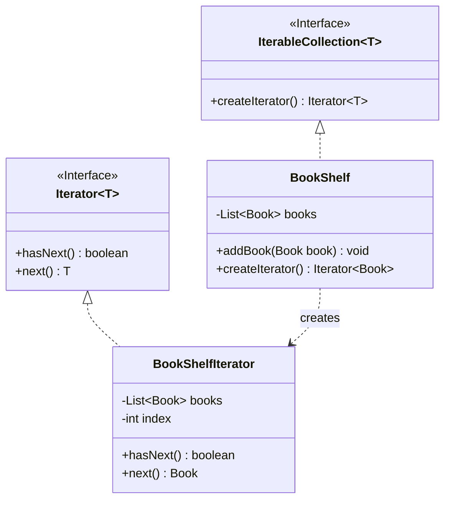

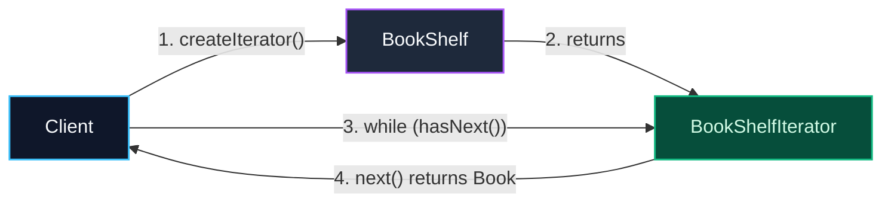

### Real-World Example: Custom Iterator

```java
public interface Iterator<T> {
    boolean hasNext();
    T next();
}

public interface IterableCollection<T> {
    Iterator<T> createIterator();
}

public class Book {
    private String title;
    private String author;

    public Book(String title, String author) {
        this.title = title;
        this.author = author;
    }

    @Override
    public String toString() {
        return title + " by " + author;
    }
}

public class BookShelf implements IterableCollection<Book> {
    private List<Book> books;

    public BookShelf() {
        this.books = new ArrayList<>();
    }

    public void addBook(Book book) {
        books.add(book);
    }

    @Override
    public Iterator<Book> createIterator() {
        return new BookShelfIterator(books);
    }

    // Inner class iterator
    private static class BookShelfIterator implements Iterator<Book> {
        private List<Book> books;
        private int index = 0;

        public BookShelfIterator(List<Book> books) {
            this.books = new ArrayList<>(books);
        }

        @Override
        public boolean hasNext() {
            return index < books.size();
        }

        @Override
        public Book next() {
            if (!hasNext()) {
                throw new NoSuchElementException();
            }
            return books.get(index++);
        }
    }
}

public class IteratorPatternDemo {
    public static void main(String[] args) {
        BookShelf shelf = new BookShelf();
        shelf.addBook(new Book("Clean Code", "Robert C. Martin"));
        shelf.addBook(new Book("Design Patterns", "Gang of Four"));
        shelf.addBook(new Book("Effective Java", "Joshua Bloch"));

        Iterator<Book> iterator = shelf.createIterator();
        while (iterator.hasNext()) {
            System.out.println(iterator.next());
        }
    }
}
```

### Java's Iterable Interface

```java
public class BetterBookShelf implements Iterable<Book> {
    private List<Book> books = new ArrayList<>();

    public void addBook(Book book) {
        books.add(book);
    }

    @Override
    public Iterator<Book> iterator() {
        return books.iterator();
    }
}

public class JavaIteratorDemo {
    public static void main(String[] args) {
        BetterBookShelf shelf = new BetterBookShelf();
        shelf.addBook(new Book("Clean Code", "Robert C. Martin"));
        shelf.addBook(new Book("Design Patterns", "Gang of Four"));

        // Can use for-each loop directly
        for (Book book : shelf) {
            System.out.println(book);
        }
    }
}
```

### Trade-Offs

| When to Use | When NOT to Use |
|---|---|
| Accessing collection elements without exposing internal structure | Direct random access (`list.get(i)`) on a simple array/list suffices |
| Supporting multiple traversal strategies (BFS, DFS, reverse) | Collection type is fixed and never changes |
| Providing a uniform interface across heterogeneous collections | Overhead of iterator object allocation in ultra-tight loops |
| Integrating with Java's `for-each` loop (`Iterable<T>`) | — |

> [!TIP]
> In Java interviews, implement `java.lang.Iterable<T>` so your custom data structure works seamlessly with enhanced `for (T item : collection)` loops and `Spliterator` streams.

---

## Summary of Behavioral Patterns

### Interview Pattern Selection Guide

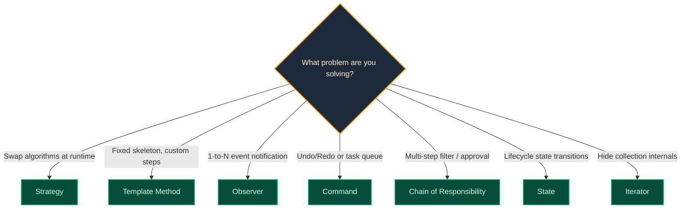

### Quick Reference Table

| Pattern | Purpose | Key Use Case | Java / Spring Example |
|---|---|---|---|
| **Strategy** | Encapsulate interchangeable algorithms | Payment methods, sorting, compression | `Comparator<T>`, `Arrays.sort()` |
| **Observer** | Notify multiple objects of state changes | Event handling, pub-sub | `ApplicationEventPublisher`, RxJava `PublishSubject` |
| **Template Method** | Define algorithm skeleton in base class | Database operations, workflows | `JdbcTemplate`, `AbstractList` |
| **Command** | Encapsulate requests as objects | Undo/Redo, task scheduling | `Runnable`, `Callable` |
| **Chain of Responsibility** | Pass request through handler chain | Logging, HTTP filters, approvals | Servlet `FilterChain`, Spring Security |
| **State** | Alter behavior by internal state | Order processing, vending machine | Order / Workflow state machines |
| **Iterator** | Access collection elements sequentially | Collection traversal | `java.util.Iterator`, `Iterable<T>` |

> [!TIP]
> When asked **"Strategy vs. Template Method?"** in an interview: **Strategy** uses **composition** to swap the *entire* algorithm at runtime, whereas **Template Method** uses **inheritance** to let subclasses override *specific steps* of a fixed algorithm skeleton.
