# Design Patterns in Real-World Java: SDK, Frameworks, and Best Practices

## Table of Contents

- [Overview](#overview)
- [1. Design Patterns in Java SDK](#1-design-patterns-in-java-sdk)
- [2. Design Patterns in Spring Framework](#2-design-patterns-in-spring-framework)
- [3. Anti-Patterns to Avoid](#3-anti-patterns-to-avoid)
- [4. SOLID Principles and Design Patterns](#4-solid-principles-and-design-patterns)
- [5. Refactoring to Patterns](#5-refactoring-to-patterns)
- [6. Interview Discussion Points](#6-interview-discussion-points)
- [Summary: Design Patterns Mapping](#summary-design-patterns-mapping)

---

## Overview

This section maps design patterns to real-world implementations in the **Java SDK**, **Spring Framework**, and standard libraries. Understanding these connections is crucial for FAANG interviews and practical enterprise development.

- **Java SDK Foundation**: Collections, `java.io` streams, and `java.util.concurrent` bake GoF patterns directly into standard APIs.
- **Spring Framework Backbone**: `DispatcherServlet`, `ApplicationContext`, `BeanFactory`, AOP dynamic proxies, and `JdbcTemplate` turn patterns into declarative infrastructure.
- **Architectural Discipline**: Pairing SOLID principles with pattern-driven refactoring prevents God Objects, circular dependencies, and hidden Service Locator coupling.

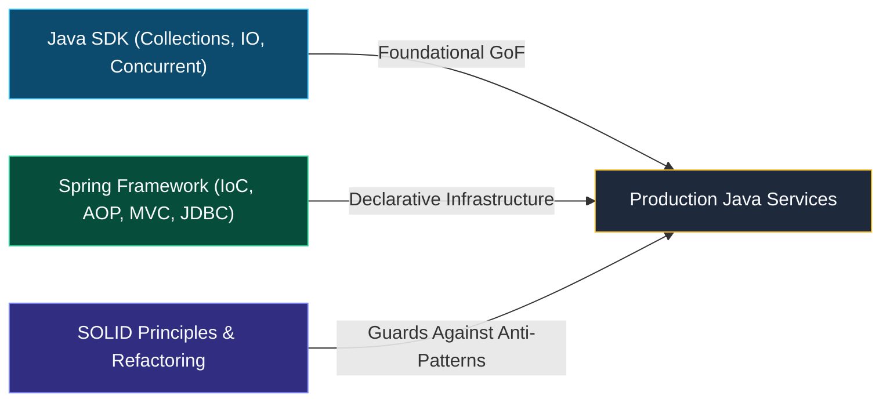

> [!TIP]
> In system design and LLD interviews, citing **where a pattern already exists in the JDK or Spring** (e.g., `BufferedInputStream` for Decorator, `JdbcTemplate` for Template Method, `DispatcherServlet` for Front Controller) signals senior-level practical fluency.

---

## 1. Design Patterns in Java SDK

The Java Standard Library is a living catalog of GoF patterns. Recognizing them helps you reuse standard abstractions instead of reinventing custom plumbing.

| Package / API | Pattern | Key Types | Core Benefit |
| :--- | :--- | :--- | :--- |
| `java.util` | **Iterator** | `Iterable`, `Iterator`, `ListIterator` | Uniform traversal without exposing internal storage |
| `java.util.Collections` | **Decorator** | `unmodifiableList`, `synchronizedList`, `singletonList` | Runtime immutability or thread-safety wrappers |
| `java.util` (Java 9+) | **Factory Method** | `List.of()`, `Set.of()`, `Map.of()` | Concise immutable collection instantiation |
| `java.util` / `java.lang` | **Strategy** | `Comparable`, `Comparator` | Swappable sorting and comparison algorithms |
| `java.io` | **Decorator** | `FileInputStream`, `BufferedInputStream`, `DataInputStream` | Composable buffering and primitive I/O layers |
| `java.util.concurrent` | **Command** | `Runnable`, `Callable`, `ExecutorService` | Decouples task submission from thread execution |


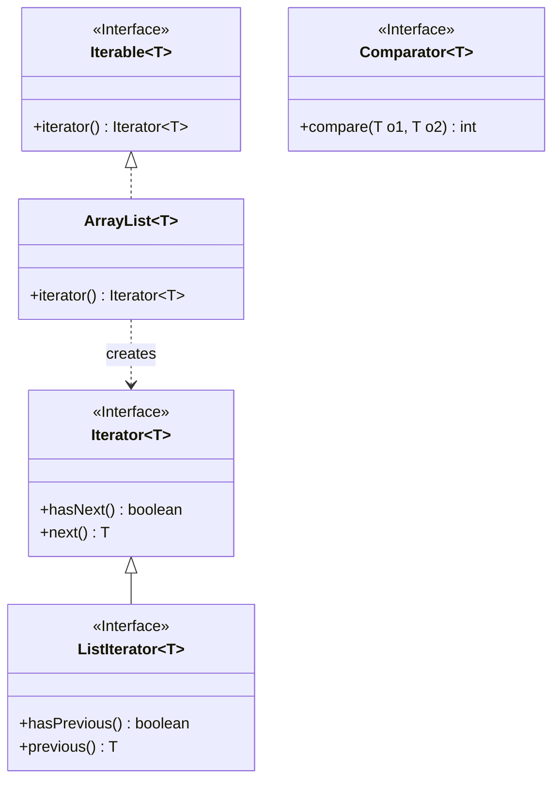

### Collections Framework

#### Iterator Pattern
```java
// Java Collections use Iterator pattern extensively
public class IteratorInCollectionsDemo {
    public static void main(String[] args) {
        List<String> list = new ArrayList<>();
        list.add("Java");
        list.add("Python");
        list.add("Go");

        // Iterator interface
        Iterator<String> iterator = list.iterator();
        while (iterator.hasNext()) {
            System.out.println(iterator.next());
        }

        // For-each uses Iterator under the hood
        for (String lang : list) {
            System.out.println(lang);
        }

        // Implementation
        // ArrayList implements Iterable, returns iterator()
        // ListIterator extends Iterator with bidirectional traversal
    }
}
```

#### Decorator Pattern in Collections
```java
public class DecoratorInCollectionsDemo {
    public static void main(String[] args) {
        List<String> list = new ArrayList<>();
        list.add("A");
        list.add("B");
        list.add("C");

        // Collections utility methods decorate lists
        // Unmodifiable - decorator adding immutability
        List<String> unmodifiable = Collections.unmodifiableList(list);
        // unmodifiable.add("D"); // throws UnsupportedOperationException

        // Synchronized - decorator adding thread safety
        List<String> synchronized_list = Collections.synchronizedList(new ArrayList<>(list));

        // Singleton - special decorator
        List<String> singletonList = Collections.singletonList("Single");

        System.out.println("Original: " + list);
        System.out.println("Unmodifiable view: " + unmodifiable);
    }
}
```

#### Factory Pattern in Collections
```java
public class FactoryInCollectionsDemo {
    public static void main(String[] args) {
        // List.of is a factory method
        List<String> immutableList = List.of("Java", "Python", "Go");

        // Set.of is a factory method
        Set<String> immutableSet = Set.of("Apple", "Banana", "Orange");

        // Map.of is a factory method
        Map<String, Integer> immutableMap = Map.of(
                "Java", 1,
                "Python", 2,
                "Go", 3
        );

        System.out.println("Immutable List: " + immutableList);
        System.out.println("Immutable Set: " + immutableSet);
        System.out.println("Immutable Map: " + immutableMap);
    }
}
```

#### Comparable and Comparator (Strategy Pattern)
```java
public class StrategyInCollectionsDemo {
    public static void main(String[] args) {
        Integer[] numbers = {5, 2, 8, 1, 9};

        // Strategy 1: Natural ordering (Comparable)
        Arrays.sort(numbers);
        System.out.println("Ascending: " + Arrays.toString(numbers));

        numbers = new Integer[]{5, 2, 8, 1, 9};

        // Strategy 2: Custom comparator (Strategy pattern)
        Arrays.sort(numbers, (a, b) -> b.compareTo(a));
        System.out.println("Descending: " + Arrays.toString(numbers));

        // Person sorting by different strategies
        List<Person> people = Arrays.asList(
                new Person("John", 30),
                new Person("Alice", 25),
                new Person("Bob", 35)
        );

        // Sort by name
        people.sort(Comparator.comparing(Person::getName));
        System.out.println("By name: " + people);

        // Sort by age
        people.sort(Comparator.comparing(Person::getAge));
        System.out.println("By age: " + people);
    }

    static class Person {
        String name;
        int age;

        Person(String name, int age) {
            this.name = name;
            this.age = age;
        }

        @Override
        public String toString() {
            return name + " (" + age + ")";
        }

        public String getName() {
            return name;
        }

        public int getAge() {
            return age;
        }
    }
}
```

### java.io - Decorator Pattern Showcase

```java
public class JavaIODecoratorShowcase {
    public static void main(String[] args) throws IOException {
        // Base component
        FileInputStream fileIn = new FileInputStream("data.txt");

        // Decorator layer 1: Buffering
        BufferedInputStream bufferedIn = new BufferedInputStream(fileIn);

        // Decorator layer 2: Data type handling
        DataInputStream dataIn = new DataInputStream(bufferedIn);

        // Each decorator adds responsibility:
        // FileInputStream: File reading
        // BufferedInputStream: Buffering for efficiency
        // DataInputStream: Reading primitive data types

        // Visual composition:
        // Client -> DataInputStream -> BufferedInputStream -> FileInputStream -> File

        // Writing side
        FileOutputStream fileOut = new FileOutputStream("output.txt");
        BufferedOutputStream bufferedOut = new BufferedOutputStream(fileOut);
        DataOutputStream dataOut = new DataOutputStream(bufferedOut);

        try {
            dataOut.writeInt(42);
            dataOut.writeUTF("Hello World");
            dataOut.flush();
        } finally {
            dataOut.close(); // Closes all decorators
        }
    }
}
```

### java.util.concurrent - Command and Observer Patterns

```java
public class ConcurrentPatternsDemo {
    public static void main(String[] args) throws InterruptedException {
        // Command pattern in ExecutorService
        ExecutorService executor = Executors.newFixedThreadPool(2);

        // Submit commands (Runnable/Callable are commands)
        executor.submit(new PrintTask("Task 1"));
        executor.submit(new PrintTask("Task 2"));

        executor.shutdown();
        executor.awaitTermination(5, TimeUnit.SECONDS);
    }

    static class PrintTask implements Runnable {
        private String name;

        PrintTask(String name) {
            this.name = name;
        }

        @Override
        public void run() {
            System.out.println("Executing: " + name);
        }
    }
}
```

> [!IMPORTANT]
> `Collections.unmodifiableList(list)` is a **read-only view decorator**, not a deep copy. Mutating the backing `list` still reflects through the unmodifiable wrapper, whereas `List.of(...)` creates a truly immutable collection.

---

## 2. Design Patterns in Spring Framework

Spring operationalizes GoF and enterprise patterns so application code stays focused on business logic while the container handles lifecycle, transactions, routing, and resource cleanup.

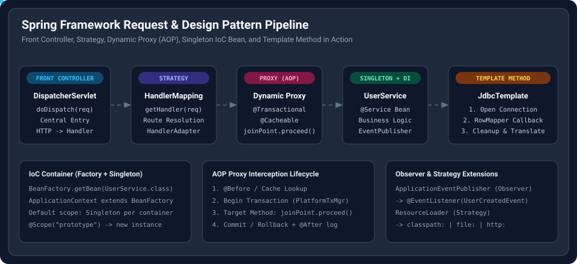

| Spring Component | Design Pattern | Mechanism | Real-World Role |
| :--- | :--- | :--- | :--- |
| `DispatcherServlet` | **Front Controller** | Central `doDispatch()` entrypoint | Routes all HTTP requests through `HandlerMapping` & `HandlerAdapter` |
| `BeanFactory` / `ApplicationContext` | **Factory** + **Singleton** | Bean registry & `@Bean` factories | Instantiates, wires, and caches singleton beans by default |
| `@Transactional` / `@Cacheable` / `@Aspect` | **Proxy (AOP)** | JDK Dynamic Proxy or CGLIB subclass | Intercepts calls for transactions, caching, logging, `@Async` |
| `JdbcTemplate` | **Template Method** | Fixed JDBC skeleton + `RowMapper` hook | Automates connection, statement, exception translation, and close |
| `ApplicationEventPublisher` | **Observer** | Event dispatch to `@EventListener` beans | Decouples side effects (welcome email, audit) from core writes |
| `ResourceLoader` | **Strategy** | `classpath:`, `file:`, `http:` prefixes | Swaps resource resolution strategy behind `Resource` interface |

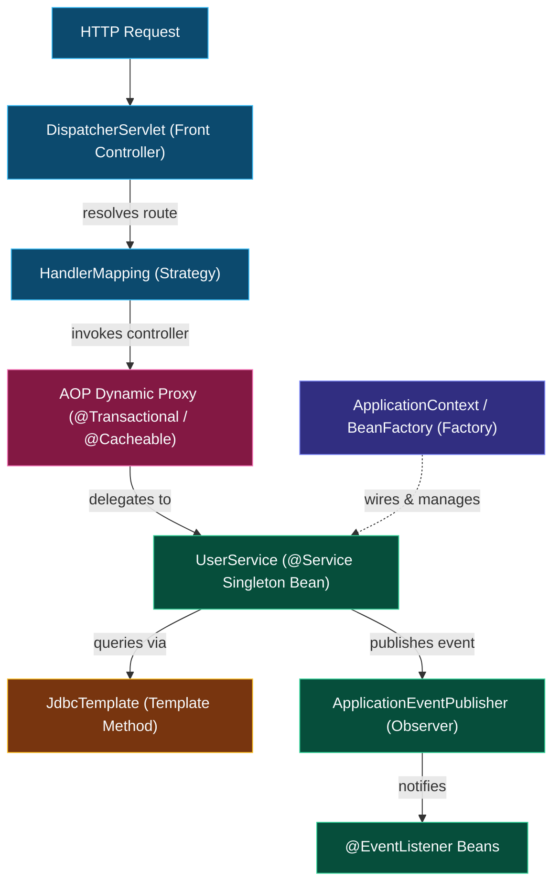

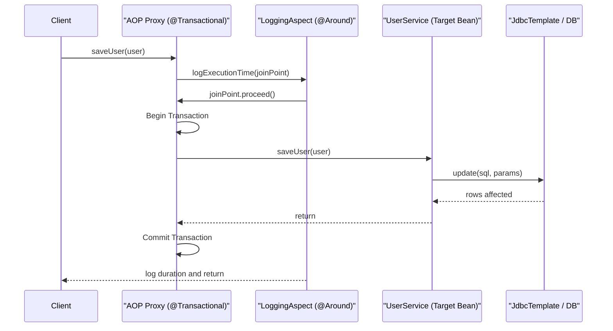

### Front Controller Pattern - DispatcherServlet

In Spring MVC, `DispatcherServlet` acts as the **Front Controller**, providing a single centralized entry point for all incoming HTTP requests. It delegates route lookup to `HandlerMapping` (Strategy), invocation to `HandlerAdapter` (Adapter), and response rendering to `ViewResolver` or `HttpMessageConverter`.

```java
// Spring MVC Front Controller flow (conceptual)
@RestController
@RequestMapping("/api/users")
public class UserController {
    private final UserService userService;

    public UserController(UserService userService) {
        this.userService = userService;
    }

    // DispatcherServlet -> HandlerMapping -> HandlerAdapter -> UserController
    @GetMapping("/{id}")
    public User getUser(@PathVariable String id) {
        return userService.getUserById(id);
    }
}
```

### Inversion of Control (IoC) and Dependency Injection

```java
// Factory pattern for bean creation
@Configuration
public class AppConfig {

    // Factory method - creates beans
    @Bean
    public UserService userService() {
        return new UserServiceImpl();
    }

    @Bean
    public UserRepository userRepository() {
        return new UserRepositoryImpl();
    }

    @Bean
    public PaymentService paymentService(UserService userService) {
        return new PaymentServiceImpl(userService);
    }
}

// Usage
@Service
public class ApplicationService {
    @Autowired
    private UserService userService; // Dependency injected

    public void processUser() {
        userService.saveUser("John");
    }
}
```

### Singleton Pattern in Spring

```java
@Service // Singleton scope by default
public class LoggingService {
    private static final Logger logger = LoggerFactory.getLogger(LoggingService.class);

    public void log(String message) {
        logger.info(message);
    }
}

@Configuration
public class SingletonBeanConfig {

    @Bean(name = "singletonDatabase")
    public DatabaseConnection singletonConnection() {
        return new DatabaseConnection("jdbc:mysql://localhost/db");
    }

    // Verify it's singleton
    @Bean
    public void verifyBeans(DatabaseConnection conn1, DatabaseConnection conn2) {
        System.out.println(conn1 == conn2); // true - same instance
    }
}

// Prototype scope (new instance each time)
@Component
@Scope("prototype")
public class PrototypeService {
    private UUID id = UUID.randomUUID();

    public UUID getId() {
        return id;
    }
}
```

### Template Method Pattern - JdbcTemplate

```java
@Repository
public class UserRepository {
    @Autowired
    private JdbcTemplate jdbcTemplate;

    // JdbcTemplate applies template method pattern
    // Handles: connection management, statement preparation,
    // result set processing, exception handling, resource cleanup

    public void saveUser(User user) {
        String sql = "INSERT INTO users (name, email) VALUES (?, ?)";
        jdbcTemplate.update(sql, user.getName(), user.getEmail());
    }

    public List<User> findAllUsers() {
        String sql = "SELECT * FROM users";
        return jdbcTemplate.query(sql, (rs, rowNum) ->
            new User(
                rs.getInt("id"),
                rs.getString("name"),
                rs.getString("email")
            )
        );
    }

    public User findById(int id) {
        String sql = "SELECT * FROM users WHERE id = ?";
        return jdbcTemplate.queryForObject(sql, (rs, rowNum) ->
            new User(rs.getInt("id"), rs.getString("name"), rs.getString("email")),
            id
        );
    }

    // What JdbcTemplate hides (template method skeleton)
    private void manualJdbcApproach(User user) throws SQLException {
        // Get connection
        // Create statement
        // Bind parameters
        // Execute
        // Process result
        // Handle exceptions
        // Close resources
        // JdbcTemplate does ALL of this!
    }
}
```

### Proxy Pattern - Spring AOP

```java
@Aspect
@Component
public class LoggingAspect {
    @Before("execution(* com.example.service.*.*(..))")
    public void logBefore(JoinPoint joinPoint) {
        System.out.println("Method: " + joinPoint.getSignature().getName());
    }

    @After("execution(* com.example.service.*.*(..))")
    public void logAfter(JoinPoint joinPoint) {
        System.out.println("Method completed: " + joinPoint.getSignature().getName());
    }

    @Around("execution(* com.example.service.*.*(..))")
    public Object logExecutionTime(ProceedingJoinPoint joinPoint) throws Throwable {
        long start = System.currentTimeMillis();
        Object result = joinPoint.proceed(); // Call actual method
        long duration = System.currentTimeMillis() - start;
        System.out.println("Execution time: " + duration + "ms");
        return result;
    }
}

@Service
public class UserService {
    // Spring creates a proxy that intercepts method calls
    // Proxy applies cross-cutting concerns (logging, transactions, caching)
    // Then calls the actual method

    @Transactional // Proxy adds transaction management
    public void saveUser(User user) {
        // Database operations wrapped in transaction
    }

    @Cacheable(value = "users", key = "#id")
    public User getUserById(String id) {
        // Result cached after first call
    }
}

// Spring creates proxies for:
// - Transactional methods (@Transactional)
// - Cached methods (@Cacheable)
// - Async methods (@Async)
// - Scheduled methods (@Scheduled)
// - Aspects (@Aspect)
```

> [!WARNING]
> **Self-invocation pitfall**: Calling a `@Transactional` or `@Cacheable` method from *another method inside the same class* (`this.saveUser(...)`) bypasses the Spring AOP proxy, so transactions and caching will silently not apply.

### Observer Pattern - Spring Events

```java
// Event
public class UserCreatedEvent extends ApplicationEvent {
    private User user;

    public UserCreatedEvent(Object source, User user) {
        super(source);
        this.user = user;
    }

    public User getUser() {
        return user;
    }
}

// Observer/Listener
@Component
public class UserCreatedEventListener {
    @EventListener
    public void onUserCreated(UserCreatedEvent event) {
        System.out.println("User created: " + event.getUser().getName());
        // Send welcome email, log, etc.
    }
}

@Component
public class UserNotificationListener {
    @EventListener
    public void onUserCreated(UserCreatedEvent event) {
        System.out.println("Sending notification for: " + event.getUser().getName());
    }
}

// Publisher
@Service
public class UserService {
    @Autowired
    private ApplicationEventPublisher eventPublisher;

    public void createUser(User user) {
        // Save user
        saveUserToDb(user);

        // Publish event - all listeners notified automatically
        eventPublisher.publishEvent(new UserCreatedEvent(this, user));
    }

    private void saveUserToDb(User user) {
        // Database operation
    }
}
```

### Strategy Pattern - Resource Loading

```java
// Spring uses strategy pattern for resource loading
public class ResourceLoadingDemo {
    public static void main(String[] args) {
        ApplicationContext context = new ClassPathXmlApplicationContext("config.xml");

        // Different strategies for loading resources
        Resource resource1 = context.getResource("classpath:app.properties");
        Resource resource2 = context.getResource("file:/tmp/config.properties");
        Resource resource3 = context.getResource("http://example.com/config.properties");

        // Same interface, different loading strategies
    }
}
```

### Factory Pattern - BeanFactory

```java
public interface BeanFactory {
    // Factory method pattern
    Object getBean(String name);
    <T> T getBean(String name, Class<T> requiredType);
    <T> T getBean(Class<T> requiredType);
}

// ApplicationContext extends BeanFactory
// Creates beans based on configuration
public class BeanFactoryDemo {
    public static void main(String[] args) {
        ApplicationContext context = new AnnotationConfigApplicationContext(AppConfig.class);

        // BeanFactory creates instances
        UserService userService = context.getBean(UserService.class);
        PaymentService paymentService = context.getBean(PaymentService.class);
    }
}
```

> [!IMPORTANT]
> `ApplicationContext` extends `BeanFactory` and adds eager singleton pre-instantiation, internationalization (`MessageSource`), `ApplicationEventPublisher`, and `ResourceLoader` strategy support.

---

## 3. Anti-Patterns to Avoid

Misapplying patterns—or ignoring separation of concerns—creates brittle codebases that are hard to test and evolve.

| Anti-Pattern | Symptom | Root Cause | Pattern-Based Fix |
| :--- | :--- | :--- | :--- |
| **God Object** | 100+ methods, unrelated responsibilities | Violates SRP | Split into focused services + DI |
| **Singleton Overuse** | Global static state everywhere | Tight coupling, untestable globals | Container-managed DI beans |
| **Circular Dependencies** | `ServiceA <-> ServiceB` deadlock | Tangled domain boundaries | Extract shared dependency or use Events |
| **Service Locator** | `ServiceLocator.getService(...)` calls | Hidden dependencies, runtime failures | Explicit constructor/field DI |

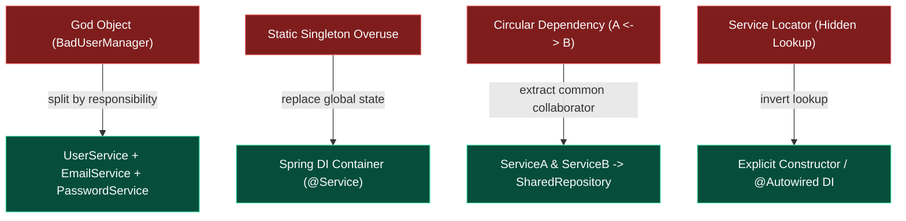

### God Object Anti-Pattern

```java
// ANTI-PATTERN: God Object doing everything
public class BadUserManager {
    public void createUser(String name, String email) { }
    public void deleteUser(String id) { }
    public void updateUser(String id, String name) { }
    public void validateEmail(String email) { }
    public void sendEmail(String email, String message) { }
    public void hashPassword(String password) { }
    public void encryptData(String data) { }
    public void logActivity(String activity) { }
    public void generateReport() { }
    // 100+ more methods...
}

// PATTERN: Single Responsibility Principle
public class UserService {
    private UserRepository repository;
    public void createUser(User user) { }
    public void deleteUser(String id) { }
    public void updateUser(User user) { }
}

public class EmailService {
    public void sendEmail(String to, String message) { }
    public void validateEmail(String email) { }
}

public class PasswordService {
    public String hashPassword(String password) { }
}

public class UserActivityLogger {
    public void logActivity(String activity) { }
}
```

### Singleton Overuse Anti-Pattern

```java
// ANTI-PATTERN: Everything is singleton
public class AntiPatternSingleton {
    public static Singleton1 instance1 = new Singleton1();
    public static Singleton2 instance2 = new Singleton2();
    public static Singleton3 instance3 = new Singleton3();
    // 50+ singletons...
    // Hard to test, tight coupling, memory leaks
}

// PATTERN: Use Dependency Injection
@Service
public class GoodService {
    @Autowired
    private Repository repository;

    @Autowired
    private Logger logger;
    // Clear dependencies, easy to mock for testing
}
```

### Circular Dependencies Anti-Pattern

```java
// ANTI-PATTERN: Circular dependency
@Service
public class ServiceA {
    @Autowired
    private ServiceB serviceB;
}

@Service
public class ServiceB {
    @Autowired
    private ServiceA serviceA; // Circular reference!
}

// PATTERN: Refactor to break cycle
@Service
public class ServiceA {
    @Autowired
    private SharedRepository repository;
}

@Service
public class ServiceB {
    @Autowired
    private SharedRepository repository;
}
```

### Service Locator Anti-Pattern

```java
// ANTI-PATTERN: Service Locator
public class ServiceLocator {
    private static Map<Class<?>, Object> registry = new HashMap<>();

    public static void register(Class<?> key, Object service) {
        registry.put(key, service);
    }

    public static Object getService(Class<?> key) {
        return registry.get(key);
    }
}

// Usage
public class Client {
    public void doWork() {
        UserService service = (UserService) ServiceLocator.getService(UserService.class);
        service.save(user);
        // Hidden dependencies, hard to test
    }
}

// PATTERN: Use Dependency Injection instead
@Service
public class GoodClient {
    @Autowired
    private UserService userService; // Explicit dependency

    public void doWork() {
        userService.save(user);
    }
}
```

> [!WARNING]
> Spring Boot 2.6+ disables circular references by default (`BeanCurrentlyInCreationException`). Always break cycles by extracting a shared collaborator, introducing an interface, or publishing an `ApplicationEvent`.

---

## 4. SOLID Principles and Design Patterns

Design patterns are concrete realizations of SOLID principles. Knowing which pattern enforces which principle turns abstract theory into actionable architecture.

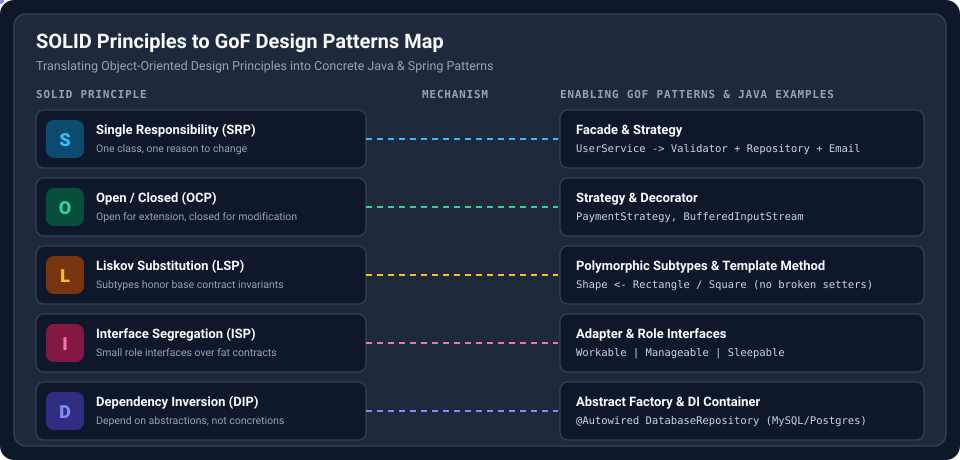

| Principle | Core Rule | Violation Symptom | Enabling Patterns |
| :--- | :--- | :--- | :--- |
| **SRP** | One class, one reason to change | `BadUserService` validates, persists, emails, logs | **Facade**, **Strategy** |
| **OCP** | Open for extension, closed for modification | `if/else` chains for payment types | **Strategy**, **Decorator** |
| **LSP** | Subtypes must honor base invariants | `Square extends Rectangle` breaks `setWidth` | **Polymorphic Subtypes**, **Template Method** |
| **ISP** | Clients shouldn't depend on unused methods | `Robot` forced to implement `sleep()` | **Adapter**, **Role Interfaces** |
| **DIP** | Depend on abstractions, not concretions | `new MySQLDatabase()` inside business service | **Abstract Factory**, **DI Container** |

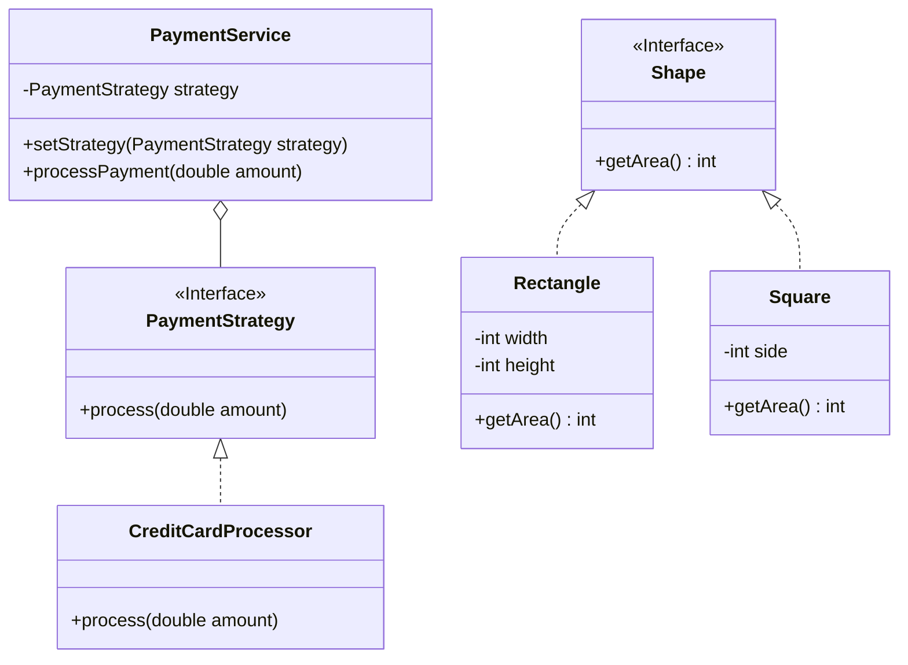

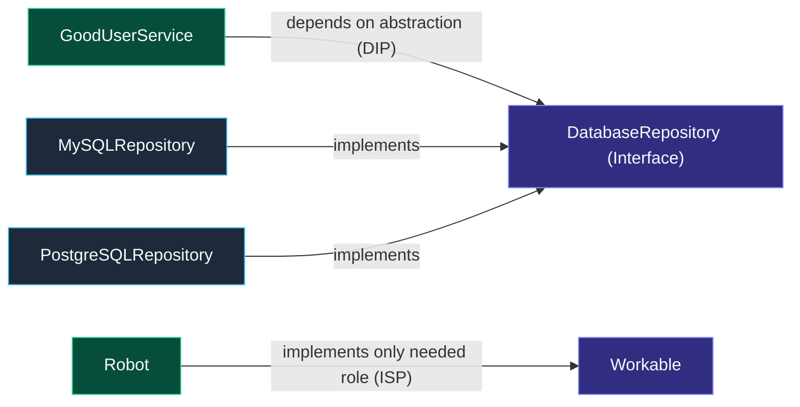

### Single Responsibility Principle (SRP)

```java
// VIOLATES SRP: Multiple reasons to change
public class BadUserService {
    public void createUser(User user) {
        validateUser(user);
        saveToDatabase(user);
        sendEmail(user);
        logActivity(user);
    }

    private void validateUser(User user) { }
    private void saveToDatabase(User user) { }
    private void sendEmail(User user) { }
    private void logActivity(User user) { }
}

// FOLLOWS SRP: One reason to change
@Service
public class UserService {
    @Autowired
    private UserRepository repository;
    @Autowired
    private UserValidator validator;
    @Autowired
    private EmailService emailService;
    @Autowired
    private ActivityLogger logger;

    public void createUser(User user) {
        validator.validate(user);
        repository.save(user);
        emailService.sendWelcomeEmail(user);
        logger.logUserCreated(user);
    }
}
```

### Open/Closed Principle (OCP)

```java
// VIOLATES OCP: Must modify to add new payment method
public class BadPaymentProcessor {
    public void processPayment(String type, double amount) {
        if ("CREDIT_CARD".equals(type)) {
            processCreditCard(amount);
        } else if ("PAYPAL".equals(type)) {
            processPayPal(amount);
        }
        // Adding new method requires modifying this class
    }
}

// FOLLOWS OCP: Strategy pattern allows extension without modification
public interface PaymentStrategy {
    void process(double amount);
}

public class CreditCardProcessor implements PaymentStrategy {
    @Override
    public void process(double amount) { }
}

public class PaymentService {
    private PaymentStrategy strategy;

    public void setStrategy(PaymentStrategy strategy) {
        this.strategy = strategy;
    }

    public void processPayment(double amount) {
        strategy.process(amount);
        // New payment method? Just add new strategy, no changes here!
    }
}
```

### Liskov Substitution Principle (LSP)

```java
// VIOLATES LSP: Rectangle can't handle Square correctly
public class Rectangle {
    protected int width;
    protected int height;

    public void setWidth(int w) { this.width = w; }
    public void setHeight(int h) { this.height = h; }
    public int getArea() { return width * height; }
}

public class Square extends Rectangle {
    @Override
    public void setWidth(int w) {
        this.width = w;
        this.height = w; // Violates expected behavior!
    }

    @Override
    public void setHeight(int h) {
        this.height = h;
        this.width = h; // Violates expected behavior!
    }
}

// FOLLOWS LSP: Correct design
public interface Shape {
    int getArea();
}

public class Rectangle implements Shape {
    private int width;
    private int height;

    public Rectangle(int width, int height) {
        this.width = width;
        this.height = height;
    }

    @Override
    public int getArea() {
        return width * height;
    }
}

public class Square implements Shape {
    private int side;

    public Square(int side) {
        this.side = side;
    }

    @Override
    public int getArea() {
        return side * side;
    }
}
```

### Interface Segregation Principle (ISP)

```java
// VIOLATES ISP: Force implementation of unwanted methods
public interface Worker {
    void work();
    void manage();
    void sleep();
}

public class Robot implements Worker {
    @Override
    public void work() { /* robot works */ }

    @Override
    public void manage() { /* robot can't manage */ }

    @Override
    public void sleep() { /* robot doesn't sleep */ }
}

// FOLLOWS ISP: Segregate interfaces
public interface Workable {
    void work();
}

public interface Manageable {
    void manage();
}

public interface Sleepable {
    void sleep();
}

public class Robot implements Workable {
    @Override
    public void work() { /* robot works */ }
}

public class Manager implements Workable, Manageable, Sleepable {
    @Override
    public void work() { }
    @Override
    public void manage() { }
    @Override
    public void sleep() { }
}
```

### Dependency Inversion Principle (DIP)

```java
// VIOLATES DIP: Depends on concrete class
public class BadUserService {
    private MySQLDatabase database = new MySQLDatabase();

    public void saveUser(User user) {
        database.save(user); // Tightly coupled
    }
}

// FOLLOWS DIP: Depends on abstraction
public interface DatabaseRepository {
    void save(User user);
}

public class MySQLRepository implements DatabaseRepository {
    @Override
    public void save(User user) { }
}

public class PostgreSQLRepository implements DatabaseRepository {
    @Override
    public void save(User user) { }
}

@Service
public class GoodUserService {
    @Autowired
    private DatabaseRepository repository; // Depends on abstraction

    public void saveUser(User user) {
        repository.save(user); // Can use any implementation
    }
}
```

> [!TIP]
> **Constructor injection** is the cleanest way to enforce DIP in Spring: it makes dependencies `final`, guarantees valid state at construction time, and enables unit testing without a Spring context.

---

## 5. Refactoring to Patterns

Rather than forcing patterns upfront, **refactor toward patterns** when specific code smells appear.

| Code Smell | Problem | Target Pattern | Refactored Artifact |
| :--- | :--- | :--- | :--- |
| **Duplicate Validation Code** | Repeated null/format checks across methods | **Template Method** / **Strategy** | `Validator` base class + `UserValidator` |
| **Long Parameter List** | 9+ positional arguments in `createOrder(...)` | **Builder** | `OrderBuilder` fluent API |

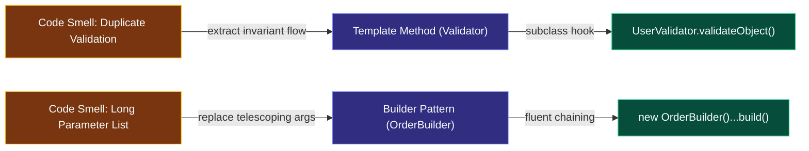

### Identifying Code Smells

```java
// Code Smell: Duplicate Code
public class BadDuplicateCode {
    public void saveUser(User user) {
        if (user == null) throw new IllegalArgumentException("User is null");
        if (user.getName().isEmpty()) throw new IllegalArgumentException("Name is empty");
        if (!user.getEmail().contains("@")) throw new IllegalArgumentException("Invalid email");
        // save logic
    }

    public void saveProduct(Product product) {
        if (product == null) throw new IllegalArgumentException("Product is null");
        if (product.getName().isEmpty()) throw new IllegalArgumentException("Name is empty");
        if (product.getPrice() < 0) throw new IllegalArgumentException("Price negative");
        // save logic
    }
}

// Refactored with Builder pattern + strategy
public abstract class Validator {
    protected List<String> errors = new ArrayList<>();

    public boolean validate(Object obj) {
        errors.clear();
        validateObject(obj);
        return errors.isEmpty();
    }

    protected abstract void validateObject(Object obj);

    protected void addError(String message) {
        errors.add(message);
    }
}

public class UserValidator extends Validator {
    @Override
    protected void validateObject(Object obj) {
        User user = (User) obj;
        if (user == null) addError("User is null");
        if (user.getName().isEmpty()) addError("Name is empty");
        if (!user.getEmail().contains("@")) addError("Invalid email");
    }
}
```

### Code Smell: Long Parameter List

```java
// ANTI-PATTERN: Too many parameters
public void createOrder(String userId, String productId, int quantity,
                        double price, String shippingAddress,
                        String billingAddress, String paymentMethod,
                        String couponCode, LocalDateTime deliveryDate) {
}

// REFACTORED: Use Builder pattern
public class OrderBuilder {
    private String userId;
    private String productId;
    private int quantity;
    private double price;
    private String shippingAddress;
    private String billingAddress;
    private String paymentMethod;
    private String couponCode;
    private LocalDateTime deliveryDate;

    public OrderBuilder userId(String userId) {
        this.userId = userId;
        return this;
    }

    // ... other fluent methods

    public Order build() {
        return new Order(this);
    }
}

// Usage
Order order = new OrderBuilder()
        .userId("user123")
        .productId("product456")
        .quantity(2)
        .shippingAddress("123 Main St")
        .build();
```

> [!TIP]
> Note that `Validator` above uses a shared `errors` field, which is **not thread-safe** if registered as a singleton bean. In production Spring services, return a fresh `ValidationResult` per `validate()` call.

---

## 6. Interview Discussion Points

Key architectural trade-offs interviewers probe when evaluating real-world Java and Spring experience.

| Comparison | Option A | Option B | Key Differentiator |
| :--- | :--- | :--- | :--- |
| **Proxy vs Decorator** | Controls access; transparent to caller | Adds behavior; explicitly composed | **Intent**: Access/cross-cutting control vs layered enhancement |
| **DI vs Service Locator** | Container pushes explicit dependencies | Client pulls from global registry | **Testability & Visibility**: Compile-time clarity vs hidden coupling |

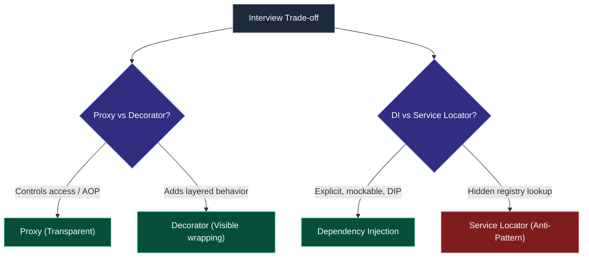

### Q: Explain how Spring uses design patterns.
**A:** Spring extensively uses:
1. **Singleton** - Bean scope (default)
2. **Factory** - `BeanFactory`, `@Bean` methods
3. **Proxy** - AOP, `@Transactional`
4. **Template Method** - `JdbcTemplate`
5. **Observer** - `ApplicationEvent`
6. **Adapter** - Various converters
7. **Strategy** - `PropertyResolver`
8. **Decorator** - Collections utilities

### Q: Why is Dependency Injection better than Service Locator?
**A:**
- Explicit dependencies (readable)
- Easy to mock for testing
- Compile-time safety
- Follows Dependency Inversion Principle
- Better for managing dependencies
- Prevents hidden dependencies

### Q: What's the difference between Proxy and Decorator?
**A:**
- **Proxy**: Controls access, doesn't add functionality
- **Decorator**: Adds functionality
- Proxy is transparent, Decorator is visible
- In Spring, AOP uses proxy pattern

### Q: How would you refactor God Object?
**A:**
1. Identify responsibilities
2. Create separate classes per responsibility
3. Use Dependency Injection to wire them
4. Follow Single Responsibility Principle
5. Use composition over inheritance

> [!IMPORTANT]
> When asked **"Proxy vs Decorator?"**, emphasize **who controls instantiation**: a Proxy typically manages or intercepts access to a target transparently (like Spring AOP), whereas a Decorator is explicitly stacked by the caller (`new BufferedInputStream(new FileInputStream(...))`).

---

## Summary: Design Patterns Mapping

A quick-reference cheat sheet connecting each GoF pattern to its Java SDK and Spring Framework counterparts.

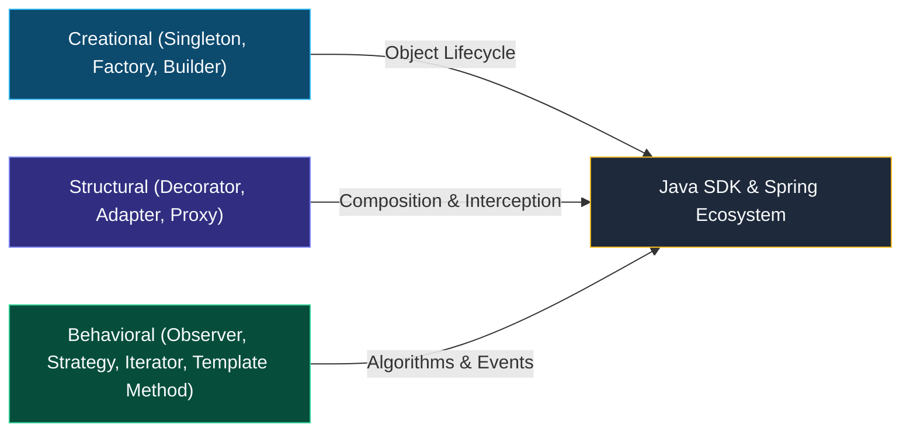

| Pattern | Java SDK | Spring | Use Case |
| :--- | :--- | :--- | :--- |
| **Singleton** | `Logger` | `@Service` | Single instance |
| **Factory** | `List.of()` | `BeanFactory` | Object creation |
| **Decorator** | `BufferedInputStream` | `@Transactional` | Behavior enhancement |
| **Observer** | `Observable` | `ApplicationEvent` | Event handling |
| **Strategy** | `Comparator` | `PropertyResolver` | Algorithm switching |
| **Iterator** | `Iterator` | Stream API | Element access |
| **Template Method** | `JdbcTemplate` | `JdbcTemplate` | Algorithm structure |
| **Adapter** | `Collections` | `Resource` | Incompatible interfaces |
| **Proxy** | Dynamic Proxy | AOP | Access control |
| **Builder** | `StringBuilder` | fluent APIs | Complex object creation |

> [!TIP]
> Keep this mapping table handy for rapid pre-interview review: being able to name one **Java SDK** class and one **Spring** class for each pattern covers 90% of real-world pattern follow-ups.
