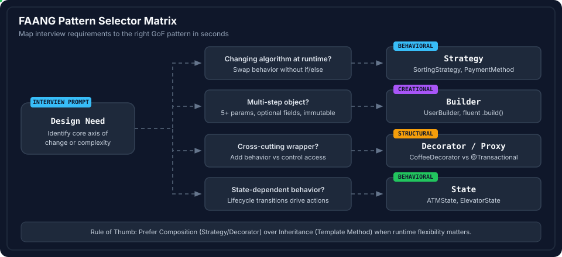
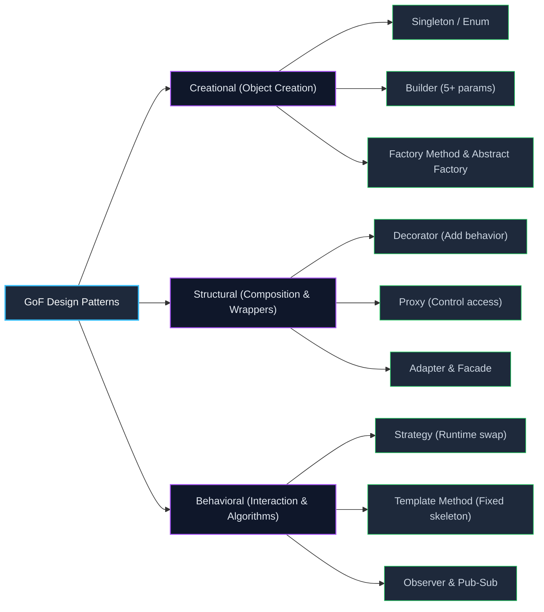
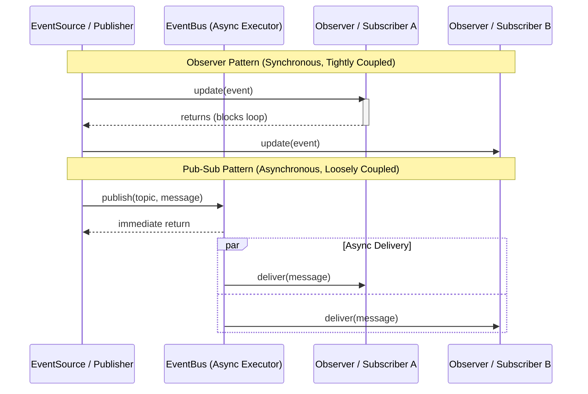
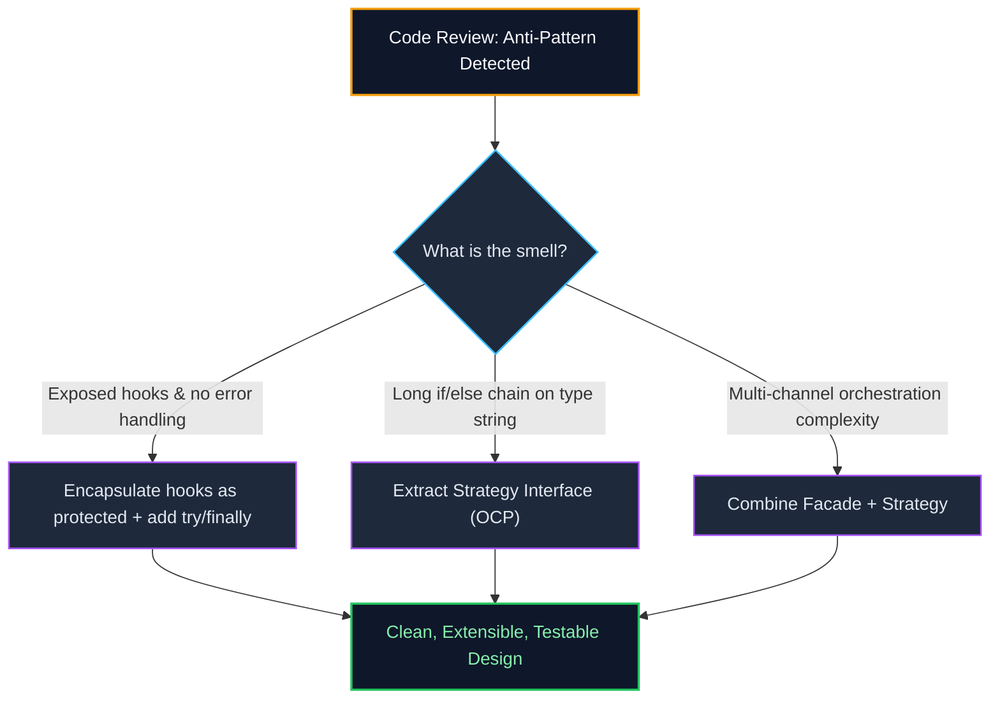
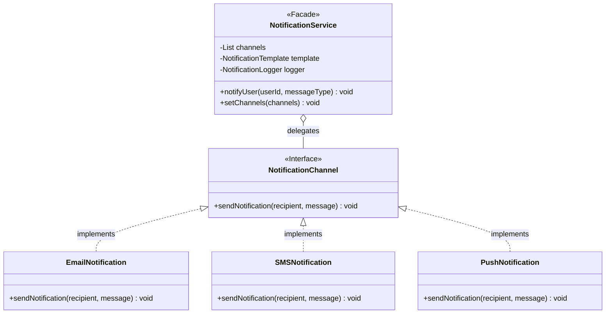
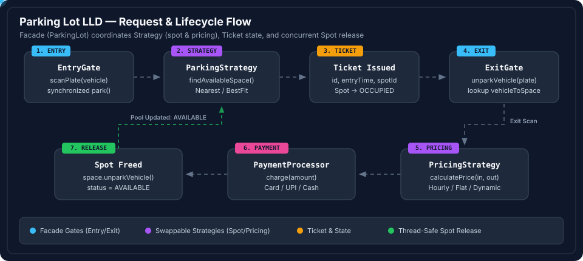
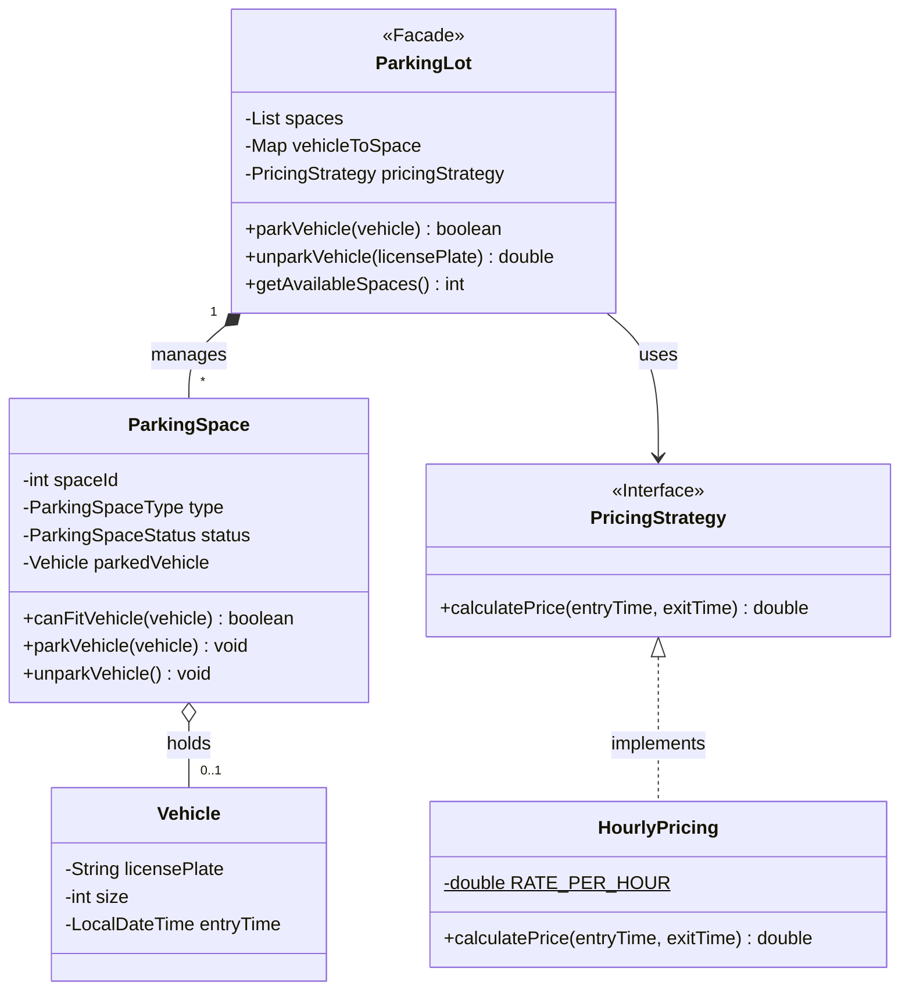
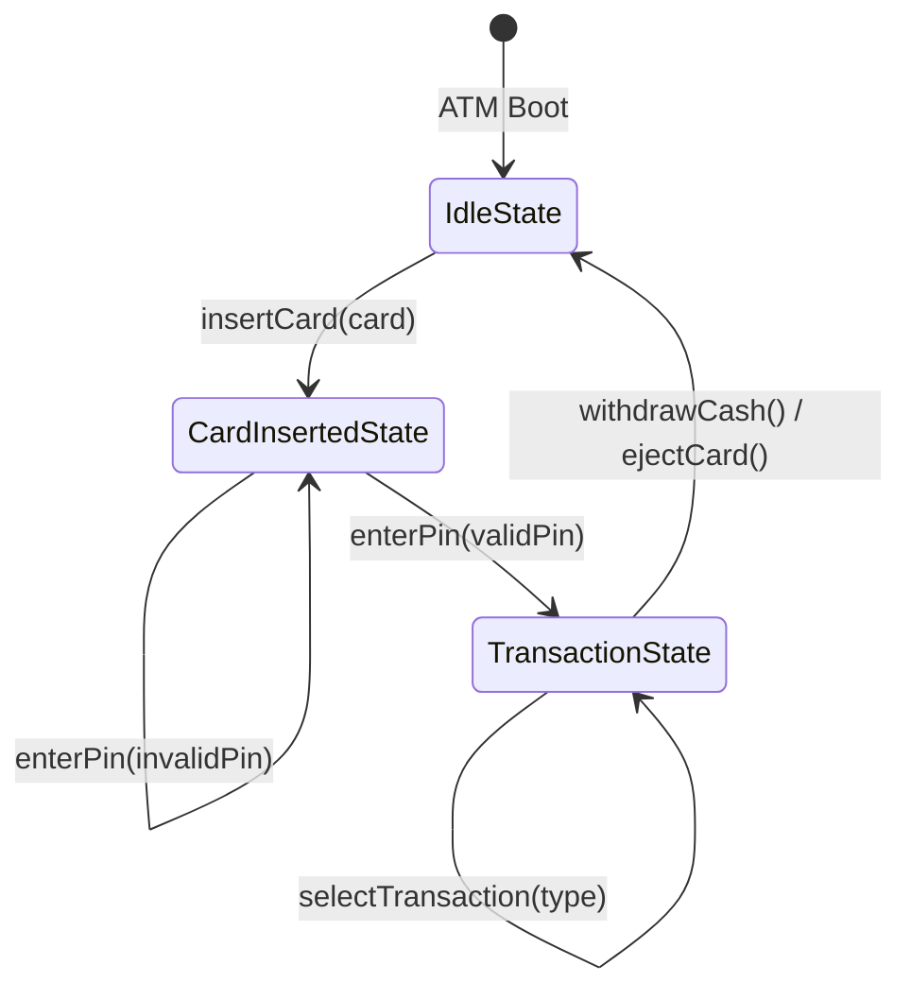
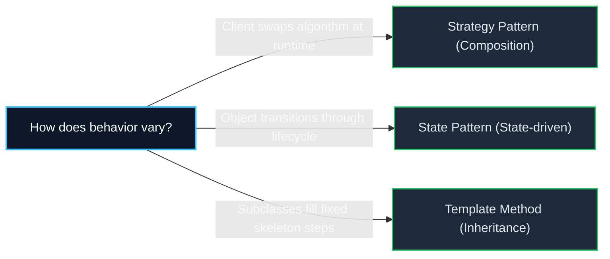
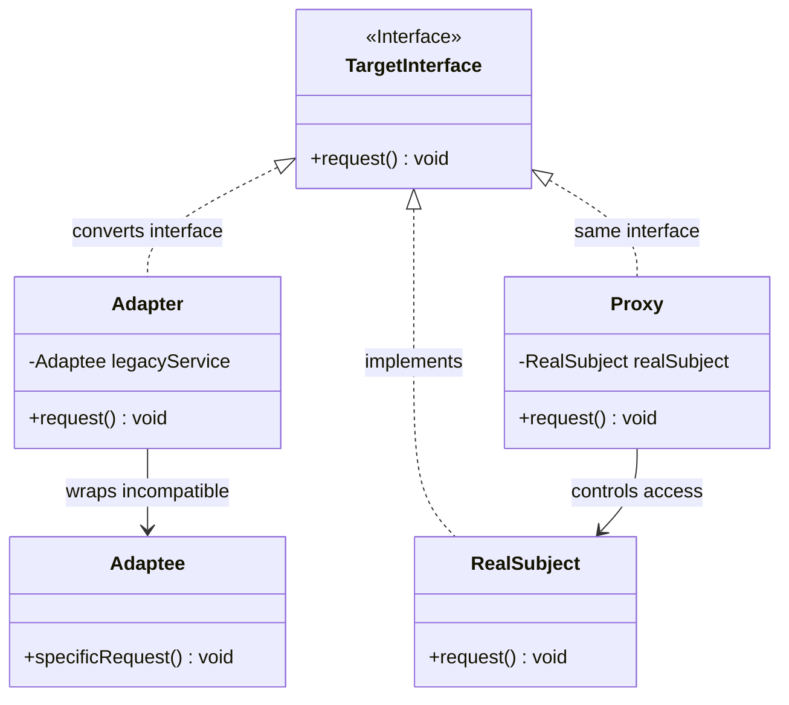

# Design Patterns Interview Questions: FAANG Level

This section contains 40+ interview questions with detailed answers, code review scenarios, and LLD problems typical of FAANG interviews.

## Table of Contents

- [Part 1: Top 25 Design Pattern Questions](#part-1-top-25-design-pattern-questions)
- [Part 2: Code Review Scenarios](#part-2-code-review-scenarios)
- [Part 3: Low-Level Design Problems](#part-3-low-level-design-problems)
- [Part 4: Comparative Questions](#part-4-comparative-questions)
- [Summary: Interview Preparation Checklist](#summary-interview-preparation-checklist)

---

## Part 1: Top 25 Design Pattern Questions







### Quick Reference: Core Interview Patterns

| Pattern | Category | Core Intent | Real-World / Spring Example |
| :--- | :--- | :--- | :--- |
| **Singleton** | Creational | Guarantee a single instance globally | `@Service` / `@Repository` beans, `Enum` |
| **Builder** | Creational | Step-by-step immutable construction (5+ params) | `StringBuilder`, Lombok `@Builder` |
| **Factory Method** | Creational | Defer single-object instantiation to subclasses | `@Bean` factory methods |
| **Abstract Factory** | Creational | Create families of related objects | `WidgetFactory` (`LightThemeFactory`) |
| **Decorator** | Structural | Dynamically add responsibilities (`is-a`) | Java I/O streams (`BufferedInputStream`) |
| **Proxy** | Structural | Control access, lazy init, or cross-cutting logic | Spring AOP `@Transactional` proxies |
| **Adapter** | Structural | Convert one interface into another | `StringHttpMessageConverter` |
| **Strategy** | Behavioral | Swap algorithms at runtime via composition | `SortingStrategy`, `PropertyResolver` |
| **Template Method** | Behavioral | Fixed algorithm skeleton with subclass hooks | `JdbcTemplate.query(...)` |
| **Observer / Pub-Sub** | Behavioral | Broadcast state changes (sync vs async) | `@EventListener`, `ApplicationEvent` |

> [!IMPORTANT]
> In FAANG interviews, **knowing why you chose a pattern** matters more than memorizing UML. Always tie your choice to the **axis of change** (e.g., swapping algorithms → Strategy; protecting a resource → Proxy; >4 optional parameters → Builder).

### Q1: What are the three categories of design patterns?

**Answer:**
1. **Creational** - Object creation (Singleton, Factory, Builder, Prototype, Abstract Factory, Object Pool)
2. **Structural** - Object composition and relationships (Adapter, Bridge, Composite, Decorator, Facade, Flyweight, Proxy)
3. **Behavioral** - Object interaction and responsibility (Strategy, Observer, Template Method, Command, Chain of Responsibility, State, Iterator, Mediator, Memento, Visitor, Null Object)

---

### Q2: Explain Singleton pattern and its potential issues.

**Answer:**
```java
// Singleton ensures single instance
public enum SingletonEnum {
    INSTANCE;

    public void doSomething() {
        System.out.println("Doing something");
    }
}

// Potential Issues:
// 1. Testability - Hard to mock
// 2. Hidden dependencies - Global state
// 3. Thread safety - If not implemented correctly
// 4. Serialization - Can create new instances
// 5. Reflection - Can bypass constructor
// 6. Cloning - Can bypass singleton

// Solutions:
// 1. Use Enum (most secure)
// 2. Bill Pugh (class loader pattern)
// 3. Implement readResolve() for serialization
// 4. Check in constructor for reflection
// 5. Implement clone() to throw exception
```

---

### Q3: When would you use Builder pattern instead of constructor?

**Answer:**
```java
// Use Builder when:
// 1. Object has 5+ parameters
// 2. Some parameters are optional
// 3. Object is immutable
// 4. Readability is important

public class User {
    private String name;      // required
    private String email;     // required
    private int age;          // optional
    private String phone;     // optional
    private String address;   // optional
    private String city;      // optional

    // Instead of:
    // new User("John", "john@ex.com", 30, "123-456-7890", "123 Main", "NYC")
    // Use:
    User user = new User.UserBuilder("John", "john@ex.com")
            .age(30)
            .phone("123-456-7890")
            .address("123 Main")
            .city("NYC")
            .build();
}

// Advantages:
// - Readable and maintainable
// - Handles optional parameters elegantly
// - Immutable objects
// - Self-documenting code

// When NOT to use:
// - Object has only 1-2 parameters
// - All parameters are required
// - Simple POJOs without complexity
```

---

### Q4: Explain the difference between Factory Method and Abstract Factory.

**Answer:**
```java
// Factory Method: Creates single object
public interface ShapeFactory {
    Shape createShape(); // Single method
}

public class CircleFactory implements ShapeFactory {
    @Override
    public Shape createShape() {
        return new Circle();
    }
}

// Abstract Factory: Creates families of related objects
public interface WidgetFactory {
    Button createButton();    // Multiple methods
    Checkbox createCheckbox();
    TextBox createTextBox();
}

public class LightThemeFactory implements WidgetFactory {
    @Override
    public Button createButton() {
        return new LightButton();
    }

    @Override
    public Checkbox createCheckbox() {
        return new LightCheckbox();
    }

    @Override
    public TextBox createTextBox() {
        return new LightTextBox();
    }
}

// Key Differences:
// 1. Factory Method: 1 object, simple
// 2. Abstract Factory: Family of objects, complex
// 3. Use Factory Method for single product
// 4. Use Abstract Factory for related products
```

---

### Q5: What's the difference between Decorator and Proxy pattern?

**Answer:**
```java
// DECORATOR: Adds functionality
public class CoffeeDecorator extends Coffee {
    protected Coffee coffee;

    public CoffeeDecorator(Coffee coffee) {
        this.coffee = coffee;
    }

    public int getPrice() {
        return coffee.getPrice() + 50; // Adds cost
    }
}

// PROXY: Controls access
public class CoffeeProxy implements Coffee {
    private CoffeeMaker realCoffeeMaker;

    public Coffee makeCoffee() {
        if (realCoffeeMaker == null) {
            realCoffeeMaker = new CoffeeMaker();
        }
        return realCoffeeMaker.makeCoffee(); // Lazy initialization
    }
}

// Differences:
// Aspect         | Decorator        | Proxy
// --------------|------------------|----------
// Purpose       | Add behavior     | Control access
// Intent        | Extension        | Protection/control
// Usage         | I/O streams      | Remote objects, lazy loading
// Relationship  | "is-a"           | "has-a"
// Visibility    | Visible to client| Transparent to client
```

---

### Q6: Explain Strategy pattern vs Template Method pattern.

**Answer:**
```java
// STRATEGY: Algorithm selection (client chooses)
public interface SortingStrategy {
    void sort(int[] array);
}

public class QuickSort implements SortingStrategy {
    public void sort(int[] array) { /* implementation */ }
}

public class Sorter {
    private SortingStrategy strategy;

    public void setStrategy(SortingStrategy strategy) {
        this.strategy = strategy;
    }

    public void sort(int[] array) {
        strategy.sort(array); // Runtime decision
    }
}

// TEMPLATE METHOD: Algorithm structure (subclass implements steps)
public abstract class DatabaseOperation {
    public final void execute() {
        openConnection();
        performOperation();  // Subclass overrides
        closeConnection();
    }

    protected abstract void performOperation();

    private void openConnection() { }
    private void closeConnection() { }
}

// Differences:
// Aspect       | Strategy         | Template Method
// -------------|------------------|------------------
// Compostion   | Composition      | Inheritance
// Selection    | Runtime          | Compile-time
// Flexibility  | High (swap at runtime) | Fixed structure
// Who decides  | Client           | Base class
// Use when     | Multiple algorithms | Common algorithm skeleton
```

---

### Q7: How do you break a Singleton, and how do you prevent it?

**Answer:**
```java
// Attack 1: Reflection
BillPughSingleton singleton1 = BillPughSingleton.getInstance();
Constructor<BillPughSingleton> constructor =
    BillPughSingleton.class.getDeclaredConstructor();
constructor.setAccessible(true);
BillPughSingleton singleton2 = constructor.newInstance();
// singleton1 != singleton2 - BROKEN!

// Prevention:
public class SafeSingleton {
    private static boolean instantiated = false;

    private SafeSingleton() {
        if (instantiated) {
            throw new IllegalStateException("Singleton already created");
        }
        instantiated = true;
    }
}

// Attack 2: Serialization
// Serialize singleton1 -> Deserialize -> singleton2 (different)
// Prevention:
protected Object readResolve() {
    return getInstance();
}

// Attack 3: Cloning
// singleton1.clone() -> singleton2 (different)
// Prevention:
@Override
public Object clone() throws CloneNotSupportedException {
    throw new CloneNotSupportedException("Cloning not allowed");
}

// BEST SOLUTION: Use Enum
public enum EnumSingleton {
    INSTANCE;

    public void doSomething() { }
}
// Enum prevents all attacks automatically!
```

---

### Q8: When would you NOT use a design pattern?

**Answer:**
```java
// DON'T use patterns when:

// 1. OVER-ENGINEERING: Simple problem, complex solution
public class BadPatternUse {
    // Using Builder for simple 2-parameter object
    User user = new User.UserBuilder("John", "john@ex.com").build();

    // Simple: new User("John", "john@ex.com")
}

// 2. PREMATURE OPTIMIZATION
public class PreOptimization {
    // Using Object Pool for lightweight objects
    ObjectPool<String> pool = new ObjectPool<>();

    // Just use new String()
}

// 3. TIGHT COUPLING: Pattern makes it worse
public class BadStrategy {
    private PaymentStrategy strategy;

    public PaymentProcessing() {
        this.strategy = new CreditCardStrategy(); // Still coupled!
    }
}

// 4. UNMAINTAINABLE COMPLEXITY
// Too many layers of abstraction makes code hard to follow

// Guidelines:
// - Use patterns for REAL problems
// - Avoid if solution is simpler without pattern
// - Refactor TO pattern when needed, not before
// - KISS (Keep It Simple, Stupid)
```

> [!TIP]
> **KISS Rule in Interviews:** Never introduce a Builder for a 2-field POJO or an Object Pool for lightweight allocations. Refactor *to* a pattern when requirements demand extensibility.

---

### Q9: Explain Observer pattern. How is it different from Pub-Sub?

**Answer:**
```java
// OBSERVER PATTERN (Synchronous, tightly coupled)
public interface Observer {
    void update(String event);
}

public class EventSource {
    private List<Observer> observers = new ArrayList<>();

    public void attach(Observer observer) {
        observers.add(observer);
    }

    public void notifyObservers(String event) {
        for (Observer observer : observers) {
            observer.update(event); // Synchronous, blocking
        }
    }
}

// PUB-SUB (Asynchronous, loosely coupled)
public class EventBus {
    private ExecutorService executor = Executors.newFixedThreadPool(10);

    public void publish(String topic, String message) {
        executor.submit(() -> {
            // Async notification to all subscribers
            notifySubscribers(topic, message);
        });
    }
}

// Differences:
// Aspect           | Observer      | Pub-Sub
// ------------------|---------------|----------
// Coupling          | Tight         | Loose
// Synchronization   | Sync          | Async
// Mediator          | None          | Message Broker
// Scalability       | Limited       | High
// Use cases         | UI, MVC       | Microservices
```

---

### Q10: How does Spring Framework use design patterns?

**Answer:**
```java
// 1. SINGLETON - Bean scope
@Service
public class UserService { }
// Every @Service/@Repository is singleton by default

// 2. FACTORY - BeanFactory
@Bean
public UserRepository userRepository() {
    return new UserRepositoryImpl();
}
// @Bean methods are factory methods

// 3. PROXY - AOP
@Transactional
public void saveUser(User user) { }
// Spring creates proxy for transaction management

// 4. TEMPLATE METHOD - JdbcTemplate
jdbcTemplate.query(sql, (rs, rowNum) -> new User(rs));
// JdbcTemplate defines query algorithm skeleton

// 5. OBSERVER - ApplicationEvent
@EventListener
public void onUserCreated(UserCreatedEvent event) { }
// Event-driven, observer pattern

// 6. STRATEGY - PropertyResolver
@Value("${app.mode:production}")
private String mode;
// Strategies for resolving properties

// 7. ADAPTER - Various converters
// StringHttpMessageConverter adapts String to HTTP response

// Spring is essentially built on design patterns!
```

---

## Part 2: Code Review Scenarios





### Code Review Summary

| Scenario | Anti-Pattern / Issue | Pattern Applied | Key Improvement |
| :--- | :--- | :--- | :--- |
| **Scenario 1** | Public step methods, rigid header/footer, no file error handling | **Template Method** | Make hooks `protected` and wrap resource lifecycle |
| **Scenario 2** | `if/else` branching on `"CARD"` / `"PAYPAL"` / `"BITCOIN"` | **Strategy** | Satisfies Open/Closed Principle via `PaymentMethod` |
| **Scenario 3** | Multi-channel dispatch mixed with templating & logging | **Strategy + Facade** | `NotificationService` orchestrates `NotificationChannel` list |

> [!WARNING]
> In **Template Method** reviews, always check visibility modifiers: helper steps (`openFile`, `closeFile`) should be `private` or `protected`, while the template `generateReport()` must be `final` so subclasses cannot alter the invariant execution order.

### Scenario 1: Identify the Pattern and Issues

```java
// Code to Review
public abstract class ReportGenerator {
    public final void generateReport() {
        openFile();
        writeHeader();
        writeData();
        writeFooter();
        closeFile();
    }

    protected abstract void writeData();

    public void openFile() { System.out.println("Opening file"); }
    public void writeHeader() { System.out.println("Writing header"); }
    public void writeFooter() { System.out.println("Writing footer"); }
    public void closeFile() { System.out.println("Closing file"); }
}

public class PDFReportGenerator extends ReportGenerator {
    @Override
    protected void writeData() {
        System.out.println("Writing PDF data");
    }
}

// ANSWER:
// Pattern: Template Method
// Issues:
// 1. openFile, writeHeader, etc. should be protected (encapsulation)
// 2. What if subclass needs different header format?
//    Consider adding protected void writeHeader() to override
// 3. No error handling for file operations
// Improvement:
protected void writeHeader() { /* can override */ }
protected void writeFooter() { /* can override */ }
```

---

### Scenario 2: Refactor Using Appropriate Pattern

```java
// Current Code (Anti-pattern)
public class PaymentProcessor {
    public void processPayment(String method, double amount, String details) {
        if ("CARD".equals(method)) {
            // Card processing logic
            validateCard(details);
            chargeCard(details, amount);
        } else if ("PAYPAL".equals(method)) {
            // PayPal logic
            validatePayPal(details);
            chargePayPal(details, amount);
        } else if ("BITCOIN".equals(method)) {
            // Bitcoin logic
        }
        // Adding new method requires modification
    }
}

// REFACTORED: Using Strategy Pattern
public interface PaymentMethod {
    void validate(String details);
    void charge(String details, double amount);
}

public class CardPayment implements PaymentMethod {
    @Override
    public void validate(String details) { /* ... */ }
    @Override
    public void charge(String details, double amount) { /* ... */ }
}

public class PaymentProcessor {
    private PaymentMethod method;

    public void setPaymentMethod(PaymentMethod method) {
        this.method = method;
    }

    public void processPayment(String details, double amount) {
        method.validate(details);
        method.charge(details, amount);
        // New method? Just add new PaymentMethod implementation!
    }
}
```

> [!TIP]
> When refactoring `if/else` or `switch` chains in an interview, explicitly mention the **Open/Closed Principle (OCP)**: new payment or notification channels are added as new classes without modifying existing orchestration code.

---

### Scenario 3: Design Review Question

**Q: Design a notification system that sends notifications via Email, SMS, and Push. How would you structure it?**

**Answer:**
```java
// Strategy Pattern for notification channels
public interface NotificationChannel {
    void sendNotification(String recipient, String message);
}

public class EmailNotification implements NotificationChannel {
    @Override
    public void sendNotification(String recipient, String message) {
        System.out.println("Sending email to " + recipient);
    }
}

public class SMSNotification implements NotificationChannel {
    @Override
    public void sendNotification(String recipient, String message) {
        System.out.println("Sending SMS to " + recipient);
    }
}

public class PushNotification implements NotificationChannel {
    @Override
    public void sendNotification(String recipient, String message) {
        System.out.println("Sending push to " + recipient);
    }
}

// Facade Pattern - Simple interface for complex operations
public class NotificationService {
    private List<NotificationChannel> channels;
    private NotificationTemplate template;
    private NotificationLogger logger;

    public void notifyUser(String userId, String messageType) {
        User user = userRepository.findById(userId);
        String message = template.generateMessage(messageType);

        for (NotificationChannel channel : channels) {
            try {
                channel.sendNotification(user.getContactInfo(), message);
                logger.log("Notification sent via " + channel.getClass().getSimpleName());
            } catch (Exception e) {
                logger.logError("Failed to send notification", e);
            }
        }
    }

    public void setChannels(List<NotificationChannel> channels) {
        this.channels = channels;
    }
}

// Usage
NotificationService service = new NotificationService();
service.setChannels(Arrays.asList(
    new EmailNotification(),
    new SMSNotification(),
    new PushNotification()
));
service.notifyUser("user123", "ORDER_CONFIRMED");
```

---

## Part 3: Low-Level Design Problems







### LLD Problem Matrix

| Problem | Primary Patterns | Key Design Focus | Core Entities |
| :--- | :--- | :--- | :--- |
| **1. Parking Lot** | **Facade + Strategy** | Thread-safe spot allocation (`synchronized`), extensible pricing | `ParkingLot`, `ParkingSpace`, `Vehicle`, `PricingStrategy` |
| **2. ATM System** | **State + Strategy** | Guarding invalid operations per state (`IllegalStateException`) | `ATM`, `ATMState`, `Transaction`, `BankAccount` |
| **3. Elevator System** | **State** | Direction-locked transitions & destination queue management | `Elevator`, `ElevatorState`, `IdleElevatorState`, `MovingUpState` |
| **4. Library System** | **Observer + Facade** | Auto-notifying subscribers when a borrowed `Book` is returned | `LibraryManagementSystem`, `Book`, `Member`, `NotificationObserver` |

> [!IMPORTANT]
> In **Parking Lot** and **Elevator** interviews, always address **concurrency** (`synchronized` or `ReentrantLock` on `parkVehicle`/`unparkVehicle`) and **extensibility** (injecting `PricingStrategy` rather than hardcoding hourly rates).

### Problem 1: Design a Parking Lot System

```java
public enum ParkingSpaceType {
    COMPACT, REGULAR, LARGE
}

public enum ParkingSpaceStatus {
    AVAILABLE, OCCUPIED, RESERVED
}

public class ParkingSpace {
    private int spaceId;
    private ParkingSpaceType type;
    private ParkingSpaceStatus status;
    private Vehicle parkedVehicle;

    public ParkingSpace(int spaceId, ParkingSpaceType type) {
        this.spaceId = spaceId;
        this.type = type;
        this.status = ParkingSpaceStatus.AVAILABLE;
    }

    public boolean isAvailable() {
        return status == ParkingSpaceStatus.AVAILABLE;
    }

    public boolean canFitVehicle(Vehicle vehicle) {
        if (!isAvailable()) return false;
        return vehicle.getSize() <= type.ordinal();
    }

    public void parkVehicle(Vehicle vehicle) {
        if (!canFitVehicle(vehicle)) {
            throw new IllegalArgumentException("Vehicle too large for space");
        }
        this.parkedVehicle = vehicle;
        this.status = ParkingSpaceStatus.OCCUPIED;
    }

    public void unparkVehicle() {
        this.parkedVehicle = null;
        this.status = ParkingSpaceStatus.AVAILABLE;
    }
}

public class Vehicle {
    private String licensePlate;
    private int size;
    private LocalDateTime entryTime;

    public Vehicle(String licensePlate, int size) {
        this.licensePlate = licensePlate;
        this.size = size;
    }

    public int getSize() {
        return size;
    }

    public String getLicensePlate() {
        return licensePlate;
    }
}

// Strategy Pattern for pricing
public interface PricingStrategy {
    double calculatePrice(LocalDateTime entryTime, LocalDateTime exitTime);
}

public class HourlyPricing implements PricingStrategy {
    private static final double RATE_PER_HOUR = 5.0;

    @Override
    public double calculatePrice(LocalDateTime entryTime, LocalDateTime exitTime) {
        long hours = ChronoUnit.HOURS.between(entryTime, exitTime);
        return (hours + 1) * RATE_PER_HOUR;
    }
}

// Main Parking Lot (Facade Pattern)
public class ParkingLot {
    private List<ParkingSpace> spaces;
    private Map<String, ParkingSpace> vehicleToSpace;
    private PricingStrategy pricingStrategy;

    public ParkingLot(int compactSpaces, int regularSpaces, int largeSpaces) {
        this.spaces = new ArrayList<>();
        this.vehicleToSpace = new HashMap<>();
        this.pricingStrategy = new HourlyPricing();

        initializeSpaces(compactSpaces, ParkingSpaceType.COMPACT);
        initializeSpaces(regularSpaces, ParkingSpaceType.REGULAR);
        initializeSpaces(largeSpaces, ParkingSpaceType.LARGE);
    }

    private void initializeSpaces(int count, ParkingSpaceType type) {
        for (int i = 0; i < count; i++) {
            spaces.add(new ParkingSpace(spaces.size(), type));
        }
    }

    public synchronized boolean parkVehicle(Vehicle vehicle) {
        ParkingSpace availableSpace = findAvailableSpace(vehicle);
        if (availableSpace == null) {
            return false;
        }

        availableSpace.parkVehicle(vehicle);
        vehicle.setEntryTime(LocalDateTime.now());
        vehicleToSpace.put(vehicle.getLicensePlate(), availableSpace);
        return true;
    }

    private ParkingSpace findAvailableSpace(Vehicle vehicle) {
        return spaces.stream()
                .filter(space -> space.canFitVehicle(vehicle))
                .findFirst()
                .orElse(null);
    }

    public synchronized double unparkVehicle(String licensePlate) {
        ParkingSpace space = vehicleToSpace.get(licensePlate);
        if (space == null) {
            throw new IllegalArgumentException("Vehicle not found");
        }

        Vehicle vehicle = space.parkedVehicle;
        LocalDateTime exitTime = LocalDateTime.now();
        double price = pricingStrategy.calculatePrice(vehicle.getEntryTime(), exitTime);

        space.unparkVehicle();
        vehicleToSpace.remove(licensePlate);

        return price;
    }

    public int getAvailableSpaces() {
        return (int) spaces.stream().filter(ParkingSpace::isAvailable).count();
    }
}

// Usage
public class ParkingLotDemo {
    public static void main(String[] args) throws InterruptedException {
        ParkingLot parkingLot = new ParkingLot(10, 20, 5);

        Vehicle car = new Vehicle("ABC123", 1);
        if (parkingLot.parkVehicle(car)) {
            System.out.println("Vehicle parked");
            Thread.sleep(2000);
            double cost = parkingLot.unparkVehicle("ABC123");
            System.out.println("Parking cost: $" + cost);
        }
    }
}
```

---

### Problem 2: Design an ATM System

```java
// State Pattern for ATM states
public interface ATMState {
    void insertCard(ATM atm, Card card);
    void enterPin(ATM atm, String pin);
    void selectTransaction(ATM atm, TransactionType type);
    void withdrawCash(ATM atm, double amount);
}

public class CardInsertedState implements ATMState {
    @Override
    public void insertCard(ATM atm, Card card) {
        System.out.println("Card already inserted");
    }

    @Override
    public void enterPin(ATM atm, String pin) {
        if (atm.validatePin(pin)) {
            atm.setState(new TransactionState());
        } else {
            System.out.println("Invalid PIN");
        }
    }

    // Other methods throw exception
    @Override
    public void selectTransaction(ATM atm, TransactionType type) {
        throw new IllegalStateException("Enter PIN first");
    }

    @Override
    public void withdrawCash(ATM atm, double amount) {
        throw new IllegalStateException("Enter PIN first");
    }
}

public class TransactionState implements ATMState {
    @Override
    public void insertCard(ATM atm, Card card) {
        throw new IllegalStateException("Card already inserted");
    }

    @Override
    public void enterPin(ATM atm, String pin) {
        System.out.println("PIN already entered");
    }

    @Override
    public void selectTransaction(ATM atm, TransactionType type) {
        atm.setSelectedTransaction(type);
    }

    @Override
    public void withdrawCash(ATM atm, double amount) {
        if (atm.hasSufficientBalance(amount)) {
            atm.dispenseCash(amount);
            System.out.println("Cash dispensed: $" + amount);
        } else {
            System.out.println("Insufficient balance");
        }
    }
}

// Strategy Pattern for transactions
public interface Transaction {
    void execute(double amount);
}

public class WithdrawalTransaction implements Transaction {
    private BankAccount account;

    public WithdrawalTransaction(BankAccount account) {
        this.account = account;
    }

    @Override
    public void execute(double amount) {
        account.withdraw(amount);
    }
}

public class ATM {
    private ATMState state;
    private Card insertedCard;
    private BankAccount account;
    private double cashAvailable;

    public ATM(double initialCash) {
        this.state = new IdleState();
        this.cashAvailable = initialCash;
    }

    public void setState(ATMState state) {
        this.state = state;
    }

    public void insertCard(Card card) {
        state.insertCard(this, card);
    }

    public void enterPin(String pin) {
        state.enterPin(this, pin);
    }

    public void selectTransaction(TransactionType type) {
        state.selectTransaction(this, type);
    }

    public void withdrawCash(double amount) {
        state.withdrawCash(this, amount);
    }

    public boolean validatePin(String pin) {
        // Validate PIN logic
        return true;
    }

    public boolean hasSufficientBalance(double amount) {
        return account.getBalance() >= amount && cashAvailable >= amount;
    }

    public void dispenseCash(double amount) {
        account.withdraw(amount);
        cashAvailable -= amount;
    }
}

public enum TransactionType {
    WITHDRAWAL, DEPOSIT, BALANCE_INQUIRY, TRANSFER
}
```

> [!TIP]
> Notice how **ATM** combines **State** (`ATMState` controls what actions are legal right now) with **Strategy** (`Transaction` encapsulates how each operation executes). Calling out this separation scores strong points in LLD rounds.

---

### Problem 3: Design an Elevator System

```java
// State Pattern for elevator states
public interface ElevatorState {
    void pressButton(Elevator elevator, int floor);
    void moveUp(Elevator elevator);
    void moveDown(Elevator elevator);
    void openDoor(Elevator elevator);
    void closeDoor(Elevator elevator);
}

public class IdleElevatorState implements ElevatorState {
    @Override
    public void pressButton(Elevator elevator, int floor) {
        elevator.addDestination(floor);
        int currentFloor = elevator.getCurrentFloor();

        if (floor > currentFloor) {
            elevator.setState(new MovingUpState());
        } else if (floor < currentFloor) {
            elevator.setState(new MovingDownState());
        } else {
            elevator.setState(new OpeningDoorState());
        }
    }

    @Override
    public void moveUp(Elevator elevator) {
        // Cannot move when idle
    }

    @Override
    public void moveDown(Elevator elevator) {
        // Cannot move when idle
    }

    @Override
    public void openDoor(Elevator elevator) {
        // Door already closed when idle
    }

    @Override
    public void closeDoor(Elevator elevator) {
        // Door already closed
    }
}

public class MovingUpState implements ElevatorState {
    @Override
    public void pressButton(Elevator elevator, int floor) {
        elevator.addDestination(floor);
    }

    @Override
    public void moveUp(Elevator elevator) {
        int nextFloor = elevator.getCurrentFloor() + 1;
        elevator.setCurrentFloor(nextFloor);

        if (elevator.isDestinationFloor(nextFloor)) {
            elevator.setState(new OpeningDoorState());
        }
    }

    @Override
    public void moveDown(Elevator elevator) {
        // Cannot move down while moving up
    }

    @Override
    public void openDoor(Elevator elevator) {
        // Cannot open door while moving
    }

    @Override
    public void closeDoor(Elevator elevator) {
        // Door already closed while moving
    }
}

public class Elevator {
    private int currentFloor = 0;
    private Queue<Integer> destinations;
    private ElevatorState state;
    private int capacity;
    private int currentPassengers;

    public Elevator(int capacity) {
        this.capacity = capacity;
        this.destinations = new LinkedList<>();
        this.state = new IdleElevatorState();
    }

    public void pressButton(int floor) {
        state.pressButton(this, floor);
    }

    public void moveUp() {
        state.moveUp(this);
    }

    public void moveDown() {
        state.moveDown(this);
    }

    public void openDoor() {
        state.openDoor(this);
    }

    public void closeDoor() {
        state.closeDoor(this);
    }

    public void setState(ElevatorState state) {
        this.state = state;
    }

    public void addDestination(int floor) {
        if (!destinations.contains(floor)) {
            destinations.offer(floor);
        }
    }

    public boolean isDestinationFloor(int floor) {
        return destinations.peek() == floor;
    }

    public int getCurrentFloor() {
        return currentFloor;
    }

    public void setCurrentFloor(int floor) {
        this.currentFloor = floor;
        System.out.println("Elevator at floor: " + floor);
    }

    public Queue<Integer> getDestinations() {
        return destinations;
    }
}
```

---

### Problem 4: Design Library Management System

```java
// Observer Pattern for notifications
public interface NotificationObserver {
    void update(Book book, String event);
}

public class BookAvailableNotification implements NotificationObserver {
    @Override
    public void update(Book book, String event) {
        if ("RETURNED".equals(event)) {
            System.out.println("Book '" + book.getTitle() + "' is now available!");
        }
    }
}

public class Book {
    private String isbn;
    private String title;
    private String author;
    private boolean available;
    private List<NotificationObserver> observers;

    public Book(String isbn, String title, String author) {
        this.isbn = isbn;
        this.title = title;
        this.author = author;
        this.available = true;
        this.observers = new ArrayList<>();
    }

    public void subscribe(NotificationObserver observer) {
        observers.add(observer);
    }

    public void notifyObservers(String event) {
        for (NotificationObserver observer : observers) {
            observer.update(this, event);
        }
    }

    public void markBorrowed() {
        available = false;
    }

    public void markReturned() {
        available = true;
        notifyObservers("RETURNED");
    }

    // Getters
    public String getTitle() {
        return title;
    }

    public boolean isAvailable() {
        return available;
    }
}

public class Member {
    private String memberId;
    private String name;
    private List<Book> borrowedBooks;
    private int maxBooksAllowed = 5;

    public Member(String memberId, String name) {
        this.memberId = memberId;
        this.name = name;
        this.borrowedBooks = new ArrayList<>();
    }

    public boolean borrowBook(Book book) {
        if (!book.isAvailable()) {
            System.out.println("Book not available");
            return false;
        }

        if (borrowedBooks.size() >= maxBooksAllowed) {
            System.out.println("Cannot borrow more books");
            return false;
        }

        book.markBorrowed();
        borrowedBooks.add(book);
        System.out.println(name + " borrowed '" + book.getTitle() + "'");
        return true;
    }

    public void returnBook(Book book) {
        if (borrowedBooks.remove(book)) {
            book.markReturned();
            System.out.println(name + " returned '" + book.getTitle() + "'");
        }
    }
}

// Facade Pattern
public class LibraryManagementSystem {
    private Map<String, Book> books;
    private Map<String, Member> members;
    private List<Reservation> reservations;

    public LibraryManagementSystem() {
        this.books = new HashMap<>();
        this.members = new HashMap<>();
        this.reservations = new ArrayList<>();
    }

    public void addBook(Book book) {
        books.put(book.getIsbn(), book);
    }

    public void registerMember(Member member) {
        members.put(member.getMemberId(), member);
    }

    public boolean borrowBook(String memberId, String isbn) {
        Member member = members.get(memberId);
        Book book = books.get(isbn);

        if (member == null || book == null) {
            return false;
        }

        return member.borrowBook(book);
    }

    public void returnBook(String memberId, String isbn) {
        Member member = members.get(memberId);
        Book book = books.get(isbn);

        if (member != null && book != null) {
            member.returnBook(book);
        }
    }

    public Book searchBook(String title) {
        return books.values().stream()
                .filter(book -> book.getTitle().equalsIgnoreCase(title))
                .findFirst()
                .orElse(null);
    }
}
```

---

## Part 4: Comparative Questions





- **Strategy vs State:** Identical UML structure (context delegates to an interface), opposite intent — *client* picks Strategy; *state machine* transitions State.
- **Factory vs Builder:** Factory returns a complete object in one call; Builder accumulates optional parameters and validates on `.build()`.
- **Adapter vs Proxy:** Adapter changes the interface for compatibility; Proxy preserves the interface to add lazy loading, security, or logging.

> [!IMPORTANT]
> Interviewers love **Strategy vs State** and **Adapter vs Proxy** because their class diagrams look nearly identical. Always anchor your answer on **intent** and **who controls the delegation/interface**.

### Q: Strategy vs State Pattern

| Aspect | Strategy | State |
|--------|----------|-------|
| **Purpose** | Select algorithm | Alter behavior based on state |
| **When** | Multiple algorithms exist | Object behavior changes with state |
| **Selection** | Client chooses | State transitions automatically |
| **Example** | Payment methods | Order status |
| **Coupling** | Loosely coupled | Object controls state changes |

### Q: Factory vs Builder Pattern

| Aspect | Factory | Builder |
|--------|---------|---------|
| **Purpose** | Create objects | Create complex objects step-by-step |
| **Parameters** | All required | Mix of required and optional |
| **Complexity** | Simple objects | Complex objects |
| **Immutability** | Not guaranteed | Easily achieved |
| **Flexibility** | Limited | High |

### Q: Adapter vs Proxy Pattern

| Aspect | Adapter | Proxy |
|--------|---------|-------|
| **Purpose** | Incompatible interfaces | Control access |
| **Intent** | Convert interface | Protect/control |
| **Visibility** | Visible | Transparent |
| **Responsibility** | Interface conversion | Access control |
| **Usage** | Legacy code | Remote objects |

> [!TIP]
> **Rule of Thumb for Factory vs Builder:** If every parameter is required and the object can be constructed in one step, use a **Factory**. If you have optional parameters or need an immutable object with 5+ fields, use a **Builder**.

---

## Summary: Interview Preparation Checklist


### Readiness Priority Matrix

| Focus Area | FAANG Interview Weight | Target Readiness |
| :--- | :--- | :--- |
| **LLD Systems (Parking Lot, ATM, Elevator)** | High | Whiteboard classes, interfaces, and concurrency in 25 mins |
| **Comparative Questions (Strategy vs State, etc.)** | High | Articulate intent differences without hesitation |
| **Code Review & Refactoring** | Medium-High | Spot `if/else` smells and apply Strategy / Facade cleanly |
| **Spring / Java Real-World Examples** | Medium | Explain `@Transactional` (Proxy), `JdbcTemplate` (Template Method) |

- [ ] Understand 3 pattern categories
- [ ] Deep dive on 5 most used patterns
- [ ] Know when NOT to use patterns
- [ ] Practice code refactoring
- [ ] Solve 2-3 LLD problems
- [ ] Explain Spring/Java patterns
- [ ] Answer SOLID questions
- [ ] Review real-world examples
- [ ] Mock interview with patterns

> [!TIP]
> Practice explaining **why** you did *not* use a pattern in a simple component — demonstrating restraint and SOLID fundamentals separates senior candidates from pattern-memorizers.
