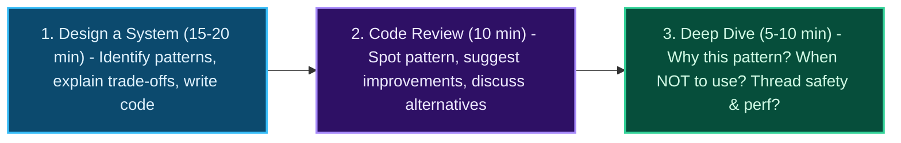
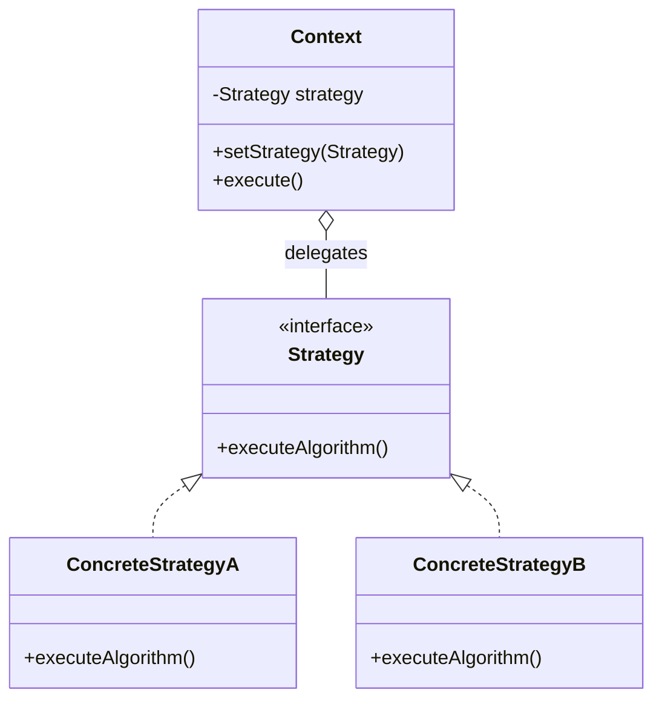
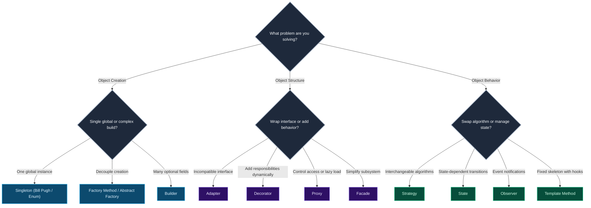

# Design Patterns Deep Dive: Complete FAANG Interview Preparation



> [!NOTE]
> **Module 03 Overview:** This comprehensive resource contains **5 detailed markdown files** with **7,284 lines** of content and **150+ complete, runnable Java implementations** covering all **23 Gang of Four (GoF) design patterns**, enterprise patterns, Java SDK & Spring internals, and 4 full Low-Level Design (LLD) systems. Designed specifically for **mid-level Java engineers (5+ years)** targeting FAANG interviews, system design discussions, architecture decisions, code reviews, and mentoring.

---

## GoF 23-Pattern & Module Taxonomy

```mermaid
flowchart TD
    ROOT["Module 03: Design Patterns Deep Dive (7,284 Lines)"]

    ROOT --> CR["01-Creational-Patterns.md (1,853 Lines • 25%)"]
    ROOT --> ST["02-Structural-Patterns.md (1,659 Lines • 23%)"]
    ROOT --> BH["03-Behavioral-Patterns.md (1,550 Lines • 20%)"]
    ROOT --> RW["04-Patterns-in-Real-World-Java.md (1,006 Lines • 20%)"]
    ROOT --> IQ["05-Design-Patterns-Interview-Questions.md (1,216 Lines • 12%)"]

    CR --> CR1["GoF: Singleton, Factory Method, Abstract Factory, Builder, Prototype"]
    CR --> CR2["Enterprise: Object Pool"]

    ST --> ST1["GoF: Adapter, Bridge, Composite, Decorator, Facade, Flyweight, Proxy"]

    BH --> BH1["Core GoF: Strategy, Observer, Template Method, Command, Chain of Responsibility, State, Iterator"]
    BH --> BH2["Additional: Mediator, Memento, Visitor, Null Object"]

    RW --> RW1["Java SDK: Collections, java.io, java.util.concurrent"]
    RW --> RW2["Spring Framework, SOLID Principles & Anti-Patterns"]

    IQ --> IQ1["40+ Interview Q&As & Code Review Scenarios"]
    IQ --> IQ2["4 Full LLD Systems: Parking Lot, ATM, Elevator, Library"]

    classDef rootNode fill:#0f172a,stroke:#38bdf8,stroke-width:2px,color:#f8fafc
    classDef creational fill:#0c4a6e,stroke:#38bdf8,stroke-width:1.5px,color:#e0f2fe
    classDef structural fill:#2e1065,stroke:#a78bfa,stroke-width:1.5px,color:#ede9fe
    classDef behavioral fill:#064e3b,stroke:#34d399,stroke-width:1.5px,color:#d1fae5
    classDef realworld fill:#451a03,stroke:#fbbf24,stroke-width:1.5px,color:#fef3c7
    classDef interview fill:#4c0519,stroke:#fb7185,stroke-width:1.5px,color:#ffe4e6
    classDef leaf fill:#1e293b,stroke:#475569,stroke-width:1px,color:#cbd5e1

    class ROOT rootNode
    class CR creational
    class ST structural
    class BH behavioral
    class RW realworld
    class IQ interview
    class CR1,CR2,ST1,BH1,BH2,RW1,RW2,IQ1,IQ2 leaf
```



---

## Content Summary & Statistics

| Metric / Category | Details | Coverage |
|---|---|---|
| **Total Lines & Files** | **7,284 lines** across **5 comprehensive markdown files** | 100% |
| **Code Examples** | **150+** complete, runnable Java implementations | All modules |
| **Patterns Covered** | **23 Gang of Four (GoF)** + enterprise patterns (Object Pool, Null Object) | Core + Enterprise |
| **Interview Questions** | **40+ Q&As** (Top 25 detailed + comparative + code reviews) | Part 1, 2 & 4 |
| **LLD Systems** | **4 complete systems** with full code (Parking Lot, ATM, Elevator, Library) | Part 3 |
| **Creational** | 6 patterns (`1,853` lines) | 25% of content |
| **Structural** | 7 patterns (`1,659` lines) | 23% of content |
| **Behavioral** | 10+ patterns (`1,550` lines) | 20% of content |
| **Real-World** | Java SDK, Spring Framework, Anti-patterns, SOLID (`1,006` lines) | 20% of content |
| **Interview Prep** | Q&A, Code Review, LLD Problems (`1,216` lines) | 12% of content |

---

## File Structure & Pattern Breakdown

### 1. [01-Creational-Patterns.md](./01-Creational-Patterns.md) (1,853 lines)
Focuses on object creation mechanisms with deep coverage of initialization strategies and thread-safety mechanisms critical for FAANG interviews.

| Pattern | Depth | Key Concepts & Examples Covered |
|---|---|---|
| **Singleton** | 500+ lines | Eager, Lazy (synchronized), Double-checked locking (`volatile`), Bill Pugh (class loader — **RECOMMENDED**), Enum-based (**MOST SECURE**); Security attacks (Reflection, Serialization, Cloning) & prevention; Real-world: Logger, Connection Pool |
| **Factory Method** | 350+ lines | Interface-based design, Spring's `BeanFactory` analogy, Payment processing example, vs Abstract Factory comparison |
| **Abstract Factory** | 300+ lines | Family of related products, UI Theme system (Light/Dark), Cross-platform UI rendering, vs Factory Method comparison |
| **Builder** | 400+ lines | Telescoping constructor problem, Fluent API design, Immutable object creation, Lombok `@Builder`, SQL Query Builder example, When to use vs constructor |
| **Prototype** | 350+ lines | Shallow vs Deep copy issues, `Cloneable` interface problems, Copy constructor alternative, Document cloning example, Prototype registry pattern |
| **Object Pool** | 300+ lines | Connection pooling, Thread pool management, Resource optimization |

---

### 2. [02-Structural-Patterns.md](./02-Structural-Patterns.md) (1,659 lines)
Focuses on object composition strategies, relationships, and when to choose composition over inheritance.

| Pattern | Depth | Key Concepts & Examples Covered |
|---|---|---|
| **Adapter** | 350+ lines | Class adapter vs Object adapter, `Arrays.asList` example, `InputStreamReader` use case, Collection adapter, Thread safety considerations |
| **Bridge** | 250+ lines | Separating abstraction from implementation, JDBC driver example, Preventing class explosion, Database operations |
| **Composite** | 300+ lines | Tree structures, File system implementation, Organization hierarchy, Recursive operations |
| **Decorator** | 400+ lines | Inheritance explosion problem, Coffee shop example, Java I/O streams (classic), Dynamic behavior addition, vs Inheritance comparison |
| **Facade** | 250+ lines | Simplifying complex subsystems, Spring's `JdbcTemplate` analogy, Payment processing facade, Multi-layer coordination |
| **Flyweight** | 300+ lines | String pool optimization, Integer cache, Game character example, Memory footprint reduction, Text rendering |
| **Proxy** | 400+ lines | Virtual proxy (lazy loading), Protection proxy (access control), Remote proxy (network), Java dynamic proxy (`InvocationHandler`), Spring AOP implementation, vs Decorator comparison |

---

### 3. [03-Behavioral-Patterns.md](./03-Behavioral-Patterns.md) (1,550 lines)
Addresses how objects communicate, interact, and distribute responsibilities in complex systems.

| Pattern | Depth | Key Concepts & Examples Covered |
|---|---|---|
| **Strategy** | 400+ lines | Algorithm selection, Conditional logic elimination, Payment processing strategies, Java `Comparator` example, Compression strategies |
| **Observer** | 350+ lines | Event-driven systems, Weather station example, Java's `Observable` (deprecated), Reactive streams alternative, Spring `ApplicationEvent`, Pub-Sub vs Observer |
| **Template Method** | 300+ lines | Algorithm skeleton, Database operations, Spring's `JdbcTemplate` analysis, Enforcing algorithm structure |
| **Command** | 350+ lines | Request encapsulation, Undo/Redo implementation, Task scheduling, Queue management |
| **Chain of Responsibility** | 300+ lines | Request forwarding, Logging handlers, Spring servlet filters, Approval workflows |
| **State** | 350+ lines | State-based behavior, Order status management, Vending machine example, State transitions |
| **Iterator** | 200+ lines | Sequential access, Custom iterators, Java's `Iterable` interface |
| **Additional Patterns** | Survey | Mediator, Memento, Visitor, Null Object |

---

### 4. [04-Patterns-in-Real-World-Java.md](./04-Patterns-in-Real-World-Java.md) (1,006 lines)
Maps patterns to actual Java SDK and Spring implementations so you can recognize why frameworks use them daily.

| Section | Depth | Frameworks, Principles & Anti-Patterns Covered |
|---|---|---|
| **Java SDK Patterns** | 300+ lines | **Collections Framework**: Iterator (`ArrayList`, `LinkedList`), Decorator (`Collections` utilities), Factory (`List.of()`, `Set.of()`), Strategy (`Comparator`); **`java.io`**: Decorator showcase; **`java.util.concurrent`**: Command, Observer |
| **Spring Framework Patterns** | 400+ lines | IoC/DI (Factory, Singleton), `JdbcTemplate` (Template Method), AOP (Proxy), `BeanFactory` (Factory), Singleton scope, `ApplicationEvent` (Observer), Resource loading (Strategy) |
| **Anti-Patterns to Avoid** | 150+ lines | God Object, Singleton overuse, Circular dependencies, Service Locator anti-pattern |
| **SOLID Principles** | 150+ lines | Single Responsibility + patterns, Open/Closed + patterns, Liskov Substitution + patterns, Interface Segregation + patterns, Dependency Inversion + patterns |

---

### 5. [05-Design-Patterns-Interview-Questions.md](./05-Design-Patterns-Interview-Questions.md) (1,216 lines)
Trains you to solve complex design problems in interviews and articulate your pattern choices under pressure.

| Part | Depth | Topics & Systems Covered |
|---|---|---|
| **Part 1: Top 25 Design Pattern Questions** | 400+ lines | Pattern categories, Singleton issues & solutions, Builder vs Constructor, Factory Method vs Abstract Factory, Decorator vs Proxy, Strategy vs Template Method, Breaking Singleton (reflection, serialization, cloning), When NOT to use patterns, Observer vs Pub-Sub, Spring's pattern usage + 15 more detailed Q&As |
| **Part 2: Code Review Scenarios** | 200+ lines | Identify pattern & suggest improvements, Refactoring exercises, Design review questions, Real-world problem solving |
| **Part 3: Low-Level Design Problems** | 450+ lines | **1. Parking Lot System** (State management, pricing strategies, vehicle allocation) • **2. ATM System** (State machine, transaction strategies, balance management) • **3. Elevator System** (Complex state transitions, destination queue, movement logic) • **4. Library Management** (Observer notifications, member management, book availability) |
| **Part 4: Comparative Questions** | 100+ lines | Strategy vs State, Factory vs Builder, Adapter vs Proxy, Quick reference tables |

---

## Study Roadmap (5-Week Mastery Track)

```mermaid
flowchart LR
    W1["Week 1: Foundations - 01-Creational-Patterns"] --> W2["Week 2: Structure - 02-Structural-Patterns"]
    W2 --> W3["Week 3: Behavior - 03-Behavioral-Patterns"]
    W3 --> W4["Week 4: Real-World - 04-Patterns-in-Real-World-Java"]
    W4 --> W5["Week 5: Interview Prep - 05-Design-Patterns-Interview-Questions"]

    classDef w1 fill:#0c4a6e,stroke:#38bdf8,stroke-width:2px,color:#e0f2fe
    classDef w2 fill:#2e1065,stroke:#a78bfa,stroke-width:2px,color:#ede9fe
    classDef w3 fill:#064e3b,stroke:#34d399,stroke-width:2px,color:#d1fae5
    classDef w4 fill:#451a03,stroke:#fbbf24,stroke-width:2px,color:#fef3c7
    classDef w5 fill:#4c0519,stroke:#fb7185,stroke-width:2px,color:#ffe4e6

    class W1 w1
    class W2 w2
    class W3 w3
    class W4 w4
    class W5 w5
```



| Week | Focus Area | Actionable Study Plan |
|---|---|---|
| **Week 1** | Foundations | Read [01-Creational-Patterns.md](./01-Creational-Patterns.md) (focus on Singleton, Factory, Builder); understand when to use each; implement from scratch |
| **Week 2** | Structural Understanding | Read [02-Structural-Patterns.md](./02-Structural-Patterns.md); focus on real-world examples (I/O streams, Spring proxies); compare patterns with similar intent |
| **Week 3** | Behavioral & Interactions | Read [03-Behavioral-Patterns.md](./03-Behavioral-Patterns.md); practice Strategy, Observer, and State examples; understand object communication |
| **Week 4** | Real-World Application | Read [04-Patterns-in-Real-World-Java.md](./04-Patterns-in-Real-World-Java.md); identify patterns in your own codebase; connect patterns to SOLID principles |
| **Week 5** | Interview Prep | Work through [05-Design-Patterns-Interview-Questions.md](./05-Design-Patterns-Interview-Questions.md); solve 1–2 LLD problems daily; run mock interviews with senior engineers |

---

## Key Concepts to Master

> [!IMPORTANT]
> **Top 10 Patterns You MUST Know for FAANG:**
> 1. **Singleton** — Thread safety, security attacks (Reflection, Serialization, Cloning)
> 2. **Factory Method** — Object creation abstraction
> 3. **Builder** — Complex object construction
> 4. **Adapter** — Legacy system integration
> 5. **Decorator** — Dynamic behavior addition
> 6. **Strategy** — Algorithm encapsulation
> 7. **Observer** — Event handling
> 8. **Template Method** — Algorithm structure
> 9. **State** — State machine design
> 10. **Proxy** — Access control and lazy loading

### Critical Interview Topics
- Differences between similar patterns (Decorator vs Proxy, Strategy vs State, Factory vs Builder, Adapter vs Proxy)
- When **NOT** to use patterns
- Security vulnerabilities (Singleton attacks) & thread-safety implementations
- Real-world implementations in Java SDK and Spring
- SOLID principles connection & anti-patterns to avoid

---

## LLD Interview Flow & Pattern Relationships





---

## Pattern Comparison Selector & Quick Reference



### When to Use Each Pattern

| Pattern | When | Complexity | Example |
|---|---|---|---|
| **Singleton** | One instance needed globally | Simple | Logger, DB connection pool |
| **Factory Method** | Decouple object creation | Simple | Database drivers, `BeanFactory` |
| **Abstract Factory** | Family of related products | Complex | Light/Dark UI themes |
| **Builder** | Complex object with options | Moderate | Configuration objects, SQL Query Builder |
| **Adapter** | Incompatible interfaces | Moderate | Legacy code integration, `InputStreamReader` |
| **Decorator** | Add behavior dynamically | Moderate | Java I/O streams, Coffee shop |
| **Proxy** | Control access / lazy loading | Moderate | Remote objects, Spring AOP |
| **Strategy** | Multiple interchangeable algorithms | Simple | Payment methods, `Comparator` |
| **Observer** | Event notification | Moderate | UI updates, Spring `ApplicationEvent` |
| **State** | State-driven behavior & transitions | Complex | Vending machine, Order status |
| **Chain of Responsibility** | Pass request along handler chain | Complex | Servlet filters, Approval workflows |

> [!TIP]
> **Complexity vs Benefit Rule of Thumb:**
> - **Simple:** Singleton, Factory Method, Strategy
> - **Moderate:** Builder, Decorator, Adapter, Observer, Proxy
> - **Complex:** Abstract Factory, State, Chain of Responsibility

---

## Common Mistakes to Avoid

> [!WARNING]
> **8 Pitfalls That Hurt Interview Scores:**
> 1. **Using Singleton for everything** — Causes tight coupling and hidden global state.
> 2. **Over-engineering simple problems** — Adds complexity without measurable benefit.
> 3. **Forgetting thread safety** — Causes race conditions in lazy Singleton initialization.
> 4. **Confusing similar patterns** — Mixing up Decorator vs Proxy, or Strategy vs State.
> 5. **Ignoring SOLID principles** — Applying patterns without a clear architectural purpose.
> 6. **Not considering testability** — Choosing patterns that make unit mocking difficult.
> 7. **Performance overhead** — Introducing heavy pattern indirection inside tight loops.
> 8. **Circular dependencies** — Creating tangled object graphs from poor architecture design.

---

## File Locations & Supplementary Resources

```text
03-Design-Patterns-Deep-Dive/
├── assets/
│   └── 00-design-patterns-banner.svg
├── 01-Creational-Patterns.md               (1,853 lines)
├── 02-Structural-Patterns.md               (1,659 lines)
├── 03-Behavioral-Patterns.md               (1,550 lines)
├── 04-Patterns-in-Real-World-Java.md       (1,006 lines)
├── 05-Design-Patterns-Interview-Questions.md (1,216 lines)
└── README.md                               (this file)
```

### Recommended Complementary Reading
- **Refactoring: Improving the Design of Existing Code** — Martin Fowler
- **Clean Code** — Robert C. Martin
- **Design Patterns: Elements of Reusable Object-Oriented Software** — Gang of Four
- **Spring Framework Documentation** — Real-world enterprise pattern implementations
- **LeetCode System Design** — Hands-on LLD & system design practice

---

## Success Metrics & FAANG Interview Expectations

### Mastery Checklist
- [x] Identify patterns in existing codebases
- [x] Explain when and why to use each pattern
- [x] Implement any pattern from scratch
- [x] Discuss trade-offs and alternatives
- [x] Design complex systems using patterns
- [x] Write thread-safe, production-ready code
- [x] Understand Spring Framework's pattern usage
- [x] Solve LLD problems in interviews
- [x] Discuss SOLID principles and patterns
- [x] Answer comparative pattern questions

| Interviewer Expectations | Your Competitive Advantage |
|---|---|
| Show deep understanding, not just definitions | Understand **why** patterns exist |
| Connect patterns to real-world code & Spring/Java | Recognize patterns in existing production code |
| Discuss trade-offs and when **NOT** to use | Know when patterns make a design worse |
| Write production-quality, thread-safe code | Connect design choices to your real experience |
| Explain architectural decisions & SOLID clearly | Demonstrate practical, balanced application |

Good luck with your FAANG interviews! Master these patterns and you'll excel in any design discussion.
