# Microservices Fundamentals: A Comprehensive Visual Study Guide

## Table of Contents
1. [Monolith vs SOA vs Microservices](#monolith-vs-soa-vs-microservices)
2. [Domain-Driven Design](#domain-driven-design)
3. [Decomposition Strategies](#decomposition-strategies)
4. [Service Boundaries](#service-boundaries)
5. [The Twelve-Factor App](#the-twelve-factor-app)
6. [Conway's Law](#conways-law)
7. [Microservices Maturity Model](#microservices-maturity-model)
8. [Migration Strategies](#migration-strategies)
9. [Common Interview Questions](#common-interview-questions)
10. [Key Takeaways for Interviews](#key-takeaways-for-interviews)

---

## Monolith vs SOA vs Microservices

Understanding the architectural spectrum from a **Monolith** to **Service-Oriented Architecture (SOA)** to **Microservices** is the foundation of distributed systems design. Each style trades operational simplicity for independent scalability and organizational autonomy.

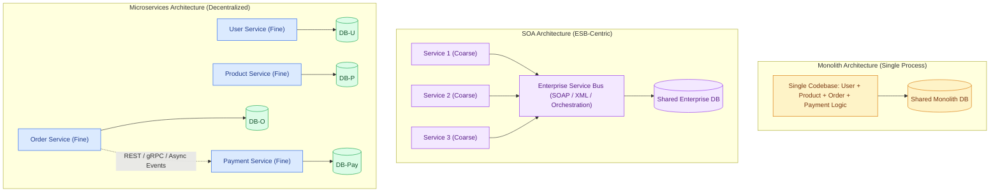

> [!IMPORTANT]
> **Smart Endpoints, Dumb Pipes:** Unlike SOA—which relies on a heavy, centralized Enterprise Service Bus (ESB) for routing, transformation, and orchestration—microservices keep communication pipes simple (HTTP/REST, gRPC, Kafka/RabbitMQ) and place business logic inside the services themselves.

### Detailed Comparison Table

| Aspect | Monolith | SOA | Microservices |
|--------|----------|-----|--------------|
| **Deployment** | Single unit, all-or-nothing | Services bundled together | Independent, service at a time |
| **Scaling** | Scale entire app | Scale service clusters | Scale individual services |
| **Team Size** | Large, coordinated teams | Large teams, slow coordination | Small autonomous teams (8–10 people) |
| **Database** | Single shared DB | Possibly shared, some isolated | Each service owns its DB |
| **Granularity** | Coarse (business features) | Coarse (business domains) | Fine (single responsibility) |
| **Communication** | In-process calls | Synchronous (often SOAP/XML) | Sync (REST/gRPC) + Async (Events) |
| **Failure Impact** | Total system down | Partial degradation | Isolated, graceful degradation |
| **Operational Complexity** | Low | Medium-High | Very High |
| **Network Latency** | None (in-process) | Significant | Significant, must optimize |
| **Development Speed** | Fast initially, slows down | Moderate | Fast long-term, slow initially |
| **Testing** | Simple (monolithic tests) | Complex (integration tests) | Very complex (distributed tests) |
| **When to Choose** | MVPs, small teams, simple domains | Enterprise, many business domains | Complex domains, high scale, independent teams |

### Trade-offs Analysis

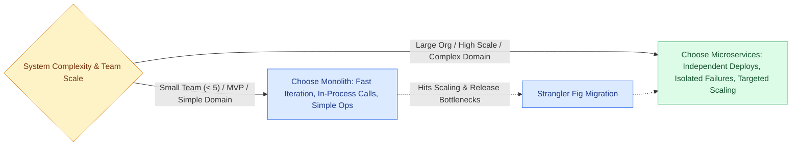

- **Monolith Advantages:**
  - **Simple deployment:** One artifact to test and deploy.
  - **Easier testing:** Full stack runs and tests locally in a single process.
  - **Better performance:** In-process method calls and shared memory (zero serialization/network overhead).
  - **Simpler debugging & monitoring:** Full stack traces across features; single runtime/JVM to monitor.
- **Monolith Disadvantages:**
  - **Technology lock-in:** Entire codebase coupled to one language/framework.
  - **Scaling inefficiency:** Must scale the entire app even if only one feature is hot.
  - **Reduced agility & reliability:** Requires coordinating releases across teams; one memory leak or bug can crash the entire system.
  - **Hard to maintain:** Codebase becomes increasingly tangled over time ("big ball of mud").
- **Microservices Advantages:**
  - **Independent deployment:** Ship features without full-system regression cycles.
  - **Technology diversity:** Each service can adopt the best stack for its workload.
  - **Targeted scaling & resilience:** Scale only hot paths; failures stay isolated via bulkheads/circuit breakers.
  - **Team autonomy & organizational alignment:** Teams own full stack (dev, deploy, monitor) aligned with Conway's Law.
- **Microservices Disadvantages:**
  - **Operational complexity:** Must manage CI/CD, service discovery, distributed tracing, and observability across many services.
  - **Network latency & data consistency:** All cross-service calls traverse the network; distributed transactions (Sagas, Outbox) replace simple ACID commits.
  - **Testing & debugging difficulty:** Integration/E2E testing is complex; errors span multiple services.

---

## Domain-Driven Design

Domain-Driven Design (DDD) provides a rigorous framework for decomposing microservices around **business capabilities and domain models**, rather than technical layers (UI, Logic, DB).

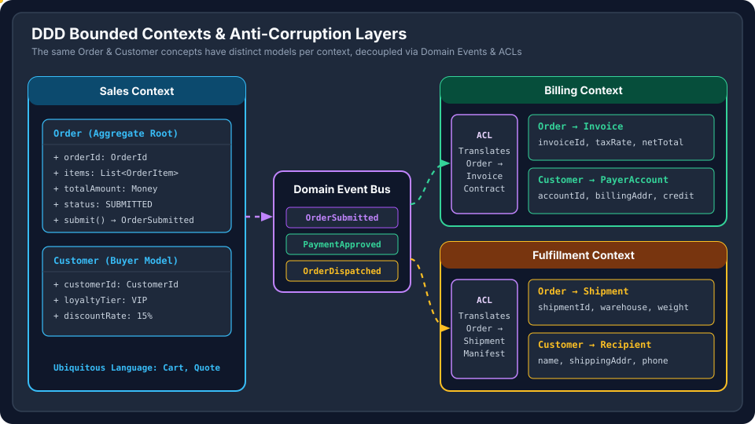

### 1. Bounded Contexts

A **Bounded Context** is an explicit boundary around a domain model where a particular **Ubiquitous Language** applies. It defines the natural scope of a microservice.

- **E-Commerce Bounded Contexts:**
  - **Order Context:** `Order` Aggregate, `OrderItem`, `OrderStatus`, `ShippingAddress`. Here, a `Product` is lightweight (ID + quantity + price snapshot).
  - **Product Context:** `Product` Aggregate, `SKU`, `Price`, `Inventory`. Here, a `Product` is a rich entity with variants, attributes, and reviews.
  - **Payment Context:** `Payment` Aggregate, `PaymentMethod`, `Transaction`.
  - **Shipping Context:** `Shipment` Aggregate, `Tracking`, `Destination`.

> [!TIP]
> **Intentional Model Divergence:** Having different definitions of `Product` or `Customer` across Bounded Contexts is *correct*, not duplication. Services communicate via explicit APIs, Anti-Corruption Layers (ACLs), and Domain Events—never shared database models.

### 2. Aggregates

An **Aggregate** is a cluster of domain objects (Entities and Value Objects) treated as a single unit for data changes and transactional consistency, accessed strictly through its **Aggregate Root**.

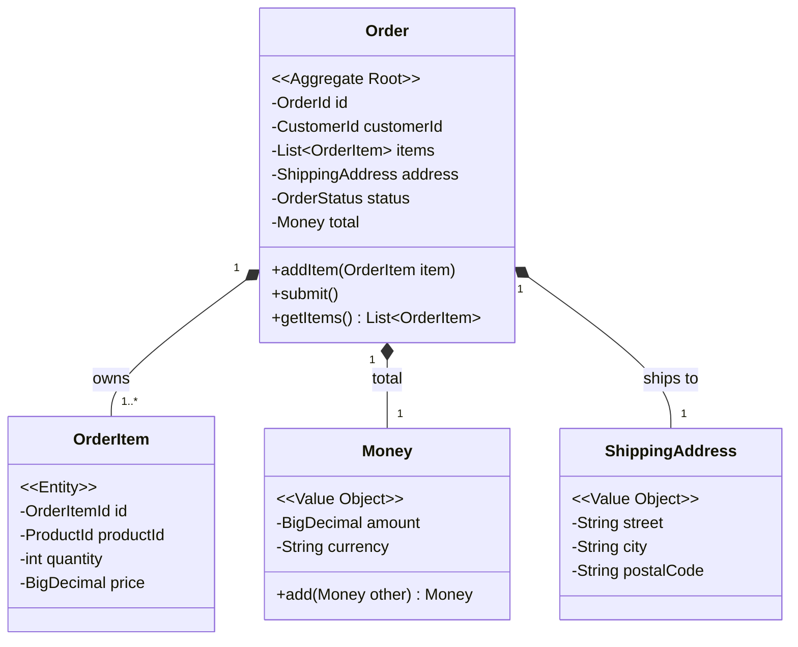

```java
// ORDER AGGREGATE
public class Order {
    private OrderId id;
    private CustomerId customerId;
    private List<OrderItem> items;   // Part of aggregate
    private ShippingAddress address; // Part of aggregate
    private OrderStatus status;
    private LocalDateTime createdAt;

    public void addItem(OrderItem item) {
        // Business logic: enforce invariants
        if (items.size() >= 100) {
            throw new OrderException("Too many items");
        }
        items.add(item);
    }

    public void submit() {
        if (items.isEmpty()) {
            throw new OrderException("Cannot submit empty order");
        }
        // Invariant: all items must be available
        status = OrderStatus.SUBMITTED;
    }

    // IMPORTANT: Only expose aggregate root, never expose mutable internal entities
    public List<OrderItem> getItems() {
        return Collections.unmodifiableList(items);
    }
}

// OrderItem is part of the aggregate, not accessed directly
public class OrderItem {
    private OrderItemId id;
    private ProductId productId;
    private int quantity;
    private BigDecimal price;

    OrderItem(ProductId productId, int quantity, BigDecimal price) {
        // Package-private constructor: only Order can create OrderItems
        this.productId = productId;
        this.quantity = quantity;
        this.price = price;
    }
}
```

**Aggregate Rules:**
- Only expose the **Aggregate Root** (`Order`, never `OrderItem` directly).
- All business logic and invariant enforcement live inside the aggregate.
- Aggregates are the **unit of consistency** (one database transaction per aggregate).
- Keep aggregates small to minimize lock contention and simplify reasoning.

### 3. Entities vs Value Objects

| Characteristic | Entity | Value Object |
|----------------|--------|--------------|
| **Identity** | Has a unique, immutable ID (`CustomerId`, `OrderId`) | No identity; defined entirely by its attributes |
| **Mutability** | Mutable state over its lifecycle | Immutable; operations return a new instance |
| **Equality** | Equal if IDs match (`id.equals(other.id)`) | Equal if all attributes match |
| **Persistence** | Persisted with its own table/document identity | Embedded within an Entity/Aggregate |
| **Examples** | `Customer`, `Order`, `OrderItem` | `Money`, `ShippingAddress`, `DateRange` |

```java
// ENTITY: Has identity, mutable, persisted separately
@Entity
public class Customer {
    @Id
    private CustomerId id;  // Identity doesn't change
    private String name;
    private String email;

    // Two customers with same data are different if IDs differ
    @Override
    public boolean equals(Object other) {
        if (!(other instanceof Customer)) return false;
        return id.equals(((Customer) other).id);
    }
}

// VALUE OBJECT: No identity, immutable, defined by attributes
public class Money {
    private final BigDecimal amount;
    private final String currency;

    public Money(BigDecimal amount, String currency) {
        this.amount = amount;
        this.currency = currency;
    }

    // Two Money objects with same amount/currency are equal
    @Override
    public boolean equals(Object other) {
        if (!(other instanceof Money)) return false;
        Money m = (Money) other;
        return amount.equals(m.amount) && currency.equals(m.currency);
    }

    // Immutable: return new instance
    public Money add(Money other) {
        if (!currency.equals(other.currency)) {
            throw new IllegalArgumentException("Different currencies");
        }
        return new Money(amount.add(other.amount), currency);
    }
}

// In Order aggregate:
public class Order {
    private OrderId id;              // Entity, has identity
    private Money total;             // Value object, immutable
    private ShippingAddress address; // Value object

    public void setTotal(Money total) {
        this.total = total; // Replace entire object
    }
}
```

### 4. Domain Events

**Domain Events** capture immutable facts about something important that happened in the business domain (always named in the past tense, e.g., `OrderSubmittedEvent`).

```mermaid
sequenceDiagram
    autonumber
    participant Client
    participant AppSvc as SubmitOrderService
    participant Agg as Order Aggregate
    participant DB as OrderRepository
    participant Bus as EventPublisher
    participant Pay as Payment Service

    Client->>AppSvc: submitOrder(orderId)
    AppSvc->>DB: findById(orderId)
    DB-->>AppSvc: Order
    AppSvc->>Agg: order.submit()
    Agg-->>Agg: Validate invariants &amp; record OrderSubmittedEvent
    AppSvc->>DB: save(order)
    AppSvc->>Bus: publishEvent(OrderSubmittedEvent)
    AppSvc->>Agg: clearDomainEvents()
    Bus-->>Pay: Async: OrderSubmittedEvent
```

```java
// Domain event
public class OrderSubmittedEvent {
    private final OrderId orderId;
    private final CustomerId customerId;
    private final LocalDateTime submittedAt;
    private final Money orderTotal;

    public OrderSubmittedEvent(OrderId orderId, CustomerId customerId, Money orderTotal) {
        this.orderId = orderId;
        this.customerId = customerId;
        this.orderTotal = orderTotal;
        this.submittedAt = LocalDateTime.now();
    }
    // Getters, no setters (immutable)
}

// Aggregate that publishes events
public class Order {
    private List<DomainEvent> domainEvents = new ArrayList<>();

    public void submit() {
        if (items.isEmpty()) {
            throw new OrderException("Cannot submit empty order");
        }
        status = OrderStatus.SUBMITTED;
        // Domain event captured
        domainEvents.add(new OrderSubmittedEvent(id, customerId, calculateTotal()));
    }

    public List<DomainEvent> getDomainEvents() { return domainEvents; }
    public void clearDomainEvents() { domainEvents.clear(); }
}

// Service that publishes events
@Service
public class SubmitOrderService {
    @Autowired private OrderRepository orderRepo;
    @Autowired private ApplicationEventPublisher eventPublisher;

    @Transactional
    public void submitOrder(OrderId orderId) {
        Order order = orderRepo.findById(orderId);
        order.submit();
        orderRepo.save(order);

        // Publish domain events
        order.getDomainEvents().forEach(eventPublisher::publishEvent);
        order.clearDomainEvents();
    }
}
```

**Why Domain Events Matter:**
- Enable **loose coupling** between services (no synchronous waiting).
- Create a natural **audit trail** of business state transitions.
- Power **Event Sourcing**, **CQRS**, and the **Saga Pattern** for distributed transactions.

### 5. Ubiquitous Language

A **Ubiquitous Language** is a shared vocabulary used identically by business stakeholders, domain experts, and developers in code, APIs, and diagrams.

```java
// BAD: Technical jargon
public class PaymentProcessor {
    public void processPaymentTx(Customer cust, double amnt, String curr) { }
}

// GOOD: Business language (Ubiquitous Language)
public class PaymentService {
    public void processPayment(Customer customer, Money amount) { }
}

// Domain model reflects business concepts (NOT generic PENDING/PROCESSING)
public enum OrderStatus {
    CREATED,           // Just created
    SUBMITTED,         // Customer clicked submit
    PAYMENT_APPROVED,  // Payment went through
    READY_FOR_PICKUP,  // In warehouse, waiting
    CANCELLED,         // Order was cancelled
    COMPLETED          // Customer received it
}
```

---

## Decomposition Strategies

Choosing the right decomposition axis determines whether your microservices are cohesive and autonomous or tangled in a "distributed monolith."

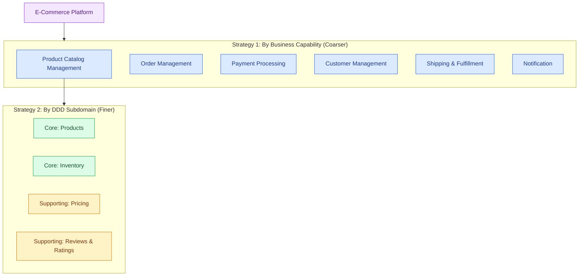

### Strategy 1: Decompose by Business Capability

Identify high-level **what the business does** capabilities and align services around them:
- **Product Catalog Management:** Browse products, manage inventory, pricing.
- **Order Management:** Create orders, track status, manage returns.
- **Payment Processing:** Process payments, refunds, payment history.
- **Customer Management:** Profiles, addresses, preferences, loyalty.
- **Shipping & Fulfillment:** Picking, packing, shipping, tracking.
- **Notification:** Email, SMS, push notifications.

| Pros | Cons |
|------|------|
| Aligned with how the business thinks about the domain | May still result in large, coarse-grained services |
| Relatively stable (capabilities rarely change) | Doesn't automatically separate Core vs Supporting subdomains |
| Clear responsibility ownership | — |

### Strategy 2: Decompose by Subdomain (DDD Approach)

Break down capabilities into **Core**, **Supporting**, and **Generic** subdomains to create fine-grained services:
- **Core Domain — Products:** Product definition and attributes (competitive differentiator).
- **Core Domain — Inventory:** Stock levels and reservations.
- **Supporting Subdomain — Pricing:** Price calculations and promotions.
- **Supporting Subdomain — Reviews & Ratings:** Customer feedback.

| Pros | Cons |
|------|------|
| More fine-grained and easier to understand | More services to deploy and operate |
| Directly aligned with DDD Bounded Contexts | Higher coordination overhead |
| Clearer boundaries and independent scaling | Risk of over-decomposition (nano-services) |

> [!TIP]
> **Core vs Supporting vs Generic:** Invest your best engineering talent in **Core Subdomains** (your competitive advantage), keep **Supporting Subdomains** simple, and consider buying SaaS or off-the-shelf solutions for **Generic Subdomains** (e.g., Auth, Analytics, Email).

---

## Service Boundaries

Well-defined service boundaries maximize **cohesion** (things that change together stay together) and minimize **coupling** (services know as little as possible about each other).

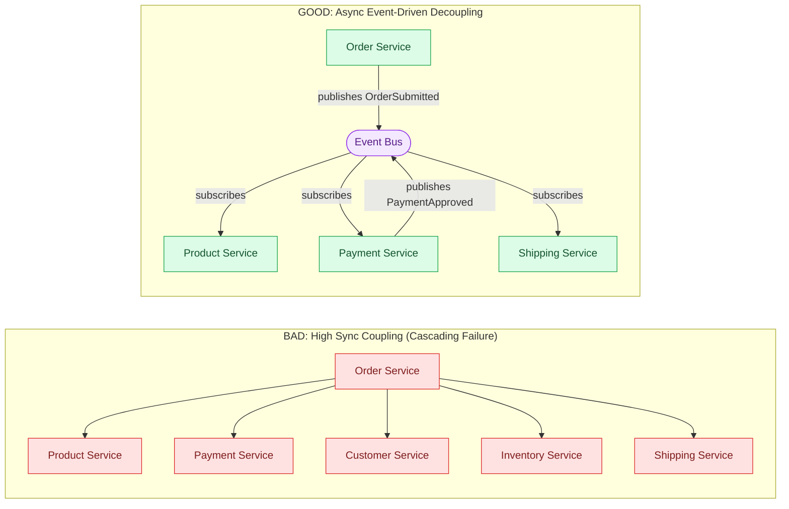

### 1. Single Responsibility Principle (SRP)

Each service should have **one reason to change**.

```java
// BAD: Multiple reasons to change
@RestController
@RequestMapping("/api")
public class UserProductPaymentController {
    @PostMapping("/users") public void createUser(CreateUserRequest request) { }
    @GetMapping("/products") public List<Product> getProducts() { }
    @PostMapping("/payments") public void processPayment(PaymentRequest request) { }
}

// GOOD: Separate services by responsibility
@RestController @RequestMapping("/api/users")
public class UserController {
    @PostMapping public void createUser(CreateUserRequest request) { }
}

@RestController @RequestMapping("/api/products")
public class ProductController {
    @GetMapping public List<Product> getProducts() { }
}

@RestController @RequestMapping("/api/payments")
public class PaymentController {
    @PostMapping public void processPayment(PaymentRequest request) { }
}
```

### 2. Minimize Inter-Service Dependencies

- **High Sync Coupling (Anti-Pattern):** If `Order Service` synchronously calls `Product`, `Payment`, `Customer`, `Inventory`, and `Shipping` on every request, any downstream outage crashes `Order Service`.
- **Async Events (Best Practice):** `Order Service` publishes `OrderSubmitted`, `Payment Service` subscribes and publishes `PaymentApproved`, and `Shipping Service` reacts to `PaymentApproved`. If `Payment Service` is temporarily down, orders are still accepted and processed eventually.

### 3. Avoid Chatty Interfaces

If two services make N+1 round-trips per operation, either batch the API into bulk calls or merge the services.

```mermaid
sequenceDiagram
    participant O as Order Service
    participant P as Product Service

    Note over O,P: BAD: Chatty Interface (4N Network Calls)
    loop For each item in Order
        O->>P: getProduct(id)
        O->>P: checkAvailability(id, qty)
        O->>P: getPrice(id)
        O->>P: reserveInventory(id, qty)
    end

    Note over O,P: GOOD: Bulk Interface (2 Network Calls Total)
    O->>P: getProductsInfo(List&lt;productIds&gt;)
    P-->>O: Map&lt;Long, ProductInfo&gt;
    O->>P: reserveInventory(List&lt;OrderItemRequest&gt;)
    P-->>O: ReservationConfirmed
```

```java
// BAD: Chatty interface (Order Service calling Product Service 4x per item)
@Service
public class ChattyOrderService {
    @Autowired private ProductClient productClient;

    @Transactional
    public void createOrder(CreateOrderRequest request) {
        Order order = new Order();
        for (OrderItemRequest item : request.getItems()) {
            Product product = productClient.getProduct(item.getProductId());
            boolean available = productClient.checkAvailability(item.getProductId(), item.getQuantity());
            BigDecimal price = productClient.getPrice(item.getProductId());
            productClient.reserveInventory(item.getProductId(), item.getQuantity());
            order.addItem(item.getProductId(), item.getQuantity(), price);
        }
        orderRepository.save(order);
    }
}

// GOOD: Bulk operation, fewer calls
@Service
public class BulkOrderService {
    @Autowired private ProductClient productClient;

    @Transactional
    public void createOrder(CreateOrderRequest request) {
        Order order = new Order();
        List<Long> productIds = request.getItems().stream()
            .map(OrderItemRequest::getProductId)
            .collect(Collectors.toList());

        // Single call: get all product info at once
        Map<Long, ProductInfo> products = productClient.getProductsInfo(productIds);

        for (OrderItemRequest item : request.getItems()) {
            ProductInfo productInfo = products.get(item.getProductId());
            if (!productInfo.isAvailable(item.getQuantity())) {
                throw new OutOfStockException(item.getProductId());
            }
            order.addItem(item.getProductId(), item.getQuantity(), productInfo.getPrice());
        }

        // Single call: reserve all inventory
        productClient.reserveInventory(request.getItems());
        orderRepository.save(order);
    }
}
```

### Common Mistakes in Defining Boundaries

> [!WARNING]
> **7 Boundary Anti-Patterns to Avoid:**
> 1. **Shared Database:** Forces tight schema coupling across teams.
> 2. **One Entity = One Service:** Creates ultra-chatty nano-services.
> 3. **Following Technical Layers:** Splitting into a "Persistence Service" and "Logic Service."
> 4. **Circular Dependencies:** Service A calls B, and B calls A.
> 5. **Ignoring Transactions:** Splitting entities that require strict atomic consistency.
> 6. **Following Current Org Structure:** Locking in silos that cannot evolve.
> 7. **Business Anti-Patterns:** Services that violate domain invariants.

---

## The Twelve-Factor App

The **Twelve-Factor App** methodology defines best practices for building cloud-native, portable, horizontally scalable microservices.

```mermaid
flowchart LR
    subgraph DEV["Code &amp; Config"]
        F1["1. Codebase (1 Repo / Service)"]
        F2["2. Dependencies (Explicit)"]
        F3["3. Config (Env Vars)"]
        F4["4. Backing Services (Attached)"]
    end

    subgraph PIPE["Build, Release, Run"]
        F5["5. Strict Stage Separation"]
        F6["6. Stateless Processes"]
        F7["7. Port Binding"]
        F8["8. Concurrency (Scale Out)"]
    end

    subgraph OPS["Runtime &amp; Ops"]
        F9["9. Disposability (Fast Graceful)"]
        F10["10. Dev/Prod Parity"]
        F11["11. Logs (stdout Streams)"]
        F12["12. Admin Processes (One-Off)"]
    end

    DEV --> PIPE --> OPS

    classDef blue fill:#dbeafe,stroke:#2563eb,color:#1e3a8a
    classDef green fill:#dcfce7,stroke:#16a34a,color:#14532d
    classDef purple fill:#f3e8ff,stroke:#9333ea,color:#581c87

    class F1,F2,F3,F4 blue
    class F5,F6,F7,F8 green
    class F9,F10,F11,F12 purple
```

### 1. Codebase
One codebase per service, tracked in version control, with many deploys (dev, staging, prod):
```text
ecommerce-system/
├── order-service/
│   ├── pom.xml
│   ├── .git
│   └── src/
├── payment-service/
│   ├── pom.xml
│   ├── .git
│   └── src/
└── product-service/
    ├── pom.xml
    ├── .git
    └── src/
```

### 2. Dependencies
Explicitly declare and isolate dependencies (Maven/Gradle) — never rely on implicit system-wide packages:
```xml
<!-- pom.xml -->
<dependencies>
    <dependency>
        <groupId>org.springframework.boot</groupId>
        <artifactId>spring-boot-starter-web</artifactId>
        <version>3.2.0</version>
    </dependency>
    <dependency>
        <groupId>org.springframework.boot</groupId>
        <artifactId>spring-boot-starter-data-jpa</artifactId>
        <version>3.2.0</version>
    </dependency>
</dependencies>
```

### 3. Config
Store environment-specific configuration in **environment variables**, never hardcoded in source:
```java
// BAD: Config in code
public class BadDatabaseConfig {
    private static final String DB_URL = "jdbc:mysql://prod-db:3306/orders";
    private static final String DB_USER = "admin";
    private static final String DB_PASSWORD = "secretpassword123";
}

// GOOD: Config from environment
@Configuration
public class DatabaseConfig {
    @Bean
    public DataSource dataSource(
        @Value("${DB_HOST:localhost}") String host,
        @Value("${DB_PORT:3306}") int port,
        @Value("${DB_NAME:orders}") String dbName,
        @Value("${DB_USER}") String user,
        @Value("${DB_PASSWORD}") String password
    ) {
        return DataSourceBuilder.create()
            .driverClassName("com.mysql.cj.jdbc.Driver")
            .url(String.format("jdbc:mysql://%s:%d/%s", host, port, dbName))
            .username(user)
            .password(password)
            .build();
    }
}
```

```yaml
# application.yml
spring:
  datasource:
    url: ${DB_URL:jdbc:mysql://localhost:3306/orders}
    username: ${DB_USER:root}
    password: ${DB_PASSWORD:}
    driver-class-name: com.mysql.cj.jdbc.Driver
```

### 4. Backing Services
Treat backing services (databases, Redis caches, message brokers) as **attached, replaceable resources** accessed via URL/credentials:
```java
@Configuration
public class ServiceConfiguration {
    @Bean
    public RestTemplate restTemplate() {
        return new RestTemplate();
    }

    @Bean
    public RedisConnectionFactory redisConnectionFactory(
        @Value("${REDIS_HOST:localhost}") String host,
        @Value("${REDIS_PORT:6379}") int port
    ) {
        return new LettuceConnectionFactory(new RedisStandaloneConfiguration(host, port));
    }

    @Bean
    public StringRedisTemplate stringRedisTemplate(RedisConnectionFactory connectionFactory) {
        return new StringRedisTemplate(connectionFactory);
    }
}
```

### 5. Build, Release, Run
Maintain strict separation between the **Build** (compile artifact), **Release** (combine build + config), and **Run** (execute in environment) stages:
```dockerfile
# Dockerfile - Build stage
FROM maven:3.9-eclipse-temurin-17 AS builder
COPY . /app
WORKDIR /app
RUN mvn clean package -DskipTests

# Release stage
FROM eclipse-temurin:17-jre
COPY --from=builder /app/target/order-service.jar /app/order-service.jar
EXPOSE 8080
CMD ["java", "-jar", "/app/order-service.jar"]
```

```bash
# Build
mvn clean package

# Release with immutable image tag
docker build -t order-service:v1.2.3 .
docker push order-service:v1.2.3

# Run with runtime environment config
docker run \
  -e DB_HOST=prod-db \
  -e DB_USER=admin \
  -e DB_PASSWORD=secret \
  order-service:v1.2.3
```

### 6–12. Runtime, Scaling & Operations Factors

| Factor | Core Principle | Microservices Implementation |
|--------|----------------|------------------------------|
| **6. Processes** | Stateless, share-nothing execution | Store session/state in Redis or DB, never in local memory |
| **7. Port Binding** | Self-contained via port binding | Embedded server (Tomcat/Netty) listening on `$PORT` |
| **8. Concurrency** | Scale out via process model | Horizontal pod autoscaling (multiple stateless instances) |
| **9. Disposability** | Fast startup, graceful shutdown | Handle `SIGTERM`, drain in-flight requests, fast boot |
| **10. Dev/Prod Parity** | Keep dev, staging, prod as similar as possible | Use Docker/Testcontainers locally to match prod DBs/brokers |
| **11. Logs** | Treat logs as event streams | Write JSON logs to `stdout`; infrastructure (Fluentd/ELK) aggregates |
| **12. Admin Tasks** | Run admin/migration tasks as one-off processes | Execute DB migrations (Flyway/Liquibase) using the same release image |

---

## Conway's Law

> *"Any organization that designs a system will produce a design whose structure is a copy of the organization's communication structure."* — **Melvin Conway (1968)**

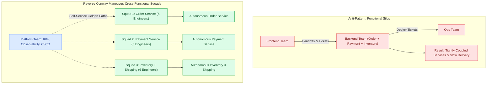

### Implications & Reverse Conway Maneuver
- **Natural Conway Effect:** If you have a Backend Team, Frontend Team, and DevOps Team, you will inevitably build a coupled backend monolith, a separate frontend, and manual ops handoffs.
- **Reverse Conway Maneuver:** Intentionally **restructure your organization** into small, cross-functional, "two-pizza" squads aligned with your desired Bounded Contexts:
  - **Squad 1:** Order Service (5 engineers)
  - **Squad 2:** Payment Service (3 engineers)
  - **Squad 3:** Inventory + Shipping (6 engineers)
  - **Squad 4:** Platform (DevOps, Monitoring, Shared Libraries)
  - **Squad 5:** Notification (2 engineers)
- **Full Ownership ("You Build It, You Run It"):** Each squad owns dev, test, deploy, and on-call monitoring for their service, supported by self-service Platform tooling.

---

## Microservices Maturity Model

Organizations rarely jump straight to Netflix-scale microservices. Maturity evolves across 6 distinct levels:

```mermaid
flowchart LR
    L0["Level 0: Monolith"] --> L1["Level 1: Modular Monolith"]
    L1 --> L2["Level 2: Service Per Team"]
    L2 --> L3["Level 3: Domain-Driven Services"]
    L3 --> L4["Level 4: Platform &amp; Ecosystem"]
    L4 --> L5["Level 5: Autonomous &amp; Resilient"]

    classDef amber fill:#fef3c7,stroke:#d97706,color:#78350f
    classDef blue fill:#dbeafe,stroke:#2563eb,color:#1e3a8a
    classDef green fill:#dcfce7,stroke:#16a34a,color:#14532d
    classDef purple fill:#f3e8ff,stroke:#9333ea,color:#581c87

    class L0,L1 amber
    class L2,L3 blue
    class L4 green
    class L5 purple
```

| Level | Architecture | Data & Communication | Key Characteristics |
|-------|-------------|----------------------|---------------------|
| **Level 0: Monolith** | Single codebase, single deployment unit | Shared DB, in-process calls | All features in one process |
| **Level 1: Modular Monolith** | Logical modules/packages in one codebase | Shared DB, strict module interfaces | Separate `user/`, `order/`, `payment/` packages; still 1 deploy unit |
| **Level 2: Service Per Team** | 1–2 coarse-grained services per team | Shared DB acceptable; independent deploy | Order Service (Team A), Product Service (Team B) |
| **Level 3: Domain-Driven Services** | Aligned with DDD Bounded Contexts | Separate DB per service; async domain events | `OrderSubmittedEvent` → `PaymentService` |
| **Level 4: Platform & Ecosystem** | Dedicated Platform team + self-service | Standardized REST/gRPC/Events | K8s, Istio, Jaeger, ELK, Prometheus/Grafana, Vault, Kong |
| **Level 5: Autonomous & Resilient** | Multi-region, self-healing | Chaos engineering, circuit breakers | Simian Army, bulkhead isolation, automatic failover, graceful degradation |

> [!TIP]
> **Start at Level 1 (Modular Monolith):** For greenfield projects, a Modular Monolith with clean package boundaries (`com.ecommerce.user`, `com.ecommerce.order`, `com.ecommerce.payment`) gives you monolith speed today and painless service extraction later.

---

## Migration Strategies

Migrating a live monolith requires incremental, zero-downtime patterns rather than a risky "big bang" rewrite.

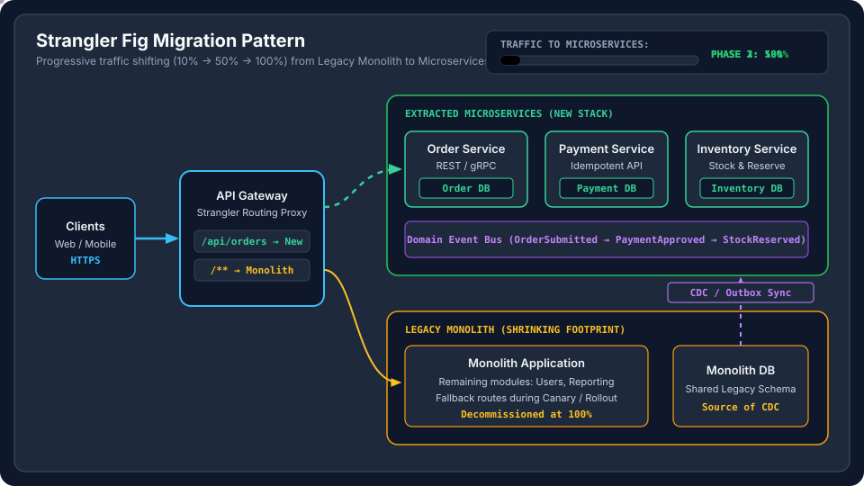

### Strategy 1: Strangler Fig Pattern

Gradually replace the monolith by building new microservices alongside it and shifting traffic progressively (`10% → 50% → 100%`) at the **API Gateway** until the monolith is decommissioned.

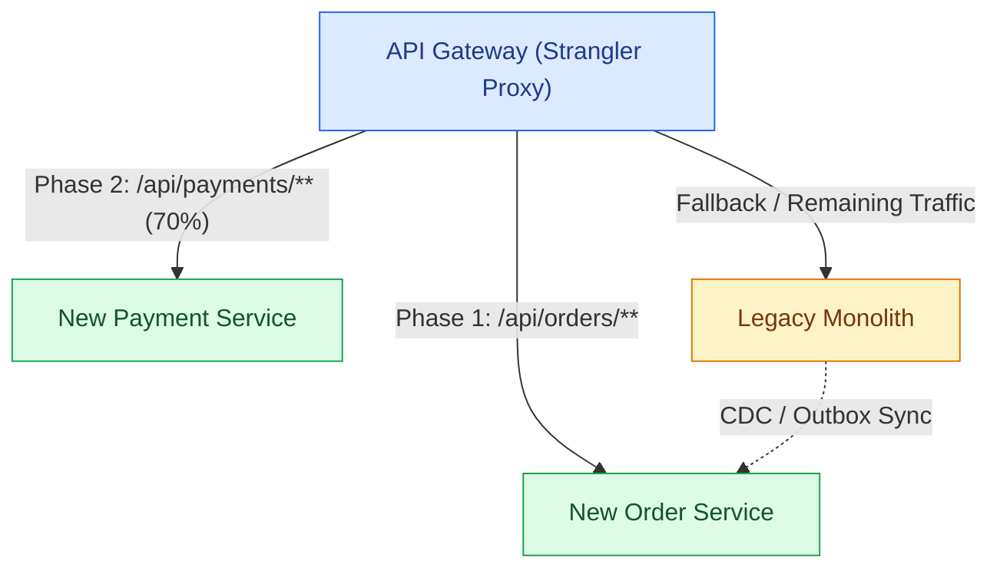

```java
// API Gateway routes based on request path
@Configuration
public class GatewayConfiguration {
    @Bean
    public RouteLocator routes(RouteLocatorBuilder builder) {
        return builder.routes()
            // New Order Service
            .route("order-service", r -> r
                .path("/api/orders/**")
                .uri("http://order-service:8080"))
            // Still using monolith for other features
            .route("monolith-fallback", r -> r
                .path("/**")
                .uri("http://monolith:8080"))
            .build();
    }
}

// Monolith can also delegate internally to new services
@Service
public class OrderController {
    @Autowired private RestTemplate restTemplate;

    @PostMapping("/orders")
    public Order createOrder(CreateOrderRequest request) {
        return restTemplate.postForObject(
            "http://order-service:8080/api/orders",
            request,
            Order.class
        );
    }
}
```

### Strategy 2: Branch by Abstraction

Introduce an internal interface inside the monolith, implement the new microservice client behind it, and use a **feature flag / traffic splitter** with automatic fallback to migrate safely.

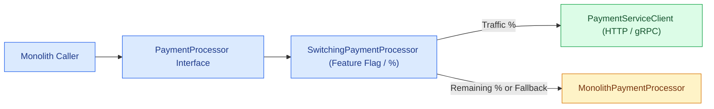

```java
// Phase 1: Abstract behind interface
public interface PaymentProcessor {
    PaymentResult processPayment(PaymentRequest request);
}

// Phase 2: Monolith & New Service implementations
public class MonolithPaymentProcessor implements PaymentProcessor {
    public PaymentResult processPayment(PaymentRequest request) { /* Legacy */ return null; }
}

public class PaymentServiceClient implements PaymentProcessor {
    @Autowired private RestTemplate restTemplate;

    public PaymentResult processPayment(PaymentRequest request) {
        return restTemplate.postForObject(
            "http://payment-service:8080/api/payments",
            request,
            PaymentResult.class
        );
    }
}

// Phase 3: Decorator pattern for gradual percentage rollout + fallback
@Component
public class SwitchingPaymentProcessor implements PaymentProcessor {
    private final PaymentProcessor monolith;
    private final PaymentProcessor service;
    private final double serviceTrafficPercentage;

    @Autowired
    public SwitchingPaymentProcessor(
        MonolithPaymentProcessor monolith,
        PaymentServiceClient service,
        @Value("${payment.service-traffic-percentage:0.0}") double percentage
    ) {
        this.monolith = monolith;
        this.service = service;
        this.serviceTrafficPercentage = percentage;
    }

    @Override
    public PaymentResult processPayment(PaymentRequest request) {
        if (Math.random() < serviceTrafficPercentage) {
            try {
                return service.processPayment(request);
            } catch (Exception e) {
                // Safe fallback to monolith if new service fails
                return monolith.processPayment(request);
            }
        }
        return monolith.processPayment(request);
    }
}
```

---

## Common Interview Questions

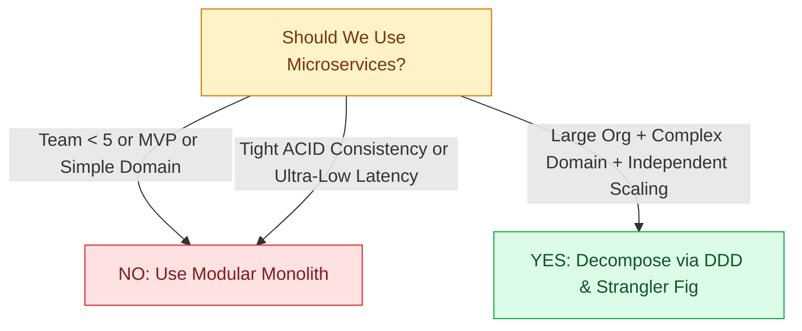

### Q1: When should you NOT use microservices?
You should **avoid** microservices when:
1. **Team is small (< 5 engineers)** — Operational overhead outweighs benefits.
2. **Simple domain / low traffic** — No complex scaling needs.
3. **Early-stage product / MVP** — Requirements are still shifting; monoliths pivot faster.
4. **Tight ACID data consistency required** — Distributed transactions are complex and slower.
5. **Ultra-low latency critical** — In-process calls beat network serialization.
6. **Team lacks distributed systems experience** — High risk of building a distributed monolith.

### Q2: How do you determine the right service boundaries?
Combine six lenses: **DDD Bounded Contexts**, **Team Ownership (Conway's Law)**, **Deployment Cycles** (things that change together stay together), **Scalability Needs**, **Technology Diversity**, and **Data Affinity**.
- *Too coarse:* A 100k-line `Product Catalog Service` mixing products, reviews, recommendations, pricing, and inventory.
- *Right granularity:* Separate `Product`, `Inventory`, `Pricing`, `Reviews`, and `Recommendation` services.

### Q3: Explain the difference between business capability and subdomain decomposition.
- **Business Capability:** Coarser, based on high-level *what the business does* (e.g., `Product Catalog`, `Order Management`). Stable over time.
- **Subdomain (DDD):** Finer-grained, splits capabilities into **Core** (competitive edge, e.g., `Order Processing`), **Supporting** (e.g., `Returns & Refunds`), and **Generic** (commodities, e.g., `Order Analytics`).

### Q4: What's a realistic migration plan from monolith to microservices?
A phased **12–24 month** roadmap:
1. **Months 1–2 (Assessment):** Identify bottlenecks, define DDD boundaries, build K8s/CI/CD foundation.
2. **Months 3–6 (First Extraction):** Use Strangler Fig on a non-critical edge service (e.g., `Notifications`); build observability maturity.
3. **Months 7–12 (Core Services):** Extract `Payment` and `Order` services; introduce Sagas, Outbox, and Domain Events.
4. **Months 13–18 (Remaining Services):** Extract `User`, `Product`, `Inventory`; harden resilience (circuit breakers, bulkheads).
5. **Months 19–24 (Decommission):** Migrate remaining data, verify parity, and retire the legacy monolith.

### Q5: How would you split a massive User Service?
Decompose a 50k-line `User Service` across **DDD**, **Scalability**, and **Data Affinity**:

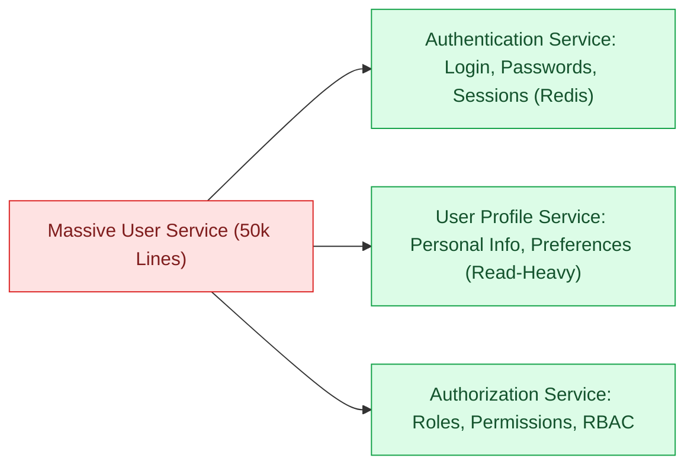

### Q6: What challenges emerge when moving from monolith to microservices?

| Challenge | Root Cause | Proven Solution |
|-----------|------------|-----------------|
| **Operational Complexity** | Managing 10+ services instead of 1 | Automation, Kubernetes, CI/CD pipelines |
| **Data Consistency** | No cross-service ACID transactions | Eventual consistency, Saga pattern, Outbox |
| **Debugging** | Errors span multiple network hops | Distributed tracing (OpenTelemetry / Jaeger / Zipkin) |
| **Testing** | Fragile E2E environments | Contract testing (Pact), isolated component tests |
| **Team Coordination** | Breaking API changes across squads | Backward-compatible APIs, semantic versioning |
| **Network Latency** | Chatty sync calls over the wire | Bulk APIs, aggressive caching, async events |

---

## Key Takeaways for Interviews

```mermaid
flowchart LR
    T1["1. Not a Silver Bullet"] --> T2["2. Align Org (Conway's Law)"]
    T2 --> T3["3. DDD Boundaries First"]
    T3 --> T4["4. Design for Failure &amp; Async"]
    T4 --> T5["5. Strangler Fig Migration"]
    T5 --> T6["6. Platform &amp; Observability"]
    T6 --> T7["7. Two-Pizza Full Ownership"]

    classDef blue fill:#dbeafe,stroke:#2563eb,color:#1e3a8a
    classDef green fill:#dcfce7,stroke:#16a34a,color:#14532d
    classDef purple fill:#f3e8ff,stroke:#9333ea,color:#581c87

    class T1,T2,T3 blue
    class T4,T5 green
    class T6,T7 purple
```

1. **Microservices are not a silver bullet** — Always justify *why* a Modular Monolith isn't sufficient first.
2. **Start with organization** — Conway's Law dictates that team structure shapes system architecture.
3. **Clear boundaries from the start** — Use DDD Bounded Contexts, Aggregates, and Domain Events.
4. **Expect distributed system challenges** — Network latency, partial failures, and eventual consistency are guaranteed.
5. **Plan migration carefully** — Use Strangler Fig and Branch by Abstraction with gradual traffic shifting.
6. **Operational excellence is mandatory** — Invest in CI/CD, distributed tracing, and centralized logging before scaling out services.
7. **Team structure matters** — Empower autonomous two-pizza teams with end-to-end ownership.
