# Communication Patterns in Microservices

## Table of Contents
1. [Synchronous Communication](#synchronous-communication)
2. [Asynchronous Communication](#asynchronous-communication)
3. [Request-Reply Pattern](#request-reply-pattern)
4. [Event-Driven Architecture](#event-driven-architecture)
5. [CQRS Pattern](#cqrs-pattern)
6. [Choreography vs Orchestration](#choreography-vs-orchestration)
7. [Saga Pattern](#saga-pattern)
8. [Idempotency](#idempotency)
9. [Interview Questions](#interview-questions)

---

## Synchronous Communication

Synchronous communication means the caller blocks and waits for a response before proceeding. It provides immediate feedback and simpler mental models, at the cost of temporal coupling.

- **REST (HTTP/JSON):** Best for public APIs, browser clients, and standard CRUD with HTTP caching.
- **gRPC (HTTP/2 + Protobuf):** Best for low-latency internal service-to-service calls and streaming.
- **GraphQL (BFF / Aggregation):** Best for preventing over-fetching/under-fetching across multiple backend services for UI clients.

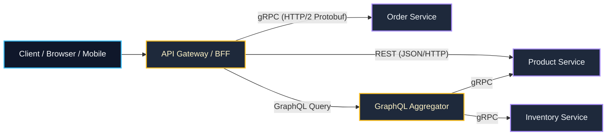

> [!TIP]
> Use **REST** at the public edge for universal tooling and HTTP caching, and **gRPC** internally where binary serialization, strict `.proto` contracts, and HTTP/2 multiplexing cut p99 latency.

### REST (RESTful APIs)

Most common approach for microservices. HTTP-based, stateless.

```java
// Product Service API
@RestController
@RequestMapping("/api/products")
public class ProductController {

    @Autowired
    private ProductService productService;

    // GET /api/products/123
    @GetMapping("/{id}")
    public ResponseEntity<ProductDTO> getProduct(@PathVariable Long id) {
        Product product = productService.findById(id);
        return ResponseEntity.ok(new ProductDTO(product));
    }

    // PUT /api/products/123
    @PutMapping("/{id}")
    public ResponseEntity<ProductDTO> updateProduct(
        @PathVariable Long id,
        @RequestBody UpdateProductRequest request
    ) {
        Product updated = productService.update(id, request);
        return ResponseEntity.ok(new ProductDTO(updated));
    }
}

// Order Service using Product Service (REST client)
@Service
public class OrderService {

    @Autowired
    private RestTemplate restTemplate;

    @Autowired
    private ProductClient productClient;

    @Transactional
    public Order createOrder(CreateOrderRequest request) {
        Order order = new Order();

        for (OrderItemRequest item : request.getItems()) {
            // Call Product Service via REST
            ProductDTO product = productClient.getProduct(item.getProductId());

            if (!product.isInStock(item.getQuantity())) {
                throw new OutOfStockException(item.getProductId());
            }

            order.addItem(item.getProductId(), item.getQuantity(), product.getPrice());
        }

        return orderRepository.save(order);
    }
}

// Product Client (wrapper for REST calls)
@Component
public class ProductClient {

    @Autowired
    private RestTemplate restTemplate;

    @Value("${product-service.url:http://product-service:8080}")
    private String productServiceUrl;

    public ProductDTO getProduct(Long productId) {
        String url = productServiceUrl + "/api/products/" + productId;
        try {
            return restTemplate.getForObject(url, ProductDTO.class);
        } catch (HttpClientErrorException e) {
            if (e.getStatusCode() == HttpStatus.NOT_FOUND) {
                throw new ProductNotFoundException(productId);
            }
            throw new ProductServiceException("Failed to fetch product", e);
        }
    }
}

// REST Best Practices

// 1. Resource naming (nouns, not verbs)
@GetMapping("/api/orders/{id}")                    // GOOD
@GetMapping("/api/getOrder/{id}")                  // BAD

// 2. Versioning strategy (API evolution)
@GetMapping("/api/v1/orders/{id}")                 // Version in path
@GetMapping("/api/orders/{id}")                    // With Accept header: Accept: application/vnd.company.v1+json

// 3. Pagination
@GetMapping("/api/products")
public Page<ProductDTO> getProducts(
    @RequestParam(defaultValue = "0") int page,
    @RequestParam(defaultValue = "20") int size,
    @RequestParam(defaultValue = "id,desc") String sort
) {
    Pageable pageable = PageRequest.of(page, size, Sort.by("id").descending());
    return productService.findAll(pageable).map(ProductDTO::new);
}

// 4. Idempotent operations
@PostMapping("/api/payments")
public ResponseEntity<Payment> processPayment(
    @RequestBody ProcessPaymentRequest request,
    @RequestHeader(value = "Idempotency-Key") String idempotencyKey
) {
    // Idempotency key prevents duplicate processing
    Payment payment = paymentService.processPayment(request, idempotencyKey);
    return ResponseEntity.status(HttpStatus.CREATED).body(payment);
}

// 5. HATEOAS (Hypermedia As The Engine Of Application State)
@GetMapping("/api/orders/{id}")
public EntityModel<OrderDTO> getOrder(@PathVariable Long id) {
    Order order = orderService.findById(id);
    OrderDTO dto = new OrderDTO(order);

    return EntityModel.of(dto,
        linkTo(methodOn(OrderController.class).getOrder(id)).withSelfRel(),
        linkTo(methodOn(OrderController.class).listOrders(0, 20, "id,desc")).withRel("orders"),
        linkTo(methodOn(PaymentController.class).getPayment(order.getPaymentId())).withRel("payment")
    );
}
```

### REST Pros & Cons

| Pros | Cons |
|------|------|
| Simple, HTTP standard | Slower than gRPC |
| Easy to debug (HTTP tools) | Verbose (JSON payloads) |
| Wide tooling support | Synchronous by nature |
| Human-readable | Tight coupling |
| Caching support (HTTP caching) | Requires polling for real-time |

---

### gRPC (gRPC Remote Procedure Call)

High-performance RPC framework using HTTP/2 and Protocol Buffers.

```protobuf
// product.proto
syntax = "proto3";

package com.ecommerce.product;

service ProductService {
    rpc GetProduct(GetProductRequest) returns (ProductResponse);
    rpc SearchProducts(SearchRequest) returns (stream ProductResponse);
    rpc UpdatePrice(stream UpdatePriceRequest) returns (UpdatePriceResponse);
    rpc RealtimeInventory(stream InventoryRequest) returns (stream InventoryResponse);
}

message GetProductRequest {
    int64 product_id = 1;
}

message ProductResponse {
    int64 id = 1;
    string name = 2;
    string description = 3;
    double price = 4;
    int32 stock = 5;
}

message SearchRequest {
    string query = 1;
    int32 limit = 2;
}

message UpdatePriceRequest {
    int64 product_id = 1;
    double new_price = 2;
}

message UpdatePriceResponse {
    bool success = 1;
    int32 updated_count = 2;
}

message InventoryRequest {
    int64 product_id = 1;
}

message InventoryResponse {
    int64 product_id = 1;
    int32 available_quantity = 2;
    int32 reserved_quantity = 3;
    int64 timestamp = 4;
}
```

```java
// gRPC Server Implementation (Product Service)
@Service
public class ProductServiceImpl extends ProductServiceGrpc.ProductServiceImplBase {

    @Autowired
    private ProductService productService;

    @Override
    public void getProduct(
        GetProductRequest request,
        StreamObserver<ProductResponse> responseObserver
    ) {
        try {
            Product product = productService.findById(request.getProductId());
            ProductResponse response = ProductResponse.newBuilder()
                .setId(product.getId())
                .setName(product.getName())
                .setDescription(product.getDescription())
                .setPrice(product.getPrice())
                .setStock(product.getStock())
                .build();

            responseObserver.onNext(response);
            responseObserver.onCompleted();
        } catch (ProductNotFoundException e) {
            responseObserver.onError(
                Status.NOT_FOUND
                    .withDescription("Product not found")
                    .asException()
            );
        } catch (Exception e) {
            responseObserver.onError(
                Status.INTERNAL
                    .withDescription("Internal server error")
                    .asException()
            );
        }
    }

    // Server-side streaming: get multiple products
    @Override
    public void searchProducts(
        SearchRequest request,
        StreamObserver<ProductResponse> responseObserver
    ) {
        try {
            List<Product> products = productService.search(
                request.getQuery(),
                request.getLimit()
            );

            for (Product product : products) {
                ProductResponse response = ProductResponse.newBuilder()
                    .setId(product.getId())
                    .setName(product.getName())
                    .setPrice(product.getPrice())
                    .setStock(product.getStock())
                    .build();

                responseObserver.onNext(response);
            }

            responseObserver.onCompleted();
        } catch (Exception e) {
            responseObserver.onError(Status.INTERNAL.asException());
        }
    }

    // Bidirectional streaming: update multiple prices
    @Override
    public StreamObserver<UpdatePriceRequest> updatePrice(
        StreamObserver<UpdatePriceResponse> responseObserver
    ) {
        return new StreamObserver<UpdatePriceRequest>() {
            private int updatedCount = 0;

            @Override
            public void onNext(UpdatePriceRequest request) {
                try {
                    productService.updatePrice(
                        request.getProductId(),
                        request.getNewPrice()
                    );
                    updatedCount++;
                } catch (Exception e) {
                    responseObserver.onError(Status.INTERNAL.asException());
                }
            }

            @Override
            public void onError(Throwable t) {
                responseObserver.onError(t);
            }

            @Override
            public void onCompleted() {
                UpdatePriceResponse response = UpdatePriceResponse.newBuilder()
                    .setSuccess(true)
                    .setUpdatedCount(updatedCount)
                    .build();

                responseObserver.onNext(response);
                responseObserver.onCompleted();
            }
        };
    }
}

// gRPC Client (Order Service calling Product Service)
@Service
public class ProductGrpcClient {

    private final ProductServiceGrpc.ProductServiceBlockingStub blockingStub;
    private final ProductServiceGrpc.ProductServiceStub asyncStub;

    public ProductGrpcClient(
        @Value("${product-service.host:product-service}") String host,
        @Value("${product-service.port:50051}") int port
    ) {
        ManagedChannel channel = ManagedChannelBuilder
            .forAddress(host, port)
            .usePlaintext()  // In production: use TLS
            .build();

        this.blockingStub = ProductServiceGrpc.newBlockingStub(channel);
        this.asyncStub = ProductServiceGrpc.newStub(channel);
    }

    public ProductDTO getProduct(Long productId) {
        GetProductRequest request = GetProductRequest.newBuilder()
            .setProductId(productId)
            .build();

        ProductResponse response = blockingStub.getProduct(request);

        return new ProductDTO(
            response.getId(),
            response.getName(),
            response.getDescription(),
            response.getPrice(),
            response.getStock()
        );
    }

    public List<ProductDTO> searchProducts(String query, int limit) {
        SearchRequest request = SearchRequest.newBuilder()
            .setQuery(query)
            .setLimit(limit)
            .build();

        List<ProductDTO> results = new ArrayList<>();

        // Server-side streaming
        blockingStub.searchProducts(request).forEachRemaining(response -> {
            results.add(new ProductDTO(
                response.getId(),
                response.getName(),
                response.getDescription(),
                response.getPrice(),
                response.getStock()
            ));
        });

        return results;
    }

    // Async server-side streaming
    public void searchProductsAsync(String query, Consumer<ProductDTO> onProduct) {
        SearchRequest request = SearchRequest.newBuilder()
            .setQuery(query)
            .build();

        asyncStub.searchProducts(request, new StreamObserver<ProductResponse>() {
            @Override
            public void onNext(ProductResponse response) {
                onProduct.accept(new ProductDTO(
                    response.getId(),
                    response.getName(),
                    response.getDescription(),
                    response.getPrice(),
                    response.getStock()
                ));
            }

            @Override
            public void onError(Throwable t) {
                throw new RuntimeException("Search failed", t);
            }

            @Override
            public void onCompleted() {
            }
        });
    }
}
```

### gRPC Configuration

```xml
<!-- pom.xml -->
<dependency>
    <groupId>io.grpc</groupId>
    <artifactId>grpc-netty-shaded</artifactId>
    <version>1.56.0</version>
</dependency>
<dependency>
    <groupId>io.grpc</groupId>
    <artifactId>grpc-protobuf</artifactId>
    <version>1.56.0</version>
</dependency>
<dependency>
    <groupId>io.grpc</groupId>
    <artifactId>grpc-stub</artifactId>
    <version>1.56.0</version>
</dependency>

<build>
    <extensions>
        <extension>
            <groupId>kr.motd.maven</groupId>
            <artifactId>os-maven-plugin</artifactId>
            <version>1.7.1</version>
        </extension>
    </extensions>
    <plugins>
        <plugin>
            <groupId>org.xolstice.maven.plugins</groupId>
            <artifactId>protobuf-maven-plugin</artifactId>
            <version>0.6.1</version>
            <configuration>
                <protocArtifact>com.google.protobuf:protoc:3.24.0:exe:${os.detected.classifier}</protocArtifact>
                <pluginId>grpc-java</pluginId>
                <pluginArtifact>io.grpc:protoc-gen-grpc-java:1.56.0:exe:${os.detected.classifier}</pluginArtifact>
            </configuration>
        </plugin>
    </plugins>
</build>
```

### gRPC Pros & Cons

| Pros | Cons |
|------|------|
| Very fast (binary, HTTP/2) | Steeper learning curve |
| Small payloads | Less widely supported |
| Built-in streaming | Poor browser support |
| Multiple RPC types | Requires code generation |
| Multiplexing (HTTP/2) | Harder to debug |

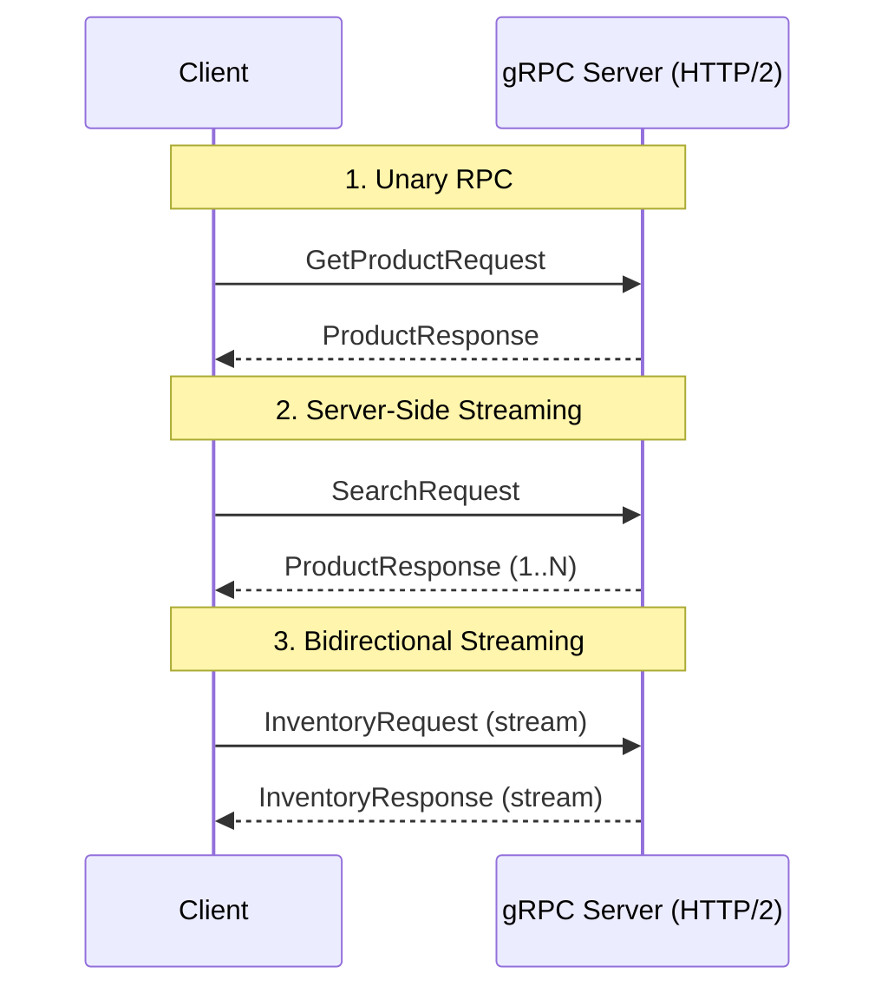

---

### GraphQL (API Aggregation / BFF)

GraphQL lets clients request **exactly the fields they need** in a single round-trip, making it ideal for Backend-for-Frontend (BFF) aggregation over multiple microservices.

```graphql
# schema.graphqls
type Query {
    orderDetails(id: ID!): OrderDetails
}

type OrderDetails {
    id: ID!
    status: String!
    total: Float!
    items: [ProductSummary!]!
}

type ProductSummary {
    id: ID!
    name: String!
    price: Float!
}
```

```java
// Spring for GraphQL Controller aggregating Order + Product services
@Controller
public class OrderGraphQLController {

    private final OrderService orderService;
    private final ProductGrpcClient productClient;

    public OrderGraphQLController(OrderService orderService, ProductGrpcClient productClient) {
        this.orderService = orderService;
        this.productClient = productClient;
    }

    @QueryMapping
    public OrderDetails orderDetails(@Argument Long id) {
        Order order = orderService.findById(id);
        return new OrderDetails(order.getId(), order.getStatus().name(), order.getTotal());
    }

    @SchemaMapping(typeName = "OrderDetails", field = "items")
    public List<ProductSummary> items(OrderDetails order) {
        return productClient.getProductsForOrder(order.getId());
    }
}
```

---

### When to use REST vs gRPC vs GraphQL

| Dimension | REST (HTTP/JSON) | gRPC (HTTP/2 + Protobuf) | GraphQL (HTTP + Schema) |
|-----------|------------------|--------------------------|-------------------------|
| **Payload** | Text (JSON), verbose | Binary (Protobuf), compact | Text (JSON), client-shaped |
| **Streaming** | Polling / SSE / WebSocket | Native 4-mode HTTP/2 streaming | Subscriptions (WebSocket) |
| **Browser Support** | Native | Requires gRPC-Web proxy | Native |
| **Contract** | OpenAPI (optional) | Strict `.proto` (mandatory) | Strongly-typed SDL schema |
| **Best For** | Public APIs, CRUD, caching | Internal service-to-service | Mobile/UI BFF aggregation |

- **Real-world hybrid topology:**
  - `Client → API Gateway`: **REST** or **GraphQL** (browser compatibility, flexible UI queries).
  - `API Gateway / BFF → Product / Order Service`: **gRPC** (internal, high-frequency, low-latency).
  - `Service → Database / Cache`: Direct driver/library (not RPC).

> [!WARNING]
> Long synchronous call chains (`A → B → C → D`) multiply tail latency and create **cascading failures** when any downstream service slows down. Always pair synchronous calls with timeouts, circuit breakers, and bulkheads.

---

## Asynchronous Communication

Services don't wait for responses—decoupling producers and consumers in **time**, **availability**, and **throughput** via a durable message broker.

- **Message Queue (Point-to-Point / RabbitMQ):** Broker routes messages through an Exchange and Binding to a Queue; each message is processed once by a competing consumer.
- **Event Stream (Pub/Sub / Kafka):** Producers append immutable events to partitioned topics; multiple independent consumer groups replay or tail the log at their own pace.

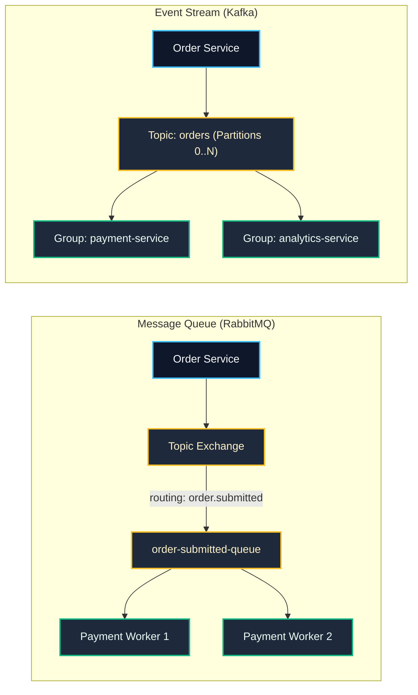

> [!IMPORTANT]
> Never publish directly to Kafka/RabbitMQ inside a `@Transactional` DB method without the **Transactional Outbox Pattern** if you need guaranteed atomicity—otherwise the DB commit can succeed while the broker publish fails (or vice versa).

### Message Queue Pattern

```java
// Order Service publishing message
@Service
public class OrderService {

    @Autowired
    private RabbitTemplate rabbitTemplate;

    @Transactional
    public void submitOrder(CreateOrderRequest request) {
        Order order = new Order();
        order.addItems(request.getItems());

        orderRepository.save(order);

        // Publish event asynchronously
        OrderSubmittedEvent event = new OrderSubmittedEvent(
            order.getId(),
            order.getCustomerId(),
            order.getOrderTotal()
        );

        rabbitTemplate.convertAndSend(
            "order-exchange",           // Exchange
            "order.submitted",          // Routing key
            event                       // Message
        );
    }
}

// Payment Service consuming message
@Component
public class PaymentProcessor {

    @Autowired
    private PaymentService paymentService;

    @RabbitListener(queues = "order-submitted-queue")
    public void processOrderSubmitted(OrderSubmittedEvent event) {
        try {
            Payment payment = paymentService.processPayment(
                event.getOrderId(),
                event.getOrderTotal()
            );

            publishPaymentApprovedEvent(payment);
        } catch (PaymentFailedException e) {
            publishPaymentFailedEvent(event);
        }
    }

    private void publishPaymentApprovedEvent(Payment payment) {
        // Publish to next service
    }
}

// Configuration
@Configuration
public class RabbitMQConfig {

    // Exchange: routes messages to queues
    @Bean
    public TopicExchange orderExchange() {
        return new TopicExchange("order-exchange", true, false);
    }

    // Queue: holds messages
    @Bean
    public Queue orderSubmittedQueue() {
        return new Queue("order-submitted-queue", true);
    }

    // Binding: connects queue to exchange
    @Bean
    public Binding orderSubmittedBinding(Queue queue, TopicExchange exchange) {
        return BindingBuilder.bind(queue)
            .to(exchange)
            .with("order.submitted");  // Routing key
    }
}
```

### Event Stream Pattern (Kafka)

For more scalable, durable event streaming.

```java
// Order Service publishing to Kafka
@Service
public class OrderService {

    @Autowired
    private KafkaTemplate<String, OrderEvent> kafkaTemplate;

    @Transactional
    public void submitOrder(CreateOrderRequest request) {
        Order order = new Order();
        order.addItems(request.getItems());
        orderRepository.save(order);

        // Send to Kafka topic
        OrderSubmittedEvent event = new OrderSubmittedEvent(
            order.getId(),
            order.getCustomerId(),
            order.getOrderTotal()
        );

        kafkaTemplate.send("orders", String.valueOf(order.getId()), event);
    }
}

// Payment Service consuming from Kafka
@Service
public class PaymentProcessor {

    @Autowired
    private PaymentService paymentService;

    @KafkaListener(topics = "orders", groupId = "payment-service")
    public void processOrder(OrderSubmittedEvent event) {
        Payment payment = paymentService.processPayment(
            event.getOrderId(),
            event.getOrderTotal()
        );

        // Publish to another topic
        kafkaTemplate.send("payments", String.valueOf(payment.getId()), payment);
    }
}

// Shipping Service consuming from payments topic
@Service
public class ShippingProcessor {

    @Autowired
    private ShippingService shippingService;

    @KafkaListener(topics = "payments", groupId = "shipping-service")
    public void shipPayment(PaymentEvent event) {
        if (event.isApproved()) {
            Shipment shipment = shippingService.createShipment(event.getOrderId());
            // Further processing
        }
    }
}

// Configuration
@Configuration
public class KafkaConfig {

    @Bean
    public KafkaTemplate<String, OrderEvent> kafkaTemplate(ProducerFactory<String, OrderEvent> producerFactory) {
        return new KafkaTemplate<>(producerFactory);
    }
}

// application.yml
spring:
  kafka:
    bootstrap-servers: localhost:9092
    producer:
      key-serializer: org.apache.kafka.common.serialization.StringSerializer
      value-serializer: org.springframework.kafka.support.serializer.JsonSerializer
    consumer:
      group-id: order-service
      key-deserializer: org.apache.kafka.common.serialization.StringDeserializer
      value-deserializer: org.springframework.kafka.support.serializer.JsonDeserializer
      properties:
        spring.json.trusted.packages: "*"
```

### Async Messaging Pros & Cons

| Pros | Cons |
|------|------|
| Decouples services | Harder to debug |
| Resilient to failures | Eventual consistency |
| Higher throughput | Requires message broker |
| Automatic retry | More complex architecture |
| Scalable | Possible message duplication |

### Message Queue (RabbitMQ) vs Event Stream (Kafka)

| Feature | RabbitMQ (Message Queue) | Apache Kafka (Event Stream) |
|---------|--------------------------|-----------------------------|
| **Model** | Smart broker, dumb consumer (push) | Dumb broker, smart consumer (pull) |
| **Retention** | Deleted after consumer ACK | Retained by time/size; replayable |
| **Ordering** | Per-queue FIFO (single consumer) | Per-partition strict ordering |
| **Throughput** | Tens of thousands msg/sec | Millions of msg/sec |
| **Best For** | Task queues, complex routing, RPC | Event sourcing, audit logs, high-volume pub/sub |

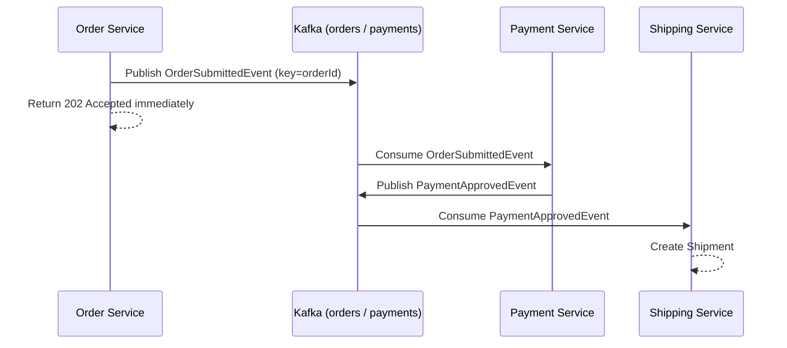

> [!TIP]
> Always partition Kafka topics by aggregate ID (e.g., `orderId`) so all events for the same order land on the same partition and are processed in strict order.

---

## Request-Reply Pattern

Synchronous semantics layered over asynchronous message delivery using a dedicated **reply queue** and a **Correlation ID**.

- **Reply-To Header:** Tells the consumer which queue to send the response back to.
- **Correlation ID:** Matches an incoming async reply to the exact waiting request thread.
- **Bounded Timeout:** Prevents caller threads from hanging indefinitely if the worker crashes.

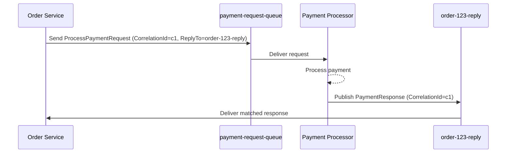


> [!WARNING]
> Blocking a web thread via `convertSendAndReceive` still couples availability and consumes thread-pool capacity. For long-running operations (&gt;2s), prefer returning `202 Accepted` with webhooks or polling.

```java
// Order Service sends request to Payment Service
@Service
public class OrderService {

    @Autowired
    private RabbitTemplate rabbitTemplate;

    public Order createOrder(CreateOrderRequest request) {
        Order order = new Order();
        order.addItems(request.getItems());
        order = orderRepository.save(order);

        // Send request and wait for reply
        ProcessPaymentRequest paymentRequest = new ProcessPaymentRequest(
            order.getId(),
            order.getCustomerId(),
            order.getOrderTotal()
        );

        // Create reply queue
        String replyQueue = "order-" + order.getId() + "-reply";

        Message message = MessageBuilder
            .withBody(JSON.serialize(paymentRequest).getBytes())
            .setHeader("X-Order-Id", String.valueOf(order.getId()))
            .setReplyTo(replyQueue)
            .setCorrelationId(UUID.randomUUID().toString())
            .build();

        rabbitTemplate.send("payment-request-exchange", "payment.process", message);

        // Wait for reply (with timeout)
        PaymentResponse response = waitForPaymentResponse(replyQueue, 30); // 30 seconds

        if (response.isApproved()) {
            order.markPaymentApproved();
            orderRepository.save(order);
        } else {
            throw new PaymentFailedException(response.getReason());
        }

        return order;
    }

    private PaymentResponse waitForPaymentResponse(String replyQueue, int timeoutSeconds) {
        // Implementation using blocking queue
    }
}

// Better: Using RabbitTemplate built-in request-reply
@Service
public class OrderServiceImproved {

    @Autowired
    private RabbitTemplate rabbitTemplate;

    public Order createOrder(CreateOrderRequest request) {
        Order order = new Order();
        order.addItems(request.getItems());
        order = orderRepository.save(order);

        ProcessPaymentRequest paymentRequest = new ProcessPaymentRequest(
            order.getId(),
            order.getCustomerId(),
            order.getOrderTotal()
        );

        // Send and receive synchronously via messaging
        PaymentResponse response = (PaymentResponse) rabbitTemplate.convertSendAndReceive(
            "payment-request-exchange",
            "payment.process",
            paymentRequest
        );

        if (response == null || !response.isApproved()) {
            throw new PaymentFailedException("Payment failed or timeout");
        }

        order.markPaymentApproved();
        return orderRepository.save(order);
    }
}

// Payment Service receiving request and sending reply
@Component
public class PaymentProcessor {

    @Autowired
    private PaymentService paymentService;

    @RabbitListener(queues = "payment-request-queue")
    public PaymentResponse processPayment(ProcessPaymentRequest request) {
        try {
            Payment payment = paymentService.processPayment(
                request.getOrderId(),
                request.getOrderTotal()
            );

            return new PaymentResponse(true, payment.getId(), null);
        } catch (PaymentFailedException e) {
            return new PaymentResponse(false, null, e.getMessage());
        }
    }
}
```

---

## Event-Driven Architecture

Services react to immutable domain events published by other services, eliminating direct point-to-point dependencies.

### Event Notification Pattern

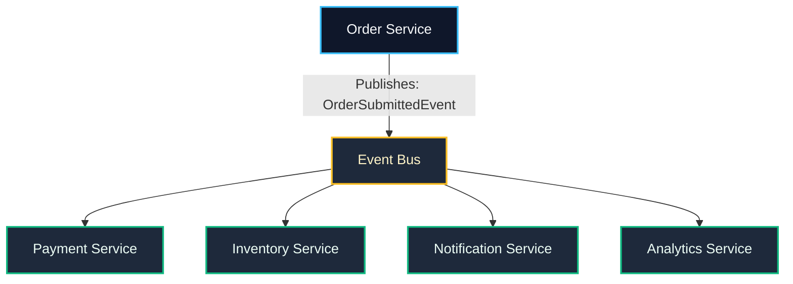

- **Advantage:** Loose coupling—publishers have zero knowledge of downstream subscribers.
- **Disadvantage:** Implicit flow of control—harder to trace end-to-end business processes without distributed tracing.

```java
// Order Service publishes event
@Service
public class OrderService {

    @Autowired
    private OrderRepository orderRepository;

    @Autowired
    private ApplicationEventPublisher eventPublisher;

    @Transactional
    public Order submitOrder(CreateOrderRequest request) {
        Order order = new Order();
        order.addItems(request.getItems());

        order = orderRepository.save(order);

        // Publish domain event
        OrderSubmittedEvent event = new OrderSubmittedEvent(
            this,
            order.getId(),
            order.getCustomerId(),
            order.getOrderTotal()
        );

        eventPublisher.publishEvent(event);

        return order;
    }
}

// Domain event
public class OrderSubmittedEvent extends ApplicationEvent {
    private final Long orderId;
    private final Long customerId;
    private final BigDecimal total;

    public OrderSubmittedEvent(Object source, Long orderId, Long customerId, BigDecimal total) {
        super(source);
        this.orderId = orderId;
        this.customerId = customerId;
        this.total = total;
    }
}

// Payment Service listens
@Service
public class PaymentEventListener {

    @Autowired
    private PaymentService paymentService;

    @EventListener(OrderSubmittedEvent.class)
    public void onOrderSubmitted(OrderSubmittedEvent event) {
        paymentService.processPayment(event.getOrderId(), event.getTotal());
    }
}

// Inventory Service listens
@Service
public class InventoryEventListener {

    @Autowired
    private InventoryService inventoryService;

    @EventListener(OrderSubmittedEvent.class)
    public void onOrderSubmitted(OrderSubmittedEvent event) {
        inventoryService.reserveItems(event.getOrderId());
    }
}

// Notification Service listens
@Service
public class NotificationEventListener {

    @Autowired
    private NotificationService notificationService;

    @EventListener(OrderSubmittedEvent.class)
    public void onOrderSubmitted(OrderSubmittedEvent event) {
        notificationService.sendOrderConfirmation(event.getCustomerId());
    }
}
```

### Event-Carried State Transfer

Events contain full state, subscribers don't need to call originating service.

```java
// BAD: Event carries only ID, subscribers must fetch full data
public class OrderSubmittedEvent {
    private Long orderId;  // Subscribers must call Order Service to get details
}

// GOOD: Event carries all needed data
public class OrderSubmittedEvent {
    private Long orderId;
    private Long customerId;
    private LocalDateTime submittedAt;
    private List<OrderItemDTO> items;      // Full data included
    private ShippingAddressDTO shippingAddress;
    private BigDecimal total;
    private BigDecimal tax;

    // Subscribers can process without additional calls
}

// Inventory Service can immediately reserve inventory
@Service
public class InventoryEventListener {

    @EventListener(OrderSubmittedEvent.class)
    public void onOrderSubmitted(OrderSubmittedEvent event) {
        for (OrderItemDTO item : event.getItems()) {
            // Have all data, no need to call Order Service
            inventoryService.reserve(item.getProductId(), item.getQuantity());
        }
    }
}
```

**Trade-off**: Larger events vs reduced inter-service calls.

### Event Notification vs Event-Carried State Transfer

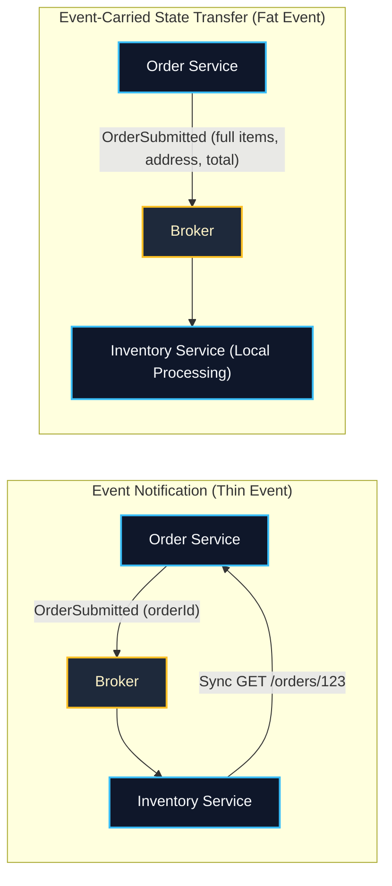

| Aspect | Event Notification | Event-Carried State Transfer (ECST) |
|--------|--------------------|-------------------------------------|
| **Payload Size** | Small (IDs + event type) | Larger (full entity snapshot) |
| **Coupling** | Subscribers must call back to producer | Zero runtime callback; works if producer is down |
| **Data Freshness** | Always fetches latest state | Snapshot at event emission time |
| **Schema Sensitivity** | Low | High (requires backward-compatible evolution) |

> [!IMPORTANT]
> When using Event-Carried State Transfer, enforce schema evolution rules (e.g., Avro/Protobuf with a Schema Registry) so adding fields never breaks existing consumers.

---

## CQRS Pattern

Command Query Responsibility Segregation — separate the **write model** (commands, invariants, ACID transactions) from the **read model** (denormalized views, fast queries, independent scaling).

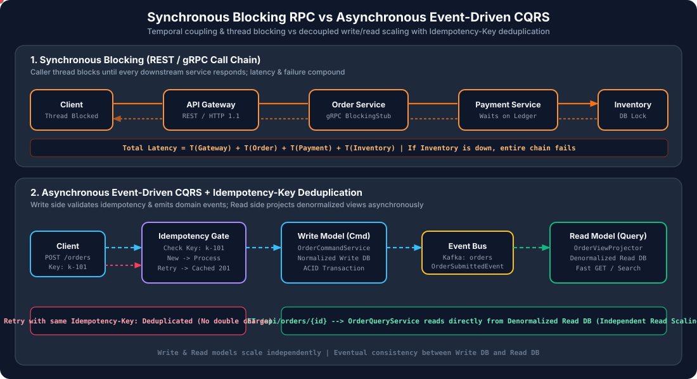

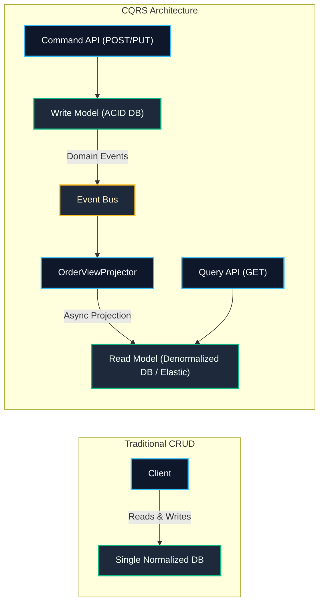

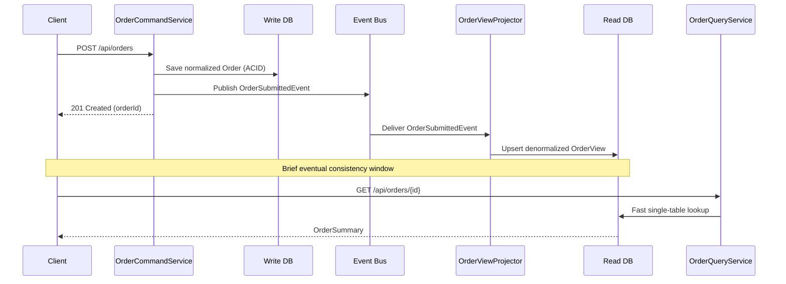

```java
// Order Service with CQRS

// Write side (Command)
@Service
public class OrderCommandService {

    @Autowired
    private OrderRepository orderRepository;

    @Autowired
    private EventPublisher eventPublisher;

    @Transactional
    public Long submitOrder(CreateOrderRequest request) {
        Order order = new Order();
        order.addItems(request.getItems());

        order = orderRepository.save(order);

        // Publish event for eventual consistency
        eventPublisher.publish(new OrderSubmittedEvent(
            order.getId(),
            order.getCustomerId(),
            order.getOrderTotal()
        ));

        return order.getId();
    }

    @Transactional
    public void shipOrder(Long orderId) {
        Order order = orderRepository.findById(orderId);
        order.markAsShipped();
        orderRepository.save(order);

        eventPublisher.publish(new OrderShippedEvent(orderId));
    }
}

// Read side (Query)
@Service
public class OrderQueryService {

    @Autowired
    private OrderViewRepository orderViewRepository;  // Read-optimized view

    public OrderSummary getOrderSummary(Long orderId) {
        // Query from denormalized read model
        return orderViewRepository.findById(orderId).map(view ->
            new OrderSummary(
                view.getOrderId(),
                view.getStatus(),
                view.getTotal(),
                view.getItems(),
                view.getEstimatedDelivery()
            )
        ).orElseThrow();
    }

    public List<OrderSummary> getCustomerOrders(Long customerId) {
        // Optimized query for reading
        return orderViewRepository.findByCustomerId(customerId)
            .stream()
            .map(view -> new OrderSummary(
                view.getOrderId(),
                view.getStatus(),
                view.getTotal(),
                view.getItems(),
                view.getEstimatedDelivery()
            ))
            .collect(Collectors.toList());
    }

    public Page<OrderSummary> searchOrders(String query, Pageable pageable) {
        // Text search on denormalized view
        return orderViewRepository.search(query, pageable)
            .map(view -> new OrderSummary(
                view.getOrderId(),
                view.getStatus(),
                view.getTotal(),
                view.getItems(),
                view.getEstimatedDelivery()
            ));
    }
}

// Event handler that updates read model
@Service
public class OrderViewProjector {

    @Autowired
    private OrderViewRepository orderViewRepository;

    @EventListener(OrderSubmittedEvent.class)
    public void onOrderSubmitted(OrderSubmittedEvent event) {
        OrderView view = new OrderView();
        view.setOrderId(event.getOrderId());
        view.setCustomerId(event.getCustomerId());
        view.setStatus(OrderStatus.SUBMITTED);
        view.setTotal(event.getOrderTotal());
        view.setCreatedAt(LocalDateTime.now());

        orderViewRepository.save(view);
    }

    @EventListener(OrderShippedEvent.class)
    public void onOrderShipped(OrderShippedEvent event) {
        OrderView view = orderViewRepository.findById(event.getOrderId()).orElseThrow();
        view.setStatus(OrderStatus.SHIPPED);
        view.setShippedAt(LocalDateTime.now());
        view.setEstimatedDelivery(calculateEstimated(view.getShippingAddress()));

        orderViewRepository.save(view);
    }

    @EventListener(OrderDeliveredEvent.class)
    public void onOrderDelivered(OrderDeliveredEvent event) {
        OrderView view = orderViewRepository.findById(event.getOrderId()).orElseThrow();
        view.setStatus(OrderStatus.DELIVERED);
        view.setDeliveredAt(event.getDeliveredAt());

        orderViewRepository.save(view);
    }

    private LocalDateTime calculateEstimated(ShippingAddressDTO address) {
        // Calculate estimated delivery based on address
        return LocalDateTime.now().plusDays(3);
    }
}

// REST API using CQRS
@RestController
@RequestMapping("/api/orders")
public class OrderController {

    @Autowired
    private OrderCommandService commandService;

    @Autowired
    private OrderQueryService queryService;

    // Command endpoint
    @PostMapping
    public ResponseEntity<Long> createOrder(@RequestBody CreateOrderRequest request) {
        Long orderId = commandService.submitOrder(request);
        return ResponseEntity.status(HttpStatus.CREATED).body(orderId);
    }

    // Command endpoint
    @PostMapping("/{id}/ship")
    public ResponseEntity<Void> shipOrder(@PathVariable Long id) {
        commandService.shipOrder(id);
        return ResponseEntity.noContent().build();
    }

    // Query endpoint
    @GetMapping("/{id}")
    public ResponseEntity<OrderSummary> getOrder(@PathVariable Long id) {
        return ResponseEntity.ok(queryService.getOrderSummary(id));
    }

    // Query endpoint
    @GetMapping("/customer/{customerId}")
    public ResponseEntity<List<OrderSummary>> getCustomerOrders(@PathVariable Long customerId) {
        return ResponseEntity.ok(queryService.getCustomerOrders(customerId));
    }

    // Query endpoint with search
    @GetMapping("/search")
    public ResponseEntity<Page<OrderSummary>> searchOrders(
        @RequestParam String query,
        Pageable pageable
    ) {
        return ResponseEntity.ok(queryService.searchOrders(query, pageable));
    }
}
```

**CQRS Benefits**:
- Queries optimized for read (denormalized, text search, caching)
- Commands optimized for write (normalized, transactional)
- Scales independently (more read replicas than write replicas)
- Audit trail (event log)

**CQRS Challenges**:
- Eventual consistency (stale read data)
- Complex to implement
- More databases to manage
- Harder to debug (flow across read/write models)

| Dimension | Traditional CRUD | CQRS |
|-----------|------------------|------|
| **Data Model** | Single shared schema | Separate write (normalized) & read (denormalized) |
| **Consistency** | Immediate strong consistency | Eventual consistency on read side |
| **Scaling** | Coupled read/write scaling | Independent read & write scaling |
| **Query Complexity** | Expensive multi-table `JOIN`s | Pre-joined materialized views |

> [!TIP]
> To handle **read-your-own-writes** right after a command in CQRS, return the created resource ID/version in the `POST` response or optimistically update the UI while the projection catches up.

---

## Choreography vs Orchestration

How services coordinate complex workflows.

### Choreography

Services listen to events and react independently without a central coordinator.

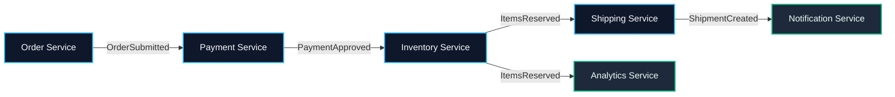

```java
// Services react to events independently

@Service
public class PaymentProcessor {
    @KafkaListener(topics = "order-events")
    public void onOrderSubmitted(OrderSubmittedEvent event) {
        Payment payment = paymentService.processPayment(event.getOrderId(), event.getTotal());
        kafkaTemplate.send("payment-events", new PaymentApprovedEvent(payment));
    }
}

@Service
public class InventoryProcessor {
    @KafkaListener(topics = "payment-events")
    public void onPaymentApproved(PaymentApprovedEvent event) {
        inventoryService.reserveItems(event.getOrderId());
        kafkaTemplate.send("inventory-events", new ItemsReservedEvent(event.getOrderId()));
    }
}

@Service
public class ShippingProcessor {
    @KafkaListener(topics = "inventory-events")
    public void onItemsReserved(ItemsReservedEvent event) {
        Shipment shipment = shippingService.createShipment(event.getOrderId());
        kafkaTemplate.send("shipment-events", new ShipmentCreatedEvent(shipment));
    }
}
```

**Choreography Pros**:
- Loosely coupled
- Services independent
- Easy to add new listeners
- Scales well

**Choreography Cons**:
- Hard to see overall flow
- Debugging difficult (implicit flow)
- Circular dependencies possible
- Testing complex

### Orchestration

A central orchestrator explicitly directs each step of the workflow and handles compensating rollbacks.

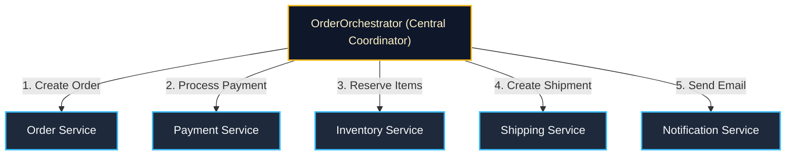

```java
// Orchestrator controls workflow

@Service
public class OrderOrchestrator {

    @Autowired
    private OrderService orderService;

    @Autowired
    private PaymentService paymentService;

    @Autowired
    private InventoryService inventoryService;

    @Autowired
    private ShippingService shippingService;

    @Autowired
    private NotificationService notificationService;

    @Transactional
    public Order processOrder(CreateOrderRequest request) {
        // Step 1: Create order
        Order order = orderService.createOrder(request);

        try {
            // Step 2: Process payment
            PaymentResult payment = paymentService.processPayment(
                order.getId(),
                order.getTotal()
            );

            if (!payment.isApproved()) {
                throw new PaymentFailedException("Payment declined");
            }

            // Step 3: Reserve inventory
            InventoryResult inventory = inventoryService.reserveItems(order.getId());

            if (!inventory.isSuccess()) {
                // Compensating transaction: refund payment
                paymentService.refund(payment.getTransactionId());
                throw new InventoryException("Items not available");
            }

            // Step 4: Create shipment
            Shipment shipment = shippingService.createShipment(order.getId());

            // Step 5: Send notification
            notificationService.sendOrderConfirmation(order.getCustomerId());

            order.markAsProcessed();
            orderService.save(order);

            return order;
        } catch (Exception e) {
            // Handle failures with compensating transactions
            handleOrderFailure(order);
            throw e;
        }
    }

    private void handleOrderFailure(Order order) {
        // Compensating transactions
        paymentService.refund(order.getId());
        inventoryService.releaseReservation(order.getId());
        orderService.markAsFailed(order.getId());
    }
}
```

Using a workflow engine:

```java
// Using Temporal.io or Airflow-like workflow

@Workflow
public interface OrderWorkflow {
    void processOrder(CreateOrderRequest request);
}

@WorkflowImpl
public class OrderWorkflowImpl implements OrderWorkflow {

    private final OrderService orderService = Workflow.newActivityStub(OrderService.class);
    private final PaymentService paymentService = Workflow.newActivityStub(PaymentService.class);
    private final InventoryService inventoryService = Workflow.newActivityStub(InventoryService.class);
    private final ShippingService shippingService = Workflow.newActivityStub(ShippingService.class);
    private final NotificationService notificationService = Workflow.newActivityStub(NotificationService.class);

    @Override
    public void processOrder(CreateOrderRequest request) {
        // Retry and timeout automatically handled by Temporal
        Order order = orderService.createOrder(request);

        try {
            // Step by step execution with automatic retry and recovery
            PaymentResult payment = paymentService.processPayment(order.getId(), order.getTotal());

            InventoryResult inventory = inventoryService.reserveItems(order.getId());

            Shipment shipment = shippingService.createShipment(order.getId());

            notificationService.sendConfirmation(order.getCustomerId());

            orderService.markAsCompleted(order.getId());
        } catch (Exception e) {
            // Compensation
            paymentService.refund(order.getId());
            orderService.markAsFailed(order.getId());
        }
    }
}
```

**Orchestration Pros**:
- Clear flow, easy to understand
- Centralized error handling
- Easier to test (mock services)
- Debugging straightforward

**Orchestration Cons**:
- Central point of failure
- Potential bottleneck
- Tightly coupled to orchestrator
- Scaling challenges

### Choreography vs Orchestration Comparison

| Dimension | Choreography | Orchestration |
|-----------|--------------|---------------|
| **Control Flow** | Implicit (distributed across event listeners) | Explicit (centralized state machine) |
| **Coupling** | Very loose (services only know events) | Orchestrator depends on all participants |
| **Visibility & Debugging** | Harder; requires correlation/trace IDs | Easy; single place tracks workflow state |
| **Failure / Rollback** | Complex as steps grow | Straightforward reverse compensation |
| **Best For** | 2–4 services, simple event reactions | 4+ services, complex branching, Temporal workflows |

> [!IMPORTANT]
> Avoid "smart" choreography that encodes multi-step conditional business logic across 6+ topics—it quickly turns into a distributed spaghetti state machine. Switch to **Orchestration** (e.g., Temporal) once workflows exceed 3–4 steps.

---

## Saga Pattern

Managing distributed transactions across multiple microservices without 2-Phase Commit (2PC), using a sequence of **local ACID transactions** paired with **compensating transactions** on failure.

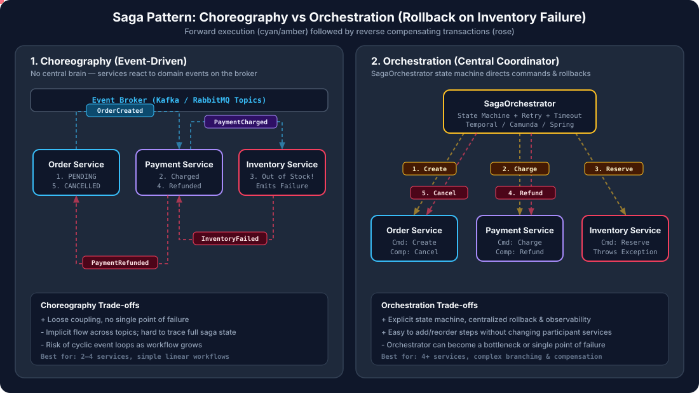

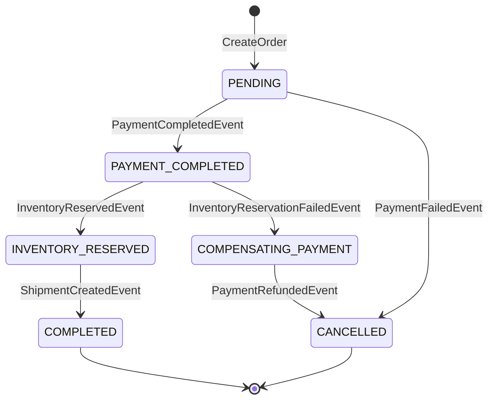

### Choreography-Based Saga

1. **Order Service** creates order (`PENDING`) and publishes `OrderCreatedEvent`.
2. **Payment Service** charges customer and publishes `PaymentCompletedEvent` (or `PaymentFailedEvent` -> Order cancels).
3. **Inventory Service** reserves stock and publishes `InventoryReservedEvent` (or `InventoryReservationFailedEvent` -> Payment refunds & Order cancels).
4. **Shipping Service** creates shipment and publishes `ShipmentCreatedEvent` -> Order marks `COMPLETED`.

```java
// Choreography-based saga implementation

// Domain events
public class OrderCreatedEvent {
    private Long orderId;
    private Long customerId;
    private List<OrderItem> items;
    private BigDecimal total;
}

public class PaymentCompletedEvent {
    private Long orderId;
    private Long transactionId;
    private BigDecimal amount;
}

public class PaymentFailedEvent {
    private Long orderId;
    private String reason;
}

public class InventoryReservedEvent {
    private Long orderId;
    private List<InventoryReservation> reservations;
}

public class InventoryReservationFailedEvent {
    private Long orderId;
    private String reason;
}

public class ShipmentCreatedEvent {
    private Long orderId;
    private Long shipmentId;
}

// Order Service
@Service
public class OrderService {

    @Autowired
    private OrderRepository orderRepository;

    @Autowired
    private EventPublisher eventPublisher;

    // Saga step 1: Create order
    public void createOrder(CreateOrderRequest request) {
        Order order = new Order(request);
        order.setStatus(OrderStatus.PENDING);

        orderRepository.save(order);

        eventPublisher.publish(new OrderCreatedEvent(order));
    }

    // Saga step: Compensate on payment failure
    @EventListener(PaymentFailedEvent.class)
    public void onPaymentFailed(PaymentFailedEvent event) {
        Order order = orderRepository.findById(event.getOrderId());
        order.setStatus(OrderStatus.CANCELLED);
        order.setCancellationReason("Payment failed: " + event.getReason());

        orderRepository.save(order);

        eventPublisher.publish(new OrderCancelledEvent(order.getId()));
    }

    // Saga step: Compensate on inventory failure
    @EventListener(InventoryReservationFailedEvent.class)
    public void onInventoryReservationFailed(InventoryReservationFailedEvent event) {
        Order order = orderRepository.findById(event.getOrderId());
        order.setStatus(OrderStatus.CANCELLED);
        order.setCancellationReason("Inventory unavailable: " + event.getReason());

        orderRepository.save(order);

        // Trigger compensating transaction (refund)
        eventPublisher.publish(new RefundPaymentEvent(order.getId()));
    }

    // Saga step: Complete order
    @EventListener(ShipmentCreatedEvent.class)
    public void onShipmentCreated(ShipmentCreatedEvent event) {
        Order order = orderRepository.findById(event.getOrderId());
        order.setStatus(OrderStatus.COMPLETED);
        order.setShipmentId(event.getShipmentId());

        orderRepository.save(order);
    }
}

// Payment Service
@Service
public class PaymentService {

    @Autowired
    private PaymentRepository paymentRepository;

    @Autowired
    private EventPublisher eventPublisher;

    // Saga step 2: Process payment
    @EventListener(OrderCreatedEvent.class)
    public void onOrderCreated(OrderCreatedEvent event) {
        try {
            Payment payment = processPayment(event.getOrderId(), event.getTotal());

            eventPublisher.publish(new PaymentCompletedEvent(
                event.getOrderId(),
                payment.getTransactionId(),
                payment.getAmount()
            ));
        } catch (PaymentException e) {
            eventPublisher.publish(new PaymentFailedEvent(
                event.getOrderId(),
                e.getMessage()
            ));
        }
    }

    // Saga compensation: Refund payment
    @EventListener(RefundPaymentEvent.class)
    public void onRefundPayment(RefundPaymentEvent event) {
        Payment payment = paymentRepository.findByOrderId(event.getOrderId());

        if (payment != null && payment.isApproved()) {
            refundPayment(payment.getTransactionId());

            eventPublisher.publish(new PaymentRefundedEvent(event.getOrderId()));
        }
    }

    private Payment processPayment(Long orderId, BigDecimal amount) {
        // Implementation
    }

    private void refundPayment(Long transactionId) {
        // Implementation
    }
}

// Inventory Service
@Service
public class InventoryService {

    @Autowired
    private InventoryRepository inventoryRepository;

    @Autowired
    private EventPublisher eventPublisher;

    // Saga step 3: Reserve inventory
    @EventListener(PaymentCompletedEvent.class)
    public void onPaymentCompleted(PaymentCompletedEvent event) {
        try {
            List<InventoryReservation> reservations = reserveInventory(event.getOrderId());

            eventPublisher.publish(new InventoryReservedEvent(
                event.getOrderId(),
                reservations
            ));
        } catch (InventoryException e) {
            eventPublisher.publish(new InventoryReservationFailedEvent(
                event.getOrderId(),
                e.getMessage()
            ));
        }
    }

    // Saga compensation: Release reservation
    @EventListener(OrderCancelledEvent.class)
    public void onOrderCancelled(OrderCancelledEvent event) {
        releaseReservation(event.getOrderId());
    }

    private List<InventoryReservation> reserveInventory(Long orderId) {
        // Implementation
    }

    private void releaseReservation(Long orderId) {
        // Implementation
    }
}

// Shipping Service
@Service
public class ShippingService {

    @Autowired
    private ShipmentRepository shipmentRepository;

    @Autowired
    private EventPublisher eventPublisher;

    // Saga step 4: Create shipment
    @EventListener(InventoryReservedEvent.class)
    public void onInventoryReserved(InventoryReservedEvent event) {
        Shipment shipment = createShipment(event.getOrderId());

        eventPublisher.publish(new ShipmentCreatedEvent(
            event.getOrderId(),
            shipment.getId()
        ));
    }

    // Saga compensation: Cancel shipment
    @EventListener(OrderCancelledEvent.class)
    public void onOrderCancelled(OrderCancelledEvent event) {
        Shipment shipment = shipmentRepository.findByOrderId(event.getOrderId());
        if (shipment != null && !shipment.isShipped()) {
            cancelShipment(shipment.getId());
        }
    }

    private Shipment createShipment(Long orderId) {
        // Implementation
    }

    private void cancelShipment(Long shipmentId) {
        // Implementation
    }
}
```

### Orchestration-Based Saga

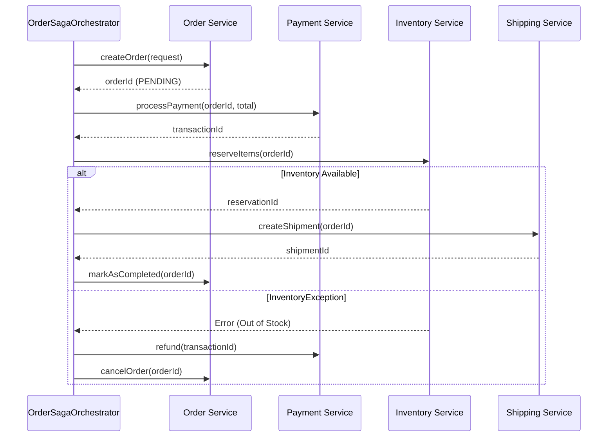

> [!WARNING]
> Sagas provide **ACD** (Atomicity, Consistency, Durability) but **NOT Isolation**—other requests can read intermediate uncommitted saga states (e.g., `PENDING`). Use semantic locks (status flags) and make every compensating action **idempotent** and **retryable**.

```java
// Using a saga orchestrator pattern

@Service
public class OrderSagaOrchestrator {

    @Autowired
    private OrderServiceClient orderServiceClient;

    @Autowired
    private PaymentServiceClient paymentServiceClient;

    @Autowired
    private InventoryServiceClient inventoryServiceClient;

    @Autowired
    private ShippingServiceClient shippingServiceClient;

    public void processOrder(CreateOrderRequest request) {
        String orderId = null;
        String transactionId = null;
        String reservationId = null;

        try {
            // Step 1: Create order
            orderId = orderServiceClient.createOrder(request);

            // Step 2: Process payment
            transactionId = paymentServiceClient.processPayment(
                orderId,
                request.getTotal()
            );

            // Step 3: Reserve inventory
            reservationId = inventoryServiceClient.reserveItems(orderId);

            // Step 4: Create shipment
            shippingServiceClient.createShipment(orderId);

            // All steps succeeded
            orderServiceClient.markAsCompleted(orderId);

        } catch (PaymentFailedException e) {
            // Compensate: Cancel order
            orderServiceClient.cancelOrder(orderId);
            throw e;

        } catch (InventoryException e) {
            // Compensate: Refund payment and cancel order
            if (transactionId != null) {
                paymentServiceClient.refund(transactionId);
            }
            orderServiceClient.cancelOrder(orderId);
            throw e;

        } catch (ShippingException e) {
            // Compensate: Release inventory, refund, cancel order
            if (reservationId != null) {
                inventoryServiceClient.releaseReservation(reservationId);
            }
            if (transactionId != null) {
                paymentServiceClient.refund(transactionId);
            }
            orderServiceClient.cancelOrder(orderId);
            throw e;
        }
    }
}
```

---

## Idempotency

Ensure that repeated identical requests (due to client retries, network timeouts, or broker at-least-once delivery) produce the **same side effects and result** as a single request.

### Why Idempotency Matters

- **Without idempotency:** A lost ACK after payment processing causes a client retry to charge the customer twice.
- **With `Idempotency-Key`:** The server records the key atomically, executes once, and returns the cached result for any retry with the same key.

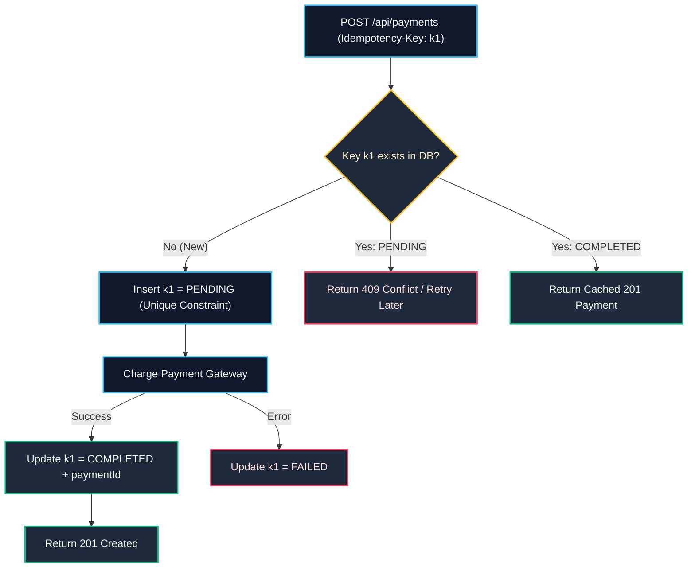

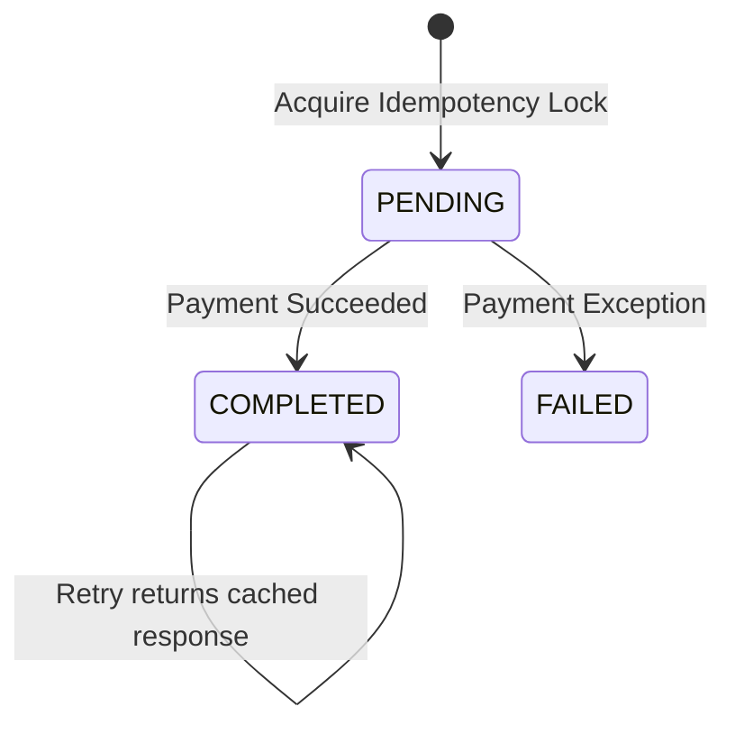

> [!IMPORTANT]
> Enforce a `UNIQUE` constraint on `idempotency_key` at the database level (or `SETNX` in Redis). A plain `SELECT` followed by `INSERT` has a TOCTOU race condition under concurrent retries.

### Implementation

```java
// Payment Service with idempotency

@RestController
@RequestMapping("/api/payments")
public class PaymentController {

    @Autowired
    private PaymentService paymentService;

    @PostMapping
    public ResponseEntity<Payment> processPayment(
        @RequestBody ProcessPaymentRequest request,
        @RequestHeader(value = "Idempotency-Key") String idempotencyKey
    ) {
        Payment payment = paymentService.processPayment(request, idempotencyKey);
        return ResponseEntity.status(HttpStatus.CREATED).body(payment);
    }
}

@Service
public class PaymentService {

    @Autowired
    private PaymentRepository paymentRepository;

    @Autowired
    private IdempotencyKeyRepository idempotencyKeyRepository;

    @Transactional
    public Payment processPayment(ProcessPaymentRequest request, String idempotencyKey) {
        // Check if we've already processed this request
        IdempotencyKeyRecord existingRecord = idempotencyKeyRepository.findByKey(idempotencyKey);

        if (existingRecord != null) {
            if (existingRecord.getStatus() == IdempotencyStatus.PENDING) {
                // Still processing, ask client to retry
                throw new IdempotencyPendingException("Payment processing in progress");
            }

            // Return cached result
            return paymentRepository.findById(existingRecord.getPaymentId()).orElseThrow();
        }

        // Record that we're processing this request
        IdempotencyKeyRecord keyRecord = new IdempotencyKeyRecord(
            idempotencyKey,
            IdempotencyStatus.PENDING
        );
        idempotencyKeyRepository.save(keyRecord);

        try {
            // Process payment
            Payment payment = new Payment();
            payment.setAmount(request.getAmount());
            payment.setCustomerId(request.getCustomerId());
            payment.setStatus(PaymentStatus.APPROVED);
            payment.setTransactionId(generateTransactionId());

            payment = paymentRepository.save(payment);

            // Mark as completed
            keyRecord.setStatus(IdempotencyStatus.COMPLETED);
            keyRecord.setPaymentId(payment.getId());
            idempotencyKeyRepository.save(keyRecord);

            return payment;
        } catch (Exception e) {
            // Mark as failed
            keyRecord.setStatus(IdempotencyStatus.FAILED);
            keyRecord.setErrorMessage(e.getMessage());
            idempotencyKeyRepository.save(keyRecord);

            throw e;
        }
    }
}

// Idempotency key record
@Entity
public class IdempotencyKeyRecord {
    @Id
    private String idempotencyKey;

    private Long paymentId;

    @Enumerated(EnumType.STRING)
    private IdempotencyStatus status;

    private String errorMessage;

    @CreationTimestamp
    private LocalDateTime createdAt;

    @Version
    private Long version;

    // Constructor and getters
}

public enum IdempotencyStatus {
    PENDING,      // Still processing
    COMPLETED,    // Successfully processed
    FAILED        // Processing failed
}

// Repository
public interface IdempotencyKeyRepository extends JpaRepository<IdempotencyKeyRecord, String> {
    IdempotencyKeyRecord findByKey(String key);
}
```

### Idempotency Keys in REST

```bash
# Include Idempotency-Key header
curl -X POST https://api.example.com/payments \
  -H "Idempotency-Key: order-123-payment-attempt-1" \
  -d '{
    "orderId": "123",
    "amount": "99.99"
  }'

# Retry with same key gets cached result
curl -X POST https://api.example.com/payments \
  -H "Idempotency-Key: order-123-payment-attempt-1" \
  -d '{
    "orderId": "123",
    "amount": "99.99"
  }'
# Returns same payment response (no new charge)
```

### Idempotent Operation Patterns

| HTTP Method | Naturally Idempotent? | Safe on Retry? | Strategy |
|-------------|-----------------------|----------------|----------|
| `GET` | Yes | Yes | Read-only; no side effects |
| `PUT` | Yes | Yes | Full resource replacement with same state |
| `DELETE` | Yes | Yes | First call deletes (`204`), repeat returns `404`/`204` |
| `POST` | **No** | **No** | Requires client-supplied `Idempotency-Key` header |
| `PATCH` | Depends | Depends | Idempotent if absolute set; non-idempotent if relative (`+10`) |

```java
// GET is naturally idempotent (read-only)
GET /api/orders/123  // Always returns same order

// PUT can be made idempotent (replace entire resource)
PUT /api/orders/123 {           // Same state, same result
  "status": "SHIPPED"
}

// DELETE should be idempotent
DELETE /api/orders/123          // Delete once
DELETE /api/orders/123          // Already deleted, 404 but idempotent

// POST needs idempotency key (creates new)
POST /api/payments {
  "amount": 100
  "Idempotency-Key": "key"      // Same key = same payment created
}
```

---

## Interview Questions

### Q1: When would you use synchronous vs asynchronous communication?

**Answer**:

**Use Synchronous (REST/gRPC) when:**
- Need immediate response (user waiting)
- Request-response pattern (query data)
- Strong consistency required
- Simple interactions (few services involved)
- Real-time operations (user actions)

**Examples**:
- Get product details for displaying on UI
- Validate order before submitting
- Check account balance before payment

**Use Asynchronous (Events/Queues) when:**
- No need for immediate response
- Can tolerate eventual consistency
- Long-running operations (background jobs)
- Decoupling services important
- High throughput needed

**Examples**:
- Order submitted → Payment processed in background
- User registered → Welcome email sent asynchronously
- Analytics data collection
- Notification broadcasts

### Q2: Design a payment system handling 10K requests/second. How would you communicate between services?

**Answer**:

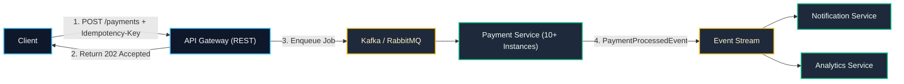

**Key decisions:**
1. Accept via REST for reliability
2. Queue immediately with idempotency key
3. Process asynchronously at rate system can handle
4. Return `"processing"` (`202 Accepted`) status to client
5. Notify when complete via webhook/polling
6. Use event stream for multiple subscribers
7. Replicate data to read-only replicas for queries

### Q3: How would you handle a failed payment in a saga?

**Answer**:

Using orchestration-based saga with compensating transactions:

```java
@Service
public class PaymentSaga {

    public void processOrder(Order order) {
        String reservationId = null;
        String shipmentId = null;

        try {
            // Step 1: Inventory
            reservationId = inventoryService.reserve(order);

            // Step 2: Payment
            paymentService.charge(order);

            // Step 3: Shipping
            shipmentId = shippingService.createShipment(order);

        } catch (PaymentFailedException e) {
            // Compensating: Inventory was reserved, need to release
            if (reservationId != null) {
                inventoryService.release(reservationId);
            }

            // Payment failed, nothing to compensate
            // Notify customer
            notificationService.sendPaymentFailed(order.getCustomerId());

            throw e;
        }
    }
}

Key principles:
1. Order matters - process in sequence
2. Reserve resources before payment
3. Compensate in reverse order
4. Idempotent compensations (can run multiple times)
5. Log all steps for audit trail
6. Timeout compensation if service down
```

### Q4: Explain CQRS. When would you use it?

**Answer**:

CQRS separates read and write models:


**When to use CQRS:**
- Read patterns very different from write patterns
- Different scaling needs (many reads, few writes)
- Event sourcing used
- Complex queries that don't fit normalized schema
- Need audit trail/immutability

**When NOT to use CQRS:**
- Simple CRUD operations
- Eventual consistency not acceptable
- Small scale, performance not critical
- Team not experienced with eventual consistency

### Q5: How do you ensure idempotency across services?

**Answer**:

```java
// Strategy 1: Idempotency Key (client provides)
POST /api/payments
  Idempotency-Key: order-123-attempt-1
  {amount: 100}

Server stores key → result mapping
Retry with same key → returns cached result

// Strategy 2: Natural idempotency (side-effect free)
GET /api/orders/123       // Always returns same order
PUT /api/orders/123       // Replace entire (same input = same result)

// Strategy 3: Deduplication at message broker
Kafka topic with deduplication key
Orders with same key within window deduplicated

// Strategy 4: Database constraints
CREATE TABLE payments (
    idempotency_key VARCHAR(255) UNIQUE,  -- Prevent duplicates
    payment_id BIGINT,
    created_at TIMESTAMP
);

Key principles:
1. Client provides unique identifier (idempotency key)
2. Server stores key → result mapping
3. Check for existing key before processing
4. Transactions ensure atomicity
5. TTL cleanup of old keys (30 days)
```

### Q6: How would you debug a distributed transaction spanning 5 services?

**Answer**:

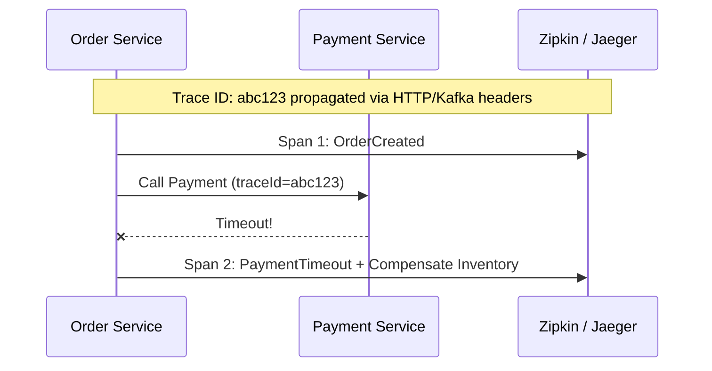

1. **Distributed Tracing:** Every request gets a `traceId` propagated across HTTP/gRPC/Kafka headers (Sleuth/OpenTelemetry + Zipkin/Jaeger).
2. **Centralized Logging:** Aggregate all logs (ELK/Loki) and filter by `traceId` to correlate errors across services.
3. **Sequence Reconstruction:** Follow spans to pinpoint the exact failing hop (e.g., `Payment timeout` -> `Compensate inventory`).
4. **Event Log Inspection:** Check Kafka consumer lag, topic offsets, and dead-letter queues (DLQ).
5. **Service Health:** Check pod restarts, DB connection pools, network latency, and resource saturation.

**Example troubleshooting (`traceId: abc123`, Order created but payment never processed):**
- **Step 1:** Find trace in Zipkin -> `Order Service` published `OrderCreated`.
- **Step 2:** `Payment Service` has no log with `abc123`.
- **Step 3:** Inspect Kafka consumer group lag -> events queued, `Payment Service` pod restarted/stalled.
- **Solution:** Fix consumer health, reset/replay consumer group offset (with idempotency).

### Q7: What are the failure modes in event-driven architecture?

**Answer**:

```
Failure Modes:

1. Event published but subscriber down
   Order published: OrderSubmitted
   Payment Service: DOWN (pod crashed)
   Impact: Order stuck in SUBMITTED state
   Solution: Event remains in queue, replay when service recovers

2. Subscriber receives but crashes before processing
   Payment Service: received event, crashed mid-processing
   Impact: Event lost, payment never recorded
   Solution: Message acknowledgment after processing (at-least-once delivery)

3. Event ordering violation
   OrderSubmitted event
   OrderShipped event (arrives first in Payment Service)
   Impact: Shipping before payment processed
   Solution: Kafka partitioning, order events by orderId

4. Duplicate event processing
   OrderSubmitted published twice (broker retransmitted)
   Payment Service: processes twice, charges customer twice
   Solution: Idempotent message processing

5. Service receives event but target service (payment) fails
   Inventory Service: received InventoryReserved event
   Inventory Service: calls Payment Service to verify
   Payment Service: timeout
   Impact: Inventory not reserved
   Solution: Don't call external services in event handlers, use published events

6. Long processing time, timeout
   Order Orchestrator: waits for all services
   Shipping Service: takes 30 seconds
   Request timeout: 10 seconds
   Impact: Order creation fails but shipment still created
   Solution: Async saga, timeouts for each step, compensations

Design resilience:

@Service
public class PaymentEventListener {

    @RabbitListener(queues = "order-events", concurrency = "5")
    public void processOrder(OrderSubmittedEvent event) {
        try {
            // Only use local operations
            // Don't call other services here
            paymentService.processPayment(event.getOrderId());

            // Explicitly acknowledge after successful processing
        } catch (Exception e) {
            // Failed: message requeued automatically
            // Use dead letter queue for repeated failures
            logger.error("Payment processing failed", e);
        }
    }
}
```

### Quick-Reference Interview Cheat Sheet

| Scenario | Recommended Pattern | Why |
|----------|---------------------|-----|
| Public browser/mobile API | **REST** or **GraphQL BFF** | Universal HTTP support; GraphQL prevents over-fetching |
| High-throughput internal RPC | **gRPC (HTTP/2 + Protobuf)** | Binary framing, multiplexing, strict `.proto` contracts |
| Decoupled background work | **Async Queue / Kafka** | Temporal decoupling, buffering spikes, replayability |
| Complex multi-service transaction | **Orchestrated Saga** | Explicit state machine + reverse compensating rollbacks |
| Heavy read/write skew | **CQRS** | Independent read/write scaling with denormalized views |
| Safe retries over unreliable networks | **Idempotency-Key + Unique DB Constraint** | Prevents duplicate charges/mutations |

> [!TIP]
> In system design interviews, always pair **Asynchronous Messaging** with **Idempotent Consumers**, **Dead Letter Queues (DLQ)**, and **Distributed Tracing (`traceId`)**—interviewers specifically probe for those three failure-handling details.


