# Service Discovery and API Gateway

## Table of Contents
1. [Service Discovery](#service-discovery)
2. [API Gateway Pattern](#api-gateway-pattern)
3. [Backend for Frontend (BFF)](#backend-for-frontend)
4. [Load Balancing](#load-balancing)
5. [Service Mesh](#service-mesh)
6. [Configuration Management](#configuration-management)
7. [Deployment Strategies](#deployment-strategies)
8. [Interview Questions](#interview-questions)

---

## Service Discovery

In a microservices architecture, service instances are ephemeral and dynamic—instances scale up, scale down, crash, and restart on different IP addresses and ports. **Service Discovery** automatically tracks active instances so callers never hardcode network locations.

### Without Service Discovery (Manual Registration)

Hardcoding URLs in application code or static config files:
- `http://payment-service-instance-1:8080`
- `http://payment-service-instance-2:8080`
- `http://payment-service-instance-3:8080`

**Problems:**
1. If an instance dies, requests to it fail until code/config is redeployed.
2. No dynamic autoscaling—new instances cannot receive traffic automatically.
3. Manual updates of service URLs across every consumer are error-prone.
4. Load balancing must be managed manually.

### Service Discovery Architecture & Comparison

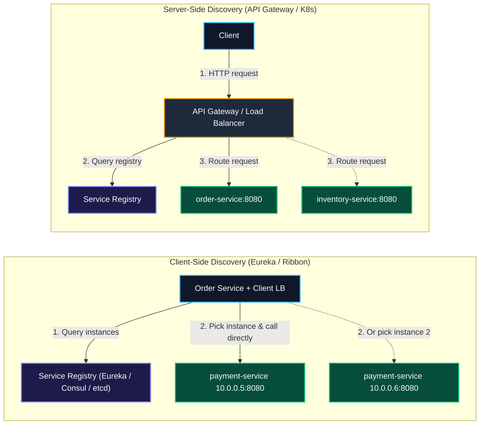

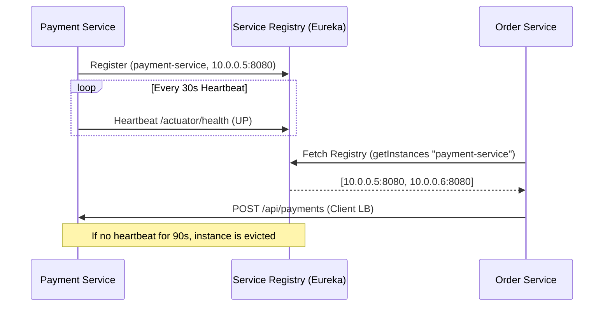

| Aspect | Client-Side Discovery | Server-Side Discovery | Kubernetes DNS |
| :--- | :--- | :--- | :--- |
| **Examples** | Netflix Eureka + Ribbon / LoadBalancer | Spring Cloud Gateway, AWS ALB, NGINX | CoreDNS + `ClusterIP` (`kube-proxy`) |
| **Who Queries Registry** | Caller microservice | API Gateway / Load Balancer | Platform DNS + `iptables` / IPVS |
| **Network Hops** | Direct (1 hop) | Extra hop via Gateway/LB | Direct to Pod IP via `kube-proxy` |
| **Language Coupling** | High (needs client SDK per language) | Low (language-agnostic) | None (standard DNS) |

> [!IMPORTANT]
> **Eureka Self-Preservation Mode (`enable-self-preservation: true`):** If a network partition prevents heartbeats from reaching Eureka, Eureka stops evicting instances when renewals drop below a threshold (85%). This prioritizes **Availability** over **Consistency** (AP in CAP) so healthy instances are not accidentally dropped during transient network blips.

### Client-Side Service Discovery

The client queries the registry, selects an instance, and load balances requests.

```java
// Netflix Eureka (Spring Cloud Eureka)

// Payment Service registers itself
@SpringBootApplication
@EnableEurekaClient
public class PaymentServiceApplication {
    public static void main(String[] args) {
        SpringApplication.run(PaymentServiceApplication.class, args);
    }
}

// application.yml
spring:
  application:
    name: payment-service
  cloud:
    eureka:
      client:
        serviceUrl:
          defaultZone: http://eureka-server:8761/eureka/
      instance:
        preferIpAddress: true
        metadata-map:
          version: 1.0

server:
  port: 8080

// Order Service discovers and calls Payment Service
@Service
public class OrderService {

    @Autowired
    private RestTemplate restTemplate;

    @Autowired
    private DiscoveryClient discoveryClient;

    public Order createOrder(CreateOrderRequest request) {
        // Find payment service instances from Eureka
        List<ServiceInstance> instances = discoveryClient
            .getInstances("payment-service");

        if (instances.isEmpty()) {
            throw new ServiceUnavailableException("payment-service not available");
        }

        // Load balance (random / round-robin)
        ServiceInstance instance = instances.get(
            (int)(Math.random() * instances.size())
        );

        String url = String.format(
            "http://%s:%d/api/payments",
            instance.getHost(),
            instance.getPort()
        );

        // Make request
        Payment payment = restTemplate.postForObject(
            url,
            new PaymentRequest(request.getOrderId(), request.getTotal()),
            Payment.class
        );

        return new Order(request, payment);
    }
}

// Better: Use Ribbon (load balancer)
@Service
public class OrderServiceWithRibbon {

    @Bean
    @LoadBalanced
    public RestTemplate restTemplate() {
        return new RestTemplate();
    }

    @Autowired
    private RestTemplate restTemplate;

    public Order createOrder(CreateOrderRequest request) {
        // Ribbon handles discovery and load balancing automatically
        Payment payment = restTemplate.postForObject(
            "http://payment-service/api/payments",  // Service name, not hostname
            new PaymentRequest(request.getOrderId(), request.getTotal()),
            Payment.class
        );

        return new Order(request, payment);
    }
}
```

### Server-Side Service Discovery

The API Gateway discovers instances and routes requests, hiding service topology from clients:
- Client doesn't know about service instances.
- Gateway handles load balancing.
- Client sees a single entry point.

```java
// Spring Cloud Gateway with service discovery
@Configuration
public class GatewayConfiguration {

    @Bean
    public RouteLocator routes(RouteLocatorBuilder builder) {
        return builder.routes()
            // Route to payment service
            .route("payment-service", r -> r
                .path("/api/payments/**")
                .uri("lb://payment-service"))  // lb:// = load balanced URI

            // Route to order service
            .route("order-service", r -> r
                .path("/api/orders/**")
                .uri("lb://order-service"))

            // Route to inventory service
            .route("inventory-service", r -> r
                .path("/api/inventory/**")
                .uri("lb://inventory-service"))

            .build();
    }
}

// application.yml
spring:
  application:
    name: api-gateway
  cloud:
    gateway:
      discovery:
        locator:
          enabled: true  # Enable service discovery
          lowerCaseServiceId: true
      routes:
        - id: payment-service
          uri: lb://payment-service
          predicates:
            - Path=/api/payments/**
        - id: order-service
          uri: lb://order-service
          predicates:
            - Path=/api/orders/**
```

### Eureka Server Setup

```java
@SpringBootApplication
@EnableEurekaServer
public class EurekaServerApplication {
    public static void main(String[] args) {
        SpringApplication.run(EurekaServerApplication.class, args);
    }
}

// application.yml
spring:
  application:
    name: eureka-server

server:
  port: 8761

eureka:
  client:
    register-with-eureka: false  # Server doesn't register with itself
    fetch-registry: false
  server:
    enable-self-preservation: true  # Keep registrations even if heartbeat stops
    eviction-interval-timer-in-ms: 60000
```

### Health Checks and Heartbeat

```java
// Health indicator
@Component
public class PaymentServiceHealthIndicator extends AbstractHealthIndicator {

    @Autowired
    private PaymentService paymentService;

    @Override
    protected void doHealthCheck(Health.Builder builder) throws Exception {
        try {
            // Check if database is accessible
            paymentService.getHealth();

            builder.up()
                .withDetail("service", "payment-service")
                .withDetail("database", "connected")
                .withDetail("status", "healthy");
        } catch (Exception e) {
            builder.down()
                .withDetail("service", "payment-service")
                .withDetail("error", e.getMessage());
        }
    }
}

// Eureka periodically polls /actuator/health
// If service unhealthy, it's marked as DOWN
// If no heartbeat for 90 seconds, instance removed
```

### Service Discovery in Kubernetes

Kubernetes has built-in service discovery via DNS (`<service-name>.<namespace>.svc.cluster.local`).

> [!TIP]
> In Kubernetes, you rarely need Eureka or Ribbon—CoreDNS resolves `http://payment-service:8080` to a stable `ClusterIP`, and `kube-proxy` distributes traffic across healthy Pod endpoints automatically.

```yaml
# Kubernetes Service definition
apiVersion: v1
kind: Service
metadata:
  name: payment-service
  namespace: default
spec:
  selector:
    app: payment-service
  ports:
    - port: 8080
      targetPort: 8080
  type: ClusterIP

---
# Deployment for payment service
apiVersion: apps/v1
kind: Deployment
metadata:
  name: payment-service
spec:
  replicas: 3
  selector:
    matchLabels:
      app: payment-service
  template:
    metadata:
      labels:
        app: payment-service
    spec:
      containers:
      - name: payment-service
        image: payment-service:1.0
        ports:
        - containerPort: 8080
```

In Kubernetes, service discovery is automatic:

```java
// Spring Boot application in Kubernetes
@Service
public class OrderServiceK8s {

    @Autowired
    private RestTemplate restTemplate;

    public Order createOrder(CreateOrderRequest request) {
        // In Kubernetes, DNS resolves service name to cluster IP
        // payment-service.default.svc.cluster.local:8080
        Payment payment = restTemplate.postForObject(
            "http://payment-service:8080/api/payments",  // Kubernetes DNS
            new PaymentRequest(request.getOrderId(), request.getTotal()),
            Payment.class
        );

        return new Order(request, payment);
    }
}
```

---

## API Gateway Pattern

A single entry point for all external clients that centralizes cross-cutting concerns before requests reach internal microservices.

### API Gateway Responsibilities & Request Pipeline

1. **Request Routing:** Route `/api/orders` to Order Service, `/api/products` to Product Service.
2. **Authentication & Authorization:** Verify JWT tokens, check permissions, and enforce per-user rate limiting.
3. **Request/Response Transformation:** Handle API versioning, protocol conversion (REST/gRPC), header enrichment, and compression.
4. **Load Balancing & Resilience:** Distribute load across instances and apply circuit breakers with fallbacks.
5. **Monitoring & Logging:** Log all requests, collect latency/status metrics, and inject distributed tracing headers.

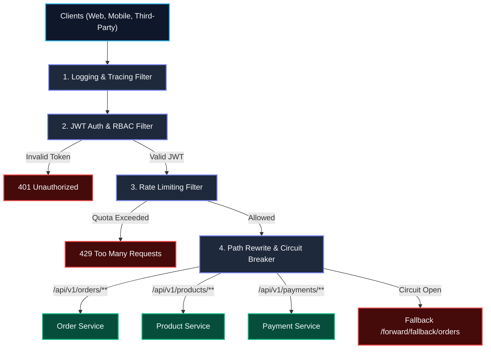

```mermaid
sequenceDiagram
    participant C as Client
    participant GW as API Gateway
    participant O as Order Service

    C->>GW: GET /api/v1/orders/42 (Bearer JWT)
    GW->>GW: Validate JWT &amp; check rate limit
    GW->>GW: Mutate headers (X-User-Id, X-User-Roles) &amp; StripPrefix(2)
    GW->>O: GET /orders/42 (lb://order-service)
    alt Order Service Healthy
        O-->>GW: 200 OK (Order JSON)
        GW-->>C: 200 OK
    else Order Service Timeout / Error
        O--xGW: 503 / Timeout
        GW-->>C: Fallback Response (/fallback/orders)
    end
```

| Gateway Option | Tech Stack | Strengths | Best Fit |
| :--- | :--- | :--- | :--- |
| **Spring Cloud Gateway** | Java / Project Reactor (Netty) | Tight Spring Boot / Eureka integration, custom Java filters | Java/Spring microservices ecosystems |
| **Kong** | NGINX / Lua (OpenResty) | High throughput, rich plugin marketplace, declarative or DB config | Polyglot teams needing turnkey plugins |
| **Envoy / NGINX** | C++ | Ultra-low latency, native xDS/K8s Ingress &amp; Gateway API support | Cloud-native Kubernetes / Service Mesh |

> [!WARNING]
> **Avoid the "Smart Gateway" Anti-Pattern:** Never put domain/business logic or complex database joins inside the API Gateway. Because it sits on the critical path for every request, bloat turns the gateway into a tightly coupled bottleneck and single point of failure—always deploy it statelessly behind a load balancer with multiple replicas.

### Spring Cloud Gateway Implementation

```java
@Configuration
public class GatewayConfig {

    @Bean
    public RouteLocator customRoutes(RouteLocatorBuilder builder) {
        return builder.routes()
            // Order Service routes
            .route("orders", r -> r
                .path("/api/v1/orders/**")
                .filters(f -> f
                    .circuitBreaker(config -> config
                        .setName("ordersCircuitBreaker")
                        .setFallbackUri("forward:/fallback/orders"))
                    .addRequestHeader("X-Service-Name", "api-gateway")
                    .stripPrefix(2))  // Remove /api/v1
                .uri("lb://order-service"))

            // Product Service routes
            .route("products", r -> r
                .path("/api/v1/products/**")
                .filters(f -> f
                    .circuitBreaker(config -> config
                        .setName("productsCircuitBreaker"))
                    .cache())  // Cache GET requests
                .uri("lb://product-service"))

            .build();
    }
}

// Global filters (apply to all routes)
@Configuration
public class GlobalGatewayConfig {

    @Bean
    public GlobalFilter authenticationFilter() {
        return new GlobalFilter() {
            @Override
            public Mono<Void> filter(ServerWebExchange exchange, GatewayFilterChain chain) {
                // Extract JWT token
                String authHeader = exchange.getRequest()
                    .getHeaders()
                    .getFirst("Authorization");

                if (authHeader == null || !authHeader.startsWith("Bearer ")) {
                    return onError(exchange, "Unauthorized", HttpStatus.UNAUTHORIZED);
                }

                String token = authHeader.substring("Bearer ".length());

                // Validate JWT
                try {
                    Claims claims = validateToken(token);

                    // Add user info to request headers
                    exchange.getRequest()
                        .mutate()
                        .header("X-User-Id", claims.getSubject())
                        .header("X-User-Roles", String.join(",", (Collection<String>) claims.get("roles")))
                        .build();
                } catch (JwtException e) {
                    return onError(exchange, "Invalid token", HttpStatus.UNAUTHORIZED);
                }

                return chain.filter(exchange);
            }
        };
    }

    @Bean
    public GlobalFilter rateLimitingFilter() {
        return new GlobalFilter() {
            @Override
            public Mono<Void> filter(ServerWebExchange exchange, GatewayFilterChain chain) {
                String userId = exchange.getRequest()
                    .getHeaders()
                    .getFirst("X-User-Id");

                if (isRateLimited(userId)) {
                    return onError(exchange, "Rate limit exceeded", HttpStatus.TOO_MANY_REQUESTS);
                }

                return chain.filter(exchange);
            }
        };
    }

    @Bean
    public GlobalFilter loggingFilter() {
        return new GlobalFilter() {
            @Override
            public Mono<Void> filter(ServerWebExchange exchange, GatewayFilterChain chain) {
                long startTime = System.currentTimeMillis();

                return chain.filter(exchange)
                    .doFinally(signalType -> {
                        long duration = System.currentTimeMillis() - startTime;
                        HttpStatus status = exchange.getResponse().getStatusCode();

                        logger.info("Gateway request: {} {} - {} ms",
                            exchange.getRequest().getMethod(),
                            exchange.getRequest().getPath(),
                            duration);
                    });
            }
        };
    }

    private Mono<Void> onError(ServerWebExchange exchange, String message, HttpStatus status) {
        ServerHttpResponse response = exchange.getResponse();
        response.setStatusCode(status);
        response.getHeaders().setContentType(MediaType.APPLICATION_JSON);

        String errorJson = String.format("""
            {"error": "%s", "status": %d}
            """, message, status.value());

        return response.writeWith(Mono.just(
            response.bufferFactory().wrap(errorJson.getBytes())
        ));
    }
}

// application.yml
spring:
  cloud:
    gateway:
      routes:
        - id: order-service
          uri: lb://order-service
          predicates:
            - Path=/api/v1/orders/**
          filters:
            - StripPrefix=2
            - name: CircuitBreaker
              args:
                name: ordersCircuitBreaker

logging:
  level:
    org.springframework.cloud.gateway: DEBUG
```

### Kong (API Gateway Alternative)

```yaml
# Kong configuration (declarative)
version: '3'
services:
  kong:
    image: kong:latest
    environment:
      KONG_DATABASE: postgres
      KONG_PG_HOST: kong-db
      KONG_PG_USER: kong
      KONG_PG_PASSWORD: kong

  kong-migrations:
    image: kong:latest
    environment:
      KONG_DATABASE: postgres
      KONG_PG_HOST: kong-db
      KONG_PG_USER: kong
      KONG_PG_PASSWORD: kong
    command: kong migrations bootstrap

# Kong admin API to register services
curl -X POST http://localhost:8001/services \
  -d name=order-service \
  -d host=order-service \
  -d port=8080

# Create route
curl -X POST http://localhost:8001/services/order-service/routes \
  -d "paths[]=/api/orders" \
  -d "methods[]=GET,POST,PUT,DELETE"

# Apply rate limiting plugin
curl -X POST http://localhost:8001/services/order-service/plugins \
  -d "name=rate-limiting" \
  -d "config.minute=1000"
```

---

## Backend for Frontend (BFF)

A **Backend for Frontend (BFF)** provides a dedicated gateway/aggregation layer tailored to each client experience (Web, Mobile, Third-Party API) instead of forcing one generic API on all consumers.

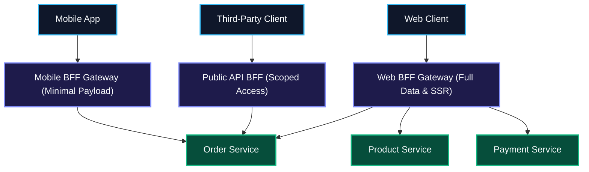

| BFF Variant | Payload Shape | Aggregation Strategy | Key Optimization |
| :--- | :--- | :--- | :--- |
| **Web BFF** | Rich DTOs (`OrderPageDTO`) | Combines Order + Products + Recommendations | Reduces browser round-trips; SSR-friendly |
| **Mobile BFF** | Minimal DTOs (`OrderMobileDTO`) | Fetches only ID, status, total; lazy-loads details | Saves cellular bandwidth &amp; battery |
| **Public API BFF** | Strictly scoped (`OrderStatusDTO`) | Exposes only safe, public fields | Enforces strict partner rate limits &amp; ACLs |

> [!TIP]
> **Team Ownership:** A BFF works best when owned by the frontend team that consumes it (e.g., the iOS/Android team owns Mobile BFF). This eliminates cross-team bottlenecks when UI screens evolve.

```java
// Web BFF - optimized for browser clients
@RestController
@RequestMapping("/api/web")
public class WebBFFController {

    @Autowired
    private OrderService orderService;

    @Autowired
    private ProductService productService;

    // Single endpoint that aggregates multiple services
    @GetMapping("/orders/{id}")
    public OrderPageDTO getOrderPage(@PathVariable Long id) {
        Order order = orderService.getOrder(id);
        List<Product> products = productService.getProductsByIds(
            order.getItems().stream()
                .map(OrderItem::getProductId)
                .collect(Collectors.toList())
        );

        return new OrderPageDTO(
            order,
            products,
            calculateRecommendations(products)
        );
    }
}

// Mobile BFF - optimized for mobile clients
@RestController
@RequestMapping("/api/mobile")
public class MobileBFFController {

    @Autowired
    private OrderService orderService;

    // Minimal data for mobile
    @GetMapping("/orders/{id}")
    public OrderMobileDTO getOrder(@PathVariable Long id) {
        Order order = orderService.getOrder(id);

        return new OrderMobileDTO(
            order.getId(),
            order.getStatus(),
            order.getTotal()
            // Minimal fields for mobile
        );
    }

    @GetMapping("/orders/{id}/details")
    public OrderDetailsMobileDTO getOrderDetails(@PathVariable Long id) {
        Order order = orderService.getOrder(id);

        return new OrderDetailsMobileDTO(
            order.getId(),
            order.getItems(),
            order.getShippingAddress()
        );
    }
}

// Public API BFF
@RestController
@RequestMapping("/api/public")
public class PublicAPIController {

    @Autowired
    private OrderService orderService;

    // Limited access to specific fields
    @GetMapping("/orders/{id}/status")
    public OrderStatusDTO getOrderStatus(@PathVariable Long id) {
        Order order = orderService.getOrder(id);

        return new OrderStatusDTO(
            order.getId(),
            order.getStatus(),
            order.getLastUpdated()
        );
    }
}
```

---

## Load Balancing

Distributes incoming requests across multiple healthy service instances to maximize throughput and prevent single-instance overload.

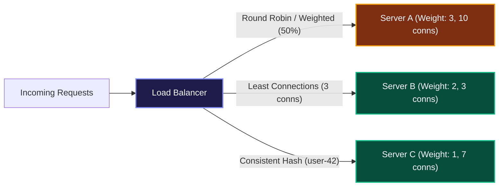

| Algorithm | Selection Rule | Best For | Trade-Off |
| :--- | :--- | :--- | :--- |
| **Round Robin** | Cycles sequentially (`A -> B -> C -> A`) | Stateless services with uniform instance sizes | Ignores active load or slow instances |
| **Least Connections** | Picks instance with fewest active connections | Long-lived or variable-latency requests (WebSockets, DB queries) | Requires tracking connection state |
| **Weighted** | Distributes proportionally by capacity (`3:2:1`) | Heterogeneous hardware or gradual traffic shifts | Static weights don't adapt to CPU spikes |
| **Consistent Hashing** | Maps request key (e.g., `userId`) onto a hash ring | Stateful caches, sticky sessions, shard locality | Hot keys can still skew one node |

> [!NOTE]
> Netflix Ribbon is in maintenance mode in modern Spring Cloud (`>= 2020.0`) and has been replaced by **Spring Cloud LoadBalancer** (`@LoadBalanced` still works identically with `RestTemplate` and `WebClient`).

### Load Balancing Algorithms

```java
// Round Robin (most common)
// Request 1 -> Server A
// Request 2 -> Server B
// Request 3 -> Server C
// Request 4 -> Server A

@Component
public class RoundRobinLoadBalancer {
    private int currentIndex = 0;

    public ServiceInstance selectInstance(List<ServiceInstance> instances) {
        ServiceInstance selected = instances.get(currentIndex % instances.size());
        currentIndex++;
        return selected;
    }
}

// Least Connections
// Server A: 10 connections
// Server B: 3 connections  (selected)
// Server C: 7 connections

@Component
public class LeastConnectionsLoadBalancer {
    private Map<ServiceInstance, Integer> connectionCount = new ConcurrentHashMap<>();

    public ServiceInstance selectInstance(List<ServiceInstance> instances) {
        return instances.stream()
            .min(Comparator.comparing(si -> connectionCount.getOrDefault(si, 0)))
            .orElseThrow();
    }
}

// Weighted Load Balancing
// Server A (power: 3): 3/6 = 50%
// Server B (power: 2): 2/6 = 33%
// Server C (power: 1): 1/6 = 17%

@Component
public class WeightedLoadBalancer {
    private Map<ServiceInstance, Integer> weights = new ConcurrentHashMap<>();

    public ServiceInstance selectInstance(List<ServiceInstance> instances) {
        int total = instances.stream()
            .map(si -> weights.getOrDefault(si, 1))
            .reduce(0, Integer::sum);

        int selected = new Random().nextInt(total);
        int sum = 0;

        for (ServiceInstance instance : instances) {
            sum += weights.getOrDefault(instance, 1);
            if (selected < sum) {
                return instance;
            }
        }

        return instances.get(0);
    }
}

// Consistent Hashing
// For sticky sessions or cache locality
// Same user always routes to same server

@Component
public class ConsistentHashLoadBalancer {
    private TreeMap<Integer, ServiceInstance> ring = new TreeMap<>();

    public ServiceInstance selectInstance(List<ServiceInstance> instances, String key) {
        int hash = key.hashCode();

        SortedMap<Integer, ServiceInstance> tailMap = ring.tailMap(hash);
        if (!tailMap.isEmpty()) {
            return tailMap.get(tailMap.firstKey());
        }
        return ring.get(ring.firstKey());
    }
}
```

### Ribbon (Client-Side Load Balancer)

```xml
<!-- pom.xml -->
<dependency>
    <groupId>org.springframework.cloud</groupId>
    <artifactId>spring-cloud-starter-netflix-ribbon</artifactId>
</dependency>
```

```java
@Configuration
public class RibbonConfig {

    @Bean
    @LoadBalanced
    public RestTemplate restTemplate() {
        return new RestTemplate();
    }

    // Custom load balancer rule
    @Bean
    public IRule ribbonRule() {
        // AvailabilityFilteringRule: skip servers that are down
        // WeightedResponseTimeRule: based on response time
        // RoundRobinRule: simple round robin
        return new WeightedResponseTimeRule();
    }
}

// application.yml
payment-service:
  ribbon:
    listOfServers: localhost:8080,localhost:8081,localhost:8082
    NFLoadBalancerClassName: com.netflix.loadbalancer.WeightedResponseTimeRule
    ServerListRefreshInterval: 1000
    MaxAutoRetries: 1
    MaxAutoRetriesNextServer: 1
    ReadTimeout: 5000
    ConnectTimeout: 3000
```

---

## Service Mesh

A **Service Mesh** (e.g., Istio + Envoy) is a dedicated infrastructure layer that handles service-to-service (East-West) communication—retries, timeouts, circuit breaking, mTLS, and telemetry—via sidecar proxies so application code stays focused on business logic.

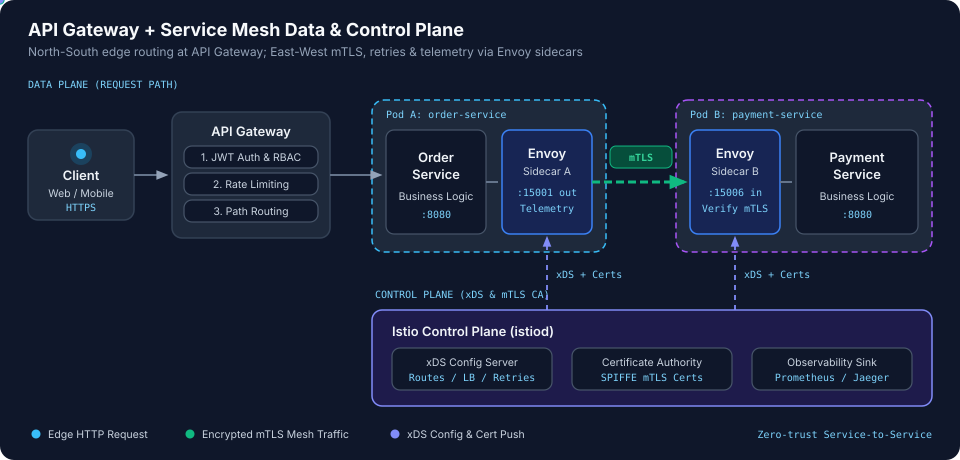

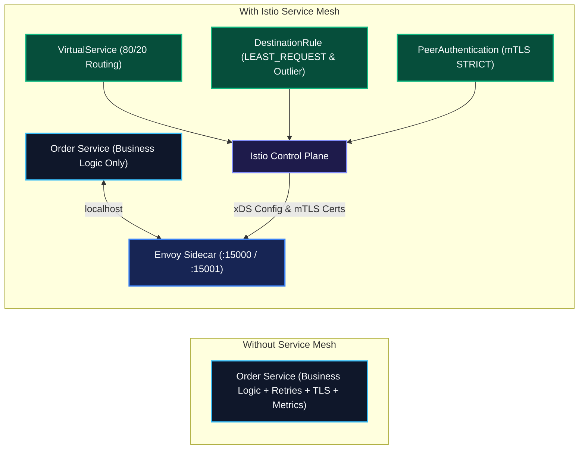

| Dimension | API Gateway (North-South) | Service Mesh (East-West) |
| :--- | :--- | :--- |
| **Traffic Direction** | External Clients -> Internal Services | Service <-> Service inside cluster |
| **Primary Concerns** | Edge Auth (JWT/OAuth), API versioning, rate limiting | mTLS, retries, outlier detection, canary splitting |
| **Deployment Model** | Centralized edge proxy cluster | Sidecar proxy (`istio-proxy`) per Pod |
| **App Code Changes** | None (clients call Gateway URL) | None (transparent `iptables` interception) |

> [!IMPORTANT]
> **Zero-Trust Security with `PeerAuthentication`:** Setting `mtls.mode: STRICT` enforces mutual TLS across all mesh workloads—every Envoy sidecar automatically rotates SPIFFE X.509 certificates and rejects plaintext traffic.

### Istio Components

```yaml
# VirtualService defines how traffic is routed
apiVersion: networking.istio.io/v1beta1
kind: VirtualService
metadata:
  name: payment-service
spec:
  hosts:
  - payment-service
  http:
  - match:
    - uri:
        prefix: /api/payments
    route:
    - destination:
        host: payment-service
        port:
          number: 8080
      weight: 80
    - destination:
        host: payment-service-canary
        port:
          number: 8080
      weight: 20

---
# DestinationRule defines load balancing policy
apiVersion: networking.istio.io/v1beta1
kind: DestinationRule
metadata:
  name: payment-service
spec:
  host: payment-service
  trafficPolicy:
    connectionPool:
      tcp:
        maxConnections: 100
      http:
        http1MaxPendingRequests: 50
        http2MaxRequests: 100
    loadBalancer:
      simple: LEAST_REQUEST
    outlierDetection:
      consecutive5xxErrors: 5
      interval: 30s
      baseEjectionTime: 30s

---
# ServiceEntry for external services
apiVersion: networking.istio.io/v1beta1
kind: ServiceEntry
metadata:
  name: external-api
spec:
  hosts:
  - api.example.com
  ports:
  - number: 443
    name: https
    protocol: HTTPS
  location: MESH_EXTERNAL
  resolution: DNS

---
# PeerAuthentication for mutual TLS
apiVersion: security.istio.io/v1beta1
kind: PeerAuthentication
metadata:
  name: default
spec:
  mtls:
    mode: STRICT  # All services must use mTLS
```

### Envoy Proxy Configuration

```yaml
# Envoy automatically deployed as sidecar
apiVersion: v1
kind: Pod
metadata:
  name: order-service-pod
spec:
  containers:
  - name: order-service
    image: order-service:1.0
    ports:
    - containerPort: 8080

  - name: istio-proxy  # Envoy sidecar (injected by Istio)
    image: proxyv2:1.x
    ports:
    - containerPort: 15000  # Admin port
    - containerPort: 15001  # Outbound traffic
    volumeMounts:
    - name: istio-envoy
      mountPath: /etc/istio/proxy
```

**Service Mesh Benefits:**
- Centralized traffic management
- Security (mTLS, authorization)
- Observability (metrics, tracing)
- Resilience (retries, circuit breaker)
- No code changes needed

**Service Mesh Drawbacks:**
- Operational complexity
- Performance overhead (sidecar proxies add extra network hops)
- Learning curve
- Resource overhead (one proxy container per pod)

> [!WARNING]
> **Evaluate Before Adopting:** For small clusters (&lt; 10–15 services), a service mesh's CPU/memory footprint and operational complexity can outweigh its benefits. Start with Kubernetes DNS + an API Gateway, and adopt Istio when you need uniform mTLS, polyglot resilience, or fine-grained traffic splitting.

---

## Configuration Management

Centralizes environment-specific settings (timeouts, feature flags, DB URLs, credentials) outside application artifacts so one build runs across dev, staging, and production.

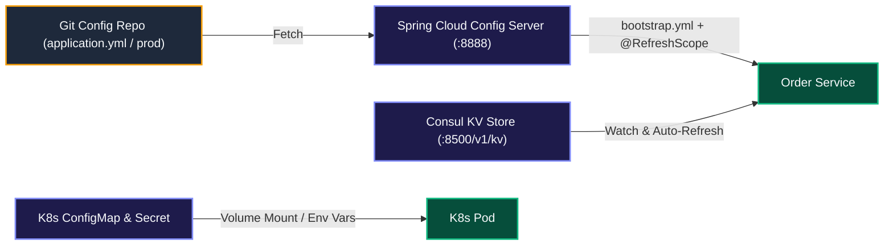

| Tool | Storage Backend | Dynamic Refresh | Secret Handling |
| :--- | :--- | :--- | :--- |
| **Spring Cloud Config** | Git repository (versioned history) | `@RefreshScope` + `/actuator/refresh` (or Spring Cloud Bus) | Supports JCE encryption (`{cipher}...`) |
| **Consul KV** | Raft-replicated key-value store | Automatic long-polling watch | Pair with HashiCorp Vault |
| **K8s ConfigMap / Secret** | `etcd` | Env vars need Pod restart; mounted files update eventually | Base64-encoded by default |

> [!WARNING]
> **Kubernetes `Secret` is NOT encrypted by default:** Base64 is encoding, not encryption. Enable `etcd` encryption at rest, restrict RBAC, or use External Secrets Operator / HashiCorp Vault in production.

### Spring Cloud Config

Centralized configuration repository backed by Git.

```yaml
# config-server/application.yml
spring:
  application:
    name: config-server
  cloud:
    config:
      server:
        git:
          uri: https://github.com/company/config-repo
          default-label: main
          search-paths: config/{application}

server:
  port: 8888
```

```text
# Configuration repository (Git)
configs/
├── application.yml
│   ├── spring.datasource.url: jdbc:mysql://localhost:3306/orders
│   ├── logging.level.root: INFO
│
├── production/
│   └── application.yml
│       ├── spring.datasource.url: jdbc:mysql://prod-db:3306/orders
│       ├── logging.level.root: WARN
│
├── order-service/
│   ├── application.yml
│   └── application-production.yml
```

```java
// Client configuration
@SpringBootApplication
public class OrderServiceApplication {
    public static void main(String[] args) {
        SpringApplication.run(OrderServiceApplication.class, args);
    }
}

// bootstrap.yml
spring:
  application:
    name: order-service
  cloud:
    config:
      uri: http://config-server:8888
      profile: production

// Access configuration
@Component
public class PaymentConfig {

    @Value("${payment.timeout:5000}")
    private int paymentTimeout;

    @Value("${payment.max-retries:3}")
    private int maxRetries;

    @RefreshScope  // Refresh configuration without restart
    public void updateConfig() {
        // Called when configuration changes
    }
}

// Listen for configuration changes
@Component
public class ConfigChangeListener {

    @EventListener
    public void onConfigRefresh(RefreshScopeRefreshedEvent event) {
        logger.info("Configuration refreshed");
        // Re-initialize components if needed
    }
}
```

> [!TIP]
> Pair `@RefreshScope` with `RefreshScopeRefreshedEvent` listeners when you need to re-initialize connection pools or thread pools without restarting the JVM.

### Consul Key-Value Store

Dynamic configuration combined with service discovery.

```java
@Configuration
@EnableConsulConfig
public class ConsulConfig {
    // Configuration automatically loaded from Consul
}

// application.yml
spring:
  application:
    name: order-service
  cloud:
    consul:
      host: consul-server
      port: 8500
      config:
        enabled: true
        format: YAML
        prefix: config
        default-context: application
        profile-separator: ','
```

```bash
# Store configuration in Consul
curl -X PUT http://localhost:8500/v1/kv/config/order-service/payment.timeout -d "5000"
curl -X PUT http://localhost:8500/v1/kv/config/order-service/payment.max-retries -d "3"

# Update configuration (services refresh automatically)
curl -X PUT http://localhost:8500/v1/kv/config/order-service/payment.timeout -d "10000"
```

### Kubernetes ConfigMaps and Secrets

```yaml
# ConfigMap for non-sensitive configuration
apiVersion: v1
kind: ConfigMap
metadata:
  name: order-service-config
data:
  application.yml: |
    spring:
      datasource:
        url: jdbc:mysql://mysql-service:3306/orders
        username: orders_user
      jpa:
        hibernate:
          ddl-auto: validate
    payment:
      timeout: 5000
      max-retries: 3

---
# Secret for sensitive data
apiVersion: v1
kind: Secret
metadata:
  name: order-service-secret
type: Opaque
data:
  db-password: cGFzc3dvcmQxMjM=  # base64 encoded
  api-key: YXBpa2V5MzQ1Ng==

---
# Pod using ConfigMap and Secret
apiVersion: v1
kind: Pod
metadata:
  name: order-service-pod
spec:
  containers:
  - name: order-service
    image: order-service:1.0
    volumeMounts:
    - name: config
      mountPath: /etc/config
    - name: secret
      mountPath: /etc/secret
    env:
    - name: DB_PASSWORD
      valueFrom:
        secretKeyRef:
          name: order-service-secret
          key: db-password
  volumes:
  - name: config
    configMap:
      name: order-service-config
  - name: secret
    secret:
      secretName: order-service-secret
```

---

## Deployment Strategies

Zero-downtime deployment strategies trade off infrastructure cost, rollback speed, and blast radius.

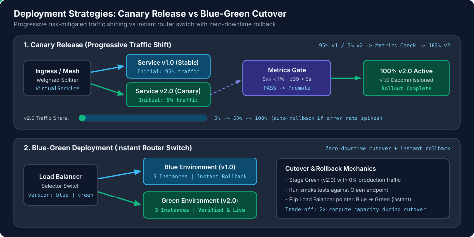

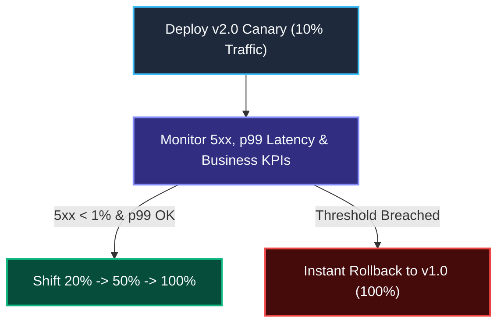


| Strategy | Traffic Cutover | Rollback Speed | Extra Compute Cost | Blast Radius |
| :--- | :--- | :--- | :--- | :--- |
| **Blue-Green** | Instant LB/router switch (0% -> 100%) | Instant (flip pointer back to Blue) | High (2x instances during cutover) | High if bug escapes smoke tests |
| **Canary Release** | Progressive (`90/10 -> 80/20 -> 50/50 -> 0/100`) | Fast (shift weight back to 100% v1) | Low (only canary slice) | Very low (capped at canary %) |
| **Rolling Update** | Gradual Pod replacement (`maxSurge` / `maxUnavailable`) | Moderate (roll back Pods one by one) | Minimal (`+maxSurge` pods) | Mixed v1 &amp; v2 serve traffic simultaneously |

> [!IMPORTANT]
> **Schema Compatibility Rule:** In both Canary and Rolling updates, `v1.0` and `v2.0` run side-by-side against the same database. Always use **expand-and-contract** database migrations so `v2.0` never breaks `v1.0` queries.

### Blue-Green Deployment

1. **V1.0 (Blue):** 3 instances running and receiving 100% of production traffic.
2. **V2.0 (Green):** 3 instances staged with 0% production traffic; smoke tests run and verified.
3. **Switch:** Load Balancer cuts over instantly from Blue (`v1.0`) to Green (`v2.0`).
4. **Cleanup:** Keep `v1.0` warm briefly for instant rollback; shut down once stability is confirmed.

```java
// Using Spring Cloud to manage blue-green deployment
@Configuration
public class BlueGreenDeploymentConfig {

    @Bean
    public ServiceVersionResolver serviceVersionResolver() {
        return new ServiceVersionResolver() {
            @Override
            public String resolveVersion(String serviceName) {
                // Read from configuration
                return environment.getProperty("service." + serviceName + ".version");
            }
        };
    }
}
```

### Canary Release

Route a small slice (e.g., 10% or internal `canary-tester` users) to `v2.0`, verify metrics, and progressively promote (`80/20` after 1h -> `50/50` after 2h -> `0/100` after 4h), or roll back immediately if metrics degrade.

```yaml
# Istio VirtualService for canary
apiVersion: networking.istio.io/v1beta1
kind: VirtualService
metadata:
  name: order-service-canary
spec:
  hosts:
  - order-service
  http:
  - match:
    - sourceLabels:
        user: canary-tester  # Route canary testers to v2.0
    route:
    - destination:
        host: order-service
        subset: v2-0
  - route:
    - destination:
        host: order-service
        subset: v1-0
      weight: 90
    - destination:
        host: order-service
        subset: v2-0
      weight: 10
```

### Rolling Update

Gradually replaces `v1.0` instances with `v2.0` one by one (`3/3 v1` -> `1 v2, 2 v1` -> `2 v2, 1 v1` -> `3/3 v2`) while keeping capacity at or above desired replicas.

```yaml
# Kubernetes rolling update
apiVersion: apps/v1
kind: Deployment
metadata:
  name: order-service
spec:
  replicas: 3
  strategy:
    type: RollingUpdate
    rollingUpdate:
      maxSurge: 1        # Can have 4 instances (3+1) during update
      maxUnavailable: 0  # Must always have 3 available
  selector:
    matchLabels:
      app: order-service
  template:
    metadata:
      labels:
        app: order-service
    spec:
      containers:
      - name: order-service
        image: order-service:2.0  # New version
```

---

## Interview Questions

### Q1: How would you design service discovery for a system with 100+ microservices?

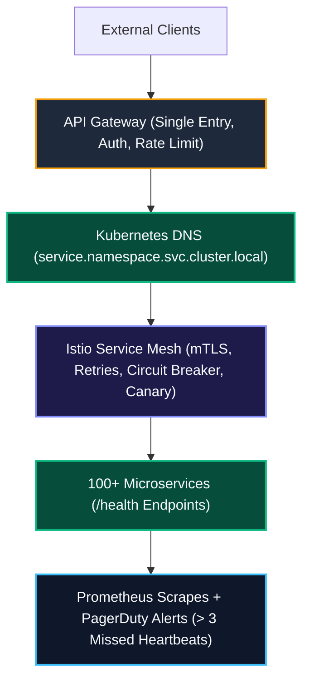

**Answer:**
- **Registry & Platform:** Use Kubernetes DNS (`service-name.namespace.svc.cluster.local` + `ClusterIP`) or a dedicated registry (Consul / Eureka) with automated registration and deregistration.
- **External Edge:** Place an API Gateway in front for single entry point, rate limiting, authentication, and hiding internal topology.
- **Inter-Service Layer:** Use a Service Mesh (Istio) for uniform resilience (circuit breakers, retries), security (mTLS), traffic management (canary, blue-green), and observability (tracing, metrics).
- **Monitoring & Eviction:** Every service exposes `/health`; instances missing &gt; 3 heartbeats are deregistered; Prometheus scrapes health metrics and triggers PagerDuty alerts if multiple instances go down.

---

### Q2: Design an API Gateway for a mobile and web application with different requirements.

**Answer:**
1. **Main API Gateway (Shared Edge):** Handles JWT validation, per-user rate limiting, and request signing (for mobile).
2. **Web BFF Gateway:** Aggregates full product data, reviews, pagination, and recommendations into HTML-friendly/SSR responses.
3. **Mobile BFF Gateway:** Returns lightweight JSON or binary-encoded responses, minimal fields, cached/offloaded image paths (no inline images) to save bandwidth.
4. **Core Services:** Order, Product, Payment, and Inventory services remain clean and client-agnostic behind the BFFs.

---

### Q3: How would you implement a canary deployment for order service?

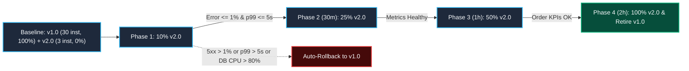

**Answer:**
- **Setup:** Keep `Order Service v1.0` at 30 instances (100% traffic) and deploy `v2.0` canary at 3 instances (0% traffic).
- **Phased Rollout:**
  - **Phase 1 (10%):** Monitor HTTP `5xx` error rates and latency; proceed if healthy.
  - **Phase 2 (25%):** After 30 minutes of stability, continue monitoring `v2.0` metrics.
  - **Phase 3 (50%):** After 1 hour of stability, validate business metrics (order completion rate).
  - **Phase 4 (100%):** After 2 hours of stability, promote to 100% and decommission `v1.0`.
- **Metrics & Automated Rollback:** Monitor `5xx` rate, `p50`/`p95`/`p99` latency, order success rate, database performance, and payment failures. Trigger automatic rollback if **error rate &gt; 1%**, **p99 latency &gt; 5 seconds**, or **database CPU &gt; 80%**.

---

### Q4: What's the difference between client-side and server-side service discovery?

| Dimension | Client-Side Discovery (e.g., Eureka + Ribbon) | Server-Side Discovery (e.g., K8s DNS, Spring Cloud Gateway) |
| :--- | :--- | :--- |
| **Flow** | Client queries registry -> picks instance -> calls directly | Client calls Gateway/LB -> Gateway queries registry -> forwards |
| **Advantages** | Direct connection (no extra hop); client controls LB strategy | Client is unaware of services; language-agnostic; topology abstracted |
| **Disadvantages** | Client must know registry &amp; implement LB; language-dependent | Extra network hop; Gateway can be a SPOF; dedicated gateway ops |

> [!TIP]
> **Interview Recommendation:** Default to **server-side discovery** (Kubernetes DNS / API Gateway) for simplicity—it lets you evolve internal service topology without updating or redeploying clients across multiple languages.
