# Resilience Patterns in Microservices

## Table of Contents
1. [Circuit Breaker](#circuit-breaker)
2. [Retry Pattern](#retry-pattern)
3. [Bulkhead Pattern](#bulkhead-pattern)
4. [Rate Limiter](#rate-limiter)
5. [Timeout Pattern](#timeout-pattern)
6. [Fallback Strategies](#fallback-strategies)
7. [Health Checks](#health-checks)
8. [Chaos Engineering](#chaos-engineering)
9. [Distributed Tracing](#distributed-tracing)
10. [Interview Questions](#interview-questions)

---

## Circuit Breaker

Prevents cascading failures by stopping requests to failing downstream services and failing fast until recovery is verified.

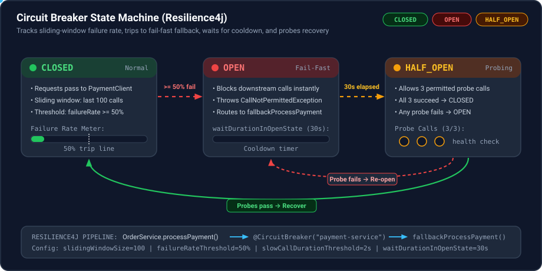

### State Machine & Decision Flow

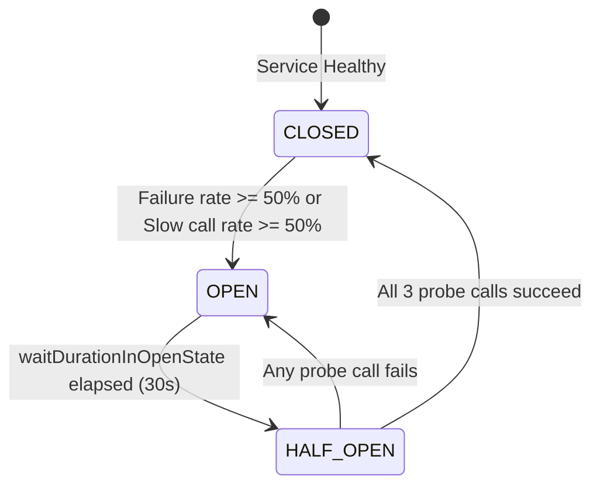

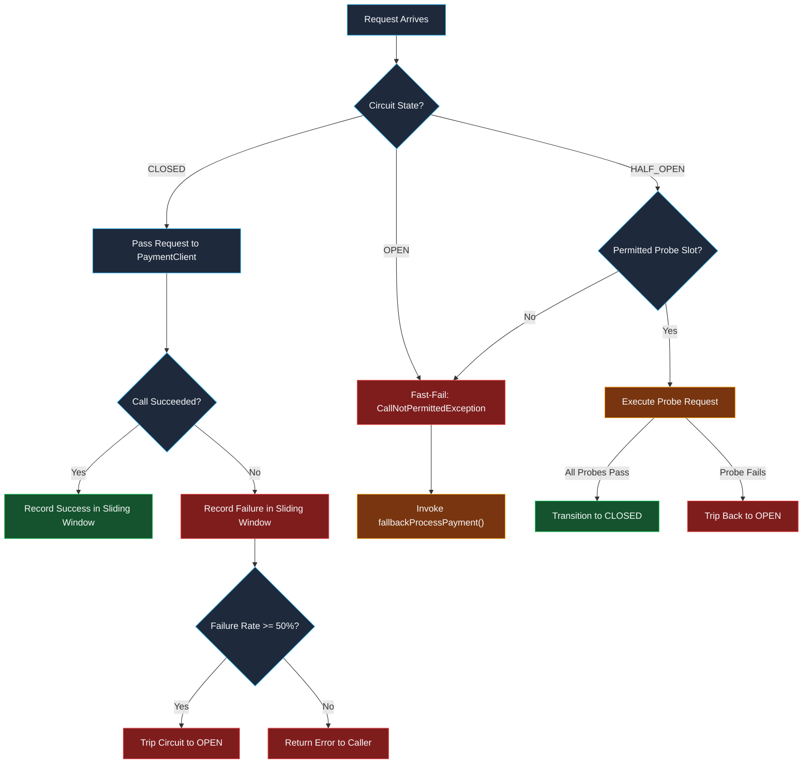

### Circuit Breaker States Comparison

| State | Traffic Behavior | Metrics Tracked | Transition Trigger |
| :--- | :--- | :--- | :--- |
| **CLOSED** | All requests pass through normally | Sliding window (`100` calls) failure & slow call rates | `failureRate >= 50%` or `slowCallRate >= 50%` → **OPEN** |
| **OPEN** | Fast-fail immediately (`CallNotPermittedException`), route to fallback | Elapsed cooldown timer (`waitDurationInOpenState = 30s`) | Timer expires (`automaticTransitionFromOpenToHalfOpenEnabled`) → **HALF_OPEN** |
| **HALF_OPEN** | Allows `permittedNumberOfCallsInHalfOpenState` (`3`) probe requests | Probe success/failure count | All 3 succeed → **CLOSED**; any probe fails → **OPEN** |

- **Sliding Window Types:** `COUNT_BASED` evaluates the last *N* calls (`slidingWindowSize = 100`), whereas `TIME_BASED` evaluates calls within the last *N* seconds.
- **Exception Filtering:** Record infrastructure/transient faults (`PaymentException`, `TimeoutException`) and ignore client input errors (`ValidationException`) so bad user input never trips the breaker.

> [!IMPORTANT]
> Always pair `@CircuitBreaker` with a `fallbackMethod` that matches the original method signature plus an `Exception` parameter, and ensure `ValidationException` is in `ignoreExceptions` so client 4xx errors do not open the circuit for all users.

### Resilience4j Implementation

```xml
<!-- pom.xml -->
<dependency>
    <groupId>io.github.resilience4j</groupId>
    <artifactId>resilience4j-spring-boot3</artifactId>
    <version>2.1.0</version>
</dependency>
<dependency>
    <groupId>io.github.resilience4j</groupId>
    <artifactId>resilience4j-circuitbreaker</artifactId>
    <version>2.1.0</version>
</dependency>
```

```java
// Configuration
@Configuration
public class Resilience4jConfig {

    @Bean
    public CircuitBreakerRegistry circuitBreakerRegistry() {
        return CircuitBreakerRegistry.ofDefaults();
    }

    @Bean
    public CircuitBreaker paymentCircuitBreaker(CircuitBreakerRegistry registry) {
        return registry.circuitBreaker("payment-service", CircuitBreakerConfig.custom()
            .failureRateThreshold(50.0f)           // Open if 50% fail
            .slowCallRateThreshold(50.0f)          // Open if 50% slow
            .slowCallDurationThreshold(Duration.ofSeconds(2))
            .waitDurationInOpenState(Duration.ofSeconds(30))  // Wait 30s before half-open
            .permittedNumberOfCallsInHalfOpenState(3)  // Allow 3 calls in half-open
            .slidingWindowSize(100)                // Track last 100 calls
            .slidingWindowType(SlidingWindowType.COUNT_BASED)
            .recordExceptions(PaymentException.class, TimeoutException.class)
            .ignoreExceptions(ValidationException.class)  // Don't count these
            .automaticTransitionFromOpenToHalfOpenEnabled(true)
            .build());
    }
}

// Using circuit breaker with annotations
@Service
public class OrderService {

    @Autowired
    private PaymentClient paymentClient;

    @CircuitBreaker(
        name = "payment-service",
        fallbackMethod = "fallbackProcessPayment"
    )
    @Retry(name = "payment-service")  // Combine with retry
    public Payment processPayment(Long orderId, BigDecimal amount) {
        return paymentClient.processPayment(orderId, amount);
    }

    // Fallback called when circuit opens
    public Payment fallbackProcessPayment(Long orderId, BigDecimal amount, Exception ex) {
        logger.warn("Payment service unavailable, returning pending payment", ex);
        return new Payment(
            orderId,
            amount,
            PaymentStatus.PENDING,
            "Payment service temporarily unavailable"
        );
    }
}

// Using circuit breaker programmatically
@Service
public class OrderServiceProgrammatic {

    private final CircuitBreaker circuitBreaker;

    @Autowired
    public OrderServiceProgrammatic(CircuitBreakerRegistry registry) {
        this.circuitBreaker = registry.circuitBreaker("payment-service");
    }

    public Payment processPayment(Long orderId, BigDecimal amount) {
        try {
            return circuitBreaker.executeSupplier(() ->
                paymentClient.processPayment(orderId, amount)
            );
        } catch (CallNotPermittedException ex) {
            // Circuit is open
            logger.error("Circuit breaker is open for payment-service");
            return createPendingPayment(orderId, amount);
        }
    }
}

// Monitoring circuit breaker state
@Component
public class CircuitBreakerHealthIndicator implements HealthIndicator {

    @Autowired
    private CircuitBreakerRegistry circuitBreakerRegistry;

    @Override
    public Health health() {
        Health.Builder builder = new Health.Builder();

        circuitBreakerRegistry.getAllCircuitBreakers()
            .forEach(cb -> {
                CircuitBreaker.State state = cb.getState();
                builder.withDetail(cb.getName(), state.name());

                if (state == CircuitBreaker.State.OPEN) {
                    builder.outOfService();
                } else {
                    builder.up();
                }
            });

        return builder.build();
    }
}

// application.yml
resilience4j:
  circuitbreaker:
    instances:
      payment-service:
        failureRateThreshold: 50
        slowCallRateThreshold: 50
        slowCallDurationThreshold: 2s
        waitDurationInOpenState: 30s
        permittedNumberOfCallsInHalfOpenState: 3
        slidingWindowSize: 100
        recordExceptions:
          - com.example.PaymentException
          - java.util.concurrent.TimeoutException

  metrics:
    enabled: true

management:
  endpoints:
    web:
      exposure:
        include: health,circuitbreakers
  health:
    circuitbreakers:
      enabled: true
```

### Circuit Breaker Metrics

```java
// Monitoring circuit breaker with metrics
@Component
public class CircuitBreakerMetrics {

    @Autowired
    private CircuitBreakerRegistry registry;

    @Scheduled(fixedDelay = 10000)
    public void publishMetrics() {
        registry.getAllCircuitBreakers()
            .forEach(cb -> {
                CircuitBreakerMetrics metrics = cb.getMetrics();

                logger.info("CircuitBreaker {} - State: {}, Failure Rate: {}%, Slow Call Rate: {}%",
                    cb.getName(),
                    cb.getState(),
                    String.format("%.2f", metrics.getFailureRate()),
                    String.format("%.2f", metrics.getSlowCallRate())
                );

                logger.info("  Total calls: {}, Successful: {}, Failed: {}, Slow: {}",
                    metrics.getNumberOfTotalCalls(),
                    metrics.getNumberOfSuccessfulCalls(),
                    metrics.getNumberOfFailedCalls(),
                    metrics.getNumberOfSlowCalls()
                );
            });
    }
}
```

---

## Retry Pattern

Automatically retries transient failures with **exponential backoff and jitter** to avoid synchronized retry storms.

### Exponential Backoff & Jitter Flow

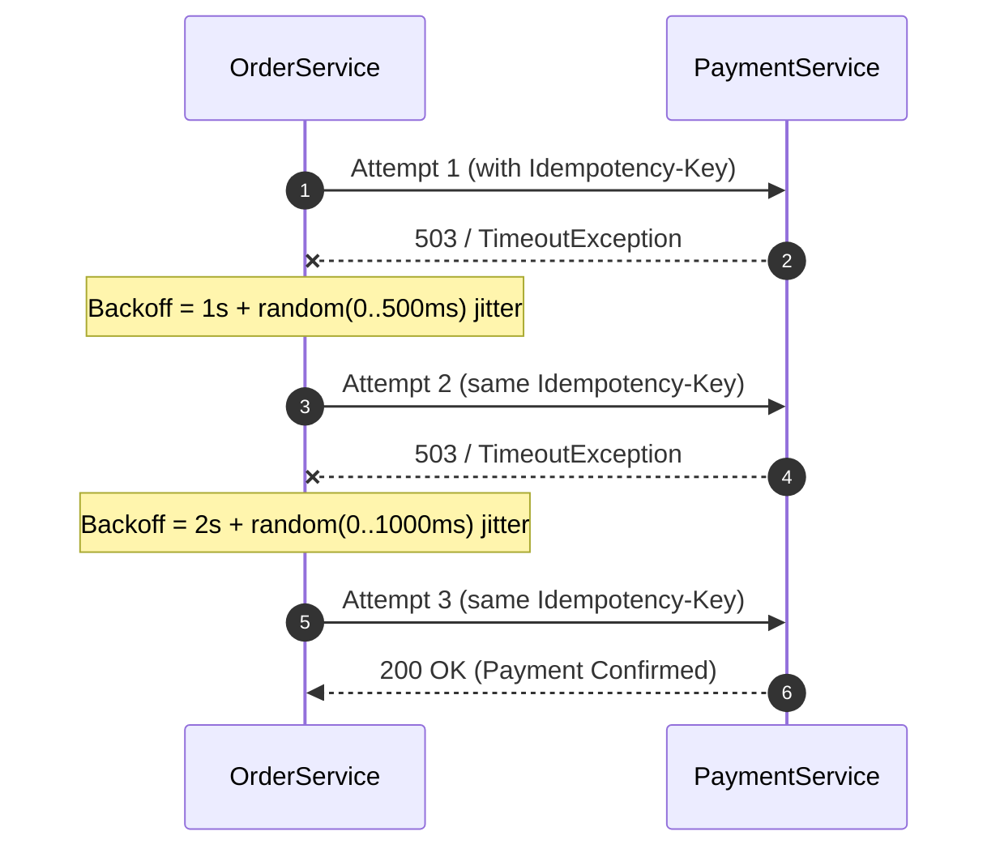

### Retry Strategy Comparison

| Strategy | Delay Formula | Thundering Herd Risk | Best Use Case |
| :--- | :--- | :--- | :--- |
| **Fixed Interval** | `waitDuration` (constant) | High — all clients retry in lockstep | Low-concurrency internal background jobs |
| **Exponential Backoff** | `base * multiplier^(attempt - 1)` | Medium — synchronized waves at `1s, 2s, 4s` | Moderate traffic transient network blips |
| **Exponential + Jitter** | `base * 2^(attempt - 1) + random(0, base/2)` | Low — spreads retries smoothly over time | High-throughput microservices & external APIs |

- **Transient vs Non-Transient:** Only retry `PaymentException` and `TimeoutException`; never retry `ValidationException` or `UnauthorizedException`.
- **Aspect Ordering:** In Resilience4j, `Retry` wraps `CircuitBreaker` by default (`Retry(CircuitBreaker(call))`), or vice versa depending on `retryAspectOrder`. Ensure retries do not mask an open circuit.

> [!WARNING]
> Never retry non-idempotent mutations (like charging a credit card) without an **Idempotency Key**. A network timeout after the server commits the charge will cause a blind retry to double-charge the customer.

### Retry Configuration

```java
// Simple retry
@Service
public class OrderService {

    @Retry(name = "payment-service")
    public Payment processPayment(Long orderId, BigDecimal amount) {
        return paymentClient.processPayment(orderId, amount);
    }
}

// Advanced retry configuration
@Configuration
public class RetryConfig {

    @Bean
    public RetryRegistry retryRegistry() {
        return RetryRegistry.ofDefaults();
    }

    @Bean
    public Retry paymentRetry(RetryRegistry registry) {
        return registry.retry("payment-service", RetryConfig.custom()
            .maxAttempts(3)                    // Total of 3 attempts (1 original + 2 retries)
            .waitDuration(Duration.ofMillis(1000))  // 1 second between retries
            .intervalFunction(
                IntervalFunction.ofExponentialBackoff(
                    1000,      // Initial interval: 1 second
                    2,         // Multiplier: each retry waits 2x longer
                    1000       // Maximum interval: 1 second (capped at 1s)
                )
            )
            .retryExceptions(PaymentException.class, TimeoutException.class)
            .ignoreExceptions(ValidationException.class)  // Don't retry these
            .failAfterMaxAttempts(true)
            .build());
    }
}

// Exponential backoff with jitter
@Service
public class PaymentClientWithJitter {

    @Autowired
    private RestTemplate restTemplate;

    private Random random = new Random();

    public Payment processPayment(Long orderId, BigDecimal amount) {
        int maxAttempts = 3;
        int attempt = 0;
        PaymentException lastException = null;

        while (attempt < maxAttempts) {
            try {
                return restTemplate.postForObject(
                    "http://payment-service:8080/api/payments",
                    new PaymentRequest(orderId, amount),
                    Payment.class
                );
            } catch (PaymentException e) {
                lastException = e;
                attempt++;

                if (attempt < maxAttempts) {
                    // Exponential backoff with jitter
                    long baseDelay = 1000 * (long) Math.pow(2, attempt - 1);  // 1s, 2s, 4s
                    long jitter = random.nextLong(baseDelay / 2);  // Random 0 to delay/2
                    long totalDelay = baseDelay + jitter;

                    logger.info("Payment attempt {} failed, retrying after {}ms",
                        attempt, totalDelay);

                    try {
                        Thread.sleep(totalDelay);
                    } catch (InterruptedException ie) {
                        Thread.currentThread().interrupt();
                        throw new RuntimeException(ie);
                    }
                }
            }
        }

        throw lastException;
    }
}

// application.yml
resilience4j:
  retry:
    instances:
      payment-service:
        maxAttempts: 3
        waitDuration: 1000
        intervalFunction: exponentialBackoff
        exponentialBackoffMultiplier: 2
        retryExceptions:
          - com.example.PaymentException
          - java.util.concurrent.TimeoutException
```

### When NOT to Retry

```java
// BAD: Retrying non-idempotent operations can cause issues
@Retry(name = "payment-service", maxAttempts = 3)
public Payment processPayment(Long orderId, BigDecimal amount) {
    // If network timeout after payment is processed:
    // Retry will charge customer AGAIN
    return paymentClient.processPayment(orderId, amount);
}

// GOOD: Use idempotency key for retries
@Retry(name = "payment-service", maxAttempts = 3)
public Payment processPayment(Long orderId, BigDecimal amount) {
    String idempotencyKey = "order-" + orderId + "-payment";
    // Same key ensures duplicate processing is prevented
    return paymentClient.processPayment(orderId, amount, idempotencyKey);
}

// Don't retry certain exceptions
@Retry(
    name = "payment-service",
    maxAttempts = 3,
    ignoreExceptions = {ValidationException.class, UnauthorizedException.class}
)
public Payment processPayment(Long orderId, BigDecimal amount) {
    // ValidationException: client error, retrying won't help
    // UnauthorizedException: auth issue, retrying won't help
    return paymentClient.processPayment(orderId, amount);
}
```

---

## Bulkhead Pattern

Isolates resource pools (threads or concurrency permits) per dependency so a single slow downstream service cannot exhaust the entire JVM thread pool.

### Thread-Pool Isolation Architecture

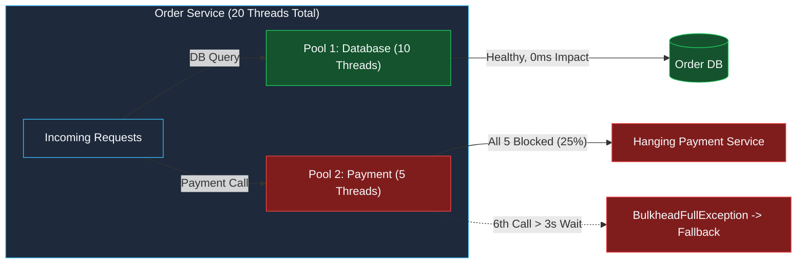

### Semaphore vs Thread-Pool Bulkhead

| Dimension | Semaphore Isolation (`SEMAPHORE`) | Thread-Pool Isolation (`THREADPOOL`) |
| :--- | :--- | :--- |
| **Execution Thread** | Runs on caller's existing HTTP/worker thread | Offloads to a dedicated isolated `ExecutorService` |
| **Overhead** | Very low (atomic counter + `maxWaitDuration`) | Higher (context switching, queue, separate threads) |
| **Timeout Cancellation** | Cannot interrupt blocking I/O on its own | Supports true async timeout cancellation (`TimeLimiter`) |
| **Best For** | Fast in-memory or non-blocking calls | Slow external HTTP/RPC calls that may hang |

- **Failure Containment:** If Payment Service hangs, only Pool 2's `5` threads (`25%`) block; Pool 1 (`10` threads) keeps serving `getOrder()` normally.
- **Fast Rejection:** Once `maxConcurrentCalls` is saturated and `maxWaitDuration` (`3s`) expires, Resilience4j throws `BulkheadFullException`.

> [!TIP]
> Size each bulkhead proportionally to downstream SLA: `maxConcurrentCalls ≈ peak_RPS * p99_latency_seconds`. Use `SEMAPHORE` for high-throughput, low-latency calls and `THREADPOOL` when isolating untrusted external APIs.

### Bulkhead Implementation

```java
@Configuration
public class BulkheadConfig {

    @Bean
    public BulkheadRegistry bulkheadRegistry() {
        return BulkheadRegistry.ofDefaults();
    }

    @Bean
    public Bulkhead paymentBulkhead(BulkheadRegistry registry) {
        return registry.bulkhead("payment-service", BulkheadConfig.custom()
            .maxConcurrentCalls(5)              // Max 5 concurrent calls
            .maxWaitDuration(Duration.ofSeconds(3))  // Wait max 3 seconds if at capacity
            .build());
    }

    @Bean
    public Bulkhead dbBulkhead(BulkheadRegistry registry) {
        return registry.bulkhead("database", BulkheadConfig.custom()
            .maxConcurrentCalls(20)
            .maxWaitDuration(Duration.ofSeconds(2))
            .build());
    }
}

// Using bulkhead with annotations
@Service
public class OrderService {

    @Bulkhead(name = "payment-service")
    public Payment processPayment(Long orderId, BigDecimal amount) {
        return paymentClient.processPayment(orderId, amount);
    }

    @Bulkhead(name = "database")
    public Order getOrder(Long orderId) {
        return orderRepository.findById(orderId).orElseThrow();
    }
}

// Programmatic usage
@Service
public class OrderServiceProgrammatic {

    private final Bulkhead paymentBulkhead;

    @Autowired
    public OrderServiceProgrammatic(BulkheadRegistry registry) {
        this.paymentBulkhead = registry.bulkhead("payment-service");
    }

    public Payment processPayment(Long orderId, BigDecimal amount) {
        try {
            return paymentBulkhead.executeSupplier(() ->
                paymentClient.processPayment(orderId, amount)
            );
        } catch (BulkheadFullException e) {
            logger.error("Payment service bulkhead at capacity");
            return createPendingPayment(orderId, amount);
        }
    }
}

// application.yml
resilience4j:
  bulkhead:
    instances:
      payment-service:
        maxConcurrentCalls: 5
        maxWaitDuration: 3s
      database:
        maxConcurrentCalls: 20
        maxWaitDuration: 2s

    metrics:
      enabled: true
```

### Semaphore Isolation

```java
// Lighter weight than thread pool isolation
@Bean
public Bulkhead paymentSemaphoreBulkhead(BulkheadRegistry registry) {
    return registry.bulkhead("payment-service", BulkheadConfig.custom()
        .maxConcurrentCalls(5)
        .maxWaitDuration(Duration.ofSeconds(3))
        .bulkheadType(BulkheadConfig.Type.SEMAPHORE)  // Semaphore instead of thread pool
        .build());
}

// Semaphore: shares existing thread, just limits concurrency
// vs
// ThreadPool: separate thread pool with separate thread creation
```

---

## Rate Limiter

Controls the rate of incoming or outgoing requests to protect services from traffic spikes, abusive clients, and downstream overload.


### Rate Limiting Decision Flow

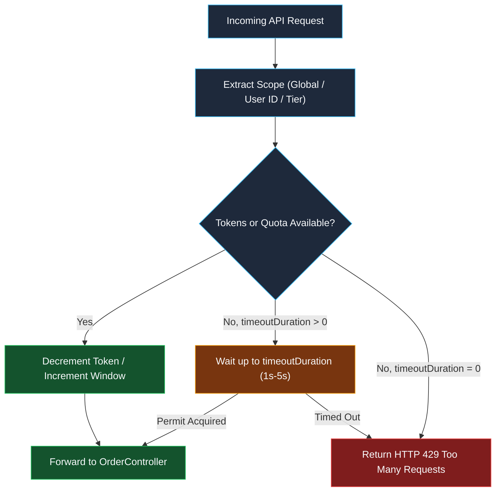

### Rate Limiting Algorithms Compared

| Algorithm | How It Works | Burst Handling | Memory Footprint | Trade-off |
| :--- | :--- | :--- | :--- | :--- |
| **Token Bucket** | Bucket holds up to *N* tokens, refilled at fixed rate *R* tokens/sec; each request consumes 1 token | **Allows bursts** up to bucket capacity | `O(1)` (2 numbers: tokens + timestamp) | Great for user-facing APIs with bursty traffic |
| **Leaky Bucket** | Requests enter a FIFO queue and drain at a **constant** outflow rate; full queue drops requests | **Smooths bursts** into steady outflow | `O(queue_size)` | Protects fragile downstream DBs; adds queueing latency |
| **Sliding Window** | Weighted sum of previous + current fixed window (or timestamp log): `curr + prev * overlap%` | **No boundary spike** (unlike fixed window) | `O(1)` counter / `O(N)` log | Accurate rate enforcement across window boundaries |

- **Token Bucket Example:** Capacity `100` tokens, refill `10` tokens/sec. Three immediate requests drop tokens `100 → 99 → 98 → 97`; after `0.1s`, `1` token refills (`98`); after `1.0s`, `10` tokens refill (capped at `100`).
- **Leaky Bucket Example:** Queue capacity `50`, drain rate `10 req/sec`. A burst of `40` requests is queued and dispatched smoothly at `100ms` intervals; the `51st` concurrent request overflows and receives `HTTP 429`.
- **Sliding Window Example:** Limit `1000 req/min`. At `2:30`, current window has `500` requests and previous window (`1:00–1:59`) had `150` requests (`50%` weight): `500 + (150 * 0.5) = 575 < 1000` → request allowed.

> [!IMPORTANT]
> For global DDoS/overload protection (`GlobalRateLimitingFilter`), set `timeoutDuration(Duration.ZERO)` so excess requests are rejected immediately with `HTTP 429` instead of holding servlet threads hostage waiting for permits.

### Resilience4j Rate Limiter Implementation

```java
@Configuration
public class RateLimiterConfig {

    @Bean
    public RateLimiterRegistry rateLimiterRegistry() {
        return RateLimiterRegistry.ofDefaults();
    }

    @Bean
    public RateLimiter apiRateLimiter(RateLimiterRegistry registry) {
        return registry.rateLimiter("api", RateLimiterConfig.custom()
            .limitRefreshPeriod(Duration.ofMinutes(1))  // 60-second window
            .limitForPeriod(1000)                       // 1000 requests per minute
            .timeoutDuration(Duration.ofSeconds(5))     // Wait max 5 seconds for token
            .build());
    }

    @Bean
    public RateLimiter premiumUserRateLimiter(RateLimiterRegistry registry) {
        return registry.rateLimiter("premium-user", RateLimiterConfig.custom()
            .limitRefreshPeriod(Duration.ofMinutes(1))
            .limitForPeriod(10000)                      // 10x more requests for premium
            .timeoutDuration(Duration.ofSeconds(1))
            .build());
    }
}

// Using rate limiter
@RestController
@RequestMapping("/api/orders")
public class OrderController {

    @GetMapping
    @RateLimiter(name = "api")
    public List<Order> getOrders() {
        return orderService.getAllOrders();
    }

    @PostMapping
    @RateLimiter(name = "api")
    public Order createOrder(@RequestBody CreateOrderRequest request) {
        return orderService.createOrder(request);
    }
}

// Per-user rate limiting
@RestController
@RequestMapping("/api/orders")
public class PerUserRateLimitingController {

    @Autowired
    private RateLimiterRegistry rateLimiterRegistry;

    @GetMapping
    public List<Order> getOrders(@RequestHeader String authorization) {
        String userId = extractUserId(authorization);
        RateLimiter rateLimiter = getRateLimiterForUser(userId);

        try {
            boolean allowed = rateLimiter.acquirePermission();
            if (!allowed) {
                throw new RateLimitExceededException("Rate limit exceeded");
            }
            return orderService.getAllOrders();
        } finally {
            // Do something
        }
    }

    private RateLimiter getRateLimiterForUser(String userId) {
        // Get or create per-user rate limiter
        String rateLimiterName = "user-" + userId;

        return rateLimiterRegistry.rateLimiter(rateLimiterName, RateLimiterConfig.custom()
            .limitRefreshPeriod(Duration.ofMinutes(1))
            .limitForPeriod(100)  // 100 requests per minute per user
            .timeoutDuration(Duration.ofSeconds(1))
            .build());
    }
}

// Application-level global rate limiter
@Component
public class GlobalRateLimitingFilter implements Filter {

    @Autowired
    private RateLimiterRegistry rateLimiterRegistry;

    private final RateLimiter globalRateLimiter;

    public GlobalRateLimitingFilter(RateLimiterRegistry registry) {
        this.globalRateLimiter = registry.rateLimiter("global-api", RateLimiterConfig.custom()
            .limitRefreshPeriod(Duration.ofSeconds(1))
            .limitForPeriod(10000)              // 10K requests per second global
            .timeoutDuration(Duration.ZERO)     // No wait, reject immediately
            .build());
    }

    @Override
    public void doFilter(ServletRequest request, ServletResponse response, FilterChain chain)
        throws IOException, ServletException {

        if (!globalRateLimiter.acquirePermission()) {
            ((HttpServletResponse) response).setStatus(HttpStatus.TOO_MANY_REQUESTS.value());
            response.getWriter().write("Service limit exceeded");
            return;
        }

        chain.doFilter(request, response);
    }
}

// application.yml
resilience4j:
  ratelimiter:
    instances:
      api:
        limitRefreshPeriod: 1m
        limitForPeriod: 1000
        timeoutDuration: 5s
      premium-user:
        limitRefreshPeriod: 1m
        limitForPeriod: 10000
        timeoutDuration: 1s
```

---

## Timeout Pattern

Prevents requests from hanging indefinitely and tying up threads, sockets, and database connections.

### Layered Timeout Timeline

```mermaid
sequenceDiagram
    autonumber
    participant Client as OrderService (TimeLimiter: 3s)
    participant TCP as TCP Socket (Connect: 3s)
    participant Server as PaymentService (Read: 5s)
    Client->>TCP: Open Connection
    Note over Client,TCP: Connect Timeout = 3000ms
    TCP-->>Client: Connected
    Client->>Server: POST /api/payments
    Note over Client,Server: TimeLimiter cancels Future if total &gt; 3000ms
    Server-->>Client: Response (or TimeoutException if &gt; Read Timeout 5000ms)
```

### Timeout Types & Hierarchy

| Timeout Layer | Scope | Typical Value | Failure Symptom |
| :--- | :--- | :--- | :--- |
| **Connect Timeout** | TCP 3-way handshake establishment | `3000ms` | Unreachable host, dropped SYN packets |
| **Read Timeout** | Max idle gap between response bytes | `5000ms` | Slow downstream query, GC pause, deadlock |
| **TimeLimiter / Request Timeout** | End-to-end call budget (including retries) | `3000ms–10000ms` | Slow trickle responses or retry loops |

- **Cancel Running Future:** Setting `cancelRunningFuture(true)` on Resilience4j `TimeLimiter` interrupts the underlying `CompletableFuture` thread when the deadline expires.
- **Budgeting Rule:** Ensure `Gateway Request Timeout > (Retry Attempts * Per-Attempt Read Timeout) + Backoff` so outer callers don't time out mid-retry.

> [!WARNING]
> Never leave HTTP client timeouts at their defaults (often `infinite` in older `RestTemplate` / `HttpURLConnection` configurations). A single hung downstream socket without a read timeout will silently exhaust your entire web server thread pool.

### Timeout Implementation

```java
// Connection timeout: time to establish TCP connection
int connectTimeout = 3000;  // 3 seconds

// Read timeout: time to read response data
int readTimeout = 5000;     // 5 seconds

// Request timeout: total time from request to response
int requestTimeout = 10000; // 10 seconds
```

```java
@Configuration
public class TimeoutConfig {

    @Bean
    public RestTemplate restTemplate() {
        HttpComponentsClientHttpRequestFactory factory =
            new HttpComponentsClientHttpRequestFactory();

        factory.setConnectTimeout(3000);  // 3 seconds
        factory.setReadTimeout(5000);     // 5 seconds

        return new RestTemplate(factory);
    }

    @Bean
    public Timer paymentTimer(TimerRegistry registry) {
        return registry.timer("payment-service");
    }

    @Bean
    public TimeLimiter paymentTimeLimiter(TimeLimiterRegistry registry) {
        return registry.timeLimiter("payment-service", TimeLimiterConfig.custom()
            .timeoutDuration(Duration.ofSeconds(3))
            .cancelRunningFuture(true)
            .build());
    }
}

// Using TimeLimiter with async
@Service
public class PaymentServiceWithTimeout {

    @Autowired
    private PaymentClient paymentClient;

    @Autowired
    private TimeLimiter timeLimiter;

    public CompletableFuture<Payment> processPaymentAsync(Long orderId, BigDecimal amount) {
        return timeLimiter.executeSupplierAsCompletableFuture(() ->
            paymentClient.processPayment(orderId, amount)
        );
    }

    @Async
    public void processPaymentAsyncWithTimeout(Long orderId, BigDecimal amount) {
        try {
            Payment payment = Failsafe.with(
                Timeout.of(Duration.ofSeconds(3))
            ).get(() -> paymentClient.processPayment(orderId, amount));

            publishPaymentSucceeded(payment);
        } catch (TimeoutException e) {
            publishPaymentTimeout(orderId);
        }
    }
}

// Application level timeout
@Component
public class TimeoutFilter implements Filter {

    @Override
    public void doFilter(ServletRequest request, ServletResponse response,
        FilterChain chain) throws IOException, ServletException {

        long startTime = System.currentTimeMillis();
        chain.doFilter(request, response);
        long duration = System.currentTimeMillis() - startTime;

        if (duration > 30000) {  // 30 second timeout
            logger.warn("Request took {}ms, exceeds timeout", duration);
        }
    }
}

// application.yml
resilience4j:
  timelimiter:
    instances:
      payment-service:
        timeoutDuration: 3s
        cancelRunningFuture: true

spring:
  cloud:
    openfeign:
      client:
        config:
          default:
            connectTimeout: 3000
            readTimeout: 5000
```

---

## Fallback Strategies

Gracefully degrade functionality when downstream dependencies fail or circuits open, preserving core user journeys.

### Fallback Routing Decision Tree

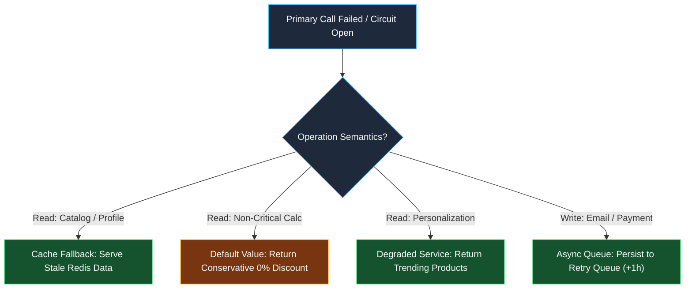

### Fallback Pattern Matrix

| Strategy | Example | Data Freshness / Consistency | Risk if Misused |
| :--- | :--- | :--- | :--- |
| **Cache Fallback** | `getProductFromCache` via Redis | Eventual / Stale (`setFromCache(true)`) | Serving stale inventory/price on checkout |
| **Default Value** | `getDefaultDiscount` returns `BigDecimal.ZERO` | Conservative safe default | Silently giving wrong financial values if not conservative |
| **Degraded Service** | `getDegradedRecommendations` returns trending items | Generic (non-personalized) | Secondary dependency (`getTrendingProducts`) also failing |
| **Async Processing** | `queueNotificationForRetry` saves to `NotificationQueue` | Eventual completion (`+1 hour` retry) | Unbounded queue growth during prolonged outage |

> [!TIP]
> Keep fallback methods **self-contained and fast**. A fallback that makes another synchronous network call to a struggling database can cause a secondary cascade.

### Cache Fallback

```java
@Service
public class ProductServiceWithFallback {

    @Autowired
    private ProductClient productClient;

    @Autowired
    private RedisTemplate<String, Product> redisTemplate;

    @CircuitBreaker(
        name = "product-service",
        fallbackMethod = "getProductFromCache"
    )
    public Product getProduct(Long productId) {
        return productClient.getProduct(productId);
    }

    // Fallback: serve stale data from cache
    public Product getProductFromCache(Long productId, Exception ex) {
        logger.warn("Product service unavailable, serving from cache", ex);

        Product cached = redisTemplate.opsForValue()
            .get("product:" + productId);

        if (cached != null) {
            cached.setFromCache(true);
            return cached;
        }

        throw new ServiceUnavailableException("Product service unavailable and no cached data");
    }
}
```

### Default Value Fallback

```java
@Service
public class DiscountServiceWithFallback {

    @CircuitBreaker(
        name = "discount-service",
        fallbackMethod = "getDefaultDiscount"
    )
    public BigDecimal getDiscount(Long customerId) {
        return discountClient.calculateDiscount(customerId);
    }

    // Fallback: return conservative default
    public BigDecimal getDefaultDiscount(Long customerId, Exception ex) {
        logger.warn("Discount service unavailable, using default 0%", ex);
        return BigDecimal.ZERO;  // No discount if service down
    }
}
```

### Degraded Service Fallback

```java
@Service
public class RecommendationServiceWithFallback {

    @CircuitBreaker(
        name = "recommendation-service",
        fallbackMethod = "getDegradedRecommendations"
    )
    public List<Product> getRecommendations(Long customerId, int count) {
        return recommendationClient.getRecommendations(customerId, count);
    }

    // Fallback: return simple fallback recommendations
    public List<Product> getDegradedRecommendations(Long customerId, int count, Exception ex) {
        logger.warn("Recommendation service unavailable, returning trending products", ex);

        // Return trending products instead of personalized
        return productService.getTrendingProducts(count);
    }
}
```

### Async Processing Fallback

```java
@Service
public class NotificationServiceWithFallback {

    @CircuitBreaker(
        name = "email-service",
        fallbackMethod = "queueNotificationForRetry"
    )
    public void sendOrderConfirmation(Order order) {
        emailService.sendOrderConfirmation(order);
    }

    // Fallback: queue for later retry
    public void queueNotificationForRetry(Order order, Exception ex) {
        logger.warn("Email service unavailable, queuing for retry", ex);

        NotificationQueue notification = new NotificationQueue(
            order.getCustomerId(),
            NotificationType.ORDER_CONFIRMATION,
            order.getId(),
            LocalDateTime.now().plusHours(1)  // Retry after 1 hour
        );

        notificationQueueRepository.save(notification);
    }
}
```

---

## Health Checks

Determine whether a service instance is alive (should not be restarted) and ready (should receive load-balancer traffic).

### Kubernetes Liveness vs Readiness Probes

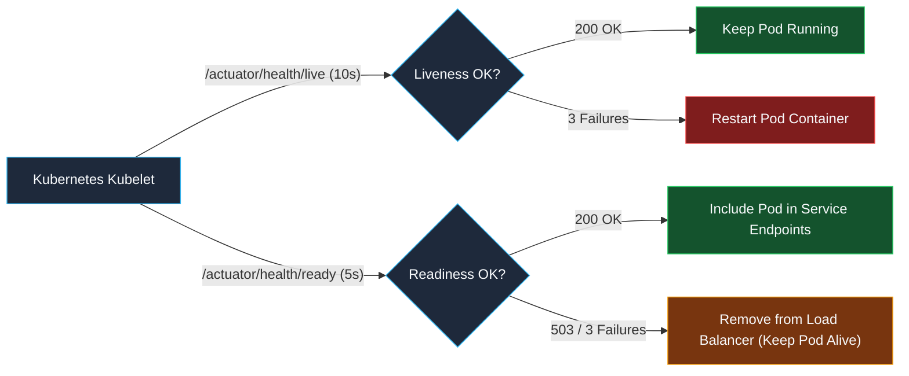

### Liveness vs Readiness Comparison

| Probe | Question Answered | Action on Failure (`failureThreshold: 3`) | What to Check |
| :--- | :--- | :--- | :--- |
| **Liveness** (`/actuator/health/live`) | *Is the process deadlocked or crashed?* | **Kill & restart** the pod | Main event loop / JVM responsiveness only |
| **Readiness** (`/actuator/health/ready`) | *Can this pod serve traffic right now?* | **Remove from load balancer** (do not kill) | DB connection pool, cache warmup, critical dependencies |

> [!WARNING]
> Never include external downstream dependencies (like `payment-service`) in your **Liveness** probe. If `payment-service` goes down, Kubernetes would restart all `order-service` pods in a crash loop, amplifying the outage. Put external checks in **Readiness** or custom health endpoints only.

### Health Check Implementation

```java
@Component
public class ApplicationHealthIndicator extends AbstractHealthIndicator {

    @Autowired
    private OrderRepository orderRepository;

    @Autowired
    private RestTemplate restTemplate;

    @Override
    protected void doHealthCheck(Health.Builder builder) throws Exception {
        try {
            // Check database connectivity
            orderRepository.count();

            // Check payment service availability
            restTemplate.getForObject("http://payment-service:8080/health", String.class);

            builder.up()
                .withDetail("service", "order-service")
                .withDetail("status", "healthy")
                .withDetail("database", "connected")
                .withDetail("payment-service", "reachable");
        } catch (Exception e) {
            builder.down()
                .withDetail("service", "order-service")
                .withDetail("error", e.getMessage());
        }
    }
}

// Kubernetes liveness probe
@RestController
public class HealthController {

    @GetMapping("/actuator/health/live")  // Liveness
    public ResponseEntity<String> isAlive() {
        return ResponseEntity.ok("OK");
    }

    @GetMapping("/actuator/health/ready")  // Readiness
    public ResponseEntity<String> isReady() {
        // Check if dependencies available
        try {
            orderRepository.count();
            return ResponseEntity.ok("READY");
        } catch (Exception e) {
            return ResponseEntity.status(503).body("NOT_READY");
        }
    }

    @GetMapping("/actuator/health")  // Overall
    public Health getHealth() {
        // Aggregate all indicators
        return new Health.Builder().up().build();
    }
}
```

```yaml
# Kubernetes manifest
apiVersion: apps/v1
kind: Deployment
metadata:
  name: order-service
spec:
  template:
    spec:
      containers:
      - name: order-service
        image: order-service:1.0

        livenessProbe:
          httpGet:
            path: /actuator/health/live
            port: 8080
          initialDelaySeconds: 30
          periodSeconds: 10
          timeoutSeconds: 3
          failureThreshold: 3

        readinessProbe:
          httpGet:
            path: /actuator/health/ready
            port: 8080
          initialDelaySeconds: 10
          periodSeconds: 5
          timeoutSeconds: 3
          failureThreshold: 3
```

---

## Chaos Engineering

Proactively injects controlled faults (failures, latency, dependency outages) to verify that circuit breakers, timeouts, and fallbacks work before production incidents happen.

### Chaos Experiment Lifecycle

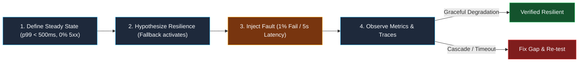

### Chaos Fault Matrix (Netflix Simian Army & Test Suite)

| Fault Injection Type | Simulated Failure | Expected Resilience Behavior |
| :--- | :--- | :--- |
| **Service Outage** | `PaymentClient` throws `PaymentServiceException` | Order created with `OrderStatus.PENDING` & `PaymentStatus.PENDING` |
| **Dependency Timeout** | `InventoryClient` throws `TimeoutException` | Graceful fallback without crashing checkout |
| **Cascade Failure** | Payment + Inventory + Shipping all throw `ServiceException` | Circuit breakers open; fast-fail `OrderException("unavailable")` |
| **Latency Injection** | `Thread.sleep(5000)` on `PaymentClient` | `TimeLimiter` aborts under `10s`; falls back to `PENDING` |
| **Production Chaos** | `ChaosMonkeyRunner` (`failureRate=0.01`, `latency=100ms`) | Blast radius contained; SLAs remain green |

> [!IMPORTANT]
> Always minimize the **blast radius** of production chaos experiments (e.g., `1%` failure rate in `ChaosMonkeyRunner`, canary pods, or automated abort triggers) and run GameDays during staffed hours.

### Chaos Engineering Implementation

```java
// Simulating chaos in tests
@SpringBootTest
public class ChaosEngineeringTests {

    @Autowired
    private OrderService orderService;

    @Autowired
    private PaymentClient paymentClient;

    // Chaos test: Payment service always fails
    @Test
    public void testOrderCreationWhenPaymentServiceDown() {
        // Mock payment service to always fail
        when(paymentClient.processPayment(any(), any()))
            .thenThrow(new PaymentServiceException("Service unavailable"));

        // Order should still be created (payment retried later)
        Order order = orderService.createOrder(createOrderRequest());

        assertThat(order.getStatus()).isEqualTo(OrderStatus.PENDING);
        assertThat(order.getPaymentStatus()).isEqualTo(PaymentStatus.PENDING);
    }

    // Chaos test: Inventory service times out
    @Test
    public void testOrderCreationWhenInventoryTimesOut() {
        // Mock inventory to timeout
        when(inventoryClient.reserveItems(any()))
            .thenThrow(new TimeoutException("Request timed out"));

        // Should fallback gracefully
        Order order = orderService.createOrder(createOrderRequest());

        assertThat(order).isNotNull();
        // Either order created with pending inventory
        // Or order failed with clear error message
    }

    // Chaos test: Cascade failure
    @Test
    public void testOrderServiceWhenMultipleDependenciesDown() {
        when(paymentClient.processPayment(any(), any()))
            .thenThrow(new ServiceException());
        when(inventoryClient.reserveItems(any()))
            .thenThrow(new ServiceException());
        when(shippingClient.createShipment(any()))
            .thenThrow(new ServiceException());

        // Circuit breaker should open for all services
        // Requests should fail fast
        OrderException exception = assertThrows(
            OrderException.class,
            () -> orderService.createOrder(createOrderRequest())
        );

        assertThat(exception.getMessage()).contains("unavailable");
    }

    // Chaos test: Latency injection
    @Test
    public void testOrderServiceWithHighLatency() {
        // Mock with slow response
        doAnswer(invocation -> {
            Thread.sleep(5000);  // 5 second delay
            return createPayment();
        }).when(paymentClient).processPayment(any(), any());

        // Should timeout and fallback
        long startTime = System.currentTimeMillis();
        Order order = orderService.createOrder(createOrderRequest());
        long duration = System.currentTimeMillis() - startTime;

        assertThat(duration).isLessThan(10000);  // Should use timeout
        assertThat(order.getPaymentStatus()).isEqualTo(PaymentStatus.PENDING);
    }
}

// Production chaos engineering with Chaos Toolkit
@Configuration
public class ChaosConfiguration {

    // In production environment, occasionally inject failures
    @Bean
    public ChaosMonkeyRunner chaosMonkeyRunner() {
        return new ChaosMonkeyRunner()
            .withFailureRate(0.01)  // 1% of requests fail
            .withLatency(100);      // Add 100ms latency
    }
}
```

---

## Distributed Tracing

Tracks a single request end-to-end across microservice boundaries using **Trace IDs**, **Span IDs**, and **Correlation IDs** to pinpoint latency and failures.

### Distributed Trace & Span Hierarchy

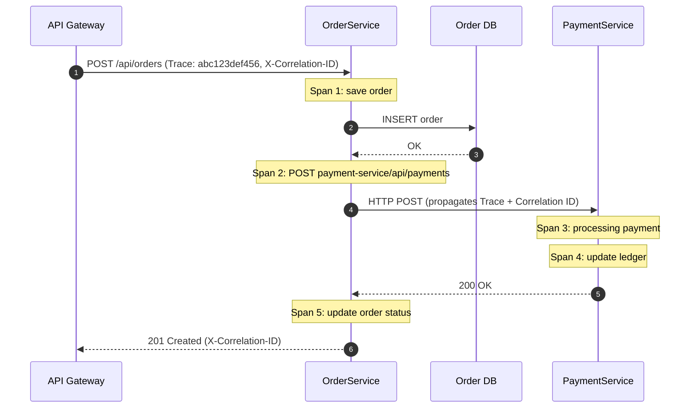

### Tracing Concepts & Sampling

| Concept | Purpose | Scope |
| :--- | :--- | :--- |
| **Trace ID** (`abc123def456`) | Uniquely identifies the entire end-to-end request tree | Across all services |
| **Span ID** | Represents a single unit of work (HTTP call, DB query, manual block) | Single operation (`parentId` links tree) |
| **Correlation ID** (`X-Correlation-ID`) | Business/log correlation header stored in SLF4J `MDC` | Logs across threads & services |
| **Sampling Probability** | Percentage of traces exported to Zipkin (`1.0` = 100%, `0.1` = 10%) | Controls Zipkin storage & network overhead |

> [!TIP]
> Always clear `MDC.remove("correlationId")` in a `finally` block inside `CorrelationIdFilter`. Servlet containers reuse threads across requests, so forgetting to clear `MDC` leaks one user's `correlationId` into subsequent unrelated logs.

### Spring Cloud Sleuth + Zipkin

```xml
<!-- pom.xml -->
<dependency>
    <groupId>org.springframework.cloud</groupId>
    <artifactId>spring-cloud-starter-sleuth</artifactId>
</dependency>
<dependency>
    <groupId>org.springframework.cloud</groupId>
    <artifactId>spring-cloud-sleuth-zipkin</artifactId>
</dependency>
```

```yaml
# application.yml
spring:
  sleuth:
    sampler:
      probability: 1.0  # Sample 100% of requests (0.1 = 10%)
  zipkin:
    baseUrl: http://zipkin-server:9411/

management:
  tracing:
    sampling:
      probability: 1.0
```

```java
// Services automatically instrumented by Sleuth
@Service
public class OrderService {

    @Autowired
    private OrderRepository orderRepository;

    @Autowired
    private PaymentClient paymentClient;

    @Autowired
    private RestTemplate restTemplate;

    public Order createOrder(CreateOrderRequest request) {
        // Sleuth automatically creates span for method
        Order order = new Order(request);
        orderRepository.save(order);

        // Sleuth automatically creates child span for HTTP call
        Payment payment = paymentClient.processPayment(order.getId(), order.getTotal());

        return order;
    }
}

// Trace appears in Zipkin:
// POST /api/orders (trace: abc123def456)
//   ├── save order (span: 1)
//   ├── POST payment-service/api/payments (span: 2)
//   │   ├── processing payment (span: 3)
//   │   └── update ledger (span: 4)
//   └── update order status (span: 5)

// Manual span creation
@Service
public class ComplexOrderService {

    @Autowired
    private Tracer tracer;

    public void processOrder(Long orderId) {
        // Parent span
        Tracer.SpanInScope span = tracer.withSpan(
            tracer.nextSpan().name("process-order")
        );

        try {
            // Child span for inventory
            Tracer.SpanInScope inventorySpan = tracer.withSpan(
                tracer.nextSpan().name("reserve-inventory")
            );
            try {
                inventoryService.reserveItems(orderId);
            } finally {
                inventorySpan.close();
            }

            // Child span for payment
            Tracer.SpanInScope paymentSpan = tracer.withSpan(
                tracer.nextSpan().name("process-payment")
            );
            try {
                paymentService.processPayment(orderId);
            } finally {
                paymentSpan.close();
            }
        } finally {
            span.close();
        }
    }
}
```

### Correlation IDs

```java
// Manually pass correlation ID
@Component
public class CorrelationIdFilter implements Filter {

    @Override
    public void doFilter(ServletRequest request, ServletResponse response,
        FilterChain chain) throws IOException, ServletException {

        HttpServletRequest httpRequest = (HttpServletRequest) request;
        String correlationId = httpRequest.getHeader("X-Correlation-ID");

        if (correlationId == null) {
            correlationId = UUID.randomUUID().toString();
        }

        // Add to MDC (Mapped Diagnostic Context) for logging
        MDC.put("correlationId", correlationId);

        // Add to response
        ((HttpServletResponse) response).addHeader("X-Correlation-ID", correlationId);

        try {
            chain.doFilter(request, response);
        } finally {
            MDC.remove("correlationId");
        }
    }
}
```

```xml
<!-- logback.xml -->
<configuration>
    <appender name="CONSOLE" class="ch.qos.logback.core.ConsoleAppender">
        <encoder>
            <pattern>
                %d{HH:mm:ss.SSS} [%thread] %-5level %logger{36} [%X{correlationId}] - %msg%n
            </pattern>
        </encoder>
    </appender>
</configuration>
```

```text
// Logs appear as:
// 2024-02-09 10:30:45.123 [http-nio-8080-exec-1] INFO OrderService [abc123] - Processing order
// 2024-02-09 10:30:45.456 [http-nio-8080-exec-2] INFO PaymentService [abc123] - Processing payment
// All with same correlationId for easy tracing
```

---

## Interview Questions

### Q1: Design a resilient payment service handling 10K requests/second

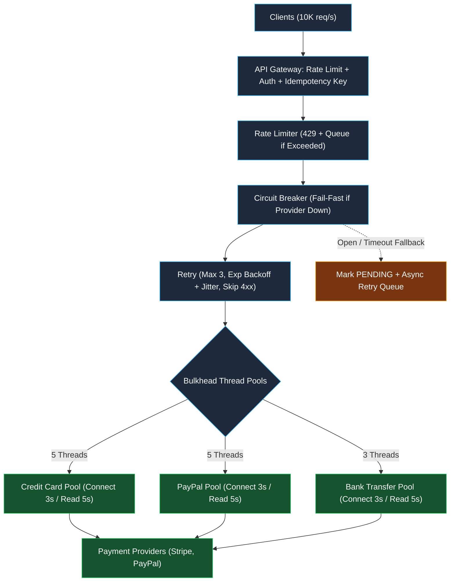

**Layered Resilience Architecture:**

- **API Gateway (Public Interface):** Enforce `10K req/s` rate limiting, authentication, request validation, and `Idempotency-Key` tracking at the edge.
- **Circuit Breaker (Resilience4j):** Fail fast when a payment provider goes down and route to a `PENDING` async retry queue.
- **Retry Pattern:** Exponential backoff with jitter, max `3` attempts (`1` original + `2` retries), ignoring validation/4xx errors; always send the `Idempotency-Key` to prevent double charging.
- **Bulkhead Pattern:** Isolate thread pools per provider (`Credit Card: 5 threads`, `PayPal: 5 threads`, `Bank Transfer: 3 threads`) so one slow provider never starves the others.
- **Timeout Pattern:** Connect timeout `3s`, read timeout `5s`, total request budget `10s`.
- **Fallback Strategy:** Provider down → `PENDING` + async queue; Timeout → async queue; Rate limited → `HTTP 429` + queue.
- **Observability:** Track circuit breaker states (Prometheus), retry counts, bulkhead capacity alerts, latency percentiles (`p50`, `p95`, `p99`), and distributed traces (Zipkin).

### Q2: Your payment service is timing out. How would you troubleshoot?

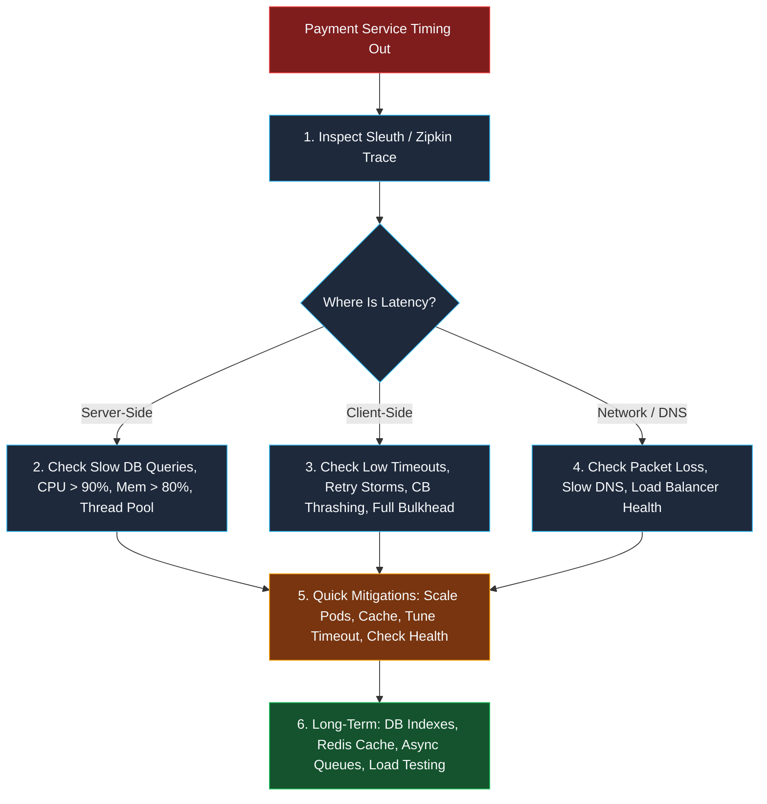

**Systematic Troubleshooting Checklist:**

| Phase | Investigation / Action | Key Signals |
| :--- | :--- | :--- |
| **1. Isolate Span** | Open Sleuth/Zipkin trace to see client vs server span | e.g., `Payment Service → Stripe API` span hanging |
| **2. Server-Side** | Check slow query log, CPU (`> 90%`), Memory (`> 80%`), thread pool exhaustion | Lock contention, missing DB indexes, GC pauses |
| **3. Client-Side** | Audit retry storms, circuit breaker thrashing, full bulkheads, overly tight timeouts | Surge in retry metrics, `BulkheadFullException` |
| **4. Network** | Inspect packet loss, DNS resolution latency, load balancer health | High TCP handshake / connect latency |
| **5. Quick Fixes** | Scale service instances, enable response caching, batch requests, temporarily raise timeout | Immediate `p99` & error-rate stabilization |
| **6. Long-Term Fixes** | Add DB indexes, Redis caching layer, async processing, provider optimization, load tests | Sustained headroom under peak traffic |

> [!TIP]
> In interviews, always mention **retry storms** when diagnosing timeouts: if a downstream service slows down and callers retry aggressively without jitter or a circuit breaker, traffic multiplies 3× and keeps the service pinned even after the root cause clears.
