# Data Management in Microservices

> [!IMPORTANT]
> **Core Principle:** Each microservice owns its private data and exposes it only through well-defined APIs or domain events. Cross-service database joins and distributed 2PC transactions are replaced by **Sagas**, **Transactional Outbox + CDC**, **CQRS**, and **Event Sourcing**.

## Table of Contents
1. [Database per Service Pattern](#database-per-service)
2. [Data Consistency](#data-consistency)
3. [Saga Pattern Deep Dive](#saga-pattern-deep-dive)
4. [Event Sourcing](#event-sourcing)
5. [CQRS Implementation](#cqrs-implementation)
6. [Distributed Caching](#distributed-caching)
7. [API Composition for Queries](#api-composition-for-queries)
8. [Data Replication](#data-replication)
9. [Interview Questions](#interview-questions)

---

## Database per Service

Each service owns its database. No shared database between services.

### Why Database per Service?

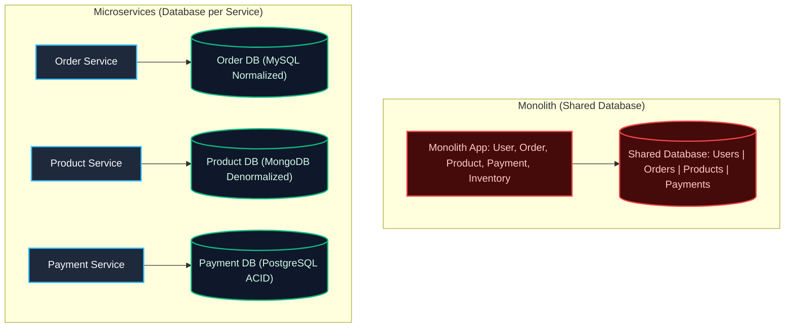

**Monolith (Shared Database) Problems:**
- **Single bottleneck:** If the database is slow, the entire application slows down.
- **Schema coupling:** Schema changes affect multiple modules and teams simultaneously.
- **No polyglot persistence:** Cannot optimize schema or engine per workload.
- **Tight coupling:** Services depend directly on internal tables of other domains.
- **Coarse scaling:** Difficult to scale independently—only option is scaling the entire app/DB.

**Microservices (Database per Service) Benefits & Tradeoffs:**
- **Benefits:** Independent scaling, polyglot persistence (SQL vs NoSQL), independent schema evolution, loose coupling, and workload-tuned performance.
- **Tradeoffs:** Distributed transactions are complex, cross-service queries are harder, eventual consistency must be handled, and more database instances must be operated.

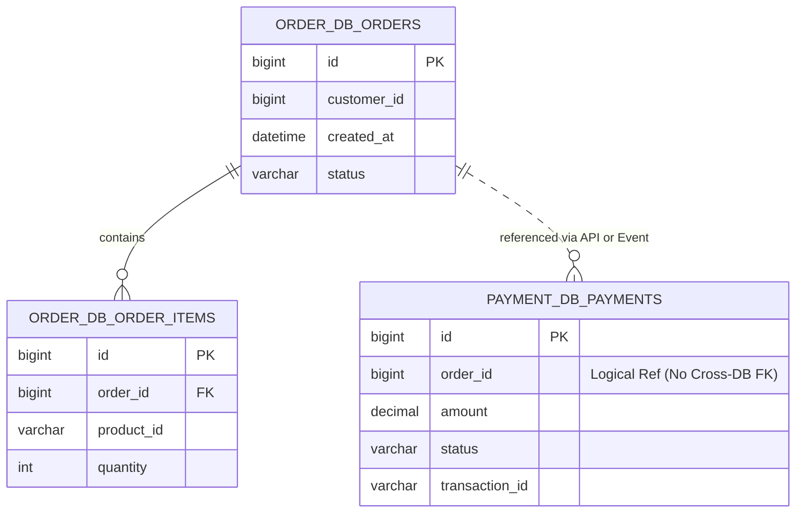

| Aspect | Shared Database | Database per Service |
| :--- | :--- | :--- |
| **Coupling** | Tight (schema-level dependencies) | Loose (API & event contracts) |
| **DB Technology** | Single engine for all domains | Polyglot (MySQL, MongoDB, Redis, etc.) |
| **Scaling** | Vertical / whole-DB scaling | Per-service independent scaling |
| **Transactions** | Local ACID joins | Sagas & eventual consistency |
| **Queries** | Simple SQL `JOIN` | API Composition or CQRS views |

> [!WARNING]
> **Shared Database Anti-Pattern:** Allowing multiple services to read/write the same tables creates hidden runtime coupling. A column rename in `payments` can silently break `OrderService` deployments.

### Implementation

```java
// Order Service with its own database
@Configuration
@EnableJpaRepositories(
    basePackages = "com.ecommerce.order",
    entityManagerFactoryRef = "orderEntityManager",
    transactionManagerRef = "orderTransactionManager"
)
public class OrderDatabaseConfiguration {

    @Bean
    @ConfigurationProperties(prefix = "spring.datasource.order")
    public DataSource orderDataSource() {
        return DataSourceBuilder.create().build();
    }

    @Bean
    public LocalContainerEntityManagerFactoryBean orderEntityManager(
        @Qualifier("orderDataSource") DataSource dataSource,
        EntityManagerFactoryBuilder builder
    ) {
        return builder
            .dataSource(dataSource)
            .packages("com.ecommerce.order.entity")
            .persistenceUnit("order")
            .build();
    }

    @Bean
    public PlatformTransactionManager orderTransactionManager(
        @Qualifier("orderEntityManager") LocalContainerEntityManagerFactoryBean emf
    ) {
        return new JpaTransactionManager(emf.getObject());
    }
}

// Product Service with different database technology
@Configuration
@EnableMongoRepositories(basePackages = "com.ecommerce.product")
public class ProductDatabaseConfiguration {

    @Bean
    public MongoTemplate mongoTemplate(MongoClient mongoClient, MongoDatabaseFactory mongoDatabaseFactory) {
        return new MongoTemplate(mongoDatabaseFactory);
    }
}
```

```yaml
# application.yml
spring:
  datasource:
    order:
      url: jdbc:mysql://order-db:3306/order_service
      username: ${DB_USER}
      password: ${DB_PASSWORD}
      driver-class-name: com.mysql.cj.jdbc.Driver

  data:
    mongodb:
      uri: mongodb://product-db:27017/product_service
```

```java
// Order Service entities (MySQL - Normalized schema, optimized for transactions)
@Entity
@Table(name = "orders")
public class Order {
    @Id
    private Long id;
    private Long customerId;
    private LocalDateTime createdAt;
}

// Product Service entities (MongoDB - Denormalized schema, optimized for querying)
@Document(collection = "products")
public class Product {
    @Id
    private String id;
    private String name;
    private List<Review> reviews;         // Embedded
    private Map<String, Object> metadata; // Flexible schema
}
```

### Shared Database Anti-Pattern

```java
// BAD: Multiple services using same database
@Entity
@Table(name = "orders")
public class Order {
    @Id
    private Long id;
    private Long customerId;
    private String productId;           // Foreign key to product_service schema
    private String paymentStatus;       // Payment service updates this
    private String shippingStatus;      // Shipping service updates this
}

// Problems:
// 1. Order service depends on payment schema
// 2. If payment adds new column, order service broken
// 3. Services tightly coupled at database level
// 4. Difficult to migrate payment to different database
// 5. Cannot optimize schema per service

// GOOD: Each service has own database
// Order Service only has order-specific data
@Entity
@Table(name = "orders")
public class Order {
    @Id
    private Long id;
    private Long customerId;
    @Embedded
    private OrderItem[] items;
    private LocalDateTime createdAt;
}

// Payment Service has its own payment database
@Entity
@Table(name = "payments")
public class Payment {
    @Id
    private Long id;
    private Long orderId;               // Reference, not foreign key
    private BigDecimal amount;
    private PaymentStatus status;
    private String transactionId;
}

// Services communicate via events or APIs, not shared database
```

> [!IMPORTANT]
> Always store **logical IDs** (e.g., `orderId`, `customerId`) instead of cross-service foreign keys. Enforce referential integrity asynchronously via domain events or synchronously at API boundaries.

---

## Data Consistency

### 2PC (Two-Phase Commit) vs Eventual Consistency

In a monolith, a single ACID transaction guarantees **Strong Consistency** (`Account A: $100 -> $70` and `Account B: $50 -> $80` both succeed or both fail). Across microservices, **2PC (XA transactions)** attempts distributed ACID by locking resources across services, whereas **Eventual Consistency** uses asynchronous events and compensating actions.

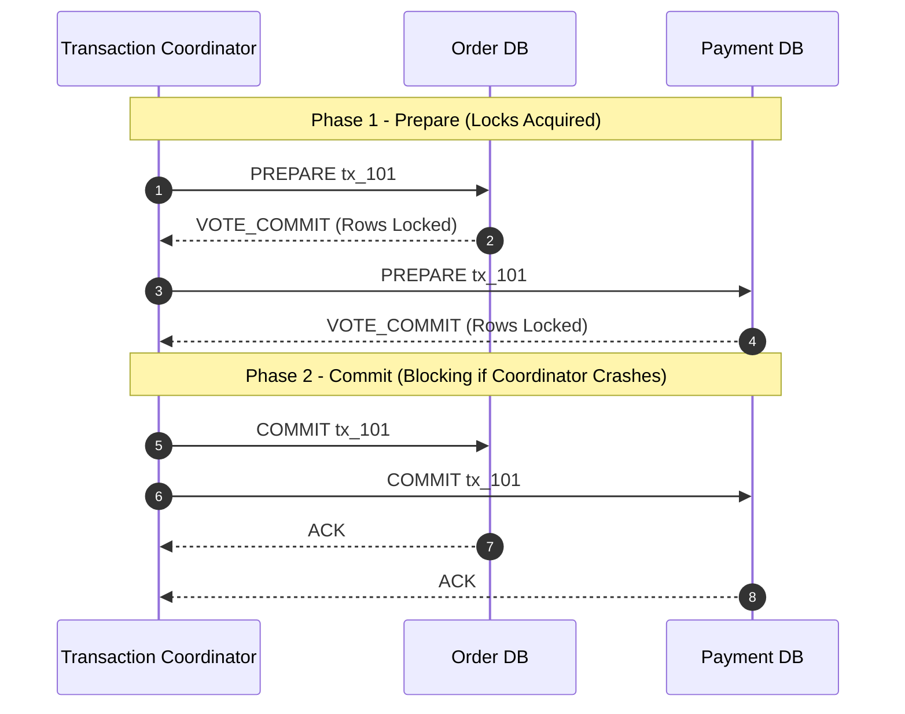

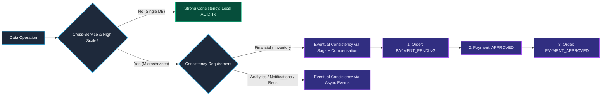

| Dimension | 2PC (Two-Phase Commit) | Eventual Consistency (Saga / Events) |
| :--- | :--- | :--- |
| **Consistency** | Strong (immediate global ACID) | Eventual (temporary intermediate states) |
| **Availability** | Low (blocks if coordinator or participant fails) | High (services operate independently) |
| **Locking** | Long-lived distributed locks across DBs | Short-lived local locks only |
| **Latency & Throughput** | High latency, poor horizontal scale | Low latency, high throughput |
| **Protocol Support** | Requires XA-compliant resources (no REST/Kafka) | Works with any DB, REST, gRPC, or Kafka |

- **When to use Strong Consistency (local ACID):** Financial ledger transfers within a single service, inventory reservation within a single DB, and ACID-critical invariants.
- **When to use Eventual Consistency:** Cross-service workflows (Order -> Payment -> Shipping), recommendations, view counts, user notifications, and analytics.

> [!WARNING]
> **Avoid 2PC in Microservices:** 2PC violates service autonomy, holds database locks across network calls, and is unsupported by modern brokers like Kafka or NoSQL stores. Use **Sagas** instead.

### Handling Eventual Consistency

```java
// Order is created but payment not yet processed
@Entity
public class Order {
    @Id
    private Long id;
    private Long customerId;

    @Enumerated(EnumType.STRING)
    private OrderStatus orderStatus;       // CREATED, PAYMENT_PENDING, PAYMENT_APPROVED

    @Enumerated(EnumType.STRING)
    private PaymentStatus paymentStatus;   // PENDING, APPROVED, FAILED

    private LocalDateTime paymentReceivedAt;
}

// Client must handle pending states
@RestController
public class OrderController {

    @GetMapping("/{id}")
    public Order getOrder(@PathVariable Long id) {
        Order order = orderService.findById(id);

        // Client sees order with PAYMENT_PENDING status
        // Knows to check back later or use event notification
        return order;
    }
}

// Polling for completion
@Component
public class OrderStatusPoller {

    @Autowired
    private OrderService orderService;

    @Scheduled(fixedDelay = 5000)  // Check every 5 seconds
    public void pollOrderStatus() {
        List<Order> pendingOrders = orderService.findByPaymentStatus(PaymentStatus.PENDING);

        pendingOrders.forEach(order -> {
            // Check if payment was processed
            Payment payment = paymentService.getPayment(order.getId());

            if (payment.isApproved()) {
                // Update order status
                order.markPaymentApproved();
                orderService.save(order);

                // Notify user
                notificationService.sendOrderConfirmation(order.getCustomerId());
            }
        });
    }
}

// Better: Event notification
@Component
public class PaymentEventListener {

    @KafkaListener(topics = "payments", groupId = "order-service")
    public void onPaymentProcessed(PaymentProcessedEvent event) {
        Order order = orderService.findById(event.getOrderId());
        order.markPaymentApproved();
        orderService.save(order);

        // User notified immediately when payment completes
        notificationService.sendOrderConfirmation(order.getCustomerId());
    }
}
```

> [!TIP]
> Prefer **push-based event notifications** (Kafka listeners, WebSockets, or SSE) over fixed-delay database polling. Polling adds unnecessary DB load and increases end-to-end latency.

---

## Saga Pattern Deep Dive

A **Saga** manages distributed transactions across microservices as a sequence of **local transactions**. If any step fails, the saga executes **compensating transactions** to undo prior steps.

### Choreography-Based Saga (Event-Driven)

Each service publishes domain events and reacts independently without a central coordinator.

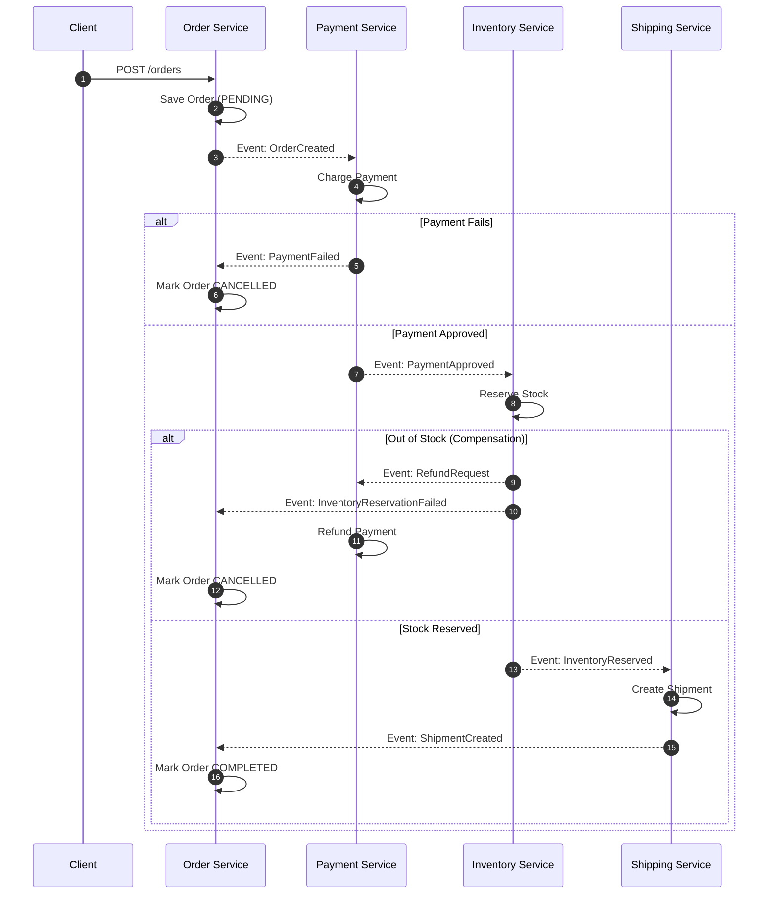

```java
// Domain events
public class OrderCreatedEvent {
    private Long orderId;
    private Long customerId;
    private List<OrderItem> items;
    private BigDecimal total;
    // Immutable event
}

public class PaymentApprovedEvent {
    private Long orderId;
    private Long paymentId;
    private BigDecimal amount;
}

public class PaymentFailedEvent {
    private Long orderId;
    private String reason;
}

// Order Service
@Service
public class OrderService {

    @Autowired
    private OrderRepository orderRepository;

    @Autowired
    private KafkaTemplate<String, OrderCreatedEvent> kafkaTemplate;

    // Step 1: Create order
    @Transactional
    public void createOrder(CreateOrderRequest request) {
        Order order = new Order();
        order.setCustomerId(request.getCustomerId());
        order.setItems(request.getItems());
        order.setTotal(request.getTotal());
        order.setStatus(OrderStatus.PENDING);

        orderRepository.save(order);

        // Publish event
        OrderCreatedEvent event = new OrderCreatedEvent(
            order.getId(),
            order.getCustomerId(),
            order.getItems(),
            order.getTotal()
        );

        kafkaTemplate.send("orders", event);
    }

    // Step 3: Listen for payment result
    @KafkaListener(topics = "payments", groupId = "order-service")
    public void onPaymentResult(PaymentEvent event) {
        Order order = orderRepository.findById(event.getOrderId()).orElseThrow();

        if (event instanceof PaymentApprovedEvent) {
            order.setPaymentApprovedAt(LocalDateTime.now());
            // Wait for inventory, don't mark completed yet
        } else if (event instanceof PaymentFailedEvent) {
            order.setStatus(OrderStatus.CANCELLED);
            order.setCancellationReason(((PaymentFailedEvent) event).getReason());
        }

        orderRepository.save(order);
    }

    // Step 5: Listen for shipment created
    @KafkaListener(topics = "shipments", groupId = "order-service")
    public void onShipmentCreated(ShipmentCreatedEvent event) {
        Order order = orderRepository.findById(event.getOrderId()).orElseThrow();
        order.setStatus(OrderStatus.COMPLETED);
        order.setShipmentId(event.getShipmentId());

        orderRepository.save(order);
    }
}

// Payment Service
@Service
public class PaymentService {

    @Autowired
    private PaymentRepository paymentRepository;

    @Autowired
    private KafkaTemplate<String, PaymentEvent> kafkaTemplate;

    // Step 2: Listen for order creation
    @KafkaListener(topics = "orders", groupId = "payment-service")
    public void onOrderCreated(OrderCreatedEvent event) {
        try {
            Payment payment = processPaymentWithProvider(event.getOrderId(), event.getTotal());

            paymentRepository.save(payment);

            // Publish success
            PaymentApprovedEvent approvedEvent = new PaymentApprovedEvent(
                event.getOrderId(),
                payment.getId(),
                payment.getAmount()
            );

            kafkaTemplate.send("payments", approvedEvent);
        } catch (PaymentException e) {
            // Publish failure
            PaymentFailedEvent failedEvent = new PaymentFailedEvent(
                event.getOrderId(),
                e.getMessage()
            );

            kafkaTemplate.send("payments", failedEvent);
        }
    }

    private Payment processPaymentWithProvider(Long orderId, BigDecimal amount) {
        // Call Stripe/PayPal API
        return new Payment();
    }
}

// Inventory Service
@Service
public class InventoryService {

    @Autowired
    private InventoryRepository inventoryRepository;

    @Autowired
    private KafkaTemplate<String, InventoryEvent> kafkaTemplate;

    // Step 4: Listen for payment approval
    @KafkaListener(topics = "payments", groupId = "inventory-service")
    public void onPaymentApproved(PaymentApprovedEvent event) {
        try {
            // Fetch order details
            Order order = orderService.getOrder(event.getOrderId());

            // Reserve inventory
            for (OrderItem item : order.getItems()) {
                inventoryRepository.reserveItem(item.getProductId(), item.getQuantity());
            }

            // Publish success
            InventoryReservedEvent reservedEvent = new InventoryReservedEvent(
                event.getOrderId(),
                order.getItems()
            );

            kafkaTemplate.send("inventory", reservedEvent);
        } catch (OutOfStockException e) {
            // Publish failure - triggers compensation
            InventoryReservationFailedEvent failedEvent = new InventoryReservationFailedEvent(
                event.getOrderId(),
                e.getMessage()
            );

            kafkaTemplate.send("inventory", failedEvent);

            // Trigger refund
            kafkaTemplate.send("refunds", new RefundRequest(event.getOrderId()));
        }
    }
}
```

### Orchestration-Based Saga (Centralized Control)

A single orchestrator coordinates every forward step and compensating rollback explicitly.

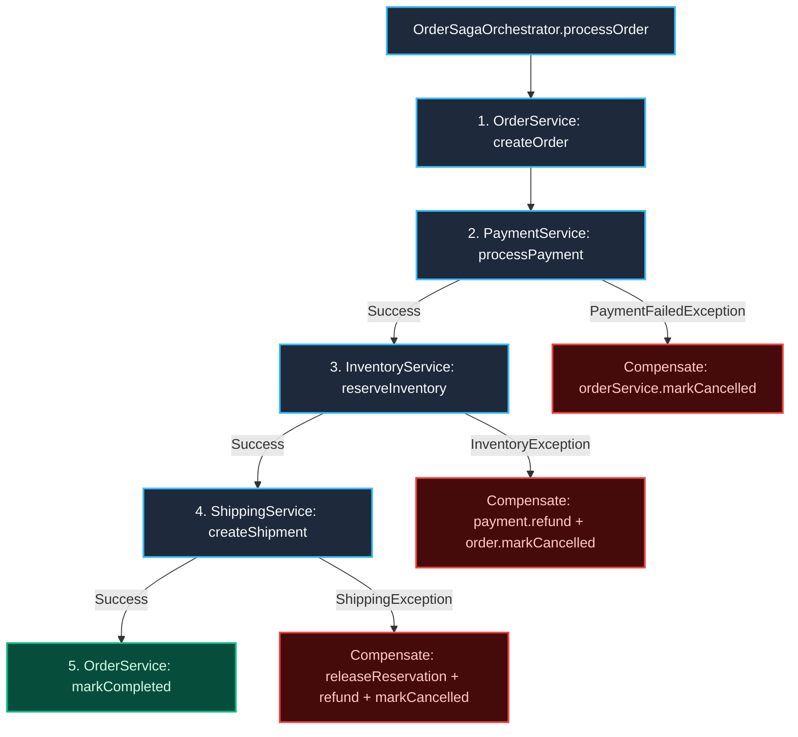

```java
// Single orchestrator coordinates the workflow
@Service
public class OrderSagaOrchestrator {

    @Autowired
    private OrderServiceClient orderService;

    @Autowired
    private PaymentServiceClient paymentService;

    @Autowired
    private InventoryServiceClient inventoryService;

    @Autowired
    private ShippingServiceClient shippingService;

    public void processOrder(CreateOrderRequest request) {
        String orderId = null;
        String paymentId = null;
        String reservationId = null;

        try {
            // Step 1: Create order
            orderId = orderService.createOrder(request);
            logger.info("Order created: {}", orderId);

            // Step 2: Process payment
            paymentId = paymentService.processPayment(orderId, request.getTotal());
            logger.info("Payment processed: {}", paymentId);

            // Step 3: Reserve inventory
            reservationId = inventoryService.reserveInventory(orderId, request.getItems());
            logger.info("Inventory reserved: {}", reservationId);

            // Step 4: Create shipment
            String shipmentId = shippingService.createShipment(orderId);
            logger.info("Shipment created: {}", shipmentId);

            // Step 5: Mark order complete
            orderService.markCompleted(orderId);

        } catch (PaymentFailedException e) {
            // Compensation: only order was created, just mark cancelled
            logger.error("Payment failed for order: {}", orderId, e);
            if (orderId != null) {
                orderService.markCancelled(orderId, "Payment failed: " + e.getMessage());
            }
            throw e;

        } catch (InventoryException e) {
            // Compensation: order created, payment done, need to refund and release
            logger.error("Inventory unavailable for order: {}", orderId, e);

            if (paymentId != null) {
                paymentService.refund(paymentId);
            }

            if (orderId != null) {
                orderService.markCancelled(orderId, "Inventory unavailable: " + e.getMessage());
            }

            throw e;

        } catch (ShippingException e) {
            // Compensation: everything done, only shipment failed
            logger.error("Shipping failed for order: {}", orderId, e);

            if (reservationId != null) {
                inventoryService.releaseReservation(reservationId);
            }

            if (paymentId != null) {
                paymentService.refund(paymentId);
            }

            if (orderId != null) {
                orderService.markCancelled(orderId, "Shipping unavailable: " + e.getMessage());
            }

            throw e;
        }
    }
}
```

### Choreography vs Orchestration

| Aspect | Choreography | Orchestration |
| :--- | :--- | :--- |
| **Control** | Distributed, implicit | Centralized, explicit |
| **Visibility** | Flow hidden in events | Clear step-by-step |
| **Debugging** | Hard (flow across multiple services) | Easy (single point to debug) |
| **Coupling** | Loose (via events) | Tight (via orchestrator) |
| **Scalability** | Scales well | Orchestrator can bottleneck |
| **New service** | Add listener, pick relevant events | Update orchestrator |
| **Failure handling** | Each service handles its failures | Orchestrator coordinates |
| **Best For** | Simple 2–4 step workflows | Complex workflows with branching/retries |

> [!IMPORTANT]
> **Saga Isolation & Idempotency:** Sagas lack **Isolation (I in ACID)**—concurrent sagas can read dirty intermediate states. Mitigate this with **Semantic Locks** (`PENDING` flags), **Commutative Updates**, and **Idempotent Compensations** (compensations must be retriable safely).

---

## Event Sourcing

Store the complete history of state changes as an **immutable, append-only log of domain events** rather than overwriting current state in place.

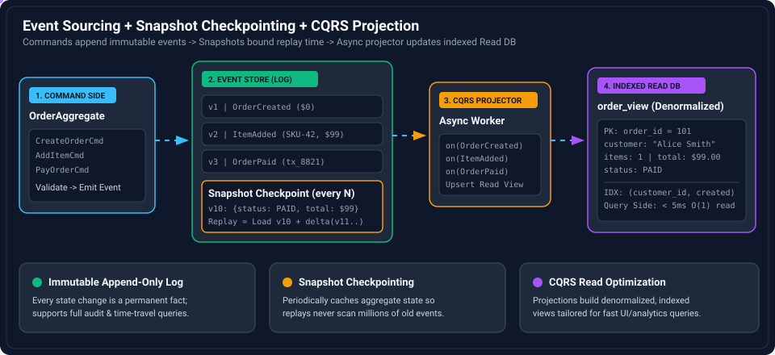

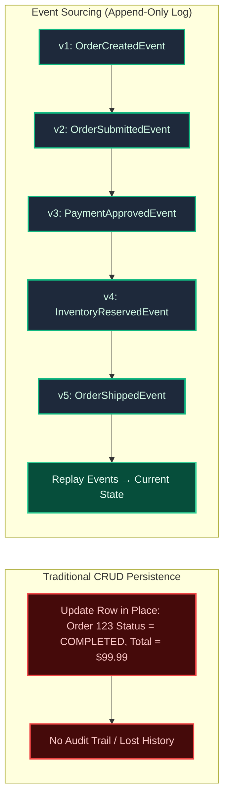

- **Advantages:** Complete audit trail, time-travel / temporal queries (state at time $T$), effortless debugging via replay, natural fit for event-driven architectures.
- **Disadvantages:** Higher implementation complexity, event schema evolution (versioning/upcasting), eventual consistency on read models, and unbounded storage growth (mitigated by snapshots).

| Feature | Traditional State Persistence | Event Sourcing |
| :--- | :--- | :--- |
| **Storage Model** | Mutable rows (latest state only) | Immutable append-only event log |
| **Audit Trail** | Requires separate audit table/triggers | Built-in by design |
| **Temporal Queries** | Not supported natively | Replay events up to timestamp $T$ |
| **Read Performance** | Direct PK lookup | Requires replay or CQRS read model |
| **Schema Evolution** | `ALTER TABLE` migrations | Event upcasting / versioned deserializers |

> [!IMPORTANT]
> **Optimistic Concurrency Control:** Always enforce a unique constraint on `(aggregate_id, event_version)` in `event_store`. If two concurrent writers attempt to append `version = 5`, the database rejects the second write cleanly.

### Event Sourcing Implementation

```java
// Event (immutable)
public abstract class DomainEvent {
    private String eventId;
    private String aggregateId;
    private LocalDateTime timestamp;
    private int version;

    // Getters, no setters
}

public class OrderCreatedEvent extends DomainEvent {
    private Long customerId;
    private List<OrderItem> items;
    private BigDecimal total;
}

public class PaymentApprovedEvent extends DomainEvent {
    private BigDecimal amount;
    private String transactionId;
}

// Event store (persistence)
@Entity
@Table(name = "event_store")
public class EventStoreEntry {
    @Id
    private String eventId;

    @Column(name = "aggregate_id")
    private String aggregateId;

    @Enumerated(EnumType.STRING)
    private String eventType;

    @Column(columnDefinition = "TEXT")
    private String eventData;  // JSON serialized event

    @Column(name = "event_version")
    private int version;

    @CreationTimestamp
    private LocalDateTime createdAt;
}

// Repository
public interface EventStoreRepository extends JpaRepository<EventStoreEntry, String> {
    List<EventStoreEntry> findByAggregateIdOrderByVersion(String aggregateId);
}

// Event store service
@Service
public class EventStore {

    @Autowired
    private EventStoreRepository eventStoreRepository;

    @Autowired
    private ObjectMapper objectMapper;

    // Append event
    @Transactional
    public void append(String aggregateId, DomainEvent event) {
        EventStoreEntry entry = new EventStoreEntry();
        entry.setEventId(UUID.randomUUID().toString());
        entry.setAggregateId(aggregateId);
        entry.setEventType(event.getClass().getSimpleName());
        entry.setEventData(objectMapper.writeValueAsString(event));
        entry.setVersion(getNextVersion(aggregateId));

        eventStoreRepository.save(entry);

        // Publish event for event handlers
        publishEvent(event);
    }

    // Reconstruct aggregate from events
    public Order reconstructOrder(String orderId) {
        List<EventStoreEntry> events = eventStoreRepository
            .findByAggregateIdOrderByVersion(orderId);

        Order order = new Order();

        for (EventStoreEntry entry : events) {
            DomainEvent event = deserializeEvent(entry);
            order.apply(event);  // Replay event
        }

        return order;
    }

    private int getNextVersion(String aggregateId) {
        Optional<EventStoreEntry> latest = eventStoreRepository
            .findByAggregateIdOrderByVersion(aggregateId)
            .stream()
            .reduce((first, second) -> second);

        return latest.map(e -> e.getVersion() + 1).orElse(1);
    }

    private DomainEvent deserializeEvent(EventStoreEntry entry) {
        Class<?> eventClass = ClassUtils.forName(
            "com.example.events." + entry.getEventType(),
            getClass().getClassLoader()
        );

        return objectMapper.readValue(entry.getEventData(), eventClass);
    }
}

// Aggregate that applies events
public class Order {
    private String orderId;
    private Long customerId;
    private List<OrderItem> items;
    private OrderStatus status;
    private int version;

    // Apply event to current aggregate
    public void apply(DomainEvent event) {
        if (event instanceof OrderCreatedEvent) {
            OrderCreatedEvent e = (OrderCreatedEvent) event;
            this.orderId = e.getAggregateId();
            this.customerId = e.getCustomerId();
            this.items = e.getItems();
            this.status = OrderStatus.CREATED;
            this.version++;

        } else if (event instanceof PaymentApprovedEvent) {
            this.status = OrderStatus.PAYMENT_APPROVED;
            this.version++;

        } else if (event instanceof OrderShippedEvent) {
            this.status = OrderStatus.SHIPPED;
            this.version++;
        }
    }

    // Generate events for actions
    public OrderCreatedEvent create(Long customerId, List<OrderItem> items, BigDecimal total) {
        return new OrderCreatedEvent(
            this.orderId,
            customerId,
            items,
            total
        );
    }

    public PaymentApprovedEvent approvePayment(BigDecimal amount, String transactionId) {
        return new PaymentApprovedEvent(
            this.orderId,
            amount,
            transactionId
        );
    }
}

// Using event sourcing
@Service
public class OrderServiceWithEventSourcing {

    @Autowired
    private EventStore eventStore;

    @Transactional
    public String createOrder(CreateOrderRequest request) {
        String orderId = UUID.randomUUID().toString();

        Order order = new Order(orderId);
        OrderCreatedEvent event = order.create(
            request.getCustomerId(),
            request.getItems(),
            request.getTotal()
        );

        eventStore.append(orderId, event);

        return orderId;
    }

    public Order getOrder(String orderId) {
        return eventStore.reconstructOrder(orderId);
    }

    // Get order state at specific time
    public Order getOrderAtTime(String orderId, LocalDateTime time) {
        List<EventStoreEntry> events = eventStoreRepository
            .findByAggregateIdOrderByVersion(orderId)
            .stream()
            .filter(e -> e.getCreatedAt().isBefore(time))
            .collect(Collectors.toList());

        Order order = new Order(orderId);
        events.forEach(e -> order.apply(deserializeEvent(e)));

        return order;
    }
}
```

### Event Store with Snapshots

```mermaid
sequenceDiagram
    autonumber
    participant S as EventStoreWithSnapshots
    participant SR as SnapshotRepository
    participant ER as EventStoreRepository

    S->>SR: findLatestSnapshot(orderId)
    alt Snapshot Found (v10)
        SR-->>S: Snapshot(v10, serializedOrder)
        S->>ER: findEvents(orderId, version &gt; 10)
        ER-->>S: [v11, v12]
        S->>S: order.apply(v11), order.apply(v12)
    else No Snapshot
        SR-->>S: Empty
        S->>ER: findEvents(orderId, version &gt; 0)
        ER-->>S: [v1..v12]
        S->>S: Replay all events from v1
    end
```

```java
// Snapshot: cached state at specific version
@Entity
@Table(name = "snapshots")
public class Snapshot {
    @Id
    private String snapshotId;

    private String aggregateId;
    private int version;

    @Column(columnDefinition = "TEXT")
    private String aggregateData;  // Serialized Order

    private LocalDateTime createdAt;
}

// Using snapshots for performance
@Service
public class EventStoreWithSnapshots {

    private static final int SNAPSHOT_THRESHOLD = 10;  // Every 10 events

    @Autowired
    private EventStoreRepository eventStoreRepository;

    @Autowired
    private SnapshotRepository snapshotRepository;

    public Order reconstructOrder(String orderId) {
        // Try to find latest snapshot
        Optional<Snapshot> latestSnapshot = snapshotRepository
            .findByAggregateIdOrderByVersionDesc(orderId)
            .stream()
            .findFirst();

        Order order;
        int eventsFromVersion = 0;

        if (latestSnapshot.isPresent()) {
            // Start from snapshot
            order = deserializeOrder(latestSnapshot.get().getAggregateData());
            eventsFromVersion = latestSnapshot.get().getVersion();
        } else {
            // Start from beginning
            order = new Order(orderId);
        }

        // Replay events since snapshot
        List<EventStoreEntry> events = eventStoreRepository
            .findByAggregateIdAndVersionGreaterThanOrderByVersion(orderId, eventsFromVersion);

        for (EventStoreEntry entry : events) {
            order.apply(deserializeEvent(entry));
        }

        return order;
    }

    @Transactional
    public void append(String aggregateId, DomainEvent event) {
        int currentVersion = getNextVersion(aggregateId);

        EventStoreEntry entry = new EventStoreEntry(aggregateId, event, currentVersion);
        eventStoreRepository.save(entry);

        // Create snapshot every N events
        if (currentVersion % SNAPSHOT_THRESHOLD == 0) {
            Order order = reconstructOrder(aggregateId);

            Snapshot snapshot = new Snapshot();
            snapshot.setSnapshotId(UUID.randomUUID().toString());
            snapshot.setAggregateId(aggregateId);
            snapshot.setVersion(currentVersion);
            snapshot.setAggregateData(serializeOrder(order));

            snapshotRepository.save(snapshot);
        }
    }
}
```

> [!WARNING]
> **Event Schema Evolution:** Never mutate or delete old events in `event_store`. When fields change, add defaults or write an **Upcaster** that transforms `v1` JSON into `v2` in memory during deserialization.

---

## CQRS Implementation

**Command Query Responsibility Segregation (CQRS)** separates the **Write Model (Commands)** from the **Read Model (Queries)** so each side can scale, index, and evolve independently.

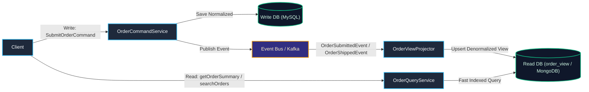

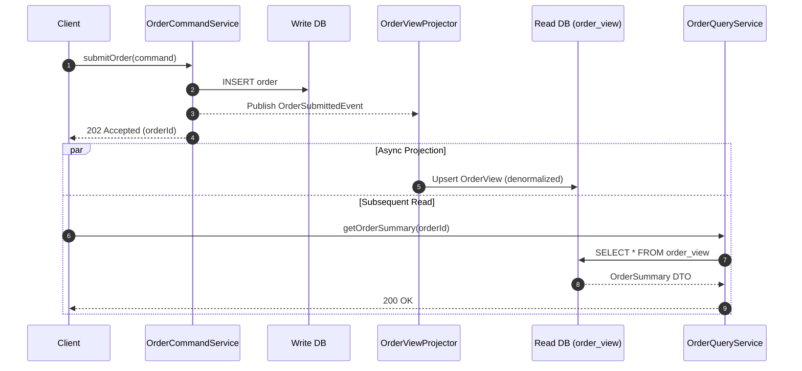

| Dimension | Command Side (Write) | Query Side (Read) |
| :--- | :--- | :--- |
| **Responsibility** | Business validation, invariants, state mutations | Fast lookups, search, pagination, analytics |
| **Data Model** | Normalized (3NF) or Event Stream | Denormalized, pre-joined `OrderView` |
| **Database Choice** | ACID RDBMS (PostgreSQL / MySQL) | Elasticsearch, MongoDB, Redis, or read-optimized SQL |
| **Consistency** | Strongly consistent per aggregate | Eventually consistent (projection lag) |

```java
// CQRS: Command side (write) and Query side (read)

// Command side: Accept commands, produce events
@Service
public class OrderCommandService {

    @Autowired
    private OrderRepository orderRepository;

    @Autowired
    private EventPublisher eventPublisher;

    @Transactional
    public String submitOrder(SubmitOrderCommand command) {
        Order order = new Order();
        order.setCustomerId(command.getCustomerId());
        order.setItems(command.getItems());
        order.setTotal(command.getTotal());

        order = orderRepository.save(order);

        // Publish event for read side
        eventPublisher.publish(new OrderSubmittedEvent(
            order.getId(),
            order.getCustomerId(),
            order.getTotal()
        ));

        return order.getId();
    }

    @Transactional
    public void shipOrder(ShipOrderCommand command) {
        Order order = orderRepository.findById(command.getOrderId()).orElseThrow();
        order.setStatus(OrderStatus.SHIPPED);

        orderRepository.save(order);

        eventPublisher.publish(new OrderShippedEvent(
            order.getId(),
            command.getShipmentId()
        ));
    }
}

// Query side: Optimized for read, updated from events
@Service
public class OrderQueryService {

    @Autowired
    private OrderViewRepository orderViewRepository;

    public OrderSummary getOrderSummary(Long orderId) {
        OrderView view = orderViewRepository.findById(orderId).orElseThrow();

        return new OrderSummary(
            view.getOrderId(),
            view.getStatus(),
            view.getTotal(),
            view.getItemCount(),
            view.getEstimatedDelivery()
        );
    }

    public Page<OrderListItem> searchOrders(String query, Pageable pageable) {
        return orderViewRepository.searchByCustomerNameOrId(query, pageable)
            .map(view -> new OrderListItem(
                view.getOrderId(),
                view.getCustomerName(),
                view.getTotal(),
                view.getStatus()
            ));
    }

    public OrderAnalytics getAnalytics(LocalDate startDate, LocalDate endDate) {
        List<OrderView> orders = orderViewRepository
            .findByCreatedAtBetween(startDate.atStartOfDay(), endDate.atTime(23, 59, 59));

        return new OrderAnalytics(
            orders.size(),
            orders.stream().map(OrderView::getTotal).reduce(BigDecimal.ZERO, BigDecimal::add),
            calculateMetrics(orders)
        );
    }
}

// Read model: OrderView (denormalized)
@Entity
@Table(name = "order_view")
@Document(value = "orders")  // Could be MongoDB
public class OrderView {
    @Id
    private Long orderId;

    private Long customerId;
    private String customerName;        // Denormalized from customer
    private String customerEmail;

    private BigDecimal total;
    private int itemCount;
    private LocalDate estimatedDelivery;

    @Enumerated(EnumType.STRING)
    private OrderStatus status;

    @CreationTimestamp
    private LocalDateTime createdAt;

    @ElementCollection
    private List<String> productNames;  // For text search

    @Index  // Fast text search
    private String searchText;          // Denormalized search index
}

// Event projector: updates read model from events
@Service
public class OrderViewProjector {

    @Autowired
    private OrderViewRepository orderViewRepository;

    @Autowired
    private CustomerClient customerClient;

    @EventListener(OrderSubmittedEvent.class)
    public void onOrderSubmitted(OrderSubmittedEvent event) {
        Customer customer = customerClient.getCustomer(event.getCustomerId());

        OrderView view = new OrderView();
        view.setOrderId(event.getOrderId());
        view.setCustomerId(event.getCustomerId());
        view.setCustomerName(customer.getName());
        view.setCustomerEmail(customer.getEmail());
        view.setTotal(event.getTotal());
        view.setStatus(OrderStatus.SUBMITTED);
        view.setCreatedAt(LocalDateTime.now());

        orderViewRepository.save(view);
    }

    @EventListener(OrderShippedEvent.class)
    public void onOrderShipped(OrderShippedEvent event) {
        OrderView view = orderViewRepository.findById(event.getOrderId()).orElseThrow();
        view.setStatus(OrderStatus.SHIPPED);
        view.setEstimatedDelivery(calculateEstimated());

        orderViewRepository.save(view);
    }

    // Handle read model consistency
    @EventListener
    public void onEvent(DomainEvent event) {
        // Ensure read model is consistent with write model
        // If event processing fails, retry logic, dead letter queue, etc.
    }
}
```

> [!WARNING]
> **Read-Your-Own-Writes Lag:** Because `OrderViewProjector` runs asynchronously, a user who submits an order and immediately refreshes the order list might not see it yet. Mitigate by returning the created resource in the command response or showing optimistic UI state.

---

## Distributed Caching

### Redis Cache Strategies

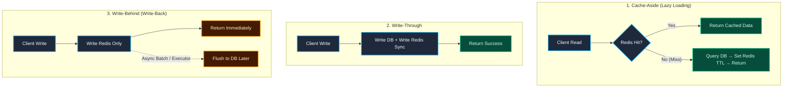

| Strategy | Read Path | Write Path | Consistency | Data Loss Risk | Best For |
| :--- | :--- | :--- | :--- | :--- | :--- |
| **Cache-Aside** | App checks cache; on miss loads DB | App updates DB, invalidates/updates cache | Eventual (TTL-bound) | None (DB is source of truth) | Read-heavy workloads (90%+ reads) |
| **Write-Through** | App reads cache | App/cache writes DB + cache synchronously | Strong (cache & DB in sync) | None | Read-after-write consistency |
| **Write-Behind** | App reads cache | App writes cache; async flush to DB | Eventual | High if Redis crashes before flush | Write-heavy counters, telemetry |

### Cache Stampede (Thundering Herd) Protection

When a hot key expires under high concurrency, hundreds of threads simultaneously miss the cache and hammer the database.

```mermaid
sequenceDiagram
    autonumber
    participant T1 as Thread 1
    participant T2 as Thread 2..N
    participant R as Redis Cache
    participant DB as Database

    T1->>R: GET product:123
    T2->>R: GET product:123
    R-->>T1: MISS
    R-->>T2: MISS

    T1->>R: SETNX lock:product:123 (Acquire Mutex)
    R-->>T1: OK (Lock Acquired)
    T2->>R: SETNX lock:product:123
    R-->>T2: FAIL (Wait 50ms &amp; Retry Cache)

    T1->>DB: SELECT * FROM products WHERE id = 123
    DB-->>T1: Product
    T1->>R: SET product:123 (TTL + Random Jitter)
    T1->>R: DEL lock:product:123

    T2->>R: GET product:123 (Retry)
    R-->>T2: HIT (Served without hitting DB)
```

```java
@Configuration
public class CacheConfiguration {

    @Bean
    public StringRedisTemplate stringRedisTemplate(RedisConnectionFactory connectionFactory) {
        return new StringRedisTemplate(connectionFactory);
    }

    @Bean
    public RedisTemplate<String, Product> productRedisTemplate(RedisConnectionFactory connectionFactory) {
        RedisTemplate<String, Product> template = new RedisTemplate<>();
        template.setConnectionFactory(connectionFactory);

        Jackson2JsonRedisSerializer<Product> jackson2JsonRedisSerializer =
            new Jackson2JsonRedisSerializer<>(Product.class);

        ObjectMapper mapper = new ObjectMapper();
        mapper.activateDefaultTyping(mapper.getPolymorphicTypeValidator(), ObjectMapper.DefaultTyping.NON_FINAL);
        jackson2JsonRedisSerializer.setObjectMapper(mapper);

        StringRedisSerializer stringSerializer = new StringRedisSerializer();

        template.setKeySerializer(stringSerializer);
        template.setValueSerializer(jackson2JsonRedisSerializer);
        template.setHashKeySerializer(stringSerializer);
        template.setHashValueSerializer(jackson2JsonRedisSerializer);

        template.afterPropertiesSet();

        return template;
    }
}

// Cache-Aside Pattern
@Service
public class ProductServiceCacheAside {

    @Autowired
    private ProductRepository productRepository;

    @Autowired
    private RedisTemplate<String, Product> redisTemplate;

    public Product getProduct(Long productId) {
        String cacheKey = "product:" + productId;

        // Try cache first
        Product cached = redisTemplate.opsForValue().get(cacheKey);

        if (cached != null) {
            logger.info("Cache hit for product: {}", productId);
            return cached;
        }

        logger.info("Cache miss for product: {}", productId);

        // Fetch from database
        Product product = productRepository.findById(productId)
            .orElseThrow(() -> new ProductNotFoundException(productId));

        // Update cache (expire after 1 hour)
        redisTemplate.opsForValue().set(
            cacheKey,
            product,
            Duration.ofHours(1)
        );

        return product;
    }
}

// Cache-Aside with Stampede Protection (Distributed Mutex + Jittered TTL)
@Service
public class ProductServiceStampedeSafe {

    @Autowired
    private ProductRepository productRepository;

    @Autowired
    private RedisTemplate<String, Product> redisTemplate;

    public Product getProductSafe(Long productId) {
        String cacheKey = "product:" + productId;
        String lockKey = "lock:product:" + productId;

        Product cached = redisTemplate.opsForValue().get(cacheKey);
        if (cached != null) {
            return cached;
        }

        // Only one thread rebuilds the cache for this key
        Boolean locked = redisTemplate.opsForValue()
            .setIfAbsent(lockKey, null, Duration.ofSeconds(10));

        if (Boolean.TRUE.equals(locked)) {
            try {
                // Double-check after acquiring lock
                Product recheck = redisTemplate.opsForValue().get(cacheKey);
                if (recheck != null) return recheck;

                Product product = productRepository.findById(productId)
                    .orElseThrow(() -> new ProductNotFoundException(productId));

                // Add random TTL jitter (55-65 min) to prevent synchronized expiration
                long jitterSeconds = ThreadLocalRandom.current().nextLong(0, 600);
                redisTemplate.opsForValue().set(
                    cacheKey, product, Duration.ofMinutes(55).plusSeconds(jitterSeconds)
                );
                return product;
            } finally {
                redisTemplate.delete(lockKey);
            }
        }

        // Other threads briefly back off and retry cache read
        try {
            Thread.sleep(50);
        } catch (InterruptedException e) {
            Thread.currentThread().interrupt();
        }
        return getProductSafe(productId);
    }
}

// Write-Through Pattern
@Service
public class ProductServiceWriteThrough {

    @Autowired
    private ProductRepository productRepository;

    @Autowired
    private RedisTemplate<String, Product> redisTemplate;

    @Transactional
    public Product updateProduct(Long productId, UpdateProductRequest request) {
        Product product = productRepository.findById(productId)
            .orElseThrow(() -> new ProductNotFoundException(productId));

        product.setName(request.getName());
        product.setPrice(request.getPrice());

        // Write to database
        productRepository.save(product);

        // Write to cache
        String cacheKey = "product:" + productId;
        redisTemplate.opsForValue().set(
            cacheKey,
            product,
            Duration.ofHours(1)
        );

        return product;
    }

    @Transactional
    public void deleteProduct(Long productId) {
        productRepository.deleteById(productId);

        // Invalidate cache
        String cacheKey = "product:" + productId;
        redisTemplate.delete(cacheKey);
    }
}

// Write-Behind Pattern
@Service
public class ProductServiceWriteBehind {

    @Autowired
    private ProductRepository productRepository;

    @Autowired
    private RedisTemplate<String, Product> redisTemplate;

    @Autowired
    private TaskExecutor taskExecutor;

    public void updateProduct(Long productId, UpdateProductRequest request) {
        Product product = new Product();
        product.setId(productId);
        product.setName(request.getName());
        product.setPrice(request.getPrice());

        String cacheKey = "product:" + productId;

        // Write to cache immediately
        redisTemplate.opsForValue().set(
            cacheKey,
            product,
            Duration.ofHours(1)
        );

        // Return to client immediately

        // Write to database asynchronously
        taskExecutor.execute(() -> {
            try {
                productRepository.save(product);
                logger.info("Product updated in database: {}", productId);
            } catch (Exception e) {
                logger.error("Failed to update product in database: {}", productId, e);
                // Could implement retry logic here
            }
        });
    }
}
```

### Cache Invalidation Patterns

```java
// Pattern 1: TTL-based
redisTemplate.opsForValue().set(
    cacheKey,
    product,
    Duration.ofMinutes(30)  // Auto-expire after 30 minutes
);

// Pattern 2: Event-based invalidation
@EventListener(ProductUpdatedEvent.class)
public void onProductUpdated(ProductUpdatedEvent event) {
    String cacheKey = "product:" + event.getProductId();
    redisTemplate.delete(cacheKey);  // Invalidate cache
}

// Pattern 3: Wildcard invalidation
@EventListener(PriceChangedEvent.class)
public void onPriceChanged(PriceChangedEvent event) {
    // Invalidate all caches for product (including derived)
    Set<String> keys = redisTemplate.keys("product:" + event.getProductId() + "*");
    if (!keys.isEmpty()) {
        redisTemplate.delete(keys);
    }
}

// Pattern 4: Cache warming
@Component
public class CacheWarmer {

    @Autowired
    private RedisTemplate<String, Product> redisTemplate;

    @EventListener(ApplicationReadyEvent.class)
    public void warmCache() {
        List<Product> topProducts = productRepository.findTopProducts(100);

        topProducts.forEach(product -> {
            String cacheKey = "product:" + product.getId();
            redisTemplate.opsForValue().set(
                cacheKey,
                product,
                Duration.ofHours(1)
            );
        });

        logger.info("Cache warmed with {} products", topProducts.size());
    }
}
```

**Cache Invalidation Recommendations:**
- Use **short TTLs (5–10 minutes)** + **random jitter** for baseline consistency and stampede prevention.
- Use **event-based invalidation** for critical data (e.g., price or inventory changes).
- Use **versioned keys** (`product:123:v4`) so old entries expire naturally without race conditions.
- Use **cache warming** on startup for hot data and continuously monitor cache hit rates.

> [!TIP]
> Never run `redisTemplate.keys(...)` (`KEYS *`) in production Redis—it is $O(N)$ and blocks the single-threaded Redis event loop. Use `SCAN`, Redis Sets tracking derived keys, or versioned cache keys instead.

---

## API Composition for Queries

When a query spans multiple services' databases (e.g., Order + Customer + Products), **API Composition** fetches data from each service in parallel and joins in memory, whereas **CQRS** maintains a pre-joined materialized view.

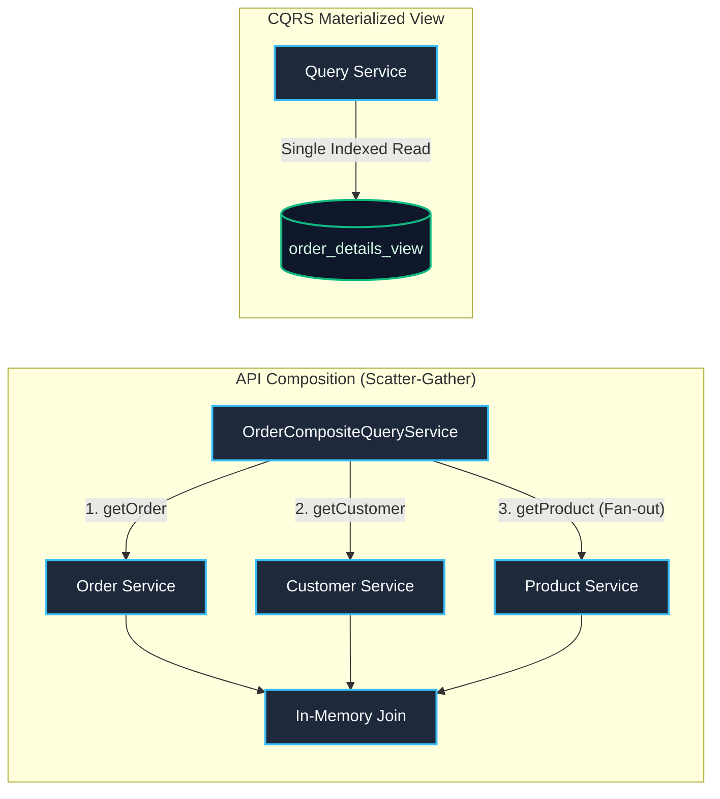

```mermaid
sequenceDiagram
    autonumber
    participant C as Client
    participant Comp as OrderCompositeQueryService
    participant OS as Order Service
    participant CS as Customer Service
    participant PS as Product Service

    C->>Comp: getOrderDetails(orderId)
    Comp->>OS: getOrder(orderId)
    OS-->>Comp: Order (customerId, itemIds)

    par Fetch Customer &amp; Products in Parallel
        Comp->>CS: getCustomer(customerId)
        CS-->>Comp: Customer
    and
        Comp->>PS: getProduct(item1)
        Comp->>PS: getProduct(item2)
        PS-->>Comp: ProductDTOs
    end

    Comp->>Comp: Aggregate into OrderDetailDTO
    Comp-->>C: OrderDetailDTO
```

| Aspect | API Composition | CQRS Materialized View |
| :--- | :--- | :--- |
| **Implementation** | Simple scatter-gather (`CompletableFuture`) | Requires event pipeline + projector + read DB |
| **Consistency** | Fresh (reads live services) | Eventually consistent |
| **Latency** | Bound by slowest service (tail latency) | Sub-10ms single-DB lookup |
| **Pagination & Filtering** | Hard across large datasets | Native indexed SQL/Elasticsearch queries |
| **Availability** | Fails if any downstream service is down | Resilient (read DB serves even if writers are down) |

```java
// Problem: Need order with customer name and product names
// Order in Order Service, Customer in Customer Service, Products in Product Service

@Service
public class OrderCompositeQueryService {

    @Autowired
    private OrderClient orderClient;

    @Autowired
    private CustomerClient customerClient;

    @Autowired
    private ProductClient productClient;

    public OrderDetailDTO getOrderDetails(Long orderId) {
        // Parallel fetch to reduce latency
        CompletableFuture<Order> orderFuture = CompletableFuture.supplyAsync(
            () -> orderClient.getOrder(orderId)
        );

        // After we have order, fetch customer
        CompletableFuture<OrderDetailDTO> detailFuture = orderFuture.thenCompose(order ->
            CompletableFuture.supplyAsync(
                () -> customerClient.getCustomer(order.getCustomerId())
            ).thenCompose(customer ->
                // Then fetch all products in order
                CompletableFuture.allOf(
                    order.getItems().stream()
                        .map(item -> CompletableFuture.supplyAsync(
                            () -> productClient.getProduct(item.getProductId())
                        ))
                        .toArray(CompletableFuture[]::new)
                ).thenApply(v -> {
                    // Aggregate everything
                    List<ProductDTO> products = order.getItems().stream()
                        .map(item -> productClient.getProduct(item.getProductId()))
                        .collect(Collectors.toList());

                    return new OrderDetailDTO(
                        order,
                        customer,
                        products
                    );
                })
            )
        );

        return detailFuture.get();
    }

    // Better: Use CQRS instead of composition
    // Maintain denormalized view that has all needed data
}

// Query-side view combining data
@Entity
@Table(name = "order_details_view")
public class OrderDetailView {
    @Id
    private Long orderId;

    // From Order Service
    private LocalDateTime createdAt;
    private BigDecimal total;

    // From Customer Service
    private String customerName;
    private String customerEmail;

    // From Product Service (embedded)
    @ElementCollection
    private List<ProductDetail> productDetails;

    // Built from events/updates from all services
}

// Projector updates this view
@Service
public class OrderDetailProjector {

    @EventListener(OrderSubmittedEvent.class)
    public void onOrderSubmitted(OrderSubmittedEvent event) {
        // Fetch customer and product details
        // Build OrderDetailView
        // Save to database
    }
}
```

> [!WARNING]
> **Tail-Latency & N+1 Fan-Out:** API Composition multiplies failure surface area and p99 latency. If an order has 50 items, avoid 50 individual calls—use batch endpoints (`GET /products?ids=1,2,...`) or switch to a **CQRS Materialized View**.

---

## Data Replication

Synchronizing reference data (like product name and price) into another service's local database avoids synchronous runtime calls, but requires solving the **Dual-Write Problem** using the **Transactional Outbox + Change Data Capture (CDC)** pattern.

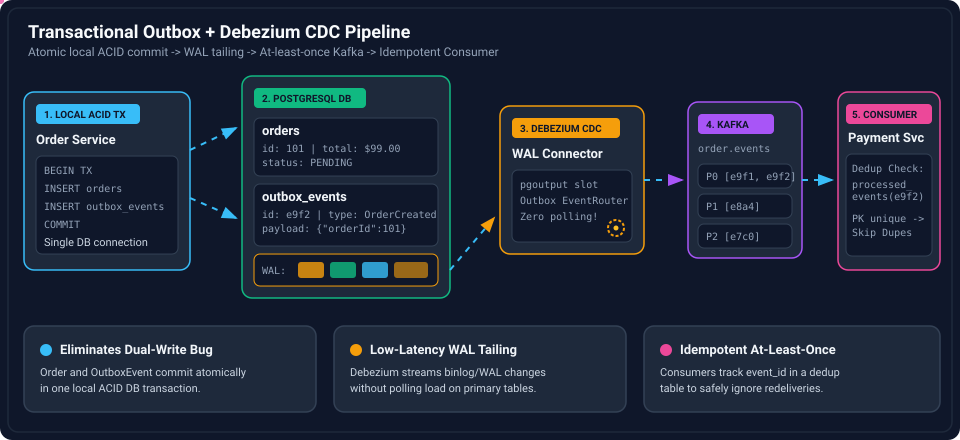

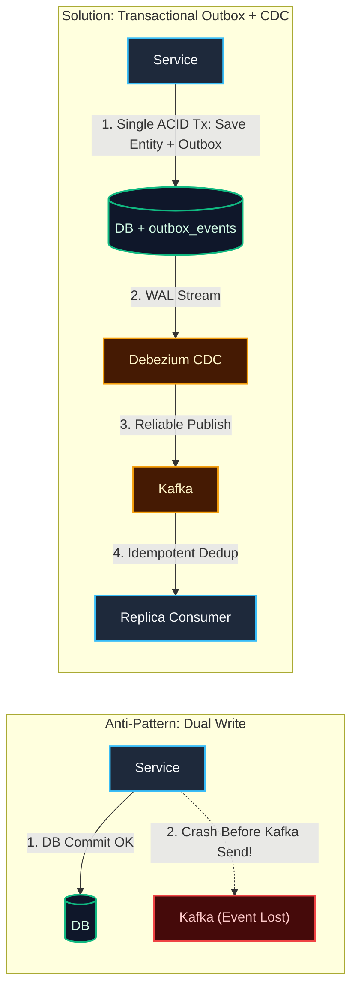

```mermaid
sequenceDiagram
    autonumber
    participant PS as ProductService
    participant PDB as Product DB
    participant Deb as Debezium CDC
    participant K as Kafka (products)
    participant Con as OrderServiceReplicaListener
    participant ODB as Order DB

    PS->>PDB: BEGIN; UPDATE products; INSERT outbox_events; COMMIT;
    Deb->>PDB: Tail WAL (pgoutput / binlog)
    Deb->>K: Publish ProductUpdatedEvent (id, version)
    K->>Con: Deliver Event (At-Least-Once)
    Con->>ODB: Check processed_events &amp; event.version &gt; replica.version
    alt New &amp; Higher Version
        Con->>ODB: Upsert ProductReplica + Insert processed_events
    else Duplicate or Stale Version
        Con->>Con: Ignore safely (Idempotent)
    end
```

### Outbox & Deduplication Schema (SQL)

```sql
-- 1. Outbox table in the producer's database (written in same ACID TX)
CREATE TABLE outbox_events (
    id              UUID PRIMARY KEY,
    aggregate_type  VARCHAR(100) NOT NULL,  -- e.g. 'Product'
    aggregate_id    VARCHAR(100) NOT NULL,  -- Kafka partition key
    event_type      VARCHAR(100) NOT NULL,  -- e.g. 'ProductUpdatedEvent'
    payload         JSONB        NOT NULL,
    created_at      TIMESTAMPTZ  NOT NULL DEFAULT NOW()
);

-- 2. Deduplication table in the consumer's database
CREATE TABLE processed_events (
    event_id        UUID PRIMARY KEY,
    processed_at    TIMESTAMPTZ NOT NULL DEFAULT NOW()
);
```

> [!IMPORTANT]
> **Why Outbox + CDC Beats Dual Writes:** Calling `repository.save()` and `kafkaTemplate.send()` in sequence is **not atomic**—if the app crashes or Kafka times out after DB commit, the event is lost forever. Writing to `outbox_events` in the same local DB transaction and tailing the WAL with Debezium guarantees **at-least-once** delivery.

### Eventual Consistency & Replica Sync Implementation

```java
// Service A: Source of truth
@Service
public class ProductService {

    @Autowired
    private ProductRepository productRepository;

    @Autowired
    private KafkaTemplate<String, ProductUpdatedEvent> kafkaTemplate;

    @Transactional
    public void updateProduct(Long productId, UpdateProductRequest request) {
        Product product = productRepository.findById(productId).orElseThrow();
        product.setName(request.getName());
        product.setPrice(request.getPrice());

        productRepository.save(product);

        // Publish event (In production: write to outbox_events in same TX for Debezium CDC)
        kafkaTemplate.send("products", new ProductUpdatedEvent(
            productId,
            product.getName(),
            product.getPrice()
        ));
    }
}

// Service B: Replicates data
@Service
public class OrderServiceReplicaListener {

    @Autowired
    private ProductReplicaRepository productReplicaRepository;

    @KafkaListener(topics = "products", groupId = "order-service")
    public void onProductUpdated(ProductUpdatedEvent event) {
        ProductReplica replica = productReplicaRepository
            .findById(event.getProductId())
            .orElse(new ProductReplica(event.getProductId()));

        replica.setName(event.getName());
        replica.setPrice(event.getPrice());
        replica.setLastSyncedAt(LocalDateTime.now());

        productReplicaRepository.save(replica);
    }
}

// Eventual consistency issues
// Solution 1: Version numbers
@Entity
public class ProductReplica {
    @Id
    private Long productId;
    private String name;
    private BigDecimal price;
    private long version;  // Track version
}

// Solution 2: Sync events with ordering
@KafkaListener(topics = "products", groupId = "order-service")
public void onProductUpdated(ProductUpdatedEvent event) {
    ProductReplica replica = productReplicaRepository.findById(event.getProductId()).orElseThrow();

    if (event.getVersion() > replica.getVersion()) {
        // Update only if newer
        replica.setName(event.getName());
        replica.setPrice(event.getPrice());
        replica.setVersion(event.getVersion());

        productReplicaRepository.save(replica);
    }
}

// Solution 3: Periodic sync for safety
@Component
public class DataReplicationSyncer {

    @Scheduled(fixedDelay = 300000)  // Every 5 minutes
    public void syncReplicas() {
        List<Product> sourceData = productRepository.findAll();
        List<ProductReplica> replicaData = productReplicaRepository.findAll();

        // Find differences and update replicas
        for (Product source : sourceData) {
            ProductReplica replica = replicaData.stream()
                .filter(r -> r.getProductId().equals(source.getId()))
                .findFirst()
                .orElse(new ProductReplica(source.getId()));

            if (!replica.getName().equals(source.getName()) ||
                !replica.getPrice().equals(source.getPrice())) {
                replica.setName(source.getName());
                replica.setPrice(source.getPrice());

                productReplicaRepository.save(replica);
                logger.info("Synced product replica: {}", source.getId());
            }
        }
    }
}
```

> [!TIP]
> Always combine **CDC + Versioned Idempotency** (`event.getVersion() > replica.getVersion()`) with a **periodic reconciliation job** (`DataReplicationSyncer`) for critical reference data to catch any missed or out-of-order updates.

---

## Interview Questions

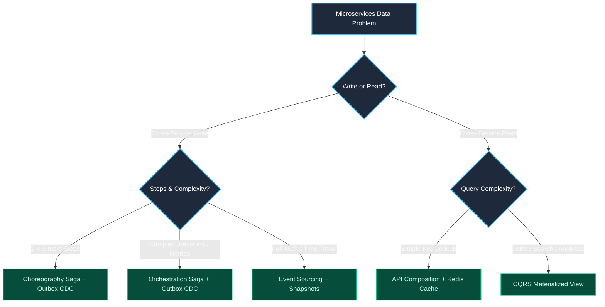

### Q1: How would you handle an order that spans multiple services with different consistency requirements?

**Answer**:

| Requirement | Consistency Level | Pattern / Mechanism |
| :--- | :--- | :--- |
| **Customer Payment** | Strong (money cannot disappear) | Local ACID TX + Saga compensation (refund) |
| **Inventory** | Strong (cannot oversell) | Local ACID TX / optimistic locking + Saga release |
| **Recommendations** | Eventual (slightly stale is OK) | Async Kafka events + Redis cache |

**Design:**
- **Command Side (Write):**
  - Accept order submission (`PENDING` semantic lock).
  - Use the **Saga pattern** (with **Transactional Outbox + CDC** for reliable event publishing):
    - Step 1: Reserve inventory (Strong local ACID).
    - Step 2: Process payment (Strong local ACID).
    - Compensate (release reservation / refund) if either fails.
  - Publish order events to Kafka.
- **Query Side (Read):**
  - Maintain an eventually consistent **CQRS read model** for order history/dashboards.
  - For critical operations (e.g., payment verification), read directly from the source of truth.
  - For display widgets (e.g., recommendations), read from distributed cache (Redis).

### Q2: When would you choose event sourcing over traditional persistence?

**Answer**:

**Choose Event Sourcing when:**
- You need a **complete, immutable audit trail** (financial ledgers, compliance, healthcare).
- You need **temporal queries** (reconstructing exact state at time $T$).
- **Debugging** is critical (replaying production event streams to reproduce bugs).
- An **event-driven architecture** is a natural fit.
- **Multiple read models (CQRS)** must be derived and rebuilt from the same source of truth.

**Don't choose Event Sourcing when:**
- Building simple CRUD applications.
- Storage growth is a hard constraint and history has low business value.
- The team is inexperienced with eventual consistency, upcasting, and snapshotting.
- Ultra-low-latency direct state reads are required without maintaining CQRS projections.

**Example use case:**
E-commerce order system — order history is critical:
- Can replay the entire order lifecycle.
- Built-in audit trail for customer disputes and chargebacks.
- Feeds multiple CQRS views (customer order tracking, admin support portal, analytics warehouse).

> [!TIP]
> **Interview Framing:** Always state *why* you avoid 2PC (blocking & coupling), name the **Saga type** (Orchestration vs Choreography) and **reliable event delivery** (Transactional Outbox + Debezium CDC), and explicitly call out **idempotency** on consumers.
