# Security and Observability in Microservices

> [!IMPORTANT]
> In a distributed microservices architecture, **security** shifts from perimeter-only defense to **zero-trust identity verification at every hop**, while **observability** shifts from single-host log tailing to **correlating logs, metrics, and distributed traces** via a shared `traceId`.

---

## Table of Contents
1. [Authentication and Authorization](#authentication-and-authorization)
2. [Token-Based Authentication](#token-based-authentication)
3. [Service-to-Service Authentication](#service-to-service-authentication)
4. [API Security](#api-security)
5. [Distributed Logging](#distributed-logging)
6. [Metrics and Monitoring](#metrics-and-monitoring)
7. [Alerting](#alerting)
8. [Interview Questions](#interview-questions)

---

## Authentication and Authorization

**Authentication (AuthN)** proves *who* the caller is (`401 Unauthorized` on failure), whereas **Authorization (AuthZ)** determines *what* the verified identity is permitted to do (`403 Forbidden` on failure).

### OAuth 2.0 + OIDC Authorization Code Flow (with PKCE)

Modern web and mobile clients use **Authorization Code + PKCE (Proof Key for Code Exchange)** so authorization codes cannot be intercepted and exchanged without the client's cryptographic `code_verifier`.

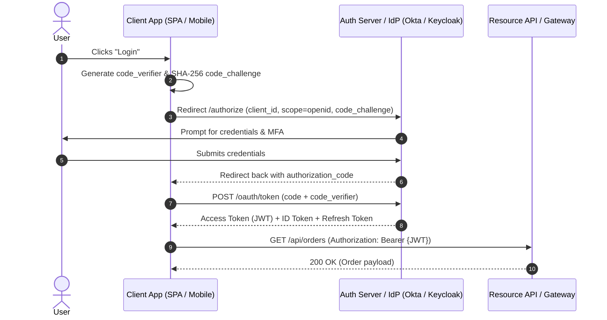

- **Step 1–2 (Redirect & Authenticate):** The application delegates credential handling to a trusted Identity Provider (Google, GitHub, Okta, Keycloak) so user passwords never touch application servers.
- **Step 3–4 (Code Exchange):** The IdP returns a short-lived authorization code, which the backend (or PKCE-enabled public client) exchanges for an Access Token and ID Token.
- **Step 5–6 (User Info & Session/Stateless Context):** The application extracts user identity/claims from the OIDC ID Token or `/userinfo` endpoint and attaches the Access Token to downstream API calls.

### AuthN vs. AuthZ & Protocol Comparison

| Dimension | OAuth 2.0 | OpenID Connect (OIDC) | SAML 2.0 |
| :--- | :--- | :--- | :--- |
| **Primary Purpose** | Delegated **Authorization** | **Authentication** + Identity layer on OAuth 2.0 | Enterprise SSO **Authentication** |
| **Token Format** | Opaque or JWT (Access Token) | **JWT** (ID Token + Access Token) | **XML** Assertions |
| **Best For** | API access & microservices | Web, Mobile, SPA, modern APIs | Legacy enterprise & B2B portals |
| **Transport** | JSON / REST over HTTPS | JSON / REST over HTTPS | HTTP POST / Redirect XML bindings |

### JWT (JSON Web Token) Anatomy & Verification

A JWT consists of three Base64URL-encoded segments separated by dots: `Header.Payload.Signature`.

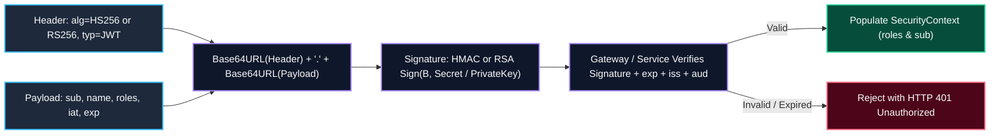

```json
// Header
{
  "alg": "HS256",
  "typ": "JWT"
}

// Payload (Claims)
{
  "sub": "user123",
  "name": "John Doe",
  "roles": ["admin", "user"],
  "iat": 1675000000,
  "exp": 1675003600
}
```

```text
Signature:
HMACSHA256(base64UrlEncode(header) + "." + base64UrlEncode(payload), secret)

Full JWT:
eyJhbGciOiJIUzI1NiIsInR5cCI6IkpXVCJ9.
eyJzdWIiOiJ1c2VyMTIzIiwibmFtZSI6IkpvaG4gRG9lIiwicm9sZXMiOlsiYWRtaW4iLCJ1c2VyIl0sImlhdCI6MTY3NTAwMDAwMCwiZXhwIjoxNjc1MDAzNjAwfQ.
TJVA95OrM7E2cBab30RMHrHDcEfxjoYZgeFONFh7HgQ
```

> [!WARNING]
> **JWT payloads are Base64URL-encoded, NOT encrypted.** Anyone with the token can decode the payload—never store PII, passwords, or secrets inside JWT claims unless using JWE (JSON Web Encryption).

### Authorization Models: RBAC vs. ABAC

| Model | How Decisions Are Made | Pros | Cons |
| :--- | :--- | :--- | :--- |
| **RBAC (Role-Based)** | Permissions bound to roles (`ROLE_ADMIN`, `ROLE_USER`) | Simple to audit, maps cleanly to JWT `roles` claim | Role explosion for fine-grained resource rules |
| **ABAC (Attribute-Based)** | Policies evaluate user, resource, and environment attributes (`user.dept == doc.dept`) | Expressive, context-aware (time, IP, ownership) | Higher policy evaluation complexity (e.g., OPA / Cedar) |

---

## Token-Based Authentication

Stateless token authentication eliminates shared server-side session stores, allowing any microservice replica to validate requests independently.

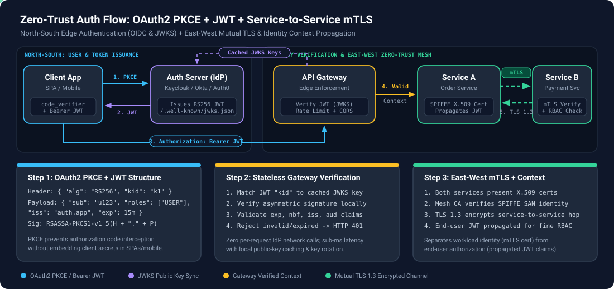

### Spring Security Stateless Filter Chain

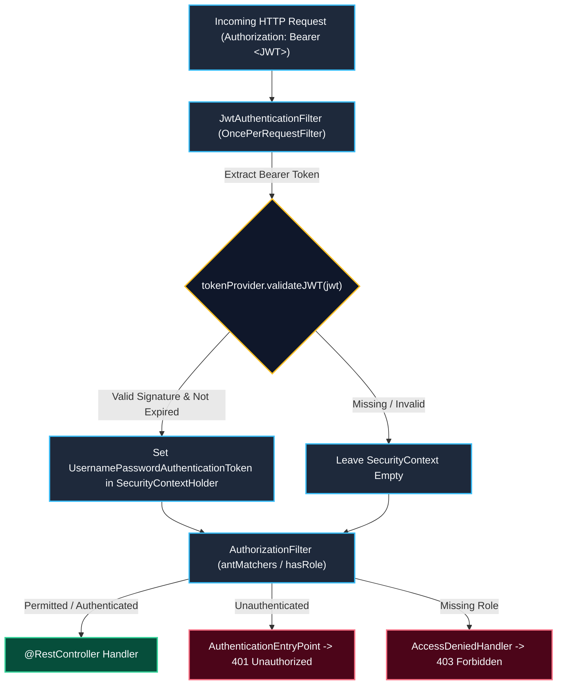

### Token Lifecycle: Issuance, Refresh Rotation & Revocation

```mermaid
sequenceDiagram
    autonumber
    participant Client
    participant Auth as AuthController
    participant Provider as JwtTokenProvider
    participant Store as Redis Deny-List / Refresh Store

    Client->>Auth: POST /api/auth/login (username, password)
    Auth->>Provider: generateToken(username, authorities)
    Provider-->>Client: Short-lived Access JWT (15m-1h) + Refresh Token
    Note over Client,Auth: Access token expires after TTL
    Client->>Auth: POST /api/auth/refresh (Refresh / Valid Token)
    Auth->>Store: Verify refresh token not revoked &amp; rotate
    Auth->>Provider: generateToken(username, latest authorities)
    Provider-->>Client: New Access JWT + Rotated Refresh Token
```

> [!TIP]
> **How do you revoke stateless JWTs before `exp`?** Keep Access Token TTLs short (**5–15 minutes**), pair them with **Refresh Token Rotation** stored server-side, and maintain a small **Redis deny-list** keyed by `jti` (JWT ID) with a TTL matching the remaining token lifetime for emergency logouts or compromised accounts.

### Symmetric vs. Asymmetric JWT Signing

| Property | Symmetric (`HS256` / `HS512`) | Asymmetric (`RS256` / `ES256` / `EdDSA`) |
| :--- | :--- | :--- |
| **Key Type** | Single shared secret key | Private key (Auth Server signs) + Public key (Services verify) |
| **Key Distribution** | Every verifier must hold the secret (higher blast radius) | Public keys published via `/.well-known/jwks.json` |
| **Best Used For** | Monoliths or single-service token validation | **Microservices** & multi-team zero-trust environments |

### JWT Implementation with Spring Security

```java
// JWT Token Provider
@Component
public class JwtTokenProvider {

    @Value("${jwt.secret:mySecretKeyThatIsAtLeast32CharactersLong}")
    private String jwtSecret;

    @Value("${jwt.expiration:3600000}")  // 1 hour in milliseconds
    private long jwtExpirationMs;

    // Generate JWT token
    public String generateToken(String username, Collection<GrantedAuthority> authorities) {
        long now = System.currentTimeMillis();
        long expiryTime = now + jwtExpirationMs;

        List<String> roles = authorities.stream()
            .map(GrantedAuthority::getAuthority)
            .collect(Collectors.toList());

        return Jwts.builder()
            .setSubject(username)
            .claim("roles", roles)
            .setIssuedAt(new Date(now))
            .setExpiration(new Date(expiryTime))
            .signWith(SignatureAlgorithm.HS512, jwtSecret)
            .compact();
    }

    // Validate and extract claims
    public String getUsernameFromJWT(String token) {
        return Jwts.parser()
            .setSigningKey(jwtSecret)
            .parseClaimsJws(token)
            .getBody()
            .getSubject();
    }

    public Claims getClaimsFromJWT(String token) {
        return Jwts.parser()
            .setSigningKey(jwtSecret)
            .parseClaimsJws(token)
            .getBody();
    }

    public boolean validateJWT(String token) {
        try {
            Jwts.parser().setSigningKey(jwtSecret).parseClaimsJws(token);
            return true;
        } catch (JwtException | IllegalArgumentException e) {
            logger.error("JWT validation failed: {}", e.getMessage());
            return false;
        }
    }
}

// Authentication Controller
@RestController
@RequestMapping("/api/auth")
public class AuthController {

    @Autowired
    private AuthenticationManager authenticationManager;

    @Autowired
    private UserService userService;

    @Autowired
    private JwtTokenProvider tokenProvider;

    @PostMapping("/login")
    public ResponseEntity<?> authenticateUser(@RequestBody LoginRequest loginRequest) {
        Authentication authentication = authenticationManager.authenticate(
            new UsernamePasswordAuthenticationToken(
                loginRequest.getUsername(),
                loginRequest.getPassword()
            )
        );

        SecurityContextHolder.getContext().setAuthentication(authentication);

        UserDetails userDetails = (UserDetails) authentication.getPrincipal();
        String jwt = tokenProvider.generateToken(userDetails.getUsername(), userDetails.getAuthorities());

        return ResponseEntity.ok(new JwtAuthenticationResponse(jwt));
    }

    @PostMapping("/refresh")
    public ResponseEntity<?> refreshToken(HttpServletRequest request) {
        String jwt = getJwtFromRequest(request);

        if (tokenProvider.validateJWT(jwt)) {
            Claims claims = tokenProvider.getClaimsFromJWT(jwt);
            String username = claims.getSubject();

            UserDetails userDetails = userService.loadUserByUsername(username);
            String newToken = tokenProvider.generateToken(username, userDetails.getAuthorities());

            return ResponseEntity.ok(new JwtAuthenticationResponse(newToken));
        }

        throw new UnauthorizedException("Invalid token");
    }

    private String getJwtFromRequest(HttpServletRequest request) {
        String bearerToken = request.getHeader("Authorization");

        if (StringUtils.hasText(bearerToken) && bearerToken.startsWith("Bearer ")) {
            return bearerToken.substring(7);
        }

        return null;
    }
}

// JWT Authentication Filter
@Component
public class JwtAuthenticationFilter extends OncePerRequestFilter {

    @Autowired
    private JwtTokenProvider tokenProvider;

    @Autowired
    private UserService userService;

    @Override
    protected void doFilterInternal(HttpServletRequest request, HttpServletResponse response,
        FilterChain filterChain) throws ServletException, IOException {

        try {
            String jwt = getJwtFromRequest(request);

            if (StringUtils.hasText(jwt) && tokenProvider.validateJWT(jwt)) {
                String username = tokenProvider.getUsernameFromJWT(jwt);
                Claims claims = tokenProvider.getClaimsFromJWT(jwt);

                UserDetails userDetails = userService.loadUserByUsername(username);

                List<GrantedAuthority> authorities = ((List<?>) claims.get("roles"))
                    .stream()
                    .map(role -> new SimpleGrantedAuthority((String) role))
                    .collect(Collectors.toList());

                UsernamePasswordAuthenticationToken authentication =
                    new UsernamePasswordAuthenticationToken(
                        userDetails,
                        null,
                        authorities
                    );

                authentication.setDetails(new WebAuthenticationDetailsSource().buildDetails(request));

                SecurityContextHolder.getContext().setAuthentication(authentication);
            }
        } catch (Exception e) {
            logger.error("Could not set user authentication in security context", e);
        }

        filterChain.doFilter(request, response);
    }

    private String getJwtFromRequest(HttpServletRequest request) {
        String bearerToken = request.getHeader("Authorization");

        if (StringUtils.hasText(bearerToken) && bearerToken.startsWith("Bearer ")) {
            return bearerToken.substring(7);
        }

        return null;
    }
}

// Security Configuration
@Configuration
@EnableWebSecurity
public class SecurityConfig {

    @Bean
    public SecurityFilterChain filterChain(HttpSecurity http) throws Exception {
        http
            .csrf().disable()
            .exceptionHandling()
                .authenticationEntryPoint((request, response, authException) -> {
                    response.setStatus(HttpStatus.UNAUTHORIZED.value());
                    response.setContentType("application/json");
                    response.getWriter().write("{\"error\": \"Unauthorized\"}");
                })
            .and()
            .sessionManagement().sessionCreationPolicy(SessionCreationPolicy.STATELESS)
            .and()
            .authorizeRequests()
                .antMatchers("/api/auth/**").permitAll()
                .antMatchers("/api/orders/**").hasRole("USER")
                .antMatchers("/api/admin/**").hasRole("ADMIN")
                .anyRequest().authenticated()
            .and()
            .addFilterBefore(new JwtAuthenticationFilter(), UsernamePasswordAuthenticationFilter.class);

        return http.build();
    }

    @Bean
    public AuthenticationManager authenticationManager(UserDetailsService userDetailsService) {
        return new ProviderManager(new DaoAuthenticationProvider() {{
            setUserDetailsService(userDetailsService);
            setPasswordEncoder(passwordEncoder());
        }});
    }

    @Bean
    public PasswordEncoder passwordEncoder() {
        return new BCryptPasswordEncoder();
    }
}

// application.yml
jwt:
  secret: mySecretKeyThatIsAtLeast32CharactersLongForJwtSigning
  expiration: 3600000  # 1 hour
```

---

## Service-to-Service Authentication

Network-level trust ("we are inside the same VPC") fails under zero-trust principles. Every east-west call must authenticate both the **calling workload** and, when applicable, the **end-user context**.

### Mutual TLS (mTLS) Handshake & SPIFFE Identity

```mermaid
sequenceDiagram
    autonumber
    participant SvcA as Service A (Order)
    participant SvcB as Service B (Payment)
    participant CA as Mesh CA / SPIRE

    Note over SvcA,CA: Workload X.509 certs rotated automatically (SPIFFE ID in SAN)
    SvcA->>SvcB: TLS ClientHello
    SvcB-->>SvcA: ServerHello + Server Certificate (spiffe://prod/ns/pay/sa/payment)
    SvcA->>SvcA: Verify Server Cert against TrustStore CA
    SvcA->>SvcB: Client Certificate (spiffe://prod/ns/ord/sa/order) + CertVerify
    SvcB->>SvcB: Verify Client Cert against TrustStore CA &amp; AuthZ Policy
    SvcA->>SvcB: Encrypted HTTP/gRPC Request + Propagated End-User JWT
    SvcB-->>SvcA: Encrypted Response
```

### Choosing a Service-to-Service Auth Strategy

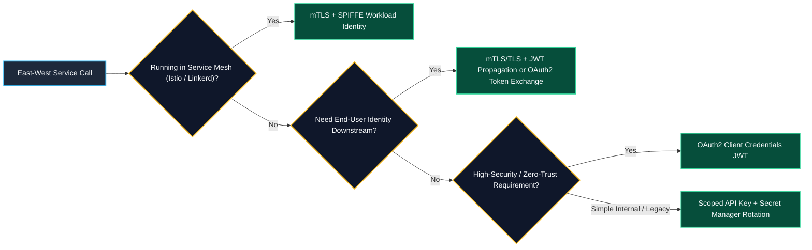

### Comparison of Service-to-Service Mechanisms

| Mechanism | Identity Granularity | Encryption | Key Rotation Overhead | Best Fit |
| :--- | :--- | :--- | :--- | :--- |
| **Mutual TLS (mTLS + SPIFFE)** | Workload / Pod (`spiffe://...`) | TLS 1.3 in-transit | Automated via Istio/SPIRE | Kubernetes & service mesh environments |
| **OAuth2 Client Credentials JWT** | Service Account + Scopes | Requires HTTPS/TLS | Automated via IdP JWKS | Cloud-native services without a mesh |
| **API Keys (`X-API-Key`)** | Service-level static secret | Requires HTTPS/TLS | Manual or Secret Manager | Simple internal tools / legacy integration |
| **Token Exchange (RFC 8693)** | Workload + End-User (`act` claim) | Requires HTTPS/TLS | Automated via IdP | Multi-hop calls needing least-privilege delegation |

> [!IMPORTANT]
> In Kubernetes service meshes (e.g., Istio), enforce strict mTLS declaratively using `PeerAuthentication` (`mode: STRICT`) so plain-text east-west traffic is rejected at the sidecar proxy without changing application code.

### Mutual TLS (mTLS) in Java / Spring

```java
// Service A: Client configuration
@Configuration
public class MtlsClientConfig {

    @Bean
    public RestTemplate restTemplate(
        @Value("${service.keystore.path}") String keystorePath,
        @Value("${service.keystore.password}") String keystorePassword,
        @Value("${service.truststore.path}") String truststorePath,
        @Value("${service.truststore.password}") String truststorePassword
    ) throws Exception {
        // Load client certificate
        KeyStore keyStore = KeyStore.getInstance("PKCS12");
        FileInputStream keyStoreFile = new FileInputStream(keystorePath);
        keyStore.load(keyStoreFile, keystorePassword.toCharArray());

        // Load trusted CA certificates
        KeyStore trustStore = KeyStore.getInstance("PKCS12");
        FileInputStream trustStoreFile = new FileInputStream(truststorePath);
        trustStore.load(trustStoreFile, truststorePassword.toCharArray());

        // Create SSL context
        SSLContext sslContext = SSLContext.getInstance("TLS");

        KeyManagerFactory kmf = KeyManagerFactory.getInstance(KeyManagerFactory.getDefaultAlgorithm());
        kmf.init(keyStore, keystorePassword.toCharArray());

        TrustManagerFactory tmf = TrustManagerFactory.getInstance(TrustManagerFactory.getDefaultAlgorithm());
        tmf.init(trustStore);

        sslContext.init(kmf.getKeyManagers(), tmf.getTrustManagers(), new SecureRandom());

        // Create HTTP client with SSL context
        HttpClientBuilder httpClientBuilder = HttpClients.custom()
            .setSSLContext(sslContext);

        HttpComponentsClientHttpRequestFactory factory =
            new HttpComponentsClientHttpRequestFactory(httpClientBuilder.build());

        return new RestTemplate(factory);
    }
}

// Configuration
spring:
  service:
    keystore:
      path: /etc/ssl/certs/client-keystore.p12
      password: ${KEYSTORE_PASSWORD}
    truststore:
      path: /etc/ssl/certs/truststore.p12
      password: ${TRUSTSTORE_PASSWORD}
```

### Service-to-Service with API Key

```java
// Service A calling Service B
@Service
public class PaymentClient {

    @Autowired
    private RestTemplate restTemplate;

    @Value("${payment-service.url}")
    private String paymentServiceUrl;

    @Value("${payment-service.api-key}")
    private String apiKey;

    public Payment processPayment(Long orderId, BigDecimal amount) {
        HttpHeaders headers = new HttpHeaders();
        headers.set("X-API-Key", apiKey);
        headers.set("X-Service-Name", "order-service");  // Service identification
        headers.setContentType(MediaType.APPLICATION_JSON);

        ProcessPaymentRequest request = new ProcessPaymentRequest(orderId, amount);
        HttpEntity<ProcessPaymentRequest> entity = new HttpEntity<>(request, headers);

        return restTemplate.postForObject(
            paymentServiceUrl + "/api/payments",
            entity,
            Payment.class
        );
    }
}

// Service B validating API key
@Component
public class ApiKeyValidator implements HandlerInterceptor {

    @Value("${api-keys.order-service:secret-key-123}")
    private String orderServiceApiKey;

    @Override
    public boolean preHandle(HttpServletRequest request, HttpServletResponse response,
        Object handler) throws Exception {

        String apiKey = request.getHeader("X-API-Key");
        String serviceName = request.getHeader("X-Service-Name");

        if (apiKey == null || !apiKey.equals(getApiKeyForService(serviceName))) {
            response.setStatus(HttpStatus.UNAUTHORIZED.value());
            response.setContentType("application/json");
            response.getWriter().write("{\"error\": \"Invalid API key\"}");
            return false;
        }

        return true;
    }

    private String getApiKeyForService(String serviceName) {
        // Load from secure store
        return switch(serviceName) {
            case "order-service" -> orderServiceApiKey;
            case "inventory-service" -> getApiKeyFromSecureStore("inventory-service");
            default -> null;
        };
    }
}

// application.yml
api-keys:
  order-service: ${ORDER_SERVICE_API_KEY}
  inventory-service: ${INVENTORY_SERVICE_API_KEY}
  shipping-service: ${SHIPPING_SERVICE_API_KEY}
```

> [!WARNING]
> **Always use constant-time comparison** (`MessageDigest.isEqual`) when validating API keys or HMAC signatures in production to prevent timing side-channel attacks, and store keys in a Secrets Manager (Vault, AWS Secrets Manager) rather than static config files.

---

## API Security

API security applies **defense-in-depth**: edge rate limiting and CORS enforcement, strict schema & business-invariant validation, and object-level authorization checks.

### Defense-in-Depth Request Pipeline


### Rate Limiting Algorithms

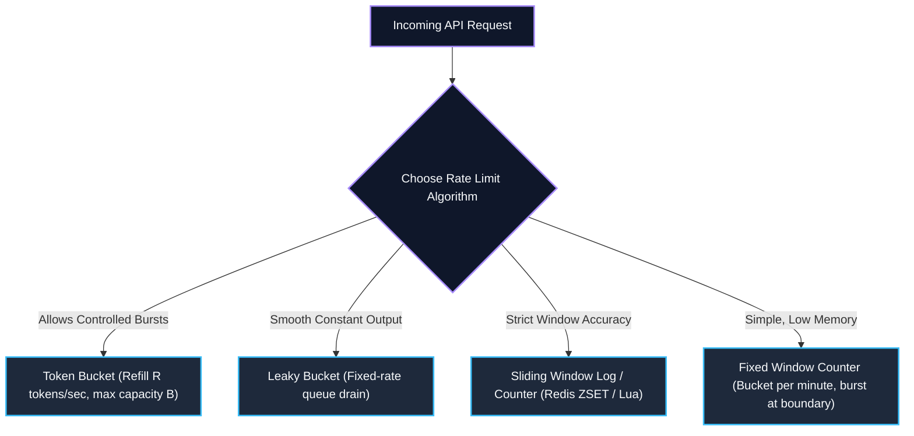

| Algorithm | Burst Handling | Memory Cost | Boundary Spike Risk | Common Usage |
| :--- | :--- | :--- | :--- | :--- |
| **Token Bucket** | Allows bursts up to bucket capacity | O(1) per user | Low | API Gateways (Envoy, AWS API GW, Resilience4j) |
| **Sliding Window Counter** | Smooths bursts across sub-windows | O(1) per user | Very Low | Distributed Redis rate limiters |
| **Fixed Window Counter** | 2x burst possible at window edge | O(1) per user | High | Simple internal quotas |
| **Leaky Bucket** | No bursts; strictly smooths egress | O(queue) | None | Downstream protection / traffic shaping |

### Input Validation

```java
@RestController
@RequestMapping("/api/orders")
public class OrderController {

    @PostMapping
    public ResponseEntity<Order> createOrder(
        @Valid @RequestBody CreateOrderRequest request
    ) {
        // Spring validates request based on annotations
        return ResponseEntity.ok(orderService.createOrder(request));
    }
}

// Request DTO with validation
public class CreateOrderRequest {

    @NotNull(message = "Customer ID required")
    @Positive(message = "Customer ID must be positive")
    private Long customerId;

    @NotEmpty(message = "Order items cannot be empty")
    @Size(max = 100, message = "Cannot have more than 100 items")
    private List<OrderItem> items;

    @NotNull
    @DecimalMin(value = "0.01", message = "Total must be positive")
    private BigDecimal total;

    @Email(message = "Valid email required")
    private String customerEmail;

    @Pattern(regexp = "\\d{5}-\\d{4}", message = "Valid ZIP code required")
    private String zipCode;

    // Getters and setters
}

// Custom validation
@Component
public class CustomOrderValidator {

    public void validate(CreateOrderRequest request) {
        // Business logic validation
        if (request.getItems().isEmpty()) {
            throw new ValidationException("Order must have items");
        }

        BigDecimal calculatedTotal = request.getItems().stream()
            .map(item -> item.getPrice().multiply(BigDecimal.valueOf(item.getQuantity())))
            .reduce(BigDecimal.ZERO, BigDecimal::add);

        if (!calculatedTotal.equals(request.getTotal())) {
            throw new ValidationException("Total amount mismatch");
        }
    }
}
```

### Rate Limiting

```java
// Per-user rate limiting
@Component
public class RateLimitingFilter implements Filter {

    @Autowired
    private RateLimiterRegistry rateLimiterRegistry;

    @Override
    public void doFilter(ServletRequest request, ServletResponse response,
        FilterChain chain) throws IOException, ServletException {

        HttpServletRequest httpRequest = (HttpServletRequest) request;
        String userId = extractUserId(httpRequest);

        RateLimiter limiter = getRateLimiterForUser(userId);

        if (!limiter.acquirePermission()) {
            HttpServletResponse httpResponse = (HttpServletResponse) response;
            httpResponse.setStatus(HttpStatus.TOO_MANY_REQUESTS.value());
            httpResponse.addHeader("Retry-After", "60");
            return;
        }

        chain.doFilter(request, response);
    }

    private RateLimiter getRateLimiterForUser(String userId) {
        String limiterName = "user-" + userId;
        // Get or create per-user rate limiter
        return rateLimiterRegistry.rateLimiter(limiterName, RateLimiterConfig.custom()
            .limitRefreshPeriod(Duration.ofMinutes(1))
            .limitForPeriod(100)  // 100 requests per minute
            .timeoutDuration(Duration.ZERO)
            .build());
    }

    private String extractUserId(HttpServletRequest request) {
        String authHeader = request.getHeader("Authorization");
        // Extract userId from JWT token
        return null;
    }
}
```

### CORS Configuration

```java
@Configuration
public class CorsConfig {

    @Bean
    public WebMvcConfigurer corsConfigurer() {
        return new WebMvcConfigurer() {
            @Override
            public void addCorsMappings(CorsRegistry registry) {
                registry.addMapping("/api/**")
                    .allowedOrigins("https://app.example.com", "https://mobile.example.com")
                    .allowedMethods("GET", "POST", "PUT", "DELETE")
                    .allowedHeaders("*")
                    .exposedHeaders("X-Total-Count", "X-Page-Number")
                    .allowCredentials(true)
                    .maxAge(3600);
            }
        };
    }
}
```

> [!WARNING]
> **OWASP API1 — Broken Object Level Authorization (BOLA):** Validating a JWT only proves *who* the user is, not whether they own `/api/orders/{orderId}`. Always scope database queries with the authenticated `userId` (`WHERE id = :orderId AND customer_id = :authUserId`), and never combine `allowedOrigins("*")` with `allowCredentials(true)` in CORS.

---

## Distributed Logging

In microservices, a single user action fans out across dozens of containers. **Structured JSON logging** combined with **MDC (Mapped Diagnostic Context)** and **W3C `traceparent` propagation** lets you reconstruct the full story of any request.

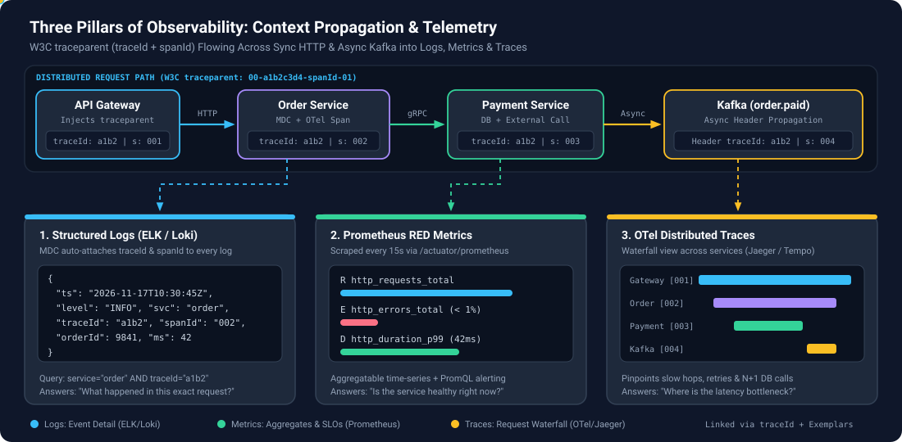

### Distributed Log & Context Propagation Pipeline

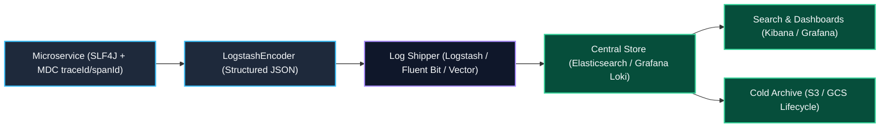

### Correlation ID & W3C `traceparent` Propagation

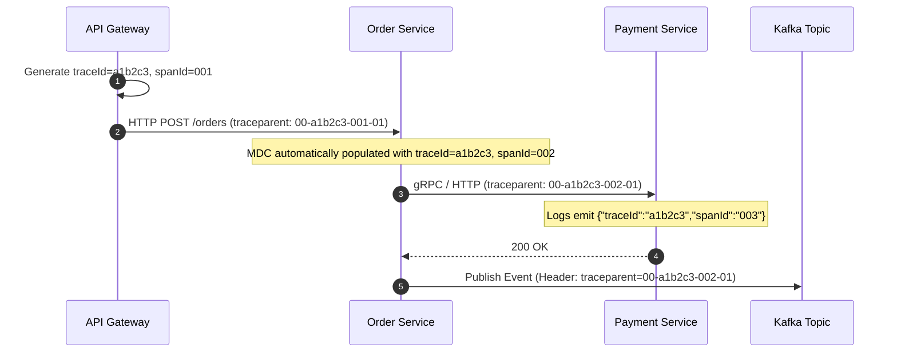

> [!TIP]
> **Spring Boot 3 Migration Note:** `spring-cloud-starter-sleuth` reached end-of-life with Spring Boot 2.x. For Spring Boot 3+, use **Micrometer Tracing** (`micrometer-tracing-bridge-otel` + `opentelemetry-exporter-otlp`), which automatically populates `%X{traceId}` and `%X{spanId}` in SLF4J MDC and propagates W3C `traceparent` headers.

### ELK Stack (Elasticsearch, Logstash, Kibana)

```xml
<!-- pom.xml -->
<dependency>
    <groupId>org.springframework.cloud</groupId>
    <artifactId>spring-cloud-starter-sleuth</artifactId>
</dependency>
<dependency>
    <groupId>net.logstash.logback</groupId>
    <artifactId>logstash-logback-encoder</artifactId>
    <version>7.2</version>
</dependency>
```

```xml
<!-- logback-spring.xml -->
<configuration>
    <!-- Console appender with color -->
    <appender name="CONSOLE" class="ch.qos.logback.core.ConsoleAppender">
        <encoder>
            <pattern>
                %d{yyyy-MM-dd HH:mm:ss.SSS} [%thread] %-5level %logger{36} [%X{traceId}] - %msg%n
            </pattern>
        </encoder>
    </appender>

    <!-- JSON structured logging for Logstash -->
    <appender name="LOGSTASH" class="net.logstash.logback.appender.LogstashTcpSocketAppender">
        <destination>logstash:5000</destination>
        <encoder class="net.logstash.logback.encoder.LogstashEncoder">
            <customFields>{"service": "order-service", "environment": "production"}</customFields>
        </encoder>
    </appender>

    <root level="INFO">
        <appender-ref ref="CONSOLE"/>
        <appender-ref ref="LOGSTASH"/>
    </root>
</configuration>
```

```yaml
# logback config in YAML
logging:
  level:
    root: INFO
    com.ecommerce: DEBUG
    org.springframework.web: WARN
  pattern:
    console: "%d{yyyy-MM-dd HH:mm:ss} - %msg%n"
    file: "%d{yyyy-MM-dd HH:mm:ss} [%thread] %-5level %logger{36} [%X{traceId}] - %msg%n"
  file:
    name: logs/application.log
    max-size: 10MB
    max-history: 10
```

### Structured Logging

```java
// Use structured logging for better querying
@Service
public class OrderService {

    private static final Logger logger = LoggerFactory.getLogger(OrderService.class);

    public void createOrder(CreateOrderRequest request) {
        // Structured logging with context
        logger.info("Creating order",
            kv("customerId", request.getCustomerId()),
            kv("itemCount", request.getItems().size()),
            kv("totalAmount", request.getTotal())
        );

        try {
            Order order = new Order(request);
            orderRepository.save(order);

            logger.info("Order created successfully",
                kv("orderId", order.getId()),
                kv("status", order.getStatus()),
                kv("duration_ms", System.currentTimeMillis() - startTime)
            );
        } catch (Exception e) {
            logger.error("Failed to create order",
                kv("customerId", request.getCustomerId()),
                kv("errorMessage", e.getMessage()),
                kv("exceptionType", e.getClass().getName()),
                e
            );
            throw e;
        }
    }

    // Helper method
    private static StructuredArgument kv(String key, Object value) {
        return keyValue(key, value);
    }
}
```

### Log Aggregation Query & Stack Comparison

```text
Query in Kibana:
service: "order-service" AND level: "ERROR" AND timestamp: [now-1h TO now]

Returns: All error logs from order service in last hour

Fields in Elasticsearch:
├─ @timestamp: 2024-02-09T10:30:45.123Z
├─ service: order-service
├─ level: ERROR
├─ message: "Failed to create order"
├─ customerId: 123
├─ totalAmount: 99.99
├─ errorMessage: "Payment service unavailable"
├─ exceptionType: "PaymentServiceException"
├─ traceId: abc123def456
└─ spanId: xyz789
```

| Stack | Indexing Strategy | Storage & Cost | Best Fit |
| :--- | :--- | :--- | :--- |
| **ELK (Elasticsearch + Logstash + Kibana)** | Full-text inverted index on all JSON fields | Higher RAM/disk; fast ad-hoc search | Rich analytics & complex full-text queries |
| **Grafana Loki (+ Promtail/Alloy)** | Indexes **labels only** (`service`, `env`), compresses log chunks in S3 | Very low cost; cloud-native | Kubernetes shops already using Prometheus/Grafana |
| **Managed SaaS (Datadog / CloudWatch)** | Managed indexing + correlation with APM | Pay-per-GB ingested & indexed | Teams prioritizing zero ops overhead |

---

## Metrics and Monitoring

Metrics are compact, numeric time-series that power real-time dashboards and automated alerting at a fraction of the cost of raw logs.

### Prometheus Pull-Based Scraping & Grafana Pipeline

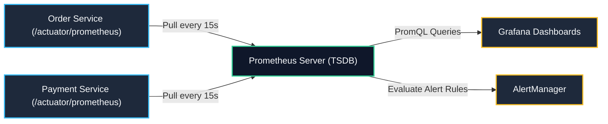

### Observability Methodologies: RED vs. USE vs. Four Golden Signals

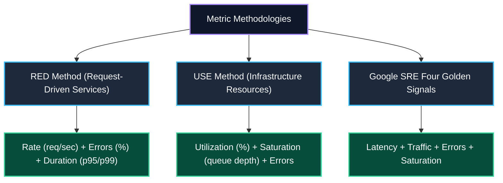

### Prometheus Metric Types

| Metric Type | Behavior | Typical Use Case | Example |
| :--- | :--- | :--- | :--- |
| **Counter** | Monotonically increasing (resets to 0 on restart) | Request counts, errors, orders created | `orders_created_total` |
| **Gauge** | Point-in-time value that goes up or down | Active threads, pending orders, memory used | `orders_pending` |
| **Histogram** | Samples observations into configurable buckets | Request latency (`p50`, `p95`, `p99`), payload sizes | `http_request_duration_ms_bucket` |
| **Summary** | Client-side quantiles over a sliding time window | Single-instance quantiles (cannot aggregate across pods) | `rpc_duration_seconds` |

> [!WARNING]
> **Avoid High-Cardinality Labels in Prometheus!** Never put `userId`, `orderId`, `requestId`, or raw URLs with IDs into metric `.tag(...)` labels. Each unique label combination creates a new time-series in Prometheus TSDB, causing memory exhaustion and query timeouts.

### Prometheus Metrics with Micrometer

```xml
<!-- pom.xml -->
<dependency>
    <groupId>io.micrometer</groupId>
    <artifactId>micrometer-registry-prometheus</artifactId>
</dependency>
```

```java
// Custom metrics
@Service
public class OrderService {

    @Autowired
    private MeterRegistry meterRegistry;

    @Autowired
    private OrderRepository orderRepository;

    private final Counter ordersCreated;
    private final Timer orderCreationTime;
    private final AtomicInteger pendingOrders;

    public OrderService(MeterRegistry meterRegistry) {
        this.meterRegistry = meterRegistry;

        // Counter: monotonically increasing
        this.ordersCreated = Counter.builder("orders_created_total")
            .description("Total number of orders created")
            .tag("service", "order-service")
            .register(meterRegistry);

        // Timer: duration tracking
        this.orderCreationTime = Timer.builder("order_creation_time")
            .description("Time taken to create an order")
            .publishPercentiles(0.5, 0.95, 0.99)
            .register(meterRegistry);

        // Gauge: current value
        this.pendingOrders = new AtomicInteger(0);
        meterRegistry.gauge("orders_pending", pendingOrders);
    }

    @Transactional
    public Order createOrder(CreateOrderRequest request) {
        long startTime = System.currentTimeMillis();

        try {
            Order order = new Order(request);
            order = orderRepository.save(order);

            ordersCreated.increment();
            pendingOrders.incrementAndGet();

            return order;
        } finally {
            long duration = System.currentTimeMillis() - startTime;
            orderCreationTime.record(Duration.ofMillis(duration));
        }
    }

    public void completeOrder(Long orderId) {
        pendingOrders.decrementAndGet();
        meterRegistry.counter("orders_completed_total").increment();
    }
}
```

```yaml
# Expose metrics endpoint
spring:
  application:
    name: order-service

management:
  endpoints:
    web:
      exposure:
        include: health,metrics,prometheus
  metrics:
    enable:
      logback: true
      jvm: true
      process: true
      system: true
    export:
      prometheus:
        enabled: true
```

### Key Metrics (RED Method)

- **R — Request Rate:** Requests per second (`rate(http_requests_total[1m])`)
- **E — Error Rate:** Percentage of failed requests (`rate(http_requests_errors_total[1m]) / rate(http_requests_total[1m])`)
- **D — Duration (Latency):** Response time distribution (`p50`, `p95`, `p99` via `histogram_quantile`)

```java
// Implement RED metrics
@Component
public class MetricsCollector {

    @Autowired
    private MeterRegistry meterRegistry;

    @Before("execution(public * com.ecommerce..*.*(..))")
    public void recordMetrics(JoinPoint joinPoint) {
        String methodName = joinPoint.getSignature().getName();
        String className = joinPoint.getTarget().getClass().getSimpleName();

        // REQUEST RATE
        Counter.builder("http_requests_total")
            .tag("method", methodName)
            .tag("service", className)
            .register(meterRegistry)
            .increment();

        // DURATION
        long startTime = System.currentTimeMillis();

        try {
            joinPoint.proceed();

            // SUCCESS: no error
            long duration = System.currentTimeMillis() - startTime;
            Timer.builder("http_request_duration_ms")
                .tag("method", methodName)
                .tag("status", "success")
                .register(meterRegistry)
                .record(Duration.ofMillis(duration));

        } catch (Throwable e) {
            // ERROR RATE
            Counter.builder("http_requests_errors_total")
                .tag("method", methodName)
                .tag("exception", e.getClass().getSimpleName())
                .register(meterRegistry)
                .increment();

            long duration = System.currentTimeMillis() - startTime;
            Timer.builder("http_request_duration_ms")
                .tag("method", methodName)
                .tag("status", "error")
                .register(meterRegistry)
                .record(Duration.ofMillis(duration));

            throw e;
        }
    }
}
```

```yaml
# Prometheus scrape config
global:
  scrape_interval: 15s
  evaluation_interval: 15s

scrape_configs:
  - job_name: 'order-service'
    static_configs:
      - targets: ['localhost:8080']
    metrics_path: '/actuator/prometheus'

  - job_name: 'payment-service'
    static_configs:
      - targets: ['localhost:8081']
    metrics_path: '/actuator/prometheus'
```

### Grafana Dashboards

```text
Dashboard: Order Service Health

Panels:
1. Request Rate (per second)
   └─ Query: rate(http_requests_total[1m])

2. Error Rate (percentage)
   └─ Query: (rate(http_requests_errors_total[1m]) / rate(http_requests_total[1m])) * 100

3. Latency Percentiles
   └─ Query: histogram_quantile(0.95, rate(http_request_duration_ms_bucket[5m]))
   └─ Shows p50, p95, p99

4. Circuit Breaker State
   └─ Query: circuitbreaker_state{name="payment-service"}
   └─ 0=CLOSED, 1=OPEN, 2=HALF_OPEN

5. Pending Orders
   └─ Query: orders_pending

Alerts:
- Error rate > 1% for 5 minutes
- Latency p99 > 5 seconds
- Circuit breaker open > 2 minutes
- Memory usage > 80%
```

---

## Alerting

Effective alerting pages engineers on **user-impacting symptoms** (error rate, latency SLO burn, service down) rather than noisy infrastructure causes, using grouping and deduplication to prevent alert fatigue.

### Alerting & Incident Routing Pipeline

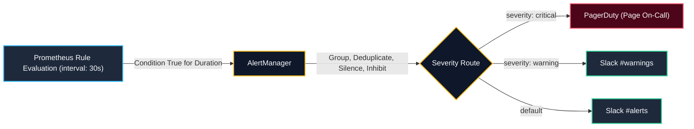

### Alert State Lifecycle

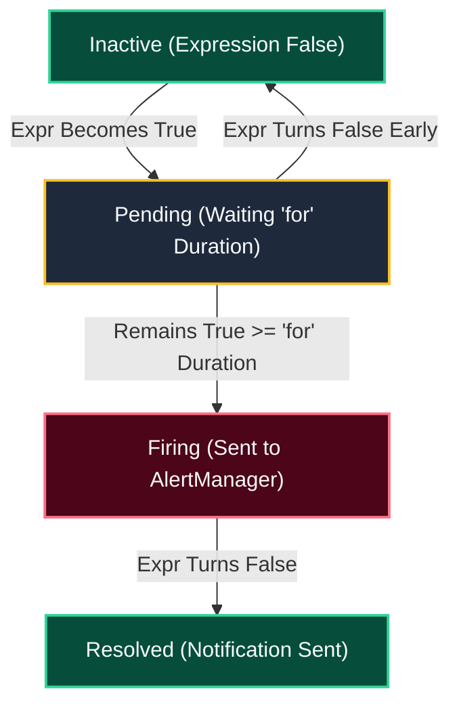

### Severity & Routing Matrix

| Severity | Meaning | Example Condition | Routing Target | Response Expectation |
| :--- | :--- | :--- | :--- | :--- |
| **Critical (P1)** | Active user impact or SLO burn | `HighErrorRate > 1%` for 5m, `ServiceDown` | PagerDuty + Slack `#incidents` | Immediate page (< 5 min ack) |
| **Warning (P2)** | Degraded performance / approaching threshold | `SlowResponse p95 > 5s` for 2m | Slack `#warnings` | Investigate during business hours |
| **Inhibition** | Suppress downstream noise during root failure | Suppress `HighLatency` when `ServiceDown == 1` | AlertManager `inhibit_rules` | Reduces alert storm |

> [!TIP]
> **Multi-Window SLO Burn-Rate Alerting:** Instead of static thresholds that break during traffic spikes, alert when your **error budget** burns too fast (e.g., consuming 2% of a 30-day error budget within 1 hour across both a 5m and 1h window).

### Alert Rules

```yaml
# prometheus-rules.yml
groups:
  - name: order-service
    interval: 30s
    rules:
      - alert: HighErrorRate
        expr: (rate(http_requests_errors_total[5m]) / rate(http_requests_total[5m])) > 0.01
        for: 5m
        labels:
          severity: critical
        annotations:
          summary: "High error rate in order service"
          description: "Error rate is {{ $value | humanizePercentage }}"

      - alert: SlowResponse
        expr: histogram_quantile(0.95, rate(http_request_duration_ms_bucket[5m])) > 5000
        for: 2m
        labels:
          severity: warning
        annotations:
          summary: "High latency in order service"
          description: "p95 latency is {{ $value | humanizeDuration }}"

      - alert: CircuitBreakerOpen
        expr: circuitbreaker_state{name="payment-service"} == 1
        for: 2m
        labels:
          severity: critical
        annotations:
          summary: "Payment service circuit breaker open"
          description: "Payment service is failing, orders cannot be processed"

      - alert: ServiceDown
        expr: up{job="order-service"} == 0
        for: 1m
        labels:
          severity: critical
        annotations:
          summary: "Order service is down"
          description: "Order service is unreachable"
```

### Alert Routing (AlertManager)

```yaml
# alertmanager.yml
global:
  resolve_timeout: 5m

route:
  receiver: 'default'
  group_by: ['alertname', 'cluster', 'service']
  group_wait: 10s
  group_interval: 10s
  repeat_interval: 12h

  routes:
    - match:
        severity: critical
      receiver: 'pagerduty'
      continue: true

    - match:
        severity: warning
      receiver: 'slack'

receivers:
  - name: 'default'
    slack_configs:
      - api_url: 'https://hooks.slack.com/services/...'
        channel: '#alerts'

  - name: 'pagerduty'
    pagerduty_configs:
      - service_key: 'YOUR_PAGERDUTY_KEY'
        description: '{{ .GroupLabels.alertname }}'

  - name: 'slack'
    slack_configs:
      - api_url: 'https://hooks.slack.com/services/...'
        channel: '#warnings'
        title: 'Warning Alert'
```

---

## Interview Questions

### Q1: Design authentication for microservices where services need to talk to each other

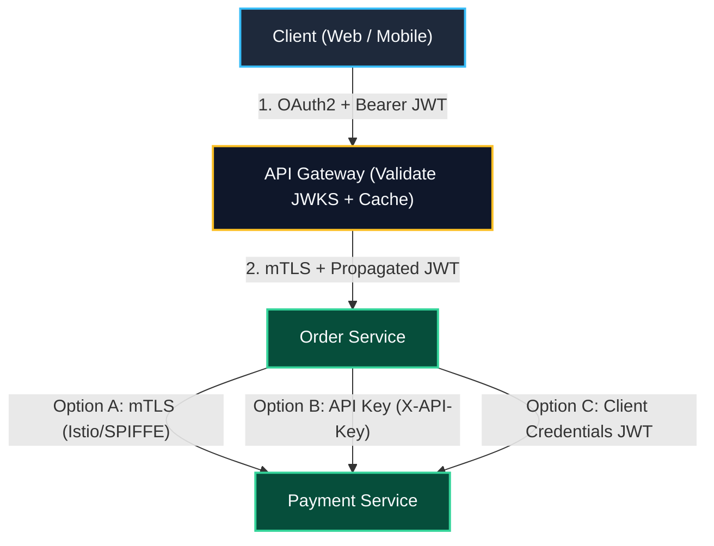

**Answer:**

1. **Client → API Gateway (North-South):**
   - Client sends `Authorization: Bearer <JWT>` obtained from a central IdP (Keycloak, Okta, Auth0) via OAuth 2.0 + OIDC.
   - API Gateway validates the JWT signature locally using cached JWKS public keys to minimize latency.
2. **API Gateway → Microservices & East-West Calls:**
   - **Option 1: mTLS (Mutual TLS):** Each service has an X.509 certificate; both sides verify certificates to establish an encrypted channel. Most secure, requires certificate rotation, ideal for **Istio / Service Mesh** environments.
   - **Option 2: API Key:** Service A sends `X-API-Key` in headers; Service B validates it against a Secrets Manager. Simpler than mTLS with less overhead, suitable for direct service calls.
   - **Option 3: JWT with Service Account (OAuth2 Client Credentials):** Service A authenticates with service account credentials, obtains a JWT from the Auth Server, and sends it to Service B—reusing the same token validation pipeline as client auth.
3. **Production Implementation Checklist:**
   - Client auth: OAuth 2.0 + PKCE + JWT.
   - Service-to-service: mTLS in Kubernetes, or API key / Service Account JWT.
   - Central auth server (Keycloak, Okta) with JWKS key caching and short-lived token refresh.

---

### Q2: Your application is generating too many logs. How would you manage them?


**Answer:**

1. **Enforce Environment-Specific Log Levels:**
   - `DEBUG` in development only; `INFO` for key business events; `WARN` for recoverable issues; `ERROR` for service failures. Support runtime level toggling via Spring Boot Actuator (`/actuator/loggers`).
2. **Apply Smart Sampling:**
   - Log **100% of `ERROR`**, **10% of `INFO`** (random/head or tail-based sampling), and **1% of `DEBUG`**. Reduces ingestion and storage costs while preserving full failure visibility.
3. **Tiered Log Retention & Archival:**
   - Hot storage: `ERROR` for **30 days**, `WARN` for **14 days**, `INFO` for **7 days**.
   - Archive older logs to **S3 / GCS** for compliance at a fraction of the cost.
4. **Structured Logging:**
   - Emit JSON with context fields (`userId`, `orderId`, `traceId`) to enable fast, indexed filtering without expensive regex parsing.
5. **Centralized Aggregation & Indexing:**
   - Centralize in ELK, Grafana Loki, or Datadog; index by `timestamp`, `service`, and `level`:
     `service: order-service AND level: ERROR AND timestamp: [now-24h TO now]`

> [!TIP]
> **Bonus Follow-Up Questions to Prepare For:**
> - **How do you prevent PII leaks in logs?** Mask/redact sensitive fields (`email`, `cardNumber`, `Authorization` headers) at the Logback converter or log-shipper layer before ingestion.
> - **Why did Prometheus OOM after a deploy?** Usually a **high-cardinality label** (like `customerId` or unparameterized URLs) was added to a metric, exploding the number of active time-series.
