# Microservices Interview Questions

Comprehensive visual study guide of microservices interview questions with detailed answers, architecture blueprints, and production trade-offs for FAANG interviews.

---

## Table of Contents

1. [Core Concepts (20 Questions)](#core-concepts)
2. [Architecture & Design (10 Questions)](#architecture--design)
3. [System Design (5 Questions)](#system-design)
4. [Debugging (2 Questions)](#debugging)
5. [Trade-offs & Decisions (3 Questions)](#trade-offs--decisions)
6. [Summary](#summary)

---

## Core Concepts

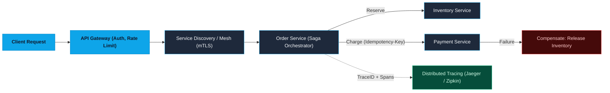

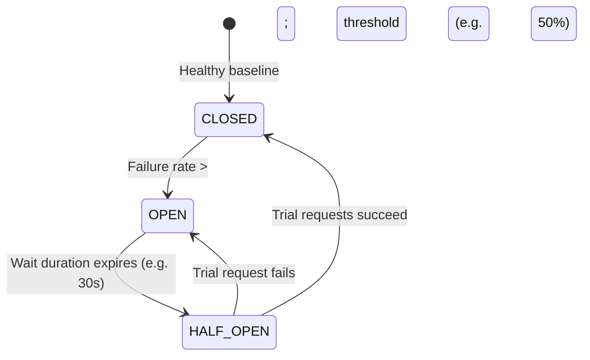

> [!IMPORTANT]
> In FAANG interviews, never treat microservices as a default upgrade over a monolith. Always anchor your answer in **organizational scale (Conway's Law)**, **bounded contexts (DDD)**, and **operational readiness**.

### Q1: What is the difference between monolith and microservices?

**Answer**:

| Aspect | Monolith | Microservices |
|--------|----------|--------------|
| Deployment | Single unit | Independent services |
| Scaling | Entire app | Individual services |
| Database | Shared | Per service |
| Development | Single codebase | Multiple codebases |
| Team size | Large, coordinated | Small, autonomous (2-pizza teams) |
| Technology | One stack | Mixed stacks |
| Fault isolation | Cascading failures | Isolated failures |
| Operational complexity | Low | Very high |

- **When to use monolith**: Early stage, small team, simple domain
- **When to use microservices**: Complex domain, multiple independent teams, high scale

### Q2: What is Domain-Driven Design and why is it important for microservices?

**Answer**:

DDD provides framework for decomposing microservices using business logic:

**Key concepts**:
- **Bounded Contexts**: Clear boundaries around business domains
- **Aggregates**: Clusters of entities treated as single unit
- **Entities**: Objects with identity that persist
- **Value Objects**: Immutable objects defined by attributes
- **Domain Events**: Important business occurrences
- **Ubiquitous Language**: Shared vocabulary with domain experts

**Why important for microservices**:
1. Service boundaries aligned with business, not technology
2. Each service has clear responsibility
3. Natural service decomposition
4. Services stable (business domains don't change often)
5. Team structure aligns with service ownership

### Q3: What is Conway's Law and how does it relate to microservices?

**Answer**:

> "Any organization that designs a system will produce a design whose structure is a copy of the organization's communication structure."

**Implication for microservices**:
- If you have backend team and frontend team, you'll get frontend-backend separation (bad)
- If you have squad structure by domain, you'll get domain-based services (good)

**Reverse Conway Maneuver**:
Structure organization to match desired architecture:
- Squad 1: Order Service (backend + frontend)
- Squad 2: Payment Service
- Squad 3: Inventory Service
- Platform team: shared infrastructure

### Q4: Explain the CAP theorem and its relevance to distributed systems

**Answer**:

**CAP Theorem**: In distributed systems, choose 2 of 3:
- **Consistency**: All nodes see same data at same time
- **Availability**: System remains available even if nodes fail
- **Partition tolerance**: System continues even if network partitions

| Choice | Trade-off | Consistency Model | Typical Examples |
|--------|-----------|-------------------|------------------|
| **AP** (Availability + Partition Tolerance) | Tolerates temporary stale data | Eventual consistency | Order service, product catalog, notifications |
| **CP** (Consistency + Partition Tolerance) | Sacrifices availability during partitions (waits for consensus) | Strong consistency | Payment systems, critical financial data, inventory |

**For microservices**:
- Accept eventual consistency
- Use saga pattern for distributed transactions
- Implement monitoring for consistency issues

### Q5: What is idempotency and why is it critical in microservices?

**Answer**:

**Idempotency**: Executing same operation multiple times has same effect as executing once.

**Why critical**:
Network unreliable - requests might be retried:
- Client sends payment request, receives timeout
- Client retries, payment processed twice (no idempotency)
- With idempotency: duplicate payment prevented

**Implementation**:
```text
Client provides: Idempotency-Key (unique ID)
Server stores: key → result mapping

Retry with same key → returns cached result
```

**Idempotent operations**:
- `GET`: naturally idempotent (read-only)
- `PUT`: idempotent (replace entire resource)
- `DELETE`: idempotent (already deleted, same result)
- `POST` with idempotency key: idempotent
- `PATCH`: NOT idempotent (partial update)

> [!TIP]
> Always pair `POST` mutation endpoints (like `/payments` or `/orders`) with a client-generated `Idempotency-Key` stored atomically alongside the transaction record.

### Q6: What are the main challenges in microservices?

**Answer**:

1. **Operational Complexity**: Many services to manage, deploy, monitor
   - Solution: Kubernetes, Docker, CI/CD automation
2. **Network Latency**: All communication over network (slower than in-process)
   - Solution: Caching, batch operations, async processing
3. **Data Consistency**: Distributed transactions hard
   - Solution: Eventual consistency, saga pattern, event sourcing
4. **Debugging**: Errors span multiple services
   - Solution: Distributed tracing, centralized logging
5. **Testing**: Integration tests complex, multiple service interactions
   - Solution: Contract testing, mock services, test environments
6. **Security**: More attack surface, service-to-service auth complex
   - Solution: mTLS, API gateway, proper authentication
7. **Monitoring**: Need visibility across many services
   - Solution: Metrics aggregation, centralized logs, dashboards

### Q7: What is a saga and when would you use it?

**Answer**:

**Saga**: Pattern for managing distributed transactions across services.

**Two types**:
1. **Choreography**: Event-driven, services react independently
   - Loose coupling
   - Hard to see overall flow
   - Example: Order → Payment → Inventory → Shipping
2. **Orchestration**: Central orchestrator directs flow
   - Clear flow, easier to debug
   - More coupling (orchestrator knows about services)
   - Example: OrderOrchestrator calls Payment, then Inventory, then Shipping

**When to use**:
- Long-running processes spanning multiple services
- When you need compensation (rollback) on failure
- Complex workflows with multiple steps

**Example**: Order creation saga
- Step 1: Reserve inventory
- Step 2: Process payment
- Step 3: Create shipment
- If step 2 fails: Compensate step 1 (release inventory)

### Q8: What is the difference between REST and gRPC?

**Answer**:

| Aspect | REST | gRPC |
|--------|------|------|
| Protocol | HTTP/1.1 | HTTP/2 |
| Serialization | JSON (text) | Protocol Buffers (binary) |
| Payload size | Large | Small |
| Performance | Slower | Fast |
| Streaming | Limited | Built-in (unary, server, client, bidirectional) |
| Browser support | Excellent | Poor |
| Learning curve | Easy | Steeper |

**When to use REST**:
- Public APIs, third-party access
- Simple CRUD operations
- Browser compatibility needed
- Debugging important

**When to use gRPC**:
- Internal service-to-service communication
- High throughput, low latency
- Bidirectional streaming needed
- Language flexibility with code generation

### Q9: Explain circuit breaker pattern

**Answer**:

**States**:
1. **CLOSED**: Normal operation, requests pass through
2. **OPEN**: Failing service detected, fast-fail all requests (return cached/default)
3. **HALF-OPEN**: Testing if service recovered, allow limited requests

**Transition**:
```text
CLOSED
  │ (failure rate > threshold)
  ▼
OPEN
  │ (wait duration expires)
  ▼
HALF_OPEN
  ├─ (success) → CLOSED
  └─ (failure) → OPEN
```

**Benefits**:
- Prevent cascading failures
- Fast failure (don't wait for timeout)
- Allow failing service to recover
- Better user experience (fallback)

**Configuration**:
- Failure rate threshold: `50%`
- Wait duration: `30 seconds`
- Slow call duration: `2 seconds`

### Q10: What is bulkhead pattern?

**Answer**:

**Bulkhead**: Isolate resources to prevent cascading failures.

**Without bulkhead**:
```text
Order Service (10 threads)
├─ Payment Service: 5 threads
└─ Inventory Service: 5 threads

If Payment hangs: 50% of threads blocked
```

**With bulkhead**:
```text
Order Service
├─ Thread Pool 1 (Payment): 5 threads (isolated)
└─ Thread Pool 2 (Inventory): 5 threads (isolated)

If Payment hangs: only 50% of threads blocked, Inventory still works
```

**Benefits**:
- Failure isolation
- Resource boundaries
- Better resilience

### Q11: Explain the difference between eventual and strong consistency

**Answer**:

**Strong Consistency**:
```text
Account A: $100 → $70
Account B: $50 → $80
Both succeed or both fail (ACID)

Good for: Financial transactions, critical data
```

**Eventual Consistency**:
```text
Order created: PENDING
Payment processing...
Order updated: PAID

Between states: system inconsistent
Good for: Recommendations, analytics, notifications
```

**For microservices**: Accept eventual consistency
- Embrace it in design
- Tolerant of stale data
- Better availability and scalability

### Q12: What is CQRS?

**Answer**:

**CQRS**: Command Query Responsibility Segregation.

**Separates read and write models**:
- **Write Model**: Optimized for transactions (normalized schema)
- **Read Model**: Optimized for queries (denormalized, multiple views)

**Benefits**:
- Queries optimized (text search, complex joins easy)
- Independent scaling (more read replicas)
- Events as first-class citizens
- Audit trail

**Challenges**:
- Eventual consistency (stale read data)
- More databases to manage
- Complex implementation

**When to use**: Complex queries, many read patterns, event-driven architecture.

### Q13: What is event sourcing?

**Answer**:

**Event Sourcing**: Store complete history of state changes as immutable events.

**Traditional**:
```text
Current state: Order {status: COMPLETED, total: $99.99}
No history, can't replay
```

**Event Sourcing**:
```text
Events:
├─ OrderCreatedEvent
├─ OrderSubmittedEvent
├─ PaymentApprovedEvent
├─ InventoryReservedEvent
└─ OrderShippedEvent

Current state: Derived by replaying all events
```

**Benefits**:
- Complete audit trail
- Replay to any point in time
- Natural event-driven architecture
- Debugging (see exactly what happened)

**Challenges**:
- Complex to implement
- Event schema evolution hard
- Storage grows infinitely

> [!WARNING]
> Event Sourcing introduces permanent schema-evolution overhead. Do not adopt it for simple CRUD services when a standard relational table plus an outbox log suffices.

### Q14: What is API Gateway pattern?

**Answer**:

**API Gateway**: Single entry point for all client requests.

**Responsibilities**:
1. **Routing**: Direct requests to correct service
2. **Authentication/Authorization**: JWT validation, permissions
3. **Rate Limiting**: Prevent abuse
4. **Load Balancing**: Distribute across service instances
5. **Request/Response Transformation**: Versioning, conversion
6. **Monitoring/Logging**: Centralized visibility

**Benefits**:
- Single point of entry
- Cross-cutting concerns centralized
- Clients don't know about services
- Security enforcement

**Tools**: Spring Cloud Gateway, Kong, AWS API Gateway.

### Q15: What is service discovery?

**Answer**:

**Service Discovery**: Automatically finding available service instances.

**Without service discovery**:
```text
// Hardcoded
payment-service-instance-1: http://10.0.0.5:8080
payment-service-instance-2: http://10.0.0.6:8080

Problem: If instance dies, code fails
```

**With service discovery**:
```text
Service Registry:
├─ payment-service:
│  ├─ instance-1: http://10.0.0.5:8080
│  ├─ instance-2: http://10.0.0.6:8080
│  └─ instance-3: http://10.0.0.7:8080

Client queries registry → gets live instances
```

**Types**:
- **Client-side**: Client discovers and load balances (Eureka + Ribbon)
- **Server-side**: API Gateway discovers (Kubernetes DNS, Spring Cloud Gateway)

**Benefits**:
- Dynamic instance management
- Load balancing
- Health checks
- Self-healing

### Q16: What is a service mesh?

**Answer**:

**Service Mesh**: Infrastructure layer handling service-to-service communication.

**Problems solved**:
- **Resilience**: Retries, circuit breaker, timeouts
- **Security**: Mutual TLS, authorization policies
- **Observability**: Distributed tracing, metrics
- **Traffic management**: Canary, blue-green, rate limiting

**Popular**: Istio, Linkerd.

**Components**:
- **Sidecar proxy**: Each service gets proxy (Envoy)
- **Control plane**: Manages proxies, policies

**Benefits**:
- No code changes needed (infrastructure handles it)
- Centralized traffic management
- mTLS by default
- Rich observability

### Q17: What is distributed tracing?

**Answer**:

**Distributed Tracing**: Track request as it flows through multiple services.

**Key concepts**:
- **Trace ID**: Unique ID for entire request (follows through all services)
- **Span**: Single operation within a service
- **Span ID**: Unique ID for operation

**Example**:
```text
Client request: POST /orders
Trace ID: abc123

Order Service: span-1
  └─ Payment Service call: span-2
     └─ Payment processing: span-3
  └─ Inventory Service call: span-4

Tools: Sleuth (Spring), Zipkin, Jaeger, Datadog
```

**Benefits**:
- See full request flow
- Identify bottlenecks
- Debugging distributed issues
- Performance analysis

### Q18: What is the twelve-factor app methodology?

**Answer**:

12 principles for building scalable applications:

1. **Codebase**: One codebase per app in version control
2. **Dependencies**: Explicitly declare dependencies
3. **Config**: Environment-specific config in environment variables
4. **Backing services**: Treat databases, caches as attached resources
5. **Build/Release/Run**: Strict separation of stages
6. **Processes**: Stateless processes
7. **Port Binding**: Self-contained (embedded Tomcat)
8. **Concurrency**: Scale via multiple processes
9. **Disposability**: Fast startup, graceful shutdown
10. **Dev/Prod Parity**: Same tools, services, OS everywhere
11. **Logs**: Write to stdout, aggregated by infrastructure
12. **Admin Tasks**: One-off tasks run against live database

**For microservices**: Essential best practice.

### Q19: What is the Strangler Fig pattern?

**Answer**:

**Pattern**: Gradually replace monolith with microservices.

**Steps**:
1. New service runs alongside monolith
2. API Gateway routes traffic to new service
3. Gradually increase traffic to new service
4. Eventually decommission monolith

**Benefits**:
- Low risk (gradual rollout)
- Easy rollback
- Services can share domain (legacy DB temporarily)
- Allows controlled migration

**Example**: Extract Payment Service from monolith
```text
Month 1: Payment Service created, 0% traffic
Month 2: 10% traffic to new service, 90% to monolith
Month 3: 50% traffic split
Month 4: 100% traffic to new service
Month 5: Decommission monolith
```

### Q20: What is the Branch by Abstraction pattern?

**Answer**:

**Pattern**: Create abstraction layer, gradually move functionality behind it.

**Steps**:
1. Create interface/abstraction
2. Implement with old code initially
3. Create new implementation (microservice)
4. Gradually switch traffic to new implementation
5. Remove old implementation

**Benefits**:
- Gradual migration
- Easy rollback
- Can A/B test implementations
- Decouples from specifics

**Example**:
```java
interface PaymentProcessor {
    PaymentResult processPayment(Request req);
}

// Old: MonolithPaymentProcessor
// New: PaymentServiceClient

// Start using new implementation percentage by percentage
if (Math.random() < serviceTrafficPercentage) {
    return paymentServiceClient.processPayment(req);
} else {
    return monolithProcessor.processPayment(req);
}
```

---

## Architecture & Design

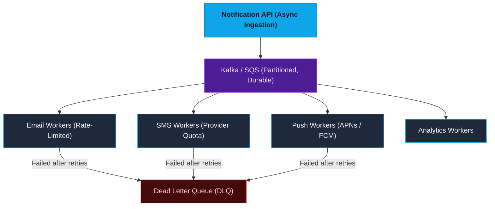

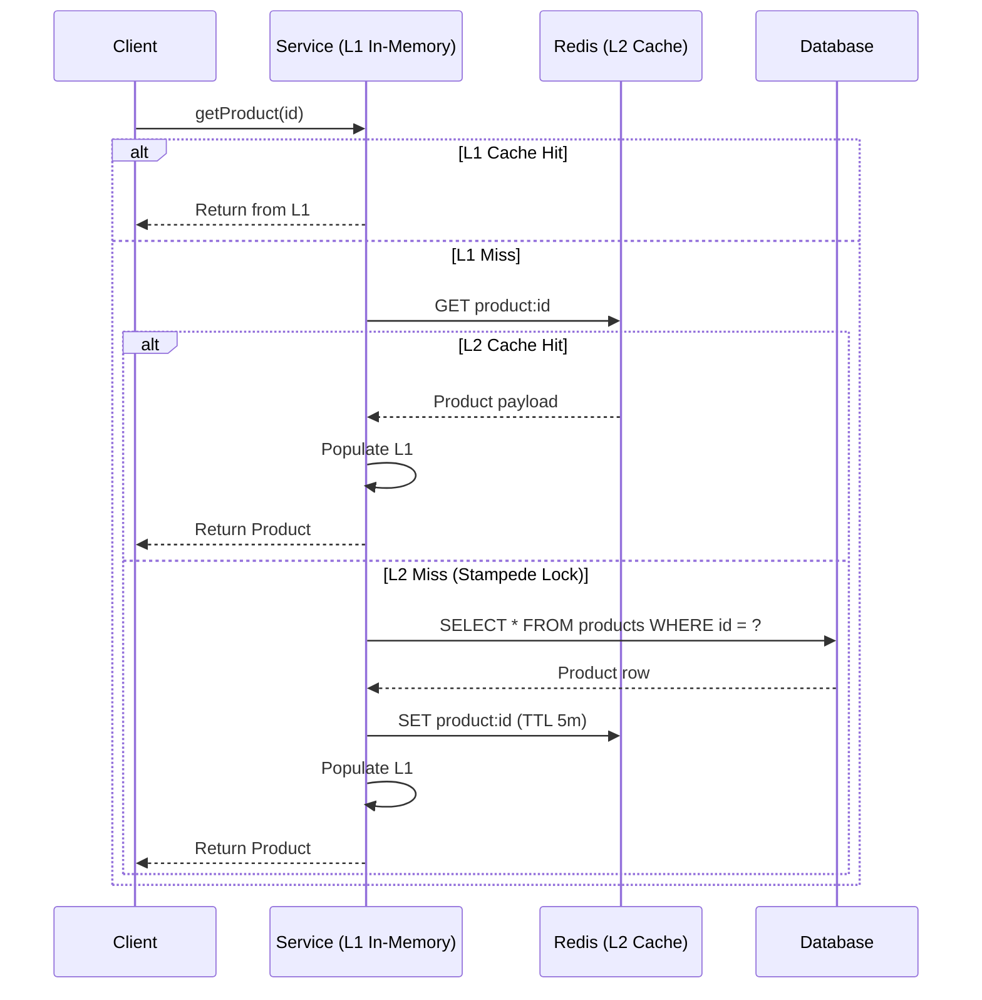

### Q21: How would you design a notification service for millions of users?

**Answer**:

```text
Architecture:

┌─────────────────────────┐
│   Notification API      │
│ (Async event receiving) │
└────────┬────────────────┘
         │
         ▼
┌─────────────────────────┐
│  Message Queue          │
│  (Kafka, SQS)           │
│  - Multiple partitions  │
│  - High throughput      │
└────────┬────────────────┘
         │
    ┌────┴────┬──────────┬────────────┐
    ▼         ▼          ▼            ▼
 Email Svc  SMS Svc  Push Svc   Analytics Svc
 (Workers)  (Workers) (Workers)  (Workers)
```

**Key Considerations**:
1. **Asynchronous**:
   - Accept notification request
   - Queue immediately
   - Process asynchronously
2. **Scalability**:
   - Multiple worker instances
   - Horizontal scaling
   - Batch operations
3. **Reliability**:
   - Message durability (persisted queue)
   - Retry logic with exponential backoff
   - Dead letter queue for failed messages
4. **Rate limiting**:
   - Per user: max X emails per day
   - Per provider: rate limits from email providers
5. **Deduplication**:
   - Same user shouldn't get duplicate notifications
   - Use idempotency keys
6. **Multi-channel**:
   - Email, SMS, push notifications
   - Separate workers for each
   - User preferences (opt-in/out)
7. **Database**:
   - No ACID needed (eventual consistency fine)
   - Could use NoSQL (MongoDB) for speed
   - Separate read replicas for analytics

### Q22: How would you handle versioning in microservices APIs?

**Answer**:

| Strategy | Example | Pros | Cons |
|----------|---------|------|------|
| **URL Versioning** | `GET /api/v1/orders`, `GET /api/v2/orders` | Explicit, clear for clients; multiple versions live simultaneously | Routes must be managed carefully |
| **Header Versioning** | `Accept: application/vnd.company.v1+json` | Less URL pollution | Harder for clients to discover versions |
| **Query Parameter** | `GET /api/orders?version=1` | Flexible | Less RESTful |

**Best practices**:
1. **Backward Compatibility**:
   ```java
   // V1: name field
   // V2: firstName, lastName fields
   // Old client: gets name field (derived from firstName + lastName)
   // New client: gets firstName, lastName
   ```
2. **Graceful Deprecation**:
   ```http
   Deprecation: true
   Sunset: Wed, 21 Nov 2024 07:00:00 GMT
   ```
   - Give clients time to migrate
   - Provide alternative endpoint
3. **Additive Changes Only**:
   ```text
   Add new fields ✓
   Remove fields ✗
   Rename fields ✗
   Change field types ✗
   ```
4. **Keep Old Versions**:
   - Run v1 and v2 simultaneously
   - Gradually deprecate v1
   - Eventually sunset v1

### Q23: How would you implement distributed caching?

**Answer**:

| Strategy | Flow | Consistency | Trade-off |
|----------|------|-------------|-----------|
| **Cache-Aside** | Check cache → Miss → Fetch DB → Update cache → Return | Eventual (stale data possible) | Simple, flexible |
| **Write-Through** | Write to cache → Write to DB → Return | Always consistent | Slower writes |
| **Write-Behind** | Write to cache → Return immediately → Async write to DB | Eventual | Fast, but data loss risk |

**Challenges**:
1. **Invalidation** (Problem: Cache has stale data):
   - TTL-based (expire after X minutes)
   - Event-based (invalidate on update)
   - Versioning (version in cache key)
   - Periodic sync (refresh from source)
2. **Stampede** (cache gets invalidated, all clients hit DB):
   - Solution: Lock pattern
   - First request acquires lock → updates cache → releases lock; other requests wait or use stale data
3. **Consistency** across multiple caches:
   - L1 Cache: In-memory (application level)
   - L2 Cache: Redis (distributed)
   - Invalidation must be propagated to both

**Implementation**:
```java
public Product getProduct(Long id) {
    // Check L1 cache
    if (l1Cache.contains(id)) return l1Cache.get(id);

    // Check L2 cache
    if (l2Cache.contains(id)) {
        Product p = l2Cache.get(id);
        l1Cache.put(id, p);
        return p;
    }

    // Fetch from DB
    Product p = db.getProduct(id);

    // Update caches
    l1Cache.put(id, p);
    l2Cache.put(id, p, Duration.ofMinutes(5));

    return p;
}
```

### Q24: How would you ensure data consistency across microservices?

**Answer**:

**Options**:
1. **Saga Pattern**:
   - Distributed transaction with compensating transactions
   - Try: Reserve inventory → Process payment → Create shipment
   - Catch failure: Compensate in reverse order
2. **Event Sourcing**:
   - Source of truth: Event log; Current state: Derived from events
   - All services read same events → eventual consistency
3. **CQRS**:
   - Write model: Normalized, transactional; Read model: Denormalized, eventual consistency
   - Write happens atomically; Read model updated asynchronously
4. **Distributed Transactions (2-phase commit)**:
   - Phase 1: Prepare (ask all services if they can do it)
   - Phase 2: Commit (all services execute)
   - Problem: Blocking, slow, not resilient — **Don't use in microservices!**

**Recommendation**:
- Embrace eventual consistency
- Use saga + events
- Accept stale data temporarily
- Design for consistency issues

> [!TIP]
> Avoid 2-Phase Commit (2PC) across microservices. It couples service availability to every participant and holds locks across network boundaries.

### Q25: How would you handle cross-cutting concerns in microservices?

**Answer**:

**Cross-cutting concerns**: Authentication/Authorization, Logging, Metrics, Rate limiting, Request validation, Error handling.

**Options**:
1. **API Gateway** (centralized): Auth validation, rate limiting, logging
   - Pros: Centralized, single point
   - Cons: Single point of failure
2. **Sidecar Proxy** (service mesh): Sidecar handles concerns alongside service
   - Pros: Decentralized, resilient
   - Cons: More complex, resource overhead
3. **Interceptors/Filters** (in-service): Interceptor chain wrapping Business Logic
   - Pros: Simple, per-service control
   - Cons: Code duplication across services

**Recommendation**: Combination
- API Gateway: auth, rate limiting (shared)
- Service Mesh: observability, resilience
- Filters: domain-specific logging, validation

### Q26: How would you implement blue-green deployment?

**Answer**:

```text
Blue (v1.0 - running):
├─ 3 instances at v1.0
└─ 100% traffic

Green (v2.0 - staged):
├─ 3 instances at v2.0 (no traffic)
└─ Running tests, verified

Switch:
├─ Load Balancer routes all traffic to Green
├─ Instant cutover
└─ If issue: switch back to Blue

Rollback:
├─ If Green is bad: switch back to Blue
├─ Blue still running, easy rollback

Cleanup:
├─ After stability: shut down Blue
└─ Blue becomes backup
```

- **Advantages**: Instant rollback, Zero downtime, Easy to test in production
- **Disadvantages**: Need 2x resources during deployment, Not good for database migrations

### Q27: How would you handle database migrations in microservices?

**Answer**:

**Challenge**: Each service owns database, schema changes hard.

**Approach: Expand-Contract**:
1. **Step 1: Expand (add new column)**:
   - Add `price_v2` column
   - Both services use `price` column
   - Backfill data to `price_v2`
2. **Step 2: Migrate code**:
   - Deploy new code using `price_v2`
   - Old code still works (using `price`)
3. **Step 3: Contract (remove old column)**:
   - Remove `price` column
   - Ensure no code references it
   - All services use `price_v2`

**Benefits**: Always backward compatible, Can rollback at each step, No downtime.

**For breaking changes**:
1. Create new service (new database)
2. Run both services simultaneously
3. Migrate data gradually
4. Switch traffic
5. Decommission old service

### Q28: How would you implement feature flags in microservices?

**Answer**:

**Feature Flags**: Control feature visibility without deployment.

```java
// Check flag before enabling feature
if (featureFlag.isEnabled("new-payment-processor", userId)) {
    return newPaymentProcessor.process(request);
} else {
    return oldPaymentProcessor.process(request);
}
```

**Levels**:
1. **Global**: All users
2. **Percentage**: X% of users (for canary)
3. **User-specific**: Specific users
4. **Country/Region**: Geographic

**Implementation**:
```java
@Component
public class FeatureFlagService {

    @Autowired
    private FeatureFlagStore flagStore;  // Redis, database, or remote service

    public boolean isEnabled(String flagName, Long userId) {
        FeatureFlag flag = flagStore.getFlag(flagName);

        return switch(flag.getRolloutStrategy()) {
            case GLOBAL -> flag.isEnabled();
            case PERCENTAGE -> {
                int hash = (userId.hashCode()) % 100;
                yield hash < flag.getPercentage();
            }
            case USER_LIST -> flag.getUserIds().contains(userId);
            case COUNTRY -> {
                User user = userService.getUser(userId);
                yield flag.getCountries().contains(user.getCountry());
            }
        };
    }
}
```

**Benefits**: Deploy without release, Gradual rollout, Easy rollback, A/B testing, Canary releases.

### Q29: How would you design a distributed ID generation system?

**Answer**:

**Requirement**: Generate unique IDs across all services, microseconds apart.

| Option | Structure / Mechanism | Pros | Cons |
|--------|-----------------------|------|------|
| **UUID** | `UUID.randomUUID().toString()` | Collision-free, no coordination | 36 chars (large), not sortable |
| **Sequence Number (DB)** | DB `id_sequence` auto-increment | Simple, sequential | Bottleneck, single point of failure |
| **Snowflake ID (Twitter)** | `[Timestamp: 41b][DC: 5b][Machine: 5b][Seq: 12b]` (64-bit) | Compact, sortable, no coordination (69 yrs) | Requires clock sync (NTP) |
| **Ticket Server** | Central server allocates ID ranges | Sequential, batched | Single point of failure (needs multiple servers) |

**Recommendation**: Snowflake ID for most cases — Compact (64 bits), Sortable, No coordination needed, Twitter battle-tested.

### Q30: How would you handle request timeouts across services?

**Answer**:

**Types of timeouts**:
1. **Connection timeout**: TCP connection (3-5 sec)
2. **Read timeout**: Waiting for response (5-30 sec)
3. **Request timeout**: Total end-to-end (30+ sec)

**Timeout strategy**:
```text
Client (30s total)
  ├─ Service A (3s connection, 5s read)
  │  └─ Service A → Service B (2s connection, 3s read)
  │     └─ Database query (1s)
  │
  └─ Fallback after 30s total
```

**Implementation**:
```java
@Bean
public RestTemplate restTemplate() {
    HttpComponentsClientHttpRequestFactory factory =
        new HttpComponentsClientHttpRequestFactory();

    factory.setConnectTimeout(3000);   // 3 seconds
    factory.setReadTimeout(5000);      // 5 seconds

    return new RestTemplate(factory);
}

// With Resilience4j
@TimeLimiter(name = "payment-service")
public Payment processPayment(PaymentRequest req) {
    return paymentClient.process(req);  // Max 3 seconds
}
```

**Configuration**:
```yaml
resilience4j:
  timelimiter:
    instances:
      payment-service:
        timeoutDuration: 3s
        cancelRunningFuture: true
```

---

## System Design

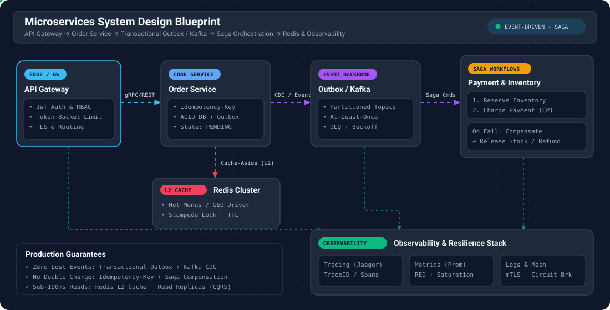

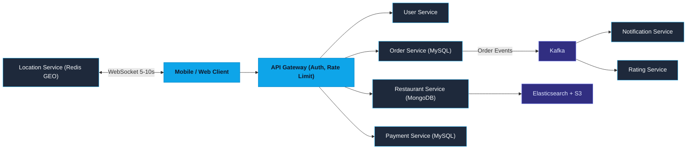

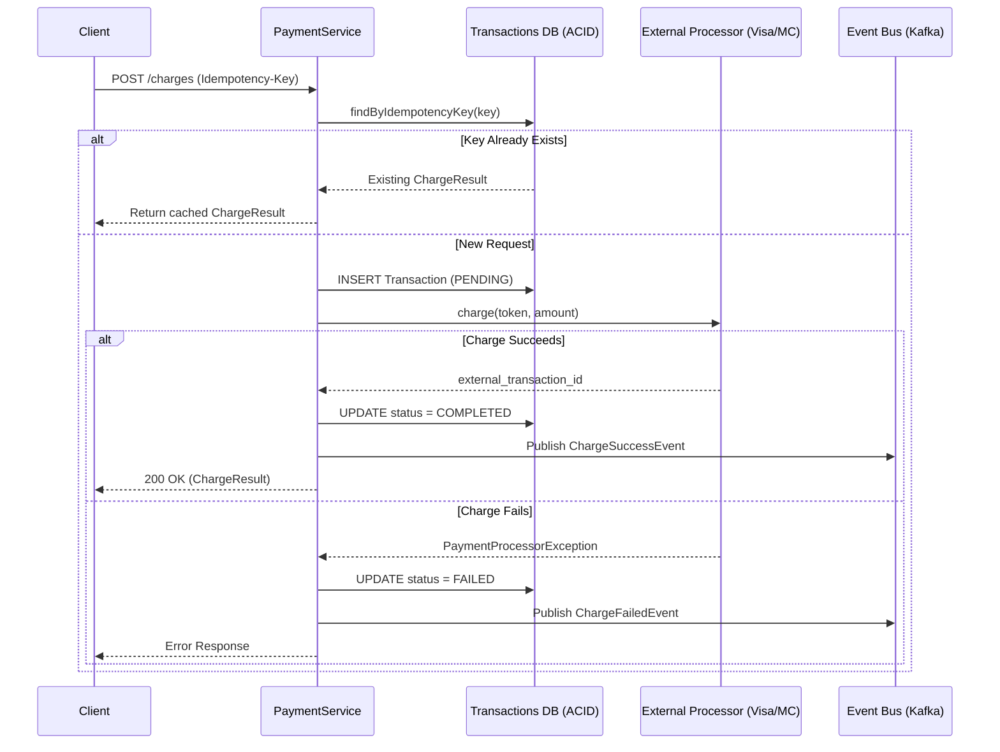

> [!IMPORTANT]
> In system design interviews, always separate **CP paths** (payments, ledger, inventory reservation) from **AP paths** (notifications, recommendations, analytics) and explain how the **Outbox Pattern + Idempotency Keys** bridge them safely.

### Q31: Design a food delivery system (Uber Eats, DoorDash)

**Answer**:

**Core Entities**: Customer, Restaurant, Order, Driver, Payment, Location.

**Key Services**:
1. **User Service**: Customer registration/authentication, Driver onboarding, User profiles
2. **Restaurant Service**: Menu management, Operating hours, Ratings/reviews — Database: `MongoDB` (flexible menu schema)
3. **Order Service (CORE)**: Order creation, Order tracking, Status updates (`CREATED → ACCEPTED → PREPARING → READY → PICKED_UP → DELIVERED`) — Database: `MySQL` (strong consistency)
4. **Payment Service**: Process payments, Refunds, Wallet management — Database: `MySQL` (critical)
5. **Location Service**: Real-time driver location, Restaurant location, Distance calculation — Database: `Redis` (frequent updates)
6. **Notification Service**: SMS, email, push notifications, Order status updates, Async processing
7. **Rating Service**: Customer ratings, Driver ratings, Analytics

**API Endpoints**:
- `/api/restaurants` (list nearby)
- `/api/restaurants/{id}/menu` (menu)
- `/api/orders` (create order)
- `/api/orders/{id}` (track order)
- `/api/payments` (process payment)
- `/api/drivers/location` (real-time location)

**Supporting Infrastructure**:
- Message Queue (`Kafka`): Order events
- Cache (`Redis`): Menu, location, driver status
- Search (`Elasticsearch`): Restaurant search
- `WebSocket`: Real-time location tracking
- File Storage (`S3`): Restaurant photos, menu images

**Challenges**:
1. **Real-time Driver Location**: Update every 5-10 seconds; use Redis for fast updates; WebSocket for push to customers
2. **Matching Drivers to Orders**: Proximity algorithm, driver availability, driver ratings; use GeospatialIndex (MongoDB) or Redis GEO
3. **Payment Reliability**: Saga pattern (Reserve payment → Process → Confirm), timeout handling, refund process
4. **Scale**: Millions of orders/day, real-time tracking (many concurrent); use sharding on customer/restaurant ID, cache heavily
5. **High Availability**: Multi-region deployment, database replication, circuit breaker for each service, graceful degradation

### Q32: Design a payment system (Stripe-like)

**Answer**:

**Core Services**:
1. **Payment Processing**: Accept payment requests, Tokenize cards (PCI compliance), Route to payment processors (Visa, Mastercard), Webhook notifications
2. **Account/Wallet Service**: Customer accounts, Balances, Transaction history
3. **Settlement Service**: Daily settlement, Payout to merchant bank accounts, Reconciliation
4. **Fraud Detection**: Real-time fraud checks, Machine learning models, Rules engine
5. **Reporting & Analytics**: Transaction reports, Revenue analytics, Chargeback tracking

**API**:
```json
POST /charges
{
  "amount": 9999,
  "currency": "USD",
  "customer_id": "cust_123",
  "payment_method": "card_456"
}
```

**Database Schema**:
```text
transactions:
├─ id (primary key)
├─ customer_id
├─ amount
├─ currency
├─ status (PENDING, COMPLETED, FAILED, REFUNDED)
├─ payment_method
├─ external_transaction_id (from processor)
├─ created_at
└─ updated_at

payment_methods:
├─ id
├─ customer_id
├─ type (card, bank_account)
├─ token (encrypted, from payment processor)
├─ last_4_digits
└─ created_at
```

**Challenges**:
1. **PCI Compliance**: Never store card details (use tokenization), End-to-end encryption, Use Payment processor's SDK, Regular security audits
2. **High Availability**: Payment is critical — Multi-region active-active, Database replication (synchronous), Circuit breaker to payment processors, Fallback processors
3. **Idempotency**: Client provides idempotency key, Prevents double-charging on retry, Store `key → result` mapping, Return same result for same key
4. **Reconciliation**: Match internal records with processor records, Handle discrepancies, Daily reconciliation job, Alert on mismatches
5. **Webhook Security**: Verify webhook signature, Prevent replay attacks, Retry on processor failure, Dead letter queue for failures

**Implementation**:
```java
@Service
public class PaymentService {

    @Transactional
    public ChargeResult processCharge(ChargeRequest request, String idempotencyKey) {
        // Check for duplicate
        ChargeResult existing = chargeRepository.findByIdempotencyKey(idempotencyKey);
        if (existing != null) {
            return existing;  // Idempotency
        }

        try {
            // Create transaction record (PENDING)
            Transaction txn = new Transaction();
            txn.setCustomerId(request.getCustomerId());
            txn.setAmount(request.getAmount());
            txn.setStatus(TransactionStatus.PENDING);
            txn.setIdempotencyKey(idempotencyKey);
            txn = transactionRepository.save(txn);

            // Process with payment processor
            ExternalChargeResult externalResult =
                paymentProcessor.charge(request.getPaymentMethod(), request.getAmount());

            // Update transaction
            txn.setStatus(TransactionStatus.COMPLETED);
            txn.setExternalTransactionId(externalResult.getId());
            transactionRepository.save(txn);

            // Publish event
            eventPublisher.publish(new ChargeSuccessEvent(txn));

            return new ChargeResult(txn);
        } catch (PaymentProcessorException e) {
            // Update to FAILED
            transactionRepository.updateStatus(txn.getId(), TransactionStatus.FAILED);

            eventPublisher.publish(new ChargeFailedEvent(txn, e));

            throw e;
        }
    }

    public void refund(String transactionId) {
        Transaction txn = transactionRepository.findById(transactionId).orElseThrow();

        if (txn.getStatus() != TransactionStatus.COMPLETED) {
            throw new InvalidStateException("Can only refund completed transactions");
        }

        // Process refund with processor
        paymentProcessor.refund(txn.getExternalTransactionId(), txn.getAmount());

        // Update status
        txn.setStatus(TransactionStatus.REFUNDED);
        transactionRepository.save(txn);

        eventPublisher.publish(new RefundedEvent(txn));
    }
}
```

### Q33: Design a notification system for millions of users

**Answer**: Covered in [Q21: How would you design a notification service for millions of users?](#q21-how-would-you-design-a-notification-service-for-millions-of-users).

### Q34: Design a recommendation system (Netflix-like)

**Answer**:

**Services**:
1. **Recommendation Engine**: Collaborative filtering, Content-based filtering, Machine learning models, Return top K recommendations
2. **Interaction Tracking**: Track what user watches, Track likes/dislikes, Update in real-time, Async event publishing
3. **Content Service**: Metadata (title, genre, actors), Ratings, reviews, Availability
4. **User Preference Service**: Preferred genres, Viewing history, Ratings history
5. **Analytics Service**: Recommendation effectiveness, Click-through rate, A/B testing results

**Architecture**:
- **Real-time Path**:
  1. User finishes watching movie
  2. Publish: `WatchedContentEvent`
  3. Update user model (Redis)
  4. Return updated recommendations
- **Batch Path (overnight)**:
  1. Fetch all user interactions
  2. Run ML models
  3. Generate recommendations
  4. Store in database

**API**: `GET /recommendations?userId=123&count=10` → Return top 10 recommendations.

**Challenges**:
1. **Real-time vs Accuracy**: Real-time uses cached models (may be stale); Accuracy recomputes models (slow); Hybrid: Real-time with periodic refresh
2. **Cold Start Problem**: New user has no watch history → Show popular content, Content-based + collaborative, Ask user preferences
3. **Scale**: Millions of users, Recommendations must be fast (`< 100ms`), Pre-compute and cache, Batch process updates
4. **Diversity**: Don't recommend same genres repeatedly, Introduce diversity in results, Balance popularity vs personalization

**Implementation**:
```java
@Service
public class RecommendationService {

    public List<Content> getRecommendations(Long userId, int count) {
        // Check cache first
        List<Content> cached = cacheService.getRecommendations(userId);
        if (cached != null && !cached.isEmpty()) {
            return cached.stream().limit(count).collect(toList());
        }

        // Real-time computation
        UserModel userModel = userModelService.getUserModel(userId);
        List<Content> recommendations = mlModel.recommend(userModel, count);

        // Cache for next time
        cacheService.setRecommendations(userId, recommendations, Duration.ofHours(1));

        return recommendations;
    }

    @KafkaListener(topics = "user-interactions")
    public void onUserInteraction(UserInteractionEvent event) {
        // Update user model in real-time
        userModelService.updateUserModel(event.getUserId(), event);

        // Invalidate cache
        cacheService.invalidateRecommendations(event.getUserId());

        // Recompute recommendations
        List<Content> recommendations = getRecommendations(event.getUserId(), 20);
        cacheService.setRecommendations(event.getUserId(), recommendations);
    }
}
```

### Q35: Design an analytics system for tracking events at scale (Mixpanel, Amplitude)

**Answer**:

```text
Architecture:

Client (Mobile, Web)
      │
      ▼
API Gateway (Collector)
├─ Validate events
├─ Batch events
├─ Async write
      │
      ▼
Message Queue (Kafka)
├─ Topics per event type
├─ Partitioned by userId
├─ High throughput
      │
    ┌─┴──┬─────┬─────────┐
    ▼    ▼     ▼         ▼
  Real-time  Batch   Cold    Query
  Aggregation Process Storage Service
```

**Services**:
1. **Event Collector**: `POST /events`
   ```json
   {
     "event_type": "page_view",
     "user_id": "123",
     "properties": {
       "page": "/products",
       "referrer": "/home"
     }
   }
   ```
2. **Real-time Aggregation**: Count events per second, Unique users, Funnel tracking, Update dashboards every minute
3. **Batch Processing (Hadoop, Spark)**: Nightly jobs, Complex aggregations, Cohort analysis, Funnel analysis, Store results in data warehouse
4. **Query Service**: Query results, Custom dimensions, Filters, Time ranges
5. **Retention Service**: Keep hot data (last 30 days) in fast storage, Archive old data to S3

**Data Storage**:
- **Raw Events**: Kafka (temporary buffer) → HDFS (long-term storage), Partitioned by date/user
- **Aggregated Results**: Elasticsearch (fast queries), ClickHouse (time-series), Redshift (data warehouse)

**Challenges**:
1. **Massive Scale**: Billions of events/day, Must not slow down client, Async collection, Batching
2. **Accuracy vs Speed**: Real-time uses approximate counts (sampling); Batch uses exact counts (slower); Combine both
3. **Data Privacy**: GDPR Right to be forgotten, PII handling, User opt-out
4. **Complex Queries**: Cohort analysis, Funnel analysis, Retention curves — Use SQL or custom query language

**Implementation**:
```java
@RestController
@RequestMapping("/events")
public class EventCollectorController {

    @Autowired
    private KafkaTemplate<String, AnalyticsEvent> kafkaTemplate;

    @PostMapping
    public ResponseEntity<Void> trackEvent(@RequestBody AnalyticsEvent event) {
        // Validate event
        validateEvent(event);

        // Send to Kafka (async)
        kafkaTemplate.send("analytics-events",
            event.getUserId(),
            event);

        // Return immediately
        return ResponseEntity.accepted().build();
    }
}

// Stream processing
@Configuration
public class StreamProcessing {

    @Bean
    public StreamsBuilder streamsBuilder() {
        return new StreamsBuilder();
    }

    @Bean
    public KStream<String, AnalyticsEvent> kStream(StreamsBuilder builder) {
        KStream<String, AnalyticsEvent> stream =
            builder.stream("analytics-events");

        // Count events per minute
        stream.groupByKey()
            .windowedBy(TimeWindows.of(Duration.ofMinutes(1)))
            .count()
            .toStream()
            .to("minute-counts");

        // Track unique users
        stream.groupByKey()
            .aggregate(
                () -> new HashSet<String>(),
                (key, event, set) -> {
                    set.add(event.getUserId());
                    return set;
                }
            )
            .toStream()
            .to("unique-users");

        return stream;
    }
}
```

---

## Debugging

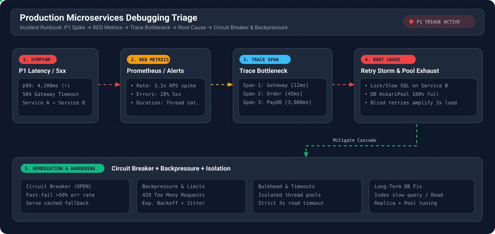

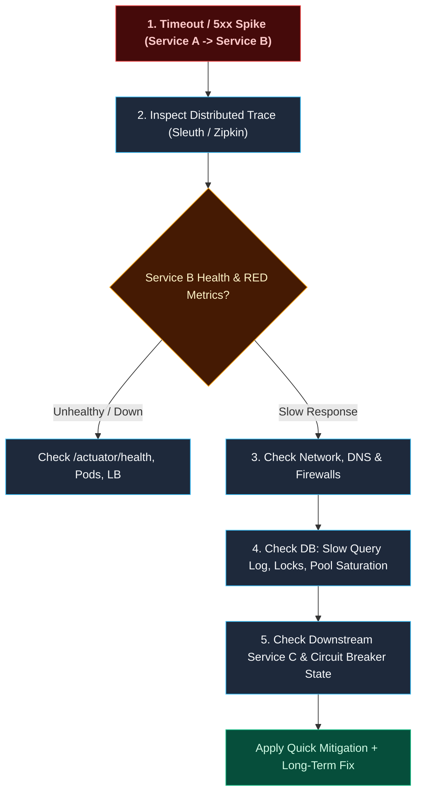

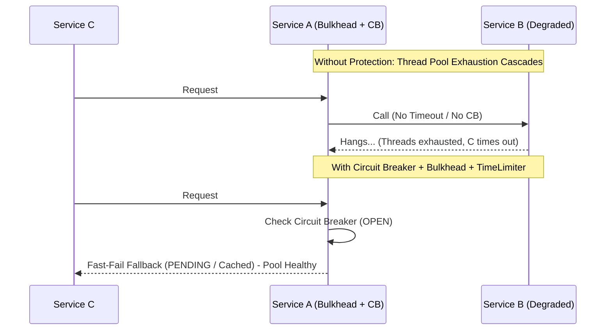

> [!WARNING]
> Increasing timeouts or retrying blindly during a downstream slowdown can trigger a **retry storm** that multiplies load by 3x–5x and exhausts database connection pools across the entire cluster.

### Q36: Service A is calling Service B, getting timeouts. How would you investigate?

**Answer**:

1. **Step 1: Identify where timeout occurs**:
   - Client timeout at 30 seconds? Or Service B returning error? Or Service A timing out waiting for Service B?
   - Use: Distributed tracing (Sleuth/Zipkin) to see exact point of failure
2. **Step 2: Check Service B health**:
   - `curl http://service-b:8080/health` — Is service even running? Check `/actuator/health/ready` vs `/live`
   - Check metrics: Error rate (Prometheus), Latency (Prometheus), CPU/Memory usage (CloudWatch), Disk space
3. **Step 3: Check network**:
   - Network latency: `ping service-b`, `traceroute service-b`, Check DNS resolution
   - Load balancer: Is it properly routing requests? Any unhealthy instances?
   - Firewall: Are ports open? Any security group rules blocking?
4. **Step 4: Check database**:
   - Service B slow query: Check slow query log, Is there query lock?, Check connection pool usage, Check database CPU/memory
   - Add indexes if needed, Optimize queries, Scale database if needed
5. **Step 5: Check for cascading failures**:
   - Service B calling Service C? Maybe Service C is down, making Service B slow
   - Check circuit breaker state: Is it open? Increase timeout if service just slow

| Mitigation Horizon | Actions |
|--------------------|---------|
| **Quick fixes (temporary)** | 1. Increase timeout value, 2. Increase thread pool size, 3. Add retry logic, 4. Implement fallback, 5. Add caching |
| **Long-term fixes** | 1. Optimize Service B (database, code), 2. Scale Service B (more instances), 3. Break Service B into smaller services, 4. Add caching layer, 5. Batch operations where possible |

### Q37: Your microservices application is experiencing cascading failures. How would you prevent it?

**Answer**:

**Causes**:
```text
Service A calls Service B
Service B is slow or failing
Service A's thread pool exhausted
Service C calling Service A gets timeout
Service D calling Service C gets timeout
...entire system down
```

**Solutions**:
1. **Circuit Breaker**: If Service B failing → Service A opens circuit → Fast fail (don't wait) → Return fallback → Service A stays healthy
2. **Bulkhead Pattern**: Service A has separate thread pools (Pool 1 for Service B: 5 threads, Pool 2 for Service C: 5 threads). If Service B fails, only Pool 1 exhausted, Pool 2 still works
3. **Timeout**: Set timeout on Service B call → Don't wait forever, fast fail, preserve resources
4. **Retry with Backoff**: Don't retry immediately → Wait 1s, then 2s, then 4s → Gives Service B time to recover
5. **Rate Limiting**: Limit requests to Service B → If Service B slow, queue fills up → Return `429` (Too Many Requests) → Prevents overload
6. **Graceful Degradation**: If Service B down → Return cached data (old but valid), or partial response, or skip feature → Don't crash entire system

**Implementation**:
```java
@Service
public class ResilientOrderService {

    // 1. Circuit breaker
    @CircuitBreaker(name = "payment-service", fallbackMethod = "fallbackPayment")

    // 2. Timeout
    @TimeLimiter(name = "payment-service")

    // 3. Retry with backoff
    @Retry(name = "payment-service", maxAttempts = 3)

    // 4. Bulkhead
    @Bulkhead(name = "payment-service", type = Bulkhead.Type.SEMAPHORE)

    public Payment processPayment(Long orderId, BigDecimal amount) {
        return paymentClient.processPayment(orderId, amount);
    }

    public Payment fallbackPayment(Long orderId, BigDecimal amount, Exception ex) {
        logger.warn("Payment service unavailable, returning pending", ex);
        return new Payment(orderId, amount, PaymentStatus.PENDING);
    }
}
```

---

## Trade-offs & Decisions

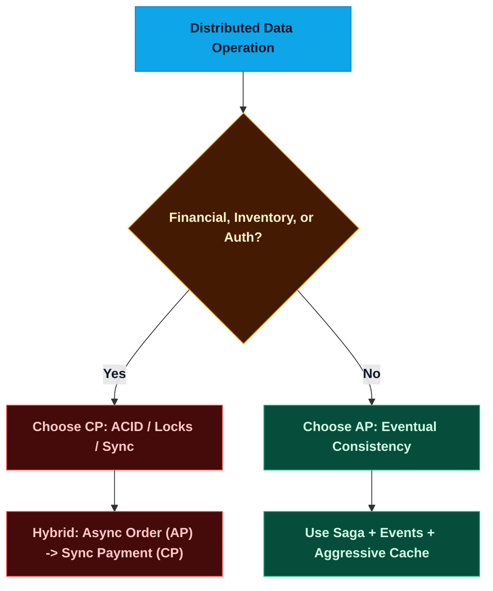


### Q38: When would you choose synchronous vs asynchronous communication?

**Answer**: See Communication Patterns document (`02-Communication-Patterns.md`).

| Dimension | Synchronous (REST / gRPC) | Asynchronous (Kafka / SQS) |
|-----------|---------------------------|----------------------------|
| **Latency** | Caller waits for response | Immediate `202 Accepted` |
| **Coupling** | Tight temporal coupling | Loose temporal coupling |
| **Best for** | Real-time reads, Payment auth, Critical validation | Notifications, Analytics, Saga events, Email/SMS |
| **Failure impact** | Propagates unless circuit-broken | Buffered in broker + DLQ |

### Q39: How would you decide between optimizing for consistency vs availability?

**Answer**:

**CAP Theorem**:
- **Choose CP (Consistency + Partition tolerance)** when:
  - Payment systems (money can't disappear)
  - Inventory (can't oversell)
  - Account balances
  - Authentication (security critical)
  - *Approach*: Treat as ACID transaction → Use `SERIALIZABLE` isolation, 2-phase commit (if necessary), Distributed locks, Sacrifice availability (system waits)
- **Choose AP (Availability + Partition tolerance)** when:
  - Recommendations
  - Notifications
  - Likes/comments (social)
  - Analytics
  - User preferences
  - *Approach*: Embrace eventual consistency → Saga pattern for distributed transactions, Events for async updates, Cache aggressively, System always available (stale data OK)

**Hybrid approach (recommended)**:
```text
Critical operations: AP → CP
├─ Order creation (async) → Payment processing (sync)
├─ Accept eventual consistency for most
├─ Strong consistency only for critical parts

Example: Order Service
├─ Order creation: async (eventually consistent)
├─ Payment: sync (strong consistency)
└─ Notification: async (can be delayed)
```

### Q40: How would you migrate from monolith to microservices?

**Answer**:

**Timeline**: `12-24 months`

**Phases**:
1. **Assessment** (Month 1-2): Identify services, infrastructure
2. **Extract first service** (Month 3-6): Non-critical service (e.g., Notifications)
3. **Extract core services** (Month 7-12): Order, Payment (face distributed transaction challenges)
4. **Extract remaining services** (Month 13-18): User, Product, Inventory
5. **Decommission monolith** (Month 19-24): Verify migration complete

**Tools**: Strangler Fig pattern, Branch by Abstraction, Shared database initially (acceptable).

**Risks**: Increased operational complexity, Team must upskill on distributed systems, More infrastructure needed.

> [!TIP]
> Always extract a **low-risk, non-critical edge service** (like Notifications) first so your team can harden CI/CD, observability, and service discovery before touching core revenue paths.

---

## Summary

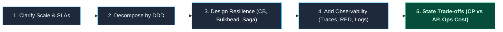

**Key Takeaways for Interviews**:
1. **Understand tradeoffs**: No perfect solution, all choices have pros/cons
2. **Ask clarifying questions**: "What's the scale? What's the latency requirement?"
3. **Start simple**: Monolith first, then microservices when you hit problems
4. **Embrace complexity**: Microservices are complex, know the patterns
5. **Know when NOT to use**: Microservices not always the answer
6. **Focus on reliability**: Resilience patterns are critical
7. **Monitor everything**: Without observability, can't operate at scale
8. **Security first**: Design security in, don't add later

| Common Interview Gotcha | High-Signal Interview Response |
|-------------------------|-------------------------------|
| Saying "we use microservices" without knowing why | Tie decomposition to team autonomy (Conway's Law) & scaling bottlenecks |
| Not knowing how to handle distributed transactions | Propose Saga (Orchestration vs Choreography) + Transactional Outbox |
| Assuming REST is always best | Contrast REST (public/CRUD) vs gRPC (internal/low-latency) vs Kafka (async) |
| Not thinking about operational complexity | Address K8s, CI/CD, distributed tracing, and mTLS up front |
| Ignoring eventual consistency implications | Explicitly separate CP paths (Payments) from AP paths (Notifications) |
| Not considering database per service implications | Discuss Expand-Contract migrations, CQRS, and avoiding cross-service joins |

**Practice Areas**:
1. Design a system end-to-end (e.g., Uber, Netflix)
2. Explain your current architecture and tradeoffs
3. Debugging complex distributed system issues
4. Pattern implementation (saga, circuit breaker, etc.)
5. Real-world failure scenarios

> [!IMPORTANT]
> Strong candidates don't just list patterns—they state **what fails first** at 10x scale, **how they detect it** (RED metrics + Trace IDs), and **what they sacrifice** to keep the system alive.
