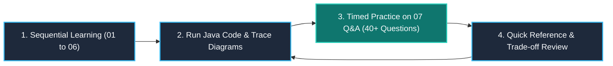
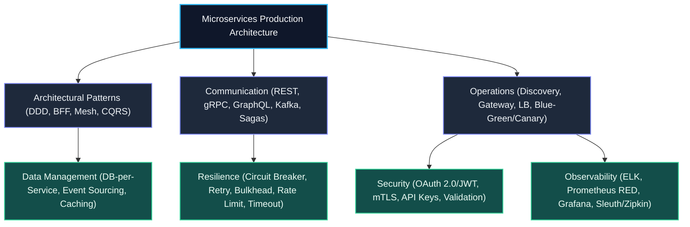
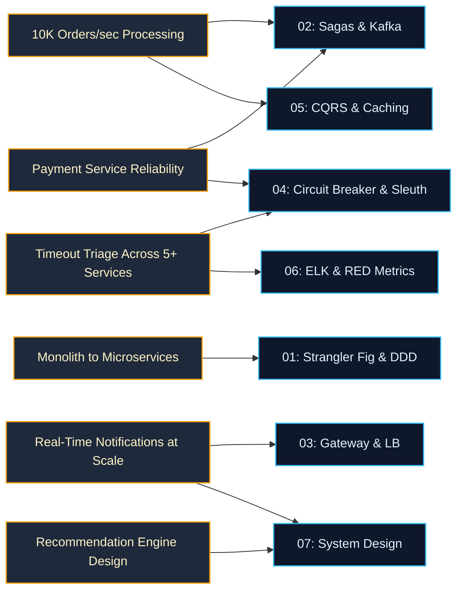

# Microservices Deep Dive - Interview Preparation Guide

Complete microservices interview preparation materials for FAANG companies targeting mid-level Java engineers (5+ years experience).

> [!NOTE]
> **Target Audience**: Mid-level Java engineers with **5+ years of experience** preparing for **FAANG** (Facebook, Apple, Amazon, Netflix, Google) microservices interviews.
> **Prerequisites**: Solid Java fundamentals, Spring Boot experience, relational database knowledge, and a basic understanding of distributed systems.

---

## Total Content Statistics

| Metric | Value | Scope |
| :--- | :--- | :--- |
| **Total Lines of Code / Content** | **11,206+ lines** | Across 7 deep-dive modules |
| **Total File Size** | **332 KB** | Production-ready markdown guides |
| **Java Code Examples** | **100+ implementations** | Copy-paste ready Spring Boot & Java snippets |
| **Architecture Diagrams** | **50+ ASCII diagrams** | Visual system flows and patterns |
| **Interview Questions** | **40+ comprehensive Q&A** | Core, Architecture, System Design, Debugging, Trade-offs |
| **Interview Scenarios** | **5 complete system design problems** | End-to-end FAANG design walkthroughs |

---

## Files Overview

### Module Learning Roadmap

### Module Index

| # | Guide | Lines | Focus |
| :---: | :--- | :---: | :--- |
| **01** | [01-Microservices-Fundamentals.md](./01-Microservices-Fundamentals.md) | 1,385 | Core concepts and architectural foundations |
| **02** | [02-Communication-Patterns.md](./02-Communication-Patterns.md) | 2,205 | In-depth guide to synchronous and asynchronous communication |
| **03** | [03-Service-Discovery-and-API-Gateway.md](./03-Service-Discovery-and-API-Gateway.md) | 1,508 | Service discovery, API Gateway, and deployment patterns |
| **04** | [04-Resilience-Patterns.md](./04-Resilience-Patterns.md) | 1,416 | Fault tolerance and resilience implementation |
| **05** | [05-Data-Management-in-Microservices.md](./05-Data-Management-in-Microservices.md) | 1,656 | Data consistency and database patterns |
| **06** | [06-Security-and-Observability.md](./06-Security-and-Observability.md) | 1,081 | Security and operational visibility |
| **07** | [07-Microservices-Interview-Questions.md](./07-Microservices-Interview-Questions.md) | 1,955 | Comprehensive interview Q&amp;A collection |

### Detailed Module Breakdown

| Module | Topics Covered | Key Code Examples |
| :--- | :--- | :--- |
| **1. [01-Microservices-Fundamentals.md](./01-Microservices-Fundamentals.md)** *(1,385 lines)* | • Monolith vs SOA vs Microservices comparison • Domain-Driven Design (DDD) - Bounded Contexts, Aggregates, Value Objects, Domain Events • Decomposition strategies (by capability, by subdomain) • Service boundaries definition and anti-patterns • Twelve-Factor App methodology • Conway's Law and organizational alignment • Microservices maturity model (5 levels) • Migration strategies (Strangler Fig, Branch by Abstraction) • 6 comprehensive interview questions with detailed answers | • DDD aggregate patterns in Java • Entity vs Value Object implementations • Domain event publishing • Service decomposition examples |
| **2. [02-Communication-Patterns.md](./02-Communication-Patterns.md)** *(2,205 lines)* | • REST best practices (naming, versioning, pagination, HATEOAS) • gRPC with Protocol Buffers (streaming, when to use) • Request-Reply pattern • Event-Driven Architecture • CQRS pattern with implementation • Saga Pattern (choreography vs orchestration) • Choreography-based and orchestration-based sagas • Idempotency implementation and patterns • 7 detailed interview questions | • gRPC server/client implementation • REST client with proper versioning • Kafka event publishing and consuming • Saga orchestration implementation • Choreography-based saga with events • Idempotency key handling |
| **3. [03-Service-Discovery-and-API-Gateway.md](./03-Service-Discovery-and-API-Gateway.md)** *(1,508 lines)* | • Service Discovery (client-side vs server-side) • Eureka server configuration • Health checks and heartbeat mechanism • Kubernetes service discovery via DNS • API Gateway pattern and responsibilities • Spring Cloud Gateway implementation • Kong API Gateway alternative • Backend for Frontend (BFF) pattern • Load Balancing algorithms (round-robin, least connections, weighted, consistent hashing) • Service Mesh (Istio, Envoy) • Configuration Management (Spring Cloud Config, Consul, Kubernetes ConfigMaps) • Deployment strategies (Blue-Green, Canary, Rolling Updates) • 4 comprehensive interview questions | • Eureka client registration and discovery • Spring Cloud Gateway route configuration • Custom load balancer implementation • Per-user rate limiting • Istio VirtualService and DestinationRule • Kubernetes deployment manifests |
| **4. [04-Resilience-Patterns.md](./04-Resilience-Patterns.md)** *(1,416 lines)* | • Circuit Breaker pattern (3 states: CLOSED, OPEN, HALF-OPEN) • Resilience4j circuit breaker implementation • Retry pattern with exponential backoff and jitter • Bulkhead pattern (thread pool and semaphore isolation) • Rate Limiter (Token Bucket, Sliding Window algorithms) • Timeout pattern (connection, read, request timeouts) • Fallback strategies (cache, default values, degraded service) • Health checks (Liveness vs Readiness probes) • Chaos Engineering principles • Distributed Tracing (Sleuth + Zipkin) • 2 detailed troubleshooting scenarios | • Circuit breaker with Resilience4j annotations • Exponential backoff retry implementation • Bulkhead isolation patterns • Rate limiter with per-user limiting • Health indicator implementation • Chaos engineering test cases • Distributed tracing with Sleuth |
| **5. [05-Data-Management-in-Microservices.md](./05-Data-Management-in-Microservices.md)** *(1,656 lines)* | • Database per Service pattern • Shared database anti-pattern • Strong vs Eventual consistency • Saga pattern deep dive with compensating transactions • Event Sourcing (append-only event log) • Event store implementation with snapshots • CQRS implementation (separate read/write models) • Distributed Caching (Cache-Aside, Write-Through, Write-Behind) • Cache invalidation strategies • API Composition pattern for queries • Data replication and synchronization • 2 interview questions with detailed answers | • Event sourcing with reconstructable aggregates • Event store with snapshots for performance • CQRS with separate command and query services • Order view projector updating read model • Redis caching patterns (all 3 strategies) • Distributed data replication |
| **6. [06-Security-and-Observability.md](./06-Security-and-Observability.md)** *(1,081 lines)* | • OAuth 2.0 flow and JWT implementation • Token-based auth with Spring Security • Service-to-service authentication (mTLS, API Keys) • Input validation and API security • Rate limiting at API Gateway • CORS configuration • Distributed logging with ELK stack • Structured logging for queryability • Prometheus metrics and monitoring • RED method (Request Rate, Error Rate, Duration) • Grafana dashboards • AlertManager configuration • 2 interview questions | • JWT token generation and validation • Spring Security configuration • Mutual TLS (mTLS) setup • Structured logging with context fields • Custom metrics with MeterRegistry • Prometheus alert rules • Health endpoint configuration |

### 7. [07-Microservices-Interview-Questions.md](./07-Microservices-Interview-Questions.md) *(1,955 lines)*

**40+ Interview Questions** organized across 5 categories:

| Category | Count | Key Topics |
| :--- | :---: | :--- |
| **1. Core Concepts** | 20 questions | Monolith vs Microservices, Domain-Driven Design, Conway's Law, CAP Theorem, Idempotency, Challenges of microservices, Saga pattern, REST vs gRPC, Circuit Breaker, and more |
| **2. Architecture & Design** | 20 questions | Notification service design, API versioning strategies, Distributed caching, Data consistency patterns, Cross-cutting concerns, Blue-Green deployment, Database migrations, Feature flags, Distributed ID generation, Request timeout handling |
| **3. System Design** | 5 full questions | Food delivery system (Uber Eats), Payment system (Stripe-like), Notification system at scale, Recommendation system (Netflix-like), Analytics system (Mixpanel/Amplitude) |
| **4. Debugging & Troubleshooting** | 5 questions | Service timeout investigation, Cascading failure prevention, Real-world failure scenarios |
| **5. Trade-offs & Decisions** | 5 questions | Sync vs Async communication, Consistency vs Availability, Monolith to Microservices migration |

> [!TIP]
> **What Each Question Includes**: Every question in [07-Microservices-Interview-Questions.md](./07-Microservices-Interview-Questions.md) provides a detailed answer, real-world context, code examples where applicable, ASCII architecture diagrams, tradeoff analysis, and follow-up considerations.

---

## How to Use

### Study Loop

| Mode | Strategy |
| :--- | :--- |
| **1. Sequential Learning** | • Start with Fundamentals ([01](./01-Microservices-Fundamentals.md)) • Progress through Architecture ([02](./02-Communication-Patterns.md)–[03](./03-Service-Discovery-and-API-Gateway.md)) • Learn Resilience ([04](./04-Resilience-Patterns.md)) • Understand Data Management ([05](./05-Data-Management-in-Microservices.md)) • Master Security &amp; Observability ([06](./06-Security-and-Observability.md)) • Practice Questions ([07](./07-Microservices-Interview-Questions.md)) |
| **2. Interview Preparation** | • Study each file thoroughly • Review architecture diagrams • Run code examples locally • Practice system design questions • Time yourself on answers |
| **3. Quick Reference** | • Use table of contents to jump to topics • Code examples are copy-paste ready • Diagrams explain concepts visually |

---

## Key Concepts Covered

### Architecture & Resilience Dependency Tree

### Concept Matrix

| Domain | Core Patterns &amp; Technologies |
| :--- | :--- |
| **Architectural Patterns** | Microservices decomposition · Service boundaries · Domain-Driven Design · API Gateway · Service Mesh · CQRS &amp; Event Sourcing |
| **Communication** | REST, gRPC, GraphQL comparison · Synchronous vs Asynchronous · Event-Driven Architecture · Saga pattern (choreography/orchestration) · Request-Reply pattern |
| **Resilience** | Circuit Breaker · Retry with exponential backoff · Bulkhead isolation · Rate limiting · Timeout handling · Fallback strategies |
| **Data Management** | Database per service · Eventual consistency · Event sourcing · CQRS · Distributed transactions · Caching strategies |
| **Operations** | Service Discovery · API Gateway · Load Balancing · Deployment strategies (Blue-Green, Canary, Rolling) · Service Mesh (Istio) · Configuration management |
| **Observability** | Distributed logging (ELK) · Metrics (Prometheus) · Monitoring (Grafana) · Distributed tracing (Sleuth/Zipkin) · Health checks |
| **Security** | OAuth 2.0 &amp; JWT · mTLS · API Key management · Input validation · Rate limiting |

> [!IMPORTANT]
> **Resilience &amp; Data Consistency Go Hand-in-Hand**: Never discuss a distributed transaction or cross-service call in an interview without pairing **idempotency keys**, **timeouts/circuit breakers**, and **compensating Sagas** (or the Outbox pattern).

---

## Interview Success Tips

| # | Principle | What Interviewers Look For |
| :---: | :--- | :--- |
| **1** | **Understand tradeoffs** | No "perfect" architecture — all choices have pros/cons |
| **2** | **Ask clarifying questions** | Scale, latency requirements, consistency needs |
| **3** | **Start simple** | Explain why you'd choose monolith vs microservices |
| **4** | **Know the patterns** | Circuit breaker, saga, bulkhead are critical |
| **5** | **Consider operations** | Microservices are complex to run |
| **6** | **Focus on resilience** | Can you design for failures? |
| **7** | **Think about consistency** | Eventual vs strong, when each is appropriate |
| **8** | **Security-first mindset** | Authentication, authorization, data protection |

> [!WARNING]
> **Common Interview Pitfall**: Jumping straight into microservices before justifying decomposition against a modular monolith, or ignoring operational overhead (distributed tracing, schema evolution, and cascading failures).

---

## Real-World Scenarios

### Scenario Map

| Scenario | Primary Focus |
| :--- | :--- |
| **Order Processing at 10K orders/sec** | Designing an order processing system handling 10K orders/second |
| **Multi-Service Timeout Investigation** | Handling service timeout investigation across 5+ services |
| **Legacy Modernization** | Migrating monolith to microservices |
| **Payment Reliability** | Payment service reliability requirements |
| **High-Throughput Notifications** | Real-time notification system at scale |
| **Personalization** | Recommendation engine design |

---

## References

| Book | Author | Core Takeaway |
| :--- | :--- | :--- |
| *Domain-Driven Design* | Eric Evans | Bounded contexts, aggregates, and ubiquitous language |
| *Building Microservices* | Sam Newman | Service boundaries, deployment, and evolutionary architecture |
| *Release It!* | Michael Nygard | Stability patterns, circuit breakers, bulkheads, and production resilience |
| *The Phoenix Project* | Gene Kim, Kevin Behr, George Spafford | DevOps flow, organizational alignment, and operational visibility |
| *Designing Data-Intensive Applications* | Martin Kleppmann | Replication, partitioning, distributed consensus, and event logs |

---

**Created**: February 2024  
**For**: Mid-level Java engineers preparing for FAANG interviews  
**Content**: Production-ready patterns and real-world examples
