# Kafka Architecture and Internals - Deep Dive

## Table of Contents
1. [Kafka Overview](#kafka-overview)
2. [Core Concepts](#core-concepts)
3. [Kafka Architecture](#kafka-architecture)
4. [Partition Internals](#partition-internals)
5. [Replication and Fault Tolerance](#replication-and-fault-tolerance)
6. [High Throughput Mechanisms](#high-throughput-mechanisms)
7. [Storage Internals](#storage-internals)
8. [Kafka vs Other Messaging Systems](#kafka-vs-other-messaging-systems)
9. [Topic Configuration](#topic-configuration)
10. [Cluster Sizing and Capacity Planning](#cluster-sizing-and-capacity-planning)
11. [Interview Questions](#interview-questions)
12. [Summary](#summary)

---

## Kafka Overview

### What is Apache Kafka?

Apache Kafka is a **distributed event streaming platform** designed to handle high-volume, high-throughput, low-latency data feeds. It is built for **durability**, **scalability**, and **fault tolerance**.

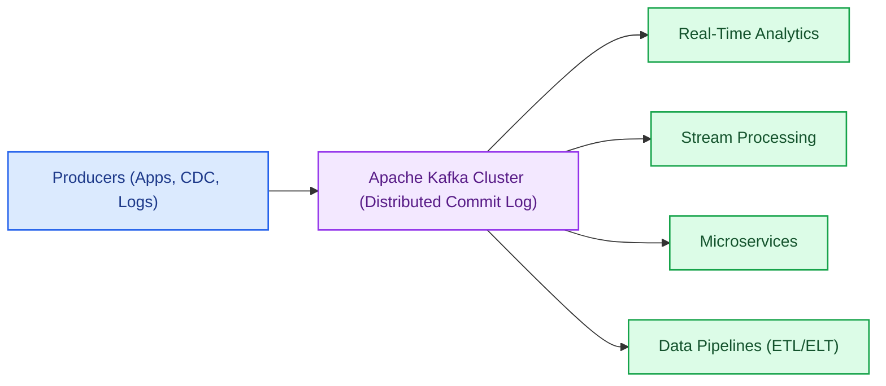

Key characteristics:
- **Pub/Sub Model**: Producers publish data; consumers subscribe to topics.
- **Distributed**: Data is partitioned and replicated across multiple brokers.
- **Persistent**: Messages are stored durably on disk, not just in memory.
- **Horizontal Scalability**: Add more brokers and partitions to handle higher load.
- **High Throughput**: Millions of messages per second via sequential I/O, batching, and zero-copy.
- **Low Latency**: Sub-millisecond to low-millisecond message delivery.

### Primary Use Cases

1. **Real-time Analytics**: Streaming data from applications for real-time dashboards.
2. **Event Sourcing**: Store all state changes as immutable events.
3. **Log Aggregation**: Centralized platform for collecting logs from distributed services.
4. **Stream Processing**: Transform, aggregate, and enrich data in real-time.
5. **Microservices Communication**: Asynchronous, decoupled communication between services.
6. **Change Data Capture (CDC)**: Capture database changes and stream them to downstream systems.
7. **Data Pipeline**: High-throughput ETL/ELT operations at scale.

> [!TIP]
> In system design interviews, frame Kafka as an **immutable, distributed append-only commit log** rather than a traditional message queue—this explains why Kafka supports replayability, multiple independent consumer groups, and horizontal scaling.

---

## Core Concepts

### 1. Brokers and Clusters

A Kafka **broker** is a single Kafka server. A **Kafka cluster** consists of multiple brokers working together, where each broker stores a portion of the data and serves read/write requests.

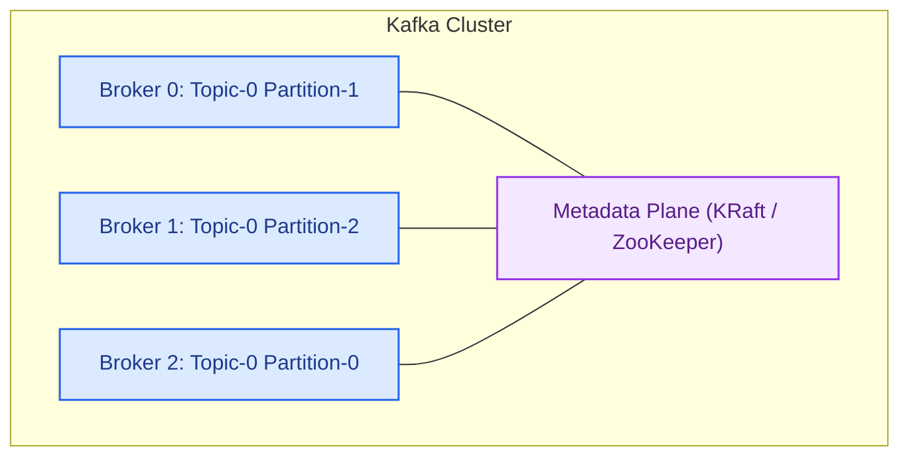

Key metadata is managed by:
- **Traditional (ZooKeeper-based)**: ZooKeeper maintains broker metadata, topic configs, and partition leaders using `/config/topics`, `/brokers/ids`, and `/controller` paths.
- **Modern (KRaft mode - Kafka 3.3+)**: Replaces ZooKeeper with the internal KRaft consensus algorithm; controllers maintain all metadata internally for simpler deployment and better performance.

### 2. Topics and Partitions

A **topic** is a logical grouping of related messages (e.g., `user-events`, `order-processing`, `system-logs`). Each topic is divided into **partitions**, which are the unit of parallelism:
- **Parallel consumption**: Multiple consumers can read from different partitions simultaneously.
- **Scalability**: Data is distributed across brokers.
- **Ordering**: Strict ordering is guaranteed **within a single partition**, not across partitions.

### 3. Offsets

An **offset** is a unique, monotonically increasing identifier for a message within a partition. Consumers track which messages they have processed using committed offsets.

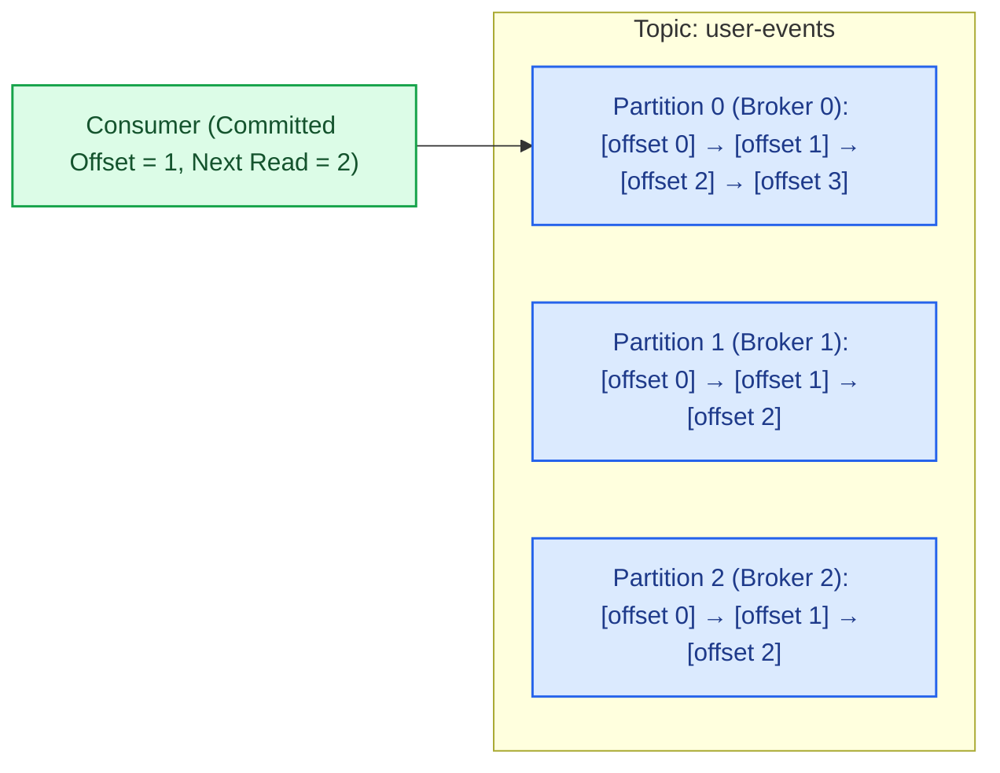

> [!IMPORTANT]
> Offsets are **per-partition** and **consumer-controlled**. Because Kafka retains messages independently of consumption, a consumer can rewind its offset to `0` or a specific timestamp to replay historical events.

---

## Kafka Architecture

### Broker Architecture

Each Kafka broker coordinates network I/O, log segment persistence, and inter-broker replication:

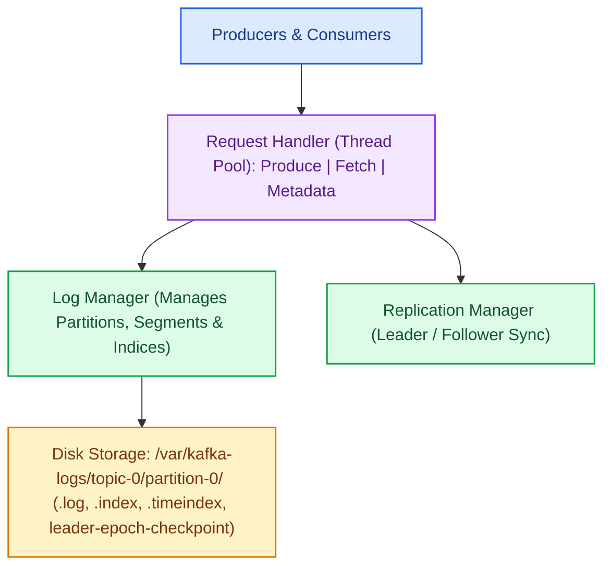

### Kafka Controller

The **controller** is a special broker responsible for:
- **Leader election**: Assigning new partition leaders when a broker fails.
- **ISR management**: Maintaining the In-Sync Replicas (ISR) list.
- **Metadata propagation**: Distributing cluster metadata updates to all brokers.

Only one broker acts as the active controller at a time; if it fails, a new controller is elected.

### ZooKeeper vs KRaft

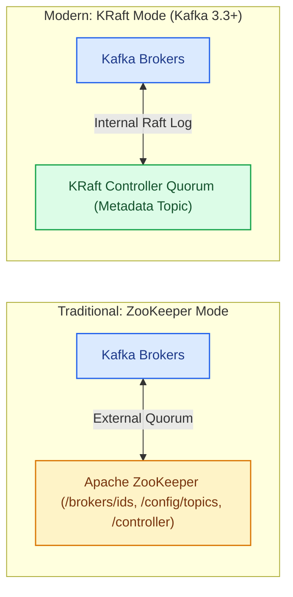

| Dimension | ZooKeeper (Traditional) | KRaft (Modern, Kafka 3.3+) |
|-----------|-------------------------|----------------------------|
| **Consensus** | External ZooKeeper quorum | Internal KRaft Raft-based consensus |
| **Deployment** | Separate cluster to operate & secure | Single unified Kafka deployment |
| **Metadata Paths / Storage** | `/brokers/ids`, `/config/topics`, `/controller` | Internal `__cluster_metadata` topic |
| **Failover & Scale** | Slower metadata propagation at high partition counts | Faster controller failover & higher partition scalability |

> [!IMPORTANT]
> KRaft removes the external ZooKeeper dependency entirely, eliminating split-brain metadata bottlenecks and enabling clusters to scale to millions of partitions with sub-second controller failover.

---

## Partition Internals

### Log Structure and Segment Files

Each partition is stored on disk as a sequence of **segments** (e.g., `/var/kafka-logs/topic-0/0/`), named by the base offset of the first message in that segment:
- `00000000000000000000.log` — Log segment file (default `1GB`) containing `[offset] [timestamp] [key_len] [key] [value]` records.
- `00000000000000000000.index` — Sparse **offset index** mapping offsets to byte positions (e.g., every `4KB`) for `O(log n)` binary search lookup.
- `00000000000000000000.timeindex` — **Timestamp index** mapping timestamps to offsets for time-based seeking.
- `leader-epoch-checkpoint` — Tracks leader epochs for log truncation consistency.
- `00000000001073741824.log` (and `.index`/`.timeindex`) — Next segment created once the previous segment reaches `log.segment.bytes`.


### Offset Index Example

| Offset | Byte Position in `.log` |
|--------|-------------------------|
| `0` | `0` |
| `10` | `2048` |
| `20` | `4096` |
| `30` | `6144` |

### Log Compaction

**Log compaction** (`cleanup.policy=compact`) retains at least the latest value for each message key, enabling event sourcing, changelog topics, and state stores.

```mermaid
flowchart LR
    subgraph Before["Before Compaction"]
        B1["Key: user-123 = John"]
        B2["Key: user-456 = Jane"]
        B3["Key: user-123 = John Doe (newer)"]
        B4["Key: user-789 = Bob"]
        B5["Key: user-456 = Jane Doe (newer)"]
    end

    subgraph After["After Compaction (Latest per Key)"]
        A1["Key: user-123 = John Doe"]
        A2["Key: user-456 = Jane Doe"]
        A3["Key: user-789 = Bob"]
    end

    Before -->|"Background Cleaner Thread"| After

    classDef amber fill:#fef3c7,stroke:#d97706,stroke-width:1.5px,color:#78350f
    classDef green fill:#dcfce7,stroke:#16a34a,stroke-width:1.5px,color:#14532d

    class B1,B2,B3,B4,B5 amber
    class A1,A2,A3 green
```

> [!TIP]
> Because `.index` files are **sparse** (indexing every `4KB` of log data by default), they stay small enough to remain memory-mapped (`mmap`) in RAM, making offset lookups `O(log n)` without scanning gigabytes of `.log` files.

---

## Replication and Fault Tolerance

### Leader, Followers, and In-Sync Replicas (ISR)

Each partition has **1 leader** (handles all client reads and writes) and **N-1 followers** (pull data from the leader; cannot serve clients directly in standard configurations).

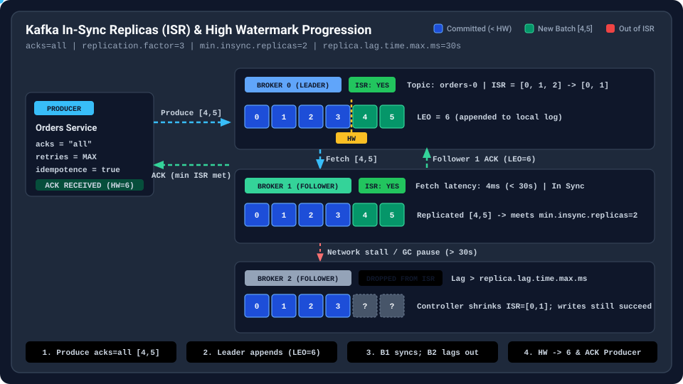

A replica is considered **In-Sync (ISR)** if:
- It maintains an active session/connection with the cluster.
- Its fetch lag is within `replica.lag.time.max.ms` (default: `30s`).
- It has replicated all messages up to the leader's **High Watermark (HW)**.

### Producer Acknowledgment Levels (`acks`) & `min.insync.replicas`

```mermaid
sequenceDiagram
    participant P as Producer
    participant L as Leader (Broker 0)
    participant F1 as Follower 1 (Broker 1)
    participant F2 as Follower 2 (Broker 2)

    Note over P,F2: acks=0 (Fire and forget - highest throughput, no durability)
    P->>L: Produce Batch (no wait)

    Note over P,F2: acks=1 (Leader acks immediately after local log append)
    P->>L: Produce Batch
    L-->>P: ACK (risk of loss if Leader crashes before replication)

    Note over P,F2: acks=all + min.insync.replicas=2 (Durable commit)
    P->>L: Produce Batch
    L->>L: Append to Local Log
    F1->>L: Fetch & Replicate
    F2-->>L: Lagging (&gt; 30s, dropped from ISR)
    L->>L: Advance High Watermark (ISR=[0,1] meets min=2)
    L-->>P: ACK (Committed)
```

| `acks` Level | Behavior | Durability | Throughput | Typical Use Case |
|--------------|----------|------------|------------|------------------|
| `"0"` | Producer does not wait for any ACK | None (fire and forget) | Highest | Non-critical metrics, telemetry |
| `"1"` | Leader ACKs after writing to its local log | Medium (lost if leader crashes before sync) | High | Logs with acceptable loss tolerance |
| `"all"` (`-1`) | Leader waits for `min.insync.replicas` to replicate | Highest (no data loss if `min.insync.replicas >= 2`) | Lower | Financial transactions, orders |

With `replication.factor = 3` and `min.insync.replicas = 2`:
- `ISR = [0, 1, 2]` → Leader commits messages (3 replicas in sync).
- `ISR = [0, 1]` → Leader still commits messages (2 replicas in sync).
- `ISR = [0]` → Leader **cannot** commit `acks=all` writes (throws `NotEnoughReplicasException`).
- `ISR = []` → No replicas in sync (partition unavailable).

### Clean vs Unclean Leader Election & Broker Failures

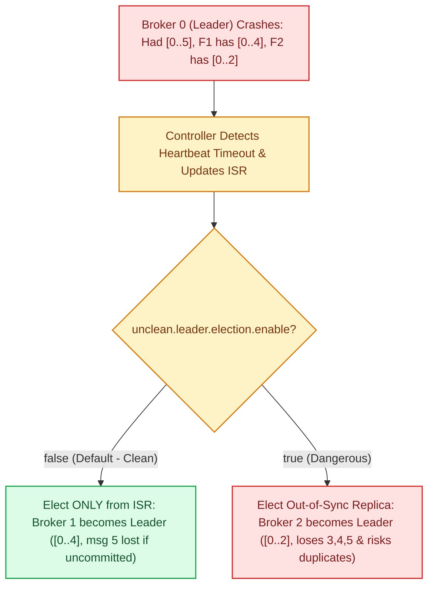

When a broker fails in a 3-broker cluster (`replication.factor=3`):
1. **Before**: `P0 [Leader: 0, ISR: 0,1,2]`, `P1 [Leader: 1, ISR: 1,0,2]`, `P2 [Leader: 2, ISR: 2,1,0]`.
2. **Broker 1 fails**: Controller detects timeout, removes Broker 1 from all ISRs, and elects a new leader from `ISR` for `P1` (e.g., Broker 0). All partitions remain available for reads/writes.

> [!WARNING]
> Never set `unclean.leader.election.enable=true` for financial, order, or state-critical topics. Electing an out-of-sync replica permanently truncates committed messages and causes silent data corruption.

---

## High Throughput Mechanisms

Kafka achieves **1M+ messages/second** by combining five hardware-friendly mechanisms:

### 1. Zero-Copy Transfer (`sendfile()`)

Traditional file serving copies data 4 times (2 DMA + 2 CPU copies) and triggers 4 context switches across kernel and user space. Kafka uses `FileChannel.transferTo()` (backed by Linux `sendfile()`), bypassing the JVM heap completely so data moves directly from the **OS Page Cache** to the **NIC** via scatter-gather DMA.

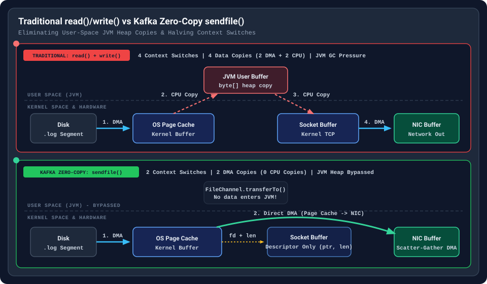

```java
// Traditional way (with JVM heap copy)
byte[] buffer = new byte[1024];
fileInputStream.read(buffer);            // Disk -> Kernel -> JVM heap
socketOutputStream.write(buffer);        // JVM heap -> Kernel -> Network

// Zero-copy (Kafka approach)
fileInputStream.transferTo(0, size, socketChannel); // Disk -> Page Cache -> NIC (no JVM copy!)
```

### 2. Sequential I/O, Batching & Compression

- **Sequential I/O**: Appending sequentially to `.log` files achieves `~500 MB/s` on spinning disks (and multi-GB/s on NVMe) compared to `3-7 MB/s` for random disk writes.
- **Batching**: Producers accumulate messages in memory until `batch.size` (e.g., `16KB`) is reached, `linger.ms` (e.g., `100ms`) elapses, or `producer.flush()` is called.
- **Compression**: Compressing entire batches reduces network bandwidth and disk footprint.

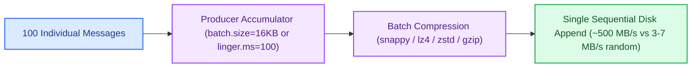

| Algorithm | Compression Ratio (1MB JSON) | CPU Overhead | Best For |
|-----------|------------------------------|--------------|----------|
| **None** | `1:1` (`1MB`) | Minimal | Pre-compressed binary payloads |
| **snappy** | Moderate | Low (`10-20%`) | Balanced default for high throughput |
| **lz4** | `4:1` (`250KB`) | Very Low | Ultra-fast compression/decompression |
| **gzip** | `6:1` (`150KB`) | High (`50%+`) | Network/storage-constrained environments |
| **zstd** | `7:1` (`140KB`) | Moderate | Modern balanced ratio and speed |

### 3. OS Page Cache

Kafka intentionally keeps its **JVM heap small** (`8-16GB`) and delegates caching to the **OS Page Cache**, avoiding JVM garbage collection pauses and enabling consumers to read recent segments at RAM speed.

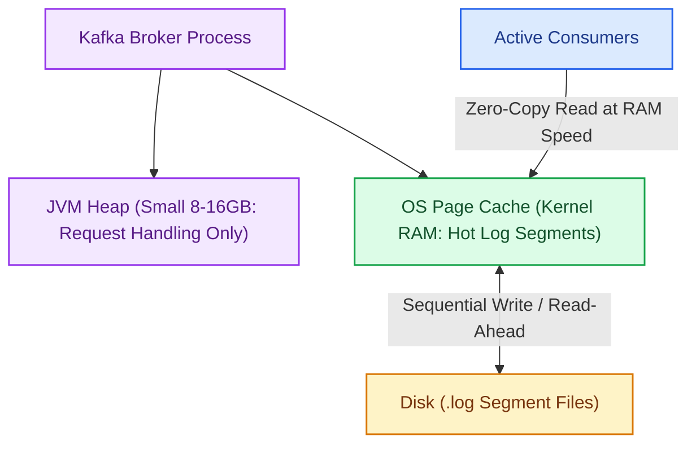

> [!TIP]
> Zero-copy (`sendfile()`) only works when the broker does **not** need to inspect or re-serialize message bytes in user space—if a producer uses compression or TLS encryption at the broker, or if `message.format.version` conversion is triggered, Kafka falls back to copying through user space.

---

## Storage Internals

### Retention Policies & Segment Rotation

Kafka manages disk usage using **time-based retention** (`retention.ms = 604800000` for 7 days), **size-based retention** (`retention.bytes = 1099511627776` for 1TB), or **log compaction** (`cleanup.policy=compact`).

Segments rotate whenever the active segment reaches `log.segment.bytes` (default `1GB`) or `log.segment.ms` (default `7 days`):
- Old segments become **immutable**, allowing independent deletion or compaction without locking active writes.

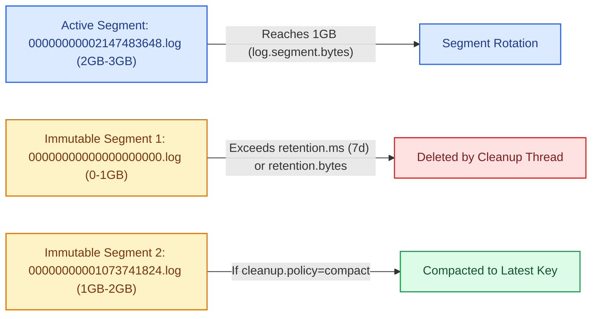

### Disk Layout Example

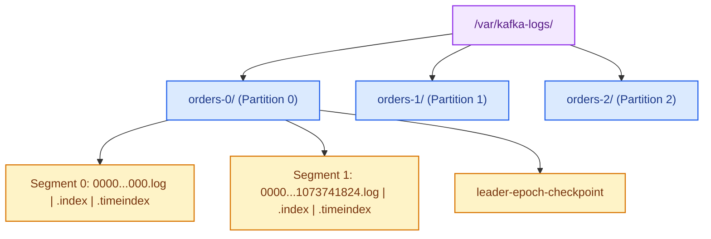

> [!IMPORTANT]
> Retention policies (`retention.ms` and `retention.bytes`) are evaluated at the **segment level**, not per individual message. A segment is only eligible for deletion once **all** messages in that closed segment have expired.

---

## Kafka vs Other Messaging Systems

| Feature | Kafka | RabbitMQ | ActiveMQ | SQS | Pulsar |
|---------|-------|----------|----------|-----|--------|
| **Throughput** | 1M+ msg/s | 50K msg/s | 100K msg/s | Throttled | 1M+ msg/s |
| **Latency** | 10-100ms | &lt;1ms | 5-50ms | 100-500ms | 5-100ms |
| **Durability** | Replicated | Memory+Disk | Disk | 3+ copies | Replicated |
| **Message Retention** | Configurable (days/months) | Until consumed | Until consumed | 14 days max | Configurable |
| **Consumer Offset** | Broker managed | App managed | App managed | Broker managed | Broker managed |
| **Replayability** | Full history | Once consumed | Once consumed | Once consumed | Full history |
| **Scaling** | Horizontal (partitions) | Vertical | Vertical | Built-in | Horizontal |
| **Use Case** | Event streaming | Task queues | Legacy systems | Cloud queues | Cloud streaming |

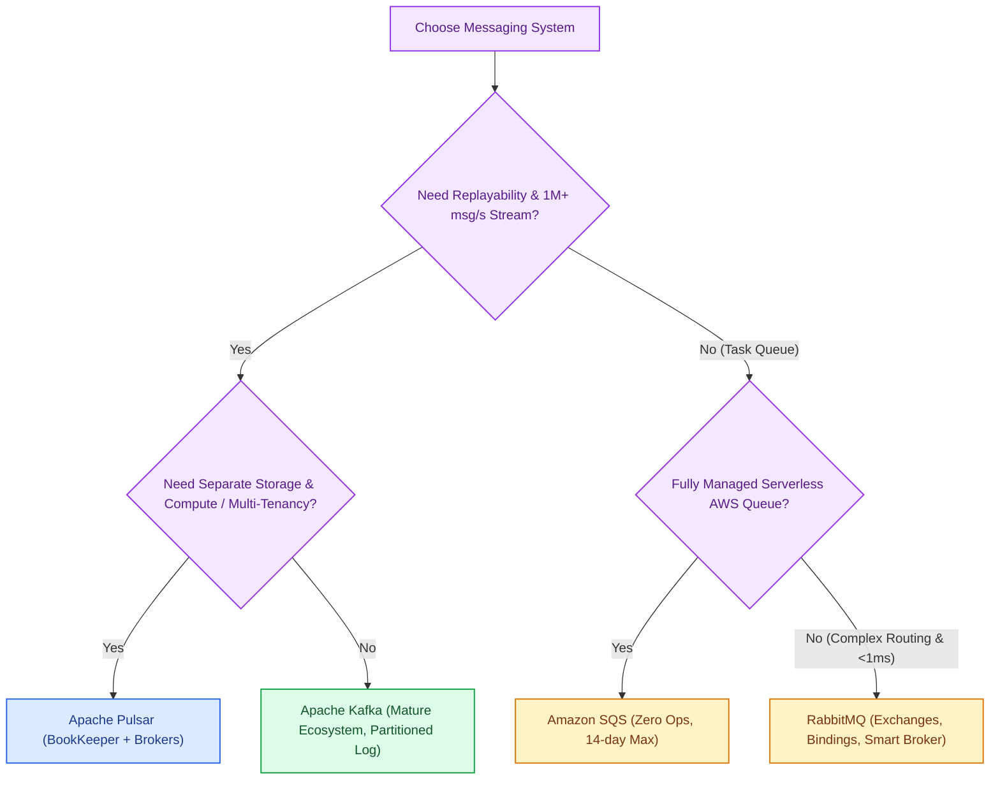

### Detailed Trade-offs

- **Kafka vs RabbitMQ**:
  - **RabbitMQ** excels at sub-millisecond latency (`<1ms`), complex routing (exchanges, bindings), built-in request/reply, and smaller deployments—but is limited to `~50K msg/s`, deletes messages after consumption, and lacks replayability.
  - **Kafka** delivers `1M+ msg/s`, persistent replayable logs, and built-in stream processing—at the cost of higher latency (`10-100ms`) and multi-broker operational complexity.
- **Kafka vs Amazon SQS**:
  - **SQS** is fully managed, serverless, and auto-scaling—but has `14-day` max retention, no message replay, higher cost at scale, and AWS lock-in.
  - **Kafka** offers unlimited retention, full replay, and lower cost at high scale—requiring self-managed operations and upfront infrastructure.
- **Kafka vs Apache Pulsar**:
  - **Pulsar** separates compute (brokers) from storage (BookKeeper), offering built-in multi-tenancy, integrated geo-replication, and lower latency—though with a smaller community and less maturity than Kafka.

> [!TIP]
> Summarize the core architectural distinction in interviews as: **RabbitMQ = Smart Broker / Dumb Consumer** (push-based, deletes on ACK), whereas **Kafka = Dumb Broker / Smart Consumer** (pull-based, immutable log, consumer-tracked offsets).

---

## Topic Configuration

### Critical Creation Command

```properties
# Topic creation
--topic orders \
--partitions 12 \
--replication-factor 3 \
--config retention.ms=604800000 \
--config compression.type=snappy \
--config min.insync.replicas=2 \
--config cleanup.policy=delete
```

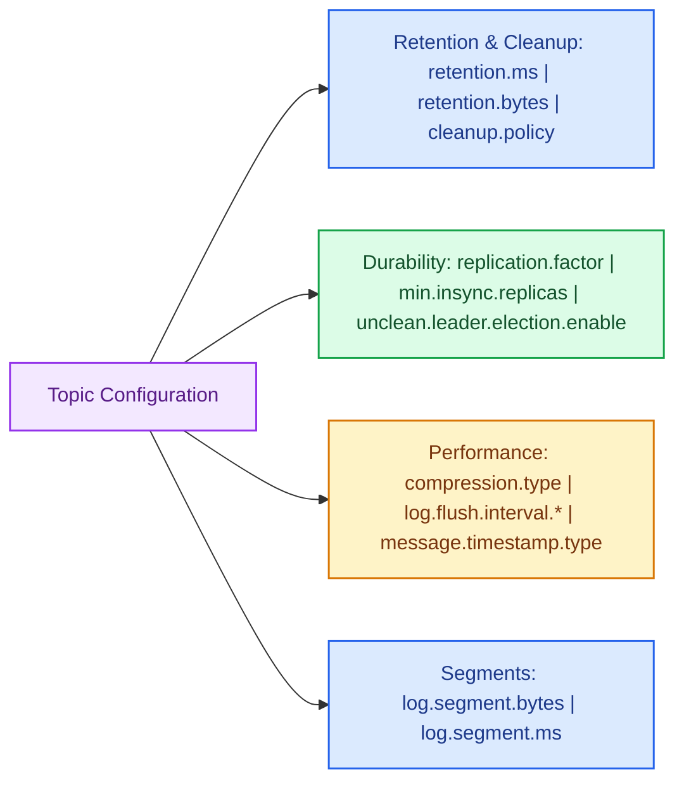

### Key Parameters Reference

```properties
# Retention
retention.ms=604800000                  # Delete old messages after 7 days
retention.bytes=1099511627776           # Delete old messages after 1TB
log.retention.check.interval.ms=300000  # Check every 5 min

# Cleanup
cleanup.policy=delete                   # Delete old messages (default)
cleanup.policy=compact                  # Keep latest per key

# Replication
replication.factor=3                    # Total copies (leader + 2 followers)
min.insync.replicas=2                   # Required for acks=all
unclean.leader.election.enable=false    # Don't elect out-of-sync leader

# Compression
compression.type=snappy                 # snappy, lz4, gzip, zstd

# Segments
log.segment.bytes=1073741824            # 1GB per segment
log.segment.ms=604800000                # Rotate every 7 days

# Performance
log.flush.interval.messages=10000       # Fsync every 10k messages
log.flush.interval.ms=1000              # Fsync every 1 second (whichever first)

# Timing
message.timestamp.type=CreateTime       # CreateTime or LogAppendTime
```

> [!WARNING]
> Avoid tuning `log.flush.interval.messages` or `log.flush.interval.ms` to force aggressive `fsync()` calls in production. Kafka relies on **replication across brokers** (`min.insync.replicas >= 2`) and the OS page cache for durability; forcing synchronous `fsync()` on every batch severely degrades throughput.

---

## Cluster Sizing and Capacity Planning

### Sizing Formula

```
Number of Brokers = (Max Daily GB / Retention Days + Peak Hourly MB/s * 3600 / 1000000) / Broker Capacity
```

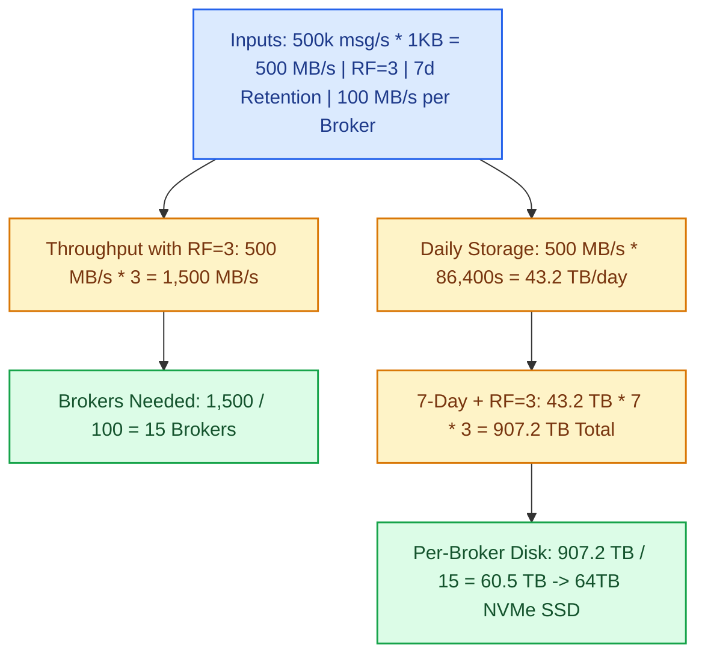

### Example Calculation

- **Requirements**:
  - Peak throughput: `500,000 messages/second`
  - Average message size: `1KB`
  - Retention: `7 days`
  - Replication factor: `3`
  - Single broker capacity: `100 MB/s` (after network/disk limits)
- **Calculations**:
  - Throughput requirement: `500,000 msg/s * 1KB = 500 MB/s`
  - With replication (`3x`): `500 MB/s * 3 = 1,500 MB/s` total
  - Brokers needed: `1,500 MB/s / 100 MB/s = 15 brokers`
  - Daily storage: `500 MB/s * 86,400 sec = 43.2 TB/day`
  - 7-day retention: `43.2 TB * 7 = 302.4 TB`
  - With replication (`3x`): `302.4 TB * 3 = 907.2 TB` total
  - Per-broker disk: `907.2 TB / 15 brokers = 60.5 TB/broker`
  - **Recommended**: Minimum **15 brokers** with **64TB SSD** each.

### Per-Broker Resource Allocation

| Resource | Recommended Spec | Rationale |
|----------|------------------|-----------|
| **CPU** | `8-16 cores` | Kafka is I/O and network bound, not CPU bound (unless heavy compression/TLS) |
| **Memory** | `32-64GB` (or `128GB`) | Keep JVM heap small (`8-16GB`); dedicate remaining RAM to OS Page Cache |
| **Disk** | NVMe SSD (RAID-10) | High sequential I/O throughput (e.g., `4x 4TB NVMe` or `64TB` for `500 MB/s`) |
| **Network** | `10Gbps NIC` (or `2x 10Gbps` bonded) | Handles client traffic + inter-broker replication |
| **Cloud / On-Prem** | AWS `i4i.4xlarge` (`16 vCPU, 128GB RAM, 15TB NVMe`) | On-prem: `16 cores, 64GB RAM, 4x 4TB NVMe SSD (RAID-10)` |

### Partition Count Strategy

Partition count directly impacts **parallelism**, **throughput potential**, **rebalancing time**, and **file descriptor usage**:

```
Partitions = Max(target_throughput_MB/s / broker_throughput_MB/s,
                 target_consumer_parallelism)
```

- **Example**: Target throughput `1,000 MB/s`, broker capacity `100 MB/s`, target `20 consumers` → `Max(10, 20) = 20 partitions` minimum.

> [!IMPORTANT]
> Partition counts can be **increased** later, but **shrinking partitions is not supported** without recreating the topic. Slightly oversizing initial partition counts avoids disruptive key-hashing shifts later.

---

## Interview Questions

### Question 1: Explain Kafka's High Throughput

**Answer Framework**:

Kafka achieves `1M+ messages/second` through five complementary mechanisms:
1. **Sequential I/O**: Disks excel at sequential access (`~500 MB/s` vs `3-7 MB/s` random).
2. **Batching**: Multiple messages are combined into a single network/disk write.
3. **Compression**: Reduces network and disk I/O overhead per batch.
4. **Zero-copy transfer**: Uses `sendfile()` syscall, avoiding JVM heap copies.
5. **Page cache**: OS caches recent log segments in kernel RAM.

```java
// Batching configuration
Properties props = new Properties();
props.put(ProducerConfig.BATCH_SIZE_CONFIG, 16384);  // 16KB
props.put(ProducerConfig.LINGER_MS_CONFIG, 100);     // Wait 100ms
props.put(ProducerConfig.COMPRESSION_TYPE_CONFIG, "snappy");
```

### Question 2: What Happens When a Broker Fails?

**Answer Framework**:

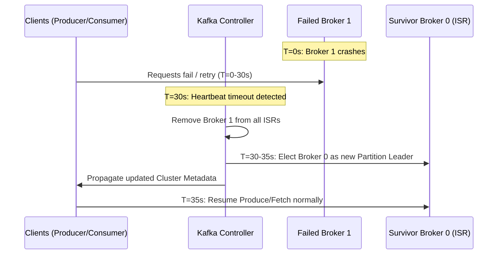

1. **Detection (`30+` seconds)**: Controller detects broker heartbeat timeout.
2. **ISR Update**: Remove failed broker from all partition ISRs.
3. **Leader Election**: For partitions where failed broker was leader:
   - If ISR is not empty: elect new leader from ISR.
   - If ISR is empty: wait for broker recovery OR trigger unclean election (if enabled).
4. **Metadata Propagation**: Distribute new metadata to all brokers.
5. **Recovery**: Clients retry with new leaders; optionally reassign partitions for rebalancing.

### Question 3: Explain `min.insync.replicas`

**Answer Framework**:

`min.insync.replicas` specifies the minimum number of replicas that must acknowledge a write when `acks=all`:
- Configuration: `replication.factor=3`, `min.insync.replicas=2`.
  - `ISR = [0, 1, 2]` → Producer can send (3 in sync).
  - `ISR = [0, 1]` → Producer can send (2 in sync).
  - `ISR = [0]` → Producer **fails** (need 2, have 1).
- **Why it matters**: If `min.insync.replicas=1`, losing the leader loses data; if `min.insync.replicas=2`, one follower can fail safely; if `3`, losing even one replica halts writes.
- **Recommendation for critical data**: `min.insync.replicas >= 2`, `replication.factor >= 3`.

### Question 4: Topic Configuration for Order Processing

**Answer Framework**:

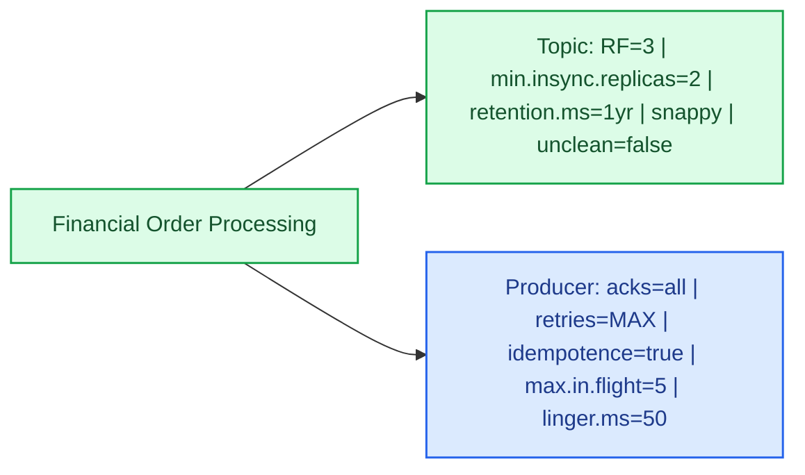

For a financial order processing system:

```properties
# Durability requirements
--config replication.factor=3                 # 3 copies minimum
--config min.insync.replicas=2                # Require 2 acks for producer

# Retention for compliance
--config retention.ms=31536000000             # Keep 1 year (legal requirement)
--config cleanup.policy=delete                # Delete old messages

# Performance
--config compression.type=snappy              # Balance compression/CPU
--config log.segment.bytes=1073741824         # 1GB segments (easier cleanup)

# Reliability
--config unclean.leader.election.enable=false # No out-of-sync leaders
```

Producer configuration:

```java
Properties props = new Properties();
props.put("acks", "all");                           // All replicas must ack
props.put("retries", Integer.MAX_VALUE);            // Infinite retries
props.put("max.in.flight.requests.per.connection", 5);
props.put("enable.idempotence", true);              // Exactly-once semantics
props.put("linger.ms", 50);                         // Small delay for batching
props.put("batch.size", 16384);                     // 16KB batches
```

### Question 5: Partition Count for Microservices

**Answer Framework**:

```
Partitions = MAX(
    throughput_requirement / single_broker_capacity,
    max_consumer_parallelism
)
```

Example: User events service:
- **Requirements**: Peak `100,000 user events/second`, message size `0.5KB` (`50 MB/s`), broker capacity `100 MB/s`, target consumer parallelism `10 threads`.
- **Calculation**:
  - Throughput factor: `50 MB/s / 100 MB/s = 0.5` → min `1` partition.
  - Parallelism factor: `10` consumers → min `10` partitions.
  - **Recommended**: `12 partitions` (for headroom).
- **Scaling strategy**: Start with `12` partitions, monitor and scale preemptively (e.g., to `24`) since shrinking partitions is not supported.

### Question 6: Explain Log Compaction

**Answer Framework**:

Log compaction (`cleanup.policy=compact`) keeps the latest value for each key:
- **Before compaction**:
  - `Offset 0`: `Key=user-123, Value={name: "John"}`
  - `Offset 1`: `Key=user-456, Value={name: "Jane"}`
  - `Offset 2`: `Key=user-123, Value={name: "John Doe"}` ← Update
  - `Offset 3`: `Key=user-789, Value={name: "Bob"}`
  - `Offset 4`: `Key=user-456, Value={name: "Jane Doe"}` ← Update
- **After compaction** (broker periodically compacts):
  - `Offset 1`: `Key=user-456, Value={name: "Jane Doe"}` ← Latest
  - `Offset 2`: `Key=user-123, Value={name: "John Doe"}` ← Latest
  - `Offset 3`: `Key=user-789, Value={name: "Bob"}` ← Latest
- **Use cases**:
  1. **Changelog topics**: Store latest value of each entity.
  2. **Event sourcing**: Compact event history to current state.
  3. **State stores**: Kafka Streams uses compacted topics.
  4. **Configuration**: Store current config per key.

### Question 7: ZooKeeper vs KRaft

**Answer Framework**:

- **ZooKeeper (Traditional)**:
  - *Pros*: Battle-tested and stable, separate coordination service, well-understood.
  - *Cons*: Operational complexity (two systems), higher latency from separate consensus, scalability limits, security complexity, metadata bottleneck.
- **KRaft (Modern, Kafka 3.3+)**:
  - *Pros*: Simplified single-system deployment, better metadata performance inside brokers, improved security (no external ZK), faster metadata propagation.
  - *Cons*: Newer, upgrade complexity from ZooKeeper, evolving operational practices.
- **Migration path**: New clusters should use KRaft; existing ZooKeeper clusters migrate to KRaft as clusters upgrade.

> [!TIP]
> When answering sizing or durability questions in an interview, always tie **three knobs together**: `replication.factor` (copies), `min.insync.replicas` (fault tolerance floor), and `acks=all` (producer guarantee)—changing one without the others leaves a durability gap.

---

## Summary

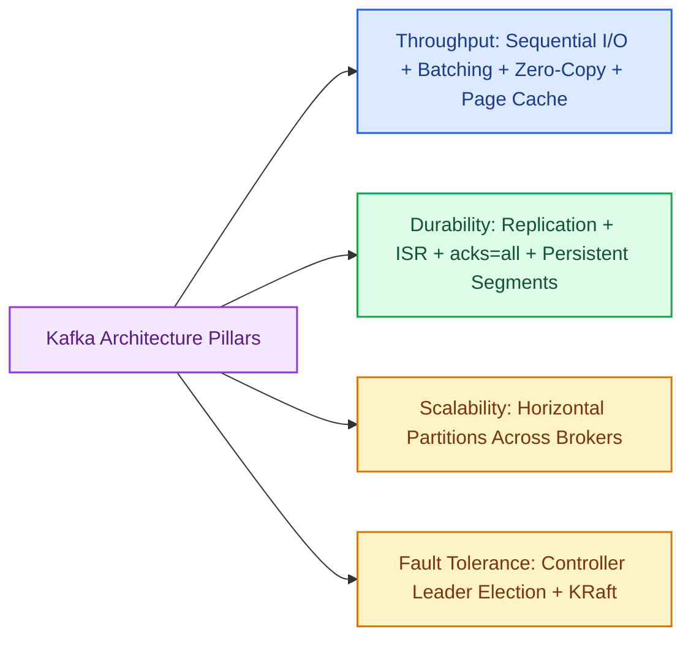

Kafka's architecture enables:
- **Extreme throughput** through sequential I/O, batching, and zero-copy.
- **Durability** through replication and persistent storage.
- **Scalability** through partitioning across brokers.
- **Flexibility** through configurable retention and log compaction.
- **Fault tolerance** through ISR and leader election.

Key takeaways for interviews:
- Kafka is optimized for **throughput over raw latency**.
- **Replication and ISR** are the durability foundation.
- **Topic configuration** must match use-case durability and retention requirements.
- **Cluster sizing** requires calculating both throughput (with `RF`) and retention storage needs.

> [!IMPORTANT]
> Master the interplay between **OS Page Cache**, **`sendfile()` zero-copy**, and **ISR + `min.insync.replicas`**—these three concepts explain 80% of Kafka's performance and reliability behavior in production.
