# Producers and Consumers - Deep Dive

## Table of Contents
1. [Producer Architecture](#producer-architecture)
2. [Producer Configuration](#producer-configuration)
3. [Idempotent Producer](#idempotent-producer)
4. [Transactional Producer](#transactional-producer)
5. [Custom Partitioners](#custom-partitioners)
6. [Consumer Architecture](#consumer-architecture)
7. [Consumer Configuration](#consumer-configuration)
8. [Offset Management](#offset-management)
9. [Consumer Rebalancing](#consumer-rebalancing)
10. [Code Examples](#code-examples)
11. [Interview Questions](#interview-questions)
12. [Summary](#summary)

---

## Producer Architecture

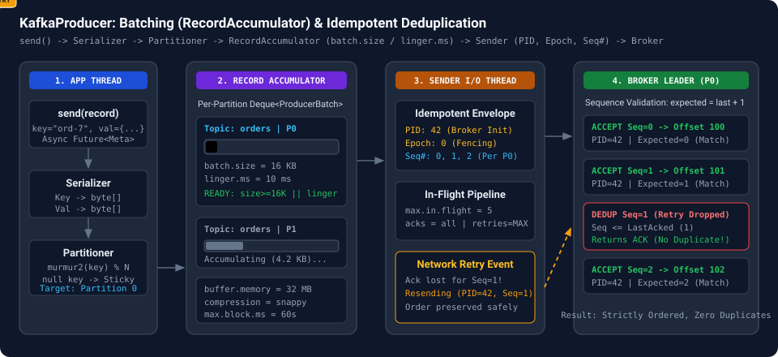

### ProducerRecord

The `ProducerRecord` is the primary data structure sent by producers:

```java
public class ProducerRecord<K, V> {
    private final String topic;           // Required
    private final Integer partition;      // Optional (calculated if null)
    private final Long timestamp;         // Optional
    private final K key;                  // Optional (can be null)
    private final V value;                // Required
    private final Iterable<Header> headers;  // Optional metadata
}

// Example:
ProducerRecord<String, String> record = new ProducerRecord<>(
    "orders",           // topic
    null,               // partition (Kafka will assign)
    System.currentTimeMillis(),  // timestamp
    "order-123",        // key
    "{order: data}"     // value
);
```

### Producer Pipeline (`RecordAccumulator` & `Sender`)

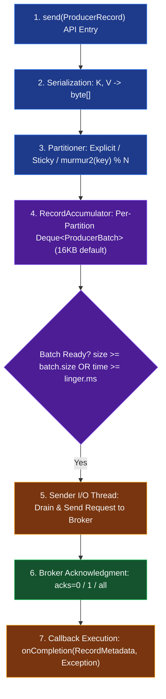

- **App Thread (`send()`)**: Serializes keys/values, computes target partition, and appends the record to a per-partition `ProducerBatch` inside `RecordAccumulator` (compressed if `compression.type` is set, with user callback registered).
- **`Sender` Network I/O Thread**: Polls `RecordAccumulator`, drains batches when `size >= batch.size` or `time >= linger.ms`, sends `ProduceRequest` to the partition leader, awaits `acks`, and invokes `onCompletion(RecordMetadata, Exception)`.

### Serialization

Kafka requires serialization of keys and values to `byte[]`:

```java
// Key & Value serializer interface
public interface Serializer<T> {
    byte[] serialize(String topic, T data);
    void close();
}

// Built-in serializers (ProducerConfig.KEY_SERIALIZER_CLASS_CONFIG)
// - StringSerializer    -> String to byte[]
// - IntegerSerializer   -> Integer to byte[]
// - ByteArraySerializer -> byte[] to byte[] (identity)
// - BytesSerializer     -> Bytes to byte[]

// Custom serializer example
class OrderSerializer implements Serializer<Order> {
    @Override
    public byte[] serialize(String topic, Order order) {
        if (order == null) return null;
        return JsonUtils.toJson(order).getBytes(UTF_8);
    }
}
```

### Batching Mechanism

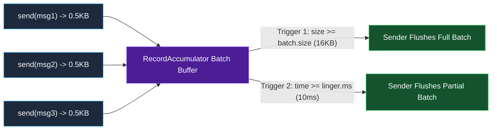

| Profile | `batch.size` | `linger.ms` | Behavior & Tradeoff |
| :--- | :--- | :--- | :--- |
| **High Throughput** | `32768` (32 KB) | `200` ms | Large batches, higher latency, maximum compression efficiency |
| **Low Latency** | `1024` (1 KB) | `0` ms | Sends immediately, small batches, higher network syscall overhead |
| **Balanced (Recommended)** | `16384` (16 KB, default) | `10` ms | Good compromise between throughput and tail latency |

> [!TIP]
> `batch.size` is an **upper bound** per partition batch, not a fixed wait size. If `linger.ms > 0`, the `Sender` waits up to `linger.ms` for more records to arrive unless `batch.size` fills up first.

---

## Producer Configuration

### Essential Configurations

```java
Properties props = new Properties();

// Connection
props.put("bootstrap.servers", "broker1:9092,broker2:9092,broker3:9092");

// Serialization
props.put("key.serializer", "org.apache.kafka.common.serialization.StringSerializer");
props.put("value.serializer", "org.apache.kafka.common.serialization.StringSerializer");

// Durability
props.put("acks", "all");  // or "1", "0"

// Retry
props.put("retries", Integer.MAX_VALUE);
props.put("max.in.flight.requests.per.connection", 5);

// Batching
props.put("batch.size", 16384);            // 16KB
props.put("linger.ms", 10);                // 10ms

// Compression
props.put("compression.type", "snappy");

// Buffering
props.put("buffer.memory", 33554432);      // 32MB

// Timeout
props.put("request.timeout.ms", 30000);    // 30s
props.put("delivery.timeout.ms", 120000);  // 2 min

KafkaProducer<String, String> producer = new KafkaProducer<>(props);
```

### `acks` Configuration (Durability vs. Latency)

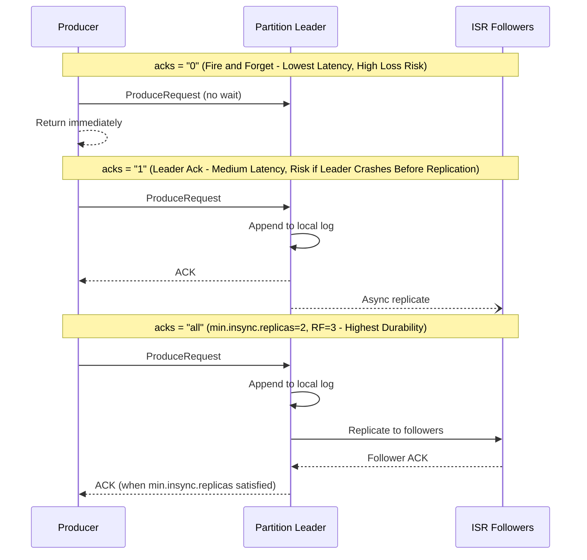

| `acks` | Wait Condition | Data Loss Risk | Latency | Typical Use Case |
| :--- | :--- | :--- | :--- | :--- |
| **`0`** | No broker acknowledgment | **High** (any broker failure loses data) | Lowest | Non-critical metrics, fire-and-forget logs |
| **`1`** | Leader writes to local log | **Medium** (leader crashes before followers pull) | Medium | General-purpose workloads |
| **`all`** (`-1`) | All `min.insync.replicas` ack | **Low** (only if 2+ brokers fail simultaneously with `RF=3, min.isr=2`) | Highest | Financial transactions, orders, critical events |

> [!IMPORTANT]
> To guarantee zero data loss with `acks="all"`, configure the topic/broker with `replication.factor >= 3` and `min.insync.replicas = 2`. With `RF=3` and `min.insync.replicas=2`, the message is safely persisted on the leader plus at least 1 follower before the producer receives an acknowledgment.

### `retries`, `max.in.flight.requests.per.connection`, and `enable.idempotence`

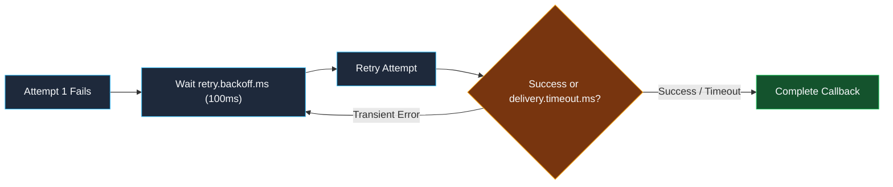

```java
// Configuration
props.put("retries", Integer.MAX_VALUE);  // Retry indefinitely until delivery.timeout.ms
props.put("retry.backoff.ms", 100);       // Wait 100ms between retries

// Option A: Strict ordering without idempotence (reduces throughput)
props.put("max.in.flight.requests.per.connection", 1);

// Option B (Kafka 0.11+): Ordering + pipelining + deduplication
props.put("enable.idempotence", true);
// Automatically enforces:
// - max.in.flight.requests.per.connection = 5 (<= 5)
// - retries = Integer.MAX_VALUE
// - acks = "all"
```

### Compression

```java
props.put("compression.type", "snappy");  // or "lz4", "gzip", "zstd"
```

| Algorithm | Compression Ratio | CPU Usage | Best For |
| :--- | :--- | :--- | :--- |
| **`snappy`** | 50–60% | 5–10% | Balanced default for most workloads |
| **`lz4`** | 40–50% | 2–3% | Maximum speed / lowest CPU overhead |
| **`gzip`** | 70–80% | 30–40% | Maximum size reduction when CPU is abundant |
| **`zstd`** | 70–75% | 15–20% | Modern high-ratio, moderate-CPU workloads |

---

## Idempotent Producer

### How It Works

Idempotent producers prevent duplicate messages from network retries by tagging each batch with `(PID, Partition, Sequence#)`:

- **Producer ID (`PID`)**: Unique identifier assigned to the producer instance by the broker.
- **Sequence Number (`Seq#`)**: Monotonically incremented per partition for each message/batch.
- **Broker Validation**: Tracks `expected = lastSequence + 1`:
  - `msgSeq == expected`: **Accept** and advance `lastSequence`.
  - `msgSeq < expected`: **Duplicate** — drop silently and return `ACK` (prevents duplicate write).
  - `msgSeq > expected`: **Out of order** — reject with `OutOfOrderSequenceException`.

```mermaid
sequenceDiagram
    participant P as Producer (PID=1)
    participant B as Broker Leader (Partition 0)

    P->>B: (PID=1, Seq=0, msg1)
    B-->>P: ACK (Accepted, Expected=1)

    P->>B: (PID=1, Seq=1, msg2)
    B->>B: Stores Seq=1 (Expected=2)
    B--xP: ACK Lost (Network Timeout)

    P->>B: Retry: (PID=1, Seq=1, msg2)
    B->>B: Seq=1 &lt; Expected(2) -&gt; Duplicate Dropped
    B-->>P: ACK (No Duplicate Written)

    P->>B: (PID=1, Seq=2, msg3)
    B-->>P: ACK (Accepted, Expected=3)
```

### Implementation

```java
Properties props = new Properties();
props.put("bootstrap.servers", "localhost:9092");
props.put("key.serializer", StringSerializer.class);
props.put("value.serializer", StringSerializer.class);

// Enable idempotence
props.put("enable.idempotence", true);

KafkaProducer<String, String> producer = new KafkaProducer<>(props);

// Producer can safely retry without duplicates
Future<RecordMetadata> future = producer.send(record);

// If future times out, can safely retry
// Broker will detect and drop duplicate
```

### Limitations

> [!WARNING]
> Idempotent producer guarantees apply **within a single producer instance** at the **partition level** only. They do **not** prevent duplicates across multiple producer instances (different `PID`s), across process restarts, or after broker log truncation/PID expiration (default 5 minutes / `transaction.state.log.min.isr` window).

---

## Transactional Producer

### Exactly-Once Semantics (2PC & `TransactionCoordinator`)

Without transactions, an idempotent producer only guarantees at-most-once duplicates *per partition*—if you write to 2 partitions and 1 fails, you get a partial write. Transactional producers use **Two-Phase Commit (2PC)** coordinated by the broker's `TransactionCoordinator` and `__transaction_state` topic for atomic all-or-nothing writes across partitions and topics.

```mermaid
sequenceDiagram
    participant P as Transactional Producer
    participant TC as TransactionCoordinator
    participant B as Partition Leaders

    P->>TC: initTransactions() (transactional.id)
    TC-->>P: Assign PID &amp; Bump Epoch (Fence Zombies)

    P->>TC: beginTransaction()
    P->>B: send(record1 -&gt; orders), send(record2 -&gt; payments)
    P->>TC: commitTransaction()
    TC->>TC: Write PREPARE_COMMIT to __transaction_state
    TC->>B: Write COMMIT markers to partitions
    TC->>TC: Write COMPLETE_COMMIT to __transaction_state
    TC-->>P: Transaction Committed
```

### Configuration & Transaction API

```java
Properties props = new Properties();
props.put("bootstrap.servers", "localhost:9092");
props.put("key.serializer", StringSerializer.class);
props.put("value.serializer", StringSerializer.class);

// Enable transactions
props.put("transactional.id", "order-producer-1");
props.put("enable.idempotence", true);              // Required
props.put("acks", "all");                           // Required

KafkaProducer<String, String> producer = new KafkaProducer<>(props);

// Initialize transaction (must do once)
producer.initTransactions();

try {
    producer.beginTransaction();

    producer.send(record1);
    producer.send(record2);
    producer.send(record3);

    producer.commitTransaction();
} catch (Exception e) {
    producer.abortTransaction();
    throw e;
}
```

### Transaction Isolation Levels

Consumers control visibility of uncommitted/aborted transactions via `isolation.level`:

| `isolation.level` | Behavior | Throughput | Rolled-back Messages | Use Case |
| :--- | :--- | :--- | :--- | :--- |
| **`read_uncommitted`** (default) | Reads all messages immediately, including uncommitted ones | Higher | **Visible** to consumer | Non-critical analytics, telemetry |
| **`read_committed`** | Buffers until `COMMIT` marker; skips aborted transactions | Slightly lower | **Never visible** to consumer | Financial, orders, billing |

> [!IMPORTANT]
> Example timeline: Producer sends `msg1, msg2` inside a transaction and then calls `abortTransaction()`. A `read_uncommitted` consumer still sees `msg1, msg2`, whereas a `read_committed` consumer never exposes them.

---

## Custom Partitioners

### Partitioner Decision Flow

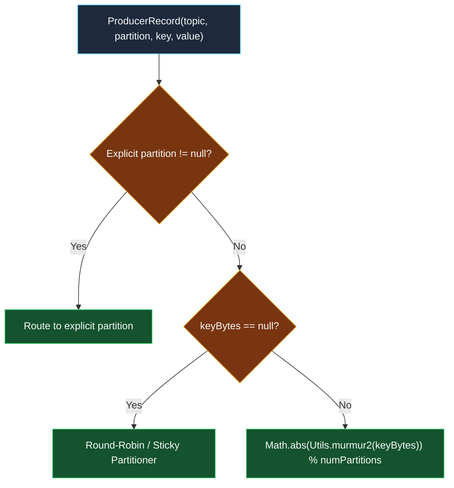

### Default Partitioner

```java
public class DefaultPartitioner implements Partitioner {
    public int partition(String topic, Object key, byte[] keyBytes,
                        Object value, byte[] valueBytes,
                        Cluster metadata) {
        List<PartitionInfo> partitions = metadata.partitionsForTopic(topic);
        int numPartitions = partitions.size();

        if (keyBytes == null) {
            // No key: round-robin
            return nextInt(numPartitions);
        } else {
            // With key: hash(key) % numPartitions
            return Math.abs(Utils.murmur2(keyBytes)) % numPartitions;
        }
    }
}
```

### Custom Partitioner Example (Order Routing by Region)

```java
public class RegionalPartitioner implements Partitioner {
    @Override
    public int partition(String topic, Object key, byte[] keyBytes,
                        Object value, byte[] valueBytes,
                        Cluster metadata) {

        Order order = (Order) value;
        String region = order.getRegion();

        List<PartitionInfo> partitions = metadata.partitionsForTopic(topic);

        // Region-based routing: NA -> 0, EU -> 1, ASIA -> 2
        switch (region) {
            case "NA":
                return 0;
            case "EU":
                return 1;
            case "ASIA":
                return 2;
            default:
                return new Random().nextInt(partitions.size());
        }
    }

    @Override
    public void close() {}

    @Override
    public void configure(Map<String, ?> configs) {}
}

// Usage
Properties props = new Properties();
props.put("partitioner.class", RegionalPartitioner.class.getName());
```

### Partitioner Best Practices

- **Good keys**: `user_id` (user events together), `customer_id` (per-customer ordering), `merchant_id` (fair distribution), `null` (logs where ordering isn't needed).
- **Avoid**: Low-cardinality keys (uneven distribution), overly high-cardinality keys when grouping is needed, and time-based keys (creates hot partitions during peak windows).

> [!TIP]
> Ensure your partition key has enough cardinality to distribute load evenly across all partitions while still preserving ordering for related entities.

---

## Consumer Architecture

### Consumer Groups

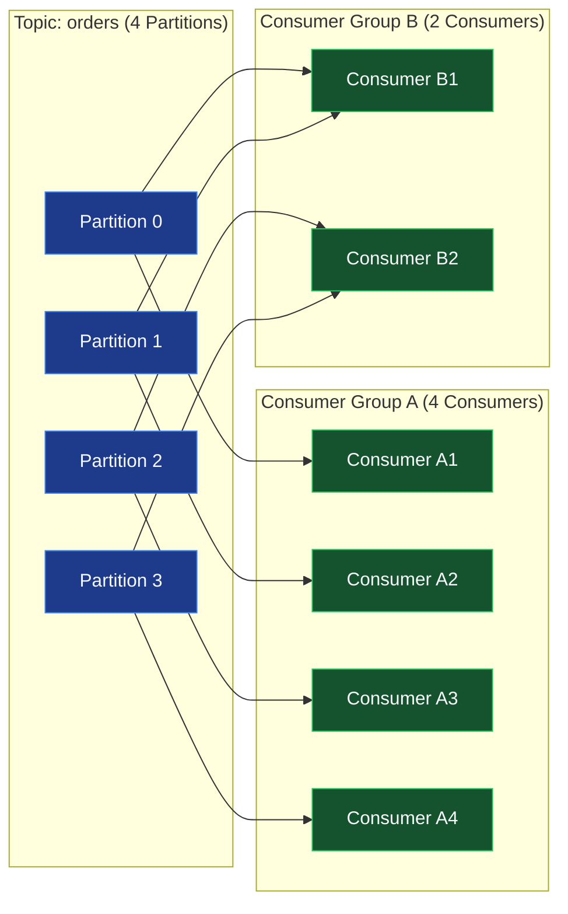

- **Key Property**: Each partition is assigned to **at most 1 consumer per consumer group**, while multiple independent consumer groups can read the exact same partition concurrently.

### `KafkaConsumer` Lifecycle

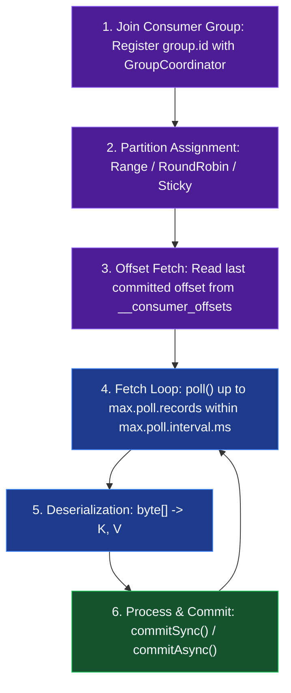

> [!NOTE]
> `KafkaConsumer` is **not thread-safe**. Each consumer instance must be driven by a single polling thread (or decouple `poll()` from worker threads while carefully managing offset commits and `max.poll.interval.ms`).

---

## Consumer Configuration

### Essential Configurations

```java
Properties props = new Properties();

// Connection
props.put("bootstrap.servers", "broker1:9092,broker2:9092");

// Consumer group (CRITICAL)
props.put("group.id", "order-processing-group");

// Serialization
props.put("key.deserializer", StringDeserializer.class);
props.put("value.deserializer", StringDeserializer.class);

// Offset management
props.put("auto.offset.reset", "earliest");  // or "latest", "none"
props.put("enable.auto.commit", true);       // Auto-commit offsets
props.put("auto.commit.interval.ms", 5000);  // Every 5 seconds

// Session management
props.put("session.timeout.ms", 30000);      // 30 seconds
props.put("heartbeat.interval.ms", 10000);   // 10 seconds

// Polling behavior
props.put("max.poll.records", 500);          // Max records per poll
props.put("max.poll.interval.ms", 300000);   // 5 minute max

KafkaConsumer<String, String> consumer = new KafkaConsumer<>(props);
```

### `auto.offset.reset`

| Value | Behavior When No Committed Offset Exists | Use Case | Risk |
| :--- | :--- | :--- | :--- |
| **`earliest`** | Start from the beginning of the partition | Initialize new consumer group | Large historical backlog |
| **`latest`** | Start from the end of the partition | Real-time only, ignore history | Misses messages sent while offline |
| **`none`** | Throw `NoOffsetForPartitionException` | Strict explicit offset management | Fails fast if offset missing |

### Session, Heartbeat, and `max.poll.interval.ms`

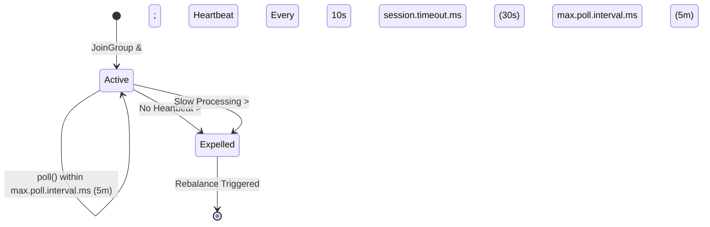

- **Heartbeat Rule of Thumb**: Set `heartbeat.interval.ms = 1/3 * session.timeout.ms` (e.g., `10s` heartbeat, `30s` session timeout) to tolerate 2–3 missed heartbeats before declaring a consumer dead.
- **Slow Processing Protection**: If business logic exceeds `max.poll.interval.ms` (default `300000ms` / 5 min) between `poll()` calls, the consumer is expelled and a rebalance triggers. Fix by increasing `max.poll.interval.ms`, lowering `max.poll.records`, or offloading processing to worker threads.

> [!WARNING]
> Background heartbeat threads keep the session alive during normal network operation, **but** `max.poll.interval.ms` is tracked on the application's `poll()` loop. A blocked `poll()` loop still causes group expulsion!

---

## Offset Management

### Automatic vs. Manual Offset Commit

- **Automatic Commit (`enable.auto.commit = true`, `auto.commit.interval.ms = 5000`)**:
  - Risky: if `poll()` returns offsets `100–104`, offset `101` throws an exception at `T=3s`, and auto-commit fires at `T=5s` committing `104`, a restart resumes at `105` and **loses offsets `101–104`**.
- **Manual Commit (`enable.auto.commit = false`)**:
  - `commitSync()`: Blocking, retries transient failures, throws exception on permanent failure.
  - `commitAsync(callback)`: Non-blocking, higher throughput, handles errors in callback.
  - **Combined Pattern (Recommended)**: Use `commitAsync()` inside the `while` loop for speed, and `commitSync()` in `finally` / `onPartitionsRevoked()` for guaranteed final commit.

```java
// Combined approach (recommended)
try {
    consumer.commitAsync((offsets, exception) -> {
        if (exception != null) {
            logger.error("Async commit failed", exception);
        }
    });
} catch (CommitFailedException e) {
    logger.error("Commit failed", e);
}
```

### Delivery Semantics

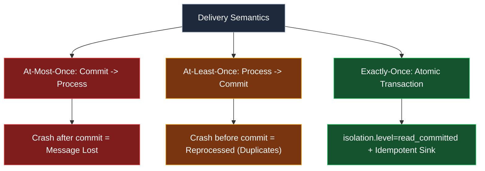

| Semantic | Commit Order | Failure Outcome | Configuration / Pattern | Use Case |
| :--- | :--- | :--- | :--- | :--- |
| **At-most-once** | Commit **before** processing | Message lost on crash | `enable.auto.commit=true` or `commitSync()` before `process()` | Non-critical logs, metrics |
| **At-least-once** | Process **before** commit | Duplicate processing on crash | `enable.auto.commit=false`, `commitSync()` after `process()` | Most applications (with idempotent consumer) |
| **Exactly-once** | Atomic with side-effect | Rolled back cleanly | `isolation.level=read_committed` + transactional producer | Financial, orders, billing |

> [!IMPORTANT]
> For **at-least-once** pipelines, always pair manual post-processing commits with an **idempotent consumer** (e.g., deduplicating by `record.key()` or `topic-partition-offset` in your database).

---

## Consumer Rebalancing

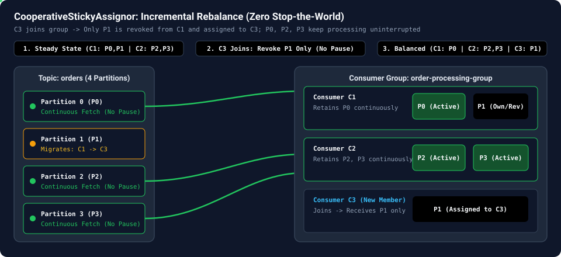

### Eager vs. Cooperative Sticky Rebalancing

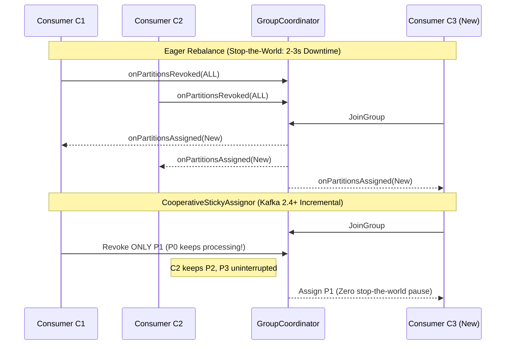

### Partition Assignment Strategies

| Strategy | Assignment Pattern | Rebalance Impact |
| :--- | :--- | :--- |
| **`RangeAssignor`** | Contiguous slices per topic (`A->[0,1], B->[2,3], C->[4,5]`) | High movement when a consumer dies; can cause uneven load across topics |
| **`RoundRobinAssignor`** | Interleaved (`A->[0,3], B->[1,4], C->[2,5]`) | Balanced distribution, but still moves many partitions on rebalance |
| **`StickyAssignor`** | Preserves existing assignments as much as possible | Minimal partition movement, reduces duplicate reprocessing |
| **`CooperativeStickyAssignor`** | Incremental revoke + sticky assignment (Kafka 2.4+) | **No stop-the-world pause**; unaffected partitions keep consuming |

```java
props.put("partition.assignment.strategy",
    "org.apache.kafka.clients.consumer.CooperativeStickyAssignor");

// Or multiple (tries in order):
props.put("partition.assignment.strategy",
    "CooperativeStickyAssignor,RangeAssignor");
```

### Static Group Membership

Avoid unnecessary rebalancing during rolling restarts or brief network blips by assigning a persistent `group.instance.id`:

```java
props.put("group.instance.id", "consumer-1");  // Unique per consumer instance
props.put("session.timeout.ms", 600000);       // 10 min timeout
```

- If the consumer restarts and rejoins within `session.timeout.ms`, the coordinator immediately restores its exact previous partitions **with zero rebalancing**.

> [!TIP]
> Combine `CooperativeStickyAssignor` with `group.instance.id` (Static Membership) in production Kubernetes/container deployments to eliminate rebalance storms during rolling deployments.

---

## Code Examples

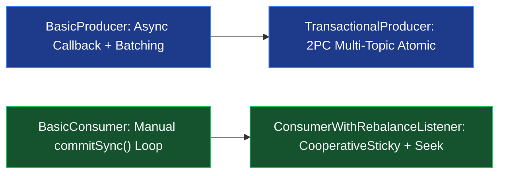

### Basic Producer

```java
import org.apache.kafka.clients.producer.*;
import org.apache.kafka.common.serialization.StringSerializer;
import java.util.Properties;

public class BasicProducer {
    public static void main(String[] args) {
        // Configuration
        Properties props = new Properties();
        props.put("bootstrap.servers", "localhost:9092");
        props.put("key.serializer", StringSerializer.class.getName());
        props.put("value.serializer", StringSerializer.class.getName());
        props.put("acks", "all");
        props.put("retries", Integer.MAX_VALUE);
        props.put("linger.ms", 10);
        props.put("batch.size", 16384);
        props.put("compression.type", "snappy");

        // Create producer
        try (KafkaProducer<String, String> producer = new KafkaProducer<>(props)) {

            // Send messages
            for (int i = 0; i < 100; i++) {
                String key = "order-" + (i % 10);
                String value = "{\"id\": " + i + ", \"amount\": " + (100 + i * 10) + "}";

                ProducerRecord<String, String> record = new ProducerRecord<>(
                    "orders",      // topic
                    key,           // key
                    value          // value
                );

                // Send with callback
                producer.send(record, (metadata, exception) -> {
                    if (exception != null) {
                        System.err.println("Send failed: " + exception.getMessage());
                    } else {
                        System.out.println("Sent to partition " + metadata.partition() +
                                         " with offset " + metadata.offset());
                    }
                });
            }

            // Flush remaining messages
            producer.flush();

        } // Producer auto-closes
    }
}
```

### Transactional Producer

```java
import org.apache.kafka.clients.producer.KafkaProducer;
import org.apache.kafka.clients.producer.ProducerRecord;
import org.apache.kafka.common.serialization.StringSerializer;
import java.util.Properties;

public class TransactionalProducer {
    public static void main(String[] args) {
        Properties props = new Properties();
        props.put("bootstrap.servers", "localhost:9092");
        props.put("key.serializer", StringSerializer.class);
        props.put("value.serializer", StringSerializer.class);

        // Transactional settings
        props.put("transactional.id", "order-producer-1");
        props.put("enable.idempotence", true);
        props.put("acks", "all");

        KafkaProducer<String, String> producer = new KafkaProducer<>(props);

        // Initialize transactions (once per producer)
        producer.initTransactions();

        try {
            // Begin transaction
            producer.beginTransaction();

            // Send order
            ProducerRecord<String, String> orderRecord = new ProducerRecord<>(
                "orders",
                "order-123",
                "{\"id\": \"order-123\", \"total\": 500.00}"
            );
            producer.send(orderRecord);

            // Send payment
            ProducerRecord<String, String> paymentRecord = new ProducerRecord<>(
                "payments",
                "order-123",
                "{\"id\": \"order-123\", \"amount\": 500.00, \"status\": \"completed\"}"
            );
            producer.send(paymentRecord);

            // Commit (atomic)
            producer.commitTransaction();
            System.out.println("Transaction committed");

        } catch (Exception e) {
            System.err.println("Transaction failed, rolling back");
            producer.abortTransaction();
        } finally {
            producer.close();
        }
    }
}
```

### Basic Consumer

```java
import org.apache.kafka.clients.consumer.*;
import org.apache.kafka.common.serialization.StringDeserializer;
import java.time.Duration;
import java.util.Arrays;
import java.util.Properties;

public class BasicConsumer {
    public static void main(String[] args) {
        Properties props = new Properties();
        props.put("bootstrap.servers", "localhost:9092");
        props.put("group.id", "order-processing-group");
        props.put("key.deserializer", StringDeserializer.class.getName());
        props.put("value.deserializer", StringDeserializer.class.getName());
        props.put("auto.offset.reset", "earliest");
        props.put("enable.auto.commit", false);  // Manual commits

        KafkaConsumer<String, String> consumer = new KafkaConsumer<>(props);

        // Subscribe to topics
        consumer.subscribe(Arrays.asList("orders", "payments"));

        int recordCount = 0;

        try {
            while (true) {
                // Poll for records
                ConsumerRecords<String, String> records = consumer.poll(Duration.ofSeconds(1));

                for (ConsumerRecord<String, String> record : records) {
                    try {
                        // Process record
                        System.out.printf("Topic: %s, Partition: %d, Offset: %d, Key: %s, Value: %s%n",
                            record.topic(), record.partition(), record.offset(),
                            record.key(), record.value());

                        processOrder(record.value());

                        recordCount++;

                    } catch (Exception e) {
                        System.err.println("Processing failed: " + e.getMessage());
                        // Don't commit on error
                    }
                }

                // Commit after processing batch
                if (recordCount > 0) {
                    consumer.commitSync();
                    System.out.println("Committed " + recordCount + " records");
                    recordCount = 0;
                }
            }
        } finally {
            consumer.close();
        }
    }

    private static void processOrder(String orderJson) throws Exception {
        // Parse and process order
        // Simulate processing time
        Thread.sleep(100);
    }
}
```

### Consumer with Rebalance Listener

```java
import org.apache.kafka.clients.consumer.*;
import org.apache.kafka.common.serialization.StringDeserializer;
import org.apache.kafka.common.TopicPartition;
import java.time.Duration;
import java.util.*;

public class ConsumerWithRebalanceListener {
    public static void main(String[] args) {
        Properties props = new Properties();
        props.put("bootstrap.servers", "localhost:9092");
        props.put("group.id", "order-group");
        props.put("key.deserializer", StringDeserializer.class.getName());
        props.put("value.deserializer", StringDeserializer.class.getName());
        props.put("auto.offset.reset", "earliest");
        props.put("enable.auto.commit", false);
        props.put("partition.assignment.strategy", "CooperativeStickyAssignor");

        KafkaConsumer<String, String> consumer = new KafkaConsumer<>(props);

        // Subscribe with rebalance listener
        consumer.subscribe(
            Arrays.asList("orders"),
            new ConsumerRebalanceListener() {
                @Override
                public void onPartitionsRevoked(Collection<TopicPartition> partitions) {
                    System.out.println("Revoking partitions: " + partitions);
                    // Save offsets before losing partitions
                    consumer.commitSync();
                }

                @Override
                public void onPartitionsAssigned(Collection<TopicPartition> partitions) {
                    System.out.println("Assigned partitions: " + partitions);
                    // Setup state for new partitions if needed
                    partitions.forEach(partition -> {
                        System.out.println("Seeking to beginning of " + partition);
                        consumer.seekToBeginning(Arrays.asList(partition));
                    });
                }
            }
        );

        try {
            while (true) {
                ConsumerRecords<String, String> records = consumer.poll(Duration.ofSeconds(1));

                for (ConsumerRecord<String, String> record : records) {
                    System.out.println("Processing: " + record.value());
                }

                consumer.commitSync();
            }
        } finally {
            consumer.close();
        }
    }
}
```

> [!TIP]
> In `ConsumerWithRebalanceListener`, always call `consumer.commitSync()` inside `onPartitionsRevoked()` so that the next consumer taking over those partitions resumes from the exact last processed offset.

---

## Interview Questions

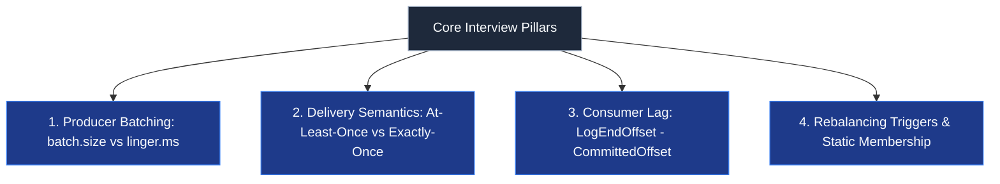

### Question 1: Producer Batching Explanation

**Answer**: Producer batching accumulates messages in memory (`RecordAccumulator`) before sending:
- `send(msg1)` -> `send(msg2)` -> `send(msg3)` accumulate until buffer reaches `batch.size` (e.g., `16KB`) **OR** `linger.ms` (e.g., `100ms`) elapses, then sends all messages in one request.
- **Benefit**: ~100x reduction in network syscalls (1000 messages in 1 request vs. 1000 individual requests).

```java
// High throughput
props.put("batch.size", 32768);      // 32KB
props.put("linger.ms", 100);         // Wait up to 100ms

// Low latency
props.put("batch.size", 1024);       // 1KB
props.put("linger.ms", 0);           // No waiting
```

### Question 2: Exactly-Once vs At-Least-Once

**Answer**:
- **At-least-once**: Process message -> Save offset. If crash occurs after processing and before commit, message is reprocessed. An idempotent producer prevents retry duplicates and preserves ordering, but still requires an idempotent consumer.
- **Exactly-once**: Transactional producer consumes, processes, sends to multiple topics atomically, and commits offsets in an all-or-nothing transaction (`transactional.id` + `isolation.level=read_committed`), at the cost of higher latency and complexity.

### Question 3: Consumer Lag Calculation

**Answer**:
`Consumer Lag = LogEndOffset (highWatermark) - CommittedOffset`
- Example: Topic partition has 1000 messages (offsets `0–999`, `LogEndOffset = 1000`) and consumer group committed offset `500` -> `Consumer Lag = 500` messages behind.
- High lag indicates a slow consumer, a crashed/recovering consumer, misconfiguration (`max.poll.records` / `fetch.max.bytes`), or a sudden traffic spike.

### Question 4: Rebalancing Causes

**Answer**: Rebalancing is triggered by:
1. **Consumer joins group** -> existing partitions redistributed.
2. **Consumer leaves/crashes** (missed `session.timeout.ms` or `max.poll.interval.ms`) -> partitions reassigned.
3. **Topic subscription changes** (e.g., `consumer.subscribe(["orders", "payments"])`).
4. **Static group membership timeout** -> if a consumer with `group.instance.id` reboots faster than `session.timeout.ms`, **no rebalance** occurs; if slower, rebalance triggers.
- Eager rebalancing causes a 2–5s stop-the-world pause; `CooperativeStickyAssignor` avoids global pauses.

> [!IMPORTANT]
> When asked about **Consumer Lag** in interviews, distinguish between **transient lag** (normal during bursts) and **growing lag** (consumer throughput < producer throughput, requiring more consumers up to the partition count).

---

## Summary

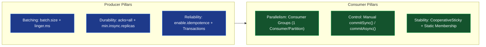

**Producers**:
- Batching (`batch.size`, `linger.ms`) increases throughput and compression efficiency.
- `acks` (`0`, `1`, `all`) determines durability vs. latency tradeoffs.
- Idempotence (`PID` + `Sequence#`) prevents retry duplicates within a partition.
- Transactions (`transactional.id` + `TransactionCoordinator`) enable atomic multi-partition exactly-once semantics.

**Consumers**:
- Consumer groups enable parallel processing (at most 1 consumer per partition per group).
- Offset commits (`commitSync`, `commitAsync`) track progress in `__consumer_offsets`.
- Rebalancing redistributes partitions; `CooperativeStickyAssignor` + `group.instance.id` minimize downtime.
- Manual commits + idempotent processing provide the safest production control.

**Key Interview Topics**:
- Durability vs. latency tradeoffs (`acks=all` + `min.insync.replicas`)
- Exactly-once semantics (Idempotent vs. Transactional producers)
- Consumer lag calculation and monitoring (`LogEndOffset - CommittedOffset`)
- Rebalancing causes and strategies (`Range`, `RoundRobin`, `Sticky`, `CooperativeSticky`, Static Membership)
