# Kafka Streams and Connect - Deep Dive

## Table of Contents
1. [Kafka Streams Overview](#kafka-streams-overview)
2. [Stateless vs Stateful Operations](#stateless-vs-stateful-operations)
3. [KStream, KTable, GlobalKTable](#kstream-ktable-globalktable)
4. [Stream Processing Operations](#stream-processing-operations)
5. [Windowing](#windowing)
6. [State Stores](#state-stores)
7. [Exactly-Once Processing](#exactly-once-processing)
8. [Interactive Queries](#interactive-queries)
9. [Kafka Connect](#kafka-connect)
10. [Schema Registry](#schema-registry)
11. [Stream Processing Comparisons](#stream-processing-comparisons)
12. [Interview Questions](#interview-questions)
13. [Summary](#summary)

---

## Kafka Streams Overview

### What is Kafka Streams?

Kafka Streams is a **client library** for building mission-critical, real-time stream processing applications directly on top of Apache Kafka—without requiring a separate processing cluster (like Flink or Spark).

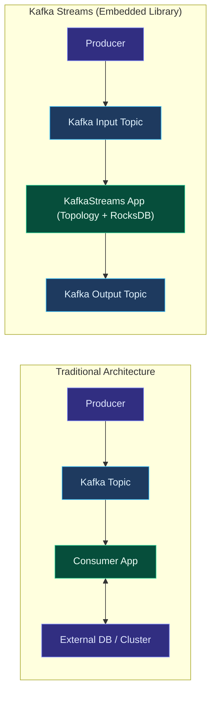

Key features:
- **Embeds in application**: Runs as a standard JVM library inside Kubernetes pods, VMs, or containers—no separate cluster manager needed.
- **Stateful**: Maintains local embedded state stores (RocksDB) backed by compacted Kafka changelog topics.
- **Exactly-once semantics**: Strong processing guarantees (`EXACTLY_ONCE_V2`) across input offsets, state stores, and output topics.
- **Elastic scalability**: Partition count dictates maximum parallelism; adding/removing instances triggers automatic task rebalancing.
- **Interactive queries**: Exposes local and distributed state stores for real-time RPC lookups.

### Architecture & Partition-to-Task Mapping

Kafka Streams compiles your DSL code into a **Topology (DAG of Processor Nodes)** and scales it by creating one **Stream Task** per input partition.

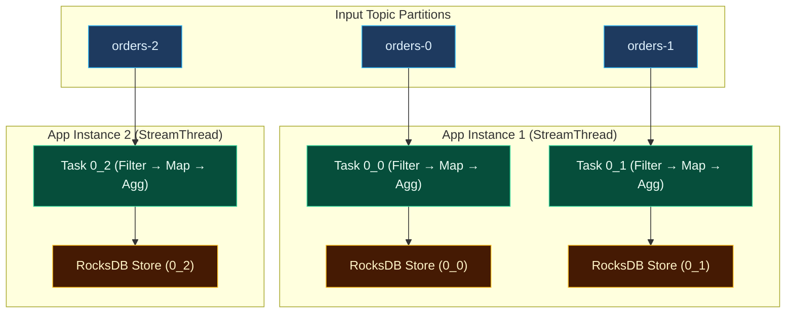

> [!TIP]
> **Parallelism Cap**: Maximum active parallelism equals the **maximum number of partitions** among your source topics. If `orders` has 12 partitions, running 16 instances leaves 4 instances idle (unless configured as `num.standby.replicas > 0`).

### Topology Example

```java
StreamsBuilder builder = new StreamsBuilder();

// Source
KStream<String, String> orders = builder.stream("orders");

// Transform
KStream<String, Order> parsedOrders = orders
    .mapValues(jsonValue -> parseOrder(jsonValue));

// Filter
KStream<String, Order> largeOrders = parsedOrders
    .filter((key, order) -> order.getAmount() > 1000);

// Sink
largeOrders.to("large-orders");

// Build topology
Topology topology = builder.build();
```

---

## Stateless vs Stateful Operations

### Execution Path Comparison

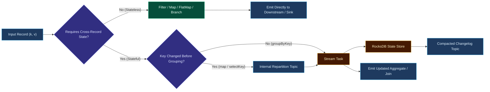

### Stateless Operations

No state needed—each record is transformed independently in memory:

```java
// Filter: Pass records matching condition
stream.filter((key, value) -> value.getAmount() > 100);

// Map: Transform each record (key and/or value)
stream.map((key, value) -> new KeyValue<>(key, value.upper()));

// FlatMap: One input -> zero or more outputs
stream.flatMap((key, value) -> {
    List<KeyValue<String, String>> results = new ArrayList<>();
    for (String word : value.split(" ")) {
        results.add(new KeyValue<>(word, word));
    }
    return results.iterator();
});

// MapValues: Transform value only (preserves partition affinity!)
stream.mapValues(value -> value * 2);

// Peek: Debug side-effect, no transformation
stream.peek((key, value) -> System.out.println(key + ": " + value));

// Branch: Split into multiple streams
Map<String, KStream<String, Order>> branches = stream.split(Named.as("order-"))
    .branch((key, order) -> order.getAmount() > 1000, Branched.as("large"))
    .branch((key, order) -> order.getAmount() > 100, Branched.as("medium"))
    .defaultBranch(Branched.as("small"));
```

Stateless characteristics:
- **No state store needed**: Zero RocksDB overhead and no changelog traffic.
- **Memory efficient & embarrassingly parallel**: Same input record always produces the same output.
- **Key preservation**: Prefer `mapValues` / `flatMapValues` over `map` / `flatMap` whenever the key does not change, because key-modifying operations mark the stream as `repartitionRequired = true` for downstream joins or aggregations.

### Stateful Operations

Maintain state across multiple records (counts, sums, windowed joins):

```java
// Aggregate: Combine records by key
KTable<String, Long> orderCounts = stream
    .groupByKey()
    .count();  // Maintains count per key in state store

// Reduce: Combine records with associative function
KTable<String, Order> totalOrders = stream
    .groupByKey()
    .reduce((order1, order2) -> {
        order1.setTotal(order1.getTotal() + order2.getAmount());
        return order1;
    });

// Aggregate with custom initializer
KTable<String, OrderStats> stats = stream
    .groupByKey()
    .aggregate(
        () -> new OrderStats(0, 0.0),  // Initializer
        (key, order, agg) -> {         // Aggregator
            agg.count++;
            agg.total += order.getAmount();
            return agg;
        }
    );

// Join: Combine records from multiple streams
stream1.join(stream2,
    (order, payment) -> {
        order.setPaymentId(payment.getId());
        return order;
    },
    JoinWindows.ofTimeDifferenceWithNoGrace(Duration.ofMinutes(5))
);
```

Stateful characteristics:
- **State store required**: Backed by RocksDB (or in-memory store) on each task.
- **Changelog topic for recovery**: Every state mutation is written to a compacted internal Kafka topic.
- **Co-partitioning requirement**: Operations joining or grouping two topics require identical partition counts and key-partitioning strategies.

> [!IMPORTANT]
> Calling `.map(...)` or `.selectKey(...)` followed by `.groupByKey()` automatically injects an **internal repartition topic** into your topology so that all records with the new key land on the same task partition.

---

## KStream, KTable, GlobalKTable

Understanding the **Stream-Table Duality** is foundational to Kafka Streams: a `KStream` is an append-only event log, whereas a `KTable` is the materialized latest state per key.

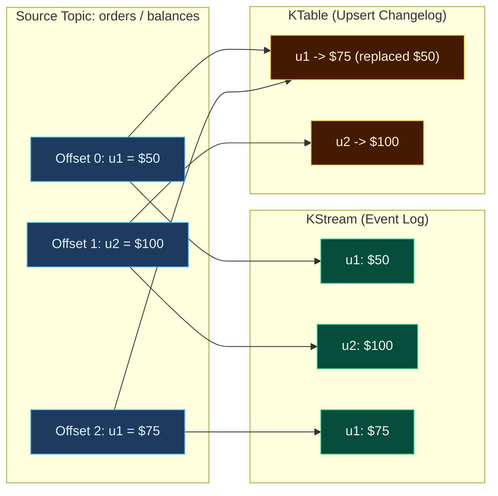

### KStream (Event Stream)

- **Semantics**: Series of immutable, append-only facts.
- **Behavior**: A new record with the same key does **not** overwrite previous records; every event is processed independently.

```java
KStream<String, Order> orders = builder.stream("orders");

// Processing receives each event
orders.foreach((key, value) -> {
    System.out.println("Order: " + key + " -> " + value);
});

// Output (each new order):
// Order: user-123 -> {amount: 50}
// Order: user-456 -> {amount: 100}
// Order: user-123 -> {amount: 75}
```

### KTable (Changelog)

- **Semantics**: Mutable view of the latest value per key (analogous to a database table).
- **Behavior**: A new record with an existing key **replaces** the old value; a `null` value (tombstone) **deletes** the key from the table.

```java
KTable<String, UserBalance> balances = builder.table("user-balances");

// Processing receives updates per key
balances.toStream().foreach((key, newValue) -> {
    System.out.println("User " + key + " balance: " + newValue);
});

// Output (latest per key):
// User user-123 balance: 950
// User user-456 balance: 500
```

### GlobalKTable (Replicated KTable)

Unlike a partitioned `KTable` (where each instance only holds a subset of keys), a `GlobalKTable` replicates **all partitions** of its source topic to **every** application instance.

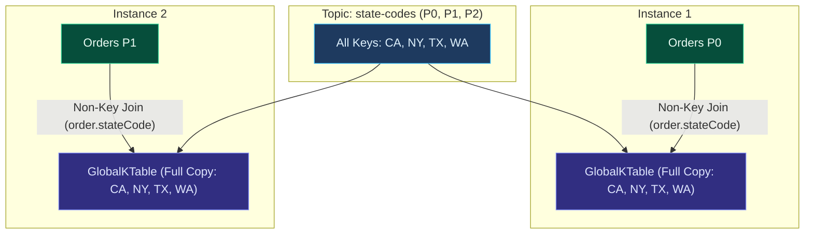

```java
// Small reference data (doesn't change often)
GlobalKTable<String, StateCode> stateCodes =
    builder.globalTable("state-codes");

// Orders (large, frequent stream)
KStream<String, Order> orders = builder.stream("orders");

// Enrich orders with state names using a foreign key (no repartition needed!)
KStream<String, OrderWithState> enriched = orders.join(
    stateCodes,
    (orderId, order) -> order.getStateCode(),  // KeyValueMapper for lookup
    (order, stateCode) -> new OrderWithState(order, stateCode)
);
```

### KStream vs KTable vs GlobalKTable

| Feature | `KStream` | `KTable` | `GlobalKTable` |
|---|---|---|---|
| **Semantics** | Append-only event log | Latest state per key (upsert/delete) | Replicated latest state |
| **Partitioning** | Partitioned across instances | Partitioned across instances | Full copy on **every** instance |
| **Join Window** | Required (for Stream-Stream) | Not needed (for Stream-Table) | Not needed |
| **Co-partitioning** | Required for joins | Required for joins | **Not required** (supports foreign-key joins) |
| **Memory / Disk** | Low | Medium (sharded by partition) | High (full dataset per instance) |
| **Use Case** | Clicks, orders, payments | User profiles, balances, aggregations | Country/state codes, currency rates, config |

> [!WARNING]
> **GlobalKTable Memory & Startup Cost**: Because every instance consumes all partitions of a `GlobalKTable` topic on startup before processing begins, avoid using `GlobalKTable` for high-volume, rapidly mutating datasets.

---

## Stream Processing Operations

### Filtering, Mapping & Grouping Pipeline

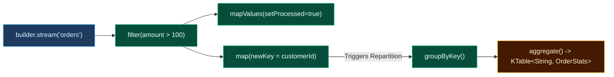

```java
KStream<String, Order> orders = builder.stream("orders");

// Filter
orders.filter((key, order) -> order.getAmount() > 100)
      .to("high-value-orders");

// Map (changes key -> marks stream for repartitioning)
orders.map((key, order) ->
    new KeyValue<>(order.getCustomerId(), order))
    .to("orders-by-customer");

// MapValues (transform value, keep key -> no repartition)
orders.mapValues(order -> {
    order.setProcessed(true);
    return order;
})
.to("processed-orders");

// FlatMapValues (one to many, preserves key)
orders.flatMapValues(order -> order.getItems())
      .to("order-items");
```

### Grouping & Aggregations

```java
// GroupByKey: Key-based grouping (no repartition if key unchanged)
KGroupedStream<String, Order> byKey = orders.groupByKey();

// GroupBy: Custom key function (triggers repartition)
KGroupedStream<String, Order> byCustomer = orders.groupBy(
    (key, order) -> order.getCustomerId()
);

// GroupBy with explicit Serdes
KGroupedStream<String, Double> byRegion = orders.groupBy(
    (key, order) -> order.getRegion(),
    Grouped.with(Serdes.String(), Serdes.Double())
);

// Count (count per key)
KTable<String, Long> orderCounts = orders
    .groupByKey()
    .count();

// Sum
KTable<String, Double> totalAmount = orders
    .groupByKey()
    .aggregate(
        () -> 0.0,
        (key, order, sum) -> sum + order.getAmount(),
        Materialized.as("order-totals")
    );

// Custom aggregation
KTable<String, OrderStats> stats = orders
    .groupByKey()
    .aggregate(
        OrderStats::new,
        (key, order, agg) -> {
            agg.count++;
            agg.sum += order.getAmount();
            agg.avg = agg.sum / agg.count;
            return agg;
        },
        Materialized.as("order-stats")
    );

// Reduce (simpler than aggregate, binary operation)
KTable<String, Order> maxOrder = orders
    .groupByKey()
    .reduce((order1, order2) ->
        order1.getAmount() > order2.getAmount() ? order1 : order2
    );
```

### Joins (Stream-Stream vs Stream-Table)

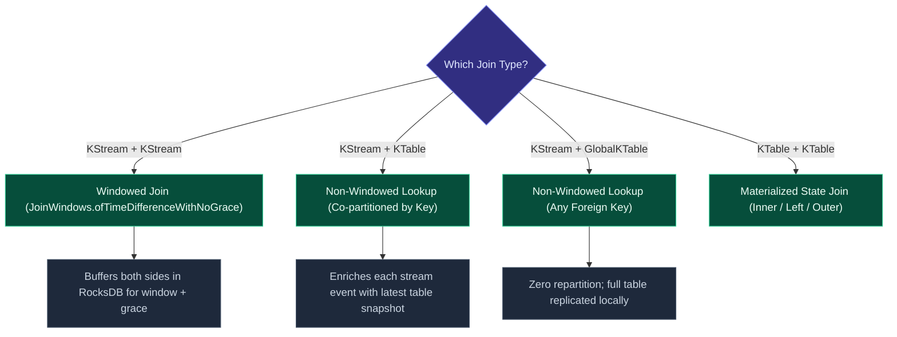

**Stream-Stream Join** (requires `JoinWindows`):
```java
KStream<String, Order> orders = builder.stream("orders");
KStream<String, Payment> payments = builder.stream("payments");

// Inner join with 5-minute window
KStream<String, OrderPayment> joined = orders.join(
    payments,
    (order, payment) -> new OrderPayment(order, payment),
    JoinWindows.ofTimeDifferenceWithNoGrace(Duration.ofMinutes(5))
);

// Left join (keep unmatched orders)
KStream<String, OrderPayment> leftJoined = orders.leftJoin(
    payments,
    (order, payment) -> new OrderPayment(order, payment),
    JoinWindows.ofTimeDifferenceWithNoGrace(Duration.ofMinutes(5))
);

// Outer join (keep unmatched from both)
KStream<String, OrderPayment> outerJoined = orders.outerJoin(
    payments,
    (order, payment) -> new OrderPayment(order, payment),
    JoinWindows.ofTimeDifferenceWithNoGrace(Duration.ofMinutes(5))
);
```

**Stream-Table & Stream-GlobalKTable Join**:
```java
KTable<String, UserProfile> users = builder.table("users");

// Enrich stream with table data (latest snapshot, co-partitioned)
KStream<String, Order> enriched = orders.join(
    users,
    (order, user) -> {
        order.setCustomerName(user.getName());
        return order;
    }
);

// Stream-GlobalKTable (no window, no co-partitioning needed)
GlobalKTable<String, StateCode> states = builder.globalTable("states");

KStream<String, Order> withState = orders.join(
    states,
    (orderId, order) -> order.getStateCode(),
    (order, state) -> {
        order.setStateName(state.getName());
        return order;
    }
);
```

> [!NOTE]
> In a **Stream-Table join**, only records arriving on the `KStream` trigger join output. Updates to the `KTable` update the local state store silently until the next matching `KStream` event arrives.

---

## Windowing

Windowing groups unbounded streams into finite **event-time** buckets for aggregations and joins.

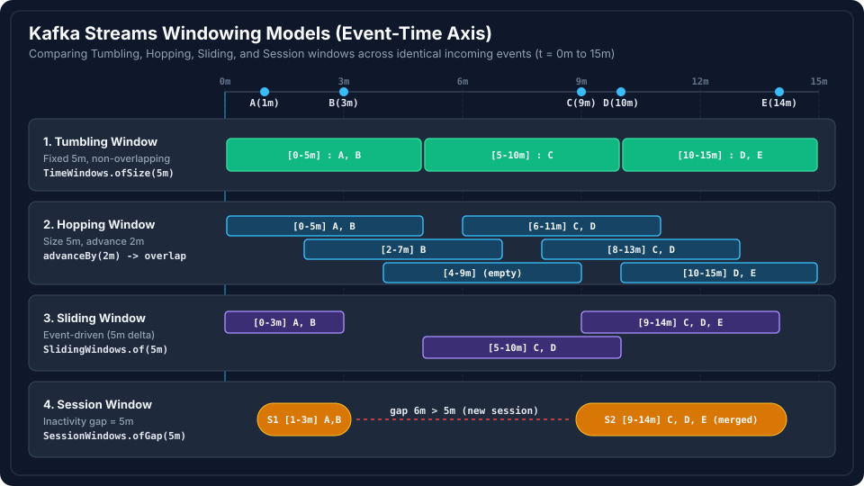

### Window Selection & Grace Period Lifecycle

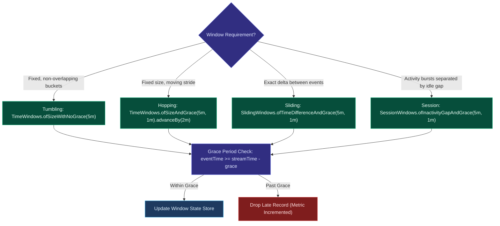

| Window Type | Overlap? | Alignment | Key Use Case |
|---|---|---|---|
| **Tumbling** | No | Epoch-aligned fixed intervals (`[0-5m]`, `[5-10m]`) | Periodic billing, hourly/minute KPIs |
| **Hopping** | Yes | Fixed size + fixed advance (`size > advance`) | Moving averages, rolling dashboards |
| **Sliding** | Yes | Event-driven (`[t - diff, t]`) | Exact rolling anomaly/fraud detection |
| **Session** | No (merges) | Dynamic, bounded by inactivity gap | User clickstreams, activity bursts |

### Tumbling Window (Fixed-size, non-overlapping)

```java
KTable<Windowed<String>, Long> tumbled = orders
    .groupByKey()
    .windowedBy(TimeWindows.ofSizeWithNoGrace(Duration.ofMinutes(5)))
    .count();

// Suppress intermediate updates until window closes
tumbled.suppress(Suppressed.untilWindowCloses(Suppressed.BufferConfig.unbounded()))
       .toStream()
       .foreach((window, count) -> {
           System.out.println("Window: " + window.window() + " Orders: " + count);
       });
```

### Hopping Window (Fixed-size, overlapping)

```java
KTable<Windowed<String>, Long> hopping = orders
    .groupByKey()
    .windowedBy(TimeWindows
        .ofSizeWithNoGrace(Duration.ofMinutes(5)) // Window size
        .advanceBy(Duration.ofMinutes(2))         // Advance interval
    )
    .count();
```

### Sliding Window (Event-time delta)

```java
KStream<String, OrderTotal> totals = orders
    .groupByKey()
    .windowedBy(SlidingWindows.ofTimeDifferenceWithNoGrace(Duration.ofMinutes(5)))
    .aggregate(/* initializer, aggregator */)
    .toStream()
    .map((windowedKey, value) ->
        new KeyValue<>(windowedKey.key() + "@" + windowedKey.window().start(), value)
    );
```

### Session Window (Inactivity gap-based)

```java
KTable<Windowed<String>, Long> sessions = orders
    .groupByKey()
    .windowedBy(SessionWindows.ofInactivityGapWithNoGrace(Duration.ofMinutes(5)))
    .count();

// Example Output:
// Session [user-123 @ 1000-3000]: 2 orders
// Session [user-123 @ 9000-10000]: 2 orders (new session, gap > 5min)
```

### Window Retention and Grace Period

```java
// Grace period: Allow late-arriving events up to 30s after window close
TimeWindows.ofSizeAndGrace(Duration.ofMinutes(5), Duration.ofSeconds(30));

// Window retention: How long to keep state in RocksDB / changelog
Materialized.<String, Long, WindowStore<Bytes, byte[]>>as("window-counts")
    .withRetention(Duration.ofMinutes(15));
```

> [!WARNING]
> **Retention vs Grace**: `retention` must always be `>= windowSize + gracePeriod`. If you use `Suppressed.untilWindowCloses(...)`, a larger grace period delays final emission until `streamTime > windowEnd + grace`.

---

## State Stores

Kafka Streams uses **RocksDB** (an embedded LSM-tree key-value store) by default, paired with an in-memory LRU write cache and a compacted Kafka **changelog topic** for fault tolerance.

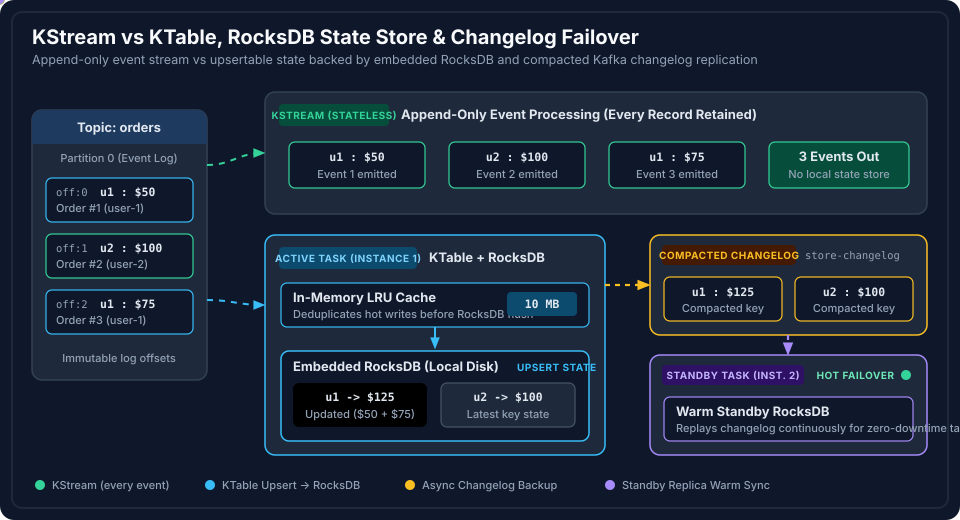

### Write Path & Standby Failover Sequence

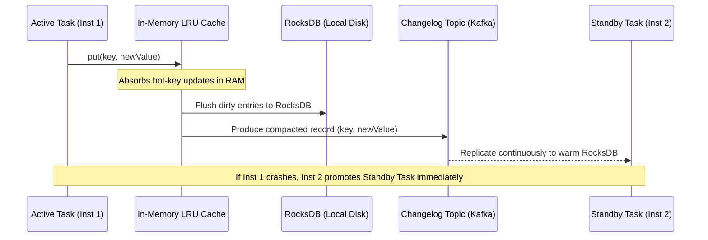

### RocksDB State Store Advantages

- **Embedded**: Zero external database network hops; co-located with compute.
- **Persistent**: Survives clean restarts without replaying the entire changelog from offset 0.
- **Fast**: LSM-tree architecture optimized for high-throughput sequential writes and prefix/range scans.
- **Changelog backed**: Automatic durability and cluster-wide recovery via compacted Kafka topics (`<app-id>-<store-name>-changelog`).

### Custom State Stores

```java
// Custom supplier for an in-memory store (faster, non-persistent)
class CustomStoreSupplier implements StoreSupplier<KeyValueStore<String, OrderStats>> {
    @Override
    public KeyValueStore<String, OrderStats> get() {
        return Stores.inMemoryKeyValueStore("custom-store").get();
    }
    @Override public String name() { return "custom-store"; }
    @Override public KeyValueBytesStoreSupplier metricsScope() { return null; }
}

// Use custom store via Materialized
KTable<String, OrderStats> stats = orders
    .groupByKey()
    .aggregate(
        OrderStats::new,
        (key, order, agg) -> { /* ... */ return agg; },
        Materialized.as(Stores.inMemoryKeyValueStore("custom-store"))
    );
```

> [!TIP]
> Set `num.standby.replicas = 1` in production for stateful topologies. Without standby replicas, a pod restart or node failure forces the new owner to rebuild multi-gigabyte RocksDB state from the beginning of the changelog topic, causing minutes of rebalancing lag.

---

## Exactly-Once Processing

Kafka Streams provides **end-to-end Exactly-Once Semantics (`EXACTLY_ONCE_V2`)** across Kafka topics and state stores.

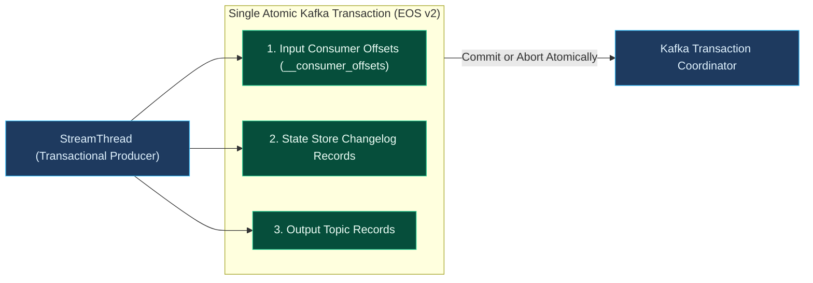

### Configuration

```java
Properties props = new Properties();
props.put(StreamsConfig.APPLICATION_ID_CONFIG, "orders-processor");
props.put(StreamsConfig.BOOTSTRAP_SERVERS_CONFIG, "localhost:9092");

// EOS v2 (Kafka 2.5+): Uses a single transactional producer per StreamThread
props.put(StreamsConfig.PROCESSING_GUARANTEE_CONFIG,
          StreamsConfig.EXACTLY_ONCE_V2);

props.put(StreamsConfig.STATESTORE_CACHE_MAX_BYTES_CONFIG,
          10 * 1024 * 1024L); // 10MB cache

StreamsConfig config = new StreamsConfig(props);
```

### Delivery Semantics Comparison

| Guarantee | Commit Timing | Crash Behavior | Downstream Visibility |
|---|---|---|---|
| **At-most-once** | Commit offset **before** processing | Message lost on crash | Never duplicated, may drop |
| **At-least-once** | Process, **then** commit offset | Reprocessed on crash | Duplicates possible |
| **Exactly-once (`EOS v2`)** | Atomic commit of offset + changelog + output | Atomic rollback; RocksDB checkpointed | Committed records visible **once** (`read_committed`) |

> [!IMPORTANT]
> Downstream consumers reading from an EOS-enabled Kafka Streams output topic **must** set `isolation.level=read_committed` so they ignore aborted transactional messages.

---

## Interactive Queries

Interactive Queries allow external services (REST/gRPC APIs) to read Kafka Streams' embedded state stores directly, turning your stream processor into a distributed key-value serving layer.

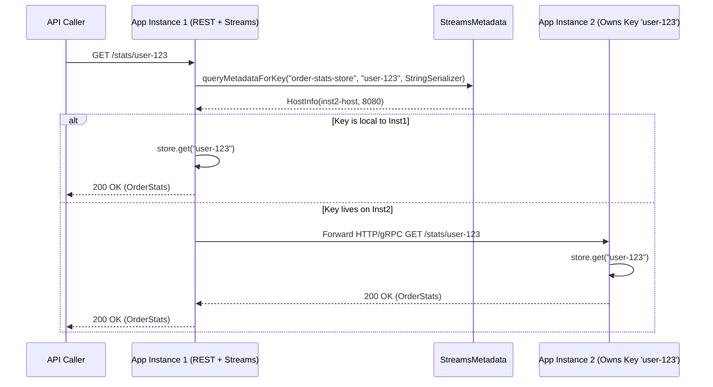

### Querying Local & Remote State Stores

```java
// 1. Materialize a named queryable store
KTable<String, OrderStats> stats = orders
    .groupByKey()
    .aggregate(
        OrderStats::new,
        (key, order, agg) -> {
            agg.count++;
            agg.total += order.getAmount();
            return agg;
        },
        Materialized.as("order-stats-store")
    );

// 2. Start KafkaStreams with application.server configured for RPC discovery
// props.put(StreamsConfig.APPLICATION_SERVER_CONFIG, "host1:8080");
KafkaStreams streams = new KafkaStreams(topology, props);
streams.start();

// 3. Locate which instance owns the key
KeyQueryMetadata metadata = streams.queryMetadataForKey(
    "order-stats-store",
    "user-123",
    Serdes.String().serializer()
);

// 4. Query local store (when metadata.activeHost() == localHost)
ReadOnlyKeyValueStore<String, OrderStats> store = streams.store(
    StoreQueryParameters.fromNameAndType(
        "order-stats-store",
        QueryableStoreTypes.keyValueStore()
    )
);

// Point lookup
OrderStats userStats = store.get("user-123");

// Range query
try (KeyValueIterator<String, OrderStats> range = store.range("user-100", "user-200")) {
    range.forEachRemaining(kv -> System.out.println(kv.key + ": " + kv.value));
}

// All entries
try (KeyValueIterator<String, OrderStats> all = store.all()) {
    all.forEachRemaining(kv -> System.out.println(kv.key + ": " + kv.value));
}
```

> [!TIP]
> Always set `application.server` (`host:port`) in `StreamsConfig` so every instance advertises its RPC endpoint via Kafka group metadata, enabling seamless cross-instance request routing.

---

## Kafka Connect

Kafka Connect is a scalable, fault-tolerant framework for streaming data **into** Kafka (Source Connectors) and **out of** Kafka (Sink Connectors) using configuration rather than custom code.

### Distributed Connect Cluster Architecture

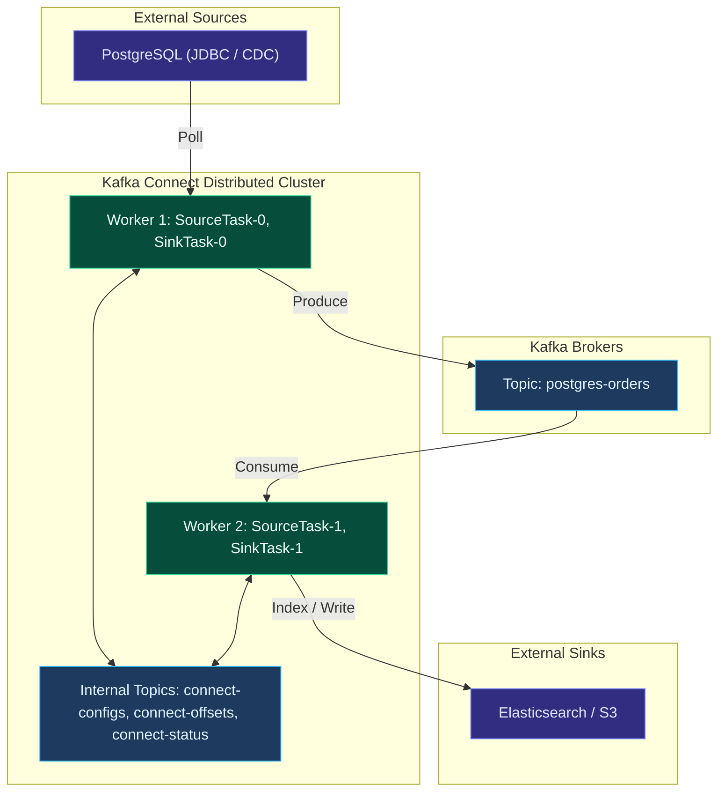

### Single Message Transform (SMT) Pipeline

SMTs apply lightweight, stateless, per-record transformations inside Connect Workers before serialization (Source) or after deserialization (Sink).

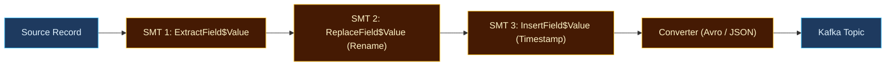

### Source Connector Example (JDBC)

```json
{
  "name": "postgres-source",
  "config": {
    "connector.class": "io.confluent.connect.jdbc.source.JdbcSourceConnector",
    "connection.url": "jdbc:postgresql://localhost:5432/orders",
    "connection.user": "admin",
    "connection.password": "secret",
    "table.whitelist": "orders",
    "mode": "incrementing",
    "incrementing.column.name": "id",
    "topic.prefix": "postgres-"
  }
}
```
Result: Table `orders` streams into Kafka topic `postgres-orders`.

### Sink Connector Example (Elasticsearch)

```json
{
  "name": "es-sink",
  "config": {
    "connector.class": "io.confluent.connect.elasticsearch.ElasticsearchSinkConnector",
    "topics": "orders",
    "connection.url": "http://localhost:9200",
    "type.name": "_doc",
    "key.ignore": true,
    "schema.ignore": false
  }
}
```
Result: Topic `orders` indexes into Elasticsearch index `orders`.

### Single Message Transform (SMT) Configuration

```json
{
  "transforms": "AddTimestamp,RenameFields,Extract",
  "transforms.AddTimestamp.type": "org.apache.kafka.connect.transforms.InsertField$Value",
  "transforms.AddTimestamp.static.field": "timestamp",
  "transforms.AddTimestamp.static.value": "1970-01-01T00:00:00Z",

  "transforms.RenameFields.type": "org.apache.kafka.connect.transforms.ReplaceField$Value",
  "transforms.RenameFields.renames": "source_id:id,source_name:name",

  "transforms.Extract.type": "org.apache.kafka.connect.transforms.ExtractField$Value",
  "transforms.Extract.field": "payload"
}
```

> [!WARNING]
> **SMTs vs Kafka Streams**: Use SMTs only for simple, stateless single-record mutations (renaming, masking, routing). Never use SMTs for joins, aggregations, or external lookups—use Kafka Streams for those.

---

## Schema Registry

Schema Registry provides a centralized repository for managing and validating schemas (Avro, Protobuf, JSON Schema) so producers and consumers evolve independently without breaking deserialization.

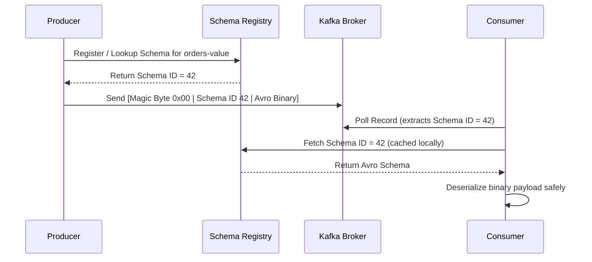

### Supported Formats

- **Avro**: Compact binary format, rich schema evolution rules, language-agnostic, best for high throughput.
- **Protobuf**: Google's compact binary format (gRPC ecosystem), fast serialization, tag-based evolution.
- **JSON Schema**: Human-readable, familiar to web services, larger payload size.

### Schema Evolution Compatibility Modes

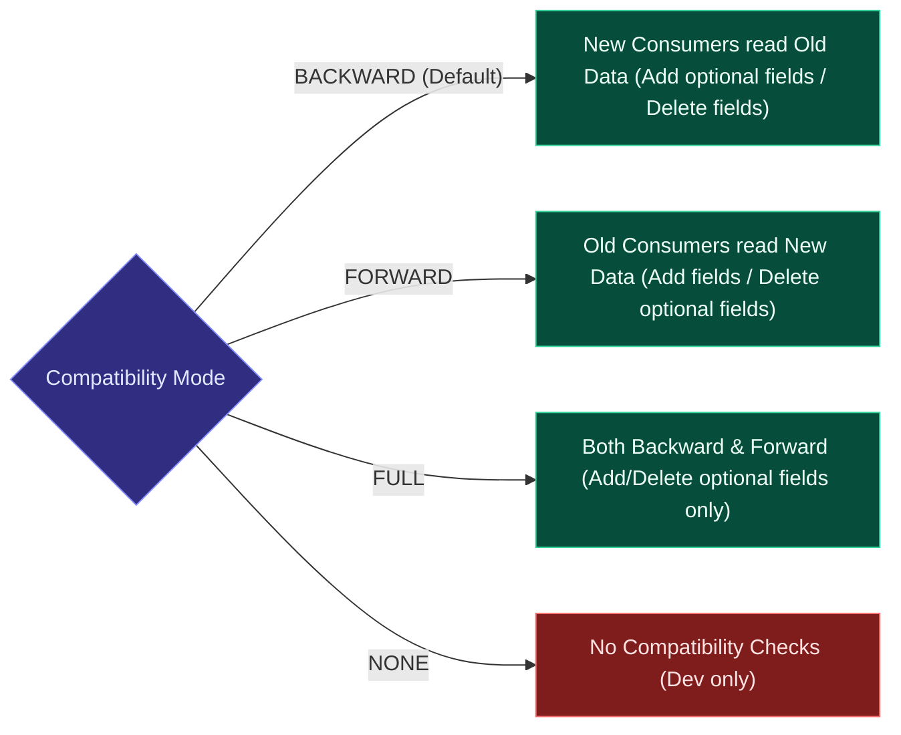

- **Backward Compatibility**: New consumers can read data produced with old schemas (e.g., adding a new field with a default value). **Upgrade consumers first.**
- **Forward Compatibility**: Old consumers can read data produced with new schemas (e.g., removing an optional field). **Upgrade producers first.**
- **Full Compatibility**: Both backward and forward compatible; safest for rolling deployments where producers and consumers upgrade in any order.

### Example: Avro with Confluent Schema Registry

```xml
<!-- Dependency -->
<dependency>
    <groupId>io.confluent</groupId>
    <artifactId>kafka-avro-serializer</artifactId>
    <version>7.0.0</version>
</dependency>
```

```json
// Schema (Order.avsc)
{
  "type": "record",
  "name": "Order",
  "fields": [
    {"name": "id", "type": "string"},
    {"name": "amount", "type": "double"},
    {"name": "timestamp", "type": "long"}
  ]
}
```

```java
// Producer Configuration
Properties props = new Properties();
props.put("bootstrap.servers", "localhost:9092");
props.put("schema.registry.url", "http://localhost:8081");
props.put("key.serializer", StringSerializer.class);
props.put("value.serializer", KafkaAvroSerializer.class);

KafkaProducer<String, Order> producer = new KafkaProducer<>(props);
Order order = new Order("order-123", 500.0, System.currentTimeMillis());
producer.send(new ProducerRecord<>("orders", "key", order));

// Consumer Configuration
Properties consumerProps = new Properties();
consumerProps.put("bootstrap.servers", "localhost:9092");
consumerProps.put("schema.registry.url", "http://localhost:8081");
consumerProps.put("group.id", "order-group");
consumerProps.put("key.deserializer", StringDeserializer.class);
consumerProps.put("value.deserializer", KafkaAvroDeserializer.class);

KafkaConsumer<String, Order> consumer = new KafkaConsumer<>(consumerProps);
```

---

## Stream Processing Comparisons

| Feature | Kafka Streams | Apache Flink | Spark Structured Streaming |
|---|---|---|---|
| **Processing Model** | True event-by-event stream | True event-by-event stream | Micro-batch (or continuous mode) |
| **Typical Latency** | 10–100 ms | 10–100 ms | 500 ms–2 s |
| **Deployment** | Embedded JVM library | Dedicated distributed cluster | Dedicated distributed cluster |
| **Exactly-Once** | Yes (`EOS v2`) | Yes (Chandy-Lamport checkpoints) | Yes (Write-ahead logs) |
| **State Management** | Embedded RocksDB + Changelog | Embedded RocksDB + Checkpoints | HDFS/S3 state store |
| **Operational Setup** | Simple (no cluster ops) | Complex | Medium |
| **Scalability** | High (bound by Kafka partitions) | Very High (independent of Kafka) | High |
| **Learning Curve** | Low | High | Medium |

### Decision Guide: When to Choose Each

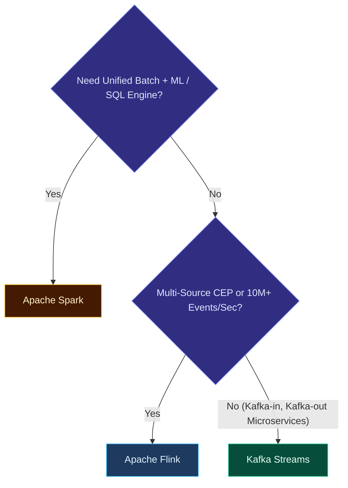

- **Kafka Streams**: Best for real-time microservices, event filtering/routing, windowed aggregations, interactive state queries, and teams wanting zero separate cluster ops.
- **Apache Flink**: Best for complex event processing (CEP), massive scale (10M+ events/sec), non-Kafka sources/sinks, and advanced savepoint/rescaling workflows.
- **Apache Spark**: Best for hybrid batch + streaming pipelines, SparkSQL analytics, and organizations with existing Spark/Databricks infrastructure.

---

## Interview Questions

### Question 1: KStream vs KTable

**Answer**:
- **`KStream`**: Append-only event log. Each record is independent; a new value with the same key does not replace the old one ("all orders ever placed").
- **`KTable`**: Materialized changelog table. A new value replaces the previous value for the same key, and `null` deletes it ("latest balance per account").

```text
Same source topic:
Offset 0: Key=A, Value=100
Offset 1: Key=B, Value=200
Offset 2: Key=A, Value=150

KStream reads 3 events:  A=100, B=200, A=150
KTable holds 2 states:   A=150 (latest), B=200
```

```java
KStream<String, Order> orders = builder.stream("orders");
KTable<String, Balance> balances = builder.table("account-balances");
```

### Question 2: Windowing Types

**Answer**:
1. **Tumbling**: Fixed-size, non-overlapping (`[0-5m]`, `[5-10m]`). Use for periodic reports.
2. **Hopping**: Fixed-size, overlapping (`size=5m, advance=2m`). Use for moving averages/trending.
3. **Sliding**: Event-time delta (`[t-5m, t]`). Use for real-time alerting where exact inter-event distance matters.
4. **Session**: Dynamic, gap-based (`inactivityGap=5m`). Use for user activity bursts.

### Question 3: State Store Recovery & Join Grace Period

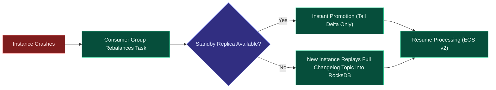

**Answer (State Store Recovery)**:
- Local **RocksDB** state is backed by a compacted Kafka **changelog topic**.
- On crash, a new instance (same `application.id`) takes over the partition, consumes the changelog topic from the beginning (or delta if a `StandbyTask` exists), rebuilds RocksDB, and resumes with zero data loss.

### Question 4: Join Window Semantics

**Answer**:
- **Stream-Stream joins** require a `JoinWindows` duration plus an optional `grace` period because events from two streams rarely arrive at the exact same millisecond.
- Events arriving within `[t - before, t + after]` are joined; events arriving after `windowEnd + grace` are dropped.

```java
JoinWindows.ofTimeDifferenceAndGrace(
    Duration.ofSeconds(5),
    Duration.ofSeconds(2)
);
```

---

## Summary

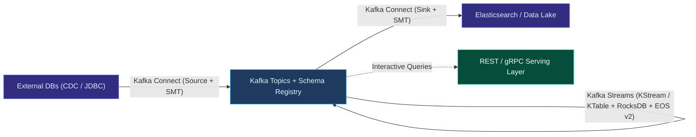

- **Kafka Streams**: Embedded DSL/Processor API for stateless and stateful stream processing, backed by RocksDB, compacted changelogs, and `EXACTLY_ONCE_V2`.
- **Kafka Connect**: Configuration-driven, fault-tolerant ingestion and egress with Source/Sink connectors and Single Message Transforms (SMTs).
- **Schema Registry**: Centralized schema validation and evolution (`BACKWARD`, `FORWARD`, `FULL`) for Avro, Protobuf, and JSON Schema.
- **Key Takeaways**: Choose `KStream` for immutable events and `KTable`/`GlobalKTable` for state; match window type to time semantics; enable `num.standby.replicas >= 1` for fast failover.
