# Kafka in Microservices - Deep Dive

## Table of Contents
1. [Event-Driven Microservices](#event-driven-microservices)
2. [Event Sourcing](#event-sourcing)
3. [CQRS (Command Query Responsibility Segregation)](#cqrs-command-query-responsibility-segregation)
4. [Saga Pattern](#saga-pattern)
5. [Outbox Pattern](#outbox-pattern)
6. [Dead Letter Queue Pattern](#dead-letter-queue-pattern)
7. [Retry and Error Handling](#retry-and-error-handling)
8. [Schema Evolution in Microservices](#schema-evolution-in-microservices)
9. [Ordering Guarantees](#ordering-guarantees)
10. [Handling Duplicates](#handling-duplicates)
11. [Monitoring and Operations](#monitoring-and-operations)
12. [Security](#security)
13. [Interview Questions](#interview-questions)
14. [Summary](#summary)

---

## Event-Driven Microservices

### Traditional vs Event-Driven Architecture

In synchronous microservice architectures, services call one another directly over REST or gRPC, creating tight temporal and runtime coupling. In an event-driven architecture powered by Kafka, producers emit immutable domain facts to topics and downstream consumers react asynchronously at their own pace.

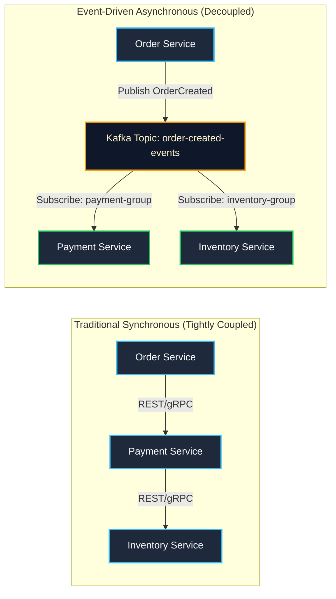

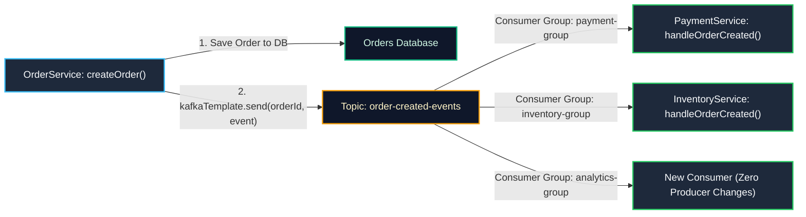

| Dimension | Traditional Synchronous (REST/gRPC) | Event-Driven Asynchronous (Kafka) |
| :--- | :--- | :--- |
| **Coupling** | Tight runtime & schema coupling; circular dependencies | Loose coupling; services only know the event contract |
| **Temporal Dependency** | All downstream services must be up simultaneously | Producers and consumers operate independently |
| **Failure Blast Radius** | Cascading failures across call chains | Faults isolated to the failing consumer group |
| **Scalability** | Scaled by upstream request spikes | Independent scaling via consumer group partitions |
| **Extensibility** | Producer must be modified to call new services | New consumers subscribe to existing topics with zero producer changes |
| **Auditability** | Ephemeral request/response logs | Durable, replayable event log |

> [!TIP]
> Use synchronous REST/gRPC when the caller needs an **immediate, strongly consistent response** (e.g., login or balance check). Use Kafka event-driven communication when you need **high throughput, failure isolation, and fan-out** to multiple independent services.

### Event-Driven Flow

```java
// Order Service: Publishes OrderCreated event
@Service
public class OrderService {
    @Autowired
    private KafkaTemplate<String, OrderCreatedEvent> kafkaTemplate;

    public void createOrder(Order order) {
        // Save order to database
        Order savedOrder = orderRepository.save(order);

        // Publish event
        OrderCreatedEvent event = new OrderCreatedEvent(
            savedOrder.getId(),
            savedOrder.getCustomerId(),
            savedOrder.getAmount(),
            System.currentTimeMillis()
        );

        kafkaTemplate.send("order-created-events", savedOrder.getId(), event);
    }
}

// Payment Service: Consumes OrderCreated event
@Service
public class PaymentService {
    @KafkaListener(topics = "order-created-events", groupId = "payment-group")
    public void handleOrderCreated(OrderCreatedEvent event) {
        // Process payment
        Payment payment = new Payment(
            event.getOrderId(),
            event.getAmount(),
            PaymentStatus.PENDING
        );

        paymentRepository.save(payment);
        processPayment(event.getOrderId(), event.getAmount());
    }
}

// Inventory Service: Consumes OrderCreated event (independently)
@Service
public class InventoryService {
    @KafkaListener(topics = "order-created-events", groupId = "inventory-group")
    public void handleOrderCreated(OrderCreatedEvent event) {
        // Update inventory
        inventoryRepository.decrementStock(event.getOrderId());
    }
}
```

---

## Event Sourcing

### Concept

Event Sourcing persists every state transition as an immutable sequence of domain events rather than overwriting a single mutable row in a database. Current state is derived by replaying events from offset `0` (or from a periodic snapshot).

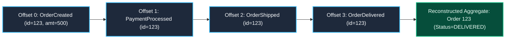

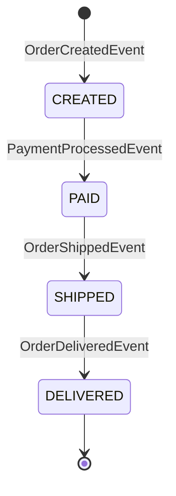

| Feature | Traditional State-Based Storage | Event Sourcing (Kafka Event Store) |
| :--- | :--- | :--- |
| **Persistence Model** | `UPDATE orders SET status = 'SHIPPED'` (overwrites history) | Append-only immutable event log (`order-events`) |
| **Audit Trail** | Requires separate audit tables or triggers | Built-in, tamper-evident history of every change |
| **Temporal Queries** | Difficult; only latest state is stored | Replay events up to any timestamp `T` |
| **Debugging & Replay** | Hard to reproduce past bugs | Replay production events into a test environment |
| **Read Performance** | Fast direct row lookup | Requires replay or CQRS materialized read views |

- **Complete audit trail:** Every mutation is recorded with timestamp and aggregate ID.
- **Replay history anytime:** Rebuild projections, fix bugs in derived views, or seed new services.
- **Temporal queries:** Reconstruct the exact state of an aggregate at any historical point in time.

> [!IMPORTANT]
> When using Kafka as an Event Store for long-lived aggregates, configure **log compaction** (`cleanup.policy=compact`) or **periodic snapshots** so `Order.fromEvents()` does not have to replay millions of historical events on every read.

### Implementation with Kafka

```java
// Event base classes
public abstract class Event {
    public final String aggregateId;
    public final long timestamp;
    public final String eventType;

    public Event(String aggregateId, String eventType) {
        this.aggregateId = aggregateId;
        this.timestamp = System.currentTimeMillis();
        this.eventType = eventType;
    }
}

public class OrderCreatedEvent extends Event {
    public final String customerId;
    public final double amount;
    public final String address;

    public OrderCreatedEvent(String orderId, String customerId, double amount, String address) {
        super(orderId, "OrderCreated");
        this.customerId = customerId;
        this.amount = amount;
        this.address = address;
    }
}

public class PaymentProcessedEvent extends Event {
    public final String transactionId;

    public PaymentProcessedEvent(String orderId, String transactionId) {
        super(orderId, "PaymentProcessed");
        this.transactionId = transactionId;
    }
}

// Aggregate (Order) reconstructed from events
public class Order {
    private String id;
    private String customerId;
    private double amount;
    private OrderStatus status;

    public static Order fromEvents(String orderId, List<Event> events) {
        Order order = new Order();
        order.id = orderId;

        for (Event event : events) {
            if (event instanceof OrderCreatedEvent) {
                OrderCreatedEvent e = (OrderCreatedEvent) event;
                order.customerId = e.customerId;
                order.amount = e.amount;
                order.status = OrderStatus.CREATED;
            } else if (event instanceof PaymentProcessedEvent) {
                order.status = OrderStatus.PAID;
            } else if (event instanceof OrderShippedEvent) {
                order.status = OrderStatus.SHIPPED;
            }
        }

        return order;
    }
}

// Event store (Kafka topic)
@Service
public class OrderEventStore {
    @Autowired
    private KafkaTemplate<String, Event> kafkaTemplate;

    public void appendEvent(Event event) {
        kafkaTemplate.send("order-events", event.aggregateId, event);
    }

    public Order getOrder(String orderId) {
        // Consume all events for this order
        List<Event> events = consumeEvents(orderId);
        return Order.fromEvents(orderId, events);
    }

    public List<Order> getAllOrders() {
        // Replay all events from beginning
        List<Event> allEvents = consumeAllEvents();
        Map<String, List<Event>> eventsByOrder = allEvents.stream()
            .collect(Collectors.groupingBy(e -> e.aggregateId));

        return eventsByOrder.entrySet().stream()
            .map(entry -> Order.fromEvents(entry.getKey(), entry.getValue()))
            .collect(Collectors.toList());
    }
}
```

---

## CQRS (Command Query Responsibility Segregation)

### Concept

CQRS separates the **Write Model (Commands)** from the **Read Model (Queries)**. Commands validate domain invariants and append events to Kafka, while asynchronous **Projectors** consume those events to update denormalized read databases (MySQL, Elasticsearch, Redis).

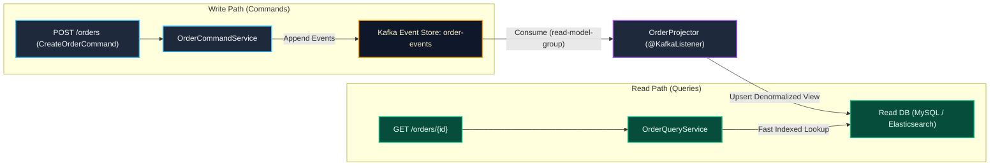

| Aspect | Write Model (Command Side) | Read Model (Query Side) |
| :--- | :--- | :--- |
| **Responsibility** | Enforce business rules, state transitions, invariants | Serve fast, tailored queries and search |
| **Data Store** | Normalized transactional DB or Kafka Event Store | Denormalized views (SQL, Elasticsearch, Redis) |
| **Scaling** | Scaled for write concurrency & validation | Scaled independently for high read QPS |
| **Consistency** | Strongly consistent within aggregate | Eventually consistent (projection lag) |

- **Independent scaling:** Scale read replicas or Elasticsearch clusters without impacting command throughput.
- **Polyglot persistence:** Use the best engine per workload (e.g., Kafka + Postgres for writes, Elasticsearch for full-text search).
- **Clean separation:** Domain logic stays isolated from complex reporting joins.

> [!WARNING]
> Because `OrderProjector` updates the read database asynchronously from Kafka, CQRS introduces **eventual consistency**. A client issuing `POST /orders` followed immediately by `GET /orders/{id}` may briefly observe a `404` or stale status until the projector catches up.

### Implementation

```java
// Write Model (Order Service)
@Service
public class OrderCommandService {
    @Autowired
    private KafkaTemplate<String, Event> eventStore;

    // Commands (write operations)
    public void createOrder(CreateOrderCommand command) {
        Order order = new Order(command);
        List<Event> events = order.getUncommittedEvents();

        // Store events
        for (Event event : events) {
            eventStore.send("order-events", order.getId(), event);
        }
    }

    public void shipOrder(ShipOrderCommand command) {
        Order order = loadOrder(command.getOrderId());
        order.ship();

        List<Event> events = order.getUncommittedEvents();
        for (Event event : events) {
            eventStore.send("order-events", order.getId(), event);
        }
    }
}

// Read Model (Materialized Views)
@Service
public class OrderQueryService {
    @Autowired
    private OrderReadRepository readRepository;  // MySQL, Elasticsearch, etc.

    // Queries (read operations)
    public Order getOrder(String orderId) {
        return readRepository.findById(orderId);
    }

    public List<Order> getOrdersByCustomer(String customerId) {
        return readRepository.findByCustomerId(customerId);
    }

    public List<Order> searchOrders(String query) {
        // Elasticsearch query
        return elasticsearchRepository.search(query);
    }
}

// Projector (Updates read model)
@Service
public class OrderProjector {
    @Autowired
    private OrderReadRepository readRepository;

    @KafkaListener(topics = "order-events", groupId = "read-model-group")
    public void project(Event event) {
        if (event instanceof OrderCreatedEvent) {
            OrderCreatedEvent e = (OrderCreatedEvent) event;
            Order readModel = new Order();
            readModel.setId(e.aggregateId);
            readModel.setCustomerId(e.customerId);
            readModel.setAmount(e.amount);
            readRepository.save(readModel);

        } else if (event instanceof OrderShippedEvent) {
            Order order = readRepository.findById(event.aggregateId);
            order.setStatus(OrderStatus.SHIPPED);
            readRepository.save(order);
        }
    }
}

// Controller
@RestController
@RequestMapping("/orders")
public class OrderController {
    @Autowired
    private OrderCommandService commandService;

    @Autowired
    private OrderQueryService queryService;

    @PostMapping
    public ResponseEntity<Void> createOrder(@RequestBody CreateOrderCommand command) {
        commandService.createOrder(command);
        return ResponseEntity.status(HttpStatus.CREATED).build();
    }

    @GetMapping("/{id}")
    public ResponseEntity<Order> getOrder(@PathVariable String id) {
        return ResponseEntity.ok(queryService.getOrder(id));
    }

    @GetMapping("/customer/{customerId}")
    public ResponseEntity<List<Order>> getOrdersByCustomer(@PathVariable String customerId) {
        return ResponseEntity.ok(queryService.getOrdersByCustomer(customerId));
    }
}
```

---

## Saga Pattern

### Distributed Transactions

In microservices, a single ACID database transaction or blocking Two-Phase Commit (2PC) across services does not scale. The **Saga Pattern** breaks a distributed transaction into a sequence of local transactions, each publishing an event or command. If any step fails, **compensating transactions** undo the preceding steps.

### Choreography-Based Saga

Services react autonomously to Kafka events without a central coordinator:

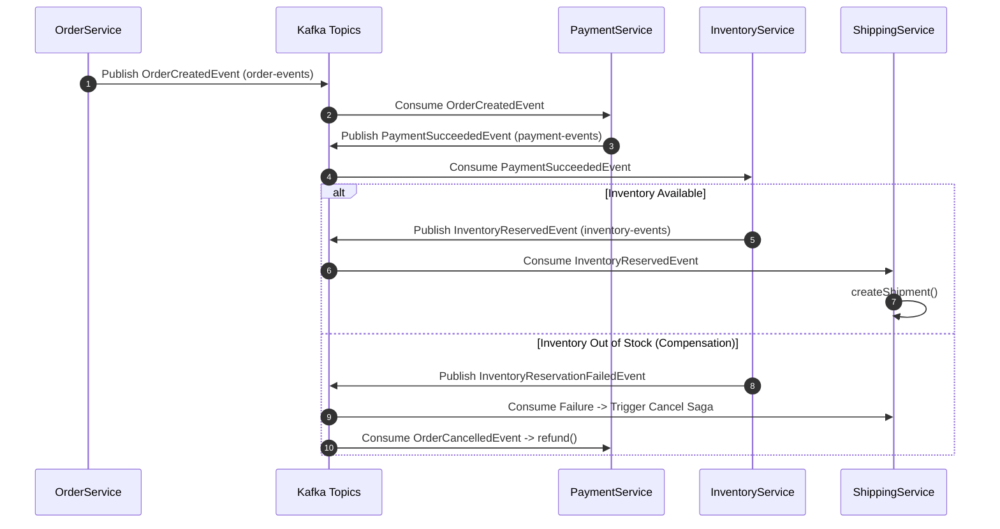

```java
// Order Service (initiator)
@Service
public class OrderService {
    @Autowired
    private KafkaTemplate<String, Event> kafka;

    public void createOrder(Order order) {
        orderRepository.save(order);

        // Trigger saga: publish OrderCreatedEvent
        kafka.send("order-events", order.getId(),
            new OrderCreatedEvent(order.getId(), order.getTotal()));
    }
}

// Payment Service (participant)
@Service
public class PaymentService {
    @Autowired
    private KafkaTemplate<String, Event> kafka;

    @KafkaListener(topics = "order-events")
    public void handleOrderCreated(OrderCreatedEvent event) {
        try {
            // Attempt payment
            processPayment(event.getOrderId(), event.getTotal());

            // Publish success
            kafka.send("payment-events",
                new PaymentSucceededEvent(event.getOrderId()));

        } catch (PaymentException e) {
            // Publish failure
            kafka.send("payment-events",
                new PaymentFailedEvent(event.getOrderId(), e.getMessage()));
        }
    }

    // Compensation: Handle order cancellation
    @KafkaListener(topics = "order-events")
    public void handleOrderCancelled(OrderCancelledEvent event) {
        // Refund payment
        refund(event.getOrderId());
    }
}

// Inventory Service (participant)
@Service
public class InventoryService {
    @Autowired
    private KafkaTemplate<String, Event> kafka;

    @KafkaListener(topics = "payment-events")
    public void handlePaymentSucceeded(PaymentSucceededEvent event) {
        try {
            // Reserve inventory
            reserveInventory(event.getOrderId());

            // Publish success
            kafka.send("inventory-events",
                new InventoryReservedEvent(event.getOrderId()));

        } catch (InventoryException e) {
            // Publish failure: this triggers compensation
            kafka.send("inventory-events",
                new InventoryReservationFailedEvent(event.getOrderId()));
        }
    }

    // Compensation: Handle payment failure
    @KafkaListener(topics = "payment-events")
    public void handlePaymentFailed(PaymentFailedEvent event) {
        // No action needed (inventory not reserved yet)
    }
}

// Shipping Service (participant)
@Service
public class ShippingService {
    @KafkaListener(topics = "inventory-events")
    public void handleInventoryReserved(InventoryReservedEvent event) {
        // Create shipment
        createShipment(event.getOrderId());
    }

    // Compensation: Handle inventory failure
    @KafkaListener(topics = "inventory-events")
    public void handleInventoryReservationFailed(InventoryReservationFailedEvent event) {
        // Trigger order cancellation saga
        // Refund payment, reverse inventory
    }
}
```

### Orchestration-Based Saga

A central `OrderSagaOrchestrator` persists saga state and explicitly dispatches commands and compensations:

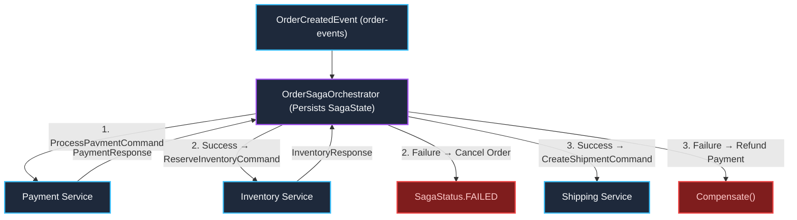

```java
// Saga Orchestrator
@Service
public class OrderSagaOrchestrator {
    @Autowired
    private KafkaTemplate<String, SagaCommand> kafka;

    @KafkaListener(topics = "order-events")
    public void handleOrderCreated(OrderCreatedEvent event) {
        // Start saga
        SagaState state = new SagaState(event.getOrderId());

        // Step 1: Process payment
        kafka.send("payment-commands",
            new ProcessPaymentCommand(event.getOrderId(), event.getTotal()));

        // Listen for response
        listenForPaymentResponse(event.getOrderId(), state);
    }

    @KafkaListener(topics = "payment-responses")
    public void handlePaymentResponse(PaymentResponse response) {
        SagaState state = loadState(response.getOrderId());

        if (response.isSuccess()) {
            // Step 2: Reserve inventory
            kafka.send("inventory-commands",
                new ReserveInventoryCommand(response.getOrderId()));

        } else {
            // Compensation: Cancel order
            state.setStatus(SagaStatus.FAILED);
            saveState(state);
        }
    }

    @KafkaListener(topics = "inventory-responses")
    public void handleInventoryResponse(InventoryResponse response) {
        SagaState state = loadState(response.getOrderId());

        if (response.isSuccess()) {
            // Step 3: Create shipment
            kafka.send("shipping-commands",
                new CreateShipmentCommand(response.getOrderId()));

        } else {
            // Compensation: Refund payment
            compensate(state);
        }
    }
}
```

| Dimension | Choreography-Based Saga | Orchestration-Based Saga |
| :--- | :--- | :--- |
| **Coordination** | Decentralized; services react to events | Centralized in a dedicated Saga Orchestrator |
| **Coupling** | Very loose; services only know event schemas | Tighter coupling to the orchestrator's commands |
| **Visibility & Debugging** | Flow is scattered across multiple services | Single place to inspect and trace saga state |
| **Single Point of Failure** | None | Orchestrator must be HA / clustered |
| **Best Fit** | Simple workflows (2–4 steps) | Complex workflows with branching and retries |

> [!IMPORTANT]
> Compensating actions in a Saga (such as `refund()` or `releaseInventory()`) **must be idempotent** and **commutatively safe**, because Kafka's at-least-once delivery may deliver a failure event more than once.

---

## Outbox Pattern

### Problem & Solution

Updating a local database and publishing a Kafka message are two separate network operations—not an atomic transaction. If a service crashes after `INSERT INTO orders` but before `kafkaTemplate.send()`, the event is permanently lost and downstream services never react.

The **Transactional Outbox Pattern** solves this by writing both the business entity (`orders`) and the domain event (`outbox`) inside the **same local ACID database transaction**. A separate relay (either an `OutboxPoller` or **Debezium CDC**) then publishes the outbox rows to Kafka.

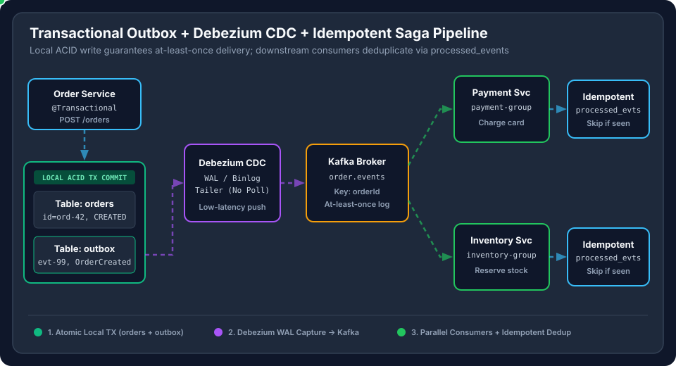

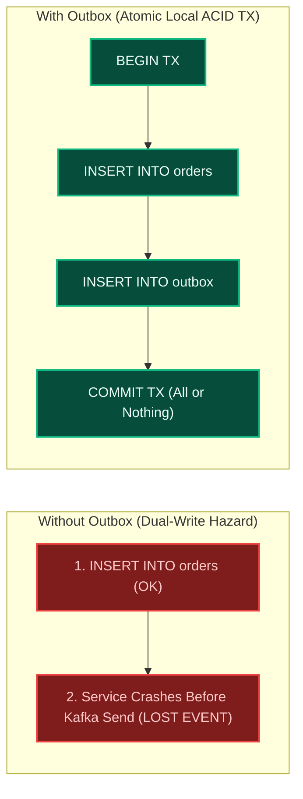

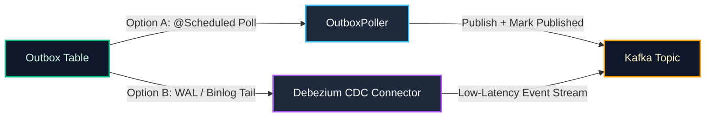

| Criteria | Outbox Poller (`@Scheduled`) | Debezium CDC (Log-Based) |
| :--- | :--- | :--- |
| **Mechanism** | Periodically queries `WHERE published = false` | Tails database WAL / binlog directly |
| **Latency** | Bounded by polling interval (e.g., 100ms–1s) | Near real-time (milliseconds) |
| **Database Load** | Extra `SELECT` + `UPDATE` queries on hot table | Zero polling queries on application tables |
| **Duplicate Risk** | Can publish twice if crash occurs before `published = true` | At-least-once from WAL offset; cleaner handoff |
| **Operational Complexity** | Simple Spring Boot code, no extra infra | Requires Kafka Connect + Debezium cluster |

### Implementation with Spring Data JPA

```java
// Order entity
@Entity
@Table(name = "orders")
public class Order {
    @Id
    private String id;
    private String customerId;
    private double amount;
    private OrderStatus status;
}

// Outbox entity
@Entity
@Table(name = "outbox")
public class OutboxEvent {
    @Id
    @GeneratedValue(strategy = GenerationType.UUID)
    private String id;

    @Column(nullable = false)
    private String aggregateId;  // Order ID

    @Column(nullable = false)
    private String eventType;    // OrderCreated, etc.

    @Column(columnDefinition = "TEXT")
    private String payload;      // JSON

    @Column(nullable = false)
    private LocalDateTime createdAt;

    @Column(nullable = false)
    private boolean published = false;

    @Column(nullable = false)
    private LocalDateTime publishedAt;
}

// Repository
@Repository
public interface OutboxRepository extends JpaRepository<OutboxEvent, String> {
    List<OutboxEvent> findByPublishedFalseOrderByCreatedAtAsc(Pageable pageable);
}

// Service: Create order with outbox
@Service
public class OrderService {
    @Autowired
    private OrderRepository orderRepository;

    @Autowired
    private OutboxRepository outboxRepository;

    @Autowired
    private ObjectMapper objectMapper;

    @Transactional
    public void createOrder(CreateOrderRequest request) {
        // Create order
        Order order = new Order(request);
        orderRepository.save(order);

        // Create outbox event in same transaction
        OrderCreatedEvent event = new OrderCreatedEvent(
            order.getId(), order.getCustomerId(), order.getAmount());

        OutboxEvent outboxEvent = new OutboxEvent();
        outboxEvent.setAggregateId(order.getId());
        outboxEvent.setEventType("OrderCreated");
        outboxEvent.setPayload(objectMapper.writeValueAsString(event));
        outboxEvent.setCreatedAt(LocalDateTime.now());

        outboxRepository.save(outboxEvent);

        // Transaction commits: Both order and outbox record persisted
    }
}

// Outbox Poller (separate service)
@Service
public class OutboxPoller {
    @Autowired
    private OutboxRepository outboxRepository;

    @Autowired
    private KafkaTemplate<String, String> kafkaTemplate;

    @Scheduled(fixedDelay = 1000)  // Poll every 1 second
    public void pollAndPublish() {
        Pageable pageable = PageRequest.of(0, 100);
        List<OutboxEvent> unpublished = outboxRepository
            .findByPublishedFalseOrderByCreatedAtAsc(pageable);

        for (OutboxEvent event : unpublished) {
            try {
                // Publish to Kafka
                kafkaTemplate.send(
                    event.getEventType().toLowerCase() + "-events",
                    event.getAggregateId(),
                    event.getPayload()
                );

                // Mark as published
                event.setPublished(true);
                event.setPublishedAt(LocalDateTime.now());
                outboxRepository.save(event);

            } catch (Exception e) {
                logger.error("Failed to publish event: " + event.getId(), e);
                // Retry on next poll
            }
        }
    }
}
```

With **Debezium CDC**, the `OutboxPoller` is replaced by a Debezium Outbox Event Router SMT that tails the database transaction log:
- **No custom polling needed:** Eliminates polling queries and lock contention.
- **Lower latency:** CDC-driven streaming reacts immediately to committed WAL entries.
- **No duplicate polling publishes & database-agnostic:** Supports PostgreSQL, MySQL, SQL Server, and Oracle via Kafka Connect.

> [!TIP]
> Regardless of whether you use `OutboxPoller` or Debezium CDC, the Outbox Pattern provides **at-least-once** delivery—downstream consumers must still be **idempotent**.

---

## Dead Letter Queue Pattern

### Handling Failed Messages

When a consumer fails to process a record after exhausting retries (e.g., malformed payload or unrecoverable validation error), blocking the partition forever would halt all subsequent messages. Instead, the record is routed to a **Dead Letter Queue (DLQ)** topic (`orders-dlq`) and the main offset is committed.

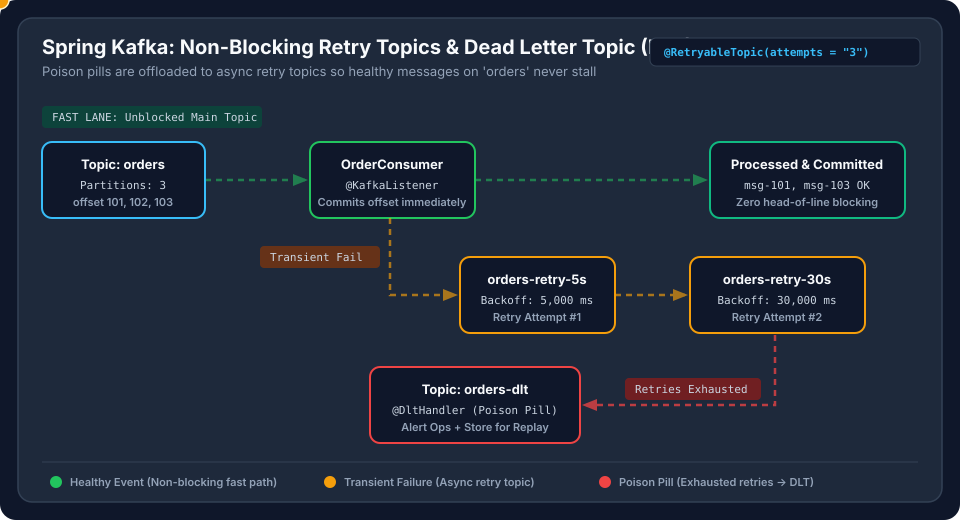

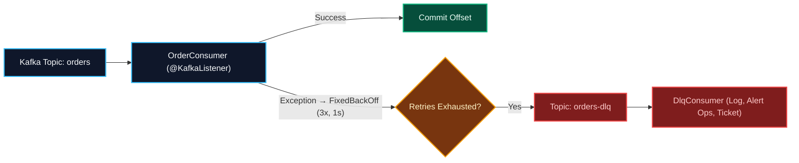

| Strategy | Blocking Behavior | Throughput Impact | Best Use Case |
| :--- | :--- | :--- | :--- |
| **In-Topic Blocking Retry (`DefaultErrorHandler`)** | Blocks current partition during backoff | High impact if backoff is long | Short transient glitches (e.g., 3x 1s) |
| **Non-Blocking Retry Topics (`@RetryableTopic`)** | Zero blocking on main topic | Healthy messages keep flowing | Longer backoffs (5s, 30s, 5m) |
| **Immediate DLQ** | Zero blocking | None | Permanent errors (bad JSON, validation failure) |

> [!WARNING]
> Synchronous `FixedBackOff` retries inside `DefaultErrorHandler` **block the consumer thread** for that partition. If your backoff exceeds `max.poll.interval.ms`, Kafka will assume the consumer is dead and trigger a **consumer group rebalance**.

### DLQ Implementation with Spring Kafka

```java
// Configuration
@Configuration
public class KafkaConfig {
    @Bean
    public NewTopic mainTopic() {
        return TopicBuilder.name("orders").partitions(3).replicas(1).build();
    }

    @Bean
    public NewTopic dlqTopic() {
        return TopicBuilder.name("orders-dlq").partitions(1).replicas(1).build();
    }

    @Bean
    public KafkaListenerContainerFactory<?> kafkaListenerContainerFactory() {
        ConcurrentKafkaListenerContainerFactory<?, ?> factory =
            new ConcurrentKafkaListenerContainerFactory<>();

        factory.setCommonErrorHandler(
            new DefaultErrorHandler(
                (record, exception) -> handleDlq(record, exception),
                new FixedBackOff(1000, 3)  // Retry 3 times, 1s delay
            )
        );

        return factory;
    }
}

// Consumer with DLQ
@Service
public class OrderConsumer {
    @Autowired
    private KafkaTemplate<String, Order> kafkaTemplate;

    @KafkaListener(topics = "orders", groupId = "order-group")
    public void handleOrder(Order order) throws Exception {
        try {
            // Process order
            validateOrder(order);
            saveOrder(order);

        } catch (ValidationException e) {
            logger.error("Validation failed for order: " + order.getId(), e);
            throw e;  // Will trigger retries, then DLQ
        }
    }

    private void handleDlq(ConsumerRecord<?, ?> record, Exception exception) {
        logger.error("Message sent to DLQ: " + record.value(), exception);

        // Send to DLQ topic
        kafkaTemplate.send("orders-dlq",
            record.key().toString(),
            ((Order) record.value()).toString());

        // Alert operations team
        alertOperations("Order DLQ: " + record.value());
    }
}

// DLQ consumer for manual intervention
@Service
public class DlqConsumer {
    @KafkaListener(topics = "orders-dlq", groupId = "dlq-handler")
    public void handleDlq(Order order) {
        logger.warn("DLQ message: " + order.getId());

        // Log to monitoring system
        // Create ticket for operations team
        // Send Slack notification
        // Send email
    }
}
```

---

## Retry and Error Handling

### Error Classification & Non-Blocking Retry Topics

Not all failures deserve a retry. Classifying exceptions into **transient** (retriable) vs **permanent** (non-retriable) prevents wasted compute and ensures poison pills reach the DLQ immediately.

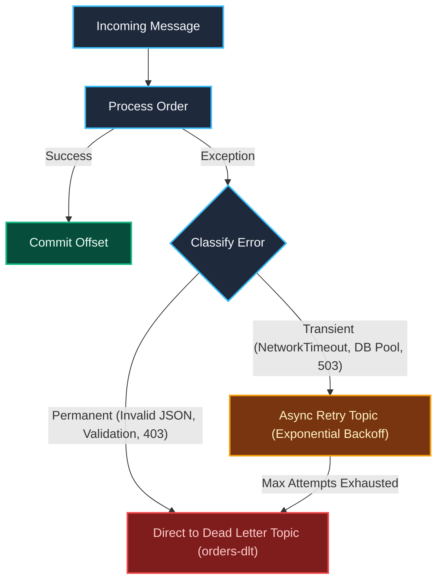


| Error Category | Examples | Action |
| :--- | :--- | :--- |
| **Transient Errors** | Network timeout, temporary 503 unavailable, DB connection pool exhausted, lock timeout | **Retry** with exponential backoff (prefer non-blocking retry topics) |
| **Permanent Errors** | Invalid JSON / deserialization error, missing required fields, validation failure, authorization failure | **Skip retries** and route directly to DLQ (`orders-dlt`) |

> [!TIP]
> Spring Kafka's `@RetryableTopic` annotation automatically provisions `*-retry-*` and `*-dlt` topics and routes failed messages asynchronously so healthy traffic on the main topic is never stalled.

### Retry Strategies (Java / Spring Kafka)

```java
// Non-Blocking Retry Topics (Recommended Spring Kafka pattern)
@Service
public class NonBlockingOrderConsumer {

    @RetryableTopic(
        attempts = "3",
        backoff = @Backoff(delay = 5000, multiplier = 6.0), // 5s -> 30s -> DLT
        exclude = { ValidationException.class }             // Permanent errors skip retries
    )
    @KafkaListener(topics = "orders", groupId = "order-group")
    public void handleOrder(Order order) {
        processOrder(order);
    }

    @DltHandler
    public void handleDlt(Order order, @Header(KafkaHeaders.RECEIVED_TOPIC) String topic) {
        logger.error("Poison pill routed to DLT {}: {}", topic, order.getId());
    }
}
```

```java
// Exponential backoff with Spring Retry (@Retryable)
@Service
public class OrderService {
    @Autowired
    private KafkaTemplate<String, Order> kafkaTemplate;

    @Retryable(
        value = {TemporaryException.class},
        maxAttempts = 3,
        backoff = @Backoff(delay = 1000, multiplier = 2.0)
    )
    public void processOrder(Order order) {
        // Delay: 1s, 2s, 4s
        apiClient.callExternalService(order);
    }

    @Recover
    public void handleRetryFailure(TemporaryException e, Order order) {
        // After all retries fail
        sendToDlq(order);
    }
}

// Retry topic / DefaultErrorHandler configuration
@Service
public class OrderConsumer {
    @KafkaListener(
        topics = "orders",
        groupId = "order-group",
        containerFactory = "kafkaListenerContainerFactory"
    )
    public void handleOrder(Order order) throws Exception {
        try {
            processOrder(order);
        } catch (Exception e) {
            throw new KafkaException("Processing failed", e);
        }
    }
}

@Configuration
public class RetryTopicConfig {
    @Bean
    public ListenerContainerFactoryConfigurer configurer() {
        return (container, endpoint) -> {
            container.getContainerProperties().setDeliveryAttemptHeader(true);
            container.setCommonErrorHandler(new DefaultErrorHandler(
                new FixedBackOff(1000, 3)
            ));
        };
    }
}
```

Error classification in a listener:

```java
@KafkaListener(topics = "orders")
public void handleOrder(Order order) throws Exception {
    try {
        processOrder(order);
    } catch (NetworkException e) {
        // Transient: Throw to trigger retry
        throw e;
    } catch (ValidationException e) {
        // Permanent: Send to DLQ directly
        sendToDlq(order, e);
    }
}
```

---

## Schema Evolution in Microservices

### Compatibility & Schema Registry

In microservices, producers and consumers deploy independently. **Schema evolution** ensures that producers can evolve event payloads without breaking existing consumers, typically enforced by a **Schema Registry** (Avro, Protobuf, or JSON Schema).

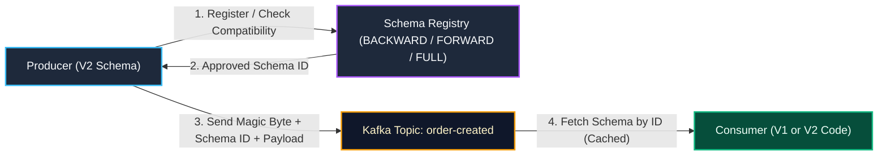

| Compatibility Mode | Rule | Allowed Changes | Upgrade Order |
| :--- | :--- | :--- | :--- |
| **`BACKWARD`** | New consumers can read **old** data | Add optional fields, delete fields | Upgrade **consumers** first |
| **`FORWARD`** | Old consumers can read **new** data | Add fields, delete optional fields | Upgrade **producers** first |
| **`FULL`** | Both `BACKWARD` and `FORWARD` compatible | Add/delete **optional** fields with defaults only | Upgrade in **any** order |
| **`NONE`** | Compatibility checks disabled | Any breaking change allowed (not for prod) | Unsafe |

### Backward Compatibility vs Breaking Changes

**Backward-compatible evolution (adding an optional field with a default):**

```json
// Old event (V1)
{
  "orderId": "order-123",
  "amount": 100.00
}

// New schema (V2) - adds optional "currency"
{
  "orderId": "order-123",
  "amount": 100.00,
  "currency": "USD"
}
```

New consumers reading V1 events read `orderId` and `amount`, and fall back to `"USD"` for `currency`.

**Incompatible (breaking) change (removing a required field):**
- Removing `"status"` while old consumers still expect `"status"` causes deserialization or runtime errors.
- **Safe removal workflow:** Mark the field deprecated -> wait for all consumers to stop reading it -> remove the field (or bump the topic/event version).

> [!IMPORTANT]
> Never delete or rename an active field in a single deployment. Use **`FULL`** or **`BACKWARD`** compatibility in Schema Registry with **optional fields and explicit defaults** so rolling deployments never crash consumers.

### Version Handling

```java
@Data
public class OrderCreatedEvent {
    public static final int VERSION = 2;

    private String orderId;
    private double amount;
    private String currency;  // Added in V2

    public OrderCreatedEvent(String orderId, double amount) {
        this(orderId, amount, "USD");
    }

    public OrderCreatedEvent(String orderId, double amount, String currency) {
        this.orderId = orderId;
        this.amount = amount;
        this.currency = currency;
    }
}

// Consumer handles multiple versions
@KafkaListener(topics = "order-created")
public void handleOrderCreated(OrderCreatedEvent event) {
    double amount = event.getAmount();
    String currency = event.getCurrency() != null ? event.getCurrency() : "USD";

    // Process using currency-aware amount
}
```

---

## Ordering Guarantees

### Single Partition Ordering

Kafka guarantees **strict FIFO ordering only within a single partition**, never across partitions. To preserve the lifecycle order of an entity (e.g., `CreateOrder` -> `PayOrder` -> `ShipOrder`), all events for that entity must use the **same message key** (`orderId`), so `hash(key) % numPartitions` routes them to the same partition.

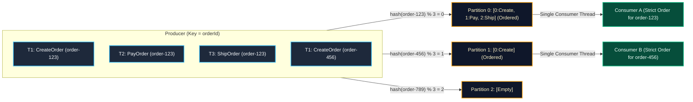

| Strategy | Ordering Scope | Parallelism & Throughput | Trade-off |
| :--- | :--- | :--- | :--- |
| **Keyed Partitioning (`key = orderId`)** | Strict per-key ordering | High (scales up to partition count) | Hot keys can skew a single partition |
| **Null Key (Sticky / Round-Robin)** | No ordering guarantee | Maximum balanced throughput | Out-of-order processing possible |
| **Single-Partition Topic** | Global strict ordering | Very low (1 consumer thread max) | Severe throughput bottleneck |

- **Same key -> same partition:** Automatic with default Murmur2 key-based partitioning.
- **Sequential processing:** One consumer thread per partition; offloading to an async worker pool inside `@KafkaListener` breaks ordering.
- **Rebalancing:** Handle partition revocations cleanly so in-flight records are committed before handoff.

> [!WARNING]
> If your `@KafkaListener` hands off records to an internal `ExecutorService` thread pool and returns immediately, **partition ordering is broken** and offsets may be committed before processing finishes.

### Ordering with Consumer Deserialization

```java
// Configuration
properties.put(ProducerConfig.KEY_SERIALIZER_CONFIG,
    StringSerializer.class);

// Produce with key
kafkaTemplate.send("orders", orderId, event);  // Key = orderId
// All events for same orderId go to same partition (hash(orderId) % partitions)

// Consume with ordering guarantee
@KafkaListener(topics = "orders", groupId = "order-group")
public void handleOrder(OrderEvent event, @Header(KafkaHeaders.RECEIVED_PARTITION_ID) int partition) {
    // Single-threaded consumption from partition
    // Events processed in order
    processEvent(event);
}
```

---

## Handling Duplicates

### Idempotent Consumers

Because Kafka defaults to **at-least-once** delivery (e.g., a consumer processes an order, crashes before committing the offset, and restarts), consumers **must be idempotent**—processing the same event multiple times must produce the exact same final state without side effects.

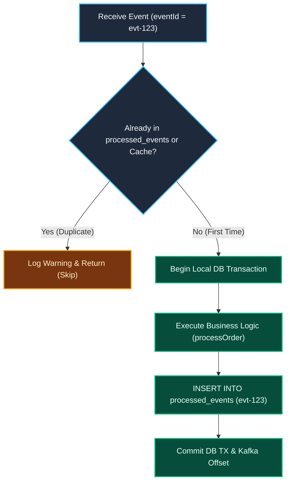

| Deduplication Approach | Durability | Multi-Instance Safe? | Best Use Case |
| :--- | :--- | :--- | :--- |
| **Database `processed_events` Table (Unique Key)** | Durable across restarts | Yes (shared DB) | Financial / order workflows requiring strict atomic dedup |
| **Distributed Cache (Redis `SETNX` + TTL)** | Configurable (RDB/AOF) | Yes (shared Redis) | High-throughput deduplication within a time window |
| **In-Memory `ConcurrentHashMap`** | Lost on pod restart | No (per-JVM only) | Best-effort, low-latency filtering only |

> [!IMPORTANT]
> Always insert into `processed_events` inside the **same `@Transactional` database boundary** as your business logic (`processOrder()`). Otherwise, a crash between the two writes re-exposes you to duplicate execution.

### Idempotent Consumer & Cache Implementations

```java
// Store processed IDs in database
@Service
public class IdempotentOrderProcessor {
    @Autowired
    private OrderRepository orderRepository;

    @Autowired
    private ProcessedEventRepository processedEventRepository;

    @KafkaListener(topics = "orders")
    public void handleOrder(Order order) throws Exception {
        // Check if already processed
        if (processedEventRepository.exists(order.getId())) {
            logger.warn("Duplicate order: " + order.getId());
            return;
        }

        try {
            // Process order
            processOrder(order);

            // Mark as processed (atomic with business logic)
            processedEventRepository.save(new ProcessedEvent(order.getId()));

        } catch (Exception e) {
            logger.error("Processing failed", e);
            throw e;
        }
    }
}

// Processed event entity
@Entity
@Table(name = "processed_events")
public class ProcessedEvent {
    @Id
    private String eventId;
    private LocalDateTime processedAt;
}
```

### Deduplication with Cache

```java
// Fast in-memory deduplication
@Service
public class CachedIdempotentProcessor {
    private final Set<String> processedIds = Collections.newSetFromMap(
        new ConcurrentHashMap<>()
    );

    @Scheduled(fixedDelay = 60000)  // Cleanup every minute
    public void cleanupCache() {
        // Remove old entries (older than 1 hour)
        processedIds.removeIf(id -> isOlderThan(id, Duration.ofHours(1)));
    }

    @KafkaListener(topics = "orders")
    public void handleOrder(Order order) {
        if (processedIds.contains(order.getId())) {
            logger.warn("Duplicate: " + order.getId());
            return;
        }

        try {
            processOrder(order);
            processedIds.add(order.getId());
        } catch (Exception e) {
            logger.error("Processing failed", e);
            throw e;
        }
    }
}
```

---

## Monitoring and Operations

### Consumer Lag & JMX Metrics

**Consumer lag** (`log_end_offset - committed_offset`) is the primary health indicator for event-driven microservices. Growing lag indicates that consumers cannot keep pace with producers or are stuck retrying poison pills.

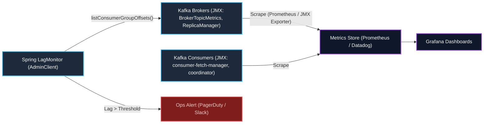

| Component | JMX MBean / Metric | What It Tracks |
| :--- | :--- | :--- |
| **Broker** | `kafka.server:type=BrokerTopicMetrics` | Messages in/sec, bytes in/out per topic |
| **Broker** | `kafka.server:type=ReplicaManager` | Under-replicated partitions, ISR shrink/expand |
| **Broker** | `kafka.controller:type=KafkaController` | Active controller count, leader elections |
| **Consumer** | `kafka.consumer:type=consumer-fetch-manager` | Records fetched, fetch latency, bytes consumed |
| **Consumer** | `kafka.consumer:type=consumer-coordinator-metrics` | Rebalance rate and rebalance latency |
| **Consumer** | `kafka.consumer:type=consumer-metrics` | Records lag max and per-partition lag |

> [!TIP]
> Alert on **sustained lag growth rate** rather than a single static spike—temporary spikes during deployments or batch imports are normal, whereas monotonically increasing lag signals a stuck consumer or under-provisioned partition count.

### Consumer Lag Monitoring

```java
// Metrics
@Component
public class LagMonitor {
    @Autowired
    private KafkaAdmin kafkaAdmin;

    @Autowired
    private AdminClient adminClient;

    @Scheduled(fixedRate = 10000)  // Every 10 seconds
    public void monitorLag() {
        // Get all consumer groups
        ListConsumerGroupsResult groups = adminClient.listConsumerGroups();

        groups.all().whenComplete((result, exception) -> {
            result.forEach(group -> {
                describeLagForGroup(group.groupId());
            });
        });
    }

    private void describeLagForGroup(String groupId) {
        // Get lag for each partition
        Map<TopicPartition, OffsetAndMetadata> offsets =
            adminClient.listConsumerGroupOffsets(groupId).partitionsToOffsetAndMetadata().join();

        offsets.forEach((partition, offset) -> {
            long lag = getLag(partition, offset.offset());

            // Alert if lag is high
            if (lag > 1000000) {
                alertOps("High lag for " + groupId + ": " + lag + " messages");
            }
        });
    }
}
```

---

## Security

### Authentication, Encryption, and Authorization

Production Kafka clusters enforce defense-in-depth across three layers: **TLS/SSL** for encryption in transit, **SASL/SCRAM** (or mTLS) for authentication, and **ACLs** for fine-grained topic and consumer-group authorization.


| Security Layer | Mechanism | Purpose |
| :--- | :--- | :--- |
| **Encryption in Transit** | TLS / SSL (`security.protocol=SSL` or `SASL_SSL`) | Encrypts payloads and credentials over the wire |
| **Authentication** | `SASL/SCRAM-SHA-256`, `SASL/OAUTHBEARER`, or mTLS | Verifies client identity (`User:app-user`) |
| **Authorization** | Kafka ACLs (`kafka-acls`) | Restricts `Read`, `Write`, `Create` per topic and group |

> [!IMPORTANT]
> Never expose `PLAINTEXT://` listeners on untrusted networks or without `SASL_SSL` in production. Always combine `SASL_SSL` with least-privilege ACLs so a compromised microservice can only access its own topics and consumer groups.

### SASL/SCRAM Authentication

```properties
# Broker configuration
security.protocol=SASL_SSL
sasl.mechanism=SCRAM-SHA-256
sasl.jaas.config=org.apache.kafka.common.security.scram.ScramLoginModule required \
    username="user" \
    password="password";

# Client configuration
bootstrap.servers=broker1:9092
security.protocol=SASL_SSL
sasl.mechanism=SCRAM-SHA-256
sasl.jaas.config=org.apache.kafka.common.security.scram.ScramLoginModule required \
    username="user" \
    password="password";
```

### TLS/SSL Encryption

```properties
# Broker
listeners=PLAINTEXT://:9092,SSL://:9093
advertised.listeners=PLAINTEXT://broker:9092,SSL://broker:9093
ssl.keystore.location=/path/to/keystore.jks
ssl.keystore.password=keystore-password
ssl.key.password=key-password
ssl.truststore.location=/path/to/truststore.jks
ssl.truststore.password=truststore-password

# Client
bootstrap.servers=broker:9093
security.protocol=SSL
ssl.truststore.location=/path/to/truststore.jks
ssl.truststore.password=truststore-password
```

### ACLs (Access Control Lists)

```bash
# Allow user to produce to topic
kafka-acls --bootstrap-server broker:9092 \
    --add \
    --allow-principal User:app-user \
    --operation Write \
    --topic orders

# Allow user to consume from group
kafka-acls --bootstrap-server broker:9092 \
    --add \
    --allow-principal User:app-user \
    --operation Read \
    --topic orders \
    --group order-processor
```

---

## Interview Questions

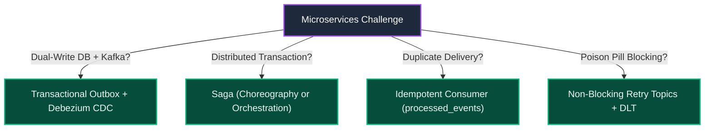

### Question 1: Event-Driven vs Synchronous Microservices

**Answer**:

| Dimension | Event-Driven Advantages | Trade-offs |
| :--- | :--- | :--- |
| **Architecture** | Loose coupling (services don't know each other) | Eventually consistent (not immediate) |
| **Resilience** | Failure isolation; no cascading outages | Harder to debug distributed flows |
| **Scaling & Extensibility** | Independent scaling; add new consumers without changing producers | Higher async latency & more complex testing |
| **Compliance** | Built-in event audit trail | Requires schema governance |

**When to use:**
- **Event-driven:** High throughput, fault tolerance, fan-out to multiple consumers.
- **Synchronous:** Simple request-response where immediate user feedback is required.

### Question 2: Outbox Pattern and Debezium

**Answer**:

- **Problem without outbox:** `1. INSERT order` succeeds, `2. Publish to Kafka` fails -> Order exists in DB, but Payment Service is never notified.
- **Outbox solution:** `INSERT order` and `INSERT outbox` execute in the **same local ACID transaction**. A separate relay reads the outbox and publishes to Kafka, guaranteeing no message loss between DB and Kafka.
- **Debezium (CDC):** Tails the DB transaction log (`outbox -> Debezium -> Kafka`), eliminating custom polling code, lowering latency, and improving database performance.

### Question 3: Saga Pattern Choreography vs Orchestration

**Answer**:

| Aspect | Choreography (Distributed) | Orchestration (Centralized) |
| :--- | :--- | :--- |
| **How it works** | Services emit events and react independently | Central orchestrator sends commands & tracks state |
| **Pros** | Loose coupling, no single point of failure | Clear flow in one place, easier testing & complex sagas |
| **Cons** | Distributed logic, possible circular dependencies | Central bottleneck, tighter coupling, SPOF risk |

Example (`Order -> Payment -> Inventory -> Shipping`):
- **Choreography:** `Order` publishes `OrderCreated` -> `Payment` listens, processes, publishes `PaymentDone` -> `Inventory` listens, reserves, publishes `InventoryDone` -> `Shipping` ships.
- **Orchestration:** `Orchestrator` calls `PaymentService`, waits for response, calls `InventoryService`, waits, calls `ShippingService`, and triggers compensations if any step fails.

### Question 4: Idempotent Consumers

**Answer**:

**Failure scenario:**
1. Consumer processes order `123` and saves to DB.
2. Consumer crashes before committing the Kafka offset.
3. Consumer restarts and re-reads order `123` -> **Duplicate order!**

**Solution:** Check if the event ID is already processed using a DB unique constraint (`processed_events`) or deduplication cache, and mark it processed atomically with the business logic:

```java
// Database-backed
if (processedEventRepository.exists(orderId)) {
    return;  // Skip duplicate
}
processOrder(order);
processedEventRepository.save(orderId);

// Cache-backed
if (processedCache.contains(orderId)) {
    return;
}
processOrder(order);
processedCache.add(orderId);
```

> [!TIP]
> In senior-level interviews, always pair **Outbox + Debezium** (at-least-once producer) with **Idempotent Consumers** (deduplicated consumer) to explain how to achieve end-to-end **effectively-once** processing without 2PC.

---

## Summary


| Pattern | Core Problem Solved |
| :--- | :--- |
| **Event Sourcing** | Preserves complete immutable state history and enables replay |
| **CQRS** | Separates and scales write-side domain logic from read-side queries |
| **Saga Pattern** | Coordinates distributed transactions across services via compensations |
| **Outbox Pattern** | Eliminates dual-write inconsistency between DB and Kafka |
| **Non-Blocking Retry & DLQ** | Isolates transient failures and poison pills without stalling partitions |
| **Idempotent Consumers** | Safely absorbs at-least-once duplicate deliveries |

Key principles:
- Loose coupling through immutable domain events
- Eventually consistent read models and sagas
- Idempotent processing to handle duplicate deliveries
- Non-blocking retries and DLQs for resilient error handling
- Schema evolution awareness (`BACKWARD` / `FULL` compatibility)

> [!NOTE]
> Master the **Outbox + CDC + Idempotent Consumer + Non-Blocking Retry/DLQ** quartet—together they form the production backbone of reliable Kafka-based microservices.
