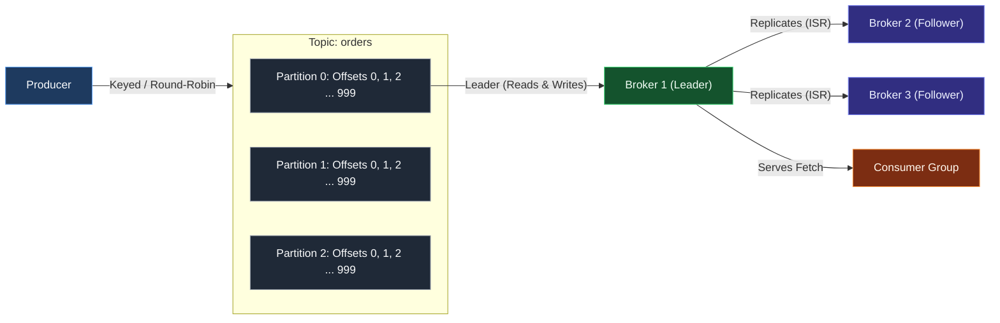
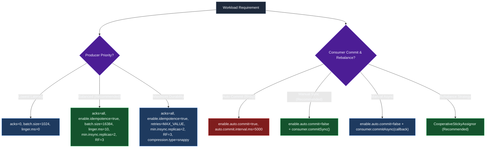
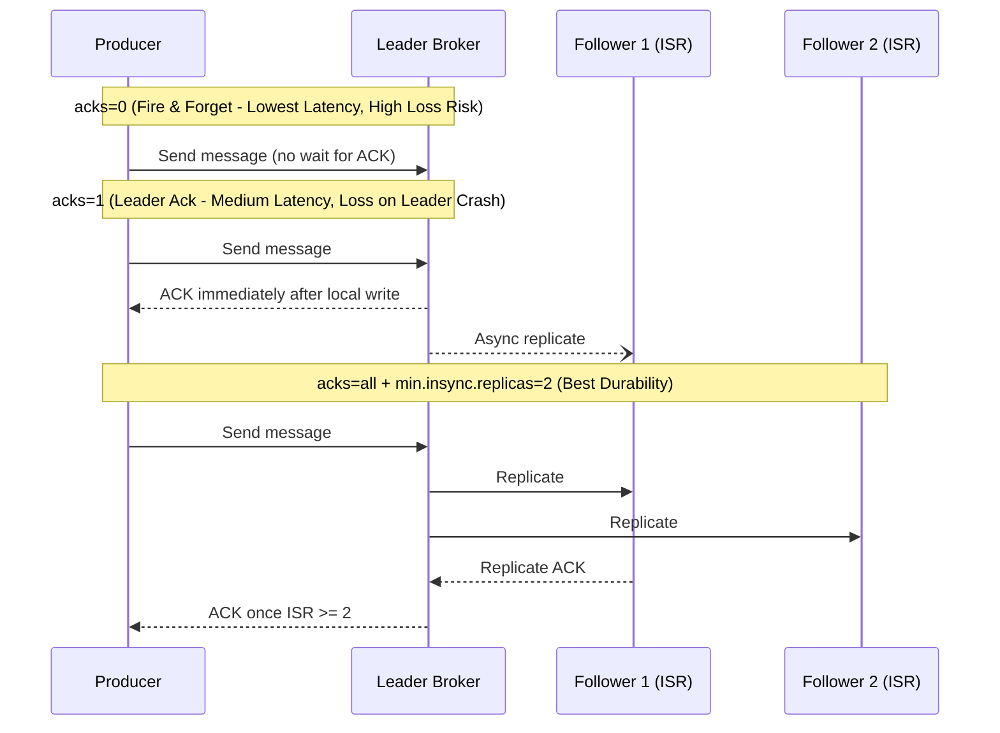
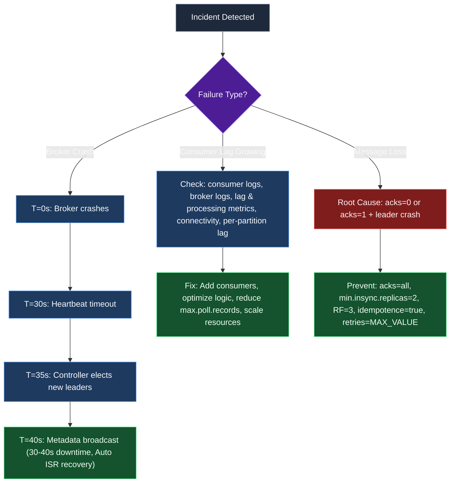
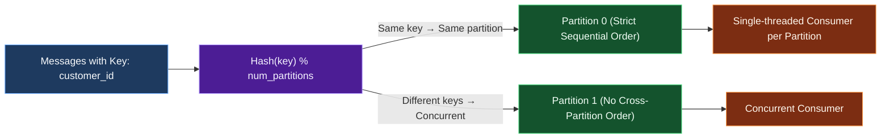
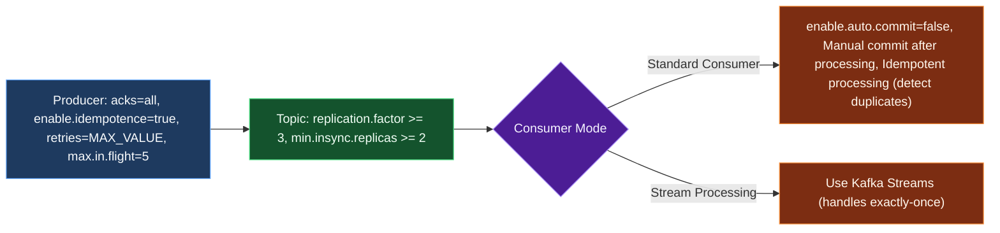

# Kafka Interview Quick Reference Card

> [!TIP]
> **Last-Minute Scan Strategy:** Focus on **Durability (`acks=all` + `min.insync.replicas=2`)**, **Consumer Lag & Rebalancing (`CooperativeStickyAssignor`)**, **Ordering (key-based partitioning)**, and **Exactly-Once Semantics (EOS)**.

---

## Core Concepts

### Topics, Partitions, Offsets & Replication



| Concept | Definition | Role in Kafka |
|---|---|---|
| **Topic** | Logical grouping (e.g., `"orders"`) | Organizes event streams by domain |
| **Partition** | Unit of parallelism (e.g., `orders-0`, `orders-1`, `orders-2`) | Enables horizontal scaling and parallel consumption |
| **Offset** | Message position in partition (`0, 1, 2, ..., 999`) | Unique sequential ID per partition; enables replay |
| **Leader** | Primary replica for a partition | Accepts all client produces and fetches |
| **Follower** | Secondary replica | Replicates from leader (cannot serve clients) |
| **ISR** | In-Sync Replicas | Replicas that are current with the leader |

### Key Numbers to Remember

| Metric / Setting | Default / Typical Value |
|---|---|
| **Default partition count** | `1` |
| **Default replication factor** | `1` |
| **Default retention** | `7 days` (`604800000 ms`) |
| **Default segment size** | `1GB` (`1073741824 bytes`) |
| **Broker failure detection** | `30 seconds` (`session.timeout.ms`) |
| **Rebalancing downtime** | `2-5 seconds` |
| **Producer default batching** | `16KB` or `0ms` (`linger.ms`) |
| **Consumer default polling** | `1000ms` |

---

## Producer & Consumer Config Decision Tree



---

## Producer Configuration Cheat Sheet

### Durability vs Performance

| Profile | Configuration | Trade-off / Notes |
|---|---|---|
| **LOWEST LATENCY** | `acks=0`, `batch.size=1024`, `linger.ms=0` | No acks, small batches, no waiting |
| **BALANCED (RECOMMENDED)** | `acks=all`, `enable.idempotence=true`, `batch.size=16384`, `linger.ms=10`, `min.insync.replicas=2` (topic), `replication.factor=3` (topic) | All replicas, exactly-once, 16KB batch, 10ms linger |
| **MAXIMUM DURABILITY** | `acks=all`, `enable.idempotence=true`, `retries=MAX_VALUE`, `min.insync.replicas=2`, `replication.factor=3`, `compression.type=snappy` | All replicas, exactly-once, infinite retries, snappy compression |

### Quick Configuration Template

```java
Properties props = new Properties();
props.put("bootstrap.servers", "broker0:9092,broker1:9092,broker2:9092");
props.put("key.serializer", StringSerializer.class.getName());
props.put("value.serializer", StringSerializer.class.getName());
props.put("acks", "all");
props.put("enable.idempotence", true);
props.put("retries", Integer.MAX_VALUE);
props.put("linger.ms", 10);
props.put("batch.size", 16384);
```

---

## Consumer Configuration Cheat Sheet

### Offset Commit Strategies

| Strategy | Configuration / Code | Behavior |
|---|---|---|
| **AUTOMATIC** | `enable.auto.commit=true`, `auto.commit.interval.ms=5000` | Commit every 5s (message loss if crash during processing) |
| **MANUAL (RECOMMENDED)** | `enable.auto.commit=false` + `consumer.commitSync()` after processing | Blocks until broker confirms offset commit |
| **ASYNC** | `consumer.commitAsync(callback)` | Non-blocking commit with callback for error handling |

### Rebalancing Strategies

| Strategy | Behavior |
|---|---|
| `RANGE` | Assign partitions in order to consumers |
| `ROUND_ROBIN` | Distribute partitions round-robin |
| `STICKY` | Minimize partition movement (**RECOMMENDED**) |
| `COOPERATIVE_STICKY` | Minimize movement + reduce downtime |

```properties
partition.assignment.strategy=CooperativeStickyAssignor
```

> [!WARNING]
> Setting `enable.auto.commit=true` commits offsets on a timer (`5000ms`), not when processing finishes. If a consumer crashes mid-batch after an auto-commit, unprocessed messages are lost.

### Quick Configuration Template

```java
Properties props = new Properties();
props.put("bootstrap.servers", "broker0:9092,broker1:9092");
props.put("group.id", "my-group");
props.put("key.deserializer", StringDeserializer.class.getName());
props.put("value.deserializer", StringDeserializer.class.getName());
props.put("auto.offset.reset", "earliest");  // or "latest"
props.put("enable.auto.commit", false);
props.put("session.timeout.ms", 30000);
props.put("heartbeat.interval.ms", 10000);
```

---

## Topic Configuration Cheat Sheet

### For Different Use Cases

| Use Case | Examples | Configuration |
|---|---|---|
| **TRANSIENT DATA** | Logs, metrics | `retention.ms=604800000` (7 days), `retention.bytes=1099511627776` (1TB), `cleanup.policy=delete` |
| **CRITICAL DATA** | Orders, payments | `retention.ms=31536000000` (1 year), `cleanup.policy=delete`, `replication.factor=3`, `min.insync.replicas=2` |
| **STATE SNAPSHOTS** | Users, balances | `cleanup.policy=compact`, `replication.factor=3`, `min.insync.replicas=2` |
| **KAFKA STREAMS** | Changelog / state topics | `cleanup.policy=compact`, `replication.factor=3`, `log.compaction.cleanup.policy=compact` |

### Quick Creation Command

```bash
kafka-topics --bootstrap-server localhost:9092 \
  --create \
  --topic orders \
  --partitions 12 \
  --replication-factor 3 \
  --config min.insync.replicas=2 \
  --config cleanup.policy=delete \
  --config retention.ms=604800000
```

---

## Durability Matrix



| Scenario / Property | `acks=0` | `acks=1` | `acks=all` |
|---|---|---|---|
| **No failure** | ✓ | ✓ | ✓ |
| **Leader crash** | ✗ | ✗ | ✓ |
| **Leader + 1 fail** | ✗ | ✗ | ✓ (if `min.insync.replicas=2`) |
| **Loss tolerance** | High | Medium | Low (best) |
| **Latency** | Lowest | Medium | Highest |
| **Throughput** | Highest | High | Medium |

---

## Performance Tuning Checklist

### Producer Throughput
- [ ] Increase `batch.size` (`32KB`)
- [ ] Increase `linger.ms` (`100ms`)
- [ ] Enable compression (`snappy` or `lz4`)
- [ ] Increase `buffer.memory` (`64MB`)
- [ ] Use async send with callback
- [ ] Multiple producer instances (partitions)

### Consumer Throughput
- [ ] Increase `max.poll.records` (`500`)
- [ ] Increase `fetch.min.bytes` (`4KB`)
- [ ] Increase `fetch.max.wait.ms` (`500ms`)
- [ ] Parallel processing (but carefully with ordering)
- [ ] Use multiple consumers (`num = partitions`)

### Broker Optimization
- [ ] Increase JVM heap (`8-16GB`)
- [ ] OS page cache (rest of RAM)
- [ ] NVMe SSD for storage
- [ ] 10Gbps NIC
- [ ] Tune `log.flush.interval.ms` (OS handles)

---

## Failure Scenarios & Recovery



### Broker Failure
- **Timeline:**
  - `T=0s`: Broker crashes
  - `T=30s`: Heartbeat timeout
  - `T=35s`: Controller elects new leaders
  - `T=40s`: Metadata broadcast
- **Impact:** 30-40s downtime for affected partitions
- **Recovery:** Automatic (no action needed if using ISR)

### Consumer Lag Growing
- **Causes:**
  1. Consumer slow (processing takes time)
  2. Consumer crashed
  3. Rebalancing happening
  4. Offset commit failing
- **Debug:**
  1. Check consumer logs
  2. Check broker logs
  3. Check metrics: consumer lag, processing time
  4. Verify connectivity to brokers
  5. Check partition lag per partition
- **Solutions:**
  1. Add more consumers (increase parallelism)
  2. Optimize processing logic
  3. Reduce `max.poll.records`
  4. Increase consumer resources

### Message Loss
- **Cause:** `acks=0` or `acks=1` + leader crash
- **Prevention:**
  1. `acks=all` + `min.insync.replicas=2`
  2. `replication.factor=3`
  3. `enable.idempotence=true` (producer)
  4. `retries=Integer.MAX_VALUE`
- **Verification:**
  1. Check producer returned success
  2. Check offsets advancing on consumer
  3. Monitor consumer lag

---

## Ordering Guarantees



| Scope | Guarantee & Trade-off | Configuration |
|---|---|---|
| **Single Partition (Within-Partition Ordering)** | Messages with same key go to same partition; consumer reads from single partition sequentially; **order is preserved** | Producer: use same key for related messages. Consumer: single-threaded processing per partition, or `max.in.flight.requests.per.connection=1` |
| **Multi-Partition (No Global Ordering)** | Kafka does **NOT** guarantee order across partitions; concurrent processing across partitions OK | Need global ordering -> use single partition (throughput trade-off). Need per-key ordering -> use key-based partitioning |

---

## Exactly-Once Delivery Checklist



### Producer
- [ ] `acks=all`
- [ ] `enable.idempotence=true`
- [ ] `retries=Integer.MAX_VALUE`
- [ ] `max.in.flight.requests.per.connection=5`

### Topic
- [ ] `replication.factor >= 3`
- [ ] `min.insync.replicas >= 2`

### Consumer
- [ ] `enable.auto.commit=false`
- [ ] Manual commit after processing
- [ ] Idempotent processing (detect duplicates)
- **OR**
- [ ] Use Kafka Streams (handles exactly-once)

---

## Monitoring Metrics

### Key Metrics to Monitor

| Layer | Key Metrics |
|---|---|
| **Producer** | Throughput (`msg/s`), Latency (`p50`, `p95`, `p99`), Error rate (`%`), Batch size |
| **Consumer** | Consumer lag (messages behind), Processing rate (`msg/s`), Rebalancing frequency, Error rate (`%`) |
| **Broker** | CPU usage, Memory usage, Disk I/O, Network I/O, Under-replicated partitions |

### Consumer Lag Formula

```text
Consumer lag = log_end_offset - committed_offset

Example:
Log has 1000 messages (0-999)
Consumer committed offset 500
Lag = 1000 - 500 = 500 messages behind
```

| Threshold | Level | Action |
|---|---|---|
| `lag > 10,000` messages | **Warning** | Investigate consumer throughput / rebalance frequency |
| `lag > 100,000` messages | **Critical** | Add more consumers (if lag > processing capacity) |

---

## Common Mistakes & Fixes

| Mistake | Impact | Fix |
|---|---|---|
| `acks=0` | Data loss | Use `acks=all` |
| `auto.offset.reset=latest` | Misses messages | Use `earliest` for new group |
| No key on producer | Uneven distribution | Use `customer_id` as key |
| `enable.auto.commit=true` | Message loss on crash | Use manual commits |
| Single partition topic | Throughput bottleneck | Increase partition count |
| Too many partitions | Slow rebalancing | Use `#partitions = 2x #consumers` |
| No compression | High network I/O | Enable `snappy` compression |
| Large `batch.size` | High latency | Reduce to `16KB` |
| No monitoring | Silent failures | Setup consumer lag alerts |
| Synchronous processing | Low throughput | Use async callbacks |

---

## Interview Time-Savers

### Explain Kafka in 2 Minutes
Kafka is a distributed, persistent pub/sub system:
1. Producers publish to topics
2. Messages stored durably across broker replicas
3. Consumers read from partitions in order
4. Offset tracking enables replay
5. Partition parallelism enables scale

**Key strengths:**
- **High throughput** (`1M msg/s` per broker)
- **Durability** (3x replication)
- **Ordering** (within partition)
- **Replay** (infinite retention)
- **Fault tolerance** (quorum-based)

### Design Order Processing System (5 min version)


- **Pattern:** Choreography-based saga
- **Storage:** Event sourcing with log compaction
- **Guarantee:** Exactly-once with idempotent consumers
- **Monitoring:** Consumer lag alerts per service

### Explain `min.insync.replicas` (1 min)

> [!IMPORTANT]
> With `replication.factor=3` and `min.insync.replicas=2`:
> - Producer with `acks=all` waits for ACK from **leader + 1 follower**
> - Can tolerate **1 broker failure** (message safe if any 2 of 3 replicas have it)
> - Without `min.insync.replicas=2`, the leader alone might satisfy `acks=1`, causing data loss if the leader crashes
> - Standard production baseline: **3 replicas + `min.insync.replicas=2`**

---

## Final Checklist Before Interview

- [ ] Understand replication, ISR, leader election
- [ ] Know producer durability configs (`acks`, `idempotence`)
- [ ] Know consumer offset management (manual vs auto)
- [ ] Can explain `min.insync.replicas`
- [ ] Know partition assignment strategies
- [ ] Understand consumer lag and monitoring
- [ ] Can implement idempotent consumer
- [ ] Know Kafka Streams: `KStream` vs `KTable`
- [ ] Understand saga pattern and outbox pattern
- [ ] Can design order processing system
- [ ] Know schema evolution and registry
- [ ] Can explain exactly-once delivery

---

## Quick Reference URLs (In Your Study)

| Study Guide | Focus Topics & Time |
|---|---|
| [File 1 (Architecture)](./01-Kafka-Architecture-and-Internals.md) | Kafka overview (1 min), Core concepts (5 min), Replication (10 min), High throughput (10 min) |
| [File 2 (Producers & Consumers)](./02-Producers-and-Consumers.md) | Producer architecture (10 min), Consumer groups (10 min), Offset management (10 min), Idempotence (5 min) |
| [File 3 (Streams & Connect)](./03-Kafka-Streams-and-Connect.md) | KStream vs KTable (10 min), Windowing (10 min), State stores (5 min), Schema Registry (5 min) |
| [File 4 (Microservices)](./04-Kafka-in-Microservices.md) | Event Sourcing (10 min), Saga pattern (15 min), Outbox pattern (10 min), Idempotent consumers (10 min) |
| [File 5 (Interview Questions)](./05-Kafka-Interview-Questions.md) | Study 5 questions per day, 10 days for all 50 questions, Deep dive on your 5 weakest |

---

Good luck! You've got this! 🚀
