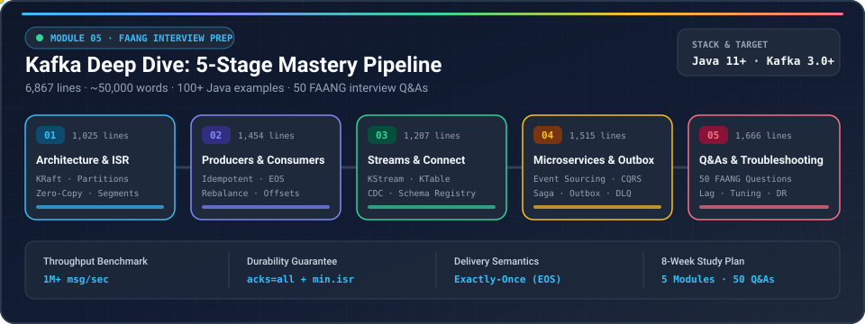
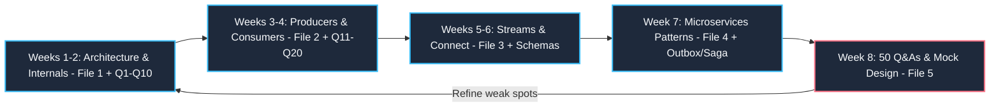
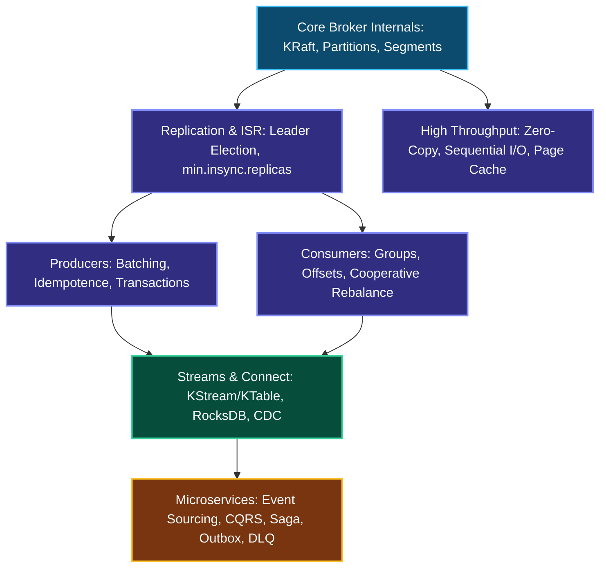
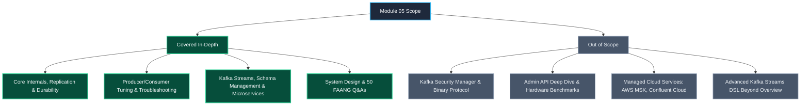

# Kafka Deep Dive - FAANG Interview Preparation

## Overview

This comprehensive Kafka interview preparation package contains **6,867 lines** of detailed content across **5 markdown files**, specifically designed for mid-level Java engineers (5+ years experience) targeting FAANG companies.

| Metric | Scope |
| :--- | :--- |
| **Total Volume** | **6,867 lines** (~50,000 words) across 5 core guides |
| **Code & Diagrams** | **100+ production-ready Java code examples** and architecture diagrams |
| **Scenario Depth** | Real-world failure, durability, scaling, and system design scenarios |
| **Target Profile** | Mid-level Java engineers (5+ YoE) targeting FAANG Senior/Staff interviews |

> [!NOTE]
> Every module pairs theoretical internals with production Java configurations and FAANG-style interview questions so you can move seamlessly from low-level broker mechanics to high-level distributed system design.

### Module Learning Roadmap

---

## File Structure

| # | Guide | Lines | Primary Focus | Interview Qs |
| :---: | :--- | :---: | :--- | :---: |
| 1 | [01-Kafka-Architecture-and-Internals.md](./01-Kafka-Architecture-and-Internals.md) | 1,025 | Brokers, KRaft, ISR, zero-copy, storage segments, sizing | 7 Q&As |
| 2 | [02-Producers-and-Consumers.md](./02-Producers-and-Consumers.md) | 1,454 | Batching, idempotence, transactions, consumer groups, rebalancing | 9 Q&As |
| 3 | [03-Kafka-Streams-and-Connect.md](./03-Kafka-Streams-and-Connect.md) | 1,207 | KStream/KTable, windowing, RocksDB, CDC, Schema Registry | 4 Q&As |
| 4 | [04-Kafka-in-Microservices.md](./04-Kafka-in-Microservices.md) | 1,515 | Event sourcing, CQRS, Saga, Outbox, DLQ, security | 4 Q&As |
| 5 | [05-Kafka-Interview-Questions.md](./05-Kafka-Interview-Questions.md) | 1,666 | Top 50 FAANG-level Kafka interview questions & system design | 50 Q&As |

### 1. [01-Kafka-Architecture-and-Internals.md](./01-Kafka-Architecture-and-Internals.md) (1,025 lines)

Deep dive into Kafka's core architecture and internals.

**Topics covered**:
- Kafka overview and use cases
- Core concepts: Topics, Partitions, Offsets, Brokers, Clusters
- Kafka broker internals and controller role
- ZooKeeper vs KRaft comparison
- Partition internals: segment files, index files, log compaction
- Replication architecture: leader/follower, ISR (In-Sync Replicas)
- High throughput mechanisms: sequential I/O, zero-copy, batching, compression, page cache
- Storage internals: log segments, retention policies, log compaction
- Kafka vs other messaging systems: detailed comparison with RabbitMQ, ActiveMQ, SQS, Pulsar
- Topic configuration with real-world examples
- Cluster sizing and capacity planning formulas
- 7 interview questions with detailed answers

**Key Sections**:
- Architecture diagrams with ASCII art
- Broker failure scenarios and recovery
- Replication guarantees with examples
- Storage architecture and retention strategies

---

### 2. [02-Producers-and-Consumers.md](./02-Producers-and-Consumers.md) (1,454 lines)

Complete guide to Kafka producers and consumers.

**Topics covered**:
- Producer architecture: `ProducerRecord` flow through the system
- Serialization and partitioning strategies
- Batching mechanism with configuration impact
- Producer configuration deep dive with 15+ parameters
- Idempotent producer: sequence numbers and producer ID
- Transactional producer: exactly-once semantics, isolation levels
- Custom partitioners with regional routing example
- Producer callbacks and error handling
- Consumer architecture and consumer groups
- Partition assignment strategies: Range, RoundRobin, Sticky, CooperativeSticky
- Consumer configuration with 12+ key parameters
- Offset management: automatic vs manual commit
- Session management and heartbeats
- Consumer rebalancing: causes, strategies, static membership
- Consumer lag monitoring and calculation
- Code examples: Basic producer, transactional producer, consumer with rebalance listener
- 9 interview questions with detailed answers

**Key Sections**:
- Producer durability configuration matrix
- `acks` setting explanation with scenarios
- Consumer group assignment visualization
- Offset commit flow diagrams
- Rebalancing timeline and strategies

---

### 3. [03-Kafka-Streams-and-Connect.md](./03-Kafka-Streams-and-Connect.md) (1,207 lines)

Kafka Streams, Kafka Connect, and Schema Registry guide.

**Topics covered**:
- Kafka Streams overview: embedded client library
- Stateless vs stateful operations
- `KStream`, `KTable`, `GlobalKTable` comparison and use cases
- Stream processing operations: `filter`, `map`, `flatMap`, `groupBy`, `aggregate`, `join`
- Windowing types: Tumbling, Hopping, Sliding, Session with examples
- State stores: RocksDB, in-memory, changelog topics
- Interactive queries for state store access
- Exactly-once processing configuration
- Kafka Connect architecture: source and sink connectors
- Common connectors: JDBC, Debezium CDC, Elasticsearch, S3
- Single Message Transform (SMT) for data transformation
- Schema Registry: Avro, JSON Schema, Protobuf
- Schema evolution strategies: backward, forward, full compatibility
- Kafka Streams vs Apache Flink vs Spark Streaming comparison
- 4 interview questions covering `KStream` vs `KTable`, windowing, state recovery, joins

**Key Sections**:
- Topology diagram with transformation flow
- Window types visualization and examples
- State store architecture with changelog topics
- Schema registry integration example
- Connector ecosystem overview

---

### 4. [04-Kafka-in-Microservices.md](./04-Kafka-in-Microservices.md) (1,515 lines)

Real-world patterns for Kafka in microservices architecture.

**Topics covered**:
- Event-driven microservices: traditional vs event-driven comparison
- Event Sourcing: storing state changes as immutable events
- Event Sourcing implementation with event store
- CQRS (Command Query Responsibility Segregation) pattern
- Write model and read model separation
- Saga pattern: distributed transactions across services
- Choreography-based saga: event-driven coordination
- Orchestration-based saga: centralized orchestrator
- Outbox pattern: transactional guarantee for event publishing
- Outbox implementation with Spring Data JPA
- Dead Letter Queue (DLQ) pattern for error handling
- Retry topics pattern with exponential backoff
- Error classification: transient vs permanent
- Schema evolution in microservices: backward compatibility
- Ordering guarantees: single partition ordering, key-based partitioning
- Handling duplicate messages: idempotent consumers
- Deduplication strategies: cache-based, database-backed
- Monitoring and operations: consumer lag, JMX metrics
- Kafka security: SASL, SSL/TLS, ACLs
- 4 interview questions with detailed answers

**Key Sections**:
- Event-driven architecture benefits and trade-offs
- Saga pattern implementation (choreography vs orchestration)
- Outbox pattern with Debezium CDC
- Idempotent consumer examples
- Multi-consumer coordination patterns

---

### 5. [05-Kafka-Interview-Questions.md](./05-Kafka-Interview-Questions.md) (1,666 lines)

**Top 50 FAANG-level Kafka interview questions with comprehensive answers.**

| Category | Range | Core Themes |
| :--- | :---: | :--- |
| **Architecture & Internals** | Q1-Q10 | High throughput, broker failure, `min.insync.replicas`, log compaction, split-brain, replication, offsets |
| **Producers & Consumers** | Q11-Q20 | Scenario configs, lag optimization, manual commits, error handling, idempotence, transactions, rebalancing |
| **Durability & Reliability** | Q21-Q30 | Lag debugging, duplicates, data loss prevention, under-replicated partitions, disk full, ISR, unclean election |
| **Performance & Optimization** | Q31-Q40 | Producer/consumer throughput, latency, partition count, broker memory, network, tiering, multi-cluster |
| **Design & Troubleshooting** | Q41-Q50 | 1M orders/day system, EOS order processing, Saga, JSON-to-Avro, multi-region, zero-downtime upgrade, DR |

Full 50-Question Index (Q1-Q50)

**Architecture & Internals (Q1-Q10)**:
1. High throughput architecture (sequential I/O, batching, compression)
2. Broker failure handling and recovery
3. `min.insync.replicas` impact on durability
4. Log compaction vs retention policies
5. Split-brain scenario prevention
6. Leader/follower replication model
7. Partition assignment and consumer groups
8. Message loss prevention in different scenarios
9. Offset management and `__consumer_offsets` topic
10. Log compaction use cases and implementation

**Producers & Consumers (Q11-Q20)**:
11. Producer configuration for different scenarios (logging, financial, e-commerce)
12. Consumer lag monitoring and optimization
13. Manual vs automatic offset commit
14. Consumer error handling patterns
15. Idempotent producer implementation
16. Transactional producer
17. Spring Kafka integration
18. Producer/consumer callbacks and metrics
19. Partitioner strategies
20. Consumer rebalancing optimization

**Durability & Reliability (Q21-Q30)**:
21. Debugging consumer lag
2. Handling message duplicates
3. Data loss scenarios and prevention
4. Broker rebalancing vs leader election
5. Under-replicated partitions
6. Offset out of range issues
7. Handling broker disk full
8. Consumer group coordination
9. ISR changes and implications
10. Unclean leader election scenarios

**Performance & Optimization (Q31-Q40)**:
31. Throughput tuning for producers
32. Latency optimization
33. Partition count optimization
34. Memory configuration in brokers
35. Network optimization
36. Consumer throughput optimization
37. Storage optimization with tiering
38. Segment size tuning
39. Topic configuration optimization
40. Multi-cluster replication

**Design & Troubleshooting (Q41-Q50)**:
41. Design event-driven order processing system (1M orders/day)
42. Guarantee exactly-once order processing
43. Distributed transaction management with saga pattern
44. Schema evolution strategy (JSON to Avro)
45. Multi-region Kafka setup with low latency
46. Debug high consumer lag scenario
47. Broker cluster upgrade with zero downtime
48. Capacity planning for 10x growth
49. Cost optimization in production
50. Disaster recovery plan

---

## Content Highlights

| Pillar | What You Get |
| :--- | :--- |
| **Code Examples** | 100+ production-ready Java code samples, Spring Kafka integration, custom partitioner, idempotent consumer, transactional producer, event sourcing, Saga (choreography & orchestration), DLQ/error handling, Kafka Streams topologies, consumer group config |
| **Architecture Diagrams** | Kafka broker internals, replication & ISR flow, consumer group partition assignment, producer batching pipeline, Kafka Streams topology, event-driven microservices flow, Saga coordination, Outbox pattern with CDC |
| **Configuration Examples** | Producer configs for 3 scenarios, consumer configs for varied use cases, financial topic configs, Kafka Streams config, Schema Registry setup, Kafka Connect connectors, security configs (SASL, TLS, ACLs) |
| **Real-World Scenarios** | Broker failure recovery, network partition handling, split-brain prevention, consumer lag debugging, message deduplication, event ordering guarantees, exactly-once delivery implementation, multi-region replication |

---

## Target Audience

| Dimension | Details |
| :--- | :--- |
| **Ideal For** | Mid-level Java engineers (5+ years experience), FAANG interview preparation, microservices architecture design, stream processing implementation, system design interviews |
| **Prerequisites** | Solid Java fundamentals, understanding of distributed systems, basic knowledge of message queues, experience with Spring Framework (helpful) |

---

## How to Use This Guide

### 8-Week Study Loop

> [!TIP]
> Pair each weekly reading block with hands-on Java code practice and timed whiteboard explanations of the corresponding interview questions.

### Interview Preparation (8-Week Plan)

| Timeline | Module Focus | Key Action Items |
| :--- | :--- | :--- |
| **Week 1-2** | Architecture Internals (File 1) | Study Kafka overview & core concepts; deep dive into replication and durability; practice Q1-Q10 |
| **Week 3-4** | Producers and Consumers (File 2) | Study producer configs for different scenarios; master consumer groups & offset management; practice Q11-Q20; implement custom partitioner |
| **Week 5-6** | Streams and Connect (File 3) | Master `KStream` vs `KTable`, windowing & state stores; practice basic topology examples; study schema evolution |
| **Week 7** | Microservices Patterns (File 4) | Implement Event Sourcing; deep dive into Saga & Outbox patterns for consistency; master DLQ and error handling |
| **Week 8** | Interview Questions & Design (File 5) | Practice all 50 questions; design order processing system; deep dive into 3 chosen questions; run mock interviews |

### System Design Practice

1. **Design order processing system** (Q41):
   - Use event sourcing, implement saga pattern, add exactly-once guarantees, and plan for 1M orders/day.
2. **Design multi-region Kafka** (Q45):
   - Low-latency reads, cross-region replication, disaster recovery, and cost optimization.
3. **Capacity planning scenario** (Q48):
   - Scale from 100K to 1M msg/s, cluster sizing, partition rebalancing, and resource allocation.

### Code Practice

1. Implement custom partitioner (regional routing)
2. Build idempotent consumer
3. Create transactional producer
4. Design Kafka Streams topology for windowing
5. Implement outbox pattern with Spring Data JPA

---

## Key Concepts to Master

### Kafka Internals Dependency Tree

> [!IMPORTANT]
> In FAANG interviews, durability questions almost always trace back to the interaction between producer `acks=all`, broker `min.insync.replicas`, and consumer `isolation.level=read_committed`.

### Mastery Checklist

**Durability & Reliability**:
- [ ] Replication and ISR
- [ ] Leader election and split-brain prevention
- [ ] Exactly-once semantics
- [ ] Transactional writes and reads
- [ ] Message loss scenarios and prevention

**Performance**:
- [ ] Throughput vs latency tradeoffs
- [ ] Batching and compression
- [ ] Partition count optimization
- [ ] Consumer parallelism
- [ ] Zero-copy transfer

**Operations**:
- [ ] Monitoring and alerting (consumer lag)
- [ ] Scaling strategies
- [ ] Cluster upgrades
- [ ] Disaster recovery
- [ ] Cost optimization

**Architecture Patterns**:
- [ ] Event sourcing
- [ ] CQRS
- [ ] Saga pattern (choreography/orchestration)
- [ ] Outbox pattern
- [ ] Dead Letter Queue
- [ ] Event-driven microservices

---

## Common Interview Questions (Quick Reference)

| # | Most Asked Interview Question | Reference |
| :---: | :--- | :---: |
| 1 | "Explain Kafka's high throughput architecture" | Q1 |
| 2 | "How does Kafka handle broker failures?" | Q2 |
| 3 | "What is `min.insync.replicas` and why is it important?" | Q3 |
| 4 | "Design an event-driven order processing system" | Q41 |
| 5 | "How would you guarantee exactly-once delivery?" | Q42 |
| 6 | "Debug high consumer lag scenario" | Q46 |
| 7 | "Difference between log compaction and retention" | Q4 |
| 8 | "`KStream` vs `KTable`" | Q11 (File 3) |
| 9 | "Saga pattern implementation" | Q43 |
| 10 | "Schema evolution strategy" | Q44 |

---

## Study Tips

1. **Understand tradeoffs**: Durability vs latency, throughput vs consistency
2. **Know the numbers**: Typical throughput (1M msg/s), broker failure detection (30s), rebalancing (2-5s)
3. **Practice code**: Write producers, consumers, and custom partitioners from scratch
4. **Real scenarios**: Study broker failures, network partitions, message deduplication
5. **System design**: Approach large problems systematically (requirements → architecture → implementation)
6. **Ask questions**: Clarify requirements, constraints, and tradeoffs in interviews

> [!WARNING]
> Avoid memorizing configuration flags in isolation. Interviewers routinely follow up by changing a constraint (e.g., network partition or sudden 10x traffic spike) to test whether you understand the underlying tradeoff.

---

## Additional Resources & Version Info

| Resource / Metadata | Details |
| :--- | :--- |
| **Apache Kafka Docs** | https://kafka.apache.org/documentation/ |
| **Confluent Platform** | https://www.confluent.io/ |
| **Spring Kafka** | https://spring.io/projects/spring-kafka |
| **Further Study** | Kafka Internals papers/talks & sample projects on GitHub |
| **Created / Stack** | February 2026 · Java 11+ · Kafka 3.0+ · Spring Kafka 2.8+ |
| **Target Level** | FAANG Senior/Staff Engineer |

---

## What's Covered vs Not Covered

### Topic Coverage Map

| Covered (In-Depth) | Not Covered (Out of Scope) |
| :--- | :--- |
| Core architecture and internals | Kafka Security Manager details |
| Producer and consumer configuration | Kafka Admin API deep dive (covered in summary) |
| Replication and durability | Kafka Protocol internals (binary format) |
| Stream processing with Kafka Streams | Performance benchmarks and hardware specifications |
| Microservices patterns | Cloud provider managed Kafka services (AWS MSK, Confluent Cloud) |
| Schema management | Advanced Kafka Streams DSL (covered at overview level) |
| Real-world troubleshooting | — |
| Performance tuning | — |
| System design scenarios | — |

---

Good luck with your FAANG interview preparation!

For questions or clarifications on any topic, refer to the detailed sections in each file.
