# Arrays and Strings - Comprehensive Guide for FAANG Interviews

## Table of Contents
1. [Two Pointer Technique](#two-pointer-technique)
2. [Sliding Window](#sliding-window)
3. [Prefix Sum](#prefix-sum)
4. [Kadane's Algorithm](#kadanes-algorithm)
5. [String Manipulation](#string-manipulation)
6. [Matrix Problems](#matrix-problems)

---

## Two Pointer Technique

### Core Concept
The two-pointer technique is used to solve problems involving pairs, sequences, or reducing the search space efficiently. Common patterns:
- **Same direction**: Both pointers move in the same direction (often with different speeds)
- **Opposite direction**: Pointers start at opposite ends and move towards each other

**Algorithm Intuition:**
- **Eliminate nested loops**: Instead of checking every `(i, j)` pair in `O(n²)`, use monotonic properties (sorted order, bounding heights, or symmetric indices) to discard impossible states in `O(1)` per step.
- **Invariant-driven movement**: At each step, move only the pointer that cannot improve the current answer if kept fixed (e.g., the shorter wall in Container With Most Water or Trapping Rain Water).
- **In-place compaction**: Use a slow `write` pointer (`k`) and fast `read` pointer (`i`) to partition or deduplicate arrays in `O(1)` extra space.

> [!TIP]
> Whenever an array is **sorted** (or can be sorted without breaking index requirements) and you need pairs/triplets with a target sum, think **Opposite-Direction Two Pointers** first.

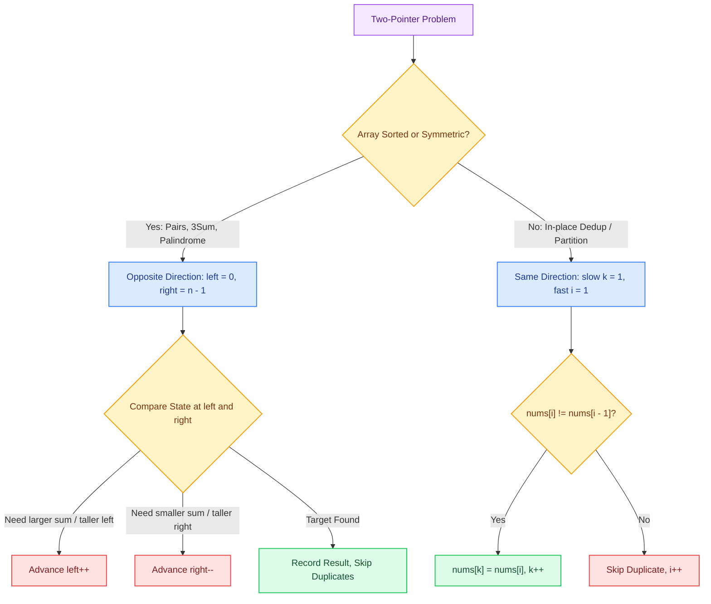

#### Visual Walkthrough: Trapping Rain Water (`O(n)` Time, `O(1)` Space)


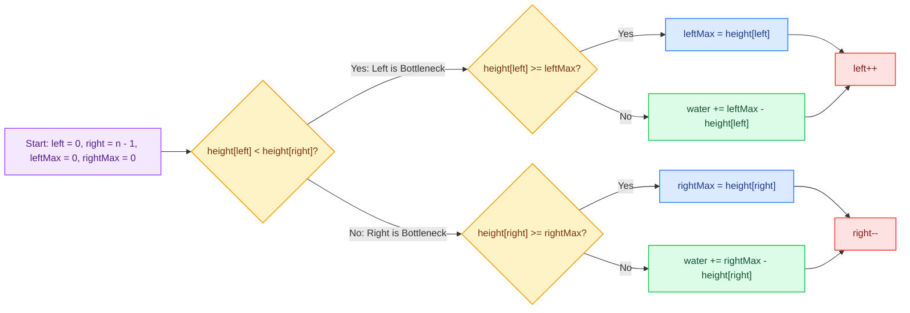

#### Section Complexity Overview

| Problem | Pattern | Brute Force | Optimal Time | Optimal Space |
|---------|---------|-------------|--------------|---------------|
| Container With Most Water | Opposite Pointers | `O(n²)` | `O(n)` | `O(1)` |
| 3Sum | Sort + Opposite Pointers | `O(n³)` | `O(n²)` | `O(1)` / `O(n)` |
| Trapping Rain Water | Converging Max Bounds | `O(n²)` | `O(n)` | `O(1)` |
| Valid Palindrome | Opposite Skip Pointers | `O(n)` (`O(n)` space) | `O(n)` | `O(1)` |
| Remove Duplicates | Same-Direction Slow/Fast | `O(n)` (`O(n)` space) | `O(n)` | `O(1)` |

> [!WARNING]
> In **3Sum**, forgetting to skip duplicate values for `i`, `left`, and `right` after finding a valid triplet is the #1 bug in interviews. Always advance past equal adjacent elements!

### Problem 1: Container With Most Water

**Problem Statement**
You are given an integer array `height` of length `n`. There are `n` vertical lines drawn such that the two endpoints of the `i`th line are `(i, 0)` and `(i, height[i])`. Find two lines that together with the x-axis form a container, such that the container contains the most water.

**Brute Force Approach**
```java
// O(n²) time, O(1) space
public int maxArea(int[] height) {
    int maxArea = 0;
    for (int i = 0; i < height.length; i++) {
        for (int j = i + 1; j < height.length; j++) {
            int width = j - i;
            int h = Math.min(height[i], height[j]);
            int area = width * h;
            maxArea = Math.max(maxArea, area);
        }
    }
    return maxArea;
}
```

**Optimal Approach (Two Pointers)**

Key insight: The area is determined by `min(left, right) * (right - left)`. If we start with the widest container:
- If `height[left] < height[right]`, moving `right` left won't help (width decreases, height limited by already-short `left`)
- We should move the pointer pointing to the shorter height inward, hoping for a taller line

```java
public int maxArea(int[] height) {
    int left = 0, right = height.length - 1;
    int maxArea = 0;

    while (left < right) {
        int width = right - left;
        int h = Math.min(height[left], height[right]);
        int area = width * h;
        maxArea = Math.max(maxArea, area);

        // Move the pointer pointing to the shorter height
        if (height[left] < height[right]) {
            left++;
        } else {
            right--;
        }
    }

    return maxArea;
}
```

**Complexity Analysis**
- Time: O(n) - Single pass with two pointers
- Space: O(1) - Only using pointers

**Edge Cases**
- Array of size 2: Works correctly
- All same heights: Returns (n-1) * height
- One very tall line at end: Correctly explores containers

**Interviewer Follow-ups**
- "Can you trace through an example?" → Show with `[1,8,6,2,5,4,8,3,7]`
- "Why move the shorter pointer?" → Explain the optimization reasoning
- "What if we stored all areas and sorted?" → Discuss trade-off

---

### Problem 2: 3Sum

**Problem Statement**
Given an integer array `nums`, return all the triplets `[nums[i], nums[j], nums[k]]` such that `i != j`, `i != k`, and `j != k`, and `nums[i] + nums[j] + nums[k] == 0`. The solution set must not contain duplicate triplets.

**Brute Force Approach**
```java
// O(n³) time - clearly unacceptable
public List<List<Integer>> threeSum(int[] nums) {
    Set<List<Integer>> resultSet = new HashSet<>();
    Arrays.sort(nums);

    for (int i = 0; i < nums.length - 2; i++) {
        for (int j = i + 1; j < nums.length - 1; j++) {
            for (int k = j + 1; k < nums.length; k++) {
                if (nums[i] + nums[j] + nums[k] == 0) {
                    resultSet.add(Arrays.asList(nums[i], nums[j], nums[k]));
                }
            }
        }
    }

    return new ArrayList<>(resultSet);
}
```

**Optimal Approach (Two Pointers after Sorting)**

Algorithm:
1. Sort the array
2. For each element as the first number of triplet
3. Use two pointers to find pairs that sum to `-nums[i]`
4. Handle duplicates carefully

```java
public List<List<Integer>> threeSum(int[] nums) {
    List<List<Integer>> result = new ArrayList<>();
    if (nums == null || nums.length < 3) return result;

    Arrays.sort(nums);

    for (int i = 0; i < nums.length - 2; i++) {
        // Optimization: if current number is positive, no triplet can sum to 0
        if (nums[i] > 0) break;

        // Skip duplicate values
        if (i > 0 && nums[i] == nums[i - 1]) continue;

        int left = i + 1, right = nums.length - 1;
        int target = -nums[i];

        while (left < right) {
            int sum = nums[left] + nums[right];

            if (sum == target) {
                result.add(Arrays.asList(nums[i], nums[left], nums[right]));

                // Skip duplicates for left pointer
                while (left < right && nums[left] == nums[left + 1]) left++;
                // Skip duplicates for right pointer
                while (left < right && nums[right] == nums[right - 1]) right--;

                left++;
                right--;
            } else if (sum < target) {
                left++;
            } else {
                right--;
            }
        }
    }

    return result;
}
```

**Complexity Analysis**
- Time: O(n²) - O(n log n) sorting + O(n²) for loops
- Space: O(1) or O(n) depending on sorting implementation (excluding output)

**Edge Cases**
- All zeros: `[0,0,0]` should return `[[0,0,0]]`
- Negative and positive: `[-1,0,1,2,-1,-4]` → `[[-1,-1,2],[-1,0,1]]`
- Array with less than 3 elements: Return empty list

---

### Problem 3: Trapping Rain Water

**Problem Statement**
Given `n` non-negative integers representing an elevation map where the width of each bar is 1, compute how much water it can trap after raining.

```
Visualization:
      |
  |   | |
  | | | |  <- Water trapped
__|_|_|_|__
  0 1 2 3 4
```

**Brute Force Approach**
```java
// O(n²) time
public int trap(int[] height) {
    int water = 0;

    for (int i = 0; i < height.length; i++) {
        int leftMax = 0, rightMax = 0;

        for (int j = 0; j <= i; j++) {
            leftMax = Math.max(leftMax, height[j]);
        }

        for (int j = i; j < height.length; j++) {
            rightMax = Math.max(rightMax, height[j]);
        }

        int waterLevel = Math.min(leftMax, rightMax) - height[i];
        water += Math.max(0, waterLevel);
    }

    return water;
}
```

**Optimal Approach (Two Pointers)**

Key insight: At each position, water level = `min(maxLeft, maxRight) - height[i]`. We can compute maxLeft and maxRight on the fly.

```java
public int trap(int[] height) {
    if (height == null || height.length == 0) return 0;

    int left = 0, right = height.length - 1;
    int leftMax = 0, rightMax = 0;
    int water = 0;

    while (left < right) {
        if (height[left] < height[right]) {
            if (height[left] >= leftMax) {
                leftMax = height[left];
            } else {
                water += leftMax - height[left];
            }
            left++;
        } else {
            if (height[right] >= rightMax) {
                rightMax = height[right];
            } else {
                water += rightMax - height[right];
            }
            right--;
        }
    }

    return water;
}
```

**Why This Works**
- We only move the pointer with smaller height
- If `height[left] < height[right]`, then `rightMax >= height[right]` somewhere to the right
- So `min(leftMax, rightMax) = leftMax`, and we can calculate water trapped directly

**Complexity Analysis**
- Time: O(n) - Single pass
- Space: O(1) - Only pointers and variables

**Edge Cases**
- Single bar: Returns 0
- All same height: Returns 0
- V-shaped: `[2,0,2]` should return 2

---

### Problem 4: Valid Palindrome

**Problem Statement**
A phrase is a palindrome if, after converting all uppercase letters into lowercase letters and removing all non-alphanumeric characters, it reads the same forward and backward. Alphanumeric characters include letters and numbers.

**Brute Force Approach**
```java
// O(n) time but with extra space
public boolean isPalindrome(String s) {
    String cleaned = "";
    for (char c : s.toCharArray()) {
        if (Character.isLetterOrDigit(c)) {
            cleaned += Character.toLowerCase(c);
        }
    }
    return cleaned.equals(new StringBuilder(cleaned).reverse().toString());
}
```

**Optimal Approach (Two Pointers)**

```java
public boolean isPalindrome(String s) {
    int left = 0, right = s.length() - 1;

    while (left < right) {
        // Skip non-alphanumeric from left
        while (left < right && !Character.isLetterOrDigit(s.charAt(left))) {
            left++;
        }

        // Skip non-alphanumeric from right
        while (left < right && !Character.isLetterOrDigit(s.charAt(right))) {
            right--;
        }

        // Compare characters (case-insensitive)
        if (Character.toLowerCase(s.charAt(left)) !=
            Character.toLowerCase(s.charAt(right))) {
            return false;
        }

        left++;
        right--;
    }

    return true;
}
```

**Complexity Analysis**
- Time: O(n) - Single pass
- Space: O(1) - No extra space

---

### Problem 5: Remove Duplicates from Sorted Array

**Problem Statement**
Given an integer array `nums` sorted in non-decreasing order, remove duplicates in-place such that each unique element appears only once. Return the number of unique elements.

**Brute Force Approach**
```java
// O(n) time, O(n) space
public int removeDuplicates(int[] nums) {
    Set<Integer> seen = new HashSet<>();
    for (int num : nums) {
        seen.add(num);
    }
    int idx = 0;
    for (int num : seen) {
        nums[idx++] = num;
    }
    return seen.size();
}
```

**Optimal Approach (Two Pointers - In-place)**

```java
public int removeDuplicates(int[] nums) {
    int k = 1; // k is the position for next unique element

    for (int i = 1; i < nums.length; i++) {
        if (nums[i] != nums[i - 1]) {
            nums[k] = nums[i];
            k++;
        }
    }

    return k;
}
```

**Complexity Analysis**
- Time: O(n) - Single pass
- Space: O(1) - In-place modification

**Important**: The in-place modification means we're modifying the input array itself, which is often required in FAANG interviews.

---

## Sliding Window

### Core Concept
Sliding window is a technique for solving problems involving subarrays or substrings. Two variants:
- **Fixed size window**: Window size k is predefined
- **Variable size window**: Window grows/shrinks based on conditions

**Algorithm Intuition:**
- **Amortized `O(n)` traversal**: Both `left` and `right` pointers only move forward across the array/string, so each element enters and leaves the window at most once (`2n` operations).
- **Incremental state updates**: Instead of recomputing sums or character frequencies from scratch for each subarray, add `arr[right]` on expansion and subtract `arr[left]` on contraction.
- **Validity invariant**: For variable-size windows, expand `right` to explore; contract `left` until the window becomes valid again (longest problems) or ceases to be valid (shortest problems).

> [!IMPORTANT]
> **Longest vs. Shortest Window Contraction**:
> - For **longest** valid window (e.g., Longest Repeating Character Replacement), contract `while (invalid)` and update `maxLen` **outside** the `while` loop.
> - For **shortest** valid window (e.g., Minimum Window Substring), update `minLen` **inside** the `while (valid)` loop before shrinking `left++`.

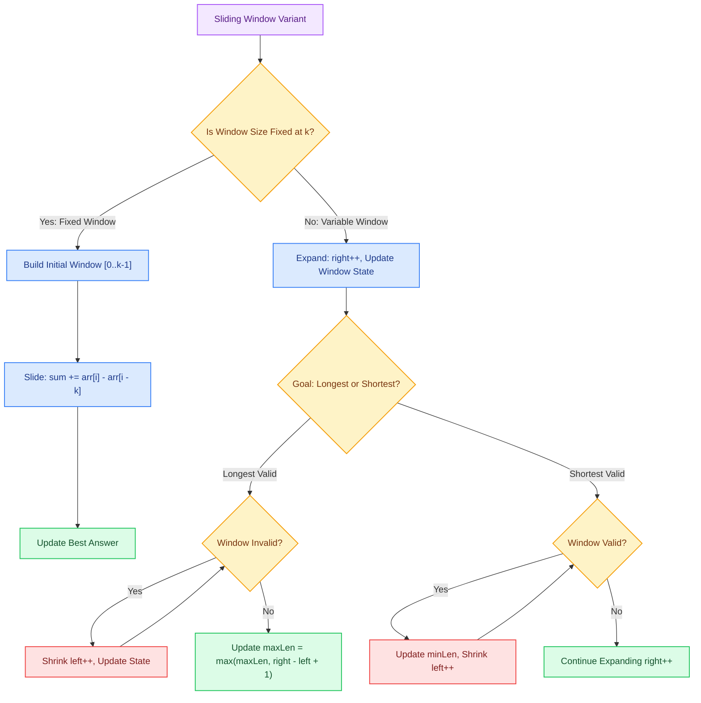

```mermaid
sequenceDiagram
    participant R as Right Pointer
    participant W as Window Frequency Map
    participant L as Left Pointer
    Note over R,W: Minimum Window Substring Cycle
    R->>W: Add s[right] to windowFreq
    W-->>R: Check if windowFreq[c] == tFreq[c], formed++
    loop while formed == required
        L->>W: Record candidate [left..right] if smaller
        L->>W: Decrement s[left] in windowFreq
        W-->>L: If count &lt; tFreq[leftChar], formed--
        L->>L: Advance left++
    end
```

#### Section Complexity Overview

| Problem | Window Type | Brute Force | Optimal Time | Optimal Space |
|---------|-------------|-------------|--------------|---------------|
| Longest Substring Without Repeating Chars | Variable (HashMap Jump) | `O(n³)` | `O(n)` | `O(min(n, m))` |
| Minimum Window Substring | Variable (Freq Match) | `O(n² * m)` | `O(|s| + |t|)` | `O(|t|)` |
| Max Sum Subarray of Size K | Fixed Size `k` | `O(n * k)` | `O(n)` | `O(1)` |
| Longest Repeating Char Replacement | Variable (`len - maxFreq &lt;= k`) | `O(n²)` | `O(n)` | `O(1)` |

> [!TIP]
> In **Longest Substring Without Repeating Characters**, `left = Math.max(left, charIndex.get(c) + 1)` prevents `left` from ever jumping backward to a stale duplicate outside the current window!

### Problem 1: Longest Substring Without Repeating Characters

**Problem Statement**
Given a string `s`, find the length of the longest substring without repeating characters.

**Brute Force**
```java
// O(n³) time - check all substrings
public int lengthOfLongestSubstring(String s) {
    int maxLen = 0;

    for (int i = 0; i < s.length(); i++) {
        for (int j = i; j < s.length(); j++) {
            Set<Character> chars = new HashSet<>();
            boolean hasDuplicate = false;

            for (int k = i; k <= j; k++) {
                if (!chars.add(s.charAt(k))) {
                    hasDuplicate = true;
                    break;
                }
            }

            if (!hasDuplicate) {
                maxLen = Math.max(maxLen, j - i + 1);
            }
        }
    }

    return maxLen;
}
```

**Optimal Approach (Variable Size Sliding Window)**

```java
public int lengthOfLongestSubstring(String s) {
    Map<Character, Integer> charIndex = new HashMap<>();
    int maxLen = 0;
    int left = 0;

    for (int right = 0; right < s.length(); right++) {
        char c = s.charAt(right);

        // If character is in current window, move left pointer
        if (charIndex.containsKey(c)) {
            left = Math.max(left, charIndex.get(c) + 1);
        }

        charIndex.put(c, right);
        maxLen = Math.max(maxLen, right - left + 1);
    }

    return maxLen;
}
```

**Example Walkthrough**: `s = "abcabcbb"`
```
Iteration 0: right=0, c='a', map={a:0}, left=0, maxLen=1
Iteration 1: right=1, c='b', map={a:0,b:1}, left=0, maxLen=2
Iteration 2: right=2, c='c', map={a:0,b:1,c:2}, left=0, maxLen=3
Iteration 3: right=3, c='a', a exists at 0, left=max(0,1)=1, maxLen=3
Iteration 4: right=4, c='b', b exists at 1, left=max(1,2)=2, maxLen=3
...
```

**Complexity Analysis**
- Time: O(n) - Two pointers traverse at most 2n positions
- Space: O(min(n, m)) - HashMap size where m is charset size (usually 26 or 128)

---

### Problem 2: Minimum Window Substring

**Problem Statement**
Given two strings `s` and `t`, return the minimum window in `s` which will contain all the characters in `t` in any order.

**Brute Force**
```java
// O(n * m * n) - impractical
public String minWindow(String s, String t) {
    // Check all substrings and validate if they contain all chars from t
    // ...
}
```

**Optimal Approach (Variable Size Sliding Window with Frequency Map)**

```java
public String minWindow(String s, String t) {
    if (s == null || t == null || s.length() < t.length()) {
        return "";
    }

    // Frequency map for characters in t
    Map<Character, Integer> tFreq = new HashMap<>();
    for (char c : t.toCharArray()) {
        tFreq.put(c, tFreq.getOrDefault(c, 0) + 1);
    }

    int required = tFreq.size(); // Number of unique characters in t with desired frequencies
    int formed = 0; // Number of unique characters in current window with desired frequencies

    Map<Character, Integer> windowFreq = new HashMap<>();

    int[] ans = {Integer.MAX_VALUE, 0, 0}; // {length, left, right}
    int left = 0;

    for (int right = 0; right < s.length(); right++) {
        char c = s.charAt(right);
        windowFreq.put(c, windowFreq.getOrDefault(c, 0) + 1);

        // If frequency of current character matches that in t
        if (tFreq.containsKey(c) && windowFreq.get(c).equals(tFreq.get(c))) {
            formed++;
        }

        // Try to contract the window until it ceases to be valid
        while (left <= right && formed == required) {
            char leftChar = s.charAt(left);

            if (right - left + 1 < ans[0]) {
                ans[0] = right - left + 1;
                ans[1] = left;
                ans[2] = right;
            }

            windowFreq.put(leftChar, windowFreq.get(leftChar) - 1);
            if (tFreq.containsKey(leftChar) &&
                windowFreq.get(leftChar) < tFreq.get(leftChar)) {
                formed--;
            }

            left++;
        }
    }

    return ans[0] == Integer.MAX_VALUE ? "" : s.substring(ans[1], ans[2] + 1);
}
```

**Complexity Analysis**
- Time: O(|s| + |t|) - Each character visited at most twice
- Space: O(|t|) - HashMap for character frequencies

---

### Problem 3: Max Sum Subarray of Size K

**Problem Statement**
Given an array of integers and an integer k, find the maximum sum of a subarray of size k.

**Brute Force**
```java
// O(n*k) time
public int maxSumSubarray(int[] arr, int k) {
    int maxSum = Integer.MIN_VALUE;

    for (int i = 0; i <= arr.length - k; i++) {
        int sum = 0;
        for (int j = i; j < i + k; j++) {
            sum += arr[j];
        }
        maxSum = Math.max(maxSum, sum);
    }

    return maxSum;
}
```

**Optimal Approach (Fixed Size Sliding Window)**

```java
public int maxSumSubarray(int[] arr, int k) {
    int windowSum = 0;

    // Calculate sum of first window
    for (int i = 0; i < k; i++) {
        windowSum += arr[i];
    }

    int maxSum = windowSum;

    // Slide the window
    for (int i = k; i < arr.length; i++) {
        windowSum = windowSum - arr[i - k] + arr[i];
        maxSum = Math.max(maxSum, windowSum);
    }

    return maxSum;
}
```

**Complexity Analysis**
- Time: O(n) - Single pass after initial window
- Space: O(1)

---

### Problem 4: Longest Repeating Character Replacement

**Problem Statement**
You can choose any character in the string and replace it with another character. You should find the length of the longest substring containing the same letter you could get after performing the above operation at most k times.

**Brute Force**
```java
// O(n²) or worse - try all substrings
public int characterReplacement(String s, int k) {
    int maxLen = 0;

    for (int i = 0; i < s.length(); i++) {
        for (int j = i; j < s.length(); j++) {
            String substring = s.substring(i, j + 1);
            if (isValidAfterKReplacements(substring, k)) {
                maxLen = Math.max(maxLen, substring.length());
            }
        }
    }

    return maxLen;
}

private boolean isValidAfterKReplacements(String s, int k) {
    Map<Character, Integer> freq = new HashMap<>();
    for (char c : s.toCharArray()) {
        freq.put(c, freq.getOrDefault(c, 0) + 1);
    }

    int maxFreq = Collections.max(freq.values());
    return s.length() - maxFreq <= k;
}
```

**Optimal Approach (Variable Size Sliding Window)**

Key insight: A substring is valid if `length - maxFrequency <= k` (we need at most k replacements).

```java
public int characterReplacement(String s, int k) {
    Map<Character, Integer> freq = new HashMap<>();
    int left = 0;
    int maxLen = 0;
    int maxFreq = 0;

    for (int right = 0; right < s.length(); right++) {
        char c = s.charAt(right);
        freq.put(c, freq.getOrDefault(c, 0) + 1);
        maxFreq = Math.max(maxFreq, freq.get(c));

        // If window size - max frequency > k, contract the window
        while (right - left + 1 - maxFreq > k) {
            char leftChar = s.charAt(left);
            freq.put(leftChar, freq.get(leftChar) - 1);
            left++;
        }

        maxLen = Math.max(maxLen, right - left + 1);
    }

    return maxLen;
}
```

**Complexity Analysis**
- Time: O(n) - Each character visited at most twice
- Space: O(1) - Fixed alphabet size (26 uppercase letters)

---

## Prefix Sum

### Core Concept
Prefix sum allows us to compute the sum of any subarray in O(1) time after O(n) preprocessing.

`prefixSum[i] = sum of all elements from index 0 to i-1`
`sum(left, right) = prefixSum[right+1] - prefixSum[left]`

**Algorithm Intuition:**
- **Range sum as a difference**: Any contiguous subarray `[i..j]` has sum `P[j+1] - P[i]`, turning a 2D search over `(i, j)` into a 1D lookup.
- **Handling negative numbers**: Unlike Sliding Window (which requires monotonic sums, i.e., non-negative numbers), **Prefix Sum + HashMap** works with arbitrary negative, zero, and positive integers.
- **Seed `{0: 1}`**: Initializing `prefixSumCount.put(0, 1)` accounts for subarrays starting at index `0` whose running sum equals `k` directly.

> [!IMPORTANT]
> **Why Sliding Window Fails Here**: When an array contains negative numbers or zeros, expanding the window does not strictly increase the sum and shrinking does not strictly decrease it. Always reach for **Prefix Sum + HashMap** when negatives are allowed!

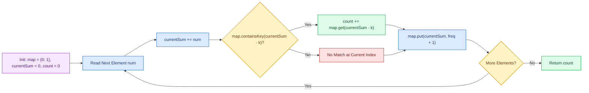

#### Section Complexity Overview

| Approach | Works with Negatives? | Time Complexity | Space Complexity |
|----------|-----------------------|-----------------|------------------|
| Brute Force Nested Loops | Yes | `O(n²)` | `O(1)` |
| Prefix Sum Array Only | Yes | `O(n²)` (still pairs) | `O(n)` |
| Prefix Sum + HashMap (Optimal) | Yes | `O(n)` | `O(n)` |

> [!WARNING]
> Always check `prefixSumCount.containsKey(currentSum - k)` **before** inserting `currentSum` into the map. If `k = 0`, inserting `currentSum` first would falsely count an empty subarray!

### Problem: Subarray Sum Equals K

**Problem Statement**
Given an integer array `nums` and an integer `k`, return the total number of subarrays whose sum equals to `k`.

**Brute Force**
```java
// O(n²) time
public int subarraySum(int[] nums, int k) {
    int count = 0;

    for (int i = 0; i < nums.length; i++) {
        int sum = 0;
        for (int j = i; j < nums.length; j++) {
            sum += nums[j];
            if (sum == k) count++;
        }
    }

    return count;
}
```

**Optimal Approach (Prefix Sum + HashMap)**

Key insight: If `prefixSum[j] - prefixSum[i] = k`, then `prefixSum[i] = prefixSum[j] - k`. We count how many times we've seen `currentSum - k`.

```java
public int subarraySum(int[] nums, int k) {
    Map<Integer, Integer> prefixSumCount = new HashMap<>();
    prefixSumCount.put(0, 1); // Base case: empty prefix

    int currentSum = 0;
    int count = 0;

    for (int num : nums) {
        currentSum += num;

        // If currentSum - k exists, we found subarrays with sum k
        if (prefixSumCount.containsKey(currentSum - k)) {
            count += prefixSumCount.get(currentSum - k);
        }

        prefixSumCount.put(currentSum, prefixSumCount.getOrDefault(currentSum, 0) + 1);
    }

    return count;
}
```

**Example**: `nums = [1,1,1], k = 2`
```
Index 0: currentSum=1, no (1-2=-1), map={0:1, 1:1}, count=0
Index 1: currentSum=2, yes (2-2=0), count=1, map={0:1, 1:1, 2:1}
Index 2: currentSum=3, no (3-2=1 exists), count=2, map={0:1, 1:1, 2:1, 3:1}
Return 2: [1,1] and [1,1] (indices 0-1 and 1-2)
```

**Complexity Analysis**
- Time: O(n)
- Space: O(n) for HashMap

---

## Kadane's Algorithm

### Core Concept
Kadane's algorithm finds the maximum sum of a contiguous subarray. Key idea: At each position, decide whether to extend the previous subarray or start fresh.

**Algorithm Intuition:**
- **Optimal substructure (1D DP in `O(1)` space)**: Let `currentSum` be the maximum subarray sum *ending* at index `i`. Any prefix with a negative sum can only hurt future totals, so we discard it by resetting `currentSum = nums[i]`.
- **Two-variable tracking**: `currentSum` tracks the local best ending here; `maxSum` tracks the global best seen anywhere so far.
- **All-negative arrays**: Initializing `maxSum = nums[0]` and `currentSum = nums[0]` (instead of `0`) ensures at least one element is always selected.

> [!TIP]
> Kadane's is just **Dynamic Programming** with space compression: `dp[i] = max(nums[i], dp[i - 1] + nums[i])`. Since `dp[i]` only depends on `dp[i - 1]`, a single scalar `currentSum` replaces the `O(n)` DP array.

#### Visual Walkthrough: Kadane's Reset vs Extend (`O(n)` Time, `O(1)` Space)


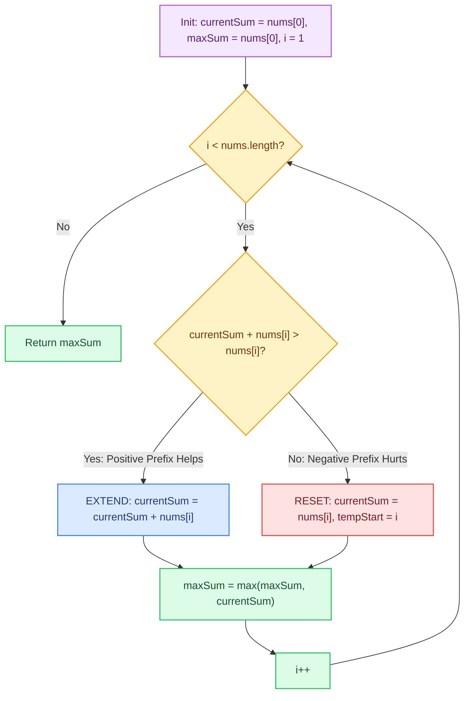

#### Section Complexity Overview

| Variant | Approach | Time Complexity | Space Complexity |
|---------|----------|-----------------|------------------|
| Brute Force | Check All `(i, j)` Subarrays | `O(n³)` | `O(1)` |
| Kadane's (Max Sum Only) | Local vs Global Max | `O(n)` | `O(1)` |
| Kadane's (With Start/End Indices) | Track `tempStart`, `start`, `end` | `O(n)` | `O(1)` |

> [!WARNING]
> Never initialize `maxSum = 0` when negative numbers are possible and a non-empty subarray is required (e.g., `nums = [-5, -2, -8]` must return `-2`, not `0`).

### Problem: Maximum Subarray

**Problem Statement**
Given an integer array `nums`, find the subarray with the largest sum and return its sum. You must select at least one element.

**Brute Force**
```java
// O(n³) - check all subarrays
public int maxSubArray(int[] nums) {
    int max = Integer.MIN_VALUE;

    for (int i = 0; i < nums.length; i++) {
        for (int j = i; j < nums.length; j++) {
            int sum = 0;
            for (int k = i; k <= j; k++) {
                sum += nums[k];
            }
            max = Math.max(max, sum);
        }
    }

    return max;
}
```

**Optimal Approach (Kadane's Algorithm)**

```java
public int maxSubArray(int[] nums) {
    int maxSum = nums[0];
    int currentSum = nums[0];

    for (int i = 1; i < nums.length; i++) {
        // Either extend the existing subarray or start fresh
        currentSum = Math.max(nums[i], currentSum + nums[i]);
        maxSum = Math.max(maxSum, currentSum);
    }

    return maxSum;
}
```

**Why It Works**
- `currentSum` represents the best sum ending at position i
- At each position, we decide: include current in previous subarray or start new
- We always pick the option with larger sum

**Example**: `nums = [-2,1,-3,4,-1,2,1,-5,4]`
```
Index: 0  1   2  3  4  5 6  7  8
Value: -2 1  -3  4 -1  2 1 -5  4
curr:  -2 1  -2  4  3  5 6  1  5
max:   -2 1   1  4  4  5 6  6  6
```

**Complexity Analysis**
- Time: O(n)
- Space: O(1)

**Variant: Return Subarray Itself**
```java
public int[] maxSubArrayWithIndices(int[] nums) {
    int maxSum = nums[0];
    int currentSum = nums[0];
    int start = 0, tempStart = 0, end = 0;

    for (int i = 1; i < nums.length; i++) {
        if (nums[i] > currentSum + nums[i]) {
            currentSum = nums[i];
            tempStart = i;
        } else {
            currentSum += nums[i];
        }

        if (currentSum > maxSum) {
            maxSum = currentSum;
            start = tempStart;
            end = i;
        }
    }

    return new int[]{start, end, maxSum};
}
```

---

## String Manipulation

**Algorithm Intuition:**
- **Canonical signatures for anagrams**: Two strings are anagrams iff they share the exact same character frequency vector (`int[26]`) or identical sorted character sequence.
- **Expand around center for palindromes**: Every palindrome has a center (either 1 character for odd length or 2 characters for even length). Checking `2n - 1` centers in `O(n)` each avoids `O(n²)` DP table space.
- **Immutability in Java**: `String` concatenation in loops (`s += c`) allocates a new `String` each iteration (`O(n²)` total); use `StringBuilder`, `char[]`, or `int[26]` frequency arrays.

> [!TIP]
> For **Group Anagrams**, if strings are long (`k` is large), you can replace `O(k log k)` sorting with an `O(k)` frequency-signature key (e.g., `"#1#0#2..."` from `int[26]`), reducing total time from `O(n * k log k)` to `O(n * k)`.

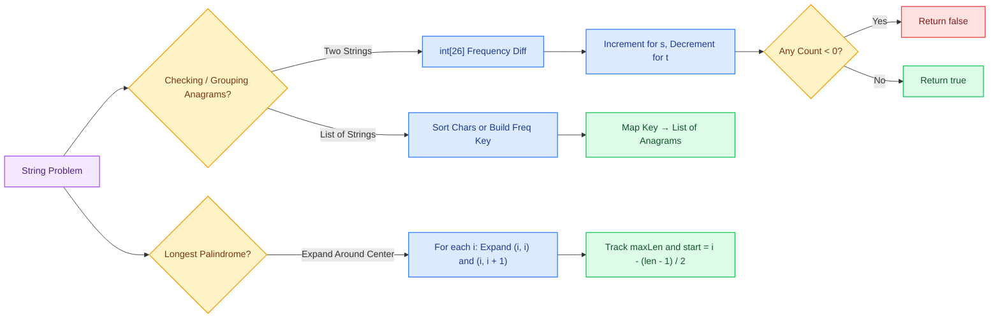

#### Section Complexity Overview

| Problem | Approach | Time Complexity | Space Complexity |
|---------|----------|-----------------|------------------|
| Valid Anagram | Sorting `char[]` | `O(n log n)` | `O(n)` (`char[]`) |
| Valid Anagram | `int[26]` Frequency Array (Optimal) | `O(n)` | `O(1)` |
| Longest Palindromic Substring | Expand Around Center | `O(n²)` | `O(1)` |
| Group Anagrams | Sorted Key + `HashMap` | `O(n * k log k)` | `O(n * k)` |

> [!IMPORTANT]
> In **Expand Around Center**, the start index formula `start = i - (len - 1) / 2` works uniformly for **both** odd-length (`len = 3`, `i - 1`) and even-length (`len = 4`, `i - 1`) palindromes centered at `(i, i+1)`.

### Problem 1: Valid Anagram

**Problem Statement**
Given two strings `s` and `t`, return `true` if `t` is an anagram of `s`, and `false` otherwise. An anagram is a word formed by rearranging the letters of another word.

**Solution 1: Sorting**
```java
public boolean isAnagram(String s, String t) {
    if (s.length() != t.length()) return false;

    char[] sArr = s.toCharArray();
    char[] tArr = t.toCharArray();
    Arrays.sort(sArr);
    Arrays.sort(tArr);

    return Arrays.equals(sArr, tArr);
}
// Time: O(n log n), Space: O(1) or O(n) depending on sort
```

**Solution 2: Frequency Map (Optimal)**
```java
public boolean isAnagram(String s, String t) {
    if (s.length() != t.length()) return false;

    int[] freq = new int[26];

    for (char c : s.toCharArray()) {
        freq[c - 'a']++;
    }

    for (char c : t.toCharArray()) {
        freq[c - 'a']--;
        if (freq[c - 'a'] < 0) return false;
    }

    return true;
}
// Time: O(n), Space: O(1)
```

---

### Problem 2: Longest Palindromic Substring

**Problem Statement**
Given a string `s`, return the longest palindromic substring in `s`.

**Solution 1: Expand Around Center**
```java
public String longestPalindrome(String s) {
    if (s == null || s.length() < 1) return "";

    int start = 0, maxLen = 0;

    for (int i = 0; i < s.length(); i++) {
        // Odd length palindromes
        int len1 = expandAroundCenter(s, i, i);
        // Even length palindromes
        int len2 = expandAroundCenter(s, i, i + 1);

        int len = Math.max(len1, len2);

        if (len > maxLen) {
            maxLen = len;
            start = i - (len - 1) / 2;
        }
    }

    return s.substring(start, start + maxLen);
}

private int expandAroundCenter(String s, int left, int right) {
    while (left >= 0 && right < s.length() && s.charAt(left) == s.charAt(right)) {
        left--;
        right++;
    }
    return right - left - 1; // Length of palindrome
}
// Time: O(n²), Space: O(1)
```

---

### Problem 3: Group Anagrams

**Problem Statement**
Given an array of strings `strs`, group the anagrams together. You can return the answer in any order.

**Solution: Sorting + HashMap**
```java
public List<List<String>> groupAnagrams(String[] strs) {
    Map<String, List<String>> map = new HashMap<>();

    for (String str : strs) {
        char[] chars = str.toCharArray();
        Arrays.sort(chars);
        String key = String.valueOf(chars);

        map.putIfAbsent(key, new ArrayList<>());
        map.get(key).add(str);
    }

    return new ArrayList<>(map.values());
}
// Time: O(n * k log k) where k is max string length
// Space: O(n * k)
```

---

## Matrix Problems

**Algorithm Intuition:**
- **4-way cyclic swap (Rotate Matrix)**: Rotating an `n x n` matrix `90°` clockwise in-place is a 4-cell cycle per `offset` in each concentric layer (`top → right → bottom → left → top`), or equivalently **Transpose + Reverse Each Row**.
- **Shrinking boundaries (Spiral Matrix)**: Maintain `top`, `bottom`, `left`, `right` fences. After each directional sweep, tighten the corresponding boundary and guard `top <= bottom` / `left <= right` before sweeping back.
- **Saddleback / Staircase search (Search 2D Matrix II)**: Starting at the **top-right** (or **bottom-left**) corner places smaller values strictly to the left and larger values strictly below, eliminating an entire row or column per comparison in `O(m + n)`.

> [!TIP]
> **Interview Shortcut for Rotate Matrix**: If you struggle with index math for 4-way layer swaps under pressure, remember `90° clockwise = Transpose (swap matrix[i][j] with matrix[j][i]) + Reverse each row`. Both are `O(n²)` time and `O(1)` space!

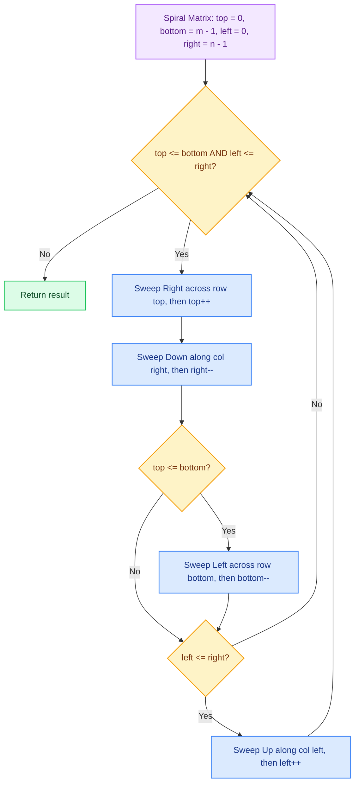

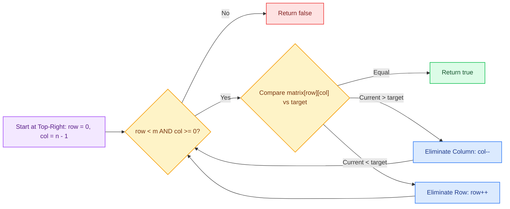

#### Section Complexity Overview

| Problem | Technique | Time Complexity | Space Complexity |
|---------|-----------|-----------------|------------------|
| Rotate Matrix (`n x n`) | Layer-by-Layer 4-Way Swap | `O(n²)` | `O(1)` |
| Spiral Matrix (`m x n`) | 4-Boundary Shrinking Loop | `O(m * n)` | `O(1)` (excl. output) |
| Search a 2D Matrix (`m x n`) | Top-Right Staircase Search | `O(m + n)` | `O(1)` |

> [!WARNING]
> In **Spiral Matrix**, omitting the `if (top <= bottom)` and `if (left <= right)` guards before sweeping left and up will cause duplicate elements on non-square matrices (e.g., `1 x 4` or `3 x 1`).

### Problem 1: Rotate Matrix

**Problem Statement**
You are given an `n x n` 2D matrix representing an image, rotate the image by 90 degrees (clockwise).

**Approach: Layer by Layer Rotation**

Key insight: Rotate the matrix layer by layer from outside to inside.

```
Original          After 90° clockwise
1 2 3              7 4 1
4 5 6              8 5 2
7 8 9              9 6 3
```

```java
public void rotate(int[][] matrix) {
    int n = matrix.length;

    for (int layer = 0; layer < n / 2; layer++) {
        int first = layer;
        int last = n - 1 - layer;

        for (int i = first; i < last; i++) {
            int offset = i - first;

            // Save top
            int top = matrix[first][i];

            // Move left to top
            matrix[first][i] = matrix[last - offset][first];

            // Move bottom to left
            matrix[last - offset][first] = matrix[last][last - offset];

            // Move right to bottom
            matrix[last][last - offset] = matrix[i][last];

            // Move top to right
            matrix[i][last] = top;
        }
    }
}
// Time: O(n²), Space: O(1)
```

---

### Problem 2: Spiral Matrix Traversal

**Problem Statement**
Given an `m x n` matrix, return all elements of the matrix in spiral order.

```
Matrix            Output
1 2 3             1 2 3 6 9 8 7 4 5
4 5 6
7 8 9
```

**Solution**
```java
public List<Integer> spiralOrder(int[][] matrix) {
    List<Integer> result = new ArrayList<>();
    if (matrix == null || matrix.length == 0) return result;

    int top = 0, bottom = matrix.length - 1;
    int left = 0, right = matrix[0].length - 1;

    while (top <= bottom && left <= right) {
        // Traverse right
        for (int i = left; i <= right; i++) {
            result.add(matrix[top][i]);
        }
        top++;

        // Traverse down
        for (int i = top; i <= bottom; i++) {
            result.add(matrix[i][right]);
        }
        right--;

        // Traverse left (if there's a row remaining)
        if (top <= bottom) {
            for (int i = right; i >= left; i--) {
                result.add(matrix[bottom][i]);
            }
            bottom--;
        }

        // Traverse up (if there's a column remaining)
        if (left <= right) {
            for (int i = bottom; i >= top; i--) {
                result.add(matrix[i][left]);
            }
            left++;
        }
    }

    return result;
}
// Time: O(m*n), Space: O(1) excluding output
```

---

### Problem 3: Search a 2D Matrix

**Problem Statement**
Write an efficient algorithm that searches for a value `target` in an `m x n` integer matrix. The matrix has the following properties:
- Integers in each row are sorted from left to right
- Integers in each column are sorted from top to bottom

**Solution: Search from Top-Right or Bottom-Left**

```java
public boolean searchMatrix(int[][] matrix, int target) {
    if (matrix == null || matrix.length == 0) return false;

    int row = 0;
    int col = matrix[0].length - 1;

    while (row < matrix.length && col >= 0) {
        int current = matrix[row][col];

        if (current == target) {
            return true;
        } else if (current > target) {
            col--;
        } else {
            row++;
        }
    }

    return false;
}
// Time: O(m + n), Space: O(1)
```

**Why This Works**
- Start from top-right corner
- If current > target: move left (smaller values)
- If current < target: move down (larger values)
- This eliminates either a row or column each step

---

## Interview Tips & Patterns

**Pattern Selection Intuition:**
- Match **data constraints** (sorted vs unsorted, negative numbers allowed vs non-negative only, in-place vs extra space) to the right linear-time pattern before coding.
- Always state the **brute-force baseline** first (`O(n²)` or `O(n³)`), then explain which redundant work is eliminated by pointers, window state, or prefix sums.

> [!TIP]
> **The 30-Second Pattern Check**: Ask yourself three questions at the start of any Array/String problem: (1) Is it sorted? (2) Does it ask for a contiguous subarray/substring? (3) Are negative numbers allowed?

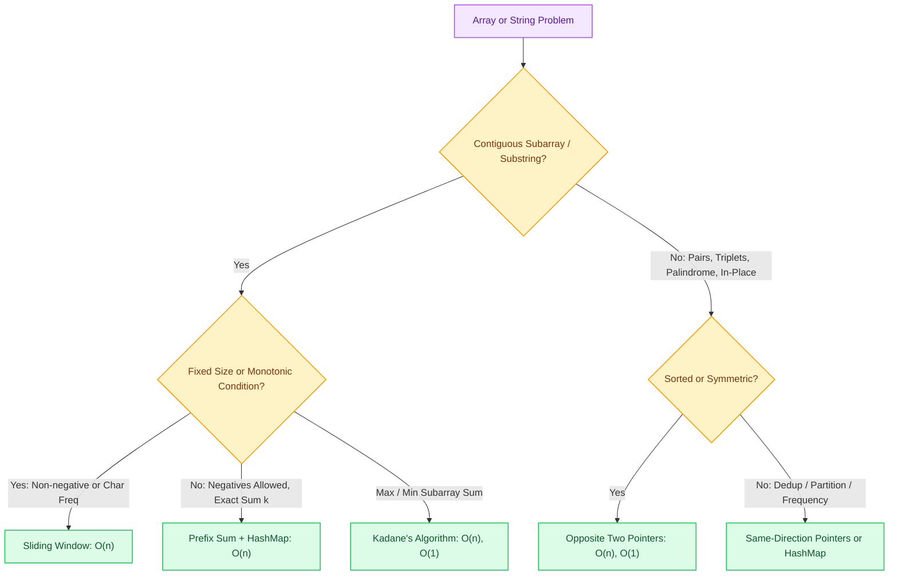

### When to Use Two Pointers
- Finding pairs with specific sum
- Checking palindromes
- Sorting related problems
- Removing elements in-place
- Slow/fast pointer scenarios

### When to Use Sliding Window
- Subarray/substring problems
- Fixed or variable window size
- Optimization from O(n²) to O(n)

### Common Edge Cases
- Empty array/string
- Single element
- All same elements
- Negative numbers
- Overflow considerations

#### Quick Pattern & Edge-Case Checklist

| Constraint / Signal | Recommended Pattern | Typical Time | Typical Space |
|---------------------|---------------------|--------------|---------------|
| Sorted array + target pair/triplet | Opposite Two Pointers | `O(n)` / `O(n²)` | `O(1)` |
| Substring / subarray + monotonic rule | Sliding Window | `O(n)` | `O(1)` / `O(k)` |
| Subarray sum = `k` with negatives | Prefix Sum + HashMap | `O(n)` | `O(n)` |
| Maximum contiguous subarray sum | Kadane's Algorithm | `O(n)` | `O(1)` |
| Character counts / anagram grouping | `int[26]` or `HashMap` | `O(n)` | `O(1)` / `O(n)` |

> [!WARNING]
> **Integer Overflow & Empty Inputs**: In Java, subarray sums can exceed `Integer.MAX_VALUE` (`2^31 - 1`); clarify with your interviewer whether `long` is needed for prefix sums, and always guard `nums == null || nums.length == 0`.

---

## Summary Table

**Complexity Optimization Intuition:**
- Every core technique in this guide compresses a brute-force `O(n²)` or `O(n³)` search into **`O(n)` linear time** by trading redundant inner loops for either **pointer invariants** (`O(1)` space) or **prefix/frequency state** (`O(n)` space).

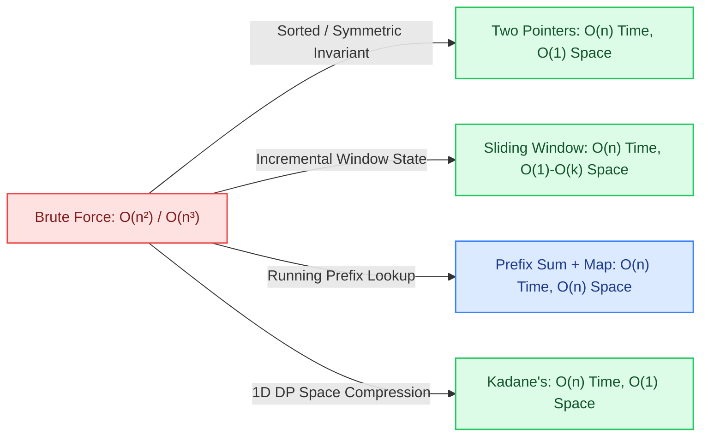

| Technique | Best For | Time | Space |
|-----------|----------|------|-------|
| Two Pointers | Pairs, Palindromes | O(n) | O(1) |
| Sliding Window | Subarrays, Substrings | O(n) | O(1) or O(n) |
| Prefix Sum | Subarray Sums | O(n) | O(n) |
| Kadane's | Max Subarray | O(n) | O(1) |
| HashMap | Frequency, Anagrams | O(n) | O(n) |

> [!IMPORTANT]
> Master these five `O(n)` primitives—**Two Pointers**, **Sliding Window**, **Prefix Sum**, **Kadane's**, and **Frequency Maps**—as they form the building blocks for 80%+ of FAANG array and string interview questions.

