# Hashing and Heaps - Comprehensive Guide for FAANG Interviews

## Table of Contents
1. [HashMap/HashSet Patterns](#hashmaphashset-patterns)
2. [HashMap Internals in Java](#hashmap-internals-in-java)
3. [Frequency Counting Patterns](#frequency-counting-patterns)
4. [Priority Queue and Heap](#priority-queue-and-heap)
5. [Min-Heap vs Max-Heap](#min-heap-vs-max-heap)
6. [TreeMap/TreeSet Usage](#treemaptreeset-usage)
7. [Complex Comparator Patterns in Java](#complex-comparator-patterns-in-java)
8. [Summary & Patterns Cheat Sheet](#summary--patterns-cheat-sheet)
9. [Practice Summary](#practice-summary)

---

## HashMap/HashSet Patterns

Hash-based structures trade `O(n)` space to eliminate nested `O(n²)` scans, turning complement lookup, grouping, sequence start detection, and prefix-sum matching into `O(1)` average-time probes.

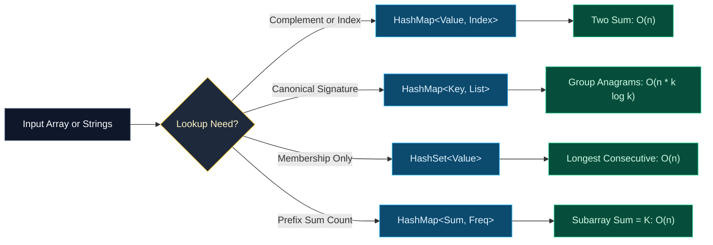

> [!TIP]
> Whenever an `O(n²)` brute-force loop searches for "does a matching past element exist?", reach for a `HashMap` (need index/count) or `HashSet` (need presence only).

| Pattern | Classic Problem | Key Invariant | Time | Space |
|---------|----------------|---------------|------|-------|
| Complement Lookup | Two Sum | Check `target - nums[i]` before inserting `nums[i]` | `O(n)` | `O(n)` |
| Canonical Key | Group Anagrams | Sorted string or `#count` encoding maps anagrams to one bucket | `O(n * k log k)` / `O(n * k)` | `O(n * k)` |
| Sequence Start Guard | Longest Consecutive Sequence | Expand only when `!set.contains(num - 1)` | `O(n)` | `O(n)` |
| Prefix Sum Frequency | Subarray Sum Equals K | Seed `{0: 1}` and query `currentSum - k` | `O(n)` | `O(n)` |
| Freq + Heap / Buckets | Top K Frequent Elements | Size-`k` Min-Heap or frequency-indexed buckets | `O(n log k)` / `O(n)` | `O(n)` |

### Problem 1: Two Sum

**Problem Statement**
Given an array of integers `nums` and an integer `target`, return the indices of the two numbers that add up to `target`. You may assume each input has exactly one solution, and you cannot use the same element twice.

**Brute Force**
```java
// O(n²) time
public int[] twoSum(int[] nums, int target) {
    for (int i = 0; i < nums.length; i++) {
        for (int j = i + 1; j < nums.length; j++) {
            if (nums[i] + nums[j] == target) {
                return new int[]{i, j};
            }
        }
    }
    return new int[]{};
}
```

**Optimal Approach (HashMap)**

Key insight: For each number, check if `target - number` exists in the map.

```java
public int[] twoSum(int[] nums, int target) {
    Map<Integer, Integer> map = new HashMap<>();

    for (int i = 0; i < nums.length; i++) {
        int complement = target - nums[i];

        // Check if complement exists in map
        if (map.containsKey(complement)) {
            return new int[]{map.get(complement), i};
        }

        // Add current number to map
        map.put(nums[i], i);
    }

    return new int[]{};
}
```

**Complexity**
- Time: O(n) - Single pass
- Space: O(n) - HashMap

**Interview Follow-ups**
- "What if there are multiple solutions?" → Return all or the first one
- "What if we can use the same element twice?" → Handle nums[i] == complement case
- "What if the array is sorted?" → Use two pointers for O(1) space

---

### Problem 2: Group Anagrams

**Problem Statement**
Given an array of strings `strs`, group the anagrams together. You can return the answer in any order.

**Approach: Sorted String as Key**

```java
public List<List<String>> groupAnagrams(String[] strs) {
    Map<String, List<String>> map = new HashMap<>();

    for (String str : strs) {
        // Sort characters to create key
        char[] chars = str.toCharArray();
        Arrays.sort(chars);
        String key = String.valueOf(chars);

        // Group anagrams using the sorted key
        map.putIfAbsent(key, new ArrayList<>());
        map.get(key).add(str);
    }

    return new ArrayList<>(map.values());
}
```

**Example**: `strs = ["eat","tea","ate","nat","bat"]`
```
"eat" → sort to "aet" → key="aet"
"tea" → sort to "aet" → key="aet" (same group)
"ate" → sort to "aet" → key="aet" (same group)
"nat" → sort to "ant" → key="ant"
"bat" → sort to "abt" → key="abt"

Result: [[eat,tea,ate], [nat], [bat]]
```

**Complexity**
- Time: O(n * k log k) where k is average string length
- Space: O(n * k)

**Alternative: Frequency Count as Key**
```java
public List<List<String>> groupAnagrams(String[] strs) {
    Map<String, List<String>> map = new HashMap<>();

    for (String str : strs) {
        int[] freq = new int[26];
        for (char c : str.toCharArray()) {
            freq[c - 'a']++;
        }

        // Convert frequency array to string key
        StringBuilder key = new StringBuilder();
        for (int count : freq) {
            key.append("#").append(count);
        }

        map.putIfAbsent(key.toString(), new ArrayList<>());
        map.get(key.toString()).add(str);
    }

    return new ArrayList<>(map.values());
}
```

---

### Problem 3: Longest Consecutive Sequence

**Problem Statement**
Given an unsorted array of integers `nums`, return the length of the longest consecutive elements sequence. You must write an algorithm that runs in O(n) time.

**Brute Force**
```java
// O(n log n) - violates the O(n) requirement
public int longestConsecutive(int[] nums) {
    if (nums.length == 0) return 0;
    Arrays.sort(nums);
    int maxLen = 1, currentLen = 1;

    for (int i = 1; i < nums.length; i++) {
        if (nums[i] == nums[i-1] + 1) {
            currentLen++;
        } else if (nums[i] != nums[i-1]) {
            maxLen = Math.max(maxLen, currentLen);
            currentLen = 1;
        }
    }

    return Math.max(maxLen, currentLen);
}
```

**Optimal Approach (HashSet)**

Key insight: Use HashSet for O(1) lookup. Only start counting from sequence beginnings (i.e., number - 1 is not in set).

```java
public int longestConsecutive(int[] nums) {
    if (nums.length == 0) return 0;

    Set<Integer> set = new HashSet<>();
    for (int num : nums) {
        set.add(num);
    }

    int maxLen = 0;

    for (int num : set) {
        // Only start counting from sequence beginnings
        if (!set.contains(num - 1)) {
            int currentNum = num;
            int currentLen = 1;

            while (set.contains(currentNum + 1)) {
                currentNum++;
                currentLen++;
            }

            maxLen = Math.max(maxLen, currentLen);
        }
    }

    return maxLen;
}
```

**Why This is O(n)**
- Building HashSet: O(n)
- Iteration: Each number visited at most twice (once in outer loop, once while extending)
- Total: O(n)

**Example**: `nums = [100, 4, 200, 1, 3, 2]`
```
Set: {1, 2, 3, 4, 100, 200}
- Start from 1 (100 not in set): 1,2,3,4 → length 4
- Skip 2, 3, 4 (already counted)
- Start from 100 (99 not in set): 100 → length 1
- Start from 200 (199 not in set): 200 → length 1
Result: 4
```

**Complexity**
- Time: O(n)
- Space: O(n)

---

### Problem 4: Subarray Sum Equals K (Revisited with HashMap)

Already covered in Arrays/Strings section, but the HashMap approach is:

```java
public int subarraySum(int[] nums, int k) {
    Map<Integer, Integer> prefixSumCount = new HashMap<>();
    prefixSumCount.put(0, 1);

    int currentSum = 0;
    int count = 0;

    for (int num : nums) {
        currentSum += num;

        if (prefixSumCount.containsKey(currentSum - k)) {
            count += prefixSumCount.get(currentSum - k);
        }

        prefixSumCount.put(currentSum, prefixSumCount.getOrDefault(currentSum, 0) + 1);
    }

    return count;
}
```

---

### Problem 5: Top K Frequent Elements

**Problem Statement**
Given an integer array `nums` and an integer `k`, return the `k` most frequent elements. You may return the answer in any order.

**Solution 1: HashMap + Heap (MinHeap)**

```java
public int[] topKFrequent(int[] nums, int k) {
    // Count frequencies
    Map<Integer, Integer> freqMap = new HashMap<>();
    for (int num : nums) {
        freqMap.put(num, freqMap.getOrDefault(num, 0) + 1);
    }

    // Min-heap of size k (keeps k most frequent elements)
    PriorityQueue<Integer> minHeap = new PriorityQueue<>(
        (a, b) -> freqMap.get(a) - freqMap.get(b)
    );

    // Maintain heap of size k
    for (int num : freqMap.keySet()) {
        minHeap.offer(num);
        if (minHeap.size() > k) {
            minHeap.poll();
        }
    }

    // Build result
    int[] result = new int[k];
    int idx = k - 1;
    while (!minHeap.isEmpty()) {
        result[idx--] = minHeap.poll();
    }

    return result;
}
```

**Complexity**
- Time: O(n log k) - n to count, n log k for heap operations
- Space: O(n) for frequency map

**Solution 2: Bucket Sort (Most Optimal)**

```java
public int[] topKFrequent(int[] nums, int k) {
    // Count frequencies
    Map<Integer, Integer> freqMap = new HashMap<>();
    for (int num : nums) {
        freqMap.put(num, freqMap.getOrDefault(num, 0) + 1);
    }

    // Create buckets indexed by frequency
    List<Integer>[] buckets = new List[nums.length + 1];
    for (int num : freqMap.keySet()) {
        int freq = freqMap.get(num);
        if (buckets[freq] == null) {
            buckets[freq] = new ArrayList<>();
        }
        buckets[freq].add(num);
    }

    // Collect from highest frequency buckets
    int[] result = new int[k];
    int idx = 0;

    for (int i = buckets.length - 1; i >= 0 && idx < k; i--) {
        if (buckets[i] != null) {
            for (int num : buckets[i]) {
                result[idx++] = num;
                if (idx == k) break;
            }
        }
    }

    return result;
}
```

**Complexity**
- Time: O(n) - Single pass
- Space: O(n)

**This is optimal since we can't do better than O(n) (must read all elements).**

> [!IMPORTANT]
> For Top K Frequent Elements, mention both `O(n log k)` Min-Heap (better when `k` is small or streaming) and `O(n)` Bucket Sort (optimal when frequencies are bounded by `nums.length`).

---

## HashMap Internals in Java

Understanding how `HashMap` hashes keys, resolves collisions, and resizes buckets is a staple Java/FAANG systems-coding interview topic.

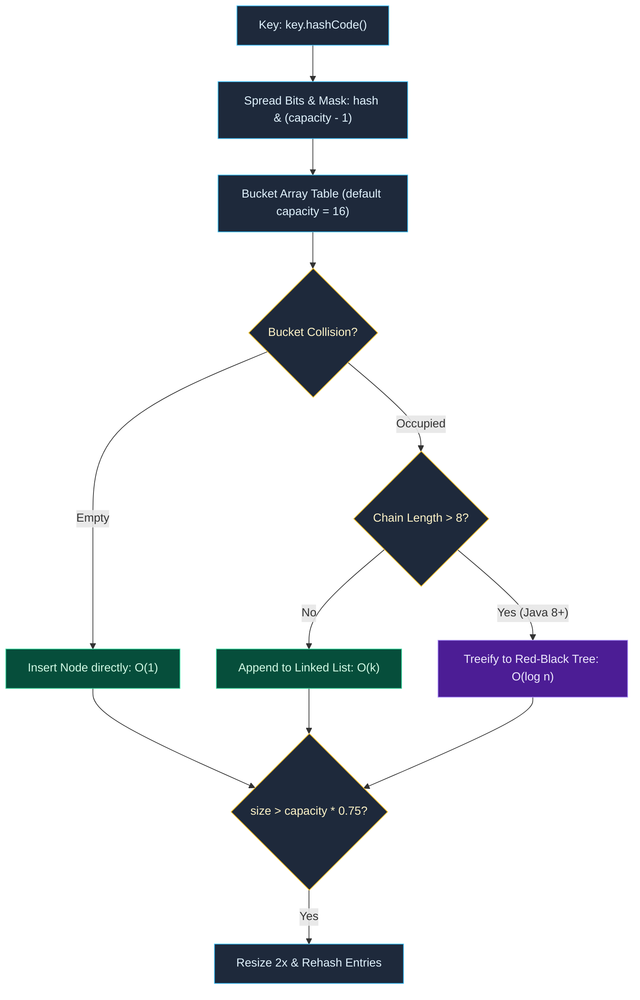

### Key Concepts

**HashMap Structure**
- Array of buckets (default capacity 16)
- Each bucket contains a linked list (or red-black tree in Java 8+)
- Handles collisions via chaining

**Hash Function**
```
hash(key) = key.hashCode() & (capacity - 1)
```

**Load Factor**
- Default: 0.75
- When size > capacity * loadFactor, array is resized
- Resizing causes rehashing of all entries

**Collision Handling**
- Java uses separate chaining (linked list in each bucket)
- Java 8+: If chain length > 8, converts to red-black tree (O(log n) access)

| Operation | Best Case | Average Case | Worst Case (Pre-Java 8) | Worst Case (Java 8+) |
|-----------|-----------|--------------|-------------------------|----------------------|
| `get(key)` | `O(1)` | `O(1)` | `O(n)` | `O(log n)` |
| `put(key, val)` | `O(1)` | `O(1)` | `O(n)` | `O(log n)` |
| `remove(key)` | `O(1)` | `O(1)` | `O(n)` | `O(log n)` |
| `resize()` | `O(n)` | `O(n)` amortized `O(1)` per insert | `O(n)` | `O(n)` |

> [!WARNING]
> Always override **both** `hashCode()` and `equals()` when using custom objects as `HashMap` keys or `HashSet` elements. Equal objects must produce identical hash codes, or lookups will silently miss the bucket.

### Interview Questions on HashMap Internals

**Q: Why is capacity always a power of 2?**
```
A: To make hash calculation efficient using bitwise AND
hash = hash(key) & (capacity - 1)

If capacity = 16 = 0b10000
capacity - 1 = 15 = 0b01111
This masks the lower 4 bits of hash, faster than modulo
```

**Q: How does rehashing work?**
```java
// Simplified rehashing process
private void resize(int newCapacity) {
    Entry[] oldTable = table;
    table = new Entry[newCapacity];

    for (Entry entry : oldTable) {
        if (entry != null) {
            // Recompute hash with new capacity
            int newHash = entry.hash & (newCapacity - 1);
            // Insert into new table
            table[newHash] = entry;
        }
    }
}
```

**Q: What's the time complexity of HashMap operations?**
- Best case: O(1) - direct bucket access
- Average case: O(1) - assuming good hash function and low load factor
- Worst case: O(n) - all keys hash to same bucket
- Java 8+: Worst case O(log n) due to red-black tree

---

## Frequency Counting Patterns

Frequency counting transforms raw streams into compact `(element → count)` histograms, enabling `O(1)` lookups, bucketed grouping, and greedy heap scheduling.


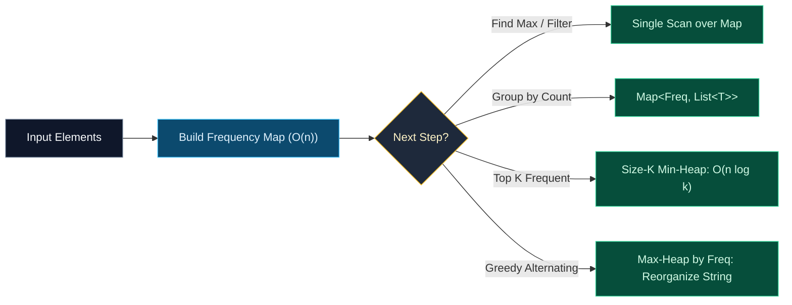

| Variant | Data Structures | Key Condition | Time | Space |
|---------|----------------|---------------|------|-------|
| Max / Threshold Filter | `HashMap<T, Integer>` | `freq.getOrDefault(x, 0) >= threshold` | `O(n)` | `O(u)` unique |
| Group by Frequency | `HashMap<Integer, List<T>>` | Invert `key → count` to `count → keys` | `O(n)` | `O(n)` |
| Top-K Frequent | `HashMap` + Size-`K` Min-Heap | Evict `minHeap.poll()` when `size > k` | `O(n log k)` | `O(n)` |
| Reorganize String | `int[26]` + Max-Heap | Impossible if `maxFreq > (n + 1) / 2` | `O(n)` | `O(1)` |

### General Template

```java
// Pattern 1: Count and find max frequency
Map<T, Integer> freq = new HashMap<>();
for (T element : input) {
    freq.put(element, freq.getOrDefault(element, 0) + 1);
}

int maxFreq = Collections.max(freq.values());
T mostFrequent = freq.entrySet().stream()
    .max(Comparator.comparingInt(Map.Entry::getValue))
    .get()
    .getKey();

// Pattern 2: Count and filter by frequency
List<T> result = new ArrayList<>();
for (T element : input) {
    if (freq.getOrDefault(element, 0) >= threshold) {
        result.add(element);
    }
}

// Pattern 3: Group by frequency
Map<Integer, List<T>> frequencyGroups = new HashMap<>();
for (Map.Entry<T, Integer> entry : freq.entrySet()) {
    frequencyGroups.putIfAbsent(entry.getValue(), new ArrayList<>());
    frequencyGroups.get(entry.getValue()).add(entry.getKey());
}
```

### Problem: Reorganize String

**Problem Statement**
Given a string `s`, reorganize it such that any two adjacent characters are different. Return any possible reorganization. If impossible, return empty string.

**Approach: Max Frequency**

Key insight: If max frequency > (length + 1) / 2, impossible to reorganize.

```java
public String reorganizeString(String s) {
    // Count frequencies
    int[] freq = new int[26];
    int maxFreq = 0;

    for (char c : s.toCharArray()) {
        freq[c - 'a']++;
        maxFreq = Math.max(maxFreq, freq[c - 'a']);
    }

    // Check if reorganization is possible
    if (maxFreq > (s.length() + 1) / 2) {
        return "";
    }

    // Use max heap (store chars with highest frequencies first)
    PriorityQueue<Character> maxHeap = new PriorityQueue<>(
        (a, b) -> freq[b - 'a'] - freq[a - 'a']
    );

    for (int i = 0; i < 26; i++) {
        if (freq[i] > 0) {
            maxHeap.offer((char)('a' + i));
        }
    }

    StringBuilder result = new StringBuilder();

    while (maxHeap.size() >= 2) {
        char first = maxHeap.poll();
        char second = maxHeap.poll();

        result.append(first).append(second);

        freq[first - 'a']--;
        freq[second - 'a']--;

        if (freq[first - 'a'] > 0) {
            maxHeap.offer(first);
        }
        if (freq[second - 'a'] > 0) {
            maxHeap.offer(second);
        }
    }

    if (!maxHeap.isEmpty()) {
        result.append(maxHeap.poll());
    }

    return result.toString();
}
```

**Why Alternating Works**
- Place highest frequency character first
- Then place second highest character
- This spreads out occurrences of frequent characters
- As frequencies decrease, all chars can be placed safely

**Complexity**
- Time: O(n + 26 log 26) = O(n)
- Space: O(1) for alphabet

> [!TIP]
> When the domain is fixed-size (lowercase English letters `'a'..'z'`), prefer `int[26]` over `HashMap<Character, Integer>` to avoid boxing overhead and get `O(1)` space.

---

## Priority Queue and Heap

A heap maintains partial order in a complete binary tree: `O(1)` access to the extremum (`peek`), `O(log n)` insertion (`offer`), and `O(log n)` removal (`poll`).


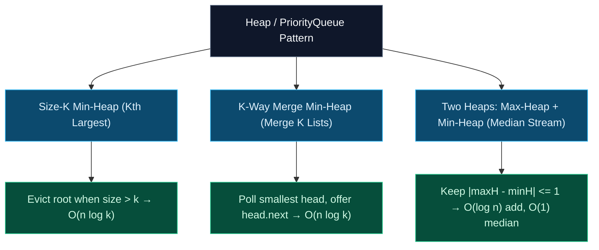

| Problem | Heap Strategy | Time | Space |
|---------|--------------|------|-------|
| Kth Largest Element (Heap) | Min-Heap of size `k` | `O(n log k)` | `O(k)` |
| Kth Largest Element (QuickSelect) | Randomized partition | `O(n)` avg / `O(n²)` worst | `O(1)` |
| Merge K Sorted Lists | Min-Heap of `k` list heads | `O(n log k)` | `O(k)` |
| Find Median from Data Stream | Max-Heap (lower) + Min-Heap (upper) | `O(log n)` add, `O(1)` median | `O(n)` |

### Core Concepts

**Max-Heap**: Parent > children (root is maximum)
**Min-Heap**: Parent < children (root is minimum)

**Java Implementation**
```java
// Default is Min-Heap
PriorityQueue<Integer> minHeap = new PriorityQueue<>();

// Max-Heap using custom comparator
PriorityQueue<Integer> maxHeap = new PriorityQueue<>((a, b) -> b - a);

// Custom objects
PriorityQueue<Person> pq = new PriorityQueue<>(
    (p1, p2) -> p1.age - p2.age  // Min-heap by age
);
```

> [!WARNING]
> Avoid `(a, b) -> b - a` when values can be near `Integer.MIN_VALUE` or `Integer.MAX_VALUE` — subtraction can overflow! Use `Integer.compare(b, a)` or `Comparator.reverseOrder()`.

---

### Problem 1: Kth Largest Element

**Problem Statement**
Find the Kth largest element in an unsorted array. Note: It is the Kth largest element in the sorted order, not the Kth distinct element.

**Solution 1: Min-Heap of Size K**

Key insight: Maintain a min-heap of size k with k largest elements.

```java
public int findKthLargest(int[] nums, int k) {
    // Min-heap of size k
    PriorityQueue<Integer> minHeap = new PriorityQueue<>();

    for (int num : nums) {
        minHeap.offer(num);

        // Keep only k largest elements
        if (minHeap.size() > k) {
            minHeap.poll();
        }
    }

    return minHeap.peek(); // Root of min-heap is kth largest
}
```

**Why This Works**
- Heap stores k largest elements
- Smallest element in heap is the kth largest overall
- Time: O(n log k) - n insertions, log k heap operations

**Solution 2: QuickSelect (Most Optimal)**

```java
public int findKthLargest(int[] nums, int k) {
    return quickSelect(nums, 0, nums.length - 1, nums.length - k);
}

private int quickSelect(int[] nums, int left, int right, int kSmallest) {
    if (left == right) {
        return nums[left];
    }

    // Random pivot for better average case
    Random rand = new Random();
    int pivotIndex = left + rand.nextInt(right - left + 1);

    pivotIndex = partition(nums, left, right, pivotIndex);

    if (kSmallest == pivotIndex) {
        return nums[kSmallest];
    } else if (kSmallest < pivotIndex) {
        return quickSelect(nums, left, pivotIndex - 1, kSmallest);
    } else {
        return quickSelect(nums, pivotIndex + 1, right, kSmallest);
    }
}

private int partition(int[] nums, int left, int right, int pivotIndex) {
    int pivot = nums[pivotIndex];
    swap(nums, pivotIndex, right);

    int storeIndex = left;
    for (int i = left; i < right; i++) {
        if (nums[i] < pivot) {
            swap(nums, storeIndex, i);
            storeIndex++;
        }
    }

    swap(nums, storeIndex, right);
    return storeIndex;
}

private void swap(int[] nums, int i, int j) {
    int temp = nums[i];
    nums[i] = nums[j];
    nums[j] = temp;
}
```

**Complexity**
- Time: Average O(n), Worst O(n²)
- Space: O(1) excluding recursion stack

---

### Problem 2: Merge K Sorted Lists

**Problem Statement**
You are given an array of `k` linked-lists lists, each linked-list is sorted in ascending order. Merge all the linked-lists into one sorted linked-list and return it.

```java
/**
 * Definition for singly-linked list node
 */
public class ListNode {
    int val;
    ListNode next;
    ListNode() {}
    ListNode(int val) { this.val = val; }
    ListNode(int val, ListNode next) { this.val = val; this.next = next; }
}
```

**Solution: Min-Heap**

```java
public ListNode mergeKLists(ListNode[] lists) {
    if (lists == null || lists.length == 0) return null;

    // Min-heap by node value
    PriorityQueue<ListNode> minHeap = new PriorityQueue<>(
        (a, b) -> a.val - b.val
    );

    // Add first node of each list to heap
    for (ListNode list : lists) {
        if (list != null) {
            minHeap.offer(list);
        }
    }

    ListNode dummy = new ListNode(0);
    ListNode current = dummy;

    while (!minHeap.isEmpty()) {
        ListNode smallest = minHeap.poll();
        current.next = smallest;
        current = current.next;

        // Add next node from same list
        if (smallest.next != null) {
            minHeap.offer(smallest.next);
        }
    }

    return dummy.next;
}
```

**Complexity**
- Time: O(n log k) where n = total nodes, k = number of lists
  - Each node inserted/removed once: O(n)
  - Each operation takes O(log k): O(n log k)
- Space: O(k) for heap

---

### Problem 3: Find Median from Data Stream

**Problem Statement**
The median is the middle value in an ordered integer list. If the size of the list is even, the median is the average of the two middle values. Design a data structure that supports:
1. Adding integers
2. Finding the median

**Solution: Two Heaps**

Key insight: Use a max-heap for smaller half and min-heap for larger half.

```java
class MedianFinder {
    private PriorityQueue<Integer> maxHeap; // Smaller half
    private PriorityQueue<Integer> minHeap; // Larger half

    public MedianFinder() {
        maxHeap = new PriorityQueue<>((a, b) -> b - a); // Max-heap
        minHeap = new PriorityQueue<>(); // Min-heap (default)
    }

    public void addNum(int num) {
        // Always add to max-heap first
        maxHeap.offer(num);

        // Ensure all elements in maxHeap <= all in minHeap
        if (!maxHeap.isEmpty() && !minHeap.isEmpty() &&
            maxHeap.peek() > minHeap.peek()) {
            int temp = maxHeap.poll();
            minHeap.offer(temp);
        }

        // Maintain size property: size(maxHeap) == size(minHeap) or size(maxHeap) == size(minHeap) + 1
        if (maxHeap.size() > minHeap.size() + 1) {
            int temp = maxHeap.poll();
            minHeap.offer(temp);
        }

        if (minHeap.size() > maxHeap.size()) {
            int temp = minHeap.poll();
            maxHeap.offer(temp);
        }
    }

    public double findMedian() {
        if (maxHeap.size() > minHeap.size()) {
            return maxHeap.peek();
        }
        return (maxHeap.peek() + minHeap.peek()) / 2.0;
    }
}
```

**Visualization**
```
After adding [1, 2]:
maxHeap: [2, 1]  minHeap: []
sizes: 2, 0 → adjust to 1, 1

After adding [3]:
maxHeap: [2]  minHeap: [3]
sizes: 1, 1

Median = (2 + 3) / 2 = 2.5
```

**Complexity**
- addNum: O(log n)
- findMedian: O(1)
- Space: O(n)

---

## Min-Heap vs Max-Heap

Choosing the opposite heap from the problem's phrasing ("Kth **largest**" → **Min-Heap** of size `k`) is the most common interview trick.

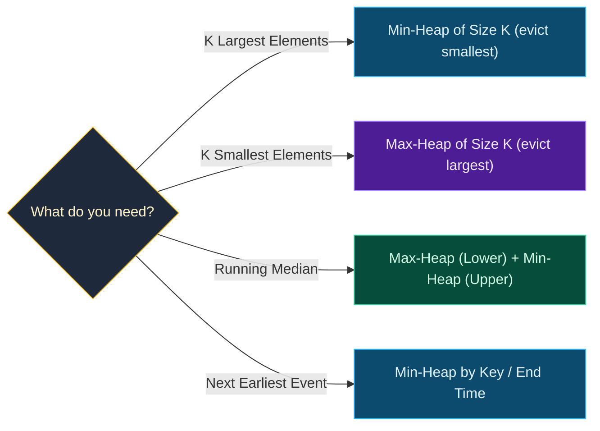

- **Eviction rule:** Keep the element you might need to *discard* at the root (`peek()`) so eviction is `O(log k)`.
- **Java default:** `new PriorityQueue<>()` is always a **Min-Heap**; pass `Comparator.reverseOrder()` for a **Max-Heap**.

| Use Case | Heap Type | Example |
|----------|-----------|---------|
| K smallest | Min-heap | Find k largest: maintain min-heap of k largest |
| K largest | Max-heap | Find k smallest: maintain max-heap of k smallest |
| Find max | Max-heap | Top K frequent elements |
| Find min | Min-heap | Kth largest element |
| Median | Both | MedianFinder |
| Pairwise operations | Min-heap | Merge K lists |

> [!TIP]
> Remember the **inversion rule**: to keep the top `k` largest items, the gatekeeper at the heap root must be the *weakest* of the top `k` (a **Min-Heap**).

---

## TreeMap/TreeSet Usage

`TreeMap` and `TreeSet` are backed by Red-Black Trees, keeping keys sorted at all times and exposing `O(log n)` neighbor queries (`floorEntry`, `ceilingEntry`, `lowerKey`, `higherKey`).

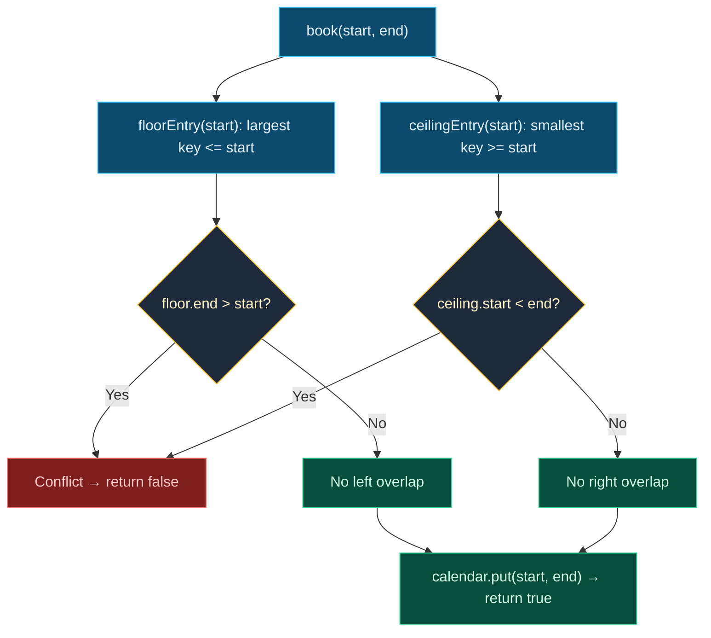

| Method | Meaning | Time | Use Case |
|--------|---------|------|----------|
| `floorEntry(k)` / `floor(k)` | Greatest entry `<= k` | `O(log n)` | Check previous interval overlap |
| `ceilingEntry(k)` / `ceiling(k)` | Least entry `>= k` | `O(log n)` | Check next interval overlap |
| `lowerKey(k)` / `higherKey(k)` | Strictly `< k` or `> k` | `O(log n)` | Strict predecessor / successor |
| `subMap(from, to)` | Range view `[from, to)` | `O(log n)` | Range queries & sweeping |

> [!NOTE]
> Use `HashMap` (`O(1)`) when you only need exact key lookups; switch to `TreeMap` (`O(log n)`) only when you need sorted iteration, range queries, or `floor`/`ceiling` neighbor checks.

### Problem: Meeting Rooms II

**Problem Statement**
Given an array of meeting time intervals where each interval is `[start, end]`, determine the minimum number of conference rooms required.

**Solution 1: Sorting with Counter**

```java
public int minMeetingRooms(int[][] intervals) {
    if (intervals == null || intervals.length == 0) return 0;

    int[] starts = new int[intervals.length];
    int[] ends = new int[intervals.length];

    for (int i = 0; i < intervals.length; i++) {
        starts[i] = intervals[i][0];
        ends[i] = intervals[i][1];
    }

    Arrays.sort(starts);
    Arrays.sort(ends);

    int rooms = 0;
    int endPtr = 0;

    for (int startTime : starts) {
        // If current meeting starts before earliest end, need new room
        if (startTime < ends[endPtr]) {
            rooms++;
        } else {
            // Can reuse a room
            endPtr++;
        }
    }

    return rooms;
}
```

**Example**
```
intervals = [[0,30], [5,10], [15,20]]
starts = [0, 5, 15]
ends = [10, 20, 30]

startTime=0: 0 < 10, rooms=1, endPtr=0
startTime=5: 5 < 10, rooms=2, endPtr=0
startTime=15: 15 >= 10, rooms=2, endPtr=1 (then check 15 < 20), rooms=2, endPtr=2

Answer: 2 rooms
```

**Complexity**
- Time: O(n log n) - sorting
- Space: O(n)

---

### Problem: My Calendar I

**Problem Statement**
You are implementing a program to use as your calendar. Each event can be represented as a pair of integers `start` and `end` that represents a booking on the calendar from `start` to `end`. Implement a `MyCalendar` class with `book(int start, int end)` method that returns `true` if the event can be added to the calendar successfully. Two events have a booking conflict if they have any moments in common.

**Solution: TreeMap**

```java
class MyCalendar {
    private TreeMap<Integer, Integer> calendar;

    public MyCalendar() {
        calendar = new TreeMap<>();
    }

    public boolean book(int start, int end) {
        // Find the event with the largest start time <= current start
        Map.Entry<Integer, Integer> floorEntry = calendar.floorEntry(start);

        // Check if previous event ends after or at current start
        if (floorEntry != null && floorEntry.getValue() > start) {
            return false;
        }

        // Find the event with the smallest start time >= current start
        Map.Entry<Integer, Integer> ceilingEntry = calendar.ceilingEntry(start);

        // Check if next event starts before or at current end
        if (ceilingEntry != null && ceilingEntry.getKey() < end) {
            return false;
        }

        calendar.put(start, end);
        return true;
    }
}
```

**Why TreeMap**
- `floorEntry(start)`: O(log n) to find last event before current
- `ceilingEntry(start)`: O(log n) to find next event after current
- Maintains sorted order by start time

**Complexity**
- book: O(log n)
- Space: O(n)

---

## Complex Comparator Patterns in Java

Multi-key tie-breaking in `PriorityQueue`, `TreeMap`, and `Arrays.sort` is cleaner and overflow-safe when expressed with `Comparator.comparingInt(...).thenComparing(...)`.

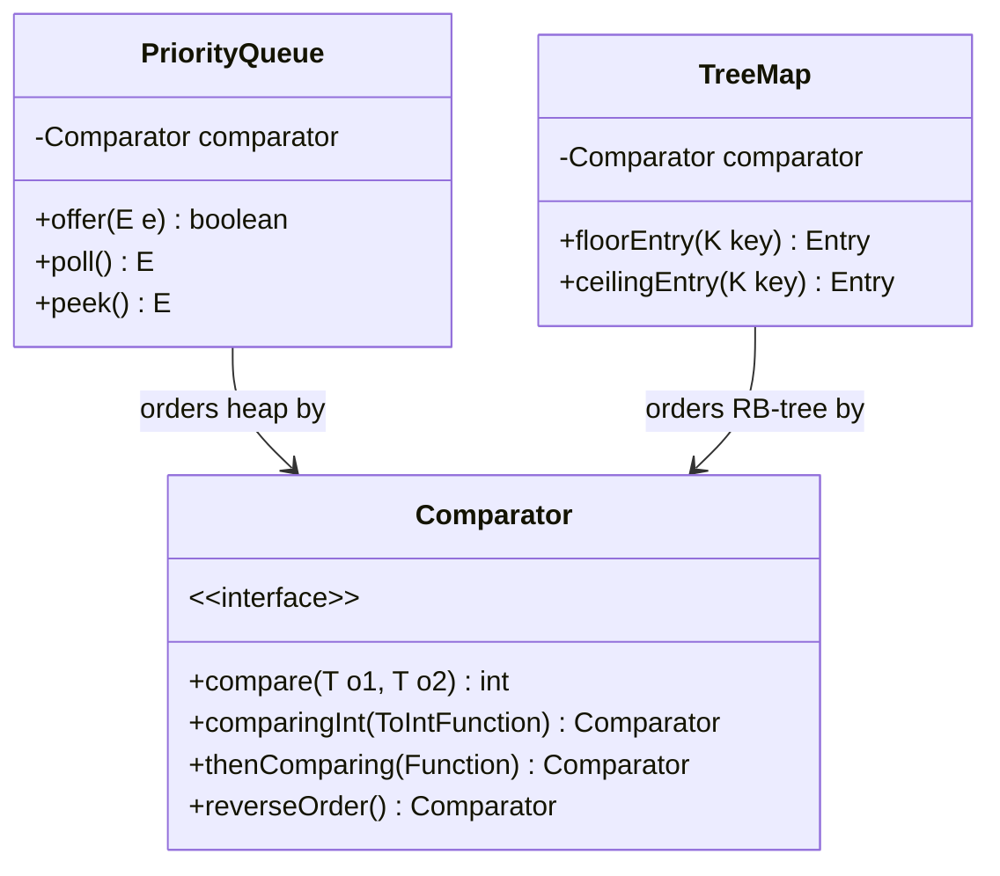

- **Overflow safety:** Prefer `Integer.compare(a, b)` or `Comparator.comparingInt(...)` over `a - b`.
- **Consistent with `equals`:** In `TreeSet`/`TreeMap`, two elements where `compare(a, b) == 0` are treated as the **same key**, so always include a tie-breaker if duplicates must be preserved.

> [!WARNING]
> In a `TreeSet`, if `compare(a, b) == 0` for two distinct objects (e.g., two tasks with the same priority), `TreeSet.add(b)` will silently drop `b`. Add a unique ID tie-breaker like `.thenComparingInt(t -> t.id)`.

### Pattern 1: Multiple Criteria
```java
PriorityQueue<Person> pq = new PriorityQueue<>(
    (p1, p2) -> {
        if (p1.age != p2.age) {
            return p1.age - p2.age;
        }
        return p1.name.compareTo(p2.name);
    }
);
```

### Pattern 2: Using Comparator.comparing()
```java
PriorityQueue<Person> pq = new PriorityQueue<>(
    Comparator.comparingInt((Person p) -> p.age)
        .thenComparing(p -> p.name)
);
```

### Pattern 3: Reverse Order
```java
PriorityQueue<Integer> maxHeap = new PriorityQueue<>(
    Comparator.reverseOrder()
);
```

---

## Summary & Patterns Cheat Sheet

Use this decision flow to pick the right data structure in the first 30 seconds of an interview:

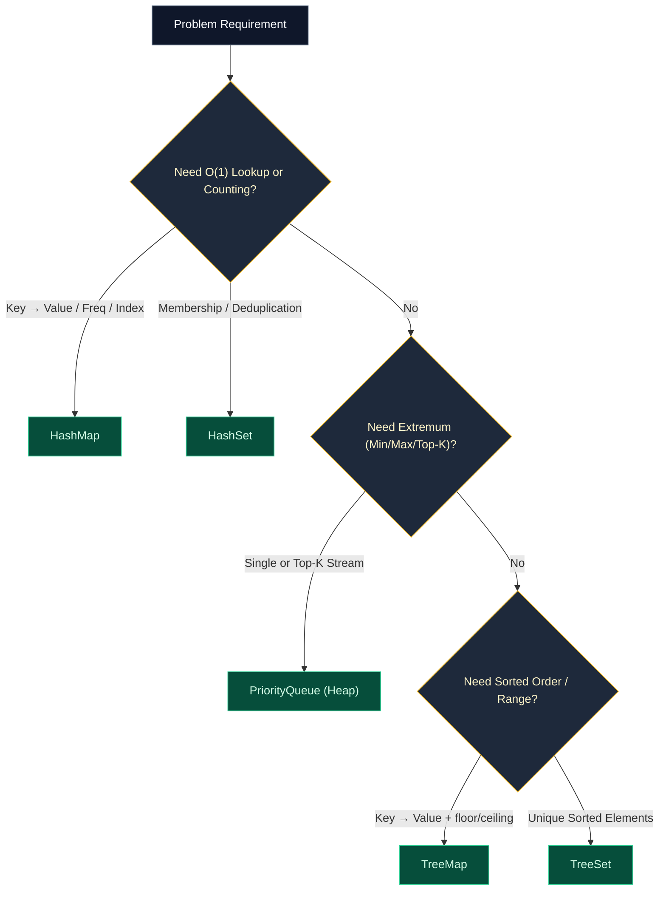

### When to Use HashMap
- Frequency counting
- Two sum, group anagrams
- Finding complements
- Caching/memoization

### When to Use HashSet
- Presence checking
- Removing duplicates
- Set operations

### When to Use Heap
- K largest/smallest
- Scheduling (priority-based)
- Median finding
- Merge K sorted structures

### When to Use TreeMap/TreeSet
- Sorted order needed
- Range queries
- Interval overlap checking
- Lexicographically sorted

> [!TIP]
> If you find yourself sorting repeatedly inside a loop (`O(n² log n)`), replace the re-sort with a `PriorityQueue` (`O(n log n)`) or `TreeMap` (`O(n log n)`).

---

## Practice Summary

Map each canonical interview problem directly to its core insight, data structure, and target complexity:

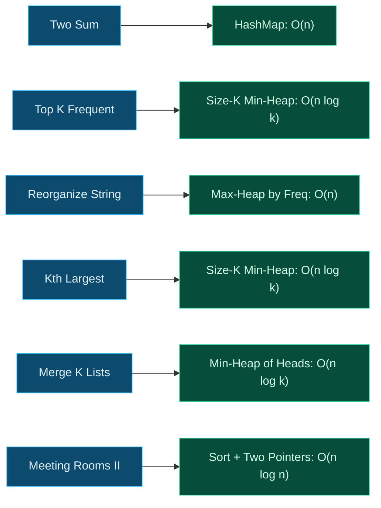

| Problem | Key Insight | Data Structure | Time |
|---------|------------|-----------------|------|
| Two Sum | Complement in map | HashMap | O(n) |
| Top K Frequent | Size-k heap | Heap | O(n log k) |
| Reorganize String | Max frequency check | Heap | O(n) |
| Kth Largest | Size-k min-heap | Heap | O(n log k) |
| Merge K Lists | All list heads in heap | Heap | O(n log k) |
| Meeting Rooms | Sort + two pointers | Sorting | O(n log n) |

> [!IMPORTANT]
> Before coding any heap or hash solution, state the invariant out loud (e.g., *"I'll maintain a Min-Heap of size `k` so the smallest of the `k` largest sits at the root"*). Interviewers score clarity of the invariant as highly as the code itself.
