# Linked Lists, Stacks, and Queues - Comprehensive Guide for FAANG Interviews

## Table of Contents
1. [Linked List Fundamentals](#linked-list-fundamentals)
2. [Fast and Slow Pointer Pattern](#fast-and-slow-pointer-pattern)
3. [Stack Patterns](#stack-patterns)
4. [Queue and Deque](#queue-and-deque)
5. [Design Problems](#design-problems)
6. [Monotonic Stack Pattern Summary](#monotonic-stack-pattern-summary)
7. [Summary Table](#summary-table)

---

## Linked List Fundamentals

Linked lists trade `O(1)` random indexing for `O(1)` pointer splicing once you hold the predecessor node. Most interview bugs stem from losing the `next` reference before rewiring or failing to guard `head == null` / single-node edge cases.

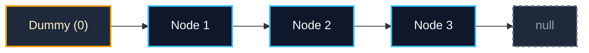

> [!TIP]
> Always introduce a `dummy` sentinel node (`dummy.next = head`) whenever the head itself might be deleted, merged, or reordered—it eliminates special-case `head == null` branches.

### Node Definition
```java
public class ListNode {
    int val;
    ListNode next;

    ListNode() {}
    ListNode(int val) {
        this.val = val;
    }
    ListNode(int val, ListNode next) {
        this.val = val;
        this.next = next;
    }
}
```

---

### Problem 1: Reverse Linked List

**Problem Statement**
Given the head of a singly linked list, reverse the list, and return the reversed list.

**Approach: Iterative Reversal**
- Save `current.next` into `nextTemp` before mutating `current.next = prev`.
- Advance `prev = current` and `current = nextTemp` until `current == null`.
- Return `prev`, which lands on the new head.

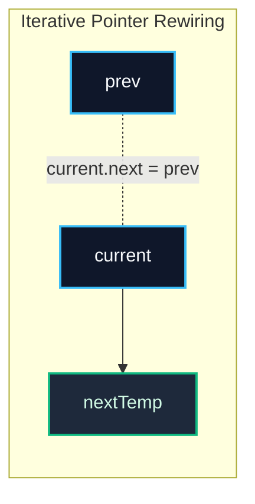

```
Original: 1 → 2 → 3 → null
Step 1:   null ← 1, 2 → 3 → null
Step 2:   null ← 1 ← 2, 3 → null
Step 3:   null ← 1 ← 2 ← 3
Result:   3 → 2 → 1 → null
```

```java
public ListNode reverseList(ListNode head) {
    ListNode prev = null;
    ListNode current = head;

    while (current != null) {
        // Store next node
        ListNode nextTemp = current.next;

        // Reverse the link
        current.next = prev;

        // Move prev and current one step forward
        prev = current;
        current = nextTemp;
    }

    return prev; // New head
}
```

**Recursive Approach**
```java
public ListNode reverseListRecursive(ListNode head) {
    // Base case: empty list or single node
    if (head == null || head.next == null) {
        return head;
    }

    // Reverse the rest of the list
    ListNode newHead = reverseListRecursive(head.next);

    // Put first element at the end
    head.next.next = head;
    head.next = null;

    return newHead;
}
```

| Variant | Time | Space | Notes |
|---------|------|-------|-------|
| Iterative | `O(n)` | `O(1)` | Preferred in interviews (no stack overflow) |
| Recursive | `O(n)` | `O(n)` | Implicit call stack frames |

---

### Problem 2: Detect Cycle in Linked List (Floyd's Algorithm)

**Problem Statement**
Given the head of a linked list, determine if the linked list has a cycle in it. A cycle exists if any node can be reached again by continuously following the `next` pointer.

**Approach: Two Pointers (Tortoise and Hare)**

Key insight: If there's a cycle, fast and slow pointers will eventually meet.

```java
public boolean hasCycle(ListNode head) {
    if (head == null || head.next == null) {
        return false;
    }

    ListNode slow = head;
    ListNode fast = head.next;

    while (slow != fast) {
        // If fast reaches null, no cycle
        if (fast == null || fast.next == null) {
            return false;
        }

        slow = slow.next; // Move 1 step
        fast = fast.next.next; // Move 2 steps
    }

    return true; // Slow and fast met
}
```

**Why It Works**
- In a cycle, fast pointer will eventually "lap" the slow pointer.
- If no cycle, fast reaches `null` first.
- The gap closes by `1` at each step.

**Problem 2b: Return Cycle Start Node**

```java
public ListNode detectCycle(ListNode head) {
    if (head == null || head.next == null) {
        return null;
    }

    ListNode slow = head;
    ListNode fast = head;

    // Find meeting point
    while (fast != null && fast.next != null) {
        slow = slow.next;
        fast = fast.next.next;

        if (slow == fast) {
            // Cycle detected
            break;
        }
    }

    // If no cycle
    if (fast == null || fast.next == null) {
        return null;
    }

    // Find cycle start
    ListNode ptr1 = head;
    ListNode ptr2 = slow;

    while (ptr1 != ptr2) {
        ptr1 = ptr1.next;
        ptr2 = ptr2.next;
    }

    return ptr1; // Cycle start
}
```

**Why It Works**
- If distance from head to cycle start = `a`
- And cycle length = `c`
- When slow and fast meet, slow has traveled `a + b` (`b < c`)
- Fast has traveled `a + b + kc` for some `k`
- Since fast travels `2x` as fast: `2(a + b) = a + b + kc`
- Therefore: `a + b = kc`, which means `a = kc - b`
- Moving one pointer from head and one from meeting point simultaneously, they meet at cycle start.

---

### Problem 3: Merge Two Sorted Lists

**Problem Statement**
Merge two sorted linked lists and return it as a new list. The new list should be made by splicing together the nodes of the two lists.

**Solution: Two Pointers**

```java
public ListNode mergeTwoLists(ListNode list1, ListNode list2) {
    ListNode dummy = new ListNode(0);
    ListNode current = dummy;

    while (list1 != null && list2 != null) {
        if (list1.val <= list2.val) {
            current.next = list1;
            list1 = list1.next;
        } else {
            current.next = list2;
            list2 = list2.next;
        }
        current = current.next;
    }

    // Attach the remaining list
    current.next = (list1 != null) ? list1 : list2;

    return dummy.next;
}
```

- **Time:** `O(n + m)`
- **Space:** `O(1)` — only rearranging pointers

---

### Problem 4: Remove Nth Node From End of List

**Problem Statement**
Given the head of a linked list, remove the `nth` node from the end of the list and return the head of the list.

**Approach: Two Pointers with Dummy Node**

Key insight: Use dummy node to handle edge case where head is removed.

```java
public ListNode removeNthFromEnd(ListNode head, int n) {
    // Dummy node helps with removing head node
    ListNode dummy = new ListNode(0);
    dummy.next = head;

    ListNode first = dummy;
    ListNode second = dummy;

    // Create n+1 gap between first and second
    for (int i = 0; i <= n; i++) {
        first = first.next;
    }

    // Move both pointers until first reaches null
    while (first != null) {
        first = first.next;
        second = second.next;
    }

    // Remove nth node
    second.next = second.next.next;

    return dummy.next;
}
```

**Example**: Remove 2nd from end of `[1,2,3,4,5]`
```
dummy → 1 → 2 → 3 → 4 → 5 → null
first at 1 (0 steps from dummy)
second at dummy

Loop 3 times (n+1):
first reaches 4
second at dummy

Move both:
first = null, second at 3

second.next = second.next.next removes 4
Result: 1 → 2 → 3 → 5 → null
```

- **Time:** `O(n)`
- **Space:** `O(1)`

---

### Problem 5: Reorder List

**Problem Statement**
You are given the head of a singly linked list with head labeled `head`. Reorder the list as if it were folded on itself. For example: For list `[1,2,3,4,5]`, the reorder should be `[1,5,2,4,3]`.

**Algorithm**
1. Find middle of list using slow/fast pointers.
2. Reverse the second half.
3. Merge first half and reversed second half.

```java
public void reorderList(ListNode head) {
    if (head == null || head.next == null) {
        return;
    }

    // Step 1: Find middle
    ListNode slow = head;
    ListNode fast = head;

    while (fast != null && fast.next != null) {
        slow = slow.next;
        fast = fast.next.next;
    }

    // Step 2: Reverse second half
    ListNode head2 = reverseList(slow);

    // Step 3: Merge
    ListNode node1 = head;
    ListNode node2 = head2;

    while (node2.next != null) {
        ListNode temp1 = node1.next;
        ListNode temp2 = node2.next;

        node1.next = node2;
        node2.next = temp1;

        node1 = temp1;
        node2 = temp2;
    }
}

private ListNode reverseList(ListNode head) {
    ListNode prev = null;
    ListNode current = head;

    while (current != null) {
        ListNode nextTemp = current.next;
        current.next = prev;
        prev = current;
        current = nextTemp;
    }

    return prev;
}
```

**Example**: `[1,2,3,4,5]`
```
Middle: node 3
Reverse from 3: [3,4,5] → [5,4,3]
Merge:
  1 → 5 → 2 → 4 → 3
```

| Problem | Pattern | Time | Space |
|---------|---------|------|-------|
| Reverse Linked List | Iterative / Recursive | `O(n)` | `O(1)` / `O(n)` |
| Detect Cycle / Cycle Start | Fast & Slow Pointers | `O(n)` | `O(1)` |
| Merge Two Sorted Lists | Dummy + Two Pointers | `O(n + m)` | `O(1)` |
| Remove Nth From End | Dummy + `n+1` Gap | `O(n)` | `O(1)` |
| Reorder List | Mid + Reverse + Merge | `O(n)` | `O(1)` |

---

## Fast and Slow Pointer Pattern

The Fast and Slow pointer technique solves cycle detection, midpoint discovery, and fixed-offset removal in a single `O(n)` pass with `O(1)` extra space.


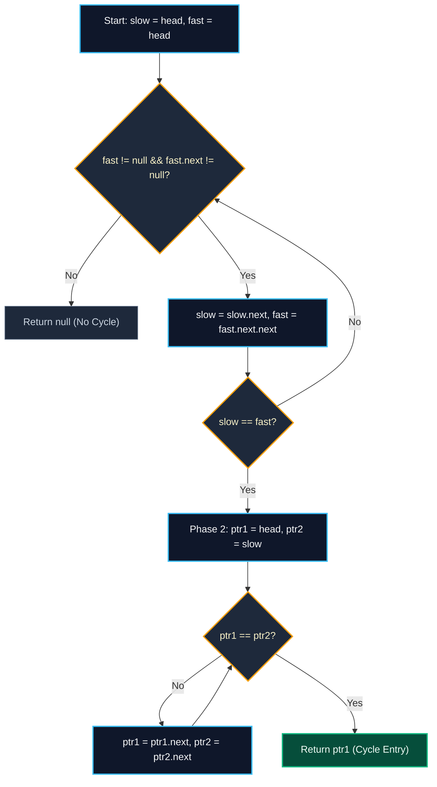

### Pattern Template & Applications
- **Find middle:** `slow` lands at the middle when `fast` reaches the end (`fast == null || fast.next == null`).
- **Detect cycle:** `fast` closes the gap by `1` node per iteration; if they meet, a cycle exists.
- **Find cycle start:** Reset one pointer to `head`, advance both at `1x` speed; they collide at the cycle entry (`a = kc - b`).
- **Remove nth from end:** Create an `n + 1` gap between `first` and `second`, then advance both at `1x`.

> [!IMPORTANT]
> For `detectCycle` (finding the entry node), both `slow` and `fast` MUST start at `head` so the `2(a + b) = a + b + kc` distance invariant holds. Starting `fast` at `head.next` works for `hasCycle` boolean checks, but shifts the Phase 2 meeting point by 1!

| Operation | Slow Speed | Fast Speed | Time | Space |
|-----------|------------|------------|------|-------|
| Cycle Detection | `1` step | `2` steps | `O(n)` | `O(1)` |
| Cycle Entry Node | `1` step (reset to `head`) | `1` step (from meet) | `O(n)` | `O(1)` |
| Middle of List | `1` step | `2` steps | `O(n)` | `O(1)` |
| Nth From End | `1` step (after `n+1` delay) | `1` step | `O(n)` | `O(1)` |

---

## Stack Patterns

Stacks enforce Last-In, First-Out (LIFO) ordering—ideal for nested structure matching, expression evaluation, `O(1)` min tracking, and monotonic next-greater/smaller queries.


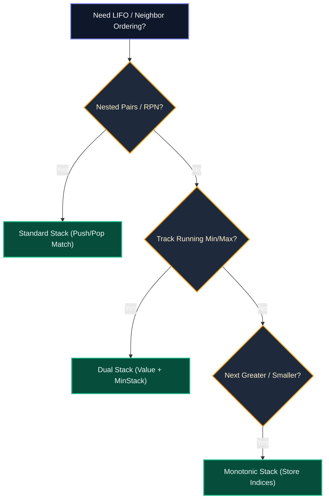

### Problem 1: Valid Parentheses

**Problem Statement**
Given a string `s` containing just the characters `'('`, `')'`, `'{'`, `'}'`, `'['` and `']'`, determine if the input string is valid.

A string is valid if:
1. Open brackets must be closed by the same type of closing brackets.
2. Every closing bracket has a corresponding opening bracket.

**Solution: Stack**

```java
public boolean isValid(String s) {
    Stack<Character> stack = new Stack<>();

    Map<Character, Character> pairs = new HashMap<>();
    pairs.put(')', '(');
    pairs.put('}', '{');
    pairs.put(']', '[');

    for (char c : s.toCharArray()) {
        if (pairs.containsKey(c)) {
            // Closing bracket
            if (stack.isEmpty() || stack.pop() != pairs.get(c)) {
                return false;
            }
        } else {
            // Opening bracket
            stack.push(c);
        }
    }

    return stack.isEmpty();
}
```

- **Time:** `O(n)`
- **Space:** `O(n)`

---

### Problem 2: Min Stack

**Problem Statement**
Design a stack that supports push, pop, top, and retrieving the minimum element in constant time.

**Solution: Dual Stack**

Key idea: Maintain a stack of minimums alongside the main stack.

```java
class MinStack {
    private Stack<Integer> stack;
    private Stack<Integer> minStack;

    public MinStack() {
        stack = new Stack<>();
        minStack = new Stack<>();
    }

    public void push(int val) {
        stack.push(val);

        // Push to minStack (maintain minimum)
        if (minStack.isEmpty() || val <= minStack.peek()) {
            minStack.push(val);
        }
    }

    public void pop() {
        int val = stack.pop();

        // Pop from minStack if it was a minimum
        if (val == minStack.peek()) {
            minStack.pop();
        }
    }

    public int top() {
        return stack.peek();
    }

    public int getMin() {
        return minStack.peek();
    }
}
```

**Why Use Two Stacks**
- Single stack approach with pairs: harder to manage.
- Dual stack: clear separation of concerns.
- **Time:** All operations `O(1)`
- **Space:** `O(n)`

> [!WARNING]
> In `MinStack.push()`, use `val <= minStack.peek()` (not `<`). Duplicate minimum values must each be pushed onto `minStack` so popping one copy doesn't prematurely discard the active minimum!

---

### Problem 3: Daily Temperatures

**Problem Statement**
Given an array of integers `temperatures` representing daily temperatures, return an array `answer` such that `answer[i]` is the number of days you have to wait after the `ith` day to get a warmer temperature. If there is no future day for which this is possible, keep `answer[i] == 0`.

**Brute Force**
```java
// O(n²) time
public int[] dailyTemperatures(int[] temperatures) {
    int[] answer = new int[temperatures.length];

    for (int i = 0; i < temperatures.length; i++) {
        for (int j = i + 1; j < temperatures.length; j++) {
            if (temperatures[j] > temperatures[i]) {
                answer[i] = j - i;
                break;
            }
        }
    }

    return answer;
}
```

**Optimal Approach: Monotonic Decreasing Stack**

Key insight: Maintain indices of temperatures in decreasing order. When current is warmer, pop and calculate distance.

```java
public int[] dailyTemperatures(int[] temperatures) {
    int[] answer = new int[temperatures.length];
    Stack<Integer> stack = new Stack<>(); // Store indices

    for (int i = 0; i < temperatures.length; i++) {
        // While current temperature is warmer than stack top
        while (!stack.isEmpty() && temperatures[i] > temperatures[stack.peek()]) {
            int idx = stack.pop();
            answer[idx] = i - idx;
        }

        // Add current index to stack
        stack.push(i);
    }

    return answer;
}
```

**Example**: `[73, 74, 75, 71, 69, 72, 76, 73]`
```
i=0 (73): stack=[0]
i=1 (74): 74>73, pop 0, answer[0]=1, stack=[1]
i=2 (75): 75>74, pop 1, answer[1]=1, stack=[2]
i=3 (71): 71<75, stack=[2,3]
i=4 (69): 69<71, stack=[2,3,4]
i=5 (72): 72>69, pop 4, answer[4]=1; 72>71, pop 3, answer[3]=2, stack=[2,5]
i=6 (76): 76>72, pop 5, answer[5]=1; 76>75, pop 2, answer[2]=4, stack=[6]
i=7 (73): 73<76, stack=[6,7]

Answer: [1,1,4,2,1,1,0,0]
```

- **Time:** `O(n)` — each element pushed and popped at most once
- **Space:** `O(n)`

---

### Problem 4: Largest Rectangle in Histogram

**Problem Statement**
Given an array of integers `heights` representing the histogram's bar heights, return the area of the largest rectangle that can be formed within the histogram.

**Approach: Monotonic Stack**

Key insight: For each bar, find the largest area with that bar as the height.

```java
public int largestRectangleArea(int[] heights) {
    Stack<Integer> stack = new Stack<>();
    int maxArea = 0;

    for (int i = 0; i < heights.length; i++) {
        // Pop while current height is less than stack top
        while (!stack.isEmpty() && heights[i] < heights[stack.peek()]) {
            int h = heights[stack.pop()];
            int w = stack.isEmpty() ? i : i - stack.peek() - 1;
            maxArea = Math.max(maxArea, h * w);
        }

        stack.push(i);
    }

    // Process remaining bars
    while (!stack.isEmpty()) {
        int h = heights[stack.pop()];
        int w = stack.isEmpty() ? heights.length : heights.length - stack.peek() - 1;
        maxArea = Math.max(maxArea, h * w);
    }

    return maxArea;
}
```

**Why Width Calculation Works**
- `Width = right boundary - left boundary - 1`
- Right boundary = current index `i` (where we first see a smaller height)
- Left boundary = top of remaining stack (last index where `height >= popped`)

- **Time:** `O(n)`
- **Space:** `O(n)`

---

### Problem 5: Evaluate Reverse Polish Notation

**Problem Statement**
Evaluate the value of an arithmetic expression in Reverse Polish Notation. In Reverse Polish Notation, operators follow their operands.

Example: `["2","1","+","3","*"] = ((2+1)*3) = 9`

**Solution: Stack**

```java
public int evalRPN(String[] tokens) {
    Stack<Integer> stack = new Stack<>();

    for (String token : tokens) {
        if (isOperator(token)) {
            int b = stack.pop();
            int a = stack.pop();
            int result = applyOperator(token, a, b);
            stack.push(result);
        } else {
            stack.push(Integer.parseInt(token));
        }
    }

    return stack.peek();
}

private boolean isOperator(String token) {
    return token.equals("+") || token.equals("-") ||
           token.equals("*") || token.equals("/");
}

private int applyOperator(String op, int a, int b) {
    switch (op) {
        case "+": return a + b;
        case "-": return a - b;
        case "*": return a * b;
        case "/": return a / b;
        default: return 0;
    }
}
```

| Problem | Stack Type | Time | Space |
|---------|------------|------|-------|
| Valid Parentheses | Character Stack | `O(n)` | `O(n)` |
| Min Stack | Dual Stack | `O(1)` per op | `O(n)` |
| Daily Temperatures | Monotonic Decreasing | `O(n)` | `O(n)` |
| Largest Rectangle | Monotonic Increasing | `O(n)` | `O(n)` |
| Evaluate RPN | Operand Stack | `O(n)` | `O(n)` |

---

## Queue and Deque

Queues enforce First-In, First-Out (FIFO) ordering, while a **Deque** (Double-Ended Queue) lets you push and pop from both ends in `O(1)`—the key primitive behind `O(n)` Sliding Window Maximum.

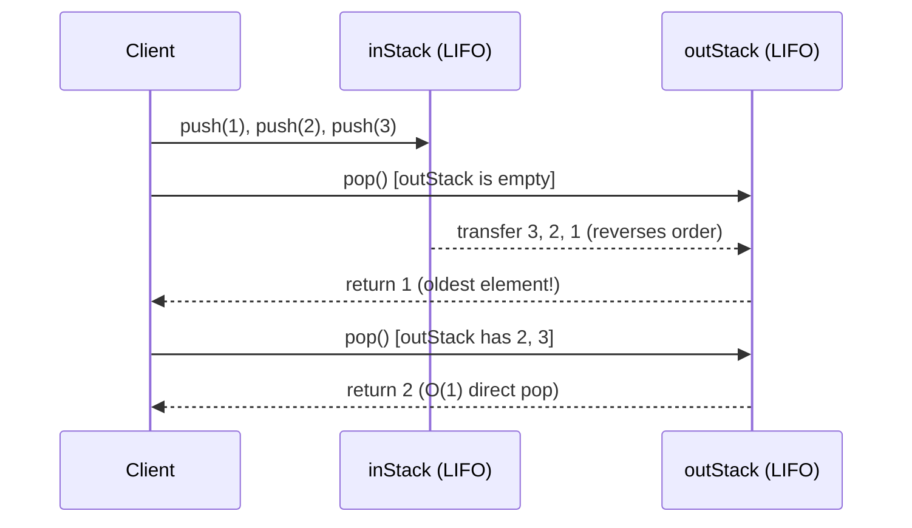

### Problem 1: Implement Queue Using Stacks

**Problem Statement**
Implement a first in first out (FIFO) queue using only two stacks.

**Solution: Two Stacks**

```java
class MyQueue {
    private Stack<Integer> inStack;
    private Stack<Integer> outStack;

    public MyQueue() {
        inStack = new Stack<>();
        outStack = new Stack<>();
    }

    public void push(int x) {
        inStack.push(x);
    }

    public int pop() {
        if (outStack.isEmpty()) {
            moveFromInToOut();
        }
        return outStack.pop();
    }

    public int peek() {
        if (outStack.isEmpty()) {
            moveFromInToOut();
        }
        return outStack.peek();
    }

    public boolean empty() {
        return inStack.isEmpty() && outStack.isEmpty();
    }

    private void moveFromInToOut() {
        while (!inStack.isEmpty()) {
            outStack.push(inStack.pop());
        }
    }
}
```

**Why It Works**
- `inStack`: receives pushed elements.
- `outStack`: serves popped elements in reversed (FIFO) order.
- Only transfer from `inStack` to `outStack` when `outStack` is empty—each element moves at most once, giving `O(1)` amortized `pop()`/`peek()`.

---

### Problem 2: Sliding Window Maximum

**Problem Statement**
You are given an array of integers `nums`, there is a sliding window of size `k` which is moving from the very left of the array to the very right. You can only see the `k` numbers in the window. Each time the sliding window moves right by one position, return an array of the maximum values in each window.

**Solution: Monotonic Deque**

Key insight: Maintain indices of decreasing values in a deque.

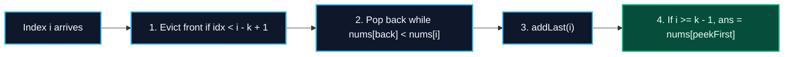

```java
public int[] maxSlidingWindow(int[] nums, int k) {
    Deque<Integer> deque = new LinkedList<>();
    int[] result = new int[nums.length - k + 1];
    int idx = 0;

    for (int i = 0; i < nums.length; i++) {
        // Remove indices outside current window
        while (!deque.isEmpty() && deque.peekFirst() < i - k + 1) {
            deque.pollFirst();
        }

        // Remove smaller elements from back
        while (!deque.isEmpty() && nums[deque.peekLast()] < nums[i]) {
            deque.pollLast();
        }

        // Add current index
        deque.addLast(i);

        // Record maximum of current window
        if (i >= k - 1) {
            result[idx++] = nums[deque.peekFirst()];
        }
    }

    return result;
}
```

**Example**: `nums = [1,3,-1,-3,5,3,6,7]`, `k = 3`
```
i=0: deque=[0], nums[0]=1
i=1: nums[1]=3>nums[0], remove 0; deque=[1], nums[1]=3
i=2: nums[2]=-1<nums[1], deque=[1,2]; result[0]=3 (window [1,3,-1])
i=3: nums[3]=-3, deque=[1,2,3]; result[1]=3 (window [3,-1,-3])
i=4: nums[4]=5>nums[3,2,1], deque=[4]; result[2]=5 (window [-1,-3,5])
...
```

> [!TIP]
> Always store **indices** (not raw values) in monotonic deques and stacks—indices let you check window expiration (`idx < i - k + 1`) AND look up `nums[idx]` in `O(1)`.

| Problem | Structure | Push / Enqueue | Pop / Query | Space |
|---------|-----------|----------------|-------------|-------|
| Queue Using Stacks | Dual Stack | `O(1)` | `O(1)` amortized | `O(n)` |
| Sliding Window Max | Monotonic Deque | `O(1)` amortized | `O(1)` | `O(k)` |

---

## Design Problems

System-level data structure design problems test your ability to combine `HashMap` (`O(1)` lookup) with Doubly Linked Lists (`O(1)` arbitrary node eviction and promotion).

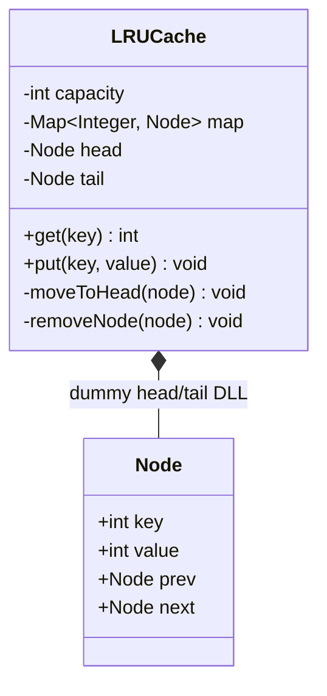

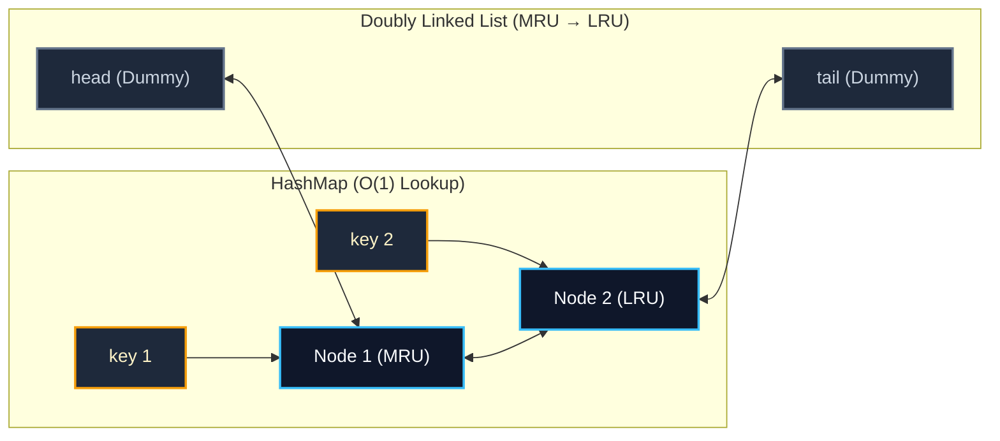

### Problem 1: LRU Cache

**Problem Statement**
Design a data structure that follows the constraints of a Least Recently Used (LRU) cache.

**Key Requirements**
- `get(key)`: Return value if exists, else return `-1` (mark as recently used).
- `put(key, value)`: Update or insert value (mark as recently used).
- Evict least recently used item when capacity is exceeded.

**Solution: HashMap + Doubly Linked List**

```java
class LRUCache {
    private class Node {
        int key, value;
        Node prev, next;

        Node(int key, int value) {
            this.key = key;
            this.value = value;
        }
    }

    private int capacity;
    private Map<Integer, Node> map;
    private Node head, tail; // Dummy nodes

    public LRUCache(int capacity) {
        this.capacity = capacity;
        this.map = new HashMap<>();

        // Initialize doubly linked list with dummy nodes
        head = new Node(0, 0);
        tail = new Node(0, 0);
        head.next = tail;
        tail.prev = head;
    }

    public int get(int key) {
        if (!map.containsKey(key)) {
            return -1;
        }

        Node node = map.get(key);
        moveToHead(node); // Mark as recently used
        return node.value;
    }

    public void put(int key, int value) {
        if (map.containsKey(key)) {
            // Update existing node
            Node node = map.get(key);
            node.value = value;
            moveToHead(node);
        } else {
            // Create new node
            Node newNode = new Node(key, value);
            map.put(key, newNode);
            addToHead(newNode);

            // Evict least recently used if capacity exceeded
            if (map.size() > capacity) {
                Node lru = tail.prev;
                removeNode(lru);
                map.remove(lru.key);
            }
        }
    }

    private void moveToHead(Node node) {
        removeNode(node);
        addToHead(node);
    }

    private void addToHead(Node node) {
        node.next = head.next;
        node.prev = head;
        head.next.prev = node;
        head.next = node;
    }

    private void removeNode(Node node) {
        node.prev.next = node.next;
        node.next.prev = node.prev;
    }
}
```

**Data Structure Design**
- HashMap: `O(1)` access by key.
- Doubly Linked List: `O(1)` addition/removal.
- `head` = Most Recent, `tail` = Least Recent.

> [!IMPORTANT]
> Always store `key` inside `Node` in addition to `value`—when evicting `tail.prev` from the Doubly Linked List, you need `lru.key` to remove the entry from `map` in `O(1)`.

---

### Problem 2: LFU Cache

**Problem Statement**
Design a data structure that implements Least Frequently Used (LFU) cache. When capacity is exceeded, evict the item with lowest frequency. If there's a tie, evict the least recently used among them.

**Solution: HashMap + Frequency Buckets**

```java
class LFUCache {
    private class Node {
        int key, value, freq;
        Node prev, next;

        Node(int key, int value) {
            this.key = key;
            this.value = value;
            this.freq = 1;
        }
    }

    private int capacity;
    private int minFreq;
    private Map<Integer, Node> keyToNode;
    private Map<Integer, Node> freqToList; // Dummy head for each frequency

    public LFUCache(int capacity) {
        this.capacity = capacity;
        this.minFreq = 0;
        this.keyToNode = new HashMap<>();
        this.freqToList = new HashMap<>();
    }

    public int get(int key) {
        if (!keyToNode.containsKey(key)) {
            return -1;
        }

        Node node = keyToNode.get(key);
        updateFrequency(node);
        return node.value;
    }

    public void put(int key, int value) {
        if (capacity <= 0) return;

        if (keyToNode.containsKey(key)) {
            // Update existing node
            Node node = keyToNode.get(key);
            node.value = value;
            updateFrequency(node);
        } else {
            // Create new node
            if (keyToNode.size() >= capacity) {
                evictLFU();
            }

            Node newNode = new Node(key, value);
            keyToNode.put(key, newNode);
            addToFrequencyList(1, newNode);
            minFreq = 1;
        }
    }

    private void updateFrequency(Node node) {
        removeFromFrequencyList(node.freq, node);

        // If frequency list is empty and it was minFreq, increment minFreq
        if (!freqToList.containsKey(node.freq) || freqToList.get(node.freq).next == freqToList.get(node.freq)) {
            if (node.freq == minFreq) {
                minFreq++;
            }
        }

        node.freq++;
        addToFrequencyList(node.freq, node);
    }

    private void addToFrequencyList(int freq, Node node) {
        if (!freqToList.containsKey(freq)) {
            freqToList.put(freq, new Node(0, 0));
        }

        Node dummyHead = freqToList.get(freq);
        node.next = dummyHead.next;
        node.prev = dummyHead;
        dummyHead.next.prev = node;
        dummyHead.next = node;
    }

    private void removeFromFrequencyList(int freq, Node node) {
        node.prev.next = node.next;
        node.next.prev = node.prev;
    }

    private void evictLFU() {
        Node dummyHead = freqToList.get(minFreq);
        Node lfu = dummyHead.prev; // Least recently used in minFreq

        removeFromFrequencyList(minFreq, lfu);
        keyToNode.remove(lfu.key);
    }
}
```

| Cache | `get(key)` | `put(key, val)` | Space | Eviction Policy |
|-------|------------|-----------------|-------|-----------------|
| LRU Cache | `O(1)` | `O(1)` | `O(capacity)` | Oldest accessed (`tail.prev`) |
| LFU Cache | `O(1)` | `O(1)` | `O(capacity)` | Lowest `freq`, tie-break by LRU |

---

## Monotonic Stack Pattern Summary

A monotonic stack maintains elements in strictly increasing or decreasing order by popping violating elements as each new index arrives. It turns `O(n²)` nested neighbor searches into `O(n)` amortized scans because each index is pushed once and popped at most once.

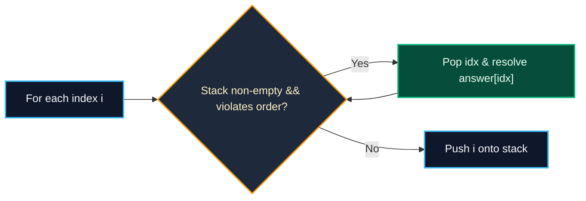

### Common Use Cases
- **Next greater element** (Monotonic Decreasing stack)
- **Previous greater element** (Monotonic Decreasing stack)
- **Trapping rain water** (Monotonic Decreasing stack)
- **Largest rectangle in histogram** (Monotonic Increasing stack)
- **Sliding window maximum** (Monotonic Decreasing deque)

### Template
```java
Stack<Integer> stack = new Stack<>();

for (int i = 0; i < arr.length; i++) {
    while (!stack.isEmpty() && condition(arr[i], arr[stack.peek()])) {
        int idx = stack.pop();
        // Process idx
    }
    stack.push(i);
}
```

> [!TIP]
> Decide stack order by asking what triggers resolution: if a **larger** incoming element resolves waiting elements (e.g., Daily Temperatures), maintain a **decreasing** stack; if a **smaller** incoming element resolves waiting elements (e.g., Largest Rectangle), maintain an **increasing** stack.

| Stack Order | Pop Condition | Classic Problems | Time |
|-------------|---------------|------------------|------|
| Decreasing | `arr[i] > arr[peek]` | Daily Temperatures, Next Greater | `O(n)` |
| Increasing | `arr[i] < arr[peek]` | Largest Rectangle, Next Smaller | `O(n)` |

---

## Summary Table

Use this decision guide to select the right pointer, stack, deque, or cache pattern under interview time pressure.

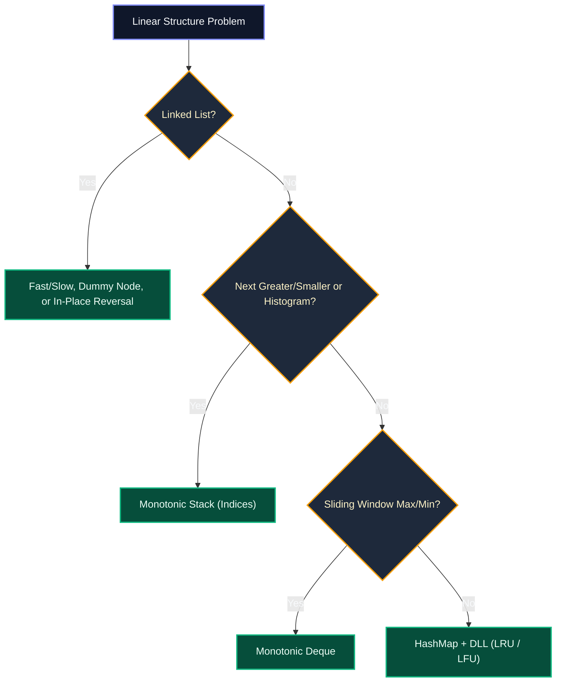

| Problem | Pattern | Time | Space |
|---------|---------|------|-------|
| Reverse LL | Iteration | `O(n)` | `O(1)` |
| Detect Cycle | Two Pointers | `O(n)` | `O(1)` |
| Min Stack | Dual Stack | `O(1)` | `O(n)` |
| Valid Parentheses | Stack | `O(n)` | `O(n)` |
| Largest Rectangle | Monotonic Stack | `O(n)` | `O(n)` |
| Sliding Window Max | Deque | `O(n)` | `O(k)` |
| LRU Cache | HashMap + DLL | `O(1)` | `O(capacity)` |

> [!NOTE]
> Master the **Dummy Node**, **Fast & Slow Pointers**, **Monotonic Stack/Deque**, and **HashMap + DLL** primitives—almost every FAANG Linked List, Stack, Queue, or Cache question is a direct composition of these four building blocks.
