# Trees and Graphs - Comprehensive Guide for FAANG Interviews

## Table of Contents
1. [Binary Tree Node Definition](#binary-tree-node-definition)
2. [Binary Tree Traversals](#binary-tree-traversals)
3. [Binary Tree Problems](#binary-tree-problems)
4. [Binary Search Trees](#binary-search-trees)
5. [Graph Representations](#graph-representations)
6. [BFS Patterns](#bfs-patterns)
7. [DFS Patterns](#dfs-patterns)
8. [Topological Sort](#topological-sort)
9. [Union-Find](#union-find)
10. [Advanced Algorithms](#advanced-algorithms)
11. [Summary Table](#summary-table)

---

## Binary Tree Node Definition

A binary tree is a hierarchical data structure where each node has at most two children (`left` and `right`). Every recursive tree algorithm reduces a problem on `root` into independent subproblems on `root.left` and `root.right`.

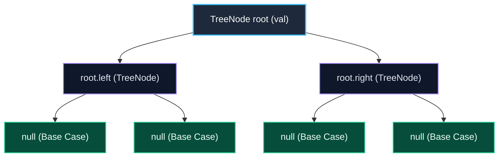

```java
public class TreeNode {
    int val;
    TreeNode left;
    TreeNode right;

    TreeNode() {}
    TreeNode(int val) {
        this.val = val;
    }
    TreeNode(int val, TreeNode left, TreeNode right) {
        this.val = val;
        this.left = left;
        this.right = right;
    }
}
```

- **Base Case:** Always guard `if (node == null)` first to terminate recursion cleanly.
- **Memory Overhead:** Each node stores one value plus two object references (`left`, `right`).

| Property | Value | Notes |
|----------|-------|-------|
| Max nodes at level `L` | `2^L` | Root is at level `0` |
| Max nodes in height `h` | `2^h - 1` | Balanced tree has `h = O(log n)` |
| Skewed tree height | `O(n)` | Degrades to a linked list |

> [!TIP]
> In interviews, clarify whether `TreeNode.val` can be negative, duplicate, or equal to `Integer.MIN_VALUE` / `Integer.MAX_VALUE` before choosing sentinel values.

---

## Binary Tree Traversals

Tree traversals fall into two families: **Depth-First Search (DFS)** using recursion or an explicit stack (Inorder, Preorder, Postorder), and **Breadth-First Search (BFS)** using a FIFO queue (Level Order).


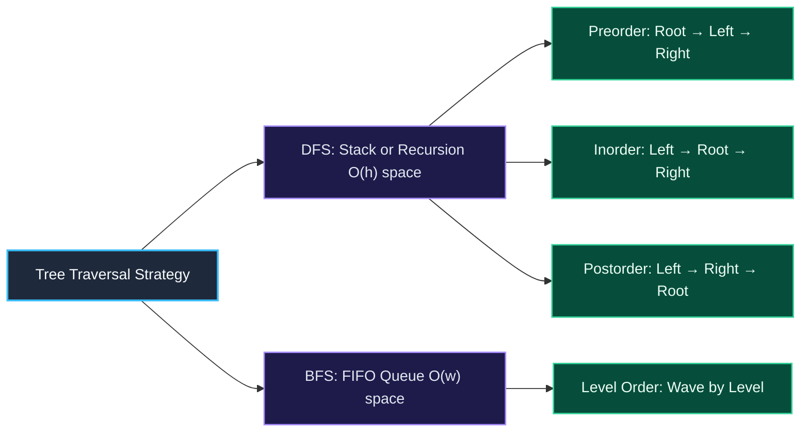

### Problem 1: Inorder Traversal (Left-Root-Right)

**Recursive Approach**
```java
public List<Integer> inorderTraversal(TreeNode root) {
    List<Integer> result = new ArrayList<>();
    inorder(root, result);
    return result;
}

private void inorder(TreeNode node, List<Integer> result) {
    if (node == null) return;

    inorder(node.left, result);
    result.add(node.val);
    inorder(node.right, result);
}
```

**Iterative Approach (Using Stack)**
```java
public List<Integer> inorderTraversal(TreeNode root) {
    List<Integer> result = new ArrayList<>();
    Stack<TreeNode> stack = new Stack<>();
    TreeNode current = root;

    while (current != null || !stack.isEmpty()) {
        // Go to leftmost node
        while (current != null) {
            stack.push(current);
            current = current.left;
        }

        // Current is null, pop from stack
        current = stack.pop();
        result.add(current.val);

        // Visit right subtree
        current = current.right;
    }

    return result;
}
```

**Complexity**
- Time: O(n)
- Space: O(h) where h is height

---

### Problem 2: Preorder Traversal (Root-Left-Right)

**Recursive**
```java
public List<Integer> preorderTraversal(TreeNode root) {
    List<Integer> result = new ArrayList<>();
    preorder(root, result);
    return result;
}

private void preorder(TreeNode node, List<Integer> result) {
    if (node == null) return;

    result.add(node.val);
    preorder(node.left, result);
    preorder(node.right, result);
}
```

**Iterative (Using Stack)**
```java
public List<Integer> preorderTraversal(TreeNode root) {
    List<Integer> result = new ArrayList<>();
    Stack<TreeNode> stack = new Stack<>();

    if (root == null) return result;

    stack.push(root);

    while (!stack.isEmpty()) {
        TreeNode node = stack.pop();
        result.add(node.val);

        // Push right first (will be processed after left)
        if (node.right != null) {
            stack.push(node.right);
        }
        if (node.left != null) {
            stack.push(node.left);
        }
    }

    return result;
}
```

---

### Problem 3: Postorder Traversal (Left-Right-Root)

Postorder processes both children before the parent, making it the natural pattern for bottom-up tree DP (height, diameter, subtree sums, and deleting trees).

```java
public List<Integer> postorderTraversal(TreeNode root) {
    List<Integer> result = new ArrayList<>();
    postorder(root, result);
    return result;
}

private void postorder(TreeNode node, List<Integer> result) {
    if (node == null) return;

    postorder(node.left, result);
    postorder(node.right, result);
    result.add(node.val);
}
```

---

### Problem 4: Level Order Traversal (BFS)

**Solution: Queue**
```java
public List<List<Integer>> levelOrder(TreeNode root) {
    List<List<Integer>> result = new ArrayList<>();

    if (root == null) return result;

    Queue<TreeNode> queue = new LinkedList<>();
    queue.offer(root);

    while (!queue.isEmpty()) {
        int levelSize = queue.size();
        List<Integer> currentLevel = new ArrayList<>();

        // Process all nodes at current level
        for (int i = 0; i < levelSize; i++) {
            TreeNode node = queue.poll();
            currentLevel.add(node.val);

            if (node.left != null) {
                queue.offer(node.left);
            }
            if (node.right != null) {
                queue.offer(node.right);
            }
        }

        result.add(currentLevel);
    }

    return result;
}
```

**Why Get levelSize Before Loop**
- Ensures we only process nodes from current level
- Nodes added in inner loop are for next level

| Traversal | Order | Primary Use Case | Time | Space |
|-----------|-------|------------------|------|-------|
| Preorder | Root, Left, Right | Tree serialization, cloning | O(n) | O(h) |
| Inorder | Left, Root, Right | Sorted order in BST | O(n) | O(h) |
| Postorder | Left, Right, Root | Bottom-up height, diameter, deletion | O(n) | O(h) |
| Level Order | Level by level | Shortest depth, right-side view | O(n) | O(w) |

> [!IMPORTANT]
> In iterative Preorder, push `node.right` onto the stack **before** `node.left` so that `node.left` is popped and processed first (LIFO).

---

## Binary Tree Problems

Most binary tree interview problems combine **top-down state passing** (passing bounds or depth down) with **bottom-up aggregation** (returning subtree height, path sum, or found target up).

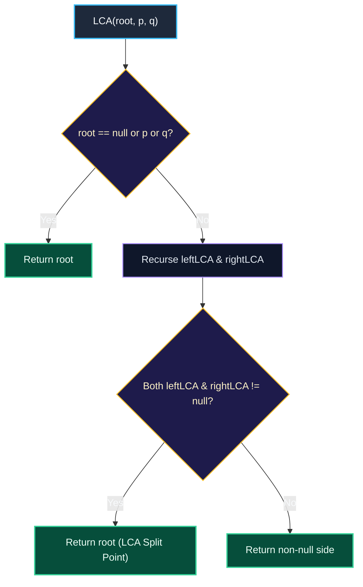

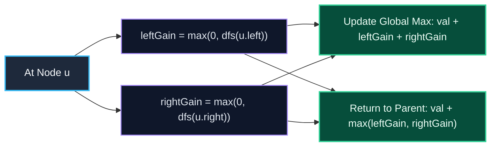

### Problem 1: Maximum Depth of Binary Tree

**Problem Statement**
Given the root of a binary tree, return its maximum depth. The maximum depth is the number of nodes along the longest path from the root node down to the farthest leaf node.

**Solution 1: DFS (Recursive)**
```java
public int maxDepth(TreeNode root) {
    if (root == null) return 0;

    int leftDepth = maxDepth(root.left);
    int rightDepth = maxDepth(root.right);

    return Math.max(leftDepth, rightDepth) + 1;
}
```

**Solution 2: BFS**
```java
public int maxDepth(TreeNode root) {
    if (root == null) return 0;

    Queue<TreeNode> queue = new LinkedList<>();
    queue.offer(root);
    int depth = 0;

    while (!queue.isEmpty()) {
        depth++;
        int levelSize = queue.size();

        for (int i = 0; i < levelSize; i++) {
            TreeNode node = queue.poll();

            if (node.left != null) queue.offer(node.left);
            if (node.right != null) queue.offer(node.right);
        }
    }

    return depth;
}
```

**Complexity**
- Time: O(n)
- Space: O(h) for recursion or O(w) for BFS where w is max width

---

### Problem 2: Validate Binary Search Tree

**Problem Statement**
Given the root of a binary tree, determine if it is a valid binary search tree (BST). A valid BST is defined as follows:
- Left subtree values < node value
- Right subtree values > node value
- All subtrees must be valid BSTs

**Solution: Range Based DFS**

Key insight: Track valid range `[min, max]` for each node.

```java
public boolean isValidBST(TreeNode root) {
    return validate(root, Long.MIN_VALUE, Long.MAX_VALUE);
}

private boolean validate(TreeNode node, long min, long max) {
    if (node == null) return true;

    // Check if current node is in valid range
    if (node.val <= min || node.val >= max) {
        return false;
    }

    // Left subtree: values must be < node.val
    // Right subtree: values must be > node.val
    return validate(node.left, min, node.val) &&
           validate(node.right, node.val, max);
}
```

**Why Long.MIN_VALUE and Long.MAX_VALUE**
- `TreeNode.val` can be `Integer.MIN_VALUE` or `Integer.MAX_VALUE`
- Need wider range to compare

**Complexity**
- Time: O(n)
- Space: O(h)

> [!WARNING]
> Checking only `node.left.val < node.val < node.right.val` is a classic bug—a node deep in the left-right subtree can still violate an ancestor's upper bound. Always pass `(min, max)` bounds down.

---

### Problem 3: Lowest Common Ancestor (LCA)

**Problem Statement**
Given a binary tree, find the lowest common ancestor (LCA) of two given nodes p and q.

**Solution 1: Recursive**

Key insight: LCA is either the current node (if p and q are on different sides) or in one of the subtrees.

```java
public TreeNode lowestCommonAncestor(TreeNode root, TreeNode p, TreeNode q) {
    // Base case: if root is null, or found p or q
    if (root == null || root == p || root == q) {
        return root;
    }

    // Search in left and right subtrees
    TreeNode leftLCA = lowestCommonAncestor(root.left, p, q);
    TreeNode rightLCA = lowestCommonAncestor(root.right, p, q);

    // If both left and right are not null, root is LCA
    if (leftLCA != null && rightLCA != null) {
        return root;
    }

    // If only one side has result, return that side
    return (leftLCA != null) ? leftLCA : rightLCA;
}
```

**Logic Flow**
```
For tree:       3
              /   \
             5     1
            / \   / \
           6   2 0   8
              / \
             7   4

LCA(5, 1):
- Check root (3): neither 5 nor 1
- leftLCA = LCA(5, 1) in left subtree
- rightLCA = LCA(5, 1) in right subtree
- 5 found in left, 1 found in right
- Return 3 (both sides not null)
```

**Complexity**
- Time: O(n) worst case
- Space: O(h)

---

### Problem 4: Serialize and Deserialize Binary Tree

**Problem Statement**
Design an algorithm to serialize a binary tree into a string and deserialize the string back to the original tree structure.

**Solution: Preorder with Null Markers**

```java
public class Codec {
    public String serialize(TreeNode root) {
        StringBuilder sb = new StringBuilder();
        serializeHelper(root, sb);
        return sb.toString();
    }

    private void serializeHelper(TreeNode node, StringBuilder sb) {
        if (node == null) {
            sb.append("null,");
            return;
        }

        sb.append(node.val).append(",");
        serializeHelper(node.left, sb);
        serializeHelper(node.right, sb);
    }

    public TreeNode deserialize(String data) {
        String[] nodes = data.split(",");
        Queue<String> queue = new LinkedList<>(Arrays.asList(nodes));
        return deserializeHelper(queue);
    }

    private TreeNode deserializeHelper(Queue<String> queue) {
        String val = queue.poll();

        if (val.equals("null")) {
            return null;
        }

        TreeNode node = new TreeNode(Integer.parseInt(val));
        node.left = deserializeHelper(queue);
        node.right = deserializeHelper(queue);

        return node;
    }
}
```

**Example**
```
Tree:     1
         / \
        2   3

Serialized: "1,2,null,null,3,null,null,"
Deserialized: Reconstruct the tree
```

**Complexity**
- Serialize: O(n) time, O(n) space for output
- Deserialize: O(n) time, O(n) space for queue

---

### Problem 5: Diameter of Binary Tree

**Problem Statement**
Given the root of a binary tree, return the diameter of the tree. The diameter is the length of the longest path between any two nodes in a tree.

```java
class Solution {
    int maxDiameter = 0;

    public int diameterOfBinaryTree(TreeNode root) {
        height(root);
        return maxDiameter;
    }

    private int height(TreeNode node) {
        if (node == null) return 0;

        int leftHeight = height(node.left);
        int rightHeight = height(node.right);

        // Update diameter if path through this node is longer
        maxDiameter = Math.max(maxDiameter, leftHeight + rightHeight);

        return Math.max(leftHeight, rightHeight) + 1;
    }
}
```

**Example**
```
Tree:      1
          / \
         2   3
        /
       4

Diameter through 2: 0 (left) + 2 (right path to 4 + 2 itself)
Actually: left height = 2 (4→2), right height = 1 (2)
Diameter = 2 + 1 = 3 (path 4→2→1→3)
```

**Complexity**
- Time: O(n)
- Space: O(h)

---

### Problem 6: Binary Tree Maximum Path Sum

**Problem Statement**
A path in a binary tree is a sequence of nodes where each pair of adjacent nodes has an edge. Find the maximum sum of any non-empty path.

```java
class Solution {
    private int maxSum = Integer.MIN_VALUE;

    public int maxPathSum(TreeNode root) {
        maxGain(root);
        return maxSum;
    }

    private int maxGain(TreeNode node) {
        if (node == null) return 0;

        // Clamp negative gains to 0 (ignore negative subtrees)
        int leftGain = Math.max(0, maxGain(node.left));
        int rightGain = Math.max(0, maxGain(node.right));

        // Path turning at current node
        maxSum = Math.max(maxSum, node.val + leftGain + rightGain);

        // Return single-branch gain to parent
        return node.val + Math.max(leftGain, rightGain);
    }
}
```

| Problem | Return Value to Parent | Global State Updated | Time | Space |
|---------|------------------------|----------------------|------|-------|
| Max Depth | `max(left, right) + 1` | None | O(n) | O(h) |
| Validate BST | `boolean` within `(min, max)` | None | O(n) | O(h) |
| LCA | `TreeNode` (found `p`/`q`/LCA) | None | O(n) | O(h) |
| Diameter | `max(leftH, rightH) + 1` | `maxDiameter` | O(n) | O(h) |
| Max Path Sum | `val + max(leftGain, rightGain)` | `maxSum` | O(n) | O(h) |

---

## Binary Search Trees

A Binary Search Tree (BST) maintains the invariant that for every node, all values in `left` are strictly smaller and all values in `right` are strictly larger. Consequently, an **Inorder traversal** visits all nodes in ascending sorted order.

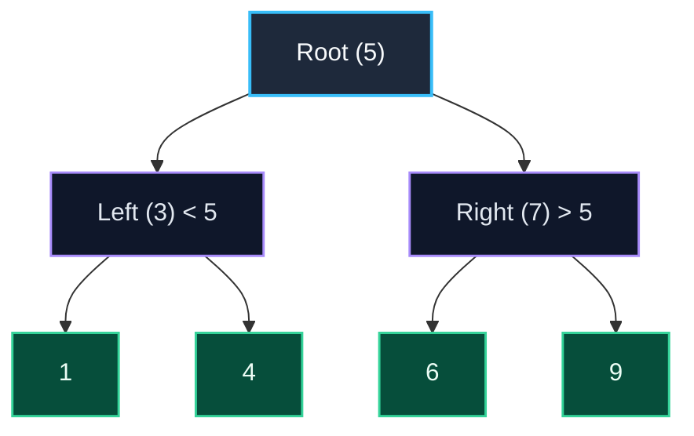

### Problem: Kth Smallest Element in BST

**Problem Statement**
Given the root of a binary search tree and an integer k, return the kth smallest value of all the values of the nodes in the tree.

**Solution: Inorder Traversal**

Key insight: Inorder traversal of BST gives values in sorted order.

```java
class Solution {
    private int count = 0;
    private int result = 0;

    public int kthSmallest(TreeNode root, int k) {
        inorder(root, k);
        return result;
    }

    private void inorder(TreeNode node, int k) {
        if (node == null) return;

        inorder(node.left, k);

        count++;
        if (count == k) {
            result = node.val;
            return;
        }

        inorder(node.right, k);
    }
}
```

**Complexity**
- Time: O(k) average, O(n) worst
- Space: O(h)

| BST Operation | Balanced (AVL/RB) | Skewed Worst Case |
|---------------|-------------------|-------------------|
| Search / Insert / Delete | O(log n) | O(n) |
| Kth Smallest (Inorder) | O(h + k) | O(n) |
| Validate BST | O(n) | O(n) |

> [!TIP]
> If `kthSmallest` is called frequently alongside inserts/deletes, augment each `TreeNode` with a `leftSubtreeSize` count to achieve O(h) lookup without traversing `k` nodes.

---

## Graph Representations

Choosing the right graph representation impacts both memory and edge-iteration speed. Sparse graphs (`E << V^2`, most interview problems) use **Adjacency Lists**, while dense graphs or O(1) edge-existence queries use **Adjacency Matrices**.

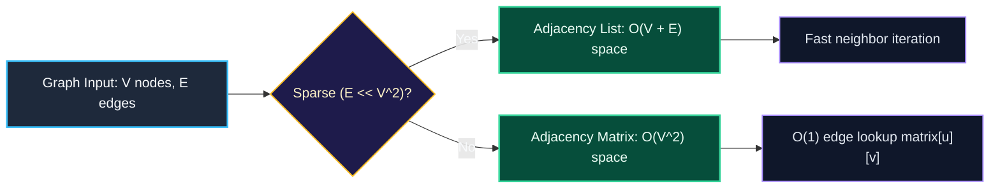

### Adjacency List (Most Common)
```java
List<Integer>[] graph = new List[numNodes];
for (int i = 0; i < numNodes; i++) {
    graph[i] = new ArrayList<>();
}

// Add edge from u to v
graph[u].add(v);
```

### Adjacency Matrix
```java
int[][] graph = new int[numNodes][numNodes];
// Add edge from u to v
graph[u][v] = 1;
```

| Representation | Space | Check Edge `(u, v)` | Iterate Neighbors of `u` | Best For |
|----------------|-------|---------------------|--------------------------|----------|
| Adjacency List | O(V + E) | O(deg(u)) | O(deg(u)) | Sparse graphs, BFS/DFS, Dijkstra |
| Adjacency Matrix | O(V^2) | O(1) | O(V) | Dense graphs, Floyd-Warshall |

> [!IMPORTANT]
> For undirected graphs, remember to add **both** `graph[u].add(v)` and `graph[v].add(u)` when building an adjacency list.

---

## BFS Patterns

Breadth-First Search explores vertices in concentric distance waves from the source. Because every node at distance `d` is dequeued before any node at distance `d + 1`, the first time BFS reaches a target in an **unweighted** graph, it is guaranteed to be the shortest path.

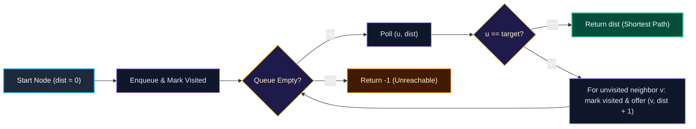

### Problem 1: Shortest Path in Unweighted Graph

**Problem Statement**
Given an unweighted graph represented as an adjacency list, find the shortest path from source to target.

```java
public int shortestPath(int[][] graph, int start, int end) {
    Queue<int[]> queue = new LinkedList<>();
    boolean[] visited = new boolean[graph.length];

    queue.offer(new int[]{start, 0}); // {node, distance}
    visited[start] = true;

    while (!queue.isEmpty()) {
        int[] current = queue.poll();
        int node = current[0];
        int distance = current[1];

        if (node == end) return distance;

        for (int neighbor : graph[node]) {
            if (!visited[neighbor]) {
                visited[neighbor] = true;
                queue.offer(new int[]{neighbor, distance + 1});
            }
        }
    }

    return -1; // No path found
}
```

---

### Problem 2: Number of Islands

**Problem Statement**
Given an m x n 2D grid of '1's (land) and '0's (water), return the number of islands. An island is surrounded by water and is formed by connecting adjacent lands horizontally or vertically.

**Solution: BFS**

```java
public int numIslands(char[][] grid) {
    if (grid == null || grid.length == 0) return 0;

    int count = 0;

    for (int i = 0; i < grid.length; i++) {
        for (int j = 0; j < grid[0].length; j++) {
            if (grid[i][j] == '1') {
                count++;
                bfs(grid, i, j);
            }
        }
    }

    return count;
}

private void bfs(char[][] grid, int i, int j) {
    Queue<int[]> queue = new LinkedList<>();
    queue.offer(new int[]{i, j});
    grid[i][j] = '0'; // Mark as visited

    int[][] directions = {{0, 1}, {0, -1}, {1, 0}, {-1, 0}};

    while (!queue.isEmpty()) {
        int[] current = queue.poll();
        int x = current[0];
        int y = current[1];

        for (int[] dir : directions) {
            int nx = x + dir[0];
            int ny = y + dir[1];

            if (nx >= 0 && nx < grid.length && ny >= 0 && ny < grid[0].length &&
                grid[nx][ny] == '1') {
                grid[nx][ny] = '0';
                queue.offer(new int[]{nx, ny});
            }
        }
    }
}
```

**Complexity**
- Time: O(m * n)
- Space: O(m * n) for queue

---

### Problem 3: Word Ladder

**Problem Statement**
Given two words, `beginWord` and `endWord`, and a dictionary `wordList`, return the shortest sequence of words such that each adjacent pair differs by a single letter. If no such sequence exists, return 0.

**Solution: BFS**

```java
public int ladderLength(String beginWord, String endWord, List<String> wordList) {
    Set<String> wordSet = new HashSet<>(wordList);

    if (!wordSet.contains(endWord)) return 0;

    Queue<String> queue = new LinkedList<>();
    queue.offer(beginWord);
    int level = 1;

    while (!queue.isEmpty()) {
        int size = queue.size();

        for (int i = 0; i < size; i++) {
            String currentWord = queue.poll();

            if (currentWord.equals(endWord)) {
                return level;
            }

            // Generate all neighbors (words differing by 1 character)
            for (String neighbor : getNeighbors(currentWord, wordSet)) {
                queue.offer(neighbor);
                wordSet.remove(neighbor); // Mark as visited
            }
        }

        level++;
    }

    return 0;
}

private List<String> getNeighbors(String word, Set<String> wordSet) {
    List<String> neighbors = new ArrayList<>();
    char[] chars = word.toCharArray();

    for (int i = 0; i < chars.length; i++) {
        char original = chars[i];

        for (char c = 'a'; c <= 'z'; c++) {
            chars[i] = c;
            String newWord = String.valueOf(chars);

            if (wordSet.contains(newWord)) {
                neighbors.add(newWord);
            }
        }

        chars[i] = original;
    }

    return neighbors;
}
```

**Complexity**
- Time: O(n * l * 26) where n is words, l is word length
- Space: O(n)

| BFS Problem | State Representation | Visited Tracking | Time | Space |
|-------------|----------------------|------------------|------|-------|
| Shortest Path | `{node, distance}` | `boolean[] visited` | O(V + E) | O(V) |
| Number of Islands | `{row, col}` | Mutate `'1'` to `'0'` | O(m * n) | O(m * n) |
| Word Ladder | `String word` | Remove from `wordSet` | O(n * l * 26) | O(n) |

> [!WARNING]
> Always mark a node as **visited at enqueue time** (`queue.offer`), never at dequeue time (`queue.poll`). Marking at dequeue allows duplicate entries in the queue and causes exponential blowup on grids.

---

## DFS Patterns

Depth-First Search explores a branch as deeply as possible before backtracking. For **directed cycle detection**, a simple `visited` boolean is insufficient—you must distinguish nodes currently on the active recursion stack (**Gray**) from nodes completely finished (**Black**).

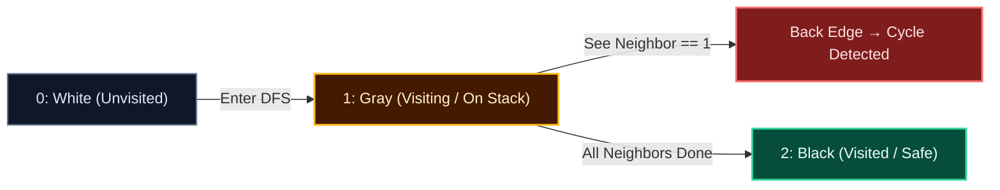

### Problem 1: Clone Graph

**Problem Statement**
Given a reference of a node in a connected undirected graph. Return a deep copy of the graph.

```java
public class Node {
    public int val;
    public List<Node> neighbors;

    public Node() {
        val = 0;
        neighbors = new ArrayList<Node>();
    }

    public Node(int _val) {
        val = _val;
        neighbors = new ArrayList<Node>();
    }

    public Node(int _val, ArrayList<Node> _neighbors) {
        val = _val;
        neighbors = _neighbors;
    }
}
```

**Solution: DFS with HashMap**

```java
public Node cloneGraph(Node node) {
    if (node == null) return null;

    Map<Node, Node> visited = new HashMap<>();
    return dfs(node, visited);
}

private Node dfs(Node node, Map<Node, Node> visited) {
    if (visited.containsKey(node)) {
        return visited.get(node);
    }

    Node clonedNode = new Node(node.val);
    visited.put(node, clonedNode);

    for (Node neighbor : node.neighbors) {
        clonedNode.neighbors.add(dfs(neighbor, visited));
    }

    return clonedNode;
}
```

**Complexity**
- Time: O(n + e) where e is edges
- Space: O(n)

---

### Problem 2: Course Schedule (Detect Cycle in Directed Graph)

**Problem Statement**
You are given a number of courses labeled from 0 to numCourses - 1 and a list of directed edges where edges[i] = [ai, bi] indicates you must take course ai before course bi. Can you finish all courses?

**Solution: DFS with Color Marking**

```java
public boolean canFinish(int numCourses, int[][] prerequisites) {
    List<Integer>[] graph = new List[numCourses];
    for (int i = 0; i < numCourses; i++) {
        graph[i] = new ArrayList<>();
    }

    // Build graph
    for (int[] edge : prerequisites) {
        graph[edge[1]].add(edge[0]);
    }

    // 0: unvisited, 1: visiting, 2: visited
    int[] state = new int[numCourses];

    for (int i = 0; i < numCourses; i++) {
        if (state[i] == 0) {
            if (hasCycle(graph, i, state)) {
                return false;
            }
        }
    }

    return true;
}

private boolean hasCycle(List<Integer>[] graph, int node, int[] state) {
    state[node] = 1; // Mark as visiting

    for (int neighbor : graph[node]) {
        if (state[neighbor] == 1) {
            // Back edge detected (cycle)
            return true;
        }

        if (state[neighbor] == 0) {
            if (hasCycle(graph, neighbor, state)) {
                return true;
            }
        }
    }

    state[node] = 2; // Mark as visited
    return false;
}
```

**State Machine**
- 0 = White (unvisited)
- 1 = Gray (currently visiting)
- 2 = Black (completely visited)

**Complexity**
- Time: O(v + e)
- Space: O(v)

| DFS Pattern | Tracking Structure | Cycle / Revisit Rule | Time | Space |
|-------------|--------------------|----------------------|------|-------|
| Clone Graph | `Map<Node, Node>` | Put clone in map **before** recursing | O(V + E) | O(V) |
| Directed Cycle | `int[] state` (0/1/2) | Neighbor with `state == 1` is a cycle | O(V + E) | O(V) |

> [!IMPORTANT]
> In `cloneGraph`, you **must** insert `visited.put(node, clonedNode)` before looping over `node.neighbors`, otherwise cycles in the graph will cause infinite recursion.

---

## Topological Sort

Topological Sort orders vertices in a Directed Acyclic Graph (DAG) such that for every directed edge `u → v`, `u` appears before `v`. **Kahn's Algorithm** repeatedly peels off nodes with `inDegree == 0` using a BFS queue; if fewer than `V` nodes are processed, a cycle exists.

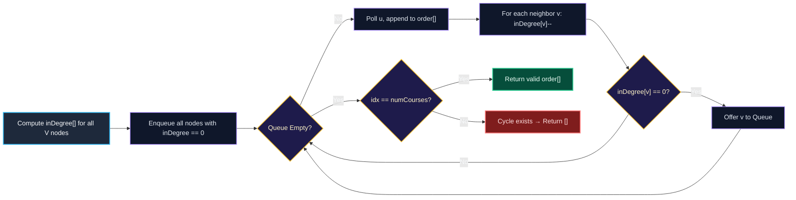

### Problem: Course Schedule II

**Problem Statement**
Return the order of courses you should take to complete all courses. If impossible, return empty array.

**Solution: Kahn's Algorithm (BFS)**

```java
public int[] findOrder(int numCourses, int[][] prerequisites) {
    List<Integer>[] graph = new List[numCourses];
    int[] inDegree = new int[numCourses];

    for (int i = 0; i < numCourses; i++) {
        graph[i] = new ArrayList<>();
    }

    // Build graph and calculate in-degrees
    for (int[] edge : prerequisites) {
        graph[edge[1]].add(edge[0]);
        inDegree[edge[0]]++;
    }

    // Find all nodes with in-degree 0
    Queue<Integer> queue = new LinkedList<>();
    for (int i = 0; i < numCourses; i++) {
        if (inDegree[i] == 0) {
            queue.offer(i);
        }
    }

    int[] order = new int[numCourses];
    int idx = 0;

    while (!queue.isEmpty()) {
        int node = queue.poll();
        order[idx++] = node;

        // Reduce in-degree of neighbors
        for (int neighbor : graph[node]) {
            inDegree[neighbor]--;

            if (inDegree[neighbor] == 0) {
                queue.offer(neighbor);
            }
        }
    }

    // If all courses are processed, return order; else cycle exists
    return (idx == numCourses) ? order : new int[0];
}
```

**Complexity**
- Time: O(v + e)
- Space: O(v + e)

| Approach | Mechanism | Cycle Detection | Time | Space |
|----------|-----------|-----------------|------|-------|
| Kahn's Algorithm (BFS) | `inDegree[]` + `Queue` | `processedCount != V` | O(V + E) | O(V + E) |
| Postorder DFS | Reverse postorder + `state[]` | Back edge to Gray node | O(V + E) | O(V + E) |

> [!TIP]
> Kahn's Algorithm is also ideal for **lexicographically smallest** topological sort: simply replace `Queue<Integer>` with a `PriorityQueue<Integer>` (min-heap).

---

## Union-Find

Union-Find (Disjoint Set Union / DSU) tracks dynamic connectivity across disjoint sets in nearly **O(1)** amortized time per operation (`O(α(n))`, where `α` is the inverse Ackermann function). Combining **Path Compression** in `find` with **Union by Rank** in `union` keeps trees flat.

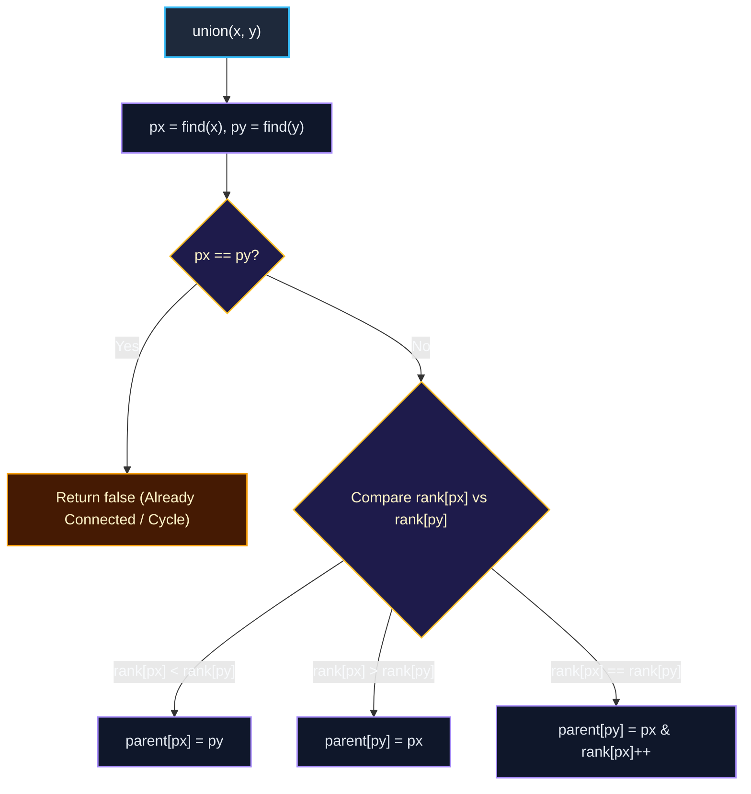

### Implementation
```java
class UnionFind {
    private int[] parent;
    private int[] rank;

    public UnionFind(int n) {
        parent = new int[n];
        rank = new int[n];

        for (int i = 0; i < n; i++) {
            parent[i] = i;
            rank[i] = 0;
        }
    }

    public int find(int x) {
        if (parent[x] != x) {
            parent[x] = find(parent[x]); // Path compression
        }
        return parent[x];
    }

    public boolean union(int x, int y) {
        int px = find(x);
        int py = find(y);

        if (px == py) return false; // Already in same set

        // Union by rank
        if (rank[px] < rank[py]) {
            parent[px] = py;
        } else if (rank[px] > rank[py]) {
            parent[py] = px;
        } else {
            parent[py] = px;
            rank[px]++;
        }

        return true;
    }
}
```

---

### Problem: Number of Connected Components

**Problem Statement**
Given n nodes and a list of edges, find the number of connected components.

```java
public int countComponents(int n, int[][] edges) {
    UnionFind uf = new UnionFind(n);

    for (int[] edge : edges) {
        uf.union(edge[0], edge[1]);
    }

    Set<Integer> roots = new HashSet<>();
    for (int i = 0; i < n; i++) {
        roots.add(uf.find(i));
    }

    return roots.size();
}
```

| Optimization | Effect | Amortized Time |
|--------------|--------|----------------|
| Path Compression (`find`) | Points every visited node directly to root | O(log n) alone |
| Union by Rank (`union`) | Attaches shorter tree under taller tree | O(log n) alone |
| Both Combined | Near-constant tree depth | **O(α(n))** ≈ O(1) |

> [!TIP]
> You can count connected components in O(1) extra space without a `HashSet`: start with `components = n` and decrement `components--` every time `uf.union(u, v)` returns `true`.

---

## Advanced Algorithms

For weighted graphs, **Dijkstra's Algorithm** uses a greedy min-heap for non-negative weights, while **Bellman-Ford** handles negative edge weights by relaxing all edges `V - 1` times. For string prefix queries, a **Trie** trades memory for O(m) lookup independent of dictionary size.


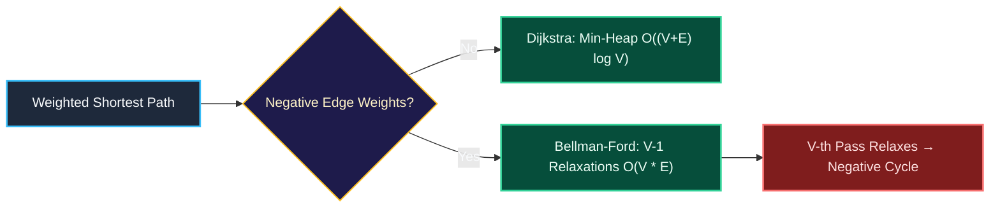

### Dijkstra's Algorithm (Shortest Path in Weighted Graph)

```java
public int[] dijkstra(int[][] graph, int start) {
    int n = graph.length;
    int[] distance = new int[n];
    Arrays.fill(distance, Integer.MAX_VALUE);
    distance[start] = 0;

    PriorityQueue<int[]> minHeap = new PriorityQueue<>(
        (a, b) -> a[0] - b[0]
    );

    minHeap.offer(new int[]{0, start}); // {distance, node}

    while (!minHeap.isEmpty()) {
        int[] current = minHeap.poll();
        int d = current[0];
        int u = current[1];

        if (d > distance[u]) continue; // Already processed

        for (int[] edge : graph[u]) {
            int v = edge[0];
            int weight = edge[1];

            if (distance[u] + weight < distance[v]) {
                distance[v] = distance[u] + weight;
                minHeap.offer(new int[]{distance[v], v});
            }
        }
    }

    return distance;
}
```

**Complexity**
- Time: O((v + e) log v)
- Space: O(v)

---

### Bellman-Ford Algorithm (Negative Edge Weights)

```java
public int[] bellmanFord(int n, int[][] edges, int start) {
    int[] distance = new int[n];
    Arrays.fill(distance, Integer.MAX_VALUE);
    distance[start] = 0;

    // Relax all edges V - 1 times
    for (int i = 0; i < n - 1; i++) {
        for (int[] edge : edges) {
            int u = edge[0], v = edge[1], w = edge[2];
            if (distance[u] != Integer.MAX_VALUE && distance[u] + w < distance[v]) {
                distance[v] = distance[u] + w;
            }
        }
    }

    // Optional V-th pass: if any edge relaxes, a negative cycle exists
    return distance;
}
```

**Complexity**
- Time: O(v * e)
- Space: O(v)

---

### Trie (Prefix Tree)

```java
class TrieNode {
    Map<Character, TrieNode> children = new HashMap<>();
    boolean isWord = false;
}

class Trie {
    private TrieNode root = new TrieNode();

    public void insert(String word) {
        TrieNode node = root;

        for (char c : word.toCharArray()) {
            node.children.putIfAbsent(c, new TrieNode());
            node = node.children.get(c);
        }

        node.isWord = true;
    }

    public boolean search(String word) {
        TrieNode node = root;

        for (char c : word.toCharArray()) {
            if (!node.children.containsKey(c)) return false;
            node = node.children.get(c);
        }

        return node.isWord;
    }

    public boolean startsWith(String prefix) {
        TrieNode node = root;

        for (char c : prefix.toCharArray()) {
            if (!node.children.containsKey(c)) return false;
            node = node.children.get(c);
        }

        return true;
    }
}
```

**Complexity**
- `insert` / `search` / `startsWith`: O(m) where m is word length
- Space: O(alphabetSize * n) where n is total chars

| Algorithm | Edge Weights | Handles Cycles | Time | Space |
|-----------|--------------|----------------|------|-------|
| Dijkstra | Non-negative (`w >= 0`) | Yes (skip stale `d > dist[u]`) | O((V + E) log V) | O(V) |
| Bellman-Ford | Any (including negative) | Detects negative cycles | O(V * E) | O(V) |
| Trie | N/A (Strings) | N/A (Prefix DAG) | O(m) per op | O(alphabet * n) |

> [!WARNING]
> Never use Dijkstra's Algorithm when edges can have negative weights—once a node is popped from the min-heap, Dijkstra assumes its distance is final, which breaks with negative edges.

---

## Summary Table

Use this decision flow to match an interview problem to its optimal graph or tree pattern in under 30 seconds:

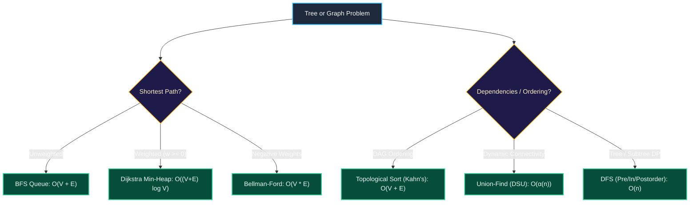

| Problem | Technique | Time | Space |
|---------|-----------|------|-------|
| Level Order | BFS | O(n) | O(w) |
| Max Depth | DFS | O(n) | O(h) |
| Validate BST | DFS | O(n) | O(h) |
| LCA | DFS | O(n) | O(h) |
| Number of Islands | DFS/BFS | O(m*n) | O(m*n) |
| Course Schedule | DFS | O(v+e) | O(v) |
| Topological Sort | Kahn | O(v+e) | O(v) |
| Union-Find | DSU | O(α(n)) | O(n) |
| Dijkstra | Heap | O((v+e)logv) | O(v) |
| Bellman-Ford | Edge Relaxation | O(v*e) | O(v) |
| Trie | Prefix Tree | O(m) | O(alphabet*n) |

> [!IMPORTANT]
> Always state both time and space complexity explicitly in terms of `V` (vertices), `E` (edges), `h` (tree height), or `w` (max tree width)—never just `O(n)` without defining `n`.
