# Dynamic Programming - Comprehensive Guide for FAANG Interviews

## Table of Contents
1. [DP Framework](#dp-framework)
2. [1D DP Problems](#1d-dp-problems)
3. [2D DP Problems](#2d-dp-problems)
4. [Interval DP](#interval-dp)
5. [DP on Strings](#dp-on-strings)
6. [DP on Trees](#dp-on-trees)
7. [State Machine DP](#state-machine-dp)
8. [DP Problem Classification](#dp-problem-classification)
9. [Common DP Pitfalls](#common-dp-pitfalls)
10. [Interview Tips](#interview-tips)

---

## DP Framework


### Key Concepts
1. **Subproblems**: Can problem be broken into smaller, overlapping subproblems?
2. **Recurrence Relation**: How does solution of larger problem depend on smaller ones?
3. **Base Cases**: Simplest scenarios with known answers
4. **Memoization vs Tabulation**:
   - **Top-Down (Memoization)**: Recursion with caching
   - **Bottom-Up (Tabulation)**: Iterative filling of DP table

### When to Apply DP
- **Optimal substructure**: Optimal solution contains optimal solutions to subproblems
- **Overlapping subproblems**: Same subproblems solved multiple times
- Problems involve optimization (max/min) or counting

### State-Transition & Formulation Equations

```text
State Definition:   dp[state] = optimal value or count for subproblem(state)
General Recurrence: dp[S]     = combine(dp[S_1], dp[S_2], ..., dp[S_k]) + cost(S)
Base Case:          dp[S_0]   = known constant (terminates recursion / seeds table)
```

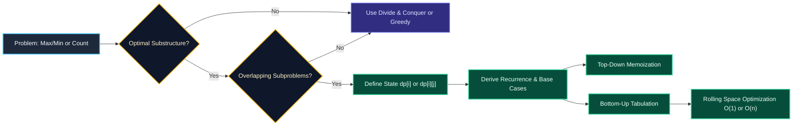

> [!IMPORTANT]
> Dynamic Programming is **recursion + memoization** or **DAG topological evaluation**. Every valid DP recurrence forms a Directed Acyclic Graph (DAG) of states with no cycles.

### Framework Complexity Comparison

| Approach | Time Complexity | Space Complexity | Stack Overhead | Best Used When |
|---|---|---|---|---|
| Brute-Force Recursion | Exponential `O(2^n)` | `O(n)` call stack | High | Initial exploration only |
| Top-Down Memoization | `O(states * transition)` | `O(states) + O(depth)` | `O(depth)` | Sparse state space or tree DP |
| Bottom-Up Tabulation | `O(states * transition)` | `O(states)` | None | Dense grids, iterative control |
| Space-Optimized DP | `O(states * transition)` | `O(1)` or `O(row)` | None | Transition uses only prior row/steps |

> [!TIP]
> Always derive the **Top-Down recurrence** first to verify correctness, then convert to **Bottom-Up Tabulation**, and finally compress space only if the transition window is bounded.

---

## 1D DP Problems

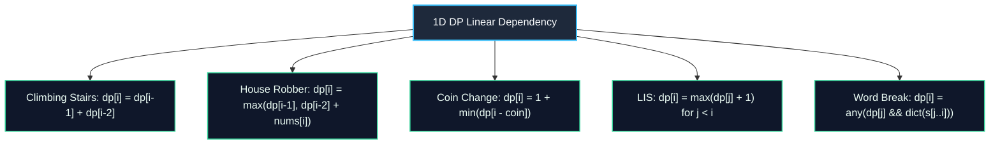

### Problem 1: Climbing Stairs

**Problem Statement**
You are climbing a staircase with n steps. Each time you can climb 1 or 2 steps. In how many distinct ways can you climb to the top?

**Recurrence Relation**
- To reach step `n`, you can come from step `n-1` (1 step) or `n-2` (2 steps)
- `dp[n] = dp[n-1] + dp[n-2]`, with `dp[0] = 1, dp[1] = 1`

**Solution 1: Top-Down (Memoization)**

```java
public int climbStairs(int n) {
    int[] memo = new int[n + 1];
    return climb(n, memo);
}

private int climb(int n, int[] memo) {
    if (n == 0 || n == 1) return 1;

    if (memo[n] != 0) return memo[n];

    memo[n] = climb(n - 1, memo) + climb(n - 2, memo);
    return memo[n];
}
```

**Solution 2: Bottom-Up (Tabulation)**

```java
public int climbStairs(int n) {
    if (n == 1) return 1;

    int[] dp = new int[n + 1];
    dp[0] = 1;
    dp[1] = 1;

    for (int i = 2; i <= n; i++) {
        dp[i] = dp[i - 1] + dp[i - 2];
    }

    return dp[n];
}
```

**Space Optimization**

```java
public int climbStairs(int n) {
    if (n == 1) return 1;

    int prev = 1, curr = 1;

    for (int i = 2; i <= n; i++) {
        int next = prev + curr;
        prev = curr;
        curr = next;
    }

    return curr;
}
```

**Complexity**
- Time: `O(n)`
- Space: `O(1)` optimized, `O(n)` for DP array

---

### Problem 2: House Robber

**Problem Statement**
You are a professional robber planning to rob houses. You cannot rob two adjacent houses (alarm triggers). Given array of house values, return maximum amount you can rob.

**Recurrence Relation**
- `dp[i] = max(dp[i-1], dp[i-2] + nums[i])`
- Either skip house `i` or rob it (and must skip `i-1`)

**Solution**

```java
public int rob(int[] nums) {
    if (nums == null || nums.length == 0) return 0;
    if (nums.length == 1) return nums[0];

    int[] dp = new int[nums.length];
    dp[0] = nums[0];
    dp[1] = Math.max(nums[0], nums[1]);

    for (int i = 2; i < nums.length; i++) {
        dp[i] = Math.max(dp[i - 1], dp[i - 2] + nums[i]);
    }

    return dp[nums.length - 1];
}
```

**Space-Optimized**

```java
public int rob(int[] nums) {
    int prev = 0, curr = 0;

    for (int num : nums) {
        int next = Math.max(curr, prev + num);
        prev = curr;
        curr = next;
    }

    return curr;
}
```

**Complexity**
- Time: `O(n)`
- Space: `O(1)` optimized

> [!TIP]
> In House Robber, initializing `prev = 0, curr = 0` eliminates separate `n == 1` and `n == 2` edge-case branches in the rolling-variable loop.

---

### Problem 3: Coin Change

**Problem Statement**
Given an array of coin denominations and a target amount, return the fewest number of coins needed to make that amount. Return -1 if impossible.

**Recurrence Relation**
- `dp[i] = 1 + min(dp[i - coin])` for all `coins` where `i >= coin`, with `dp[0] = 0`

**Solution**

```java
public int coinChange(int[] coins, int amount) {
    int[] dp = new int[amount + 1];
    Arrays.fill(dp, amount + 1); // Initialize with impossible value
    dp[0] = 0;

    for (int i = 1; i <= amount; i++) {
        for (int coin : coins) {
            if (i >= coin) {
                dp[i] = Math.min(dp[i], 1 + dp[i - coin]);
            }
        }
    }

    return dp[amount] > amount ? -1 : dp[amount];
}
```

**Why Initialize with `amount + 1`**
- Serves as "infinity" for comparison without risking integer overflow (`Integer.MAX_VALUE + 1` wraps negative)
- Ensures any valid path is strictly smaller
- Final check: if `dp[amount] > amount`, it's unreachable

**Example**: `coins = [1,2,5], amount = 5`
```text
dp[0] = 0
dp[1] = 1 (1 coin of 1)
dp[2] = 1 (1 coin of 2)
dp[3] = 2 (2 coins of 1, or 1 of 1 + 1 of 2)
dp[4] = 2 (2 coins of 2)
dp[5] = 1 (1 coin of 5)
```

**Complexity**
- Time: `O(amount * len(coins))`
- Space: `O(amount)`

---

### Problem 4: Longest Increasing Subsequence (LIS)

**Problem Statement**
Given an integer array `nums`, return the length of the longest strictly increasing subsequence.

**Recurrence Relation**
- `dp[i] = 1 + max(dp[j])` for all `0 <= j < i` where `nums[j] < nums[i]`, else `1`

**Solution 1: O(n²) DP**

```java
public int lengthOfLIS(int[] nums) {
    int n = nums.length;
    int[] dp = new int[n];
    Arrays.fill(dp, 1);

    for (int i = 1; i < n; i++) {
        for (int j = 0; j < i; j++) {
            if (nums[j] < nums[i]) {
                dp[i] = Math.max(dp[i], dp[j] + 1);
            }
        }
    }

    return Arrays.stream(dp).max().orElse(0);
}
```

**Solution 2: O(n log n) Binary Search**

Key insight: Maintain array of smallest tail element for each subsequence length.

```java
public int lengthOfLIS(int[] nums) {
    int[] tails = new int[nums.length];
    int size = 0;

    for (int num : nums) {
        // Find position to insert num in tails
        int pos = Arrays.binarySearch(tails, 0, size, num);

        // binarySearch returns -(insertion point + 1) if not found
        if (pos < 0) {
            pos = -(pos + 1);
        }

        tails[pos] = num;

        // If inserted at end, increase size
        if (pos == size) {
            size++;
        }
    }

    return size;
}
```

**Example**: `nums = [10,9,2,5,3,7,101,18]`
```text
tails = [0,   0,   0,  0,  0,  0,  0,  0]
After 10: [10, 0,   0,  0,  0,  0,  0,  0], size=1
After 9:  [9,  0,   0,  0,  0,  0,  0,  0], size=1
After 2:  [2,  0,   0,  0,  0,  0,  0,  0], size=1
After 5:  [2,  5,   0,  0,  0,  0,  0,  0], size=2
After 3:  [2,  3,   0,  0,  0,  0,  0,  0], size=2
After 7:  [2,  3,   7,  0,  0,  0,  0,  0], size=3
After 101:[2,  3,   7,  101,0,  0,  0,  0], size=4
After 18: [2,  3,   7,  18, 0,  0,  0,  0], size=4
Return: 4
```

**Complexity**
- Time: `O(n log n)` (Binary Search) / `O(n²)` (Standard DP)
- Space: `O(n)`

---

### Problem 5: Word Break

**Problem Statement**
Given a string `s` and a dictionary `wordDict`, return true if `s` can be segmented into words from the dictionary.

**Recurrence Relation**
- `dp[i] = OR_{0 <= j < i} (dp[j] && wordSet.contains(s[j..i)))`, with `dp[0] = true`

**Solution: 1D DP**

```java
public boolean wordBreak(String s, List<String> wordDict) {
    Set<String> wordSet = new HashSet<>(wordDict);
    boolean[] dp = new boolean[s.length() + 1];
    dp[0] = true;

    for (int i = 1; i <= s.length(); i++) {
        for (int j = 0; j < i; j++) {
            // If s[0..j) can be segmented and s[j..i) is in dictionary
            if (dp[j] && wordSet.contains(s.substring(j, i))) {
                dp[i] = true;
                break;
            }
        }
    }

    return dp[s.length()];
}
```

**Example**: `s = "leetcode", dict = ["leet","code"]`
```text
dp[0] = true
dp[1] = false (no match)
dp[2] = false
dp[3] = false
dp[4] = true (s[0..4]="leet" is in dict)
dp[5] = false
dp[6] = false
dp[7] = false
dp[8] = true (s[4..8]="code" is in dict, dp[4]=true)
Return: true
```

**Complexity**
- Time: `O(n² * m)` where `m` is average substring length
- Space: `O(n)`

### 1D DP Complexity Summary

| Problem | State `dp[i]` | Time Complexity | Space (Standard) | Space (Optimized) |
|---|---|---|---|---|
| Climbing Stairs | Ways to reach step `i` | `O(n)` | `O(n)` | `O(1)` |
| House Robber | Max loot from `0..i` | `O(n)` | `O(n)` | `O(1)` |
| Coin Change | Min coins for amount `i` | `O(amount * coins)` | `O(amount)` | `O(amount)` |
| LIS | LIS ending at index `i` | `O(n²)` / `O(n log n)` | `O(n)` | `O(n)` |
| Word Break | Can segment `s[0..i)` | `O(n² * m)` | `O(n)` | `O(n)` |

> [!WARNING]
> In **Coin Change**, never initialize `dp` with `Integer.MAX_VALUE` if you compute `1 + dp[i - coin]`—it overflows to `Integer.MIN_VALUE` and corrupts `Math.min`. Use `amount + 1`.

---

## 2D DP Problems


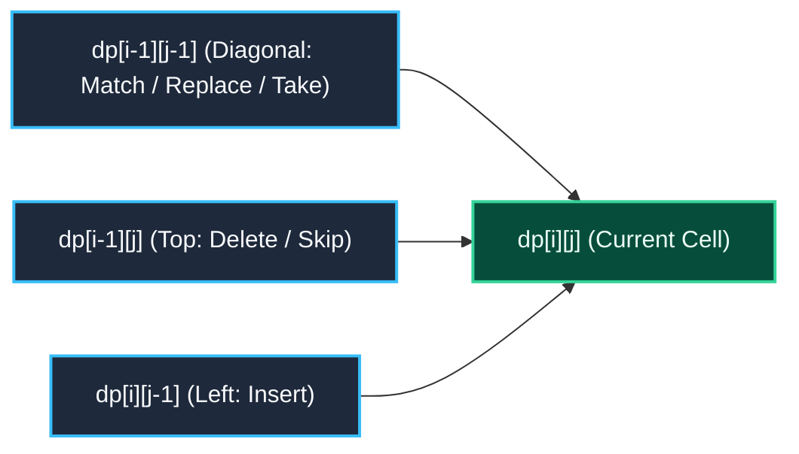

### Problem 1: Unique Paths

**Problem Statement**
A robot starts at top-left of an `m x n` grid and wants to reach bottom-right. It can only move right or down. Count unique paths.

**Recurrence Relation**
- `dp[i][j] = dp[i-1][j] + dp[i][j-1]`
- Base cases: `dp[i][0] = 1`, `dp[0][j] = 1`

**Solution**

```java
public int uniquePaths(int m, int n) {
    int[][] dp = new int[m][n];

    // Initialize first row and column
    for (int i = 0; i < m; i++) {
        dp[i][0] = 1;
    }
    for (int j = 0; j < n; j++) {
        dp[0][j] = 1;
    }

    // Fill the rest
    for (int i = 1; i < m; i++) {
        for (int j = 1; j < n; j++) {
            dp[i][j] = dp[i - 1][j] + dp[i][j - 1];
        }
    }

    return dp[m - 1][n - 1];
}
```

**Combinatorics Solution**
- Total moves = `m - 1` down + `n - 1` right
- Answer = `C(m+n-2, m-1)`

```java
public int uniquePaths(int m, int n) {
    return factorial(m + n - 2) / (factorial(m - 1) * factorial(n - 1));
}

private long factorial(int n) {
    long result = 1;
    for (int i = 2; i <= n; i++) {
        result *= i;
    }
    return result;
}
```

**Complexity**
- Time: `O(m * n)`
- Space: `O(m * n)` or `O(n)` with optimization

---

### Problem 2: Edit Distance (Levenshtein Distance)

**Problem Statement**
Given two strings `word1` and `word2`, return the minimum number of operations to convert `word1` to `word2`. Operations: insert, delete, or replace a character.

**Recurrence Relation**
```text
If word1[i-1] == word2[j-1]:
  dp[i][j] = dp[i-1][j-1]
Else:
  dp[i][j] = 1 + min(
    dp[i-1][j],    // Delete
    dp[i][j-1],    // Insert
    dp[i-1][j-1]   // Replace
  )
```

**Solution**

```java
public int editDistance(String word1, String word2) {
    int m = word1.length();
    int n = word2.length();
    int[][] dp = new int[m + 1][n + 1];

    // Initialize: convert empty string to word2 (insert operations)
    for (int j = 0; j <= n; j++) {
        dp[0][j] = j;
    }

    // Initialize: convert word1 to empty string (delete operations)
    for (int i = 0; i <= m; i++) {
        dp[i][0] = i;
    }

    for (int i = 1; i <= m; i++) {
        for (int j = 1; j <= n; j++) {
            if (word1.charAt(i - 1) == word2.charAt(j - 1)) {
                dp[i][j] = dp[i - 1][j - 1];
            } else {
                dp[i][j] = 1 + Math.min(
                    Math.min(dp[i - 1][j], dp[i][j - 1]),
                    dp[i - 1][j - 1]
                );
            }
        }
    }

    return dp[m][n];
}
```

**Example**: `word1 = "horse", word2 = "ros"`
```text
    ""  r  o  s
""   0  1  2  3
h    1  1  2  3
o    2  2  1  2
r    3  2  2  2
s    4  3  3  2
e    5  4  4  3

Answer: 3 (horse → rorse → rose → ros)
```

**Complexity**
- Time: `O(m * n)`
- Space: `O(m * n)`

---

### Problem 3: Longest Common Subsequence (LCS)

**Problem Statement**
Given two strings `text1` and `text2`, return the length of their longest common subsequence. A subsequence maintains relative order but doesn't need to be contiguous.

**Recurrence Relation**
```text
If text1[i-1] == text2[j-1]:
  dp[i][j] = dp[i-1][j-1] + 1
Else:
  dp[i][j] = max(dp[i-1][j], dp[i][j-1])
```

**Solution**

```java
public int longestCommonSubsequence(String text1, String text2) {
    int m = text1.length();
    int n = text2.length();
    int[][] dp = new int[m + 1][n + 1];

    for (int i = 1; i <= m; i++) {
        for (int j = 1; j <= n; j++) {
            if (text1.charAt(i - 1) == text2.charAt(j - 1)) {
                dp[i][j] = dp[i - 1][j - 1] + 1;
            } else {
                dp[i][j] = Math.max(dp[i - 1][j], dp[i][j - 1]);
            }
        }
    }

    return dp[m][n];
}
```

**Complexity**
- Time: `O(m * n)`
- Space: `O(m * n)`

---

### Problem 4: 0/1 Knapsack

**Problem Statement**
Given weights and values of items and a knapsack of capacity `W`, select items to maximize total value without exceeding capacity.

**Recurrence Relation**
```text
dp[i][w] = max(
  dp[i-1][w],                       // Don't take item i
  dp[i-1][w-weight[i]] + value[i]   // Take item i
)
```

**Solution**

```java
public int knapsack(int[] weights, int[] values, int capacity) {
    int n = weights.length;
    int[][] dp = new int[n + 1][capacity + 1];

    for (int i = 1; i <= n; i++) {
        for (int w = 1; w <= capacity; w++) {
            if (weights[i - 1] <= w) {
                dp[i][w] = Math.max(
                    dp[i - 1][w],
                    dp[i - 1][w - weights[i - 1]] + values[i - 1]
                );
            } else {
                dp[i][w] = dp[i - 1][w];
            }
        }
    }

    return dp[n][capacity];
}
```

**Space-Optimized (1D)**

```java
public int knapsack(int[] weights, int[] values, int capacity) {
    int[] dp = new int[capacity + 1];

    for (int i = 0; i < weights.length; i++) {
        // Iterate backwards to avoid using same item twice
        for (int w = capacity; w >= weights[i]; w--) {
            dp[w] = Math.max(dp[w], dp[w - weights[i]] + values[i]);
        }
    }

    return dp[capacity];
}
```

**Why Backwards in 1D Version**
- Forward iteration would use updated values from the same item (turning 0/1 Knapsack into Unbounded Knapsack)
- Backwards ensures each item is used at most once

> [!IMPORTANT]
> **Loop Direction Rule**: In 1D space-compressed Knapsack, iterate `w` **downward** (`W → weight[i]`) for **0/1 Knapsack** (at most once) and **upward** (`weight[i] → W`) for **Unbounded Knapsack** (unlimited reuse).

### 2D DP Complexity Summary

| Problem | Grid Dimensions | Time Complexity | Space (Full Table) | Space (Optimized) |
|---|---|---|---|---|
| Unique Paths | `m * n` | `O(m * n)` | `O(m * n)` | `O(n)` |
| Edit Distance | `(m+1) * (n+1)` | `O(m * n)` | `O(m * n)` | `O(min(m, n))` |
| LCS | `(m+1) * (n+1)` | `O(m * n)` | `O(m * n)` | `O(min(m, n))` |
| 0/1 Knapsack | `(n+1) * (W+1)` | `O(n * W)` | `O(n * W)` | `O(W)` |

---

## Interval DP

### Problem: Burst Balloons

**Problem Statement**
You have `n` balloons indexed `0` to `n-1`. When you burst balloon `i`, you get coins equal to `nums[left] * nums[i] * nums[right]` where `left` and `right` are nearest non-burst neighbors. Find maximum coins.

**Key Insight**
- Instead of thinking "which balloon to burst first", think **"which balloon to burst last"**
- When balloon `k` is burst last in range `(left, right)`, `left` and `right` are fixed boundaries

**Recurrence Relation**
```text
dp[left][right] = max_{left < k < right} (
  dp[left][k] + dp[k][right] + balloons[left] * balloons[k] * balloons[right]
)
```

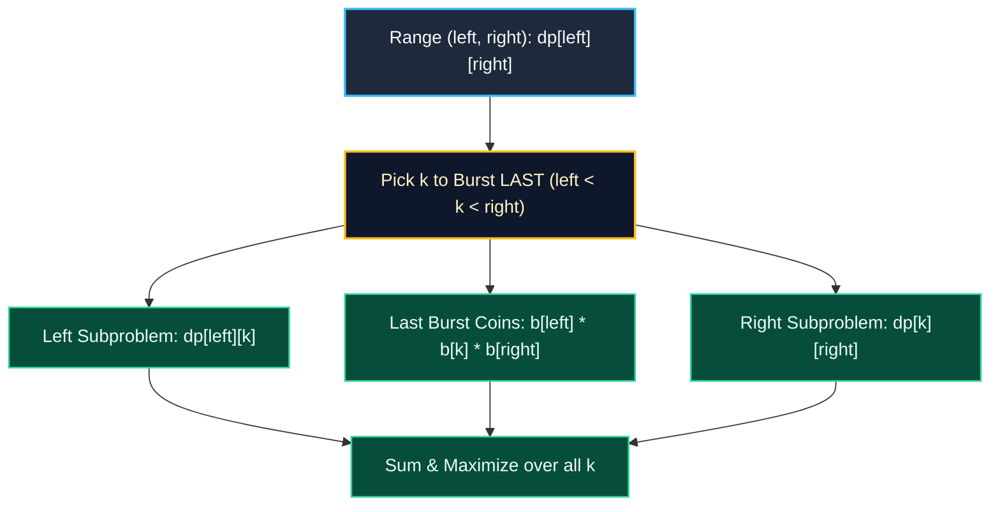

> [!IMPORTANT]
> Interval DP always iterates by **interval length (`len`)** in the outer loop so that smaller sub-intervals `dp[left][k]` and `dp[k][right]` are already computed before `dp[left][right]`.

**Solution**

```java
public int maxCoins(int[] nums) {
    int n = nums.length;

    // Add padding: imagine balloons with value 1 at both ends
    int[] balloons = new int[n + 2];
    balloons[0] = 1;
    balloons[n + 1] = 1;
    for (int i = 0; i < n; i++) {
        balloons[i + 1] = nums[i];
    }

    // dp[i][j] = max coins bursting balloons between i and j (exclusive)
    int[][] dp = new int[n + 2][n + 2];

    for (int len = 3; len <= n + 2; len++) {
        for (int left = 0; left + len - 1 < n + 2; left++) {
            int right = left + len - 1;

            for (int k = left + 1; k < right; k++) {
                // Burst balloon k last in range (left, right)
                int coins = balloons[left] * balloons[k] * balloons[right];
                coins += dp[left][k] + dp[k][right];

                dp[left][right] = Math.max(dp[left][right], coins);
            }
        }
    }

    return dp[0][n + 1];
}
```

### Interval DP Complexity Summary

| Problem | State `dp[left][right]` | Loop Order | Time Complexity | Space Complexity |
|---|---|---|---|---|
| Burst Balloons | Max coins in open interval `(left, right)` | `len` → `left` → `k` | `O(n³)` | `O(n²)` |

> [!TIP]
> Padding `balloons[0] = 1` and `balloons[n + 1] = 1` turns boundary checks into uniform interior transitions.

---

## DP on Strings

### Problem: Regular Expression Matching

**Problem Statement**
Given string `s` and pattern `p` with `'.'` (any char) and `'*'` (0+ of previous char), determine if `s` matches `p`.

**Recurrence Relation**
```text
dp[i][j] = true if s[0..i-1] matches p[0..j-1]

If p[j-1] == '*':
  - 0 occurrences:  dp[i][j] = dp[i][j-2]
  - 1+ occurrences: dp[i][j] = dp[i-1][j] && match(s[i-1], p[j-2])

Else:
  dp[i][j] = dp[i-1][j-1] && match(s[i-1], p[j-1])
```

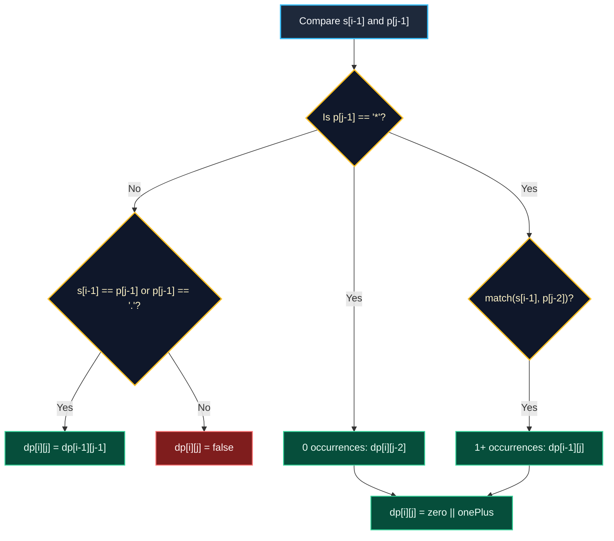

> [!WARNING]
> Do not forget the **base case for empty string `s = ""`** with patterns like `"a*b*c*"`: `dp[0][j] = dp[0][j-2]` whenever `p[j-1] == '*'`.

**Solution**

```java
public boolean isMatch(String s, String p) {
    int m = s.length();
    int n = p.length();
    boolean[][] dp = new boolean[m + 1][n + 1];

    // Empty string matches empty pattern
    dp[0][0] = true;

    // Handle patterns like a*, a*b*, a*b*c*
    for (int j = 2; j <= n; j++) {
        if (p.charAt(j - 1) == '*') {
            dp[0][j] = dp[0][j - 2];
        }
    }

    for (int i = 1; i <= m; i++) {
        for (int j = 1; j <= n; j++) {
            if (p.charAt(j - 1) == '*') {
                dp[i][j] = dp[i][j - 2]; // 0 occurrences

                // 1+ occurrences
                if (p.charAt(j - 2) == '.' || p.charAt(j - 2) == s.charAt(i - 1)) {
                    dp[i][j] = dp[i][j] || dp[i - 1][j];
                }
            } else if (p.charAt(j - 1) == '.' || p.charAt(j - 1) == s.charAt(i - 1)) {
                dp[i][j] = dp[i - 1][j - 1];
            }
        }
    }

    return dp[m][n];
}
```

### String DP Complexity Summary

| Problem | State `dp[i][j]` | Time Complexity | Space Complexity |
|---|---|---|---|
| Regular Expression Matching | `s[0..i-1]` matches `p[0..j-1]` | `O(m * n)` | `O(m * n)` |

---

## DP on Trees

### Problem: House Robber III

**Problem Statement**
Houses form a binary tree. Rob houses without robbing two directly connected (parent-child). Maximize total value.

**Recurrence Relation**
```text
dfs(node) returns [robThis, notRobThis]:
  robThis    = node.val + left[1] + right[1]
  notRobThis = max(left[0], left[1]) + max(right[0], right[1])
Answer = max(root[0], root[1])
```

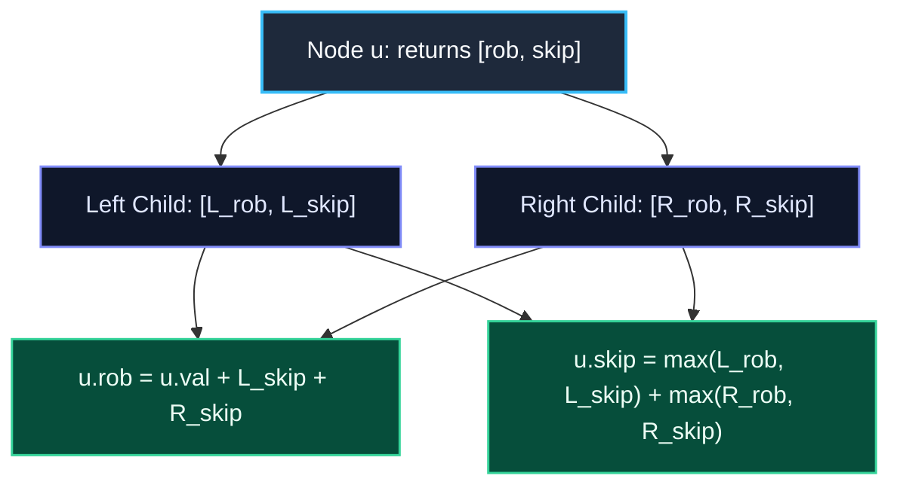

> [!TIP]
> Returning a 2-element tuple `[robThis, notRobThis]` from a post-order DFS eliminates the need for a `HashMap<TreeNode, int[]>` because each tree node is visited exactly once!

**Solution: DFS with Memoization**

```java
public int rob(TreeNode root) {
    return Math.max(dfs(root, new HashMap<>())[0], dfs(root, new HashMap<>())[1]);
}

// Returns [rob this house, don't rob this house]
private int[] dfs(TreeNode node, Map<TreeNode, int[]> memo) {
    if (node == null) return new int[]{0, 0};

    if (memo.containsKey(node)) {
        return memo.get(node);
    }

    int[] left = dfs(node.left, memo);
    int[] right = dfs(node.right, memo);

    // Rob this house: can't rob children
    int robThis = node.val + left[1] + right[1];

    // Don't rob this house: can rob or not rob children
    int notRobThis = Math.max(left[0], left[1]) + Math.max(right[0], right[1]);

    int[] result = new int[]{robThis, notRobThis};
    memo.put(node, result);
    return result;
}
```

### Tree DP Complexity Summary

| Problem | Traversal Order | Time Complexity | Space Complexity |
|---|---|---|---|
| House Robber III (with Memo) | Post-order DFS | `O(n)` | `O(n)` map + `O(h)` stack |
| House Robber III (tuple only) | Post-order DFS | `O(n)` | `O(h)` recursion stack |

---

## State Machine DP

### Problem: Best Time to Buy and Sell Stock with Cooldown

**Problem Statement**
You can buy and sell stocks. After selling, you must wait 1 day before buying. Maximize profit.

**State Definition**
- `hold`: maximum profit when currently holding stock
- `sold`: maximum profit when just sold stock (cooldown)
- `rest`: maximum profit when in cooldown or waiting

**State Transitions**
```text
hold[i] = max(prevHold, prevRest - prices[i])  // Keep holding, or buy today after rest
sold[i] = prevHold + prices[i]                 // Sell today (must have been holding)
rest[i] = max(prevRest, prevSold)              // Continue resting, or finish cooldown
```

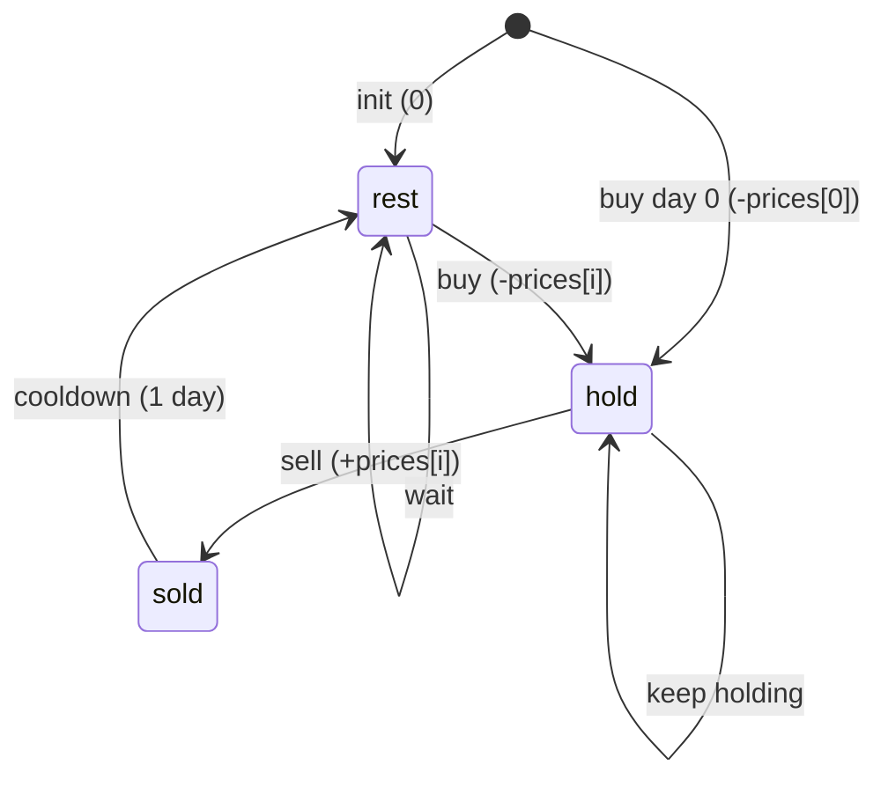

> [!IMPORTANT]
> Snapshot `prevHold`, `prevSold`, and `prevRest` before updating any state for day `i` so transitions read strictly from day `i - 1`.

**Solution**

```java
public int maxProfit(int[] prices) {
    if (prices == null || prices.length < 2) return 0;

    int hold = -prices[0];
    int sold = 0;
    int rest = 0;

    for (int i = 1; i < prices.length; i++) {
        int prevHold = hold;
        int prevSold = sold;
        int prevRest = rest;

        hold = Math.max(prevHold, prevRest - prices[i]);
        sold = prevHold + prices[i];
        rest = Math.max(prevRest, prevSold);
    }

    return Math.max(sold, rest);
}
```

### State Machine DP Complexity Summary

| Problem | States | Time Complexity | Space Complexity |
|---|---|---|---|
| Stock with Cooldown | `hold`, `sold`, `rest` | `O(n)` | `O(1)` |

---

## DP Problem Classification

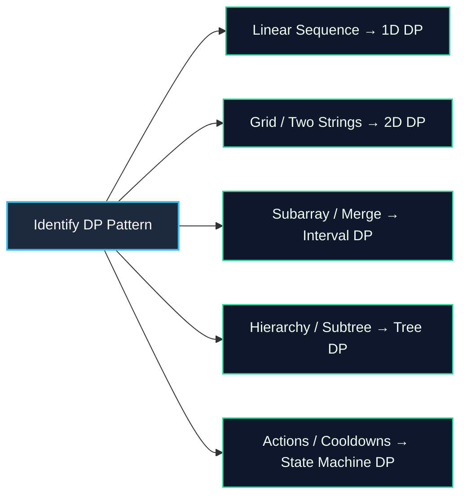

**Pattern Selection Equation**
```text
Pattern(Problem) =
  1D DP         if state depends on prefix i-1, i-2, or j &lt; i
  2D DP         if state pairs (i, j) across two strings, grid, or capacity W
  Interval DP   if combining contiguous range [left, right] via split k
  Tree DP       if node state combines child subtree tuples
  State Machine if transitions depend on discrete mode (hold / sold / rest)
```

| Type | Key Insight | Examples | Typical Time | Typical Space |
|---|---|---|---|---|
| 1D DP | Linear dependency | Climbing Stairs, Coin Change | `O(n)` – `O(n²)` | `O(1)` – `O(n)` |
| 2D DP | Grid/String matching | Unique Paths, Edit Distance | `O(m * n)` | `O(min(m, n))` – `O(m * n)` |
| Interval | Last action matters | Burst Balloons | `O(n³)` | `O(n²)` |
| String | Pattern matching | Regex, Wildcard | `O(m * n)` | `O(m * n)` |
| Tree | Subtree states | House Robber III | `O(n)` | `O(h)` – `O(n)` |
| State Machine | Multiple states | Stock with Cooldown | `O(n)` | `O(1)` |

> [!TIP]
> When stuck classifying a problem, write down the **parameters that change** in a brute-force recursive signature `solve(idx, cap, state)`—the number of changing parameters directly tells you the DP dimension.

---

## Common DP Pitfalls

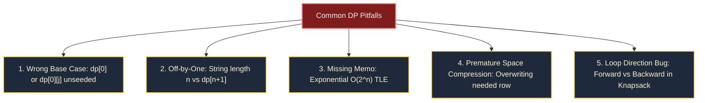

**Pitfall Guardrail Equations**
```text
Safe Infinity:      INF = target + 1  (avoids Integer.MAX_VALUE + 1 overflow)
1-Indexed DP Table: dp[i] maps to s.charAt(i - 1)  (keeps dp[0] as empty prefix)
0/1 Knapsack Loop:  for w = W down to weight[i]     (reads un-updated i-1 state)
```

1. **Wrong Base Case**: Most mistakes come from improper initialization
2. **Off-by-One Errors**: String indexing and array bounds
3. **Not Memoizing**: `O(2^n)` becomes `O(n)` with memoization
4. **Space Optimization Too Early**: Optimize after getting correct solution
5. **Misunderstanding Constraints**: Re-read whether items are reusable

| Pitfall | Symptom | Fix | Complexity Impact |
|---|---|---|---|
| Integer overflow on `MAX_VALUE + 1` | Negative min value | Use `amount + 1` or guard `!= INF` | Prevents wrong answer |
| Forward loop in 0/1 Knapsack | Item counted multiple times | Loop `w` backwards (`W → weight[i]`) | Preserves `O(W)` space |
| Missing `memo` check | Time Limit Exceeded (TLE) | Cache `memo[state]` before returning | `O(2^n) → O(states)` |
| Off-by-one on `dp[m][n]` | `IndexOutOfBoundsException` | Allocate `new int[m + 1][n + 1]` | `O(m * n)` |

> [!WARNING]
> Never optimize space before your 2D tabulation passes all small test cases. A wrong loop direction during premature compression is one of the hardest bugs to spot under interview pressure.

---

## Interview Tips


**5-Step Interview Execution Formula**
```text
Brute Force → State Meaning → Mathematical Recurrence → Small Trace → Space Compression
```

1. **Start with Brute Force**: Identify overlapping subproblems
2. **Define State Clearly**: What exactly does `dp[i]` or `dp[i][j]` represent?
3. **Write Recurrence**: Before coding, write mathematical recurrence
4. **Test Small Cases**: Trace through `n=1`, `n=2`, `n=3`
5. **Optimize Space Last**: Get correctness first, optimize later

| Interview Phase | Target Time | Key Deliverable | Complexity Goal |
|---|---|---|---|
| Clarify & Brute Force | 3–5 min | Recursive decision tree | Identify `O(2^n)` overlap |
| State & Recurrence | 5–7 min | Exact `dp[...]` equation + base cases | `O(states * transition)` |
| Code & Trace | 10–12 min | Clean tabulation or memoized DFS | Verified on `n=1,2,3` |
| Space Optimization | 3–5 min | Rolling variables / 1D array | `O(1)` or `O(row)` |

> [!TIP]
> State the exact English meaning of `dp[i]` or `dp[i][j]` out loud to your interviewer **before** writing a single line of code—it anchors both you and the interviewer on the recurrence.
