# Recursion and Backtracking - Comprehensive Guide for FAANG Interviews

## Table of Contents
1. [Recursion Fundamentals](#recursion-fundamentals)
2. [Backtracking Template](#backtracking-template)
3. [Subsets and Combinations](#subsets-and-combinations)
4. [Permutations](#permutations)
5. [Constraint Satisfaction](#constraint-satisfaction)
6. [String Problems](#string-problems)
7. [Interview Tips for Backtracking](#interview-tips-for-backtracking)
8. [Common Patterns](#common-patterns)

---

## Recursion Fundamentals

### Core Concepts

**Three Key Components**
1. **Base Case**: When to stop recursing (avoid infinite loops)
2. **Recursive Case**: How to break problem into smaller subproblems
3. **Call Stack**: Each recursive call adds to stack memory

> [!IMPORTANT]
> Every recursive function needs a reachable **base case** and a **progressing state** that strictly moves toward that base case; otherwise, the call stack overflows (`StackOverflowError`).

**Example: Simple Recursion**
```java
public int factorial(int n) {
    // Base case
    if (n <= 1) return 1;

    // Recursive case
    return n * factorial(n - 1);
}
```

**Call Stack Visualization for `factorial(5)`**

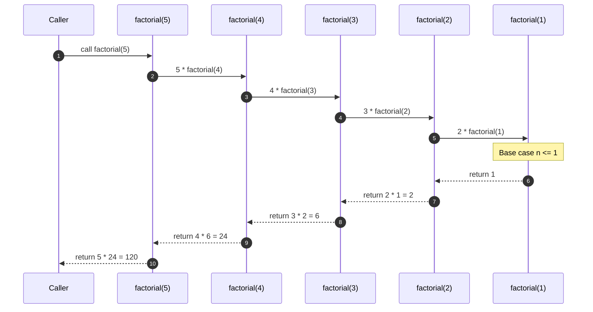

```
factorial(5)
  -> 5 * factorial(4)
       -> 4 * factorial(3)
            -> 3 * factorial(2)
                 -> 2 * factorial(1)
                      -> 1 (BASE CASE)
                 -> 2 * 1 = 2
            -> 3 * 2 = 6
       -> 4 * 6 = 24
  -> 5 * 24 = 120
```

---

### Problem: Reverse String (In-Place)

**Problem Statement**
Write a function that reverses a string. The input is given as an array of characters and you must modify the input in-place.

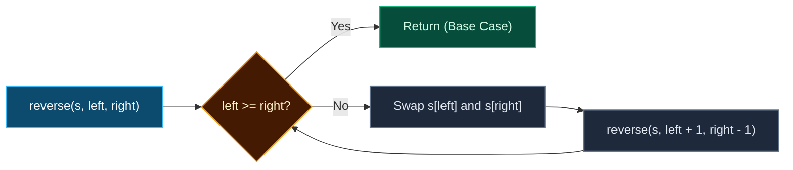

**Recursive Solution**

```java
public void reverseString(char[] s) {
    reverse(s, 0, s.length - 1);
}

private void reverse(char[] s, int left, int right) {
    // Base case: pointers meet or cross
    if (left >= right) {
        return;
    }

    // Swap characters
    char temp = s[left];
    s[left] = s[right];
    s[right] = temp;

    // Recursive case: shrink range
    reverse(s, left + 1, right - 1);
}
```

**Complexity**

| Problem | Time Complexity | Space Complexity | Notes |
|---------|----------------|------------------|-------|
| `factorial(n)` | `O(n)` | `O(n)` | `n` stack frames before base case |
| `reverseString(s)` | `O(n)` | `O(n)` | `n / 2` recursive stack frames (in-place array) |

---

## Backtracking Template

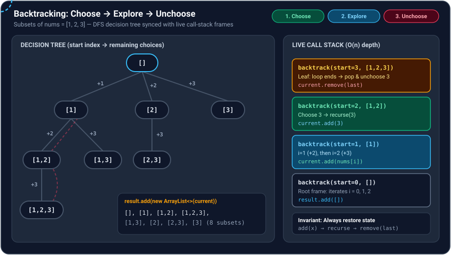

### Generic Backtracking Structure

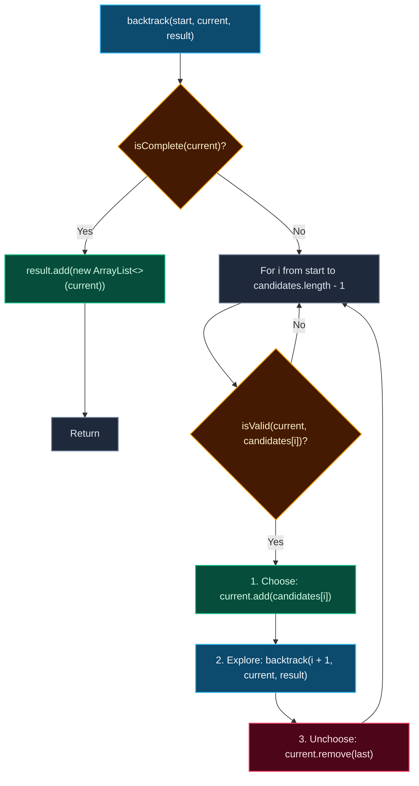

```java
void backtrack(int start, List<T> current, List<List<T>> result, T[] candidates) {
    // Base case: solution is complete
    if (isComplete(current)) {
        result.add(new ArrayList<>(current));
        return;
    }

    // Try all choices
    for (int i = start; i < candidates.length; i++) {
        // Skip invalid choices (pruning)
        if (!isValid(current, candidates[i])) {
            continue;
        }

        // Make choice
        current.add(candidates[i]);

        // Explore
        backtrack(i + 1, current, result, candidates);

        // Undo choice (backtrack)
        current.remove(current.size() - 1);
    }
}
```

### Key Points
1. **Make Choice**: Add to current solution
2. **Explore**: Recursively solve subproblem
3. **Undo Choice**: Remove for next iteration (crucial!)

> [!WARNING]
> Always copy `current` via `new ArrayList<>(current)` when adding to `result`. Storing the mutable reference directly causes every entry in `result` to end up empty after backtracking finishes!

| Aspect | Typical Cost | Why |
|--------|-------------|-----|
| **Time** | `O(branching_factor ^ depth * copy_cost)` | Explores valid decision tree paths and copies complete solutions |
| **Recursion Space** | `O(depth)` | Only one active root-to-leaf path exists on the call stack at a time |

---

## Subsets and Combinations

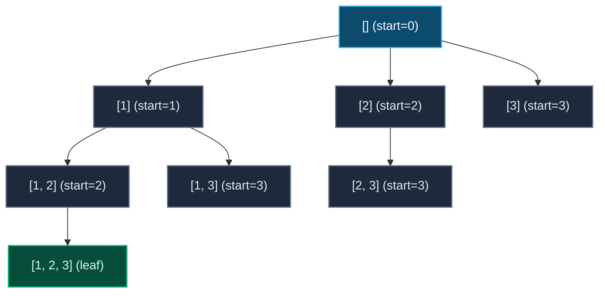

### Problem 1: Generate All Subsets (Combinations of All Sizes)

**Problem Statement**
Given an array of distinct integers `nums`, return all possible subsets (the power set). Include empty set.

**Approach: For each element, decide to include or exclude**

```java
public List<List<Integer>> subsets(int[] nums) {
    List<List<Integer>> result = new ArrayList<>();
    backtrack(nums, 0, new ArrayList<>(), result);
    return result;
}

private void backtrack(int[] nums, int start, List<Integer> current,
                       List<List<Integer>> result) {
    // Add current subset (even if empty)
    result.add(new ArrayList<>(current));

    // Try adding each remaining number
    for (int i = start; i < nums.length; i++) {
        // Include nums[i]
        current.add(nums[i]);

        // Explore with nums[i] included
        backtrack(nums, i + 1, current, result);

        // Exclude nums[i]
        current.remove(current.size() - 1);
    }
}
```

**Example**: `nums = [1,2,3]`
```
Recursion tree:
                    []
        /             |              \
      [1]           [2]              [3]
     /   \         /   \            /
   [1,2] [1,3]   [2,3]  []...    [3]

Result: [[], [1], [1,2], [1,3], [2], [2,3], [3]]
```

**Complexity**
- Time: `O(2^n)` - `2^n` subsets (or `O(n * 2^n)` including list copying)
- Space: `O(n)` for recursion depth

---

### Problem 2: Subsets with Duplicates

**Problem Statement**
Given an integer array `nums` that may contain duplicates, return all possible subsets without duplicates.

**Key Insight**: Sort array, then skip consecutive duplicates

```java
public List<List<Integer>> subsetsWithDup(int[] nums) {
    Arrays.sort(nums); // Sort to group duplicates
    List<List<Integer>> result = new ArrayList<>();
    backtrack(nums, 0, new ArrayList<>(), result);
    return result;
}

private void backtrack(int[] nums, int start, List<Integer> current,
                       List<List<Integer>> result) {
    result.add(new ArrayList<>(current));

    for (int i = start; i < nums.length; i++) {
        // Skip duplicates
        if (i > start && nums[i] == nums[i - 1]) {
            continue;
        }

        current.add(nums[i]);
        backtrack(nums, i + 1, current, result);
        current.remove(current.size() - 1);
    }
}
```

**Why Skip Duplicates**
- If we process `nums[i-1]` in current iteration and `nums[i] == nums[i-1]`
- We would generate duplicate subsets
- Skipping ensures each unique element appears at most once in each "branch"

> [!TIP]
> Notice the condition is `i > start`, **not** `i > 0`. Using `i > start` allows the *first* occurrence at a deeper recursion level (e.g., `[1, 2, 2]`) while skipping duplicate siblings at the *same* recursion level.

---

### Problem 3: Combinations

**Problem Statement**
Given two integers `n` and `k`, return all possible combinations of `k` numbers chosen from `[1..n]`.

```java
public List<List<Integer>> combine(int n, int k) {
    List<List<Integer>> result = new ArrayList<>();
    backtrack(n, k, 1, new ArrayList<>(), result);
    return result;
}

private void backtrack(int n, int k, int start, List<Integer> current,
                       List<List<Integer>> result) {
    // Base case: combination is complete
    if (current.size() == k) {
        result.add(new ArrayList<>(current));
        return;
    }

    // Optimization: remaining numbers must be enough
    int remaining = k - current.size();
    for (int i = start; i <= n - remaining + 1; i++) {
        current.add(i);
        backtrack(n, k, i + 1, current, result);
        current.remove(current.size() - 1);
    }
}
```

**Optimization Explanation**
- Need `k - size` more elements
- Must have at least `k - size` numbers left
- If we're at position `i`, numbers available: `[i, i+1, ..., n]`
- Need: `n - i + 1 >= k - size`
- Therefore: `i <= n - (k - size) + 1`

**Complexity**

| Problem | Time Complexity | Space Complexity | Key Pruning / Trick |
|---------|----------------|------------------|---------------------|
| Subsets | `O(n * 2^n)` | `O(n)` | Pass `i + 1` to avoid reusing earlier elements |
| Subsets II (Duplicates) | `O(n * 2^n)` | `O(n)` | `Arrays.sort(nums)` + `if (i &gt; start && nums[i] == nums[i - 1]) continue` |
| Combinations | `O(k * C(n, k))` | `O(k)` | Upper bound `i &lt;= n - (k - current.size()) + 1` |

---

## Permutations

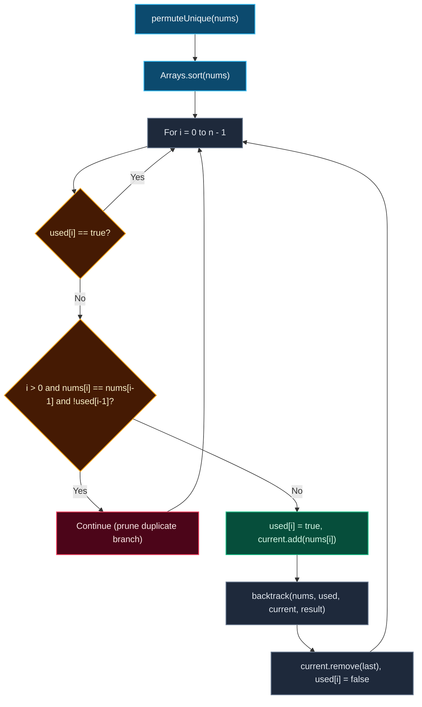

### Problem 1: Generate All Permutations

**Problem Statement**
Given an array of distinct integers `nums`, return all possible permutations in any order.

**Solution: Swap-Based**

```java
public List<List<Integer>> permute(int[] nums) {
    List<List<Integer>> result = new ArrayList<>();
    backtrack(nums, 0, result);
    return result;
}

private void backtrack(int[] nums, int start, List<List<Integer>> result) {
    // Base case: all positions filled
    if (start == nums.length) {
        result.add(new ArrayList<>());
        for (int num : nums) {
            result.get(result.size() - 1).add(num);
        }
        return;
    }

    // Try swapping each element to current position
    for (int i = start; i < nums.length; i++) {
        // Swap
        swap(nums, start, i);

        // Explore
        backtrack(nums, start + 1, result);

        // Undo swap
        swap(nums, start, i);
    }
}

private void swap(int[] nums, int i, int j) {
    int temp = nums[i];
    nums[i] = nums[j];
    nums[j] = temp;
}
```

**Alternative: Using Visited Array**

```java
public List<List<Integer>> permute(int[] nums) {
    List<List<Integer>> result = new ArrayList<>();
    backtrack(nums, new boolean[nums.length], new ArrayList<>(), result);
    return result;
}

private void backtrack(int[] nums, boolean[] used, List<Integer> current,
                       List<List<Integer>> result) {
    // Base case: permutation is complete
    if (current.size() == nums.length) {
        result.add(new ArrayList<>(current));
        return;
    }

    // Try each number
    for (int i = 0; i < nums.length; i++) {
        if (used[i]) continue;

        // Use this number
        used[i] = true;
        current.add(nums[i]);

        backtrack(nums, used, current, result);

        // Undo
        current.remove(current.size() - 1);
        used[i] = false;
    }
}
```

**Complexity**
- Time: `O(n! * n)` - `n!` permutations, each takes `O(n)` to copy
- Space: `O(n)` for recursion depth

---

### Problem 2: Permutations with Duplicates

**Problem Statement**
Given an array `nums` with possible duplicates, return all unique permutations.

**Solution: Sort + Skip Duplicates**

```java
public List<List<Integer>> permuteUnique(int[] nums) {
    Arrays.sort(nums);
    List<List<Integer>> result = new ArrayList<>();
    backtrack(nums, new boolean[nums.length], new ArrayList<>(), result);
    return result;
}

private void backtrack(int[] nums, boolean[] used, List<Integer> current,
                       List<List<Integer>> result) {
    if (current.size() == nums.length) {
        result.add(new ArrayList<>(current));
        return;
    }

    for (int i = 0; i < nums.length; i++) {
        // Skip used elements
        if (used[i]) continue;

        // Skip duplicates: only use duplicate if previous duplicate is used
        if (i > 0 && nums[i] == nums[i - 1] && !used[i - 1]) {
            continue;
        }

        used[i] = true;
        current.add(nums[i]);

        backtrack(nums, used, current, result);

        current.remove(current.size() - 1);
        used[i] = false;
    }
}
```

**Duplicate Skipping Logic**
- After sorting, duplicates are adjacent
- For duplicate `nums[i]`, only use if `nums[i-1]` is already used
- Ensures duplicates appear in order, preventing duplicate permutations

> [!IMPORTANT]
> Unlike Subsets (`i = start`), Permutations always loop `i = 0` to `n - 1`. Checking `!used[i - 1]` guarantees identical values are chosen in left-to-right order, pruning duplicate trees cleanly.

| Variant | Time Complexity | Space Complexity | Loop Start |
|---------|----------------|------------------|------------|
| Distinct Permutations (Swap) | `O(n! * n)` | `O(n)` | `i = start` |
| Distinct Permutations (`used[]`) | `O(n! * n)` | `O(n)` | `i = 0` |
| Unique Permutations (Duplicates) | `O(n! * n)` | `O(n)` | `i = 0` + `!used[i - 1]` |

---

## Constraint Satisfaction


### Problem 1: N-Queens

**Problem Statement**
Place `n` queens on an `n×n` chessboard such that no two queens attack each other (same row, column, or diagonal).

**Solution**

```java
public List<List<String>> solveNQueens(int n) {
    List<List<String>> result = new ArrayList<>();
    char[][] board = new char[n][n];

    // Initialize board
    for (int i = 0; i < n; i++) {
        for (int j = 0; j < n; j++) {
            board[i][j] = '.';
        }
    }

    backtrack(board, 0, result);
    return result;
}

private void backtrack(char[][] board, int row, List<List<String>> result) {
    // Base case: all queens placed
    if (row == board.length) {
        result.add(buildResult(board));
        return;
    }

    // Try placing queen in each column
    for (int col = 0; col < board.length; col++) {
        if (isValid(board, row, col)) {
            // Place queen
            board[row][col] = 'Q';

            // Explore
            backtrack(board, row + 1, result);

            // Undo
            board[row][col] = '.';
        }
    }
}

private boolean isValid(char[][] board, int row, int col) {
    int n = board.length;

    // Check column (above)
    for (int i = 0; i < row; i++) {
        if (board[i][col] == 'Q') return false;
    }

    // Check upper-left diagonal
    for (int i = row - 1, j = col - 1; i >= 0 && j >= 0; i--, j--) {
        if (board[i][j] == 'Q') return false;
    }

    // Check upper-right diagonal
    for (int i = row - 1, j = col + 1; i >= 0 && j < n; i--, j++) {
        if (board[i][j] == 'Q') return false;
    }

    return true;
}

private List<String> buildResult(char[][] board) {
    List<String> result = new ArrayList<>();
    for (char[] row : board) {
        result.add(String.valueOf(row));
    }
    return result;
}
```

**Optimizations**
```java
// Use sets to avoid re-checking
Set<Integer> cols = new HashSet<>();
Set<Integer> diag1 = new HashSet<>();  // row - col
Set<Integer> diag2 = new HashSet<>();  // row + col

private boolean isValid(int row, int col) {
    if (cols.contains(col)) return false;
    if (diag1.contains(row - col)) return false;
    if (diag2.contains(row + col)) return false;
    return true;
}
```

> [!TIP]
> On any chessboard, every cell on the same main diagonal (`\`) shares a constant `row - col`, and every cell on the same anti-diagonal (`/`) shares a constant `row + col`. Tracking these in `HashSet` (or `boolean[]`) reduces `isValid` from `O(N)` to `O(1)`.

**Complexity**
- Time: `O(N!)` - `N!` valid solutions at most
- Space: `O(N)` for recursion depth

---

### Problem 2: Sudoku Solver

**Problem Statement**
Write a program to solve a Sudoku puzzle by filling empty cells (`'.'` marks empty).

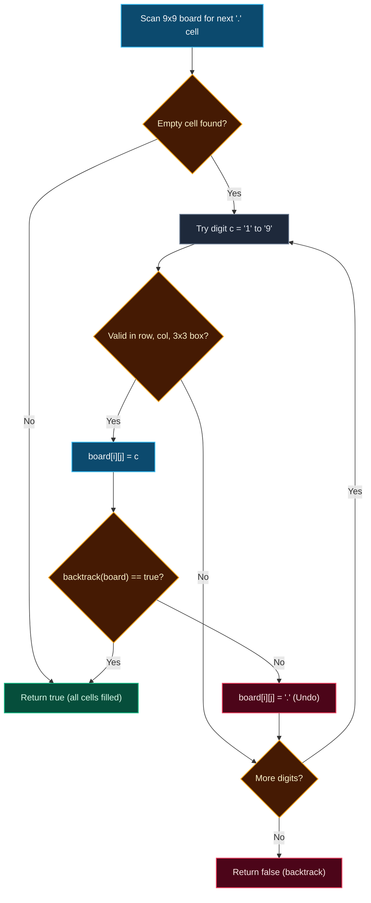

**Solution**

```java
public void solveSudoku(char[][] board) {
    backtrack(board);
}

private boolean backtrack(char[][] board) {
    // Find next empty cell
    for (int i = 0; i < 9; i++) {
        for (int j = 0; j < 9; j++) {
            if (board[i][j] == '.') {
                // Try each digit
                for (char c = '1'; c <= '9'; c++) {
                    if (isValid(board, i, j, c)) {
                        board[i][j] = c;

                        if (backtrack(board)) {
                            return true;
                        }

                        board[i][j] = '.';
                    }
                }

                return false; // No valid digit found
            }
        }
    }

    return true; // All cells filled (solution found)
}

private boolean isValid(char[][] board, int row, int col, char c) {
    // Check row
    for (int j = 0; j < 9; j++) {
        if (board[row][j] == c) return false;
    }

    // Check column
    for (int i = 0; i < 9; i++) {
        if (board[i][col] == c) return false;
    }

    // Check 3x3 box
    int boxRow = (row / 3) * 3;
    int boxCol = (col / 3) * 3;
    for (int i = boxRow; i < boxRow + 3; i++) {
        for (int j = boxCol; j < boxCol + 3; j++) {
            if (board[i][j] == c) return false;
        }
    }

    return true;
}
```

**Complexity**

| Problem | Time Complexity | Space Complexity | Constraint Check |
|---------|----------------|------------------|------------------|
| N-Queens | `O(N!)` | `O(N)` (or `O(N^2)` board) | Column + 2 diagonals (`row - col`, `row + col`) |
| Sudoku Solver | `O(9^(empty cells))` worst case | `O(1)` auxiliary (fixed 9x9) | Row + column + `(row/3)*3`, `(col/3)*3` box |

---

## String Problems

### Problem 1: Word Search

**Problem Statement**
Given an `m x n` board of characters and a string `word`, return `true` if `word` exists in the board. Letters must be in adjacent cells (horizontally or vertically, not diagonally).

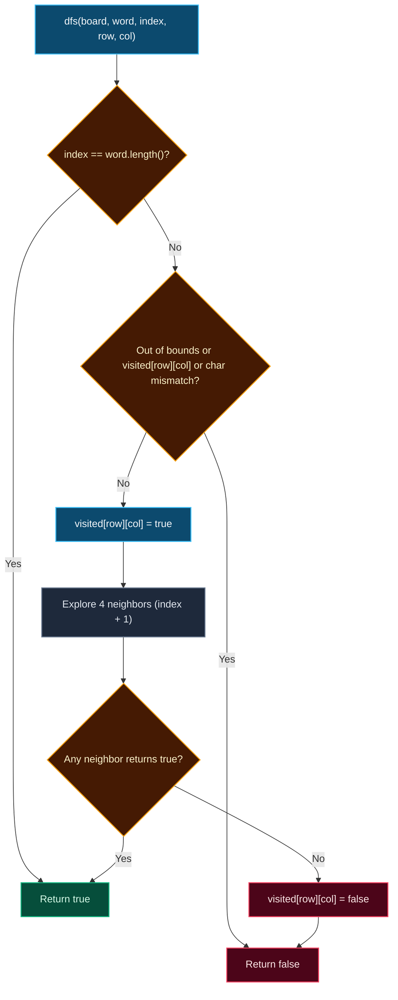

**Solution: DFS with Backtracking**

```java
public boolean exist(char[][] board, String word) {
    if (board == null || board.length == 0) return false;

    boolean[][] visited = new boolean[board.length][board[0].length];

    for (int i = 0; i < board.length; i++) {
        for (int j = 0; j < board[0].length; j++) {
            if (dfs(board, word, 0, i, j, visited)) {
                return true;
            }
        }
    }

    return false;
}

private boolean dfs(char[][] board, String word, int index, int row, int col,
                    boolean[][] visited) {
    // Base case: matched entire word
    if (index == word.length()) {
        return true;
    }

    // Check bounds and if already visited
    if (row < 0 || row >= board.length || col < 0 || col >= board[0].length ||
        visited[row][col]) {
        return false;
    }

    // Check if current character matches
    if (board[row][col] != word.charAt(index)) {
        return false;
    }

    // Mark as visited
    visited[row][col] = true;

    // Explore 4 directions
    int[][] directions = {{0, 1}, {0, -1}, {1, 0}, {-1, 0}};
    for (int[] dir : directions) {
        if (dfs(board, word, index + 1, row + dir[0], col + dir[1], visited)) {
            return true;
        }
    }

    // Undo visited
    visited[row][col] = false;
    return false;
}
```

> [!WARNING]
> Do not forget `visited[row][col] = false;` when all 4 directions fail. Unlike standard graph reachability DFS, Word Search must allow other paths to reuse that cell later.

**Complexity**
- Time: `O(m*n*4^L)` where `L` is word length
- Space: `O(m*n)` for visited array

---

### Problem 2: Palindrome Partitioning

**Problem Statement**
Given a string `s`, partition it such that every substring of the partition is a palindrome. Return all possible partitions.

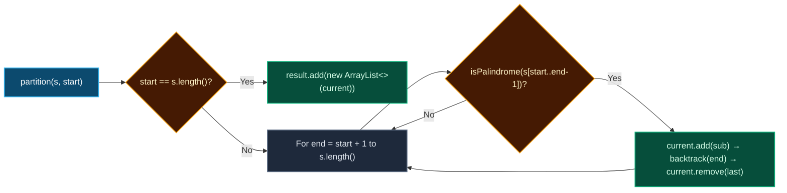

**Solution**

```java
public List<List<String>> partition(String s) {
    List<List<String>> result = new ArrayList<>();
    backtrack(s, 0, new ArrayList<>(), result);
    return result;
}

private void backtrack(String s, int start, List<String> current,
                       List<List<String>> result) {
    // Base case: processed entire string
    if (start == s.length()) {
        result.add(new ArrayList<>(current));
        return;
    }

    // Try all possible partition points
    for (int end = start + 1; end <= s.length(); end++) {
        String substring = s.substring(start, end);

        // Only continue if substring is palindrome
        if (isPalindrome(substring)) {
            current.add(substring);
            backtrack(s, end, current, result);
            current.remove(current.size() - 1);
        }
    }
}

private boolean isPalindrome(String s) {
    int left = 0, right = s.length() - 1;
    while (left < right) {
        if (s.charAt(left++) != s.charAt(right--)) {
            return false;
        }
    }
    return true;
}
```

**Optimization: Memoize Palindrome Checks**
```java
private void precomputePalindromes(String s, boolean[][] dp) {
    for (int i = 0; i < s.length(); i++) {
        dp[i][i] = true;
    }

    for (int len = 2; len <= s.length(); len++) {
        for (int i = 0; i <= s.length() - len; i++) {
            int j = i + len - 1;
            if (s.charAt(i) == s.charAt(j)) {
                dp[i][j] = (len == 2) || dp[i + 1][j - 1];
            }
        }
    }
}
```

**Complexity**

| Problem | Time Complexity | Space Complexity | Optimization |
|---------|----------------|------------------|--------------|
| Word Search | `O(m * n * 4^L)` | `O(m * n)` | In-place board marking (`board[r][c] = '#'`) removes `visited[][]` |
| Palindrome Partitioning | `O(n * 2^n)` | `O(n)` (or `O(n^2)` with DP) | Precompute `dp[i][j]` for `O(1)` palindrome checks |

---

## Interview Tips for Backtracking


1. **Identify Decision Points**: What choices can we make at each step?
2. **Constraints**: What makes a partial solution invalid?
3. **Base Case**: When is a complete solution found?
4. **Pruning**: Skip obviously wrong branches early
5. **Undo Properly**: Always undo changes before trying next option

| Checklist Question | Concrete Example |
|--------------------|------------------|
| What is the state per call? | `start` index, `current` path, `used[]` or `cols/diag` sets |
| What terminates recursion? | `current.size() == k`, `start == s.length()`, or `row == n` |
| What can prune early? | Duplicate skip (`i &gt; start`), remaining count bound, or conflict check |
| What must be restored? | `current.remove(last)`, `used[i] = false`, `board[r][c] = '.'` |

> [!TIP]
> Before coding in an interview, sketch the **first 2 levels of the recursion tree** for a small input (like `[1, 2, 3]`) and state the branching factor and max depth aloud—this immediately clarifies your `start` parameter, base case, and time complexity.

---

## Common Patterns

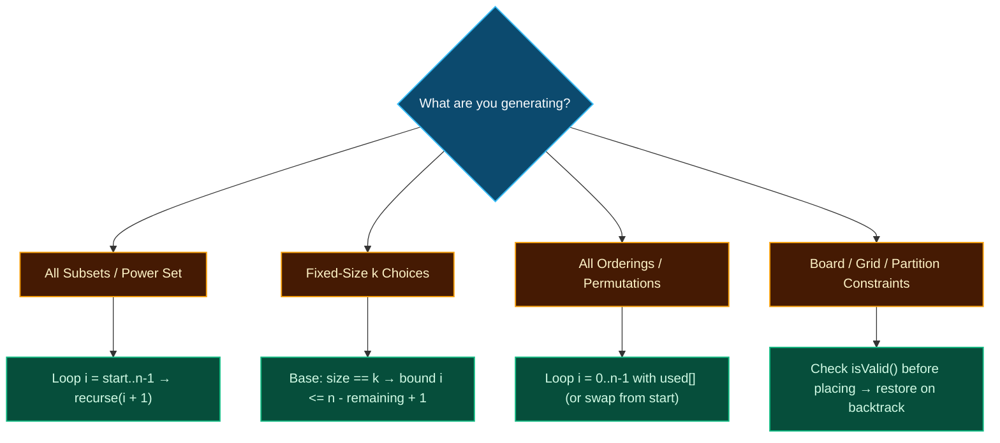

| Problem | Pattern | Typical Time | Key Loop / State |
|---------|---------|-------------|------------------|
| Subsets | Choose to include/exclude | `O(n * 2^n)` | `for (i = start..n-1)` → `backtrack(i + 1)` |
| Permutations | Try each unused element | `O(n! * n)` | `for (i = 0..n-1)` with `used[i]` or `swap` |
| Combinations | Choose `k` elements from `n` | `O(k * C(n, k))` | `current.size() == k`, prune `i &lt;= n - rem + 1` |
| Constraint | Check validity, backtrack if invalid | `O(N!)` / `O(9^E)` | `isValid(...)` before placing, undo on return |
| Path | Build path, restore on backtrack | `O(m*n*4^L)` / `O(n*2^n)` | Mark `visited` / add substring, restore after |

> [!IMPORTANT]
> Almost every FAANG backtracking problem reduces to one of two shapes: **order-insensitive** (`start` moves forward via `i + 1`, giving `O(2^n)` or `C(n, k)`) or **order-sensitive** (`i` starts at `0` with `used[]`, giving `O(n!)`).
