# Sorting, Searching, and Binary Search - Comprehensive Guide for FAANG Interviews

## Table of Contents
1. [Sorting Algorithms](#sorting-algorithms)
2. [Binary Search Fundamentals](#binary-search-fundamentals)
3. [Binary Search Problems](#binary-search-problems)
4. [Bit Manipulation](#bit-manipulation)
5. [Interval Problems](#interval-problems)
6. [Interview Tips](#interview-tips)
7. [Summary Table](#summary-table)

---

## Sorting Algorithms

Sorting is both a foundational building block and a frequent preprocessing step for two-pointer, greedy, and interval problems.


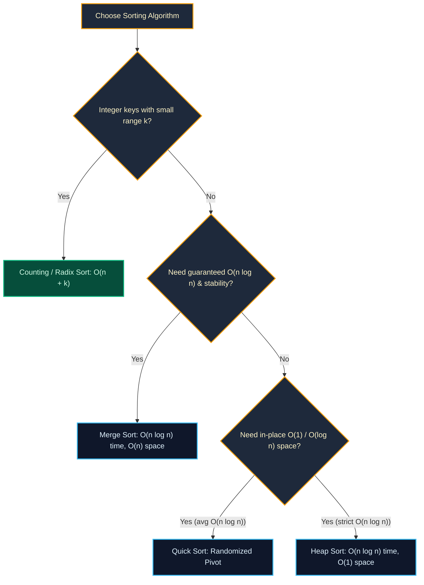

> [!TIP]
> **Interview Rule of Thumb:** Mention **Merge Sort** for linked lists and stability, **Quick Sort** (with randomized pivot) for in-memory arrays, and **Counting/Radix Sort** when the value range `k` is bounded.

### Problem 1: Merge Sort

**Concept**: Divide-and-conquer; split array in half, recursively sort, merge.

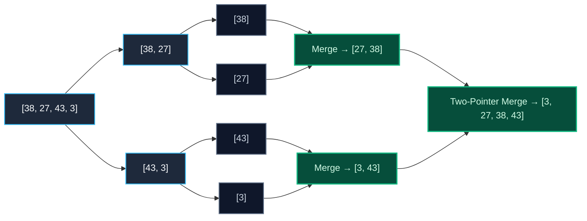

```java
public void mergeSort(int[] arr) {
    if (arr == null || arr.length == 0) return;
    mergeSort(arr, 0, arr.length - 1);
}

private void mergeSort(int[] arr, int left, int right) {
    if (left < right) {
        int mid = left + (right - left) / 2;

        // Sort left half
        mergeSort(arr, left, mid);

        // Sort right half
        mergeSort(arr, mid + 1, right);

        // Merge
        merge(arr, left, mid, right);
    }
}

private void merge(int[] arr, int left, int mid, int right) {
    int[] temp = new int[right - left + 1];
    int i = left, j = mid + 1, k = 0;

    // Merge two sorted halves
    while (i <= mid && j <= right) {
        if (arr[i] <= arr[j]) {
            temp[k++] = arr[i++];
        } else {
            temp[k++] = arr[j++];
        }
    }

    // Copy remaining elements
    while (i <= mid) {
        temp[k++] = arr[i++];
    }
    while (j <= right) {
        temp[k++] = arr[j++];
    }

    // Copy back to original array
    for (int p = 0; p < temp.length; p++) {
        arr[left + p] = temp[p];
    }
}
```

**Characteristics**
- **Time**: `O(n log n)` all cases
- **Space**: `O(n)` for temporary array
- **Stable**: Yes (equal elements maintain relative order via `arr[i] <= arr[j]`)
- **Best for**: Linked lists, external sorting, when stable sort is needed

---

### Problem 2: Quick Sort

**Concept**: Divide-and-conquer; partition around pivot, recursively sort.

```java
public void quickSort(int[] arr) {
    if (arr == null || arr.length == 0) return;
    quickSort(arr, 0, arr.length - 1);
}

private void quickSort(int[] arr, int left, int right) {
    if (left < right) {
        int pivotIndex = partition(arr, left, right);

        quickSort(arr, left, pivotIndex - 1);
        quickSort(arr, pivotIndex + 1, right);
    }
}

private int partition(int[] arr, int left, int right) {
    // Choose random pivot to avoid worst case
    Random rand = new Random();
    int pivotIndex = left + rand.nextInt(right - left + 1);

    swap(arr, pivotIndex, right);

    int pivot = arr[right];
    int i = left;

    // Partition: all elements < pivot go to left
    for (int j = left; j < right; j++) {
        if (arr[j] < pivot) {
            swap(arr, i, j);
            i++;
        }
    }

    swap(arr, i, right);
    return i;
}

private void swap(int[] arr, int i, int j) {
    int temp = arr[i];
    arr[i] = arr[j];
    arr[j] = temp;
}
```

**Characteristics**
- **Time**: Average `O(n log n)`, Worst `O(n²)`
- **Space**: `O(log n)` for recursion (in-place)
- **Stable**: No
- **Best for**: General-purpose sorting, in-place

> [!WARNING]
> Without a **randomized pivot** (or median-of-three), an already-sorted or reverse-sorted array triggers `O(n²)` worst-case recursion depth.

---

### Problem 3: Counting Sort

**Concept**: Non-comparison sort; count occurrences, output in order. (For multi-digit integers with larger ranges, **Radix Sort** applies Counting Sort digit-by-digit in `O(d · (n + b))` time.)

```java
public void countingSort(int[] arr) {
    if (arr == null || arr.length == 0) return;

    // Find min and max
    int min = arr[0], max = arr[0];
    for (int num : arr) {
        min = Math.min(min, num);
        max = Math.max(max, num);
    }

    // Create count array
    int[] count = new int[max - min + 1];
    for (int num : arr) {
        count[num - min]++;
    }

    // Reconstruct sorted array
    int index = 0;
    for (int i = 0; i < count.length; i++) {
        while (count[i]-- > 0) {
            arr[index++] = i + min;
        }
    }
}
```

**Characteristics**
- **Time**: `O(n + k)` where `k` is range
- **Space**: `O(k)`
- **Stable**: Yes (when built with prefix sums)
- **Best for**: Small range of integers, small `k` relative to `n`

---

### When to Use Which Sorting Algorithm

| Algorithm | Time (Best / Avg / Worst) | Space | Stable | Best For | Worst |
|-----------|---------------------------|-------|--------|----------|-------|
| **Merge Sort** | `O(n log n)` / `O(n log n)` / `O(n log n)` | `O(n)` | Yes | Guaranteed `O(n log n)`, stable, linked lists | `O(n)` space |
| **Quick Sort** | `O(n log n)` / `O(n log n)` / `O(n²)` | `O(log n)` | No | In-place, general-purpose, average case | Worst case `O(n²)` |
| **Counting Sort** | `O(n + k)` | `O(k)` | Yes | Small integer range | Large range, non-integers |
| **Heap Sort** | `O(n log n)` / `O(n log n)` / `O(n log n)` | `O(1)` | No | In-place, guaranteed `O(n log n)` | Not stable |
| **Insertion Sort** | `O(n)` / `O(n²)` / `O(n²)` | `O(1)` | Yes | Nearly sorted data, small arrays | `O(n²)` |

---

## Binary Search Fundamentals

Binary search halves a monotonic search space at every step, reducing `O(n)` linear scans to `O(log n)`.

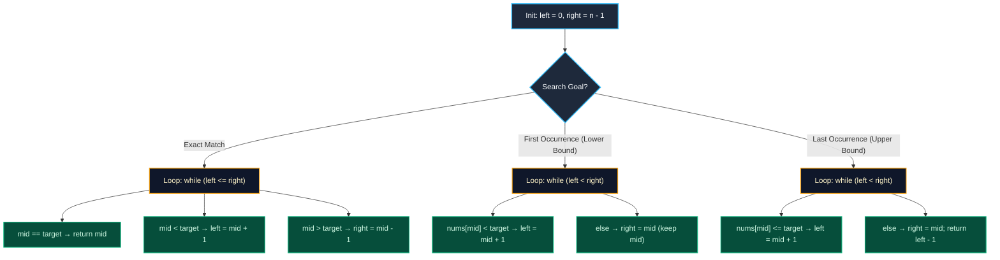

### Core Template

```java
// Standard binary search (exact match)
public int binarySearch(int[] nums, int target) {
    int left = 0, right = nums.length - 1;

    while (left <= right) {
        int mid = left + (right - left) / 2;

        if (nums[mid] == target) {
            return mid;
        } else if (nums[mid] < target) {
            left = mid + 1;
        } else {
            right = mid - 1;
        }
    }

    return -1; // Not found
}
```

### Three Variants

| Variant | Loop Condition | `right` Update | Return Value | Use Case |
|---------|----------------|----------------|--------------|----------|
| **1. Exact Match** | `left <= right` | `right = mid - 1` | `mid` or `-1` | Target existence in unique array |
| **2. Left Boundary** | `left < right` | `right = mid` | `left` | First occurrence / insertion index |
| **3. Right Boundary** | `left < right` | `right = mid` | `left - 1` | Last occurrence (uses `<= target`) |

**1. Finding Exact Match**
```java
while (left <= right) {
    int mid = left + (right - left) / 2;
    if (nums[mid] == target) return mid;
    else if (nums[mid] < target) left = mid + 1;
    else right = mid - 1;
}
return -1;
```

**2. Finding Left Boundary (First Occurrence)**
```java
while (left < right) {
    int mid = left + (right - left) / 2;
    if (nums[mid] < target) left = mid + 1;
    else right = mid; // Don't exclude mid
}
return left; // May be out of bounds or different value
```

**3. Finding Right Boundary (Last Occurrence)**
```java
while (left < right) {
    int mid = left + (right - left) / 2;
    if (nums[mid] <= target) left = mid + 1;
    else right = mid;
}
return left - 1; // Adjust for last occurrence
```

> [!IMPORTANT]
> Always compute `mid = left + (right - left) / 2` instead of `(left + right) / 2` to prevent 32-bit signed integer overflow when `left + right > Integer.MAX_VALUE`.

---

## Binary Search Problems


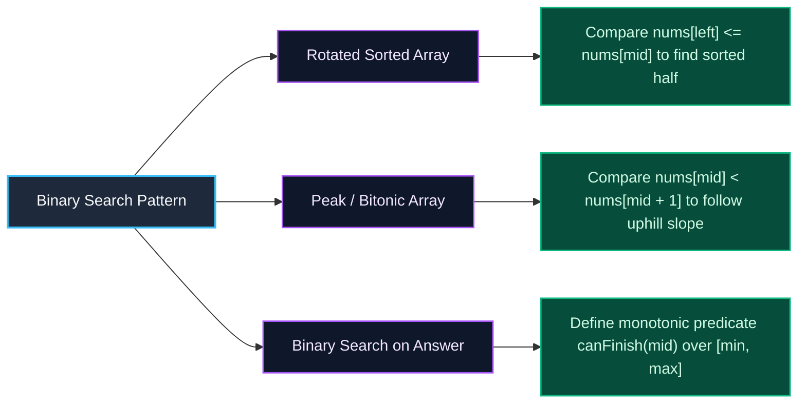

### Problem 1: Search in Rotated Sorted Array

**Problem Statement**
Search for target in a rotated sorted array with no duplicates.

```
Example: [4,5,6,7,0,1,2], target=0 → return 4
```

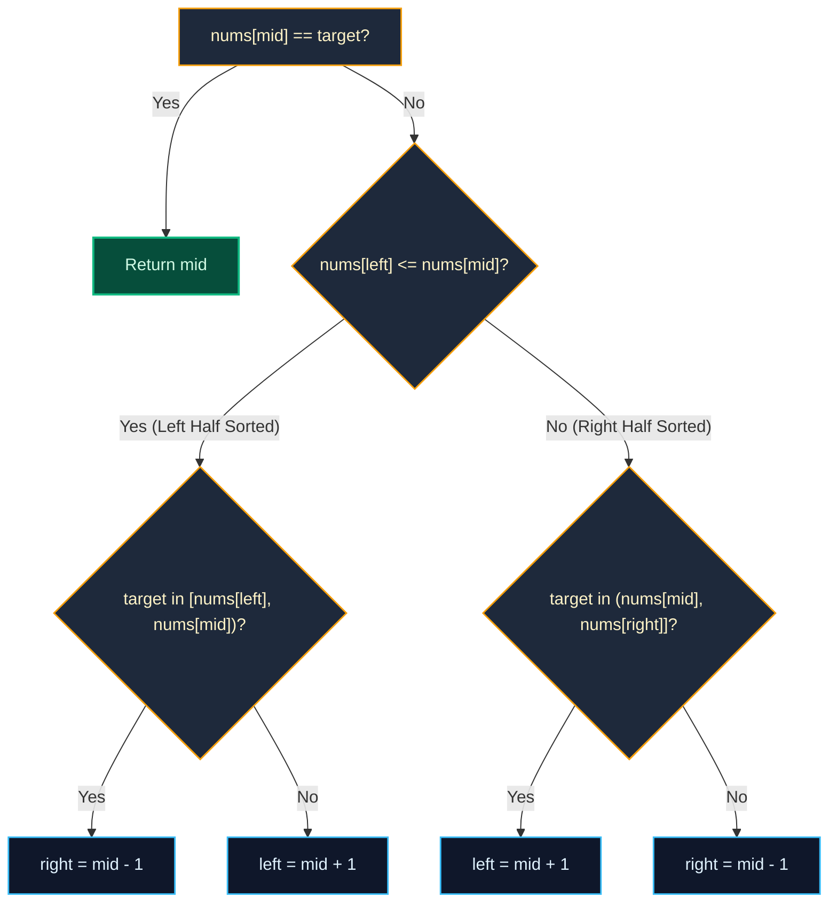

**Solution**

```java
public int search(int[] nums, int target) {
    int left = 0, right = nums.length - 1;

    while (left <= right) {
        int mid = left + (right - left) / 2;

        if (nums[mid] == target) {
            return mid;
        }

        // Determine which side is sorted
        if (nums[left] <= nums[mid]) {
            // Left side is sorted
            if (target >= nums[left] && target < nums[mid]) {
                // Target in sorted left side
                right = mid - 1;
            } else {
                // Target in right side
                left = mid + 1;
            }
        } else {
            // Right side is sorted
            if (target > nums[mid] && target <= nums[right]) {
                // Target in sorted right side
                left = mid + 1;
            } else {
                // Target in left side
                right = mid - 1;
            }
        }
    }

    return -1;
}
```

**Key Insight**
- One side is always sorted
- Check if target is in sorted side
- Eliminate half based on where target should be

**Complexity**
- **Time**: `O(log n)`
- **Space**: `O(1)`

---

### Problem 2: Find Minimum in Rotated Sorted Array

**Problem Statement**
Find the minimum element in a rotated sorted array.

**Solution**

```java
public int findMin(int[] nums) {
    int left = 0, right = nums.length - 1;

    while (left < right) {
        int mid = left + (right - left) / 2;

        if (nums[mid] > nums[right]) {
            // Minimum is in right half
            left = mid + 1;
        } else {
            // Minimum is in left half (or mid)
            right = mid;
        }
    }

    return nums[left];
}
```

**Logic**
- If `mid > right`: rotation point is to the right
- If `mid <= right`: rotation point is to the left (or no rotation)

**With Duplicates**
```java
public int findMin(int[] nums) {
    int left = 0, right = nums.length - 1;

    while (left < right) {
        int mid = left + (right - left) / 2;

        if (nums[mid] > nums[right]) {
            left = mid + 1;
        } else if (nums[mid] < nums[right]) {
            right = mid;
        } else {
            // nums[mid] == nums[right], can't determine side
            right--; // Shrink search space
        }
    }

    return nums[left];
}
```

**Complexity**
- **Time**: `O(log n)` average, `O(n)` worst with duplicates
- **Space**: `O(1)`

---

### Problem 3: Find Peak Element

**Problem Statement**
A peak element is greater than its neighbors. Find any peak element.

**Solution: Binary Search**

```java
public int findPeakElement(int[] nums) {
    int left = 0, right = nums.length - 1;

    while (left < right) {
        int mid = left + (right - left) / 2;

        // If mid is less than right, peak must be to the right
        if (nums[mid] < nums[mid + 1]) {
            left = mid + 1;
        } else {
            // Peak is at mid or to the left
            right = mid;
        }
    }

    return left;
}
```

**Why This Works**
- Array guaranteed to have a peak (ends are `-∞`)
- If `nums[mid] < nums[mid+1]`, peak is to the right
- Otherwise, peak is to the left (or at `mid`)

**Complexity**
- **Time**: `O(log n)`
- **Space**: `O(1)`

---

### Problem 4: Koko Eating Bananas

**Problem Statement**
Koko eats bananas. For each pile, she eats at most `k` bananas/hour. Find minimum `k` to finish all piles in `h` hours.

**Solution: Binary Search on Answer**

```java
public int minEatingSpeed(int[] piles, int h) {
    int left = 1; // Minimum speed
    int right = 0;
    for (int pile : piles) {
        right = Math.max(right, pile);
    }

    while (left < right) {
        int mid = left + (right - left) / 2;

        if (canFinish(piles, h, mid)) {
            // Can finish with speed mid, try slower
            right = mid;
        } else {
            // Can't finish, need faster speed
            left = mid + 1;
        }
    }

    return left;
}

private boolean canFinish(int[] piles, int h, int speed) {
    long hours = 0;
    for (int pile : piles) {
        hours += (pile + speed - 1) / speed; // Ceiling division
    }
    return hours <= h;
}
```

**Complexity**
- **Time**: `O(n log m)` where `m` is max pile
- **Space**: `O(1)`

> [!TIP]
> **Binary Search on Answer** applies whenever a problem asks for the *minimum/maximum feasible value* and `feasible(x)` is monotonic (`false, false, ..., true, true`).

---

## Bit Manipulation

Bitwise operators run in `O(1)` CPU cycles and unlock `O(1)`-space solutions for parity, missing-number, and subset problems.

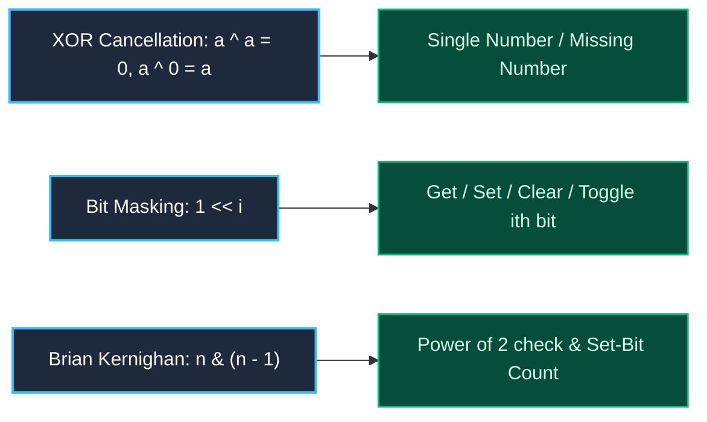

### Common Operations

| Operation | Expression | Effect |
|-----------|------------|--------|
| **Check `i`-th bit** | `(num & (1 << i)) != 0` | Returns `true` if bit `i` is `1` |
| **Set `i`-th bit** | `num \| (1 << i)` | Forces bit `i` to `1` |
| **Clear `i`-th bit** | `num & ~(1 << i)` | Forces bit `i` to `0` |
| **Toggle `i`-th bit** | `num ^ (1 << i)` | Flips bit `i` |
| **Is Power of 2** | `n > 0 && (n & (n - 1)) == 0` | Exactly one `1` bit |
| **Rightmost set bit** | `n & -n` | Isolates lowest `1` bit |

```java
// Check if ith bit is set
boolean isBitSet(int num, int i) {
    return (num & (1 << i)) != 0;
}

// Set ith bit
int setBit(int num, int i) {
    return num | (1 << i);
}

// Clear ith bit
int clearBit(int num, int i) {
    return num & ~(1 << i);
}

// Toggle ith bit
int toggleBit(int num, int i) {
    return num ^ (1 << i);
}

// Check if power of 2
boolean isPowerOfTwo(int n) {
    return n > 0 && (n & (n - 1)) == 0;
}

// Get rightmost set bit
int getRightmostSetBit(int n) {
    return n & -n;
}
```

---

### Problem 1: Single Number

**Problem Statement**
Given array where every element appears twice except one, find the single element.

**Solution: XOR**

```java
public int singleNumber(int[] nums) {
    int result = 0;
    for (int num : nums) {
        result ^= num; // XOR is self-inverse: a ^ a = 0, a ^ 0 = a
    }
    return result;
}
```

**Why XOR Works**
- `a ^ a = 0`
- `a ^ 0 = a`
- XOR is commutative and associative
- All pairs cancel out, leaving single element

---

### Problem 2: Number of 1 Bits

**Problem Statement**
Count number of 1 bits in binary representation (Hamming weight).

**Solution**

```java
public int hammingWeight(int n) {
    int count = 0;
    while (n != 0) {
        count += n & 1;  // Check if last bit is 1
        n >>>= 1;        // Logical right shift (handles negative)
    }
    return count;
}
```

**Better Solution**
```java
public int hammingWeight(int n) {
    int count = 0;
    while (n != 0) {
        n &= (n - 1); // Remove rightmost 1 bit
        count++;
    }
    return count;
}
```

**Complexity**
- **Time**: `O(log n)` or `O(number of 1 bits)`
- **Space**: `O(1)`

> [!WARNING]
> In Java, always use unsigned right shift `>>>=` (not `>>=`) when shifting bits of a potentially negative `int`, otherwise sign-extension causes an infinite loop on negative inputs.

---

### Problem 3: Missing Number

**Problem Statement**
Given array of `n` integers `[0, n]`, one number is missing. Find it.

**Solution 1: XOR**
```java
public int missingNumber(int[] nums) {
    int result = 0;

    for (int i = 0; i < nums.length; i++) {
        result ^= i ^ nums[i];
    }

    result ^= nums.length; // XOR with n
    return result;
}
```

**Solution 2: Gauss Formula**
```java
public int missingNumber(int[] nums) {
    long expected = (long) nums.length * (nums.length + 1) / 2;
    long actual = 0;
    for (int num : nums) {
        actual += num;
    }
    return (int) (expected - actual);
}
```

---

## Interval Problems

Interval problems almost always reduce to choosing the right sort key (**start time** vs **end time**) followed by a linear greedy sweep.

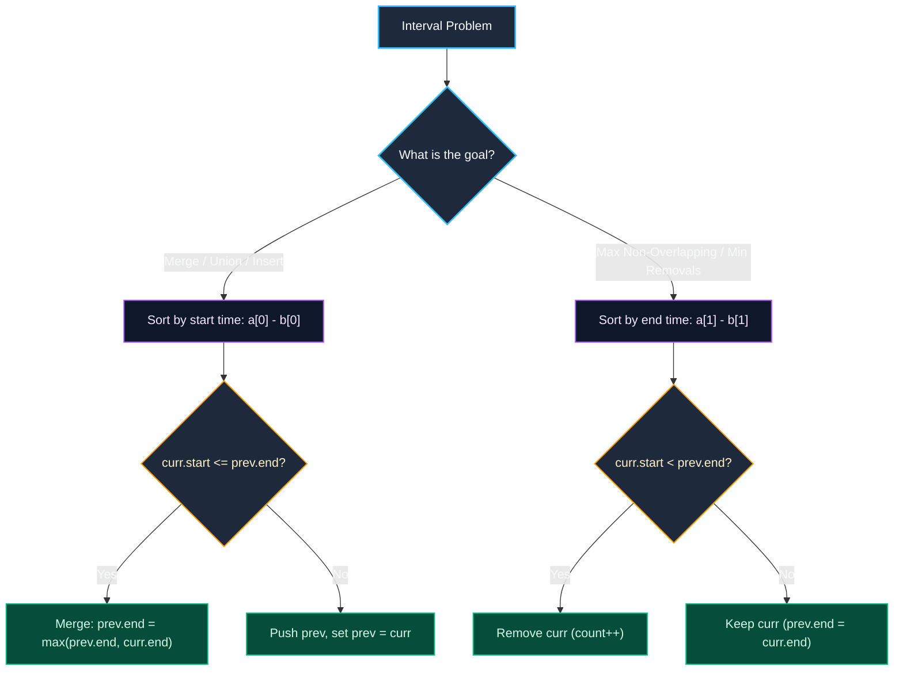

### Problem 1: Merge Intervals

**Problem Statement**
Given array of intervals, merge overlapping intervals.

**Solution: Sorting + Greedy**

```java
public int[][] merge(int[][] intervals) {
    if (intervals == null || intervals.length == 0) return new int[0][0];

    // Sort by start time
    Arrays.sort(intervals, (a, b) -> a[0] - b[0]);

    List<int[]> merged = new ArrayList<>();
    int[] current = intervals[0];

    for (int i = 1; i < intervals.length; i++) {
        if (intervals[i][0] <= current[1]) {
            // Overlapping, merge
            current[1] = Math.max(current[1], intervals[i][1]);
        } else {
            // Non-overlapping, add current and move to next
            merged.add(current);
            current = intervals[i];
        }
    }

    merged.add(current);
    return merged.toArray(new int[0][]);
}
```

**Example**: `[[1,3],[2,6],[8,10],[15,18]]`
```
After sort: [[1,3],[2,6],[8,10],[15,18]]
Process [2,6]: 2 <= 3, merge to [1,6]
Process [8,10]: 8 > 6, add [1,6], start [8,10]
Process [15,18]: 15 > 10, add [8,10], start [15,18]
Result: [[1,6],[8,10],[15,18]]
```

**Complexity**
- **Time**: `O(n log n)` for sorting
- **Space**: `O(1)` excluding output

---

### Problem 2: Insert Interval

**Problem Statement**
Insert new interval into list of non-overlapping intervals, merge if necessary.

**Solution**

```java
public int[][] insert(int[][] intervals, int[] newInterval) {
    List<int[]> result = new ArrayList<>();

    int i = 0;

    // Add all intervals that end before new interval starts
    while (i < intervals.length && intervals[i][1] < newInterval[0]) {
        result.add(intervals[i]);
        i++;
    }

    // Merge overlapping intervals
    while (i < intervals.length && intervals[i][0] <= newInterval[1]) {
        newInterval[0] = Math.min(newInterval[0], intervals[i][0]);
        newInterval[1] = Math.max(newInterval[1], intervals[i][1]);
        i++;
    }

    result.add(newInterval);

    // Add remaining intervals
    while (i < intervals.length) {
        result.add(intervals[i]);
        i++;
    }

    return result.toArray(new int[0][]);
}
```

**Complexity**
- **Time**: `O(n)`
- **Space**: `O(1)` excluding output

---

### Problem 3: Non-Overlapping Intervals

**Problem Statement**
Given array of intervals, find minimum number of intervals to remove so no two overlap.

**Solution: Greedy with Sorting**

```java
public int eraseOverlapIntervals(int[][] intervals) {
    if (intervals == null || intervals.length == 0) return 0;

    // Sort by end time
    Arrays.sort(intervals, (a, b) -> a[1] - b[1]);

    int end = intervals[0][1];
    int count = 0;

    for (int i = 1; i < intervals.length; i++) {
        // If start of current >= end of previous, no overlap
        if (intervals[i][0] < end) {
            count++;
        } else {
            // Update end
            end = intervals[i][1];
        }
    }

    return count;
}
```

**Why Sort by End Time**
- Greedy approach: keep intervals ending earliest
- This leaves more room for subsequent intervals

**Complexity**
- **Time**: `O(n log n)`
- **Space**: `O(1)`

> [!IMPORTANT]
> For **Meeting Rooms II** (minimum rooms needed), sort start and end times separately (two-pointer sweep) or use a Min-Heap of end times in `O(n log n)` time.

---

## Interview Tips

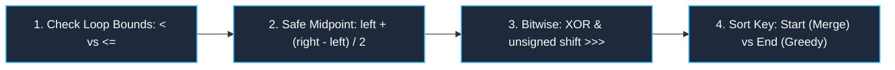

1. **Binary Search Conditions**: Be careful with `<` vs `<=` and boundary updates
2. **Overflow Prevention**: Use `mid = left + (right - left) / 2`
3. **Bit Manipulation**: Think about bit patterns, XOR properties
4. **Sorting Choice**: Consider stability, space, and guaranteed performance
5. **Interval Problems**: Sort strategically (by start, end, or duration)

> [!TIP]
> Before coding any Binary Search, dry-run a **2-element array** (`[a, b]`) by hand. Most infinite-loop bugs (`left = mid` with `mid = (left + right) / 2`) surface immediately on size 2.

---

## Summary Table

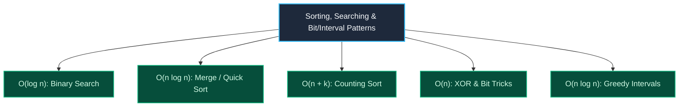

| Technique | Best For | Complexity |
|-----------|----------|------------|
| **Binary Search** | Sorted arrays, answer space | `O(log n)` |
| **Merge Sort** | Stable sort, linked lists | `O(n log n)` |
| **Quick Sort** | In-place, general-purpose | `O(n log n)` avg |
| **Counting Sort** | Small integer range | `O(n + k)` |
| **XOR Tricks** | Single elements, swaps | `O(n)` |
| **Greedy Intervals** | Min removals/selections | `O(n log n)` |
