# Coding Interview Strategy - Mastering FAANG Technical Interviews

## Table of Contents
1. [FAANG Interview Format](#faang-interview-format)
2. [The UMPIRE Method](#the-umpire-method)
3. [Communication During Coding](#communication-during-coding)
4. [Time Management](#time-management)
5. [Pattern Recognition](#pattern-recognition)
6. [Testing and Edge Cases](#testing-and-edge-cases)
7. [8-Week Study Plan](#8-week-study-plan)
8. [Top 75 LeetCode Problems](#top-75-leetcode-problems)
9. [Java-Specific Tips for FAANG Interviews](#java-specific-tips-for-faang-interviews)
10. [Final Interview Day Checklist](#final-interview-day-checklist)
11. [Closing Advice](#closing-advice)

---

## FAANG Interview Format

### Typical 45-Minute Interview Structure


```
0-2 min   : Greeting, rapport building
2-5 min   : Problem statement, clarifications
5-8 min   : Approach discussion
8-28 min  : Implementation
28-40 min : Testing, edge cases, optimization
40-45 min : Discussion of complexity, follow-ups
```

> [!IMPORTANT]
> Interviewers score **how** you arrive at a solution just as heavily as whether your code compiles. Jumping straight into typing at minute 2 is one of the fastest ways to lose points on Problem Solving and Communication.

### What Interviewers Are Evaluating

| Evaluation Pillar | Weight | Core Signals Interviewers Look For |
| :--- | :---: | :--- |
| **Problem Solving** | 40% | Understands problem, decomposes into manageable pieces, arrives at a working solution |
| **Code Quality** | 30% | Readable and well-structured code, handles edge cases, avoids unnecessary complexity |
| **Communication** | 20% | Explains thinking clearly, asks clarifying questions, discusses trade-offs |
| **Technical Knowledge** | 10% | Accurate complexity analysis, strong grasp of data structures and algorithms |

1. **Problem Solving** (40%)
   - Can you understand the problem?
   - Do you break it into manageable pieces?
   - Do you arrive at a working solution?

2. **Code Quality** (30%)
   - Is code readable and well-structured?
   - Do you handle edge cases?
   - Is there unnecessary complexity?

3. **Communication** (20%)
   - Can you explain your thinking?
   - Do you ask clarifying questions?
   - Can you discuss trade-offs?

4. **Technical Knowledge** (10%)
   - Complexity analysis
   - Knowledge of data structures
   - Understanding of algorithms

> [!TIP]
> Treat the 45-minute session as a collaborative engineering pairing exercise rather than a silent exam. Confirm your approach before writing code so you never spend 15 minutes implementing the wrong idea.

---

## The UMPIRE Method

A systematic approach to coding interviews developed for structured problem-solving.

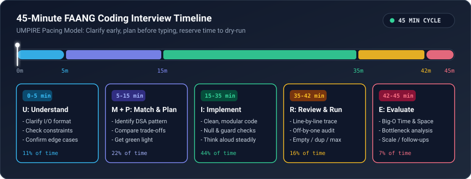


| UMPIRE Step | Primary Goal | Key Deliverable Before Moving On |
| :--- | :--- | :--- |
| **U - Understand** | Eliminate ambiguity on inputs, outputs, and constraints | Confirmed edge cases and sample I/O |
| **M - Match** | Map problem cues to known DSA patterns | 1-2 candidate patterns identified |
| **P - Plan** | Design algorithm steps and verify complexity | Interviewer buy-in on approach + Big-O |
| **I - Implement** | Translate plan into clean, modular, defensive code | Complete, readable solution |
| **R - Review** | Catch syntax, boundary, and off-by-one bugs | Clean self-audit checklist pass |
| **E - Evaluate** | Dry-run concrete test cases and discuss complexity | Verified trace on happy, edge, and special cases |

### U - Understand the Problem

**Questions to Ask**
- What is the exact input format? (array, tree, graph, string?)
- What is the expected output format? (single value, list, modified input?)
- What are the constraints? (array size, value ranges, time limit?)
- Are there any special cases? (empty input, negative numbers, duplicates?)
- Do we need to modify input in-place or return new structure?

**Example Dialog**
```
Problem: "Given an array of integers, find two numbers that add up to a target."

Your clarifications:
- "Is the input array sorted or unsorted?"
- "Can I use each element only once?"
- "Should I return indices or values?"
- "Can there be multiple valid pairs?"
- "What if no pair exists?"
```

> [!TIP]
> Write down constraints (e.g., `1 <= n <= 10^5`, negative values allowed, return `[-1, -1]` if missing) directly in comments at the top of the editor so both you and the interviewer share a single source of truth.

---

### M - Match to Known Patterns

Ask yourself: "Have I seen a similar problem before?"

**Common Pattern Categories**
- Two Pointers → Pairs, palindromes, opposite ends
- Sliding Window → Subarrays, substrings, continuous
- Hash Map → Frequencies, complements, grouping
- Heap/Priority Queue → K-largest, scheduling
- Stack → Parentheses, next greater, expressions
- Binary Search → Sorted arrays, answer space
- DFS/BFS → Graphs, trees, connected components
- Dynamic Programming → Optimization, counting
- Backtracking → Permutations, combinations, constraints

**Pattern Matching Example**
```
Problem: "Longest substring without repeating characters"
Pattern: Sliding Window (variable size)
Why: Need contiguous elements with constraint (no duplicates)
```

---

### P - Plan Before Coding

**Outline Your Approach**
```
1. Data structure to use: HashMap for character indices
2. Algorithm steps:
   a. Use two pointers (left, right)
   b. Expand window by moving right
   c. Track character frequencies
   d. Contract window when duplicate found
   e. Update maximum length
3. Time complexity: O(n)
4. Space complexity: O(min(n, m)) where m is charset
```

**Discuss Before Implementing**
- "I'm thinking of using a HashMap to store character indices"
- "I'll use a sliding window approach with two pointers"
- "This should give us O(n) time complexity"
- "Should I proceed with this approach?"

---

### I - Implement

**Code Structure**
```java
public class Solution {
    // Main method with clear parameter names
    public int solve(int[] nums, int target) {
        // Validate input
        if (nums == null || nums.length == 0) {
            return -1; // or handle appropriately
        }

        // Initialize variables
        int result = 0;

        // Core logic
        for (int num : nums) {
            // process
        }

        // Return result
        return result;
    }
}
```

**Best Practices**
- Write clean, readable code (avoid single-letter vars except i, j)
- Use meaningful variable names
- Add comments for non-obvious logic
- Don't over-engineer (KISS principle)

---

### R - Review

**Self-Review Checklist**
- [ ] Does code compile? (no syntax errors)
- [ ] Does logic match approach?
- [ ] Have I handled edge cases?
- [ ] Are there any off-by-one errors?
- [ ] Are variable initializations correct?

**Example Review**
```
for (int i = 0; i < nums.length; i++) {
    // Check: should this be < or <=? → < is correct (0-indexed array)
    // Check: am I accessing out of bounds? → No, i < nums.length safe
}
```

---

### E - Evaluate

**Trace Through Examples**

Example 1: Happy path
```
Input: [2, 7, 11, 15], target = 9
Expected: [0, 1] (indices of 2 and 7)

Trace:
map = {}
i=0: map[2]=0, map={}
i=1: complement=2, 2 in map? No. map[7]=1, map={2:0,7:1}
i=2: complement=−2, in map? No. map[11]=2
i=3: complement=−6, in map? No. map[15]=3
Return [-1,-1]? WRONG!

Issue found: Should check complement AFTER adding to map.
```

Example 2: Edge case
```
Input: [], target = 0
Expected: [] or [-1,-1]
Trace: nums.length == 0, return edge case value
```

Example 3: Special case
```
Input: [0, 0], target = 0
Expected: [0, 1]
Trace: Handles correctly if we use indices
```

> [!WARNING]
> Never announce "I'm done!" right after typing the closing brace. Always dry-run at least one happy path and one edge case line-by-line—catching your own bug during Review/Evaluate is a strong positive signal.

---

## Communication During Coding

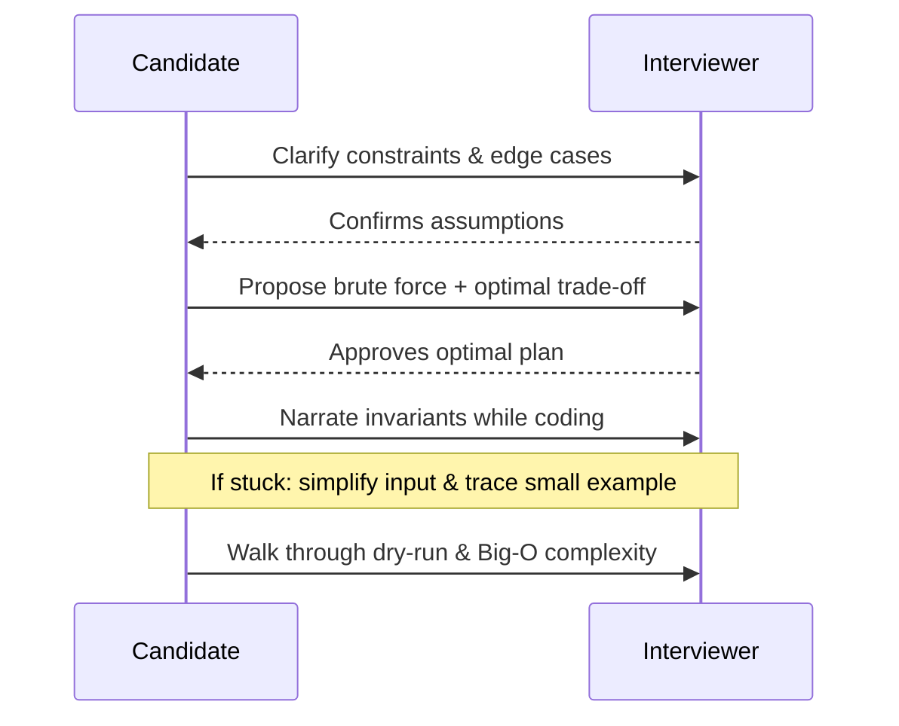

### Thinking Aloud Framework

**Narrate Your Process**
```
"So I need to find two numbers that add up to target.
The brute force would be checking every pair, which is O(n²).
But I can optimize this with a HashMap.

The idea is: for each number, check if (target - number) exists.
I'll iterate through and store each number in a map with its index.

Let me code this up:
1. Create HashMap
2. Iterate through array
3. For each number, check if complement exists in map
4. If yes, return indices
5. If no, add current number to map
6. Return error if not found
```

### Handling "I Don't Know"

**DON'T**
```
"I don't know" → silence
```

**DO**
```
"I haven't solved this exact problem, but it reminds me of X pattern.
Let me think about how that approach could apply here...

For example, if this is a graph problem, I'd normally use BFS or DFS.
Let me try BFS first since we want shortest path."
```

### When You Get Stuck


**Strategy**
```
1. Acknowledge: "Let me take a moment to think about this"
2. Simplify: "What if the input was smaller or simpler?"
3. Try examples: "Let me trace through a small example manually"
4. Think differently: "What if I used a different data structure?"
5. Ask for hints: "Can I ask a clarifying question?"
6. Communicate: "I'm stuck on X part, let me think aloud"
```

> [!IMPORTANT]
> Silence longer than 20-30 seconds makes it impossible for the interviewer to help you. Even if you are unsure, verbalizing your current hypothesis lets the interviewer nudge you back on track.

### Discussing Trade-offs

| Approach | Time Complexity | Space Complexity | Best Used When | Key Trade-off |
| :--- | :---: | :---: | :--- | :--- |
| **Two Pointers** | `O(n log n)` if unsorted, `O(n)` if sorted | `O(1)` | Array is already sorted or values (not original indices) are needed | Sorting loses original indices |
| **HashMap** | `O(n)` | `O(n)` | Input is unsorted and original indices must be preserved | Uses extra `O(n)` memory for `O(1)` lookup |

**Two Pointer vs HashMap**
```
Two Pointer Approach:
- Pros: O(1) space, simpler
- Cons: Requires sorted array, loses original indices

HashMap Approach:
- Pros: Works on unsorted array, O(1) lookup
- Cons: O(n) space

Given unsorted array, HashMap is better choice."
```

> [!TIP]
> When comparing approaches, state the constraint that breaks the tie (e.g., "Because the array is unsorted and we need original indices, HashMap wins over Two Pointers").

---

## Time Management

### 45-Minute Interview Breakdown

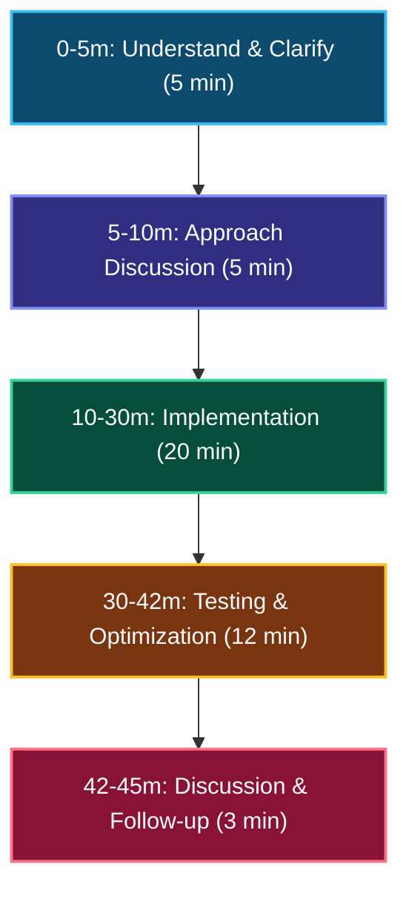

```
Minutes 0-5: Understand & Clarify (5 min)
├─ Read problem carefully
├─ Ask clarifying questions
└─ State assumptions

Minutes 5-10: Approach Discussion (5 min)
├─ Mention naive approach (if applicable)
├─ Describe optimal approach
├─ Discuss complexity
└─ Get interviewer approval

Minutes 10-30: Implementation (20 min)
├─ Write clean code
├─ Code defensively (null checks)
└─ Test as you write

Minutes 30-42: Testing & Optimization (12 min)
├─ Trace through example
├─ Test edge cases
├─ Optimize if needed
└─ Discuss complexity

Minutes 42-45: Discussion & Follow-up (3 min)
├─ Answer follow-up questions
├─ Discuss variations
└─ Closing remarks
```

> [!WARNING]
> If you reach minute 15 without writing a single line of code, stop searching for micro-optimizations. State your working approach, get confirmation, and start implementing so you still have time to test.

### Pace Indicators

| Pace Signal | Symptoms | Immediate Course Correction |
| :--- | :--- | :--- |
| **Too Fast** | Skipped clarifications, missed edge cases, silent coding | Slow down, explain invariants, test boundary cases carefully |
| **On Track** | Plan approved by min 10, core code done by min 30 | Proceed to dry-run, edge cases, and complexity analysis |
| **Too Slow** | Still designing at min 15, narrating every single line | Focus on main logic first, defer optimization, skip trivial narration |

**Too Fast?**
- You might be missing details
- Slow down, explain more
- Test more carefully

**Too Slow?**
- Focus on main logic first
- Defer optimization
- Skip variable-by-variable explanations

> [!TIP]
> Keep a discreet timer or clock visible next to your monitor. Use minute 10 (start coding) and minute 30 (finish coding) as your two non-negotiable checkpoints.

---

## Pattern Recognition

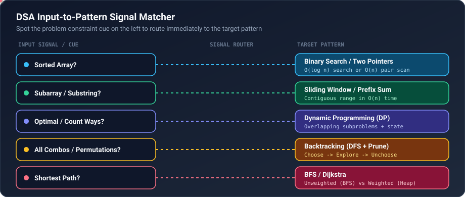

### Decision Tree for Problem Type

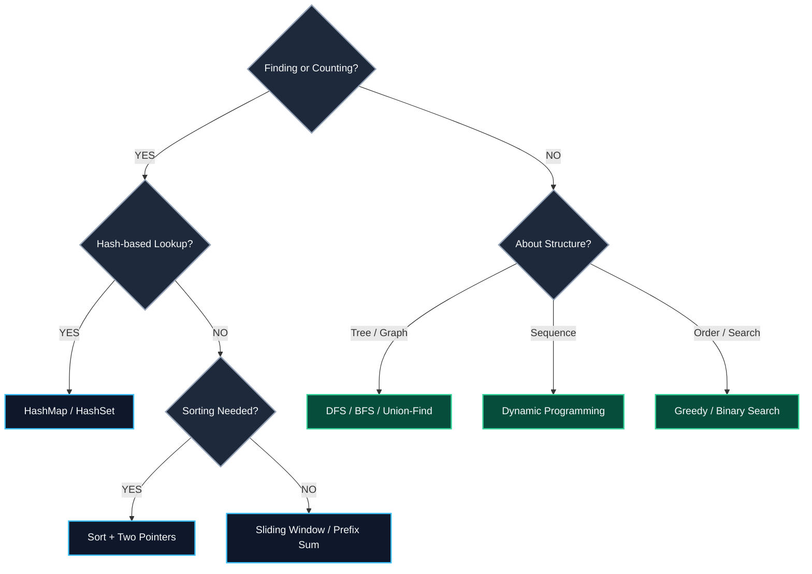

```
Is it about finding/counting?
├─ YES → Hash-based? → HashMap/HashSet
│        └─ Sorting needed? → Sort + Two Pointers
├─ NO → Is it about structure?
│       ├─ Tree/Graph? → DFS/BFS/Union-Find
│       ├─ Sequence? → Dynamic Programming
│       └─ Order? → Greedy/Binary Search
```

> [!TIP]
> Always check the input constraints (`n`) before committing to a pattern: `n <= 20` screams Backtracking/Bitmask DP, `n <= 10^4` allows `O(n^2)` DP, and `n >= 10^5` requires `O(n log n)` or `O(n)` (Two Pointers, Sliding Window, Binary Search, HashMap).

### Cheat Sheet by Problem Type

| Problem Domain | Trigger Cues | Go-To Patterns |
| :--- | :--- | :--- |
| **Array / String** | Pairs, palindromes, subarrays, sorted input, frequencies | Two Pointers, Sliding Window, Sorting, HashMap, Binary Search |
| **Tree** | Traversal, level-by-level, BST ordering, root-to-leaf paths | DFS (recursive/stack), BFS (queue), Inorder (`left &lt; root &lt; right`) |
| **Graph** | Shortest path, connected components, dependencies, cycles | BFS / Dijkstra, DFS / Union-Find, Topological Sort (Kahn's), DFS colors |
| **Dynamic Programming** | Best/min/max value, count ways, grid paths, unlimited items | 1D/2D DP (`dp[i]`, `dp[i][j]`), Unbounded inner loop `0 → i` |

**Array/String Problems**
```
Two Pointers?     → Pairs, palindromes, duplicates
Sliding Window?   → Subarrays, contiguous
Sorting?          → Compare elements
HashMap?          → Frequencies, complements
Binary Search?    → Sorted input
```

**Tree Problems**
```
Traversal?        → DFS (recursive or stack)
Level-wise?       → BFS (queue)
BST Properties?   → Left < root < right
Path Finding?     → DFS with path tracking
```

**Graph Problems**
```
Shortest Path?    → BFS (unweighted) or Dijkstra (weighted)
Components?       → DFS or Union-Find
Topological?      → DFS or Kahn's algorithm
Cycle Detection?  → DFS with colors
```

**DP Problems**
```
Optimization?     → dp[i] = best so far
Counting?         → dp[i] = number of ways
Path?             → dp[i][j] = value to reach (i,j)
Unbounded?        → Inner loop from 0 to i
```

> [!IMPORTANT]
> Do not confuse **Shortest Path in an unweighted graph** (use BFS, `O(V + E)`) with **Shortest Path in a weighted graph** (use Dijkstra's with a `PriorityQueue`, `O((V + E) log V)`).

---

## Testing and Edge Cases

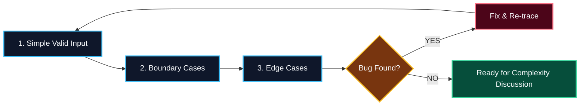

### Systematic Testing Approach

| Test Tier | What It Validates | Concrete Example (Two Sum) |
| :--- | :--- | :--- |
| **1. Simple Valid Input** | Core algorithm logic on a small happy path | `[2, 7, 11, 15], target = 9` → `[0, 1]` |
| **2. Boundary Cases** | Minimum length, `Integer.MAX_VALUE` / overflow | `[1, 2147483647], target = 2147483648` |
| **3. Edge Cases** | Empty/null input, no solution, duplicates, negatives | `[]`, `[3, 3]`, `[-3, -1, 0, 2]` |

**1. Simple Valid Input**
```java
// Example: Two Sum
Input: [2, 7, 11, 15], target = 9
Expected: [0, 1]
```

**2. Boundary Cases**
```java
// Minimum size
Input: [1, 2], target = 3
Expected: [0, 1]

// Largest values
Input: [1, 2147483647], target = 2147483648
Expected: [0, 1] (check for overflow)
```

**3. Edge Cases**
```java
// Empty input
Input: [], target = 0
Expected: [] or [-1, -1]

// No solution
Input: [1, 2, 3], target = 100
Expected: [-1, -1] or []

// Duplicates
Input: [3, 3], target = 6
Expected: [0, 1]

// Negative numbers
Input: [-3, -1, 0, 2], target = -1
Expected: [-3, 2] (indices)
```

> [!WARNING]
> Watch out for `Integer.MAX_VALUE` overflow when summing elements or computing `(left + right) / 2` in Java. Use `long` for sums when values can reach `10^9`, and `left + (right - left) / 2` for midpoints.

### Edge Case Checklist

- [ ] Empty input (null or empty array)
- [ ] Single element
- [ ] All same elements
- [ ] Negative numbers
- [ ] Zero
- [ ] Very large numbers (overflow?)
- [ ] Duplicates
- [ ] No valid solution

> [!TIP]
> Dry-run your code by maintaining a small variable state table (`i`, `num`, `map`, `result`) in comments—never execute the algorithm from memory.

---

## 8-Week Study Plan

```mermaid
flowchart LR
    W1["W1: Arrays & Strings (5-7h)"] --> W2["W2: Hash & Heap (5-7h)"]
    W2 --> W3["W3: Lists & Stacks (5-7h)"]
    W3 --> W4["W4: Trees & Graphs (7-9h)"]
    W4 --> W5["W5: Dynamic Prog (7-9h)"]
    W5 --> W6["W6: Backtracking (5-7h)"]
    W6 --> W7["W7: Binary Search (5-7h)"]
    W7 --> W8["W8: Mocks & Review (10-12h)"]

    classDef fnd fill:#0c4a6e,stroke:#38bdf8,stroke-width:2px,color:#f8fafc
    classDef core fill:#312e81,stroke:#818cf8,stroke-width:2px,color:#f8fafc
    classDef adv fill:#064e3b,stroke:#34d399,stroke-width:2px,color:#f8fafc
    classDef mock fill:#881337,stroke:#fb7185,stroke-width:2px,color:#f8fafc

    class W1,W2,W3 fnd
    class W4,W5 core
    class W6,W7 adv
    class W8 mock
```

| Week | Primary Focus | Core Patterns | Target Hours |
| :---: | :--- | :--- | :---: |
| **Week 1** | Foundation (Arrays & Strings) | Two Pointers, Sliding Window | 5-7 hrs |
| **Week 2** | Hash & Heap Fundamentals | HashMap patterns, Priority Queues | 5-7 hrs |
| **Week 3** | Linked Lists & Stacks | Pointer manipulation, Stack patterns | 5-7 hrs |
| **Week 4** | Trees & Graphs | Traversals, DFS/BFS, Topological Sort | 7-9 hrs |
| **Week 5** | Dynamic Programming | 1D & 2D DP, State definition | 7-9 hrs |
| **Week 6** | Recursion & Backtracking | Problem decomposition, State management | 5-7 hrs |
| **Week 7** | Binary Search & Sorting | Left/Right boundary search, Sorting | 5-7 hrs |
| **Week 8** | Mock Interviews & Review | 10-15 timed 45-min mocks + weak areas | 10-12 hrs |

> [!IMPORTANT]
> Consistency beats cramming: 1-2 hours every day builds far stronger pattern recall than a 10-hour weekend marathon.

### Week 1: Foundation (Arrays & Strings)
```
Focus: Two Pointers, Sliding Window
Problems:
- Container With Most Water
- Remove Duplicates
- Valid Palindrome
- Longest Substring Without Repeating Chars
- Trapping Rain Water

Time: 5-7 hours
```

### Week 2: Hash & Heap Fundamentals
```
Focus: HashMap patterns, Priority Queues
Problems:
- Two Sum, Two Sum II
- Group Anagrams
- Top K Frequent Elements
- Kth Largest Element
- LRU Cache

Time: 5-7 hours
```

### Week 3: Linked Lists & Stacks
```
Focus: Pointer manipulation, Stack patterns
Problems:
- Reverse Linked List
- Detect Cycle
- Merge Two Sorted Lists
- Valid Parentheses
- Min Stack
- Daily Temperatures

Time: 5-7 hours
```

### Week 4: Trees & Graphs
```
Focus: Traversals, DFS/BFS
Problems:
- Inorder/Preorder/Postorder Traversal
- Max Depth / Balanced Tree
- LCA
- Number of Islands
- Course Schedule (detect cycle)
- Topological Sort

Time: 7-9 hours
```

### Week 5: Dynamic Programming
```
Focus: 1D and 2D DP, state definition
Problems:
- Climbing Stairs
- House Robber
- Coin Change
- Longest Increasing Subsequence
- Edit Distance
- Longest Common Subsequence
- Unique Paths

Time: 7-9 hours
```

### Week 6: Recursion & Backtracking
```
Focus: Problem decomposition, state management
Problems:
- Permutations
- Combinations
- Generate Parentheses
- N-Queens
- Word Search
- Sudoku Solver

Time: 5-7 hours
```

### Week 7: Binary Search & Sorting
```
Focus: Binary search variations, sorting algorithms
Problems:
- Binary Search variants (left/right boundary)
- Search Rotated Array
- Find Peak Element
- Merge Intervals
- Koko Eating Bananas

Time: 5-7 hours
```

### Week 8: Mock Interviews & Review
```
- Attempt 10-15 timed problems (45 min each)
- Review weak areas
- Practice communication
- Study system design basics

Time: 10-12 hours
```

> [!TIP]
> Keep an error log for every problem you miss: record the trigger cue you missed, the bug you hit, and re-solve the problem from scratch 3 days later.

---

## Top 75 LeetCode Problems

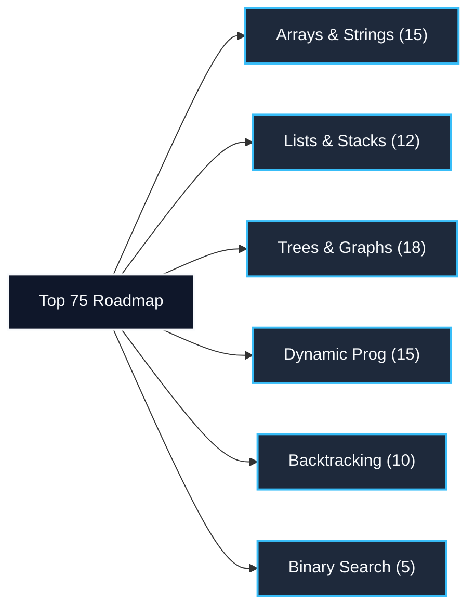

| Category | Total | Easy | Medium | Hard | Core Patterns Covered |
| :--- | :---: | :---: | :---: | :---: | :--- |
| **Arrays & Strings** | 15 | 3 | 7 | 5 | HashMap, Two Pointers, Sliding Window, DP |
| **Linked Lists & Stacks** | 12 | 3 | 6 | 3 | Pointers, Monotonic Stack, Heap, DLL + HashMap |
| **Trees & Graphs** | 18 | 3 | 10 | 5 | DFS, BFS, Topological Sort, Union-Find |
| **Dynamic Programming** | 15 | 2 | 9 | 4 | 1D DP, 2D DP, String DP, State/Interval/Tree DP |
| **Recursion & Backtracking** | 10 | 0 | 7 | 3 | Backtracking, Pruning, Constraint Satisfaction |
| **Binary Search & Sorting** | 5 | 1 | 3 | 1 | Binary Search Template, Rotated Array, Median |

> [!TIP]
> Solve each of the 75 problems cleanly without looking at hints first. If you are stuck after 25 minutes, study the pattern, close the solution, and implement it from scratch.

### Arrays & Strings (15 problems)
```
Easy:
1. Two Sum (HashMap)
2. Valid Palindrome (Two Pointers)
3. Remove Duplicates from Sorted Array (Two Pointers)

Medium:
4. Container With Most Water (Two Pointers)
5. Longest Substring Without Repeating Characters (Sliding Window)
6. Minimum Window Substring (Sliding Window)
7. 3Sum (Two Pointers)
8. Trapping Rain Water (Two Pointers)
9. Longest Palindromic Substring (Expand Around Center)
10. Increase Triplets Subsequence (Greedy)

Hard:
11. Group Anagrams (HashMap)
12. Longest Consecutive Sequence (HashSet)
13. Word Ladder (BFS)
14. Edit Distance (DP)
15. Burst Balloons (Interval DP)
```

### Linked Lists & Stacks (12 problems)
```
Easy:
16. Reverse Linked List (Iteration)
17. Valid Parentheses (Stack)
18. Merge Two Sorted Lists (Two Pointers)

Medium:
19. Merge K Sorted Lists (Heap)
20. Remove Nth Node From End (Two Pointers)
21. LRU Cache (HashMap + DLL)
22. Daily Temperatures (Monotonic Stack)
23. Largest Rectangle in Histogram (Monotonic Stack)
24. Evaluate Reverse Polish Notation (Stack)

Hard:
25. Reverse Nodes in K Group (Recursive)
26. LFU Cache (HashMap + Freq Buckets)
27. Trapping Rain Water II (Heap)
```

### Trees & Graphs (18 problems)
```
Easy:
28. Same Tree (DFS)
29. Invert Binary Tree (DFS)
30. Max Depth Binary Tree (DFS/BFS)

Medium:
31. Binary Tree Level Order Traversal (BFS)
32. Binary Tree Zigzag Level Order (BFS)
33. Validate Binary Search Tree (DFS)
34. Lowest Common Ancestor (DFS)
35. Binary Tree Maximum Path Sum (DFS)
36. Serialize and Deserialize (DFS)
37. Number of Islands (DFS/BFS)
38. Clone Graph (DFS/BFS)
39. Course Schedule I & II (Topological Sort)
40. Pacific Atlantic Water Flow (DFS)

Hard:
41. Accounts Merge (Union-Find)
42. Word Ladder II (BFS + Backtrack)
43. Alien Dictionary (Topological Sort)
44. Longest Path in Tree (DFS)
45. Redundant Connection (Union-Find)
```

### Dynamic Programming (15 problems)
```
Easy:
46. Climbing Stairs (1D DP)
47. House Robber (1D DP)

Medium:
48. Coin Change (1D DP)
49. Longest Increasing Subsequence (1D DP)
50. Word Break (1D DP)
51. Unique Paths (2D DP)
52. Unique Paths II (2D DP)
53. 0/1 Knapsack (2D DP)
54. Longest Common Subsequence (2D DP)
55. Regular Expression Matching (String DP)
56. Wildcard Matching (String DP)

Hard:
57. Best Time to Buy & Sell Stock III/IV (State DP)
58. House Robber III (Tree DP)
59. Burst Balloons (Interval DP)
60. Decode Ways (1D DP)
```

### Recursion & Backtracking (10 problems)
```
Medium:
61. Permutations (Backtrack)
62. Combinations (Backtrack)
63. Subsets (Backtrack)
64. Generate Parentheses (Backtrack)
65. N-Queens (Backtrack)
66. Word Search (DFS Backtrack)
67. Palindrome Partitioning (Backtrack)

Hard:
68. Permutations II (Backtrack + Skip Duplicates)
69. Sudoku Solver (Backtrack + Constraint)
70. Letter Combinations of Phone Number (Backtrack)
```

### Binary Search & Sorting (5 problems)
```
Easy:
71. Binary Search (Template)

Medium:
72. Search in Rotated Array (Binary Search)
73. Find Minimum in Rotated Array (Binary Search)
74. Find Peak Element (Binary Search)

Hard:
75. Median of Two Sorted Arrays (Binary Search)
```

> [!IMPORTANT]
> If you are short on time before an interview, prioritize the **Medium** problems in Trees & Graphs, Arrays & Strings, and 1D/2D DP—they represent the highest-frequency FAANG interview questions.

---

## Java-Specific Tips for FAANG Interviews

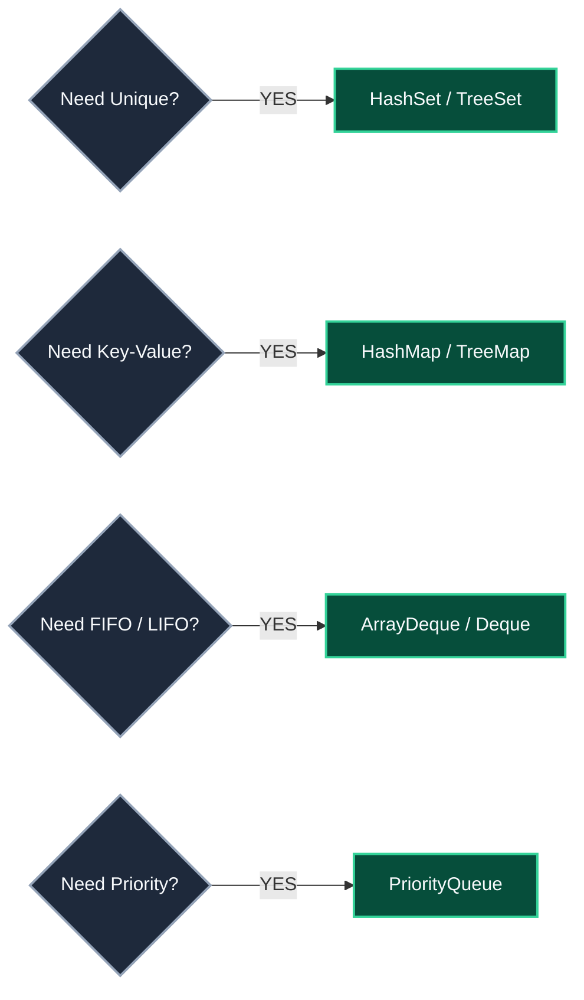

### Common Java Pitfalls

| Pitfall | Common Bug | Safe Interview Pattern |
| :--- | :--- | :--- |
| **Integer Overflow** | `(left + right) / 2` overflows `int` | `left + (right - left) / 2` (or `long`) |
| **Array Initialization** | `Integer[]` defaults to `null`, causing NPE | Use `int[]` (defaults to `0`) or null-check `Integer[]` |
| **String Concatenation** | `result += nums[i]` in loop is `O(n^2)` | Use `StringBuilder` for `O(n)` |
| **HashCode & Equals** | Overriding `equals` without `hashCode` breaks `HashMap` | Always override both with `Objects.hash(...)` |
| **Null Pointers** | Dereferencing `node.val` when `node == null` | Guard with `if (node != null && node.val &gt; 0)` |

**1. Integer Overflow**
```java
// WRONG
int mid = (left + right) / 2;

// CORRECT
int mid = left + (right - left) / 2;

// For long values
long mid = left + (right - left) / 2;
```

**2. Array Initialization**
```java
// Common mistake
int[] arr = new int[n];
// All elements are 0 by default (correct)

// But for objects
Integer[] arr = new Integer[n];
// All elements are null (remember null checks!)
```

**3. String vs StringBuilder**
```java
// WRONG: O(n²) due to immutability
String result = "";
for (int i = 0; i < n; i++) {
    result += nums[i];
}

// CORRECT: O(n)
StringBuilder sb = new StringBuilder();
for (int i = 0; i < n; i++) {
    sb.append(nums[i]);
}
String result = sb.toString();
```

**4. HashCode and Equals**
```java
// If overriding equals, always override hashCode
@Override
public int hashCode() {
    return Objects.hash(field1, field2);
}

@Override
public boolean equals(Object o) {
    if (this == o) return true;
    if (o == null || getClass() != o.getClass()) return false;
    MyClass that = (MyClass) o;
    return Objects.equals(field1, that.field1);
}
```

**5. Null Pointer Exceptions**
```java
// Always check before operations
if (node != null && node.val > 0) {
    // process
}

// Use Optional in production (avoid in interviews)
// Be explicit in interviews for clarity
```

> [!WARNING]
> In Java, `(a, b) -> b - a` for a max-heap comparator can overflow if `a` and `b` have large opposite signs (e.g., `Integer.MIN_VALUE` and `Integer.MAX_VALUE`). Prefer `Integer.compare(b, a)` or `Collections.reverseOrder()` when extreme values are possible.

### Java Collections to Know

**Choosing the Right Collection**
```
Need unique elements?      → HashSet, TreeSet
Need key-value pairs?      → HashMap, TreeMap
Need ordered insertion?    → LinkedList, LinkedHashMap
Need priority ordering?    → PriorityQueue
Need FIFO?                 → Queue (ArrayDeque)
Need LIFO?                 → Stack, Deque
Need sorted?               → TreeSet, TreeMap
```

**Common Operations**
```java
// List
list.add(element);
list.get(index);
list.remove(index);
list.size();

// Set
set.add(element);
set.contains(element);
set.remove(element);
set.isEmpty();

// Map
map.put(key, value);
map.get(key);
map.getOrDefault(key, defaultValue);
map.putIfAbsent(key, value);
map.remove(key);

// Queue (FIFO)
queue.offer(element);   // add
queue.poll();           // remove
queue.peek();           // look

// Stack (LIFO)
stack.push(element);
stack.pop();
stack.peek();
stack.empty();

// PriorityQueue (Min-Heap by default)
minHeap.offer(element);
minHeap.poll();
minHeap.peek();

// Max-Heap
PriorityQueue<Integer> maxHeap = new PriorityQueue<>((a, b) -> b - a);
```

> [!TIP]
> Prefer `Deque<Integer> stack = new ArrayDeque<>()` over the legacy `Stack` class in Java—`ArrayDeque` is faster, non-synchronized, and the standard idiomatic choice for both queues and stacks.

---

## Final Interview Day Checklist

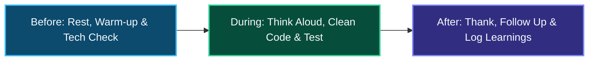

| Stage | Primary Objective | Top Non-Negotiables |
| :--- | :--- | :--- |
| **Before** | Arrive calm, rested, and technically ready | Good sleep, 2-3 warm-up problems, video/audio check, pen & paper |
| **During** | Demonstrate clear thinking and clean code | Think aloud, clarify first, handle edge cases, dry-run examples |
| **After** | Close professionally and compound learning | Thank interviewer, send follow-up email, log weak areas |

### Before the Interview
```
24 Hours Before:
- [ ] Get good sleep
- [ ] Review key patterns (2 pointer, sliding window, DP)
- [ ] Do 2-3 practice problems as warm-up

Morning Of:
- [ ] Eat good breakfast
- [ ] Test internet/video connection
- [ ] Have pen and paper ready
- [ ] Use the restroom
- [ ] Close unnecessary applications
- [ ] Have a glass of water
- [ ] Wear appropriate attire
```

### During the Interview
```
Interview Mindset:
- [ ] Be calm and confident
- [ ] Think aloud constantly
- [ ] Ask clarifying questions
- [ ] Don't panic if stuck
- [ ] Be honest if unsure
- [ ] Accept hints gracefully
- [ ] Smile (they can hear it!)

Coding Best Practices:
- [ ] Write clean, readable code
- [ ] Use meaningful variable names
- [ ] Add comments for complex parts
- [ ] Test as you write
- [ ] Trace through examples
- [ ] Handle edge cases
```

### After the Interview
```
Post-Interview:
- [ ] Thank the interviewer
- [ ] Don't over-explain
- [ ] Get feedback if asked
- [ ] Follow up with thank you email
- [ ] Document what you learned
- [ ] Identify weak areas for improvement
```

> [!TIP]
> Do 2-3 easy/medium warm-up problems 24 hours before—not hard ones—so you enter the interview with momentum and confidence rather than mental fatigue.

---

## Closing Advice

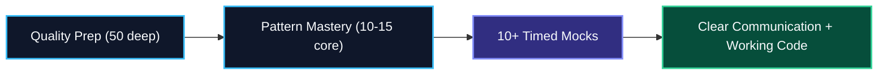

| Principle | Anti-Pattern to Avoid | Winning Habit |
| :--- | :--- | :--- |
| **Quality over Quantity** | Grinding 500 problems superficially | Master 50-75 core problems deeply |
| **Communication over Speed** | Coding silently at top speed | Narrate trade-offs and invariants clearly |
| **Consistency** | 10-hour weekend cramming | 1-2 hours of focused daily practice |
| **Timed Mocks** | Only solving untimed on LeetCode | 10+ 45-min timed mock interviews |

1. **Preparation is Key**: Quality practice beats quantity. Do 50 problems deeply rather than 500 superficially.

2. **Think Like an Interviewer**: Not just solving problems, but demonstrating thought process.

3. **Communication Over Speed**: A slow, well-explained solution beats a fast, unclear one.

4. **Pattern Recognition**: 80% of interview problems fall into 10-15 patterns. Master them.

5. **Consistency**: Practice 1-2 hours daily is better than 10 hours once per week.

6. **Mock Interviews**: Do 10+ timed mock interviews before the real thing.

7. **Embrace Mistakes**: Errors during practice are learning opportunities.

8. **Confidence Building**: As you solve more problems, confidence naturally builds.

> [!IMPORTANT]
> Good luck with your FAANG interviews! Remember: they're hiring you to solve problems, not to be perfect. Show them you can think clearly, communicate well, and ship working code.
