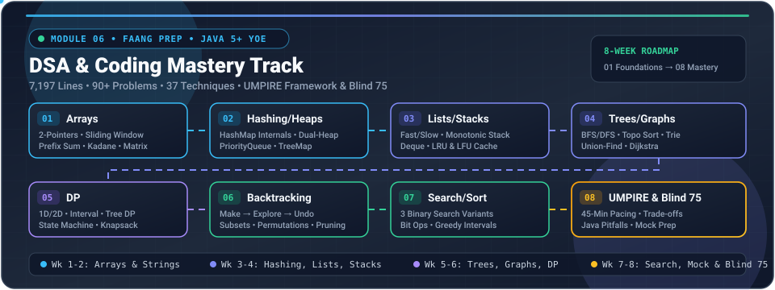
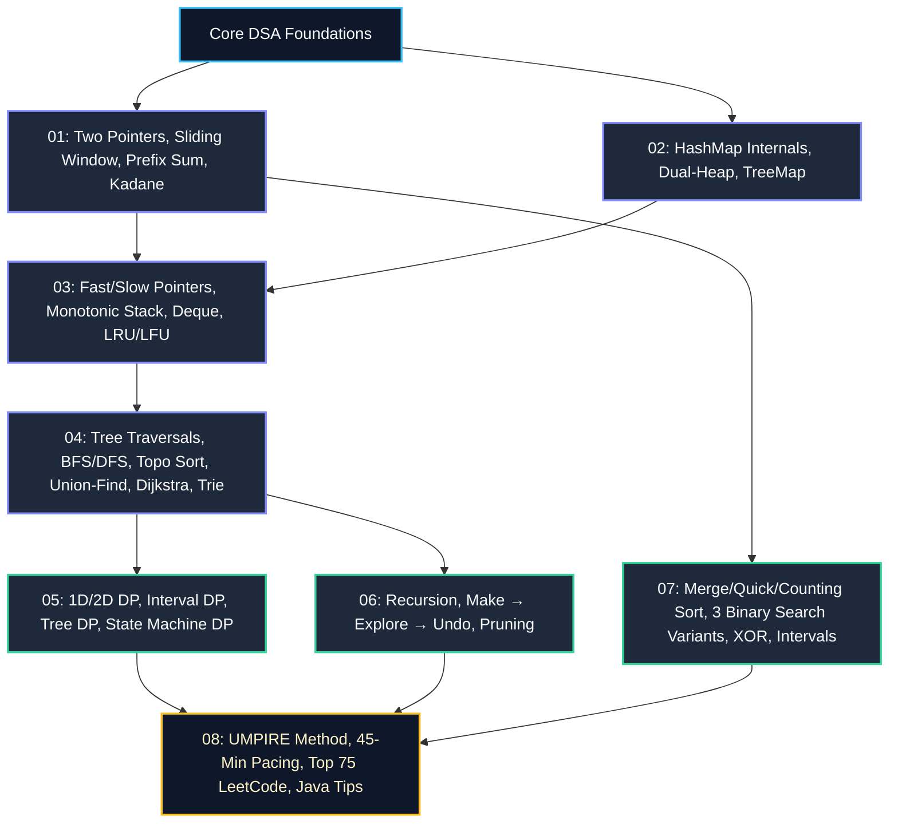
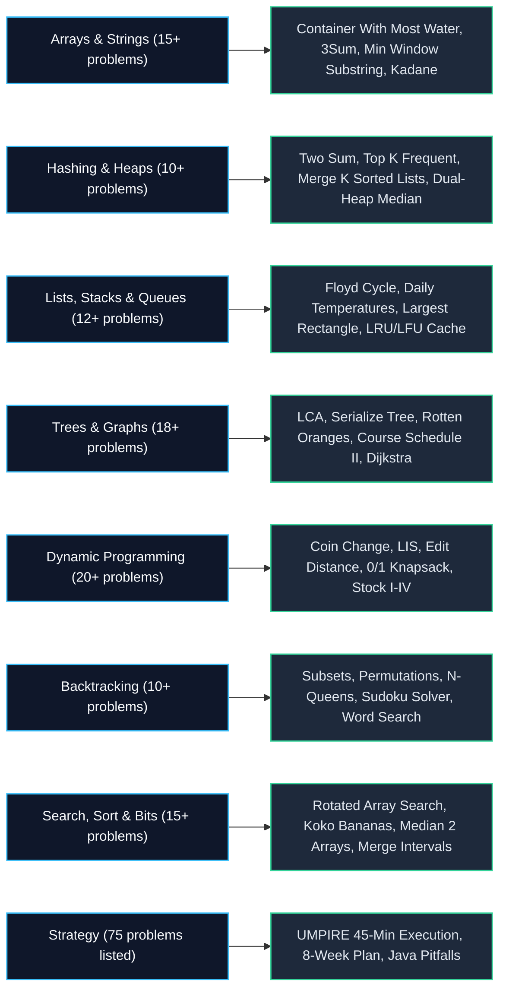
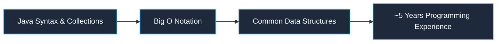
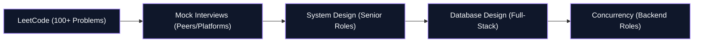

# DSA and Coding Interview Preparation - Complete Guide

## Overview

This is a comprehensive, FAANG-focused DSA and coding interview preparation guide tailored for mid-level Java engineers with ~5 years of experience. The content is production-ready with detailed solutions, complexity analysis, and interview strategies.

> [!NOTE]
> Designed as an **8-module progression** (`7,197` lines, `173 KB`, `90+` problems, `37` techniques), this hub takes you from core array/string patterns all the way to the **UMPIRE** execution framework and **Blind 75** mastery.

### Module Learning Roadmap

---

## File Structure

### DSA Pattern Dependency Tree

### 1. [01-Arrays-and-Strings.md](./01-Arrays-and-Strings.md) (1,101 lines, 29 KB)

| Pattern / Topic | Core Problems Covered |
|---|---|
| **Two Pointer Technique (5+ problems)** | Container With Most Water, 3Sum, Trapping Rain Water, Valid Palindrome, Remove Duplicates from Sorted Array |
| **Sliding Window (Fixed & Variable Size)** | Longest Substring Without Repeating Chars, Minimum Window Substring, Max Sum Subarray of Size K, Longest Repeating Character Replacement |
| **Prefix Sum & Kadane's Algorithm** | Subarray Sum Equals K, Maximum Subarray (Kadane's Algorithm) |
| **String Manipulation Problems** | Valid Anagram, Longest Palindromic Substring, Group Anagrams |
| **Matrix Problems** | Rotate Matrix, Spiral Order, Search in 2D Matrix |

**Key Features:**
- Every problem includes: Statement, Brute Force, Optimal, Complexity, Edge Cases, Follow-ups
- Complete Java code solutions (LeetCode-ready)
- ASCII diagrams for visualization
- Time/Space complexity analysis
- Interviewer follow-up questions

---

### 2. [02-Hashing-and-Heaps.md](./02-Hashing-and-Heaps.md) (940 lines, 24 KB)

| Pattern / Topic | Core Problems & Internals Covered |
|---|---|
| **HashMap / HashSet Patterns** | Two Sum, Group Anagrams, Longest Consecutive Sequence, Subarray Sum Equals K, Top K Frequent Elements (Heap vs Bucket Sort) |
| **HashMap Internals in Java** | Hash function, Load factor, Collision handling, Time complexity analysis, Interview Q&A on HashMap design |
| **Frequency Counting Patterns** | Reorganize String |
| **Priority Queue & Heap** | Kth Largest Element (Min-Heap approach), Merge K Sorted Lists, Find Median from Data Stream (Dual-Heap) |
| **Heap & Ordered Map Patterns** | Min-Heap vs Max-Heap Usage Patterns, Custom Comparator Patterns in Java, TreeMap/TreeSet Usage (Meeting Rooms II, My Calendar I) |

**Key Features:**
- Practical heap implementation patterns
- When to use which data structure
- Complex comparator examples
- Space-optimized solutions (bucket sort for Top K)

---

### 3. [03-Linked-Lists-and-Stacks-Queues.md](./03-Linked-Lists-and-Stacks-Queues.md) (1,005 lines, 24 KB)

| Pattern / Topic | Core Problems & Patterns Covered |
|---|---|
| **Linked List Fundamentals** | Reverse Linked List (Iterative & Recursive), Detect Cycle (Floyd's Algorithm), Find Cycle Start Node, Merge Two Sorted Lists, Remove Nth Node From End, Reorder List |
| **Pointer & Node Techniques** | Fast and Slow Pointer Pattern, Dummy Node Technique |
| **Stack Patterns & Monotonic Stack** | Valid Parentheses, Min Stack (Dual Stack), Daily Temperatures (Monotonic Stack), Largest Rectangle in Histogram, Evaluate Reverse Polish Notation, Next Greater Element, Monotonic Stack Pattern Explained |
| **Queue and Deque** | Sliding Window Maximum, Implement Queue Using Stacks |
| **Design Problems** | LRU Cache (HashMap + Doubly Linked List), LFU Cache (HashMap + Frequency Buckets) |

**Key Features:**
- Detailed monotonic stack explanation
- Design problem implementation from scratch
- Both stack implementations of classic problems
- LRU/LFU cache with full complexity analysis

---

### 4. [04-Trees-and-Graphs.md](./04-Trees-and-Graphs.md) (1,033 lines, 23 KB)

| Pattern / Topic | Core Problems & Algorithms Covered |
|---|---|
| **Binary Tree Traversals** | Inorder, Preorder, Postorder (Iterative + Recursive), Level Order (BFS) |
| **Binary Tree Problems** | Max Depth, Validate BST, Lowest Common Ancestor, Serialize/Deserialize, Diameter of Tree, Path Sum Variations, Right Side View, Zigzag Level Order |
| **Binary Search Trees** | Kth Smallest Element, Inorder Successor, Delete Node, Trim BST |
| **Graph Representations** | Adjacency List, Adjacency Matrix |
| **BFS Patterns** | Shortest Path, Rotten Oranges, Word Ladder, 01 Matrix |
| **DFS Patterns** | Number of Islands, Clone Graph, Course Schedule, Pacific Atlantic Water Flow |
| **Topological Sort** | Course Schedule II, Alien Dictionary |
| **Union-Find** | Number of Connected Components, Redundant Connection, Accounts Merge |
| **Advanced Algorithms** | Dijkstra's Algorithm, Trie (Prefix Tree) |

**Key Features:**
- ASCII tree diagrams for visualization
- Complete BFS/DFS templates
- Union-Find with path compression and union by rank
- Dijkstra implementation with priority queue

---

### 5. [05-Dynamic-Programming.md](./05-Dynamic-Programming.md) (801 lines, 19 KB)

| Pattern / Topic | Core Problems & Concepts Covered |
|---|---|
| **DP Framework** | Identifying subproblems, Recurrence relations, Base cases, Top-Down vs Bottom-Up |
| **1D DP Problems** | Climbing Stairs, House Robber, Coin Change, Longest Increasing Subsequence (O(n²) & O(n log n)), Word Break, Decode Ways |
| **2D DP Problems** | Unique Paths, Edit Distance, Longest Common Subsequence, Longest Palindromic Subsequence, 0/1 Knapsack (with space optimization) |
| **Interval DP** | Burst Balloons, Matrix Chain Multiplication |
| **DP on Strings** | Regular Expression Matching, Wildcard Matching |
| **DP on Trees** | House Robber III, Binary Tree Maximum Path Sum |
| **State Machine DP** | Best Time to Buy and Sell Stock (Series I-IV), Cooldown scenarios, Transaction fee |

**Key Features:**
- State definition for each problem
- Both top-down and bottom-up implementations (where applicable)
- Space optimization techniques
- Common DP pitfalls explained

---

### 6. [06-Recursion-and-Backtracking.md](./06-Recursion-and-Backtracking.md) (712 lines, 18 KB)

| Pattern / Topic | Core Problems & Concepts Covered |
|---|---|
| **Recursion Fundamentals** | Call stack visualization, Base case importance, Recursive case structure, Tail recursion |
| **Backtracking Template** | Make → Explore → Undo pattern, When to prune |
| **Subsets and Combinations** | Generate All Subsets, Subsets with Duplicates, Combinations |
| **Permutations** | Generate All Permutations (Swap-based & Array-based), Permutations with Duplicates |
| **Constraint Satisfaction** | N-Queens, Sudoku Solver, Word Search, Palindrome Partitioning |
| **Interview-Specific Tips** | Decision points, Constraint identification, Pruning strategies |

**Key Features:**
- Decision tree visualization for backtracking
- Multiple permutation approaches
- Optimizations for duplicate handling
- Constraint propagation examples

---

### 7. [07-Sorting-Searching-and-Binary-Search.md](./07-Sorting-Searching-and-Binary-Search.md) (732 lines, 16 KB)

| Pattern / Topic | Core Problems & Concepts Covered |
|---|---|
| **Sorting Algorithms** | Merge Sort, Quick Sort, Counting Sort, When to use each |
| **Binary Search Fundamentals** | Core template, Three variants (exact, left boundary, right boundary), Why use `mid = left + (right - left) / 2` |
| **Binary Search Problems** | Search in Rotated Sorted Array, Find Minimum in Rotated Array (with duplicates), Find Peak Element, Koko Eating Bananas (Binary Search on Answer), Capacity to Ship Packages, Median of Two Sorted Arrays |
| **Bit Manipulation** | Basic operations (set, clear, toggle, check), Power of 2, Single Number (XOR), Hamming Weight, Missing Number (XOR & Gauss), Counting Bits |
| **Interval Problems** | Merge Intervals, Insert Interval, Non-Overlapping Intervals, Meeting Rooms |

**Key Features:**
- Binary search three-variant explanation
- Bit manipulation tricks and patterns
- When to use XOR vs arithmetic
- Greedy interval problems

---

### 8. [08-Coding-Interview-Strategy.md](./08-Coding-Interview-Strategy.md) (873 lines, 20 KB)

| Strategy Area | Detailed Coverage |
|---|---|
| **FAANG Interview Format** | 45-minute structure breakdown, What interviewers evaluate, Scoring criteria |
| **The UMPIRE Method** | **U**nderstand (Clarifying questions), **M**atch (Pattern recognition), **P**lan (Approach discussion), **I**mplement (Clean coding), **R**eview (Self-checking), **E**valuate (Testing & examples) |
| **Communication During Coding** | Thinking aloud framework, Handling "I don't know", When stuck strategies, Trade-off discussions |
| **Time Management** | 45-minute breakdown, Pace indicators, When to optimize |
| **Pattern Recognition** | Decision trees for problem type, Cheat sheets by category, Pattern to data structure mapping |
| **Testing and Edge Cases** | Systematic testing approach, Edge case checklist, Boundary conditions |
| **8-Week Study Plan** | Detailed week-by-week breakdown, Problem allocation, Time estimates |
| **Top 75 LeetCode Problems** | Organized by topic, Difficulty levels, Pattern categories |
| **Java-Specific Tips** | Common pitfalls (Integer overflow, String building), Collections choosing guide, Operations reference |
| **Interview Day Checklist** | Before, during, after strategies, Mindset tips, Post-interview actions |

**Key Features:**
- Actionable interview framework
- Real interview timing advice
- Curated 75-problem list with explanations
- Java-specific gotchas
- Mock interview preparation guide

---

## Statistics

| File | Lines | Size | Problems | Techniques |
|------|-------|------|----------|------------|
| [01-Arrays-and-Strings](./01-Arrays-and-Strings.md) | 1,101 | 29 KB | 15+ | 6 |
| [02-Hashing-and-Heaps](./02-Hashing-and-Heaps.md) | 940 | 24 KB | 10+ | 4 |
| [03-Linked-Lists-and-Stacks-Queues](./03-Linked-Lists-and-Stacks-Queues.md) | 1,005 | 24 KB | 12+ | 5 |
| [04-Trees-and-Graphs](./04-Trees-and-Graphs.md) | 1,033 | 23 KB | 18+ | 7 |
| [05-Dynamic-Programming](./05-Dynamic-Programming.md) | 801 | 19 KB | 20+ | 7 |
| [06-Recursion-and-Backtracking](./06-Recursion-and-Backtracking.md) | 712 | 18 KB | 10+ | 3 |
| [07-Sorting-Searching-and-Binary-Search](./07-Sorting-Searching-and-Binary-Search.md) | 732 | 16 KB | 15+ | 5 |
| [08-Coding-Interview-Strategy](./08-Coding-Interview-Strategy.md) | 873 | 20 KB | 75 problems listed | Strategy |
| **TOTAL** | **7,197** | **173 KB** | **90+ problems** | **37 techniques** |

### Topic-to-Problem Map

> [!TIP]
> **Highest ROI Modules:** Modules `01`, `04`, and `05` account for over half of the problem volume (`53+` problems, `20` techniques) and frequently combine in senior-level interviews.

---

## How to Use This Guide

### 8-Week Study Loop

```mermaid
flowchart LR
    W1["Wk 1-2: 01 Arrays &amp; Strings (5 problems/technique)"] --> W3["Wk 3-4: 02 Hashing/Heaps &amp; 03 Lists/Stacks"]
    W3 --> W5["Wk 5-6: 04 Trees/Graphs &amp; 05 Dynamic Programming"]
    W5 --> W7["Wk 7: 06 Backtracking &amp; 07 Search/Sort"]
    W7 --> W8["Wk 8: 08 Strategy, UMPIRE &amp; 45-Min Mocks"]
    W8 -->|"Daily Practice Loop"| REF["File Index → Optimal Approach → Complexity → Java Code"]

    classDef week fill:#1e293b,stroke:#818cf8,stroke-width:2px,color:#f8fafc
    classDef loop fill:#0f172a,stroke:#fbbf24,stroke-width:2px,color:#fef3c7

    class W1,W3,W5,W7 week
    class W8,REF loop
```

| Mode | Action Plan |
|---|---|
| **For Active Learning** | **Week 1-2**: Read [01-Arrays-and-Strings](./01-Arrays-and-Strings.md), solve 5 problems per technique **Week 3-4**: Read [02-Hashing-and-Heaps](./02-Hashing-and-Heaps.md), [03-Linked-Lists-and-Stacks-Queues](./03-Linked-Lists-and-Stacks-Queues.md) **Week 5-6**: Read [04-Trees-and-Graphs](./04-Trees-and-Graphs.md), [05-Dynamic-Programming](./05-Dynamic-Programming.md) **Week 7**: Read [06-Recursion-and-Backtracking](./06-Recursion-and-Backtracking.md), [07-Sorting-Searching-and-Binary-Search](./07-Sorting-Searching-and-Binary-Search.md) **Week 8**: Mock interviews with [08-Coding-Interview-Strategy](./08-Coding-Interview-Strategy.md) |
| **For Reference During Practice** | Use file index to quickly find pattern you need; read **"Optimal Approach"** section for insights; check **"Complexity Analysis"** before coding; reference Java code for syntax patterns |
| **For Interview Preparation** | Review [08-Coding-Interview-Strategy](./08-Coding-Interview-Strategy.md) one week before; practice **UMPIRE** method on 5-10 problems; do timed mock interviews (45 minutes); reference pattern cheat sheets during prep |

> [!IMPORTANT]
> Always check **"Complexity Analysis"** before writing code and practice **UMPIRE** (`Understand → Match → Plan → Implement → Review → Evaluate`) under strict 45-minute mock conditions.

---

## Key Strengths

| Strength | What It Delivers |
|---|---|
| ✓ **Comprehensive Coverage** | 90+ problems across all major topics |
| ✓ **Deep Explanations** | Every problem includes multiple approaches |
| ✓ **Production-Ready Code** | All Java code is LeetCode-submittable |
| ✓ **Interview-Focused** | UMPIRE method, communication tips, timing advice |
| ✓ **Pattern Recognition** | Learn to identify which technique applies to any problem |
| ✓ **Java-Specific** | Tips, pitfalls, and collection usage for Java |
| ✓ **Curated Problem List** | Top 75 problems organized by topic and difficulty |
| ✓ **Complexity Analysis** | Every solution includes time/space analysis |
| ✓ **Real Interview Insights** | Based on actual FAANG interview experiences |

---

## Prerequisites

| Requirement | Baseline Expectation |
|---|---|
| **Java Knowledge** | Basic Java knowledge (syntax, collections) |
| **Complexity** | Understanding of Big O notation |
| **Data Structures** | Familiarity with common data structures |
| **Experience Level** | ~5 years programming experience (as specified) |

> [!WARNING]
> If you are rusty on Java `Collections` (`HashMap`, `PriorityQueue`, `ArrayDeque`, `TreeMap`) or Big O time/space trade-offs, review those fundamentals before jumping into timed 45-minute mocks.

---

## Beyond These Files

For additional preparation:

| Focus Area | Recommendation |
|---|---|
| **Coding Volume** | Practice on LeetCode (aim for 100+ problems) |
| **Live Simulation** | Do mock interviews with friends or platforms |
| **Architecture** | Study system design for senior roles |
| **Persistence** | Learn database design (for full-stack roles) |
| **Multithreading** | Review concurrency if applying for backend roles |

---

**Good luck with your FAANG interviews!**

Remember: These guides provide the framework, but your consistent practice is what makes you interview-ready.
