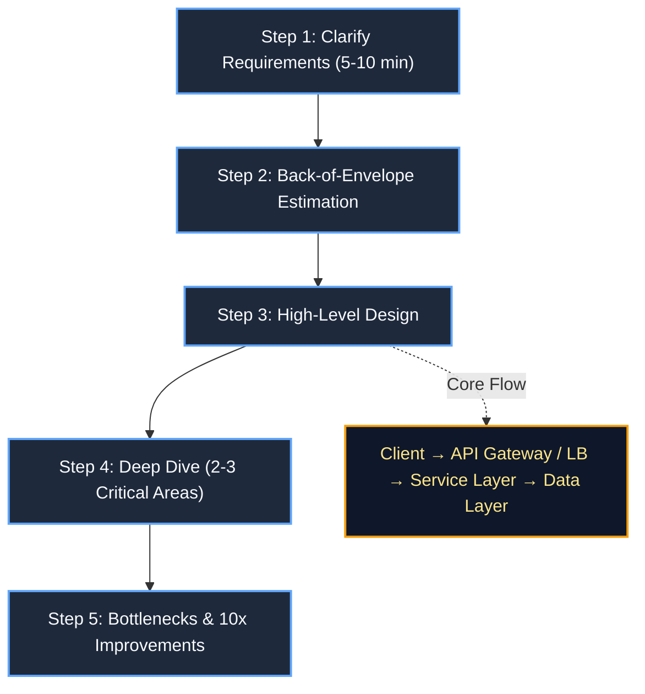
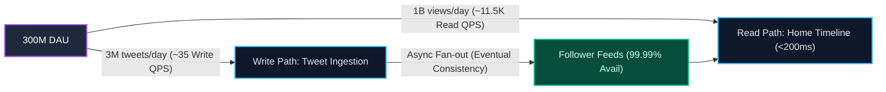
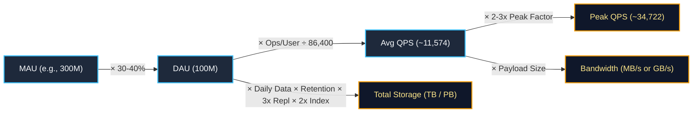
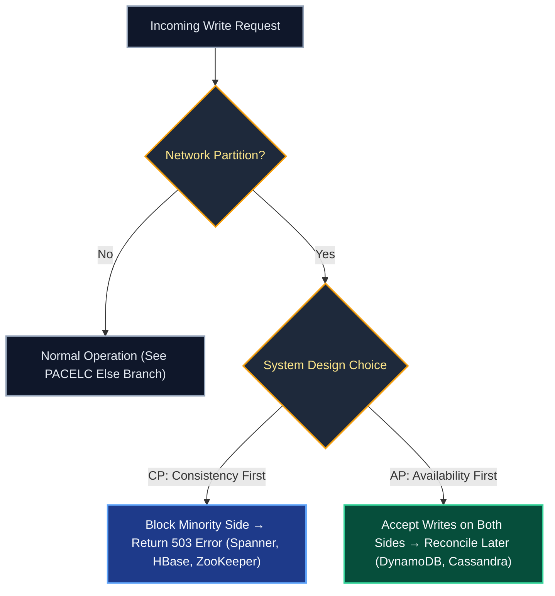
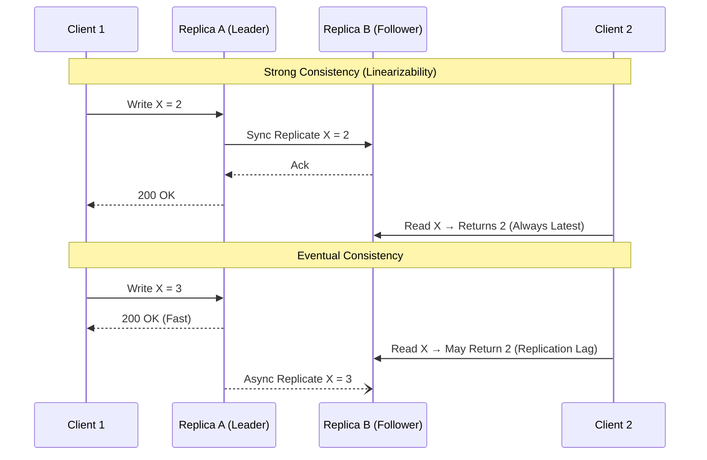
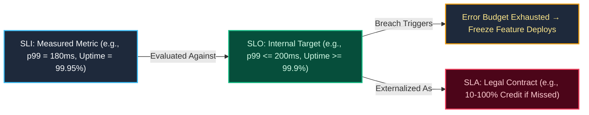
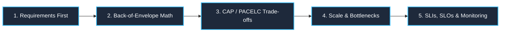

# System Design Fundamentals for FAANG Interviews

> [!IMPORTANT]
> System design interviews test **trade-off reasoning under constraints**, not memorized architectures. Every decision—consistency, caching, sharding, or SLA tier—must tie directly back to **requirements** and **back-of-envelope numbers**.

## Table of Contents
1. [How FAANG System Design Interviews Work](#how-faang-system-design-interviews-work)
2. [The 5-Step Framework](#the-5-step-framework)
3. [Requirements Analysis](#requirements-analysis)
4. [Back-of-Envelope Estimation](#back-of-envelope-estimation)
5. [Key Metrics and SLA](#key-metrics-and-sla)
6. [CAP Theorem and PACELC](#cap-theorem-and-pacelc)
7. [Consistency Models](#consistency-models)
8. [SLAs, SLOs, SLIs](#slas-slos-slis)
9. [Key Takeaways](#key-takeaways)
10. [Practice Exercise](#practice-exercise)

---

## How FAANG System Design Interviews Work

### Interview Format (45–60 Minutes)

- **0–2 min:** Greeting and understanding the problem statement.
- **2–10 min:** Clarify functional and non-functional requirements (scope control).
- **10–20 min:** High-level design with end-to-end architecture diagram.
- **20–40 min:** Deep dive into 2–3 critical components (data model, sharding, caching, failure modes).
- **40–50 min:** Discuss bottlenecks, trade-offs, and 10x scaling improvements.
- **50–60 min:** Q&A and verification of back-of-envelope calculations.

> [!TIP]
> Narrate your thought process out loud before drawing. Stating *"I will optimize for read latency first because reads outnumber writes 100:1"* signals senior-level judgment immediately.

### Interviewer's Lens & Common Questions

| Evaluation Criterion | What Interviewers Look For | High-Signal Behavior |
| :--- | :--- | :--- |
| **Communication** | Clear articulation of thinking | State assumptions before committing to a design |
| **Problem Decomposition** | Breaking ambiguity into modules | Separate ingestion, storage, serving, and async paths |
| **Technical Depth** | Understanding trade-offs | Contrast CP vs AP, SQL vs NoSQL, push vs pull |
| **Pragmatism** | Making reasonable assumptions | Pick simple, proven primitives before exotic tech |
| **Scalability Mindset** | Designing for millions of users | Identify hot keys, single points of failure, and fan-out |
| **Recovery Thinking** | Handling partial failures | Plan for retries, dead-letter queues, and failover |

**Frequency Ranking of Common FAANG Questions:**
1. **Design Twitter/X Feed** (most common at Meta)
2. **Design URL Shortener** (good baseline, Google/Amazon)
3. **Rate Limiter** (infrastructure focus, Uber/Stripe)
4. **Design a Cache / Distributed Cache** (LinkedIn, Adobe)
5. **Design Key-Value Store** (Amazon, Google)
6. **Design WhatsApp / Chat System** (Meta, Microsoft)
7. **Design YouTube** (video-heavy interviews)
8. **Design Search Engine** (Google, Microsoft, Airbnb)
9. **Design Notification System** (infrastructure)
10. **Design Database** (Amazon, Google, Microsoft)

---

## The 5-Step Framework

### Step-by-Step Breakdown

- **Step 1 — Clarify Requirements (5–10 min, CRITICAL):**
  - *Functional:* Core features, explicit non-goals (scope control), target users, primary use case.
  - *Non-Functional:* Scale (DAU, QPS), latency targets, availability (`99.9%` vs `99.99%`), consistency (strict vs eventual), durability (is data loss acceptable?), security (auth/encryption), and multi-region needs.
- **Step 2 — Back-of-Envelope Estimation:**
  - Compute **DAU**, **QPS** (average and peak), **storage**, **bandwidth**, and key throughput numbers.
- **Step 3 — High-Level Design:**
  - Draw a 2–3 layer architecture (`[Client] → [API Gateway/Load Balancer] → [Service Layer] → [Data Layer]`), pick technologies, and trace primary read/write data flows.
- **Step 4 — Deep Dive:**
  - Pick 2–3 critical components: caching strategy, sharding/partitioning key, node failure recovery, and consistency guarantees.
- **Step 5 — Bottlenecks & Improvements:**
  - Identify the biggest bottleneck, propose mitigations, articulate trade-offs, and explain what changes at **10x scale**.

| Step | Time Allocation | Primary Output | Common Pitfall |
| :--- | :--- | :--- | :--- |
| **1. Requirements** | 5–10 min | Scope + NFR targets | Jumping straight into boxes without asking scale |
| **2. Estimation** | 5 min | QPS, Storage, Bandwidth | Ignoring 2–3x peak traffic or replication factor |
| **3. High-Level Design** | 10 min | End-to-end component flow | Over-engineering microservices on day one |
| **4. Deep Dive** | 15–20 min | Sharding, caching, failure handling | Staying superficial across too many components |
| **5. Bottlenecks** | 5–10 min | Hot-spot &amp; 10x scaling plan | Failing to mention trade-offs of chosen fixes |

> [!WARNING]
> Never skip Step 1. Designing a system for 10,000 QPS looks completely different from designing for 10,000,000 QPS—asking early prevents building the wrong architecture.

---

## Requirements Analysis

### Example: Designing Twitter Feed

- **Functional Requirements:**
  - Users can create/delete tweets and view their home feed (timeline).
  - Users can follow/unfollow other users.
  - Tweets appear promptly to followers; support likes, retweets, and replies.
- **Non-Functional Requirements:**
  - **DAU:** ~300M (Twitter scale).
  - **Write QPS:** 3M tweets/day ÷ 86,400s ≈ **35 write QPS**.
  - **Read QPS:** 1B feed views/day ÷ 86,400s ≈ **11.5K read QPS** (heavily read-skewed!).
  - **Latency:** Feed loads in **&lt;200ms**.
  - **Availability:** **99.99%** (52.6 min/year downtime).
  - **Consistency:** Eventual consistency acceptable (a few seconds of propagation lag).

### 5 Questions to Always Ask

| Category | Exact Interview Question | Why It Changes the Design |
| :--- | :--- | :--- |
| **Scale** | *"What is the expected DAU and read/write ratio?"* | Determines caching, sharding, and fan-out strategy |
| **Latency** | *"What is the target p99 latency?"* | Dictates CDN, in-memory cache, and async processing |
| **Consistency** | *"Do we need strong or eventual consistency?"* | Chooses CP vs AP storage and replication mode |
| **Durability** | *"Is any data loss acceptable?"* | Controls sync replication, WAL, and backup strategy |
| **Features** | *"Is feature X (e.g., search, analytics) in scope?"* | Protects your 45-minute budget from scope creep |

> [!TIP]
> Explicitly confirm **read-to-write ratio** early. A 330:1 read-to-write ratio (like Twitter's 11.5K vs 35 QPS) immediately justifies pre-computing timelines and aggressive caching.

---

## Back-of-Envelope Estimation

### Core Formulas & Worked Examples

1. **QPS Calculation:**
   - Formula: `QPS = Daily Operations / 86,400`
   - *Twitter Example:* 500M DAU × 1 tweet/day = 500M writes/day → `500M / 86,400 ≈ 5,800 write QPS`.
   - *Feed Reads:* 500M DAU × 10 views/day = 5B reads/day → `5B / 86,400 ≈ 57,870 read QPS`.
2. **Storage Estimation:**
   - Formula: `Total Storage = Daily Data Size × Retention Period`
   - *Twitter Example:* 300 bytes/tweet × 500M/day = **150 GB/day**. Over 5 years: `150 GB × 365 × 5 = 273.75 TB`.
   - Add **3x** for replication/redundancy: **~820 TB**. Add **2x** for indexes/metadata: **~1.6 PB**.
3. **Bandwidth Estimation:**
   - Formula: `Bandwidth = QPS × Average Payload Size`
   - *Twitter Feed Egress:* `57,870 read QPS × (100 tweets × 300 bytes = 30 KB) = 1.74 GB/s`.

### Practical 5-Step Calculation Template & YouTube Scale

| Estimation Step | Generic Template Example | YouTube-Scale Example |
| :--- | :--- | :--- |
| **1. User Base** | MAU = 300M → DAU (30–40%) = **100M** | DAU = **500M** |
| **2. Avg QPS** | 10 ops/user/day = 1B/day → `1B / 86,400` ≈ **11,574 QPS** | 500 hrs/min = 30,000 hrs/day → `(30K × 3600) / 86,400` = **1,250 upload QPS** |
| **3. Peak QPS** | `2–3x` average → `11,574 × 3` ≈ **34,722 Peak QPS** | Apply 2–3x multiplier for regional prime-time spikes |
| **4. Storage** | 1B × 1 KB = 1 TB/day → 365 TB/yr → `× 3` repl = **1.1 PB** | 30K hrs × 2 GB = 60 PB/day raw → `× 5` transcoding = **300 PB/day** → **109.5 EB/yr** |
| **5. Bandwidth** | `34,722 (peak) × 1 KB` = **34.7 MB/s write bandwidth** | Heavy egress requires edge caching and **CDN** offloading |

> [!WARNING]
> **5 Common Estimation Mistakes:**
> 1. Forgetting **peak QPS** (always use **2–3x** average).
> 2. Ignoring **replication** (multiply storage by **2–3x**).
> 3. Underestimating **metadata/indexes** (**1–2x** raw data).
> 4. Confusing **1024x** unit conversions (GB vs TB vs PB) or bits vs bytes.
> 5. Assuming uniform traffic—real workloads follow the **80/20 rule** (hot spots).

---

## Key Metrics and SLA

### Latency Numbers Every Engineer Should Know

- **Throughput (Capacity) Benchmarks:**
  - Single database: **1,000–5,000 QPS**
  - Single server with caching: **10,000–100,000 QPS**
  - Message queue: **100,000–1M QPS**
  - Large CDN: **10M+ QPS**
- **Latency Rule of Thumb:** Keep **p99 latency &lt; 2 seconds** for user-facing features.
- **Percentiles vs. Averages:** For 1,000 API requests, an average of **150ms** can hide severe tail latency: **P50 = 100ms**, **P95 = 500ms**, **P99 = 2000ms**, **P99.9 = 5000ms**. Always report **P95/P99**.

### Availability Math & Downtime Table

Formula: `Downtime = 365 × 24 × 60 × (1 - availability)`

| Availability Target | Annual Downtime | Monthly Downtime | Typical Use Case |
| :--- | :--- | :--- | :--- |
| **99%** ("two 9s") | 87.6 hours | ~7.3 hours | Too low for production; internal batch/analytics |
| **99.5%** | 43.8 hours | ~3.65 hours | Non-critical internal tools |
| **99.9%** ("three 9s") | 8.76 hours | 43.2 minutes | Standard web services |
| **99.95%** | 4.38 hours | ~21.6 minutes | Common for B2B SaaS |
| **99.99%** ("four 9s") | 52.6 minutes | ~4.38 minutes | High-availability production (requires redundancy) |
| **99.999%** ("five 9s") | 5.26 minutes | ~26.3 seconds | Mission-critical infra (very difficult/expensive) |

> [!IMPORTANT]
> **Serial Component Caveat:** Overall availability is bounded by your weakest serial dependency. Three serial components each at `99.9%` yield a combined availability of `0.999^3 = 99.7%`—lower than any individual component! Use parallel redundancy (`1 - (1 - A)^n`) to raise availability.

---

## CAP Theorem and PACELC

### CAP Theorem: During a Network Partition

The **CAP Theorem** states that a distributed data store can guarantee at most **2 of 3** properties: **Consistency (C)** (all replicas see the same data at the same time), **Availability (A)** (every non-failing node returns a non-error response), and **Partition Tolerance (P)** (the system continues operating despite dropped/delayed messages between nodes). Because network partitions are inevitable in distributed systems, real architectures choose between **CP** and **AP**.

- **CP Systems (Consistency over Availability):** Sacrifice availability on the minority side of a partition.
  - *Examples:* Google Spanner, HBase, ZooKeeper, traditional single-leader RDBMS with sync replication.
  - *When to use:* Financial transactions, banking, critical inventory management, leader election.
- **AP Systems (Availability over Consistency):** Sacrifice immediate consistency during partitions; accept writes locally and queue replication for when the partition heals.
  - *Examples:* Cassandra, DynamoDB, Memcached, most NoSQL stores.
  - *When to use:* Social media feeds, caches, time-series telemetry, recommendation systems.
- **Real-World E-Commerce Hybrid:** Use **AP** for product catalog reads and recommendations, **CP** for payments and order placement, and eventual consistency with conflict resolution for shopping carts.

### PACELC Extension: Normal Operation Trade-offs

CAP only describes behavior **during a partition (P)**. The **PACELC Theorem** extends CAP to explain what happens **Else (E)**—during the 99.9%+ of time when the network is healthy:
- **If Partition (P):** Trade off **Availability (A)** vs **Consistency (C)**.
- **Else (E — Normal Operation):** Trade off **Latency (L)** vs **Consistency (C)** (async replication is fast `L`, whereas synchronous quorum replication adds cross-node RTT `C`).

| System | PACELC Class | Behavior on Partition (P) | Behavior in Normal Operation (E) |
| :--- | :--- | :--- | :--- |
| **DynamoDB / Cassandra** | **PA / EL** | Available (accepts writes on split) | Low Latency (async replication by default) |
| **Google Spanner / HBase / ZooKeeper** | **PC / EC** | Consistent (blocks minority) | Consistent (pays sync consensus/TrueTime RTT) |
| **MongoDB (default)** | **PA / EC** | Available (elects new primary if majority) | Consistent (reads/writes go to primary) |
| **Yahoo PNUTS** | **PC / EL** | Consistent (record-master timeline) | Low Latency (async replication to remote DCs) |

> [!TIP]
> Mentioning **PACELC** in an interview shows you understand that replication latency is a constant everyday cost—even when there is no network partition.

---

## Consistency Models

### The 4 Consistency Levels

1. **Strong Consistency (Linearizability):** Every read returns the most recent completed write. Intuitive and conflict-free, but incurs higher latency and cannot tolerate minority-side partitions. *Examples:* PostgreSQL, Google Spanner, MongoDB (`writeConcern: "majority"`).
2. **Causal Consistency:** If operation B causally depends on A (e.g., a reply to a chat message), all replicas see A before B; concurrent unrelated events may appear in any order. *Examples:* Social media comment threads, chat ordering (Facebook/Meta).
3. **Eventual Consistency:** Replicas converge to the same value once writes stop, with temporary **replication lag** in between. Fast, highly available, fault-tolerant, but reads can be stale and conflicts can occur. *Examples:* DynamoDB, Cassandra, distributed caches.
4. **Weak Consistency:** No guarantees on ordering or when updates become visible; replicas may diverge for a TTL window. Extremely fast and available. *Examples:* DNS (TTL caching), Memcached.

### Comparison & Conflict Resolution

| Model | Latency | Partition Tolerance | Correctness | Conflict Resolution Needed? |
| :--- | :--- | :--- | :--- | :--- |
| **Strong** | High | Poor | Perfect | No |
| **Causal** | Medium | Good | Good | Minimal (causality preserved) |
| **Eventual** | Low | Excellent | Weak (temporary lag) | Yes (LWW, Vector Clocks, App Merge) |
| **Weak** | Very Low | Excellent | Very Weak | N/A (best-effort / TTL expiry) |

- **Handling AP Conflicts:**
  - **Last-Write-Wins (LWW):** Pick the update with the highest timestamp (e.g., `t=105` beats `t=100`). Simple, but vulnerable to **clock skew**.
  - **Vector Clocks:** Track causal version history per node to distinguish sequential updates from true concurrent conflicts.
  - **Application-Level Merging:** Store all conflicting siblings and merge in domain logic (e.g., unioning shopping cart items or merging phone contacts).

> [!WARNING]
> Never use **Last-Write-Wins (LWW)** for financial balances or inventory counts—clock skew between servers can silently drop valid writes.

---

## SLAs, SLOs, SLIs

### Definitions & AWS S3 SLA Example

- **SLI (Service Level Indicator):** The actual measured metric (e.g., *"API p99 latency is 200ms"*, *"Uptime is 99.9%"*, *"Error rate is 0.1%"*).
- **SLO (Service Level Objective):** The internal reliability target (e.g., *"Commit to p99 latency ≤ 200ms"*, *"99.95% availability"*).
- **SLA (Service Level Agreement):** The external legal/financial contract with penalties if SLOs are missed.
  - *AWS S3 Example:* **SLI** = monthly availability; **SLO** = `99.99%`; **SLA** = `99.9–99.99%` → **10% credit**, `99–99.9%` → **30% credit**, `&lt;99%` → **100% credit**.

### Setting Realistic SLOs & Error Budgets

- **3-Step SLO Process:**
  1. **Measure baseline** for 1 month (p99 latency, error rate, uptime).
  2. **Add conservative buffer** (if current p99 = 300ms, set SLO = 500ms; if error rate = 0.05%, set SLO = 0.1%).
  3. **Attach alerting:** Critical alert (`error rate &gt; 0.5% for 5 min`), warning alert (`&gt; 0.2% for 10 min`), plus real-time dashboards.
- **Error Budget Concept:** `Error Budget = (1 - SLO) × Time`. At **99.9% SLO**, you get `0.1% × 30 days = 43.2 minutes/month` of allowable downtime (e.g., 10 min deploys + 20 min infra upgrades + 13 min incidents). Once exhausted, freeze non-critical releases until next month.

| Service Tier | Example Workloads | Target SLO | Monthly Error Budget | Key SLIs |
| :--- | :--- | :--- | :--- | :--- |
| **Tier 1 (Critical)** | Payments, Authentication | **99.99%** | ~4.38 min/month | Availability, p99 &lt; 100ms, 0 data loss |
| **Tier 2 (High Priority)** | User Feeds, Search, APIs | **99.9%** | 43.2 min/month | % successful requests, p99 &lt; 200ms, error &lt; 0.1% |
| **Tier 3 (Standard)** | Recommendations, Analytics | **99%** | 432 min/month | Batch completion time, queue lag &lt; 1s |

> [!IMPORTANT]
> Set your internal **SLO tighter than your external SLA** (e.g., `99.95%` SLO for a `99.9%` SLA) so engineering teams catch degradation before triggering customer credits.

---

## Key Takeaways

- **Follow the order:** Requirements → Estimation → High-Level Design → Deep Dive → Trade-offs.
- **Practice math:** Master conversions (bits, bytes, KB, GB, TB, PB) and `86,400` seconds/day shortcuts.
- **Embrace trade-offs:** There is no universally "best" database or architecture—only the best fit for your constraints.
- **Pick your poison:** Understand **CAP** (CP vs AP under partition) and **PACELC** (Latency vs Consistency in normal operation).
- **Measure everything:** You cannot optimize or defend an architecture without **SLIs**, **SLOs**, and **P99** percentiles.

| Principle | Anti-Pattern | Interview-Winning Approach |
| :--- | :--- | :--- |
| **Design Flow** | Jumping straight to Kafka/Redis | Clarify requirements and estimate QPS/storage first |
| **Data Consistency** | Assuming strong consistency everywhere | Match CP to payments and AP/eventual to feeds |
| **Reliability** | Reporting average latency only | Track P95/P99 latency and manage error budgets |

> [!TIP]
> Keep a mental cheat sheet of `86,400 ≈ 10^5` seconds/day for quick interview math, then refine if needed.

---

## Practice Exercise

### Design a URL Shortener (60-Minute Drill)

- **0–5 min (Requirements):** Clarify DAU, write QPS, read/write ratio (typically 100:1), custom aliases, and link expiration.
- **5–10 min (Estimation):** Calculate 10-year storage (with 3x replication) and read/write bandwidth.
- **10–25 min (High-Level Design):** Sketch Client → Load Balancer → URL Service → Cache + Database.
- **25–45 min (Deep Dive):** Base62 hashing vs counter-based ID generation, collision handling, sharding key, and Redis caching.
- **45–55 min (Bottlenecks):** Hot-key URLs (viral links), database write scaling, and rate limiting.
- **55–60 min (10x Scale):** Multi-region active-active reads, CDN edge redirects, and analytics pipeline decoupling.

| Phase | Target Time | Key Question to Answer |
| :--- | :--- | :--- |
| **Requirements &amp; Math** | 10 min | How many bytes per URL × 10 years × 3x replication? |
| **HLD &amp; Deep Dive** | 35 min | How do you guarantee unique short codes at scale without a single bottleneck? |
| **Bottlenecks &amp; 10x** | 15 min | How do you handle 1M RPS to a single viral short URL? |

> [!IMPORTANT]
> Time yourself strictly with a 60-minute timer. Practicing the **transition between phases** is just as important as knowing the technical building blocks.
