# System Design Building Blocks

## Table of Contents
1. [DNS & CDN](#dns--cdn)
2. [Load Balancing](#load-balancing)
3. [Reverse Proxy vs Forward Proxy](#reverse-proxy-vs-forward-proxy)
4. [Caching](#caching)
5. [Databases](#databases)
6. [Consistent Hashing](#consistent-hashing)
7. [Message Queues](#message-queues)
8. [Blob Storage](#blob-storage)
9. [Search Engines](#search-engines)
10. [API Design](#api-design)
11. [Rate Limiting](#rate-limiting)
12. [Key Takeaways](#key-takeaways)

---

## DNS & CDN

### DNS (Domain Name System)

**What it is:** Maps human-readable domain names (e.g., `google.com`) to routable IP addresses (e.g., `142.251.41.14`).

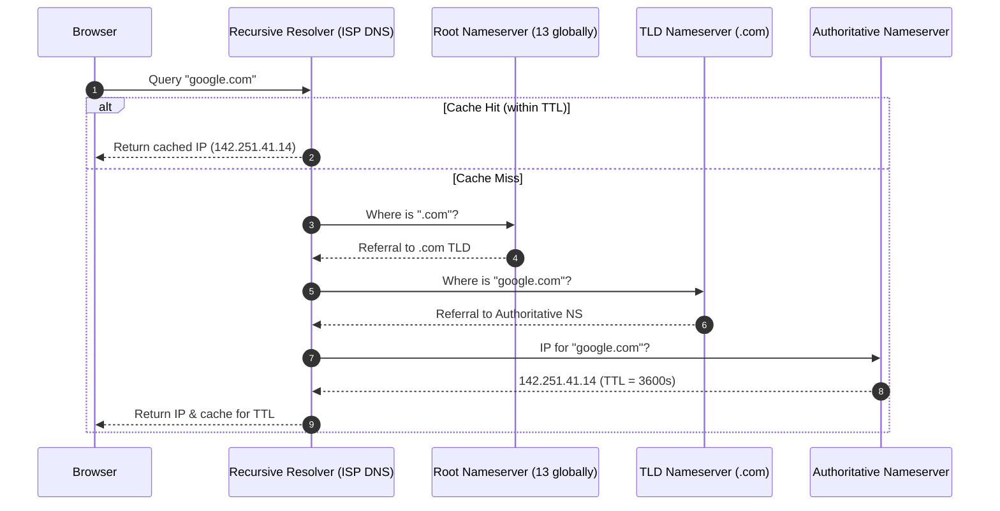

**TTL (Time To Live):**
- **Short TTL (300 sec):** Changes propagate quickly, but generates more DNS queries.
- **Long TTL (86400 sec):** Fewer DNS queries, but slow to propagate IP changes.

> [!TIP]
> Use `TTL=300` before and during planned migrations/failovers, and `TTL=3600` during normal steady-state operation.

### Content Delivery Network (CDN)

**What it is:** Geographically distributed edge servers that cache and serve static and dynamic content close to end users, cutting round-trip latency (e.g., from ~2000ms cross-continent to ~50ms at a local edge).

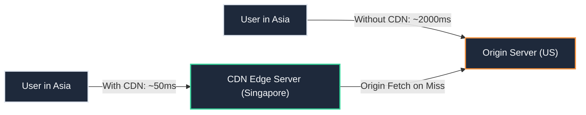

#### Push CDN vs Pull CDN

| Dimension | Push CDN | Pull CDN |
| :--- | :--- | :--- |
| **Mechanism** | You proactively upload files to all edge locations and keep them in sync | CDN fetches content from origin on first request and caches it for TTL |
| **Pros** | Guaranteed availability; zero origin load during traffic peaks | Zero operational overhead; automatic cache management; only popular content cached |
| **Cons** | Complex operations; manual updates; wastes storage on unaccessed files | First user pays cache-miss latency; origin load during traffic spikes |
| **Best For** | Static assets, software releases, large pre-known files | Dynamic content, user-generated content, majority of web apps |

### CDN Cache Invalidation

When a new version of a file is deployed, the CDN may still serve the stale cached version. Use one of these four strategies:

| Strategy | How It Works | Tradeoff |
| :--- | :--- | :--- |
| **1. URL Versioning (Recommended)** | `/api/logo.png` → `/api/logo-v2.png` or `/api/logo?v=2` | Different URL forces an immediate cache miss and fetches the new version |
| **2. Version in Path (Best Practice)** | Content-hashed bundles (`app.abc123.js`, `/v1/styles.css`) | Automatically busts cache on every deploy with long TTLs |
| **3. TTL-Based** | Set a low TTL (e.g., `300` seconds) on mutable files | Higher origin load; good for frequently changing files |
| **4. Explicit Invalidation** | Call CDN purge API to evict specific URLs | Slow propagation across global edges (minutes); use for emergency fixes only |

> [!IMPORTANT]
> Prefer **Pull CDN** with **content-hashed filenames** (`app.abc123.js`) and long TTLs. Reserve explicit CDN purges for emergency rollbacks.

---

## Load Balancing

### Load Balancer Types: Layer 4 vs Layer 7

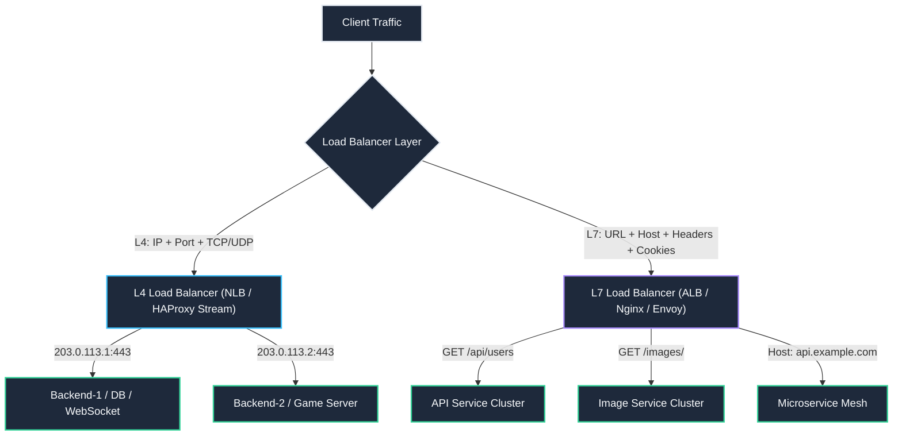

| Dimension | Layer 4 (Transport Layer) | Layer 7 (Application Layer) |
| :--- | :--- | :--- |
| **Routing Basis** | IP, Port, Protocol (TCP/UDP); no application awareness | HTTP data (URL, hostname, headers, cookies) |
| **Pros** | Very fast (minimal processing), handles millions of connections, lower latency, non-HTTP support | Intelligent routing, compression, caching, header/URL rewriting, sticky sessions |
| **Cons** | Cannot route by URL/hostname, limited balancing strategies, no caching/compression | More CPU intensive, lower throughput per instance, slightly higher latency |
| **When to Use** | Database connections, game servers, WebSockets | Web applications, microservices, REST/GraphQL APIs |
| **Technologies** | Nginx (`stream`), HAProxy, AWS NLB, Google Cloud LB | Nginx, HAProxy, AWS ALB, Envoy, NGINX Plus |

### Load Balancing Algorithms

| Algorithm | How It Works | Pros | Cons |
| :--- | :--- | :--- | :--- |
| **Round-Robin** | Distributes requests sequentially (`1→S1, 2→S2, 3→S3`) | Simple, fair | Ignores server capacity and current load |
| **Weighted Round-Robin** | High-capacity servers receive proportionally more requests (e.g., weight `3` gets 3x) | Handles heterogeneous clusters | Requires manual weight configuration |
| **Least Connections** | Routes to server with fewest active connections | Great for long-lived connections (WebSocket, chat) | Slightly higher tracking overhead |
| **IP Hash / Consistent Hash** | `Hash(IP) mod server_count` pins client IP to same server | Sticky sessions, cache-friendly | Uneven distribution when servers are added/removed |
| **Least Load / Response Time** | Routes based on server CPU, memory, and response latency | Most intelligent distribution | Requires active monitoring/telemetry |

### Load Balancer Placement & High Availability (HA)

A single Load Balancer is a **Single Point of Failure (SPOF)**. Production topologies use **Active-Passive** pairs sharing a **Virtual IP (VIP)** with a periodic heartbeat (e.g., every `100ms` via ICMP ping or HTTP health check) and split-brain prevention.

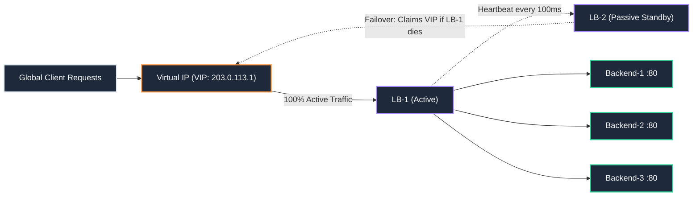

> [!IMPORTANT]
> Always prevent **split-brain** in Active-Passive LB pairs by using redundant heartbeat links or quorum fencing so only one LB ever advertises the Virtual IP at a time.

---

## Reverse Proxy vs Forward Proxy

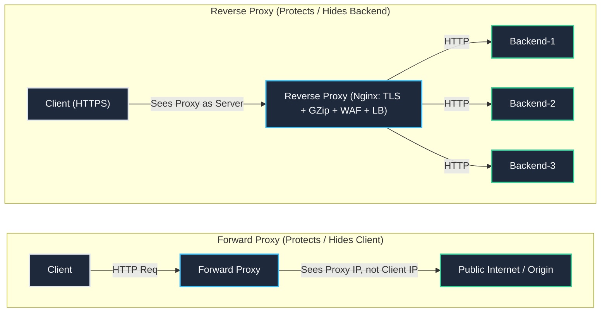

| Dimension | Forward Proxy | Reverse Proxy |
| :--- | :--- | :--- |
| **Placement** | Sits between client and the internet | Sits between the internet and backend servers |
| **Identity Hidden** | Origin sees proxy IP, not client IP | Client sees reverse proxy as the server; hides backend topology |
| **Core Use Cases** | Corporate traffic monitoring, hiding client IP, geo-IP spoofing, bypassing restrictions, network-level caching | Load balancing, response caching, SSL/TLS termination, GZip compression, rate limiting, auth, WAF |
| **Responsibilities** | Outbound filtering & anonymity | `O(1)` TLS termination, request/response logging, virtual host routing, connection pooling |

> [!TIP]
> Terminating **SSL/TLS** at the Reverse Proxy reduces asymmetric crypto handshakes from `O(n)` across all backends to `O(1)` at the edge, while GZip/Brotli compression can achieve ~`10:1` bandwidth savings on JSON payloads.

---

## Caching

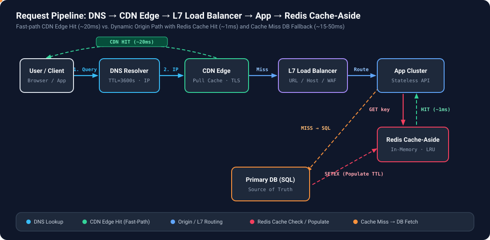

### Cache Tiers (Latency vs Capacity)

| Tier | Location | Typical Latency | Capacity | Examples |
| :--- | :--- | :--- | :--- | :--- |
| **L1 Cache** | CPU L1/L2/L3 | `1–100 ns` | `KB–MB` | Hardware CPU cache (transparent to software) |
| **L2 Cache** | In-Process Memory | `~100 µs` | `MB–GB` | Local `HashMap`, Caffeine, single-node Redis |
| **L3 Cache** | Distributed Cache | `1–10 ms` | `GB–TB` | Redis Cluster, Memcached |
| **L4 Cache** | CDN Edge | `10–50 ms` | `TB–PB` | Cloudflare, Akamai, CloudFront |
| **L5 Cache** | Database Query Cache | `~100 ms` | Variable | Query result caching |
| **Storage** | Source of Truth (DB) | `10–100 ms` | Unlimited | PostgreSQL, MySQL, DynamoDB (ACID/BASE) |

### Cache Strategies

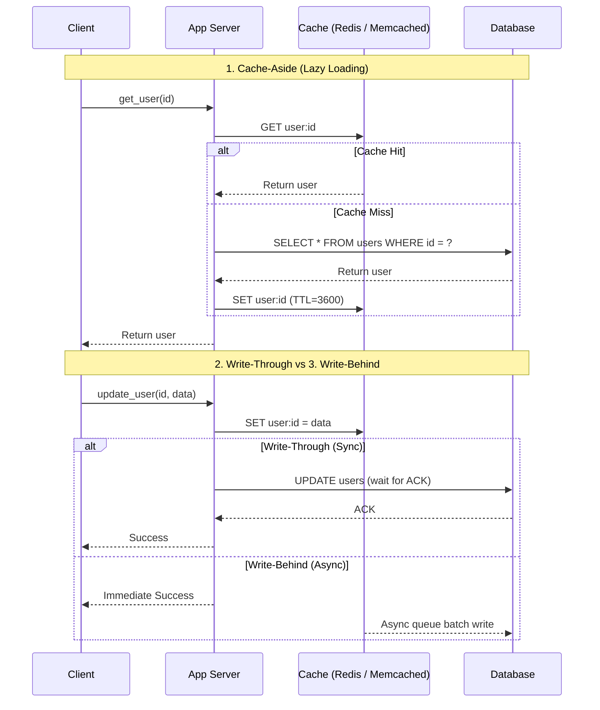

| Strategy | Read / Write Flow | Pros | Cons | Best For |
| :--- | :--- | :--- | :--- | :--- |
| **Cache-Aside (Lazy Loading)** | App checks cache; on miss, reads DB and populates cache | Simple; only caches accessed data; DB is source of truth | Miss penalty (extra DB hop); complex invalidation; thundering herd risk | Read-heavy, infrequently changing data |
| **Read-Through** | Cache provider itself fetches from DB on miss and auto-caches | Clean client code; cache handles all fetch logic | Requires specialized cache library; tight coupling to data source | Standardized data-access layers |
| **Write-Through** | App writes to cache and synchronously writes to DB | Data always consistent; tolerates cache failure | Higher write latency; every write hits DB | Financial transactions, critical data |
| **Write-Behind (Write-Back)** | App writes to cache (returns immediately); async worker batches writes to DB | Very fast writes; batches DB writes; reduces DB load | Data loss risk if cache crashes; eventual consistency; ordering bugs | Non-critical data, analytics, recommendations |
| **Write-Around** | App writes directly to DB (and deletes/invalidates cache); populated on next read | Prevents cache pollution from write-once data | Next read is a cache miss; temporary inconsistency | High write-to-read ratio workloads (logs) |

#### Strategy Code Patterns

```python
# 1. Cache-Aside (Lazy Loading)
def get_user(user_id):
    cache_key = f"user:{user_id}"
    user = cache.get(cache_key)
    if user is None:  # Cache miss
        user = db.get_user(user_id)
        cache.set(cache_key, user, ttl=3600)
    return user

# 2. Write-Through (Synchronous)
def update_user_write_through(user_id, data):
    cache.set(f"user:{user_id}", data)
    db.update_user(user_id, data)
    return "success"

# 3. Write-Behind (Asynchronous Queue)
def update_user_write_behind(user_id, data):
    cache.set(f"user:{user_id}", data)
    queue.enqueue(("update_user", user_id, data))
    return "success"  # Immediate return

def process_queue():
    while True:
        op, user_id, data = queue.dequeue()
        db.update_user(user_id, data)

# 4. Write-Around (Skip cache on write, invalidate stale entry)
def update_user_write_around(user_id, data):
    db.update_user(user_id, data)
    cache.delete(f"user:{user_id}")
    return "success"
```

### Cache Eviction Policies

| Policy | Eviction Rule | Implementation | Pros | Cons | Best For |
| :--- | :--- | :--- | :--- | :--- | :--- |
| **LRU** (Least Recently Used) | Evicts item accessed longest ago | Doubly Linked List + HashMap (`O(1)`) | Intuitive; exploits spatial/temporal locality | Ignores item size/frequency; sequential scans pollute cache (`1,2,3,4,1,2,3,4...`) | General-purpose caching (Memcached, Redis default) |
| **LFU** (Least Frequently Used) | Evicts item accessed least often | Frequency counter + Min-heap | Keeps truly popular items | Complex; historical frequency biases old items; no recency factor | Long-term caching, analytics |
| **TTL** (Time To Live) | Evicts item after fixed duration | Expiry timestamp + lazy/active deletion | Simple; bounds staleness | Ignores access patterns; may evict hot items | Session data, temporary API caches |

> [!TIP]
> **Redis vs Memcached:** Choose **Memcached** for simple, multi-threaded, pure key-value string caching with minimal overhead. Choose **Redis** when you need rich data structures (Sorted Sets for leaderboards, Hashes, Lists), persistence (RDB/AOF), pub/sub, or Lua scripting.

### Cache Problems and Solutions

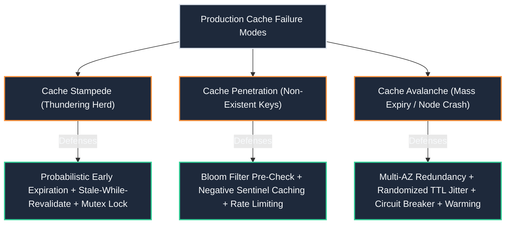

> [!WARNING]
> **Cache Stampede & Avalanche** can cascade into a full database outage. Never assign identical flat TTLs to bulk-loaded keys—always add randomized jitter (`BASE_TTL + random(0, BASE_TTL // 10)`).

#### Problem 1: Cache Stampede (Thundering Herd)
A popular key expires and thousands of concurrent requests miss simultaneously, hammering the DB at once.
- **Probabilistic Early Expiration (Recommended):** Refresh asynchronously when ~80% of TTL has elapsed.
- **Mutex / Lock:** Only the first miss acquires a lock to query the DB; others wait and read the populated cache.
- **Stale-While-Revalidate:** Serve stale data immediately while refreshing in the background. *(Best practice: combine Probabilistic Early Expiration + Stale-While-Revalidate).*

```python
# Probabilistic early expiration + Stale-while-revalidate
def get_with_early_refresh(key):
    value, exp_time, is_stale = cache.get_with_meta(key)
    if is_stale or should_refresh_early(exp_time):  # e.g., >80% TTL passed
        background_task(refresh_cache, key)
    return value

# Mutex lock fallback
def get_with_lock(key):
    value = cache.get(key)
    if value is None:
        if acquire_lock(key):
            value = db.get(key)
            cache.set(key, value)
            release_lock(key)
        else:
            wait_for_lock(key)
            value = cache.get(key)
    return value
```

#### Problem 2: Cache Penetration
Requests for non-existent IDs (e.g., `user_id = 999999999999`, or DoS attacks with random IDs) miss both cache and DB repeatedly because nothing is cached.
- **Cache Negative Results (Recommended):** Store a short-TTL `"NOT_FOUND"` sentinel.
- **Bloom Filters:** Space-efficient probabilistic structure returning *"definitely not in DB"* or *"might exist"* before touching cache/DB.
- **Rate Limiting:** Throttle IPs requesting missing resources.

```python
bloom_filter = BloomFilter(capacity=1_000_000, false_positive_rate=0.01)

def get_user_safe(user_id):
    if user_id not in bloom_filter:
        return None  # Definitely not in database

    cached = cache.get(f"user:{user_id}")
    if cached == "NOT_FOUND":
        return None
    if cached is not None:
        return cached

    user = db.get_user(user_id)
    if user is None:
        cache.set(f"user:{user_id}", "NOT_FOUND", ttl=300)
        return None
    cache.set(f"user:{user_id}", user, ttl=3600)
    return user
```

#### Problem 3: Cache Avalanche
Multiple cache nodes fail simultaneously or a massive batch of keys expires together, overloading surviving cache nodes (`10x` spike) and crashing the DB (`100x` spike).
- **Multi-AZ Redundancy:** Master-replica / cluster across availability zones with health monitoring.
- **Randomized Expiration (Jitter):** `ttl = BASE_TTL + random(0, BASE_TTL // 10)`.
- **Circuit Breaker:** Stop querying an overloaded DB and return degraded/stale responses until recovery.
- **Gradual Cache Warming:** Preload top `10,000` hot keys on startup before serving traffic.

```python
def get_with_circuit_breaker(key):
    value = cache.get(key)
    if value is None:
        if circuit_breaker.is_open():
            return error_response("Service temporarily unavailable")
        try:
            value = db.get(key)
        except SlowDatabaseError:
            circuit_breaker.open()
            return error_response("Service temporarily unavailable")
    return value

def warm_cache():
    for key, value in db.get_top_10000_items():
        ttl = 3600 + random(0, 360)
        cache.set(f"item:{key}", value, ttl=ttl)
```

---

## Databases

### Choosing the Right Database

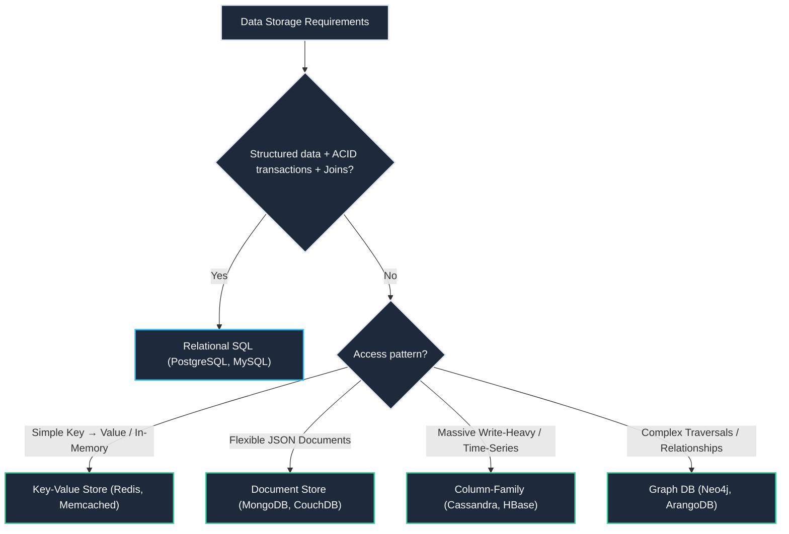

### Database Comparison Table

| Type | Examples | Consistency | Scalability | Query Power | Best Use Cases |
| :--- | :--- | :--- | :--- | :--- | :--- |
| **Relational (SQL)** | PostgreSQL, MySQL, Oracle, SQL Server | Strong (ACID) | Vertical (+ Read Replicas, Sharding) | Very Powerful (SQL, Joins) | Banking, inventory, structured business entities |
| **Document (NoSQL)** | MongoDB, CouchDB | Eventual | Horizontal (built-in sharding) | Moderate (Document queries) | User profiles, catalogs, semi-structured web apps |
| **Key-Value (NoSQL)** | Redis, Memcached | Eventual | Horizontal (key sharding) | Simple (`get`/`set`/`incr`) | Caching, sessions, rate limiting, leaderboards |
| **Column-Family (NoSQL)** | Cassandra, HBase | Eventual | Horizontal (massive scale) | Analytic / Row-key range | Time-series, metrics, logs, `100TB+` write-heavy |
| **Graph (NoSQL)** | Neo4j, ArangoDB | Varies (ACID on some) | Moderate | Graph traversals (Cypher) | Social networks, recommendations, knowledge graphs, ACLs |

### Deep-Dive Notes & Examples

- **Relational (SQL):** Rigid schema, strong ACID guarantees. Scale via vertical scaling, read replicas, caching, or sharding.
  > [!IMPORTANT]
  > Avoid sharding SQL databases until vertical scaling, read replicas, and caching are exhausted—sharding breaks cross-shard `JOIN`s and distributed transactions.
- **Document Stores:** Store flexible JSON/BSON documents (e.g., nested `address`, `emails` arrays, optional fields like `phone` per document) sharded by `user_id`. Avoid when cross-shard ACID or heavy joins are required.
- **Key-Value Stores:** In-memory `O(1)` operations:
  ```python
  redis.set("user:1001:name", "Alice")
  redis.incr("page_views:home")
  redis.zadd("leaderboard", {"alice": 1000, "bob": 900})
  ```
- **Column-Family Stores:** Sparse `Row Key → Column` layout with high columnar compression; optimized for write throughput (`millions/sec`), not low-latency ad-hoc queries:
  ```sql
  -- Efficient: SELECT profile:name WHERE row_key LIKE 'user:*'
  ```
- **Graph Databases:** Store vertices and edges natively for multi-hop traversals:
  ```cypher
  MATCH (alice:User {name:"Alice"})-[:FRIEND]->(friend)-[:FRIEND]->(fof),
        (fof)-[:LIKES]->(movie:Movie {genre:"sci-fi"})
  RETURN fof, movie
  ```

---

## Consistent Hashing

### The Problem with Modulo Hashing (`hash(key) % N`)

With simple modulo hashing across `N = 3` servers (`S1, S2, S3`), adding `S4` changes the modulus to `4`, causing **nearly all keys to rehash** to different servers—triggering a massive cache invalidation storm and database overload.

### The Consistent Hashing Ring & Virtual Nodes

Arrange servers and keys on a circular hash ring (`0` to `2^32 - 1`). To locate a key's server, hash the key and walk **clockwise** until hitting the first server. When `S4` is added, only keys between `S3` and `S4` (`~N/4`) move.

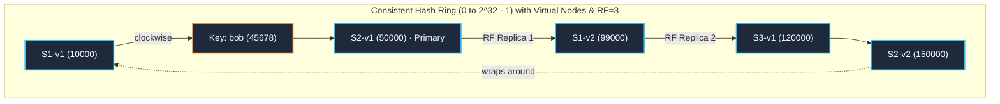

| Feature | Simple Modulo (`hash(k) % N`) | Basic Consistent Hashing | Consistent Hashing + Virtual Nodes |
| :--- | :--- | :--- | :--- |
| **Keys Moved on Resize** | `~100%` (`(N-1)/N`) | `~1/N` | `~1/N` with smooth rebalancing |
| **Load Distribution** | Uniform (static `N`) | Skewed when `N` is small | `<5%` deviation (`150–300` vnodes/server) |
| **Fault Tolerance** | Poor (rehash storm) | Next clockwise server absorbs entire load | Failed server's load spreads evenly across all survivors |

#### Virtual Nodes & Replication Factor (`RF = 3`)

```python
for i in range(num_virtual_nodes):  # Typically 150-300 per physical server
    virtual_key = f"{server_id}:v{i}"
    ring.add(hash(virtual_key), server_id)
```

- **Replication (`RF = 3`):** Store each key on its primary clockwise node plus the next 2 distinct physical nodes on the ring. Tolerates 2 server failures; **quorum reads/writes (`2/3` ACKs)** provide strong consistency.

> [!WARNING]
> Without **virtual nodes**, a small cluster (e.g., 3–5 servers) suffers severe hot-spotting and cascading overload when a single node fails.

---

## Message Queues

### Asynchronous Decoupling Architecture

Producers publish events and return immediately while consumer groups process slow tasks (charging cards, sending emails) asynchronously.

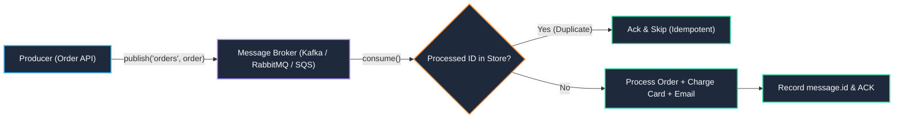

### Kafka vs RabbitMQ vs AWS SQS

| Feature | Apache Kafka | RabbitMQ | AWS SQS |
| :--- | :--- | :--- | :--- |
| **Throughput** | Millions/sec | Thousands/sec | Millions/sec |
| **Latency** | Low (ms) | Medium (ms) | Medium (ms) |
| **Durability** | Very High (replicated commit log) | High | High (managed) |
| **Ordering** | Strong (per partition) | Per queue | FIFO queues only |
| **Replayability** | Yes (retained event log) | No (deleted after ACK) | No |
| **Operations** | Complex | Medium | Simple (fully managed) |
| **When to Use** | Event sourcing, stream processing, replay | Complex routing rules, classic pub/sub | AWS-native apps without cluster ops |

### Delivery Guarantees

| Guarantee | Behavior | Tradeoff / Requirement |
| :--- | :--- | :--- |
| **At-Least-Once** | Retries until ACKed; duplicates possible on crash | Most common; requires **idempotent** consumers |
| **At-Most-Once** | Fire-and-forget (`0` or `1` delivery) | Fast, no retries; messages lost on crash (metrics/logs) |
| **Exactly-Once** | Effectively processed once | Achieved in practice via **idempotency + unique message ID deduplication** |

```python
def consume_and_process(message):
    if message.id in processed_messages:
        return  # Already processed, skip
    process(message)
    processed_messages.add(message.id)
    acknowledge(message)
```

> [!IMPORTANT]
> True network-level exactly-once delivery is theoretically impossible (Two Generals' Problem). Implement **At-Least-Once delivery + Idempotent Consumers** backed by a deduplication store.

---

## Blob Storage

**What it is:** Highly durable (`99.999999999%` / eleven 9s) HTTP-accessible storage for large unstructured files (photos, videos, backups) organized into buckets (e.g., **AWS S3**, **Azure Blob Storage**, **Google Cloud Storage**).


| Core API Operation | Purpose | Best Practice |
| :--- | :--- | :--- |
| `PUT object` | Upload file to bucket | Use pre-signed URLs so clients upload directly to S3, bypassing app servers |
| `GET object` | Download file | Serve through a **CDN** (CloudFront) for geo-proximity, compression (`gzip`/`brotli`), and lower S3 egress cost |
| `DELETE object` | Remove file | Pair with lifecycle policies for cold/archive tiers |
| `LIST objects` | Enumerate bucket keys | Paginate and store searchable metadata in a DB rather than listing S3 in hot paths |

> [!TIP]
> Never serve hot blobs directly from an origin bucket—front your Blob Storage with a **CDN** to cut cross-region latency and reduce origin egress fees.

---

## Search Engines

### Inverted Index & Distributed Scatter-Gather

Traditional forward indexes scan every document (`Doc → [words]`). Search engines like **Elasticsearch** build an **Inverted Index** (`word → [Doc1, Doc2, ...]`) per mapped field for `O(1)` term lookup and fast boolean (`AND`/`OR`/`NOT`) and phrase queries.

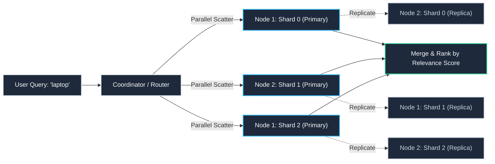

| Index Type | Structure | Query `"lazy dog"` |
| :--- | :--- | :--- |
| **Forward Index** | `Doc1 → ["the", "quick", ...]` | Must scan every document (`O(N)`) |
| **Inverted Index** | `"lazy" → [Doc1, Doc2]`, `"dog" → [Doc1, Doc2]` | `O(1)` lookup per term + list intersection → `[Doc1, Doc2]` |

> [!IMPORTANT]
> **Capacity Planning:** An Elasticsearch index with `5` primary shards and `1` replica per shard requires `5 × (1 + 1) = 10` total shards (`2×` storage footprint).

---

## API Design

### REST vs gRPC vs GraphQL

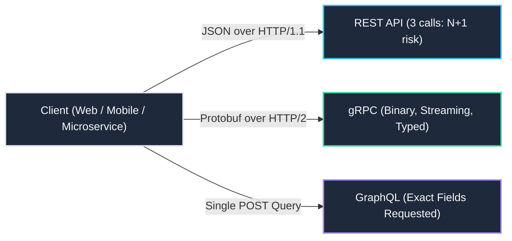

| Feature | REST (HTTP) | gRPC (Protobuf over HTTP/2) | GraphQL |
| :--- | :--- | :--- | :--- |
| **Simplicity** | High | Low (requires `.proto` schema) | Medium |
| **Performance** | Medium (JSON text) | High (binary, multiplexed streams) | Medium |
| **HTTP Caching** | Easy (built-in) | Hard | Hard (POST queries) |
| **Type Safety** | None (unless OpenAPI) | Strong | Strong |
| **Over/Under-Fetching** | Common (`N+1` requests) | Controlled by RPC contract | Eliminated (client specifies fields) |
| **Best For** | Public APIs, standard web apps | Internal microservice-to-microservice & streaming | Diverse clients (mobile + web) with nested data |

> [!TIP]
> Use **gRPC** for low-latency internal service-to-service communication, **REST** for cacheable public APIs, and **GraphQL** when mobile/web clients need flexible aggregations without `N+1` round trips.

---

## Rate Limiting

### Rate Limiting Algorithms

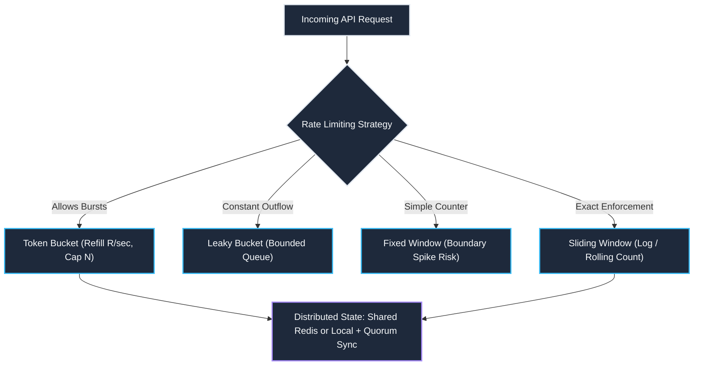

| Algorithm | Mechanism | Pros | Cons |
| :--- | :--- | :--- | :--- |
| **Token Bucket** | Bucket holds `N` tokens, refills at `R/sec`; request consumes tokens | Allows controlled bursts; smooth average rate; simple | Needs shared state in distributed clusters |
| **Leaky Bucket** | Requests enter bounded queue and leak out at constant rate | Smooth, constant output rate; no bursts | Higher latency (queued requests); poor for bursty spikes |
| **Fixed Window** | Counts requests in fixed intervals (e.g., `00:00–00:59`) | Very simple; low memory | **Boundary exploit:** `100` reqs at `00:59` + `100` at `01:00` = `200` in 2s |
| **Sliding Window** | Counts requests in `(now - window_size, now]` | No boundary exploits; accurate enforcement | Higher memory (timestamps) and CPU |

```python
# Token Bucket
def allow_request_token_bucket(needed_tokens=1):
    global tokens, last_refill_time
    now_ts = now()
    tokens = min(bucket_size, tokens + (now_ts - last_refill_time) * refill_rate)
    last_refill_time = now_ts
    if tokens >= needed_tokens:
        tokens -= needed_tokens
        return True
    return False
```

### Distributed Rate Limiting

| Approach | How It Works | Pros | Cons |
| :--- | :--- | :--- | :--- |
| **Per-Server Local** | Each server enforces `100 req/min` locally | Zero network hop | User can hit `3` servers for `300 req/min` total |
| **Shared Redis (Standard)** | All API servers check atomic Redis counters/Lua scripts | Accurate global limit per user/IP | Redis can become a latency bottleneck / SPOF (mitigate with Redis Cluster) |
| **Distributed Quorum** | Local limiters sync every `100ms`; allow if `>= 2/3` quorum agrees | No SPOF; low local latency | Complex; requires clock sync; slight quota overages |

> [!WARNING]
> Avoid **Fixed Window** counters for strict security or billing limits—attackers can double the allowed burst across minute boundaries. Use **Token Bucket** or **Sliding Window** backed by **Redis**.

---

## Key Takeaways

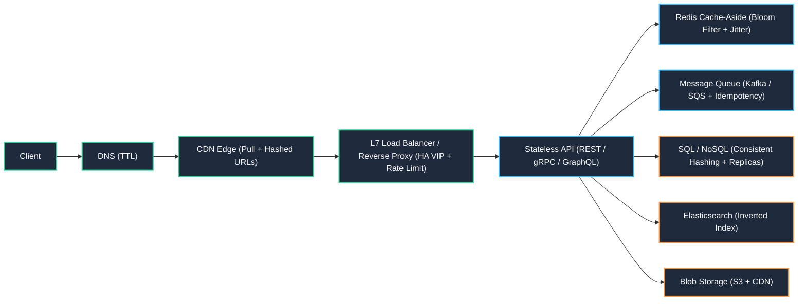

- **Caching is critical:** Combine CDN edge caching, in-memory Redis/Memcached (`Cache-Aside`), Bloom Filters, and randomized TTL jitter.
- **Pick the right database:** Use SQL for ACID + joins; Document/Column/KV/Graph NoSQL when scale, schema flexibility, or access patterns demand it.
- **Consistent hashing + virtual nodes:** Enables horizontal scaling with minimal key movement (`~1/N`) and `<5%` load skew.
- **Message queues decouple slow work:** Pair At-Least-Once delivery with idempotent consumers.
- **Protect the edge:** Combine HA Load Balancers, Reverse Proxy TLS termination, and Redis-backed Rate Limiting.

> [!TIP]
> In system design interviews, trace a request end-to-end (**DNS → CDN → L7 LB → App → Cache → DB / Queue**) and explicitly call out **failure modes** (SPOFs, cache stampede, hot partitions, duplicate messages) alongside their mitigations.
