# Scalability and Reliability

## Table of Contents
1. [Scaling Strategies](#scaling-strategies)
2. [Stateless vs Stateful Services](#stateless-vs-stateful-services)
3. [Database Replication](#database-replication)
4. [Database Partitioning (Sharding)](#database-partitioning-sharding)
5. [Fault Tolerance and Failover](#fault-tolerance-and-failover)
6. [Recovery and Durability](#recovery-and-durability)
7. [Distributed Consensus](#distributed-consensus)
8. [Backpressure and Load Shedding](#backpressure-and-load-shedding)
9. [Key Takeaways](#key-takeaways)

---

## Scaling Strategies

Scaling increases a system's capacity to handle growing traffic, data volume, and compute demands while maintaining target latency and availability.

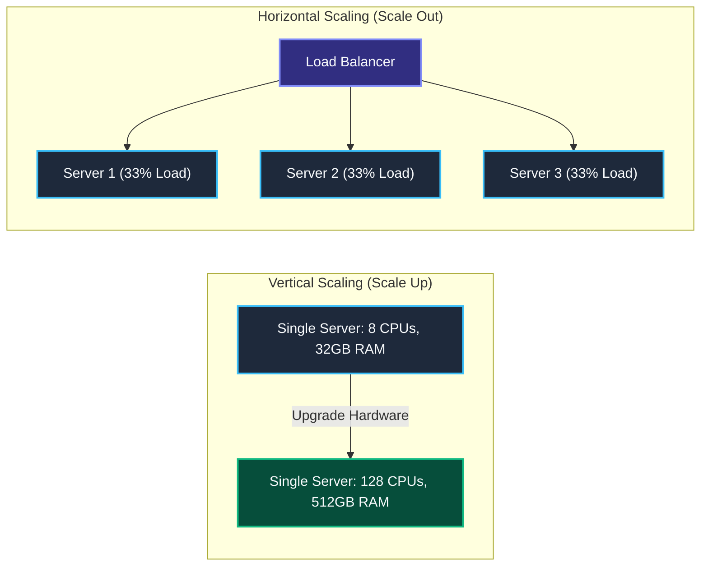

### Vertical Scaling (Scale Up)
Adding more CPU, memory, or disk to a single machine (e.g., upgrading from `8 CPUs, 32GB RAM, 1TB disk` to `128 CPUs, 512GB RAM, 50TB disk`).

- **Pros:** Simple (no distributed logic), no sharding complexity, transactions remain ACID, and well-suited for stateful services.
- **Cons:** Hard hardware limits (max ~1000s of CPUs per machine), downtime during upgrades, high cost (`$100k+` for massive servers), single point of failure (SPOF), and diminishing returns.
- **When to use:** Early-stage products, stateful services (databases, caches), and until hitting hardware limits (typically scale vertically up to ~50K QPS, then horizontally).

### Horizontal Scaling (Scale Out)
Adding more commodity servers/machines behind a Load Balancer so each node handles a fraction of total traffic.

- **Pros:** Virtually unlimited scaling, zero-downtime capacity additions, built-in redundancy (if one server fails, others continue), and cost-effective commodity hardware.
- **Cons:** Higher complexity (load balancing, sharding, consensus), eventual consistency across replicas, network overhead for distributed calls, and harder debugging.
- **When to use:** High-traffic systems (100K–millions of QPS), high-availability workloads requiring redundancy, stateless web/API tiers, and most modern cloud architectures.

> [!TIP]
> Start with vertical scaling to ship fast and avoid premature distributed-systems complexity, then transition to horizontal scaling before hitting single-machine hardware or SPOF limits.

### Traffic Scale Progression

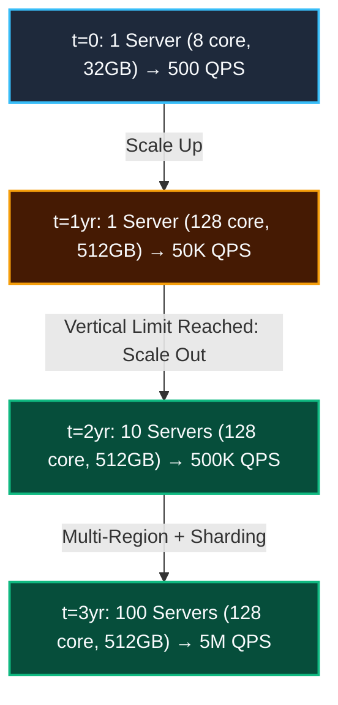

| Traffic Scale | Recommended Approach | Primary Characteristics |
| :--- | :--- | :--- |
| **1–10K QPS** | Vertical scaling | Single node, simple ACID transactions, minimal ops overhead |
| **10–100K QPS** | Hybrid (Vertical + Horizontal) | Scale app tier horizontally; scale DB vertically + read replicas |
| **100K+ QPS** | Horizontal scaling | Stateless app clusters, DB sharding, distributed caching |
| **1M+ QPS** | Horizontal + Advanced | Multi-region active-active, edge CDN, consistent hashing, async queues |

> [!IMPORTANT]
> Scaling the application tier horizontally is straightforward only if services are **stateless**; otherwise, local state traps requests on specific nodes and breaks elastic scaling.

---

## Stateless vs Stateful Services

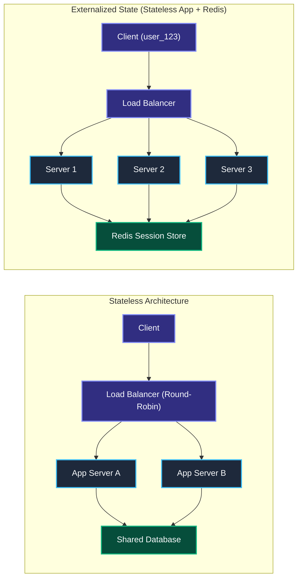

### Stateless Services
A service is stateless when it stores **no local client session data** between requests. Each request is independent (e.g., `POST /users` followed by `GET /users/1` can hit any server).

- **Properties:** Symmetric servers, simple load balancing (round-robin), trivial horizontal scaling (add/remove nodes anytime).
- **Best for:** Web API servers, microservices, and frontend-facing tiers.

> [!TIP]
> Keep compute tiers stateless and push state down into purpose-built data stores (PostgreSQL, Redis, S3) that natively handle replication and durability.

### Stateful Services
A service is stateful when it stores **client data locally** between requests (e.g., `Server A` holds `{user_123: {cart: [item1, item2]}}` in memory).

- **Sticky Sessions:** The load balancer must route `user_123` back to `Server A` using IP hashing or cookies.
- **Scaling Problem:** Adding `Server C` leaves existing sessions on `Server A` and `Server B`, causing uneven distribution. If `Server A` crashes, all its active sessions are lost.
- **Solutions:**
  1. **Replication:** Replicate session state across multiple servers so a replica survives primary failure.
  2. **External Session Store (Redis):** Move session state out of application servers into a shared store like Redis, effectively converting the app tier into a stateless service.

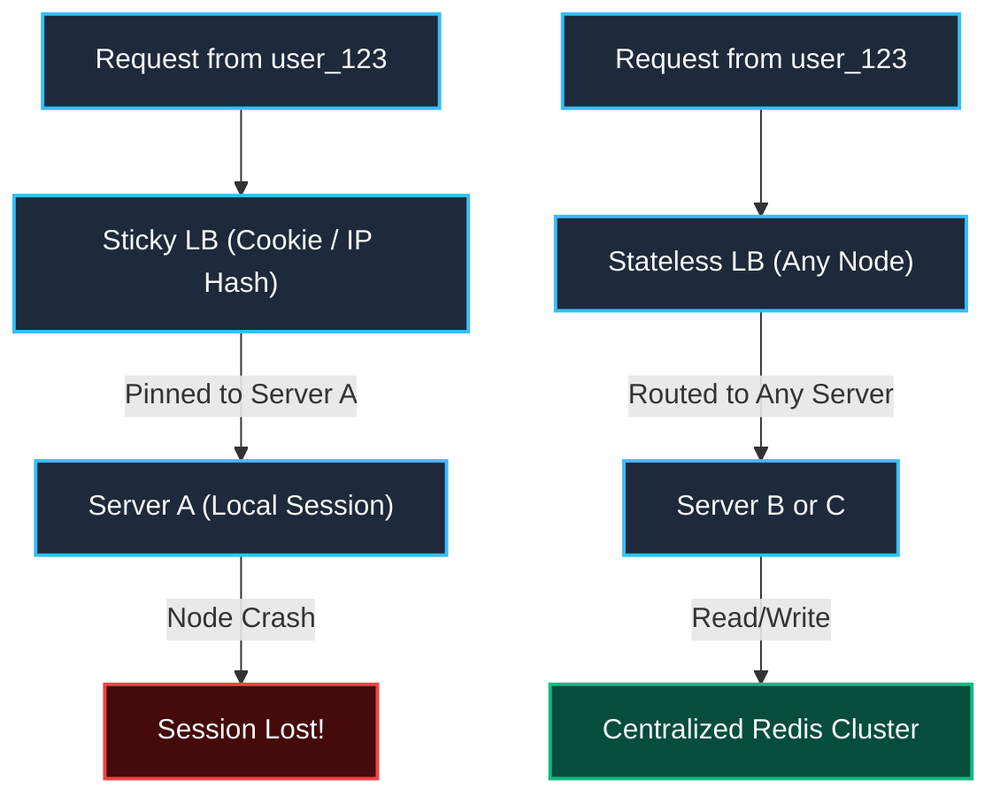

| Dimension | Stateless Service | Stateful Service (Local) | Externalized State (App + Redis) |
| :--- | :--- | :--- | :--- |
| **Routing** | Any node (Round-Robin) | Sticky sessions (IP/Cookie hash) | Any node (Round-Robin) |
| **Node Failure** | Zero session loss | Active local sessions lost | Zero session loss (if Redis replicated) |
| **Auto-Scaling** | Instant, symmetric | Uneven load on new nodes | Instant, symmetric |
| **Best Use Case** | REST/gRPC APIs, workers | Databases, caches, brokers | Authenticated web apps |

> [!WARNING]
> Relying on sticky sessions for application servers creates hotspots and causes user session loss during deployments or node crashes. Always externalize ephemeral session state to Redis or JWTs.

---

## Database Replication

Database replication maintains copies of data across multiple nodes to improve read scalability, fault tolerance, and geographic locality.

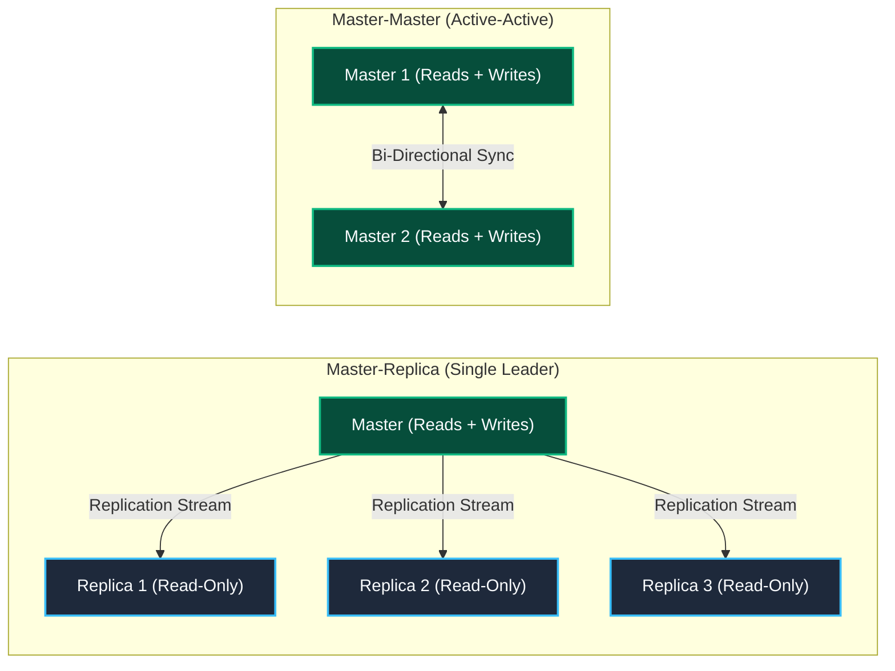

### Master-Slave (Master-Replica)
- **Write Flow:** Client writes to Master → Master updates local disk → Master streams updates to Replicas → Replicas apply updates.
- **Read Flow:** Clients read from Replicas (faster, horizontally scaled) or from Master (always latest).
- **Replication Lag:** If Master executes `INSERT user WHERE id=1001` at `t=0ms`, Replica 1 may apply at `t=6ms` while Replica 2 applies at `t=10ms`. A read on Replica 2 at `t=7ms` returns stale data.
- **Pros:** Simple single source of truth, strong write consistency on Master, high read scalability, replica failure has minimal impact.
- **Cons:** Master is a write bottleneck and SPOF requiring failover, replicas see stale data, and cascading replication (`Master → Replica → Replica`) increases lag.
- **Failover & Data Loss:** When Master dies (missed heartbeats), a Replica is promoted and clients redirect. If Master died before replicating a committed write, that write is lost unless quorum ACKs are required.

> [!IMPORTANT]
> Semi-synchronous replication balances durability and latency: waiting for at least **one** replica ACK guarantees the write survives a single-node crash without blocking on every distant replica.

### Master-Master (Active-Active)
Both nodes accept reads and writes and replicate bi-directionally.

- **Pros:** Higher write availability, no single point of failure, and geographic distribution (local writes per region).
- **Cons:** Conflict resolution complexity when both masters update the same key, higher write latency if synchronized, and **split-brain** risk during network partitions (e.g., Master-1 writes `A=1` while Master-2 writes `A=2`).
- **Conflict Resolution Strategies:**
  1. **Last-Write-Wins (LWW):** Attach timestamps; higher timestamp wins (e.g., `t=100` overwrites `t=95`). Risky if system clocks drift.
  2. **Application-Level Merge:** Store both conflicting versions and let application logic merge fields.
  3. **Quorum-Based:** Require a majority of masters to ACK writes; minority partition cannot accept writes, preventing split-brain.

### Synchronous vs Asynchronous vs Semi-Synchronous Replication

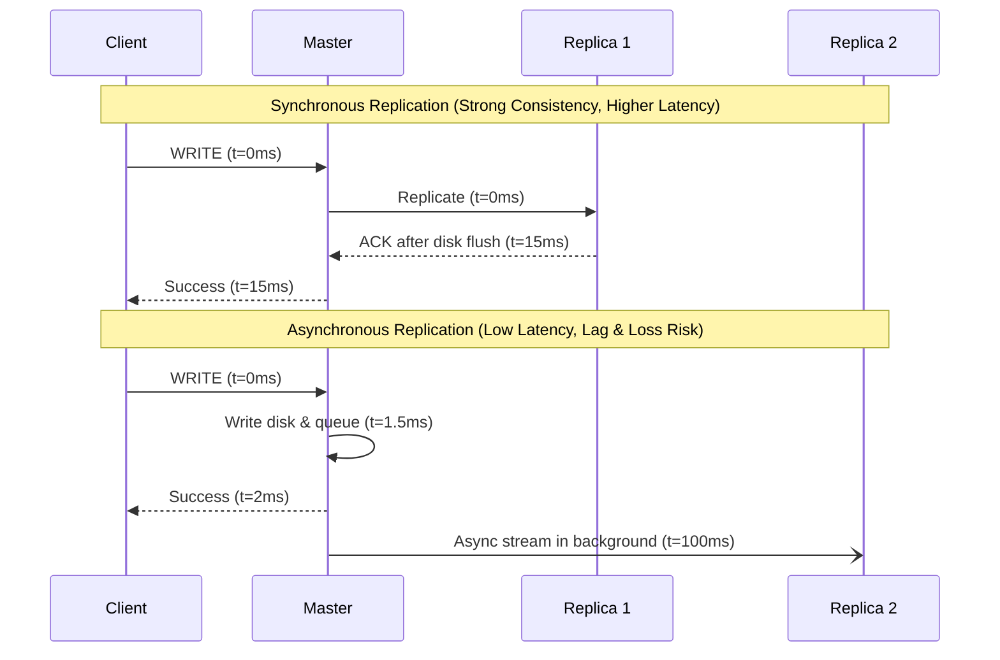

| Replication Mode | Write Latency | Data Loss Risk | Consistency | Best Used For |
| :--- | :--- | :--- | :--- | :--- |
| **Synchronous** | High (waits for replica disk + network ACK) | Zero (replica always has latest) | Strong | Banking, financial ledgers, critical state |
| **Asynchronous** | Very low (ACKs after local Master write) | High if Master crashes before streaming | Eventual (replication lag) | Social feeds, logs, analytics, most web apps |
| **Semi-Synchronous** | Moderate (waits for 1 replica ACK, others async) | Low (tolerates 1 node loss) | Tunable | Production MySQL/PostgreSQL HA clusters |

> [!WARNING]
> In Master-Master replication without quorum enforcement, a network partition creates a **split-brain** state where both masters accept conflicting writes (`A=1` vs `A=2`), causing silent data corruption upon recovery.

---

## Database Partitioning (Sharding)

Sharding distributes a large dataset (e.g., `100M users`) across multiple independent databases (**shards**), where each shard stores a subset of records (e.g., `10M users` per shard across 10 shards).

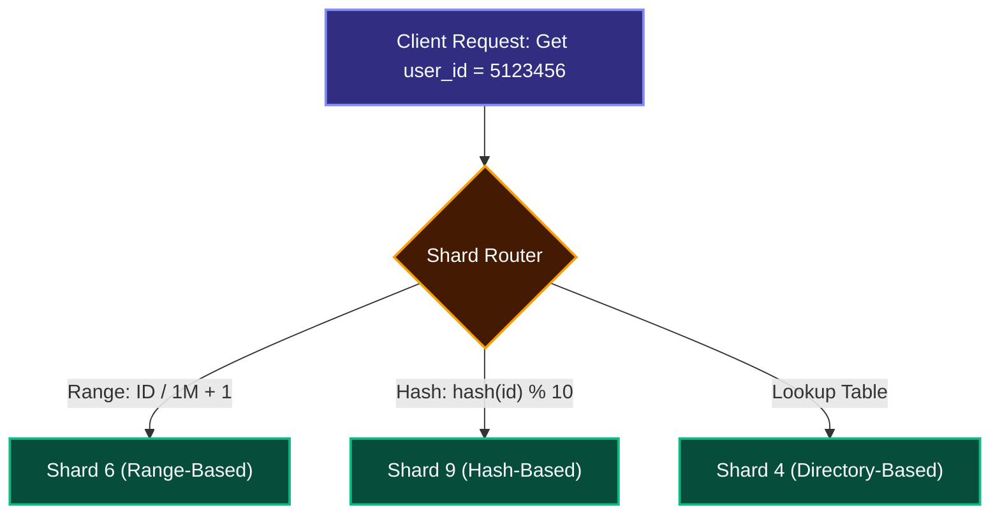

- **Benefits:** Linear capacity scaling (`10 shards = 10x capacity`), parallel query execution, and smaller per-shard indexes for faster lookups.
- **Challenges:** Shard key selection, cross-shard queries/joins, complex rebalancing when adding shards, hotspots, and single-shard transaction boundaries.

### Sharding Strategies

| Strategy | Routing Logic | Pros | Cons |
| :--- | :--- | :--- | :--- |
| **Range-Based** | Partition by value ranges (e.g., `1–1M → Shard 1`) | Simple, efficient range scans | Hotspots on newest/active ranges; uneven distribution |
| **Hash-Based** | `shard = hash(key) % num_shards` | Uniform distribution, avoids hotspots | Rebalancing nightmare (`% 10` vs `% 11` moves ~90% of keys) |
| **Consistent Hashing** | Hash ring with virtual nodes | Minimal key movement (`1/N`) on scale-out | Slightly more complex routing metadata |
| **Directory-Based** | Lookup table (`key range → shard`) | Flexible custom distributions, easy partial rebalancing (e.g., move 25%) | Extra lookup hop, directory can become a bottleneck/SPOF |

> [!WARNING]
> Modulo hashing (`hash(key) % N`) causes a massive data migration storm whenever `N` changes (e.g., `hash("alice") % 10 = 3` shifts to `% 11 = 2`). Always use **consistent hashing** or **directory-based** partitioning for elastic clusters.

### Handling Cross-Shard Operations & Hotspots

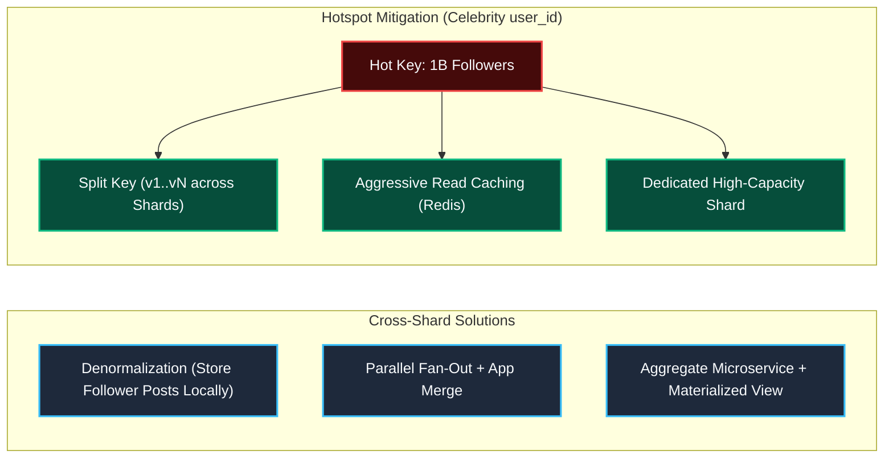

1. **Cross-Shard Operations** (e.g., *"Get all posts from users I follow"*):
   - **Denormalization:** Pre-store follower posts with the user (single-shard read, higher write/storage cost).
   - **Fan-Out Query:** Query all shards in parallel and merge in the application tier.
   - **Aggregate Microservice:** Dedicated service maintaining an eventually consistent materialized view.
   - **Schema Design:** Design shard keys to co-locate related entities and avoid cross-shard joins.
2. **Hotspot Problem** (e.g., celebrity `user_id = 1000000001` with `1B` followers overloading `Shard 1`):
   - **Split Hot Key:** Replicate `user:1000000001:v1` to Shard 1 and `:v2` to Shard 2; reads pick randomly, writes update all versions.
   - **Aggressive Caching:** Serve celebrity reads from Redis/CDN so the shard only handles cache misses.
   - **Dedicated Shard:** Isolate hot keys onto a high-capacity shard.
   - **Application-Tier Handling:** Bypass standard user-ID sharding for known celebrity accounts.

> [!TIP]
> Pick a shard key with high cardinality and uniform access frequency (e.g., `tenant_id` or `user_id` paired with hot-key caching) to avoid hotspots and cross-shard scatter-gather queries.

---

## Fault Tolerance and Failover

Fault tolerance ensures a system continues operating despite hardware crashes, network partitions, or regional outages by eliminating single points of failure through **redundancy** and automated **failover**.


### Redundancy Tiers & Placement

| Architecture | Availability SLA | Annual Downtime | Fault Tolerance |
| :--- | :--- | :--- | :--- |
| **Single Server** | `99%` | ~35 hours/year | None (unacceptable for production) |
| **Master + 1 Replica** | `99.9%` | ~8.7 hours/year | Tolerates 1 server failure |
| **Master + 3 Replicas** | `99.99%` | ~52 minutes/year | Tolerates up to 3 staggered failures |
| **Master + 5 Replicas + Geo** | `99.999%` | ~5 minutes/year | Tolerates simultaneous failures + regional outages |

- **Placement Hierarchy:** Spread replicas across different servers → racks → datacenters/AZs → geographic regions → cloud providers (highest cost, ultimate resilience).

### Active-Passive vs Active-Active Failover

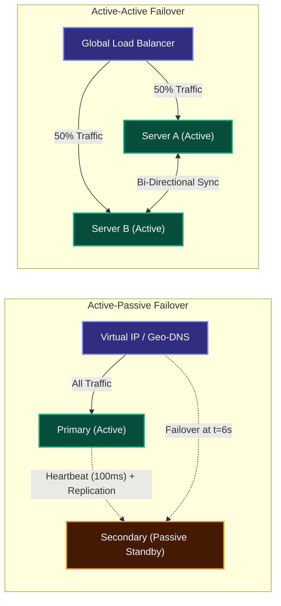

| Failover Mode | Resource Utilization | Failover Speed | Complexity & Risks |
| :--- | :--- | :--- | :--- |
| **Active-Passive** | Standby sits idle for writes | Seconds (e.g., 5s timeout + VIP/DNS switch) | Split-brain, false positives on network jitter, async data loss |
| **Active-Active** | 100% active (no idle capacity) | Near-instant (remove failed node from pool) | Distributed consensus, write conflicts, higher operational overhead |

> [!IMPORTANT]
> Most real-world outages stem not from the initial node failure, but from **failover bugs** (split-brain, thundering herds, or untested promotion scripts). Always test automated failover in staging or chaos-engineering drills.

### Heartbeat Mechanism & Failure Detection

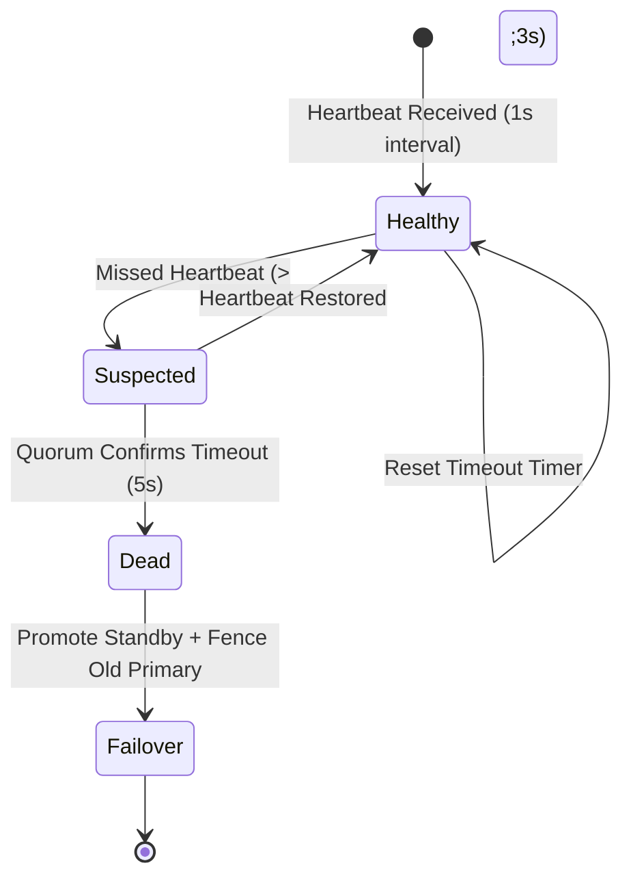

- **Payload:** Periodic (every `1s`) JSON heartbeat `{server_id, timestamp, healthy, seq_num}` over a dedicated network interface separate from the data path.
- **Challenges:**
  1. **False Positives:** Network jitter triggers unnecessary failover → solve with **quorum** (e.g., 2 of 3 nodes must declare death).
  2. **Cascading Failures:** Asymmetric network partitions trigger simultaneous failovers → solve with **consensus** (Raft/Paxos) and fencing (STONITH).
  3. **Timeout Tuning:** Too short causes false positives; too long inflates downtime (typical: `1s` interval, `3–5s` timeout).
- **Best Practices:** Exponential backoff on retries, randomized **jitter** to prevent thundering herds, dedicated heartbeat NICs, and continuous monitoring of heartbeat loss rate/latency.

> [!WARNING]
> Never promote a standby node without **fencing** the old primary (revoking its lease or network access); otherwise, a temporarily partitioned primary can wake up and corrupt data.

---

## Recovery and Durability

Recovery and durability define how much data and time a system can afford to lose during a disaster, and the storage mechanisms that guarantee committed writes survive crashes.

### RPO vs RTO

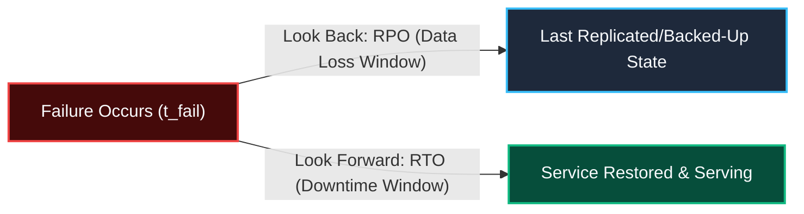

- **RPO (Recovery Point Objective):** Maximum acceptable data loss measured in time.
- **RTO (Recovery Time Objective):** Maximum acceptable downtime to restore service.

| Target Tier | RPO Mechanism | RTO Mechanism | Relative Cost |
| :--- | :--- | :--- | :--- |
| **Basic (`RPO 24h / RTO 4h`)** | Nightly backups | Manual restore scripts | `1x` (Cheap) |
| **Standard (`RPO 1h / RTO 1h`)** | Hourly snapshots | Automated recovery + alerts | `3x` (Medium) |
| **High (`RPO 1–5m / RTO 5–15m`)** | Continuous async replication | Hot standby + automated failover | `5x` (Expensive) |
| **Mission-Critical (`RPO 0 / RTO 0`)** | Synchronous multi-site replication | Redundant active-active + instant routing | `10x` (Very Expensive) |

### Checkpointing and Recovery
Long-running batch jobs (e.g., processing `1M` items over 1 hour) save periodic checkpoints to durable storage (Database, HDFS, or S3—never in-memory) so a crash at item `500K` resumes at `500K + 1` instead of restarting from `0`.

```python
def process_items(items):
    checkpoint = load_checkpoint()
    start_index = checkpoint.last_item_id + 1

    for i in range(start_index, len(items)):
        process(items[i])
        if i % 10000 == 0:
            save_checkpoint(i)  # Persist every 10K items (1-5% of total time)
```

> [!TIP]
> Aim for a checkpoint interval equal to **1–5% of total job duration**—frequent enough to bound rework on crash, infrequent enough to avoid write amplification.

### Write-Ahead Logging (WAL)

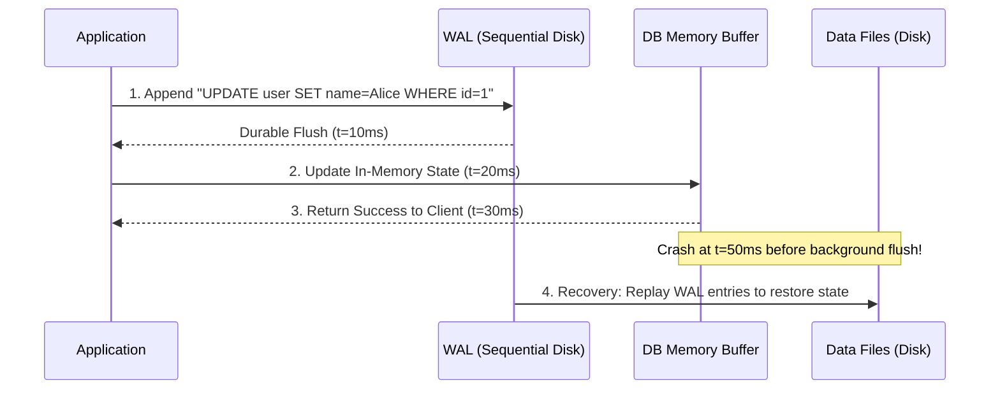

- **Why WAL:** Without WAL, updating memory at `t=0ms` and crashing at `t=50ms` before the `t=100ms` disk flush loses the committed update.
- **Pros:** Guarantees durability before client ACK, fast sequential disk I/O, and simple crash recovery via log replay.
- **Cons:** Disk I/O overhead per write unless batched, potential log-disk bottleneck, and requires log rotation/compaction.
- **Best Practices:** Batch log flushes, use SSDs, separate log disk from data disk for parallel I/O, and archive/rotate old logs.

> [!IMPORTANT]
> Checkpoints and WALs only provide durability if flushed (`fsync`) to **persistent storage** (local SSD, replicated DB, or object storage). In-memory buffers vanish on power loss.

---

## Distributed Consensus

When multiple servers must agree on a single source of truth (e.g., Master A has `balance = 100` vs Master B `balance = 150`, or electing a single leader), **distributed consensus** prevents data corruption and split-brain.

### Raft State Machine & Log Replication

> [!IMPORTANT]
> Never implement custom consensus or leader-election protocols from scratch. Use battle-tested Raft/Paxos systems like **etcd**, **Consul**, **ZooKeeper**, or **CockroachDB**.

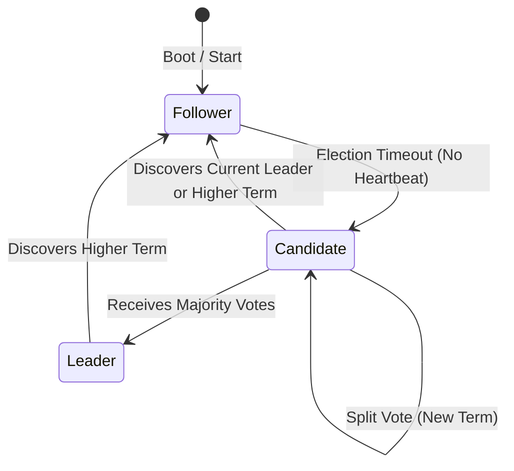

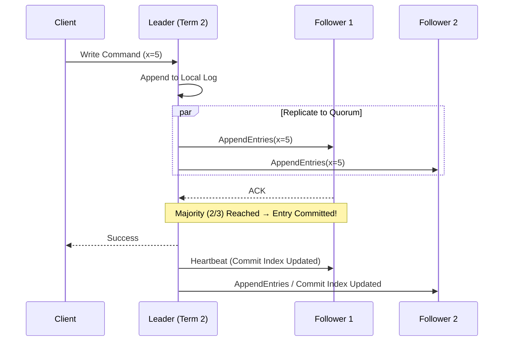

### Paxos vs Raft

| Dimension | Paxos | Raft |
| :--- | :--- | :--- |
| **Core Mechanism** | Two-phase: **Stage 1 (Prepare/Promise)** + **Stage 2 (Accept/Accepted)** | **Leader Election** + **Log Replication** with monotonic terms |
| **Understandability** | Notoriously complex, many edge cases | Designed for clarity and teachability |
| **Safety** | Provably safe across network partitions | Only 1 leader/term; majority log before commit; never loses committed entries |
| **Fault Tolerance** | Tolerates `(N - 1) / 2` failures | `3` nodes → 1 failure; `5` nodes → 2 failures; `7` nodes → 3 failures |
| **Production Usage** | Google Chubby, Apache Cassandra (LWT) | `etcd` (Kubernetes), Consul, CockroachDB |

> [!WARNING]
> Always deploy consensus clusters with an **odd number of nodes** (`3`, `5`, or `7`). A 4-node cluster has the exact same fault tolerance (`1` failure) as a 3-node cluster while requiring a larger quorum (`3` vs `2`).

---

## Backpressure and Load Shedding

When downstream services or databases slow down, unbounded request queues exhaust memory and cause cascading latency spikes across the entire system. **Backpressure** and **load shedding** protect system stability under overload.

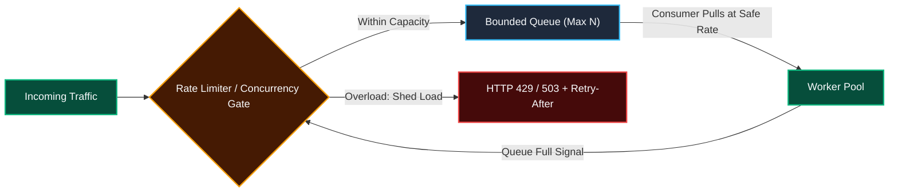

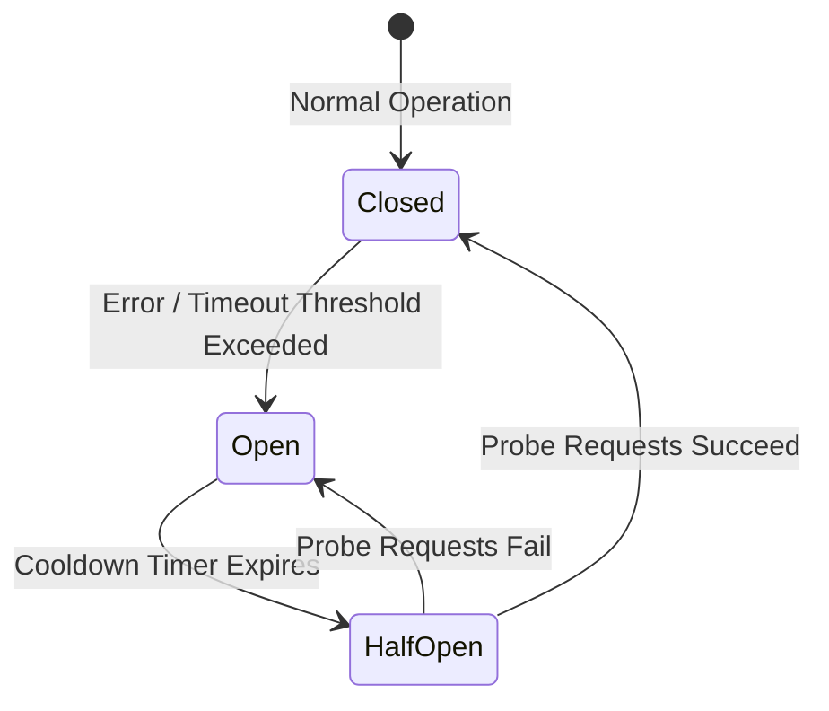

- **Backpressure (Slow Down Upstream):** Propagate congestion signals upstream using bounded queues, TCP flow control, reactive streams (pull-based demand), or adaptive concurrency limits (AIMD).
- **Load Shedding (Drop Excess Work):** When capacity is saturated, immediately reject low-priority requests (returning `HTTP 429 Too Many Requests` or `503 Service Unavailable` with `Retry-After`) so high-priority traffic succeeds with low latency.
- **Circuit Breakers:** Stop calling a failing downstream dependency (`Open` state) to prevent thread-pool exhaustion and allow recovery before probing again (`Half-Open`).

> [!WARNING]
> Unbounded queues are a reliability anti-pattern: they hide overload until memory is exhausted or request latencies exceed client timeouts, causing clients to retry and amplify the outage (**retry storm**).

| Mechanism | Action Under Overload | Primary Goal | Example |
| :--- | :--- | :--- | :--- |
| **Bounded Queues** | Cap buffer size; block or reject when full | Prevent OOM crashes | Kafka consumer poll limits, fixed thread-pool queues |
| **Backpressure** | Signal producer to slow emission rate | Match producer rate to consumer capacity | gRPC flow control, Reactive Streams |
| **Load Shedding** | Drop excess/low-priority requests early | Preserve latency for admitted requests | Returning `503` at API Gateway |
| **Circuit Breaker** | Fail fast without calling degraded dependency | Prevent cascading thread exhaustion | Resilience4j, Envoy outlier detection |

> [!TIP]
> Pair load shedding with **randomized exponential backoff + jitter** on clients so rejected callers do not synchronize and overwhelm the server again simultaneously.

---

## Key Takeaways


1. **Scale horizontally** when possible (more commodity servers, not bigger single servers).
2. **Keep compute stateless** by externalizing session data to Redis or shared stores.
3. **Redundancy is essential** — a single server is a guaranteed point of failure.
4. **Replication strategy matters** (sync vs async vs semi-sync; master-replica vs master-master).
5. **Failover needs testing** — most outages stem from failover bugs, split-brain, or missing fencing.
6. **Consensus is hard** — use proven libraries (`Raft`, `etcd`, `Consul`), never home-grown protocols.
7. **RPO and RTO** directly drive infrastructure architecture and cost (`1x` to `10x`).
8. **Checkpointing, WAL, and Backpressure** enable fast crash recovery and prevent cascading overload.

> [!TIP]
> In system design interviews, always tie your reliability choices back to explicit **RPO/RTO targets**, **SLA nines** (`99.9%` vs `99.999%`), and **graceful degradation** under load.
