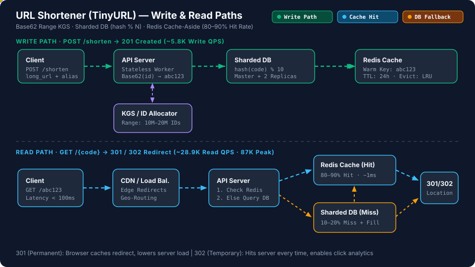
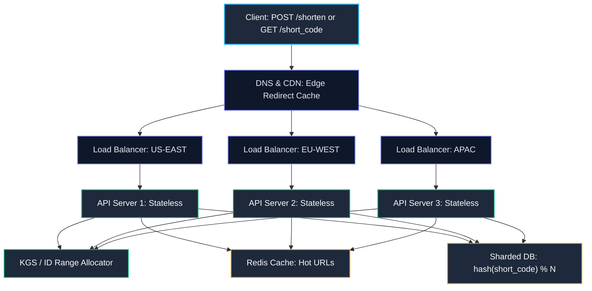
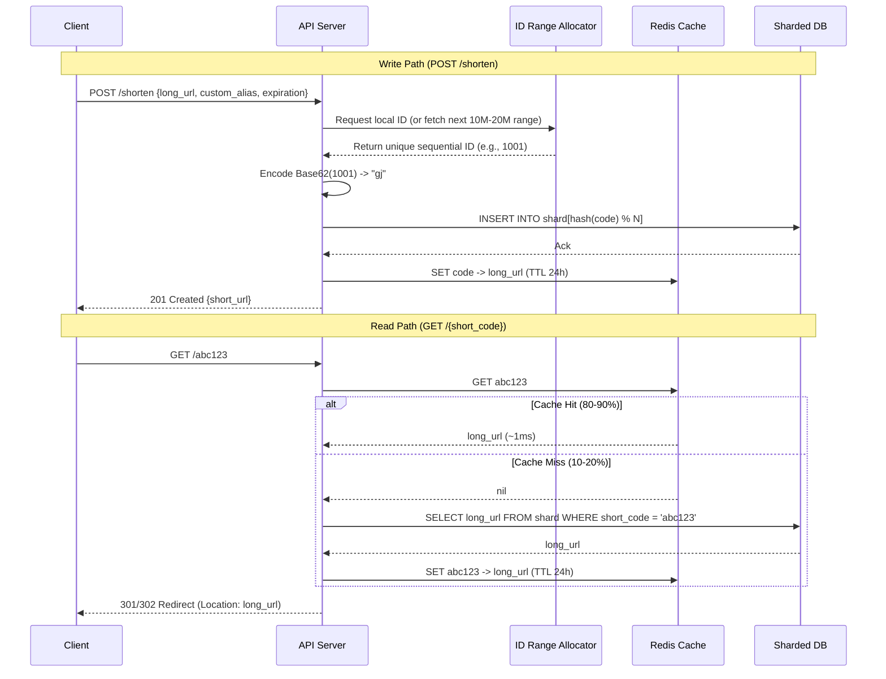
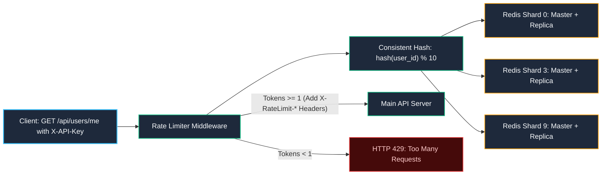
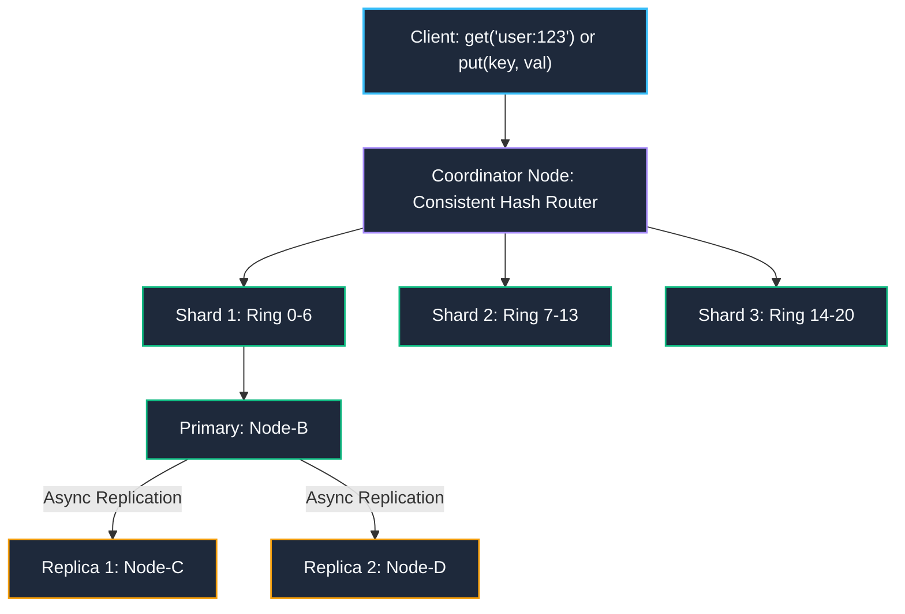
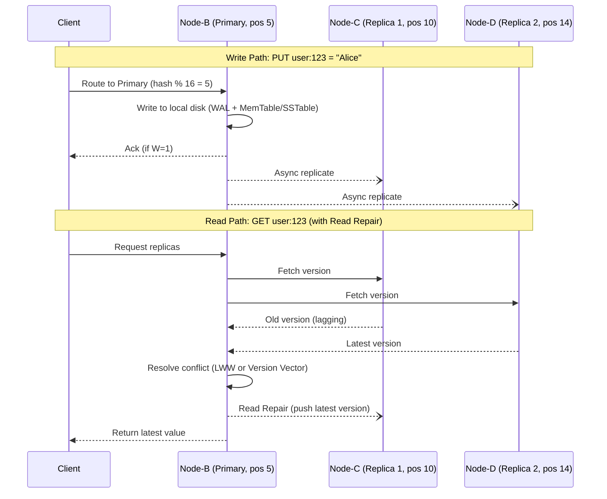
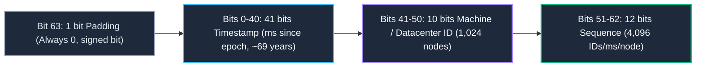
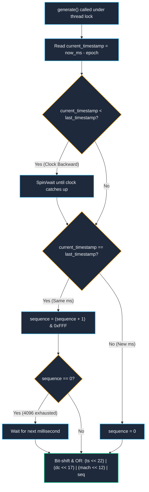
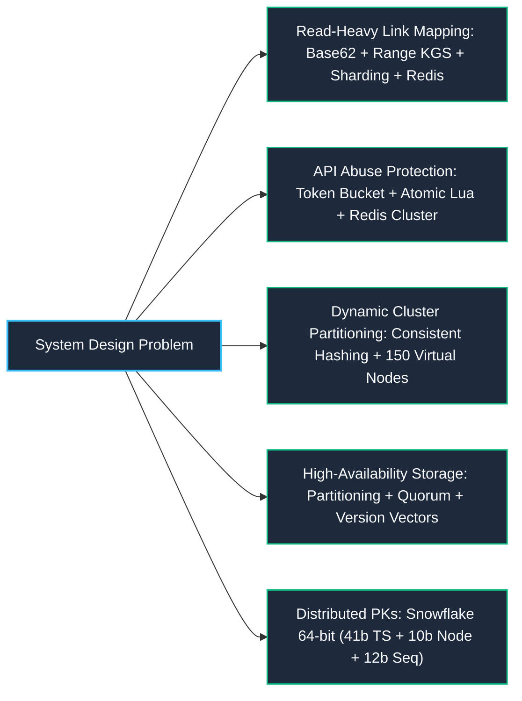

# Classic System Designs

## Table of Contents
1. [URL Shortener](#url-shortener)
2. [Rate Limiter](#rate-limiter)
3. [Consistent Hashing](#consistent-hashing)
4. [Key-Value Store](#key-value-store)
5. [Unique ID Generator](#unique-id-generator)
6. [Key Takeaways](#key-takeaways)

---

## URL Shortener

Design a URL shortening service like TinyURL. Users can shorten long URLs, and others can access the original URL via the short link.



### Requirements

**Functional:**
- Users submit a long URL → receive a short URL
- Users access a short URL → redirect to the original long URL
- Optional: Custom aliases, expiration timestamps, and click analytics

**Non-Functional (Twitter / TinyURL Scale):**
- **DAU:** 100M daily active users
- **Write Load:** 500M URLs shortened/day (5,787 write QPS)
- **Read Load:** 2B–2.5B accesses/day (23,148–28,935 read QPS; read-heavy)
- **Latency:** Redirect `&lt; 100ms` for crisp user experience
- **Availability:** 99.9% uptime
- **Durability:** URLs never expire unless explicitly configured
- **Retention:** Scale for 10+ years of data

### Back-of-Envelope Estimation

| Metric | Calculation | Result |
|---|---|---|
| **DAU** | 100M users/day | 100M |
| **Writes / Day** | 100M × 5 short URLs/user/day | 500M URLs/day |
| **Redirects / Day** | 500M × 5 redirects (or 2B–2.5B total accesses/day) | 2.5B accesses/day |
| **Write QPS** | 500M / 86,400 sec | ~5,787 QPS |
| **Read QPS** | 2.5B / 86,400 sec (avg) · 3× peak | ~28,935 QPS (~87K peak) |
| **Entry Size** | `short_url` (12B) + `original_url` (500B) + `created_at` (8B) + `metadata` (200B) | ~720 bytes/entry |
| **10-Year Storage** | 500M × 720B × 365 × 10 = 1.3 PB raw · 3× replication = 3.9 PB | ~5 PB (with indexes) |
| **Write Bandwidth** | 5,787 QPS × 500 bytes | 2.9 MB/s |
| **Read Bandwidth** | 28,935 QPS × 300 bytes (redirect response) | 8.7 MB/s |

### High-Level Architecture



### Request Flow: Write & Read Paths



> [!IMPORTANT]
> **301 vs 302 Redirect:** Use `301 Moved Permanently` when minimizing server load is the priority (browsers cache the redirect). Use `302 Found` (temporary) when you need accurate click analytics, since every access still hits your servers.

### API Design

1. **Shorten URL**
```http
POST /shorten
Content-Type: application/json

Request:
{
  "long_url": "https://example.com/very/long/path?query=value",
  "custom_alias": "my-code",  // optional
  "expiration": "2025-12-31"  // optional
}

Response (201 Created):
{
  "short_url": "https://tinyurl.com/abc123",
  "short_code": "abc123",
  "long_url": "https://example.com/very/long/path?query=value",
  "created_at": "2024-01-15T10:30:00Z",
  "expires_at": "2025-12-31T23:59:59Z"
}
```

2. **Redirect to Original URL**
```http
GET /{short_code}
Host: tinyurl.com

Response (301 Moved Permanently):
Location: https://example.com/very/long/path?query=value
Cache-Control: public, max-age=3600  // Cache redirect for 1 hour
```

3. **Get URL Details**
```http
GET /{short_code}/info

Response (200 OK):
{
  "short_code": "abc123",
  "short_url": "https://tinyurl.com/abc123",
  "long_url": "https://example.com/...",
  "created_at": "2024-01-15T10:30:00Z",
  "clicks": 1523,
  "unique_clicks": 892
}
```

### Data Model

**URL Mapping Table:**

| `short_id` (PK) | `short_code` (UNIQUE) | `long_url` | `created_at` (INDEX) | `expires_at` (INDEX) |
|---|---|---|---|---|
| `1001` | `abc123` | `https://example.com/...` | `2024-01-15` | `2025-12-31` |
| `1002` | `xyz789` | `https://google.com/...` | `2024-01-16` | `NULL` |
| `1003` | `my-code` | `https://github.com/...` | `2024-01-17` | `2026-01-17` |

- **Primary Key:** `short_id`
- **Unique Index:** `short_code` (fast lookup by code)
- **Secondary Indexes:** `created_at` (analytics), `expires_at` (cleanup/expiration)

**Analytics Table (Optional):**

| `short_id` | `timestamp` | `user_agent` | `ip` | `referer` |
|---|---|---|---|---|
| `1001` | `2024-01-15T10:35:00Z` | `Mozilla/5.0...` | `127.0.0.1` | `google.com` |

### Deep Dive: Short Code Generation

| Approach | Mechanism | Space / Capacity | Pros | Cons |
|---|---|---|---|---|
| **Base62 Encoding (Recommended)** | Incrementing ID → Base62 (`0-9, a-z, A-Z`) | 6 chars = `62^6` (~57B, ~114 days at 5,787 QPS); 7+ chars = 362T+ | Deterministic, zero collisions, compact, reversible (`gj` → `1001`) | Predictable sequential IDs; needs distributed range allocator |
| **MD5 Hash** | `MD5(long_url)[0:6]`, extend length on collision | 6 hex chars = `16^6` (4.3B); birthday paradox ~65K–98K URLs | Same URL → same code, unpredictable, no central counter | Collisions require DB check + extending slice (`[0:7]`, `[0:8]`) |
| **Random Generation** | Random 6-char Base62 + DB uniqueness check | `62^6` (~57B) | Unpredictable, simple, multi-instance friendly | Non-deterministic; retry storms as keyspace fills (90% full ≈ 10 retries; 99% ≈ 100 retries) |

#### Option 1: Base62 Encoding (Example)
```text
ID 1001 in base62:
1001 / 62 = 16 remainder 9   → 'j' (9)
16 / 62   = 0  remainder 16  → 'g' (16)
Result: "gj" (reverse order)

Decode: 'g' = 16, 'j' = 9 → 16 * 62 + 9 = 1001
Query:  SELECT * FROM urls WHERE short_id = 1001
```

#### Option 2: MD5 Hash with Collision Extension
```python
def generate_short_code(long_url):
    for length in range(6, 12):
        hash_value = hashlib.md5(long_url.encode()).hexdigest()
        short_code = hash_value[:length]
        if not exists_in_db(short_code):
            return short_code
    raise Exception("Too many collisions")
```

> [!WARNING]
> **Birthday Paradox & Retry Amplification:** With 6 hex characters (`16^6 = 4.3B`), `sqrt(4.3B) ≈ 65,000` URLs already produce a high collision probability. Similarly, random generation degrades exponentially as the keyspace fills (at 99% full, ~100 DB retries per insert). Prefer Base62 with 7+ characters (`62^7 ≈ 3.5T`) and range allocation.

### Scaling Considerations

- **ID Counter Bottleneck → Range Allocation:** Instead of a single global counter on every write, an **ID Allocator DB** (`min_range`, `max_range`, `next_range_start`) assigns disjoint blocks (e.g., Server 1 gets `1–10M`, Server 2 gets `10M+1–20M`, Server 3 gets `20M+1–30M`). Servers increment locally in memory with zero lock contention and only call the allocator when a range is exhausted.
- **Database Sharding:** A single DB maxes at ~10K QPS. Shard by `shard_id = hash(short_code) % num_shards`. With 10 shards, each shard handles ~3K write QPS (Master) and ~30K read QPS across 2 Read Replicas.
- **Cache Layer (Redis):** Traffic follows a Pareto distribution (80% of clicks hit 20% of URLs). Cache-aside with a 24h TTL achieves an 80–90% hit rate, cutting 30K read QPS down to ~3K DB QPS (87% reduction).

> [!TIP]
> **Preventing Predictability with Base62:** If sequential IDs expose business metrics or allow scraping, XOR the sequential ID with a secret bitmask or shuffle the Base62 alphabet per deployment—preserving zero collisions while hiding sequence order.

---

## Rate Limiter

Design a rate limiting service (like Stripe or AWS API Gateway) that limits users to `X` requests per time window.

### Requirements

**Functional:**
- Allow `X` requests per user per time window
- Return `429 Too Many Requests` when the limit is exceeded
- Support tiered limits per user/plan (Basic, Standard, Premium)
- Work consistently across distributed API servers

**Non-Functional:**
- **Latency:** `&lt; 1ms` overhead per check
- **Throughput:** Millions of checks/sec across the fleet
- **Accuracy:** Minimal false positives/negatives
- **Durability:** No loss of rate limit state on single-node failure

### Estimation & Tier Limits

| Metric / Tier | Value | Notes |
|---|---|---|
| **Daily Volume** | 1B API requests/day | Across 10M users (~1,000 req/user/hr avg) |
| **Baseline / Peak QPS** | 11,574 QPS avg · 35,000 QPS peak (3×) | Must complete check in `&lt; 1ms` |
| **Basic Tier** | 1,000 requests / hour | `capacity = 1000`, `window = 3600s` |
| **Standard Tier** | 10,000 requests / hour | `capacity = 10000`, `window = 3600s` |
| **Premium Tier** | 100,000 requests / hour | `capacity = 100000`, `window = 3600s` |

### High-Level & Distributed Architecture



### Token Bucket Request Flow (Atomic Lua)

```mermaid
sequenceDiagram
    participant Client
    participant RL as Rate Limiter
    participant Redis as Redis Shard (Lua)
    participant API as Main API Server

    Client->>RL: Request + X-API-Key
    RL->>RL: Lookup user tier policy (capacity, refill_rate)
    RL->>Redis: EVAL lua_token_bucket(key, now, needed)
    Note over Redis: 1. HGETALL rate_limit:{user_id} · 2. Refill = (now - last_refill) * rate · 3. Clamp to capacity &amp; HSET
    Redis-->>RL: {allowed, tokens_remaining, reset_time}
    alt allowed == true
        RL->>API: Forward request
        API-->>RL: 200 OK
        RL-->>Client: 200 OK + X-RateLimit-Limit / Remaining / Reset
    else allowed == false
        RL-->>Client: 429 Too Many Requests
    end
```

### Implementation: Token Bucket with Redis

**Recommendation: Token Bucket** — allows controlled bursts, smooths traffic, and is the industry standard (AWS, Google, Stripe).

- **Redis Hash Key:** `rate_limit:{user_id}`
- **Fields:** `tokens`, `last_refill` (unix timestamp), `capacity`, `refill_rate` (tokens/sec)
- **Response Headers (when allowed):** `X-RateLimit-Limit: 1000`, `X-RateLimit-Remaining: 487`, `X-RateLimit-Reset: 1234567890`

```python
def check_rate_limit(user_id, tokens_needed=1):
    key = f"rate_limit:{user_id}"
    current_time = time.time()

    # Get current state
    state = redis.hgetall(key)
    if not state:  # First time user
        state = {
            "tokens": capacity,
            "last_refill": current_time,
            "capacity": 100,
            "refill_rate": 10
        }

    # Calculate tokens to add since last refill
    time_passed = current_time - float(state["last_refill"])
    tokens_to_add = time_passed * float(state["refill_rate"])
    tokens = min(float(state["capacity"]),
                 float(state["tokens"]) + tokens_to_add)

    # Check if request allowed
    if tokens >= tokens_needed:
        tokens -= tokens_needed
        allowed = True
    else:
        allowed = False

    # Update state (atomic with Lua script)
    lua_script = """
    redis.call('HSET', KEYS[1], 'tokens', ARGV[1])
    redis.call('HSET', KEYS[1], 'last_refill', ARGV[2])
    return {ARGV[1], ARGV[3]}
    """
    result = redis.eval(lua_script, 1, key, tokens, current_time, allowed)

    return {
        "allowed": allowed,
        "tokens_remaining": result[0],
        "reset_time": current_time + (state["capacity"] - tokens) / state["refill_rate"]
    }
```

**Multi-User Tier Routing:**
```python
api_keys = {
    "api_key_user1": {"tier": "basic"},
    "api_key_user2": {"tier": "standard"},
    "api_key_user3": {"tier": "premium"}
}

rate_limits = {
    "basic": {"capacity": 1000, "window": 3600},
    "standard": {"capacity": 10000, "window": 3600},
    "premium": {"capacity": 100000, "window": 3600}
}

def check_rate_limit(api_key):
    user_tier = api_keys[api_key]["tier"]
    limit = rate_limits[user_tier]
    return check_token_bucket(api_key, limit)
```

> [!IMPORTANT]
> **Atomicity via Lua:** Performing `HGETALL` in application code followed by `HSET` introduces a read-modify-write race condition under concurrency. Executing the entire read-refill-decrement-write inside a Redis Lua script guarantees single-threaded atomic execution on the Redis server.

### Distributed Scaling Comparison

| Strategy | Architecture | Capacity at 35K QPS | Trade-Offs |
|---|---|---|---|
| **Centralized Single Redis** | All API servers query 1 Redis instance | Overloaded at 35K+ QPS | Single source of truth, but single bottleneck & SPOF |
| **Redis Cluster (Recommended)** | Partition by `user_id` via consistent hashing (`hash("123") % 10`) | 10 nodes = 3.5K QPS & 100M users/node | Scales linearly; each shard has Master + 1 Replica for failover |
| **Local In-Memory Counters** | Per-server counters synced periodically | Highest speed (`&lt; 0.1ms`) | Eventual consistency; users can bypass limits across servers |

> [!WARNING]
> **Fail-Open vs Fail-Closed:** If a Redis shard becomes unreachable, decide upfront whether to **fail-open** (allow traffic through to protect availability) or **fail-closed** (reject with 429/503 to protect downstream databases from overload).

---

## Consistent Hashing

See the Building Blocks section for conceptual theory. Consistent hashing minimizes key remapping when nodes join or leave a distributed cluster.

### Virtual Node Ring & Lookup Flow


### Modulo Hashing vs Consistent Hashing

| Strategy | Key Mapping Formula | Keys Moved on Add/Remove Node | Hot-Spot Risk |
|---|---|---|---|
| **Modulo Hashing** | `hash(key) % N` | `~ (N - 1) / N` (almost 100% of keys!) | Low if hash is uniform |
| **Basic Consistent Hashing** | Clockwise on `2^32` ring | `~ 1 / N` keys | High with few physical nodes (uneven arcs) |
| **Virtual Nodes (150+ vnodes)** | `hash(f"{node_id}:v{i}") % 2^32` | `~ 1 / N` keys | Very low; load balances smoothly across nodes |

### Implementation

```python
class ConsistentHash:
    def __init__(self, num_virtual_nodes=150):
        self.ring = {}  # position -> node_id
        self.sorted_positions = []
        self.num_virtual_nodes = num_virtual_nodes

    def add_node(self, node_id):
        for i in range(self.num_virtual_nodes):
            virtual_key = f"{node_id}:v{i}"
            position = hash(virtual_key) % (2**32)
            self.ring[position] = node_id
            self.sorted_positions.append(position)

        self.sorted_positions.sort()

    def remove_node(self, node_id):
        for i in range(self.num_virtual_nodes):
            virtual_key = f"{node_id}:v{i}"
            position = hash(virtual_key) % (2**32)
            del self.ring[position]
            self.sorted_positions.remove(position)

    def get_node(self, key):
        if not self.ring:
            return None

        position = hash(key) % (2**32)

        # Find next position >= key's position (clockwise)
        for ring_pos in self.sorted_positions:
            if ring_pos >= position:
                return self.ring[ring_pos]

        # Wrap around (no position >= key found)
        return self.ring[self.sorted_positions[0]]

    def get_replicas(self, key, num_replicas=3):
        """Get N replicas for this key (for replication)"""
        replicas = []
        seen = set()

        position = hash(key) % (2**32)

        for ring_pos in self.sorted_positions:
            if ring_pos >= position:
                node = self.ring[ring_pos]
                if node not in seen:
                    replicas.append(node)
                    seen.add(node)
                if len(replicas) == num_replicas:
                    break

        # Wrap around if needed
        for ring_pos in self.sorted_positions:
            node = self.ring[ring_pos]
            if node not in seen:
                replicas.append(node)
                seen.add(node)
            if len(replicas) == num_replicas:
                break

        return replicas
```

> [!TIP]
> **Binary Search & Distinct Physical Replicas:** In production, replace the linear scan over `sorted_positions` with `bisect.bisect_left` for `O(log(V * N))` lookup. Also, always track a `seen` set of physical `node_id`s when walking the ring for replicas so multiple virtual nodes of the same physical server are not chosen as separate replicas.

---

## Key-Value Store

Design a distributed key-value store like DynamoDB or Cassandra.

### Requirements

**Functional:**
- `get(key)` → `value`
- `put(key, value)`
- `delete(key)`
- Distributed across multiple servers

**Non-Functional:**
- **Availability:** 99.99% (always writable/readable)
- **Scalability:** Hundreds of TB across commodity nodes
- **Consistency:** Eventual consistency (tunable via quorums)
- **Durability:** Persistent storage with multi-node replication

### Partitioned & Replicated Architecture



### Partitioning, Write Path & Quorum Read Flow

With a simplified 16-position ring (`Node-A: 0`, `Node-B: 5`, `Node-C: 10`, `Node-D: 14`), `hash("user:123") % 16 = 5` maps to **Node-B (Primary)**, with **Node-C (Replica 1)** and **Node-D (Replica 2)** clockwise.



> [!TIP]
> **Quorum Tuning (`N, W, R`):** For `N = 3` replicas, setting `W + R > N` (e.g., `W = 2, R = 2`) guarantees at least one overlapping node holds the latest write for strong read consistency, while `W = 1, R = 1` maximizes availability and speed.

### Conflict Resolution Strategies

During a network partition, `Node-B` receives a write at `t=100ms` while `Node-C` does not receive it until `t=200ms`. A read from `Node-C` at `t=150ms` sees stale data.

| Strategy | How It Works | Pros | Cons |
|---|---|---|---|
| **Last-Write-Wins (LWW)** | Attach wall-clock timestamp; highest timestamp wins | Simple, zero client complexity | Broken if clocks drift; silently drops concurrent writes |
| **Version Vectors** | Track causal history `[Node-B: 5, Node-C: 3] > [Node-B: 4, Node-C: 3]` | Detects concurrent vs sequential updates accurately | Vector size grows with nodes; needs sibling resolution |
| **Application-Level Merging** | Store and return all conflicting sibling versions to client | Preserves all updates (e.g., merging shopping cart items) | Pushes conflict logic into application code |
| **Read Repairs** | On read, compare all replicas and push latest version to lagging nodes | Self-healing eventual consistency without background scans | Adds latency/bandwidth to read path |

> [!WARNING]
> **Clock Skew in LWW:** Because physical wall clocks across servers are never perfectly synchronized (even with NTP), Last-Write-Wins can discard a newer write if the receiving node's clock lags behind another node.

---

## Unique ID Generator

Design a distributed service that generates globally unique, time-sortable 64-bit IDs (like Twitter Snowflake).

### Requirements

**Functional:**
- Generate globally unique 64-bit integer IDs
- IDs sortable by creation timestamp
- Zero runtime coordination between generator nodes
- Fast generation (`&lt; 1ms`)

**Non-Functional:**
- Distributed (no single server bottleneck)
- High throughput (millions of IDs/sec)
- Zero collisions

### Snowflake 64-Bit ID Format



**Bit Breakdown:**
- **Timestamp (41 bits):** Milliseconds since custom epoch (`2^41` = ~2.2 trillion ms = **69 years**, e.g., until 2089 from 2020)
- **Machine ID (10 bits):** Supports `2^10 = 1,024` machines (often split as 5-bit `datacenter_id` + 5-bit `machine_id`)
- **Sequence (12 bits):** Per-millisecond counter supporting `2^12 = 4,096` IDs/ms per machine (**4M IDs/sec per node**, **4B IDs/sec** across 1,000 nodes)
- **Padding (1 bit):** Unused sign bit kept as `0`

> [!IMPORTANT]
> **B-Tree Index Locality:** Because Snowflake IDs are monotonically increasing by timestamp, inserting them into clustered B-Tree indexes (MySQL InnoDB, Postgres) appends to the right edge of the index, avoiding random page splits caused by UUID v4.

### Clock & Sequence Overflow Handling



### Implementation

```python
import time
import threading

class SnowflakeIDGenerator:
    def __init__(self, machine_id, datacenter_id):
        self.machine_id = machine_id & 0x3FF  # 10 bits
        self.datacenter_id = datacenter_id & 0x1F  # 5 bits
        self.sequence = 0
        self.last_timestamp = 0
        self.lock = threading.Lock()

        # Epoch: 2020-01-01 00:00:00 UTC (in ms)
        self.epoch = 1577836800000

    def generate(self):
        with self.lock:
            current_timestamp = int(time.time() * 1000) - self.epoch

            if current_timestamp < self.last_timestamp:
                # Clock went backwards (system time adjusted)
                # Wait for clock to catch up
                while current_timestamp < self.last_timestamp:
                    current_timestamp = int(time.time() * 1000) - self.epoch

            if current_timestamp == self.last_timestamp:
                # Same millisecond: increment sequence
                self.sequence = (self.sequence + 1) & 0xFFF  # 12 bits
                if self.sequence == 0:
                    # Sequence overflow: wait for next millisecond
                    while current_timestamp == self.last_timestamp:
                        current_timestamp = int(time.time() * 1000) - self.epoch
            else:
                # New millisecond: reset sequence
                self.sequence = 0

            self.last_timestamp = current_timestamp

            # Construct ID
            id = (current_timestamp << 22) | \
                 (self.datacenter_id << 17) | \
                 (self.machine_id << 12) | \
                 self.sequence

            return id

# Usage:
generator = SnowflakeIDGenerator(machine_id=1, datacenter_id=1)
user_id = generator.generate()  # Returns unique 64-bit integer
```

### ID Generation Trade-Offs

| Approach | Size | Time-Sortable | Coordination | Collision Risk |
|---|---|---|---|---|
| **Snowflake (Recommended)** | 64-bit int | Yes (ms precision) | None at runtime | None (unique `(machine_id, seq)`) |
| **UUID v4** | 128-bit string/bytes | No (random) | None | Negligible, but fragments B-Tree DB indexes |
| **DB Auto-Increment** | 64-bit int | Yes | Central DB lock | None, but SPOF & write bottleneck |
| **Timestamp + Random** | 64–128 bits | Partially | None | Possible under high concurrency |

> [!WARNING]
> **NTP Clock Jumps:** If NTP steps the system clock backward, Snowflake waits until `current_timestamp >= last_timestamp` to prevent duplicate IDs. Monitor NTP drift closely and alert on abnormal clock adjustments.

---

## Key Takeaways



| System | Primary Bottleneck | Core Pattern | Scaling Mechanism | Key Trade-Off |
|---|---|---|---|---|
| **URL Shortener** | Read QPS (28.9K–87K) & ID generation | Base62 + Range KGS | `hash(code) % N` shards + Redis (80–90% hit) | `301` (cacheable) vs `302` (analytics) |
| **Rate Limiter** | Sub-millisecond atomic checks | Token Bucket + Redis Lua | Redis Cluster sharded by `user_id` | Fail-open (availability) vs fail-closed (safety) |
| **Consistent Hashing** | Mass key reshuffling on resize | `2^32` hash ring | 150+ virtual nodes per physical server | `O(log N)` lookup vs uniform load balance |
| **Key-Value Store** | Partitioning & replication conflicts | Consistent ring + Quorums | Master + async replicas + Read Repair | LWW simplicity vs Version Vector accuracy |
| **Unique ID Generator** | Central DB auto-increment lock | 64-bit Snowflake format | Independent node generation (4M IDs/s/node) | NTP clock dependency vs lock-free speed |

> [!TIP]
> **Interview Framing:** Always anchor your design on the bottleneck first—state the read/write QPS ratio, storage over 5–10 years, and the single point of failure before choosing a pattern. Each system has trade-offs; know the constraints and choose wisely!
